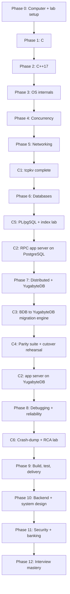

# Systems Mastery Course

A from-zero, hands-on course that turns every line of the learner's resume into something they have personally built, measured and can defend in an interview.

Learner: MD Shakir Khan. Resume source: [Shakir_Resume_CPP.tex](Shakir_Resume_CPP.tex) and [Shakir_Resume_CPP.pdf](Shakir_Resume_CPP.pdf).

## How this course works

- Every module is one Markdown file in this repo. Read it on GitHub, in the GitHub app, or in VS Code.
- The course assumes **zero** programming knowledge. Phase 0 starts with what a CPU is. Nothing is skipped.
- Each topic follows the same shape: intuition, analogy, why it exists, three layers of depth (beginner, working engineer, internals), a diagram, compilable code, a core-banking use case, a lab you run, common mistakes, the resume link, five interview questions, and a three-line revision summary.
- Six capstones recreate the resume claims as real projects. You write the code; starter files and tests come first, and reference solutions live under `solutions/` so you can attempt each lab before looking.
- After every lab you write a short journal entry in `journal/` using [journal/TEMPLATE.md](journal/TEMPLATE.md). These entries become your interview stories.
- To move forward, reply `NEXT`. One module is written per step, committed and pushed.

## Honest time estimate

| Item | Hours |
|---|---|
| Phase 0: How a computer runs a program + lab setup | 21 |
| Phase 1: C from zero to systems level | 54 |
| Phase 2: C++17 from zero to modern C++ | 68 |
| Phase 3: OS internals (Linux and Windows) | 51 |
| Phase 4: Concurrency deep dive | 55 |
| Phase 5: Networking and servers | 43 |
| Phase 6: Databases from zero to internals | 75 |
| Phase 7: Distributed systems and YugabyteDB | 43 |
| Phase 8: Debugging, performance and reliability | 41 |
| Phase 9: Build, test and delivery | 35 |
| Phase 10: Backend fundamentals and system design | 36 |
| Phase 11: Security and banking context | 17 |
| Phase 12: Interview mastery | 30 |
| Capstones C1-C6 (build time on top of modules) | 180 |
| **Total** | **749** |

At 15 focused hours a week this is about 50 weeks. At 25 hours a week it is about 30 weeks. Starting from zero, that is realistic; shorter plans skip exactly the parts interviewers probe.

The resume notes a tcpkv target of 2026-11-09. From zero programming knowledge that date is not reachable with real understanding. A **tcpkv fast track** exists: Phases 0, 1 (modules 1-8, 12), 2 (modules 1-9, 16), 4 (modules 1-5, 10), 5 (modules 2-6, 11) and 9 (modules 1, 2, 4, 6) give the minimum to build and defend tcpkv honestly. That is roughly 150 hours, or about 8 weeks at 20 hours a week.

## Resume claims and where they are mastered

| Claim | What the resume says | Modules | Capstone |
|---|---|---|---|
| A | C, C++17, SQL, PL/pgSQL, Bash, Python | Phase 1, Phase 2, 6.02, 6.11, 9.08, 9.09 | all |
| B | RAII, smart pointers, move, templates, STL internals, patterns, ownership, UB, performance | 2.03-2.14 | C1, C2 |
| C | Threads, mutex, shared_mutex, condvars, atomics, memory model, thread pools, lock-free, Win32 sync | Phase 4 | C1, C2 |
| D | PostgreSQL, YugabyteDB, Berkeley DB, Redis, Oracle, SQL Server; storage, B-tree, MVCC, WAL, EXPLAIN, caching, replication | Phase 6, 7.07 | C3, C5 |
| E | Sockets, TCP/IP, RPC, HTTP, client-server, distributed SQL, sharding, replication, Raft, HA | Phase 5, Phase 7 | C1, C2, C4 |
| F | Crash/core dump analysis (WinDbg, GDB), Valgrind, ASan/TSan, corruption and leaks, triage, RCA | Phase 8 | C6 |
| G | Linux, GCC/Clang, CMake, GoogleTest, Git, Docker, GitHub Actions, Azure DevOps, Win32, MSVC, VS, MSBuild | Phase 0, Phase 9 | C1, C2 |
| H1 | C migration engine: cursor traversal, batched writes, arena allocator, restartable batches | 1.07, 1.14, 3.06, 6.13, 7.10 | C3 |
| H2 | Record-to-relational mapping, composite keys, set-based SQL | 1.07, 6.03, 6.09, 6.13 | C3 |
| H3 | Data-parity suite gating a zero-downtime cutover | 7.09, 7.10, 9.09 | C4 |
| H4 | Multithreaded RPC-over-TCP app server, sync layer, pooled requests, master-table cache | 4.10-4.13, 5.05-5.07, 6.12 | C2 |
| H5 | Crash-dump and live-incident debugging with formal RCA under SLA | 8.01-8.06, 8.09, 8.10 | C6 |
| H6 | PL/pgSQL layer centralising validation, authorisation, workflow | 6.11, 11.03 | C5 |
| H7 | Login-latency fix via composite and covering indexes from execution plans | 6.09, 6.10 | C5 |
| I | tcpkv: thread pool, text protocol, shared_mutex store, RAII fds, graceful shutdown, tests, sanitizers, CI | 2.16, 4.10, 5.03-5.06, 5.11, 9.01-9.06 | C1 |

## Capstone track

| Capstone | Project | Resume claim | Folder | When |
|---|---|---|---|---|
| C1 | tcpkv: multithreaded TCP key-value server | I | `capstones/tcpkv/` | After Phase 5 (parser in Phase 2, pool in Phase 4, CI in Phase 9) |
| C2 | Multithreaded RPC-over-TCP application server | H4 | `capstones/rpc-app-server/` | After Phase 6 on PostgreSQL; YugabyteDB backend after Phase 7; Win32 sync variant after 4.12 |
| C3 | Berkeley DB to YugabyteDB migration engine in C | H1, H2 | `capstones/bdb-migration-engine/` | After Phase 7 (arena built in 3.06, Berkeley DB in 6.13) |
| C4 | Data-parity suite and zero-downtime cutover rehearsal | H3 | `capstones/data-parity-cutover/` | After Phase 7 and C3 |
| C5 | PL/pgSQL stored-procedure layer and index tuning lab | H6, H7 | `capstones/plpgsql-index-lab/` | After Phase 6 |
| C6 | Crash-dump and RCA lab | H5 | `capstones/crash-rca-lab/` | After Phase 8 |

Each capstone ships with: the core-banking use case, a design document, step-by-step build instructions with exact commands and expected output, deliberate bugs to introduce and fix, numbers to measure, and a `RESUME-DEFENSE.md` written after completion.

## Recommended order



Capstones are built in pieces. The thread pool for tcpkv is built in module 4.10, the arena allocator for the migration engine in 3.06, and so on. The syllabus tables mark which capstone each module feeds.

## Full syllabus

Legend: **Must-know** marks topics interviewers for a 3-year C++ systems, database or backend role ask about directly. **Feeds** names the capstone the module contributes to.

### Phase 0: How a computer runs a program + lab setup

Folder: `phase-00-how-a-computer-runs-a-program/` (21 hours). Ends with `revision.md`, `quiz.md` and a teach-it-back session.

| Module | Topics | Hours | Feeds | Must-know |
|---|---|---|---|---|
| [0.01 What a computer actually does](phase-00-how-a-computer-runs-a-program/module-01-what-a-computer-does.md) | CPU, registers, RAM, binary and hex, instructions, clock, what a program is | 2 | all | yes |
| [0.02 The operating system, processes and files](phase-00-how-a-computer-runs-a-program/module-02-operating-system-processes-files.md) | kernel vs user programs, a process, a file, a path, permissions | 2 | all | yes |
| [0.03 The terminal and Bash basics](phase-00-how-a-computer-runs-a-program/module-03-terminal-and-bash-basics.md) | shell, commands, pipes, redirection, environment variables, scripts | 3 | all | - |
| [0.04 Linux lab setup](phase-00-how-a-computer-runs-a-program/module-04-linux-lab-setup.md) | WSL2 Ubuntu, GCC/Clang, CMake, GDB, Valgrind, Git, VS Code; first build | 4 | C1 | - |
| [0.05 Data lab setup](phase-00-how-a-computer-runs-a-program/module-05-data-lab-setup.md) | Docker, PostgreSQL, YugabyteDB (Docker), Berkeley DB (libdb), Redis, GoogleTest | 4 | C2-C5 | - |
| [0.06 Windows lab setup](phase-00-how-a-computer-runs-a-program/module-06-windows-lab-setup.md) | Visual Studio, MSVC, MSBuild, WinDbg, first Win32 build | 3 | C2, C6 | - |
| [0.07 Git from zero](phase-00-how-a-computer-runs-a-program/module-07-git-from-zero.md) | repository, commit, branch, merge, remote, push/pull, .gitignore, resolving conflicts | 3 | all | yes |

### Phase 1: C from zero to systems level

Folder: `phase-01-c-from-zero-to-systems/` (54 hours). Ends with `revision.md`, `quiz.md` and a teach-it-back session.

| Module | Topics | Hours | Feeds | Must-know |
|---|---|---|---|---|
| [1.01 Your first C program](phase-01-c-from-zero-to-systems/module-01-first-c-program.md) | source, compile, link, run; main(), printf, return codes | 3 | C3 | yes |
| [1.02 Variables, types and how numbers live in memory](phase-01-c-from-zero-to-systems/module-02-variables-types-and-memory.md) | int/char/float, sizeof, signed vs unsigned, two's complement, endianness, overflow | 3 | C3 | yes |
| [1.03 Control flow](phase-01-c-from-zero-to-systems/module-03-control-flow.md) | if/else, loops, switch, break/continue, boolean logic | 3 | - | - |
| [1.04 Functions and the call stack](phase-01-c-from-zero-to-systems/module-04-functions-and-the-call-stack.md) | parameters, return values, scope, stack frames, recursion, what a stack overflow is | 4 | C6 | yes |
| [1.05 Pointers](phase-01-c-from-zero-to-systems/module-05-pointers.md) | addresses, * and &, pointer arithmetic, NULL, pointers to pointers, dangling pointers | 5 | C3 | yes |
| [1.06 Arrays and strings](phase-01-c-from-zero-to-systems/module-06-arrays-and-strings.md) | arrays in memory, decay to pointer, C strings, buffer overflow, safe string handling | 4 | C3, C6 | yes |
| [1.07 Structs, unions and packed record layouts](phase-01-c-from-zero-to-systems/module-07-structs-unions-packed-layouts.md) | struct layout, padding and alignment, unions, bit fields, serialising a struct to bytes | 4 | C3 | yes |
| [1.08 Dynamic memory: malloc and free](phase-01-c-from-zero-to-systems/module-08-dynamic-memory.md) | heap, malloc/calloc/realloc/free, ownership, leaks, double free, use-after-free | 4 | C3, C6 | yes |
| [1.09 File I/O and binary files](phase-01-c-from-zero-to-systems/module-09-file-io-and-binary-files.md) | fopen/fread/fwrite, text vs binary, record files, fseek, error handling | 3 | C3 | - |
| [1.10 Process memory layout](phase-01-c-from-zero-to-systems/module-10-process-memory-layout.md) | text, data, bss, heap, stack, mmap regions; reading /proc/PID/maps | 3 | C6 | yes |
| [1.11 Undefined behaviour](phase-01-c-from-zero-to-systems/module-11-undefined-behaviour.md) | what UB is, why compilers exploit it, common UB, -fsanitize=undefined, UB-aware coding rules | 4 | C6 | yes |
| [1.12 Preprocessor, compiler and linker](phase-01-c-from-zero-to-systems/module-12-preprocessor-compiler-linker.md) | #include/#define, translation units, object files, symbols, static vs shared libraries, the linker | 4 | C1, C3 | yes |
| [1.13 Multi-file programs, headers and Make](phase-01-c-from-zero-to-systems/module-13-multi-file-programs-and-make.md) | header guards, declarations vs definitions, Makefiles, building libdb-based programs | 3 | C3 | - |
| [1.14 Error handling and ownership contracts in C](phase-01-c-from-zero-to-systems/module-14-error-handling-and-ownership-in-c.md) | return codes, errno, goto cleanup, who frees what, documenting ownership in APIs | 3 | C3 | yes |
| [1.15 Mini-project: hash map and record parser in C](phase-01-c-from-zero-to-systems/module-15-c-mini-project-hash-map-and-parser.md) | build a hash map, parse a packed record format, test with Valgrind | 4 | C3 | - |

### Phase 2: C++17 from zero to modern C++

Folder: `phase-02-cpp17-from-zero-to-modern/` (68 hours). Ends with `revision.md`, `quiz.md` and a teach-it-back session.

| Module | Topics | Hours | Feeds | Must-know |
|---|---|---|---|---|
| [2.01 From C to C++](phase-02-cpp17-from-zero-to-modern/module-01-from-c-to-cpp.md) | references, namespaces, iostream, std::string, std::vector, auto, function overloading | 3 | C1 | yes |
| [2.02 Classes, constructors and destructors](phase-02-cpp17-from-zero-to-modern/module-02-classes-constructors-destructors.md) | class vs struct, member functions, this, constructor/destructor order, const correctness | 4 | C1 | yes |
| [2.03 RAII and the rule of 0/3/5](phase-02-cpp17-from-zero-to-modern/module-03-raii-and-rule-of-0-3-5.md) | resource = object lifetime, copy ctor/assign, destructor, deleted functions, RAII fd wrapper | 4 | C1 | yes |
| [2.04 Move semantics](phase-02-cpp17-from-zero-to-modern/module-04-move-semantics.md) | lvalues/rvalues, std::move, move ctor/assign, move-only types, noexcept, return value optimisation | 5 | C1 | yes |
| [2.05 Smart pointers and the shared_ptr control block](phase-02-cpp17-from-zero-to-modern/module-05-smart-pointers-and-control-block.md) | unique_ptr, shared_ptr, weak_ptr, make_shared, control block layout, cycles, custom deleters | 5 | C1, C2 | yes |
| [2.06 Templates and generic programming](phase-02-cpp17-from-zero-to-modern/module-06-templates.md) | function/class templates, instantiation, specialisation, SFINAE basics, type traits, where code bloat comes from | 5 | C1 | yes |
| [2.07 STL containers and their internals](phase-02-cpp17-from-zero-to-modern/module-07-stl-containers-internals.md) | vector growth, deque blocks, list nodes, map red-black tree, unordered_map buckets, invalidation rules, complexity table | 6 | C1, C2 | yes |
| [2.08 Iterators, algorithms and lambdas](phase-02-cpp17-from-zero-to-modern/module-08-iterators-algorithms-lambdas.md) | iterator categories, <algorithm>, lambdas and captures, std::function cost | 4 | C1 | yes |
| [2.09 Exceptions vs error codes](phase-02-cpp17-from-zero-to-modern/module-09-exceptions-vs-error-codes.md) | throw/try/catch, stack unwinding, exception safety, noexcept, std::optional, result types, what to use in a server | 4 | C1, C2 | yes |
| [2.10 Inheritance and virtual dispatch](phase-02-cpp17-from-zero-to-modern/module-10-inheritance-and-virtual-dispatch.md) | virtual functions, vtables, pure virtual, override/final, slicing, when not to use inheritance | 4 | C2 | yes |
| [2.11 Design patterns used in real systems](phase-02-cpp17-from-zero-to-modern/module-11-design-patterns-in-systems-code.md) | strategy, factory, observer, command, pImpl, singleton pitfalls, dependency injection without frameworks | 4 | C2 | yes |
| [2.12 Memory and ownership design](phase-02-cpp17-from-zero-to-modern/module-12-memory-and-ownership-design.md) | ownership diagrams, raw vs smart pointers, string_view/span, object pools, avoiding allocations on hot paths | 4 | C1, C2 | yes |
| [2.13 Performance optimisation](phase-02-cpp17-from-zero-to-modern/module-13-performance-optimisation.md) | measure first, cache lines, branch prediction, data layout, inlining, compiler explorer, perf basics | 5 | C1, C2 | yes |
| [2.14 Undefined-behaviour-aware C++](phase-02-cpp17-from-zero-to-modern/module-14-ub-aware-cpp.md) | lifetime UB, strict aliasing, signed overflow, iterator invalidation, UBSan, writing code that cannot be UB | 3 | C6 | yes |
| [2.15 C++20 essentials](phase-02-cpp17-from-zero-to-modern/module-15-cpp20-essentials.md) | concepts, ranges, std::span, std::string_view, std::jthread, designated initialisers, <format> | 4 | - | - |
| [2.16 Mini-project: tcpkv protocol parser](phase-02-cpp17-from-zero-to-modern/module-16-cpp-mini-project-protocol-parser.md) | parse GET/SET/DEL lines into commands with tests; the first real tcpkv file | 4 | C1 | - |

### Phase 3: OS internals (Linux and Windows)

Folder: `phase-03-os-internals/` (51 hours). Ends with `revision.md`, `quiz.md` and a teach-it-back session.

| Module | Topics | Hours | Feeds | Must-know |
|---|---|---|---|---|
| [3.01 Processes](phase-03-os-internals/module-01-processes.md) | fork, exec, wait, exit codes, PIDs, zombies, orphans, environment | 4 | C6 | yes |
| [3.02 Threads vs processes](phase-03-os-internals/module-02-threads-vs-processes.md) | shared address space, thread stacks, pthread_create, what the kernel sees | 3 | C1, C2 | yes |
| [3.03 Scheduling](phase-03-os-internals/module-03-scheduling.md) | time slices, context switches and their cost, priorities, CFS, affinity, why too many threads is slow | 3 | C2 | yes |
| [3.04 Virtual memory and paging](phase-03-os-internals/module-04-virtual-memory-and-paging.md) | virtual vs physical addresses, page tables, TLB, page faults, copy-on-write, mmap, OOM | 5 | C6 | yes |
| [3.05 malloc internals](phase-03-os-internals/module-05-malloc-internals.md) | glibc arenas, bins, chunks, fragmentation, brk vs mmap, why free() does not return memory | 4 | C3 | yes |
| [3.06 Custom allocators: arena, pool, slab](phase-03-os-internals/module-06-custom-allocators-arena-pool-slab.md) | bump allocation, reset-in-bulk, pool free lists, slab; ownership contracts; build the migration arena | 6 | C3 | yes |
| [3.07 System calls](phase-03-os-internals/module-07-system-calls.md) | user vs kernel mode, the syscall boundary, strace, cost of a syscall, vDSO | 3 | C1 | yes |
| [3.08 File descriptors and the VFS](phase-03-os-internals/module-08-file-descriptors-and-vfs.md) | fd table, open/read/write/close, dup, O_CLOEXEC, fd leaks, everything is a file | 4 | C1 | yes |
| [3.09 Signals](phase-03-os-internals/module-09-signals.md) | SIGINT/SIGTERM/SIGSEGV, handlers, async-signal-safety, self-pipe trick, signalfd, graceful shutdown | 3 | C1 | yes |
| [3.10 Inter-process communication](phase-03-os-internals/module-10-ipc.md) | pipes, FIFOs, shared memory, Unix domain sockets, message queues | 4 | C2 | - |
| [3.11 I/O models: blocking, non-blocking, select/poll/epoll](phase-03-os-internals/module-11-io-models-blocking-to-epoll.md) | readiness vs completion, level vs edge triggered, C10K, when a thread pool is enough | 5 | C1, C2 | yes |
| [3.12 io_uring and Windows IOCP](phase-03-os-internals/module-12-io-uring-and-iocp.md) | submission/completion rings, completion ports, how high-end servers do I/O | 3 | C2 | - |
| [3.13 Windows internals and the Win32 API](phase-03-os-internals/module-13-windows-internals-and-win32.md) | handles, objects, CreateThread, CreateFile, the Windows memory manager, MSVC runtime | 4 | C2, C6 | yes |

### Phase 4: Concurrency deep dive

Folder: `phase-04-concurrency-deep-dive/` (55 hours). Ends with `revision.md`, `quiz.md` and a teach-it-back session.

| Module | Topics | Hours | Feeds | Must-know |
|---|---|---|---|---|
| [4.01 Threads in C++](phase-04-concurrency-deep-dive/module-01-threads-in-cpp.md) | std::thread, join/detach, passing arguments, thread_local, hardware_concurrency | 3 | C1 | yes |
| [4.02 Data races and why they are undefined behaviour](phase-04-concurrency-deep-dive/module-02-data-races.md) | what a race is, torn reads, compiler reordering, TSan demonstration | 3 | C1, C6 | yes |
| [4.03 Mutex internals: futex](phase-04-concurrency-deep-dive/module-03-mutex-internals-futex.md) | std::mutex, lock_guard/unique_lock, fast path vs futex wait, contention cost, recursive mutex | 4 | C1, C2 | yes |
| [4.04 Condition variables](phase-04-concurrency-deep-dive/module-04-condition-variables.md) | wait/notify, predicates, spurious wakeups, lost wakeups, bounded queue, producer-consumer | 4 | C1, C2 | yes |
| [4.05 shared_mutex and reader-writer locks](phase-04-concurrency-deep-dive/module-05-shared-mutex.md) | shared_lock vs unique_lock, writer starvation, when it beats a plain mutex (measured) | 3 | C1, C2 | yes |
| [4.06 Spinlocks and atomics](phase-04-concurrency-deep-dive/module-06-spinlocks-and-atomics.md) | std::atomic, CAS, fetch_add, spinlock, when spinning is wrong | 4 | C2 | yes |
| [4.07 The memory model and memory orders](phase-04-concurrency-deep-dive/module-07-memory-model-and-memory-orders.md) | sequential consistency, acquire/release, relaxed, happens-before, fences, Dekker example | 6 | - | yes |
| [4.08 Cache coherence and false sharing](phase-04-concurrency-deep-dive/module-08-cache-coherence-and-false-sharing.md) | MESI, cache lines, false sharing benchmark, alignas, per-thread counters | 4 | C2 | yes |
| [4.09 Lock-free basics](phase-04-concurrency-deep-dive/module-09-lock-free-basics.md) | ABA problem, Treiber stack, SPSC ring buffer, MPMC queue outline, hazards | 6 | - | yes |
| [4.10 Thread pool design](phase-04-concurrency-deep-dive/module-10-thread-pool-design.md) | task queue, worker loop, shutdown protocol, futures, work stealing overview; build the tcpkv pool | 5 | C1, C2 | yes |
| [4.11 Deadlocks, livelocks and lock ordering](phase-04-concurrency-deep-dive/module-11-deadlocks-and-lock-ordering.md) | four conditions, lock hierarchies, std::scoped_lock, timeouts, detecting with TSan and GDB | 4 | C2, C6 | yes |
| [4.12 Win32 synchronisation](phase-04-concurrency-deep-dive/module-12-win32-synchronisation.md) | CRITICAL_SECTION, SRWLock, Event, Mutex, Semaphore, WaitForMultipleObjects, condition variables on Windows | 5 | C2 | yes |
| [4.13 Pooled request model and a concurrent master-table cache](phase-04-concurrency-deep-dive/module-13-pooled-request-model-and-concurrent-cache.md) | request objects, pooling, cache with shared_mutex, invalidation, hot-path design | 4 | C2 | yes |

### Phase 5: Networking and servers

Folder: `phase-05-networking-and-servers/` (43 hours). Ends with `revision.md`, `quiz.md` and a teach-it-back session.

| Module | Topics | Hours | Feeds | Must-know |
|---|---|---|---|---|
| [5.01 How the internet works](phase-05-networking-and-servers/module-01-how-the-internet-works.md) | IP addresses, ports, routing, DNS, NAT, the layered model | 3 | C1 | yes |
| [5.02 TCP](phase-05-networking-and-servers/module-02-tcp.md) | three-way handshake, sequence numbers, retransmission, byte stream (not messages), close and FIN | 4 | C1, C2 | yes |
| [5.03 POSIX sockets API](phase-05-networking-and-servers/module-03-posix-sockets-api.md) | socket/bind/listen/accept/connect, send/recv, partial reads, SO_REUSEADDR, echo server in C | 5 | C1 | yes |
| [5.04 TCP internals](phase-05-networking-and-servers/module-04-tcp-internals.md) | send/receive buffers, Nagle, TIME_WAIT, backlog, keepalive, reading ss and tcpdump output | 4 | C1, C2 | yes |
| [5.05 Server architectures](phase-05-networking-and-servers/module-05-server-architectures.md) | thread-per-connection, thread pool, reactor (epoll), proactor; trade-off table with measurements | 5 | C1, C2 | yes |
| [5.06 Wire protocol design](phase-05-networking-and-servers/module-06-wire-protocol-design.md) | text line protocol vs length-prefixed binary, framing, escaping, versioning, the tcpkv protocol spec | 4 | C1, C2 | yes |
| [5.07 RPC and serialization](phase-05-networking-and-servers/module-07-rpc-and-serialization.md) | what RPC is, request IDs, marshalling, endianness, schema evolution, build a tiny RPC layer | 5 | C2 | yes |
| [5.08 HTTP/1.1, HTTP/2 and HTTP/3](phase-05-networking-and-servers/module-08-http.md) | request/response, headers, keep-alive, chunking, multiplexing, QUIC overview, curl -v | 4 | - | yes |
| [5.09 TLS basics](phase-05-networking-and-servers/module-09-tls-basics.md) | certificates, handshake, symmetric vs asymmetric, OpenSSL s_client, why banking traffic is encrypted | 3 | - | - |
| [5.10 Backpressure, timeouts and flow control](phase-05-networking-and-servers/module-10-backpressure-timeouts-flow-control.md) | slow clients, bounded queues, timeouts everywhere, connection limits | 3 | C1, C2 | yes |
| [5.11 Load generator and latency percentiles](phase-05-networking-and-servers/module-11-load-generator-and-latency.md) | build tools/load_gen, p50/p99, ops/sec, measuring tcpkv | 3 | C1 | yes |

### Phase 6: Databases from zero to internals

Folder: `phase-06-databases-from-zero-to-internals/` (75 hours). Ends with `revision.md`, `quiz.md` and a teach-it-back session.

| Module | Topics | Hours | Feeds | Must-know |
|---|---|---|---|---|
| [6.01 What a database is](phase-06-databases-from-zero-to-internals/module-01-what-a-database-is.md) | tables, rows, keys, the relational model, psql first steps | 3 | C5 | yes |
| [6.02 SQL from scratch](phase-06-databases-from-zero-to-internals/module-02-sql-from-scratch.md) | SELECT, WHERE, ORDER BY, JOIN types, GROUP BY, subqueries, INSERT/UPDATE/DELETE | 6 | C2, C5 | yes |
| [6.03 Data modelling and normalisation](phase-06-databases-from-zero-to-internals/module-03-data-modelling-and-normalisation.md) | entities, keys, 1NF-3NF, denormalisation, the loan-origination schema | 4 | C3, C5 | yes |
| [6.04 Transactions and ACID](phase-06-databases-from-zero-to-internals/module-04-transactions-and-acid.md) | BEGIN/COMMIT/ROLLBACK, atomicity, durability, the lost-update problem | 4 | C2, C5 | yes |
| [6.05 PostgreSQL storage: pages, tuples and the heap](phase-06-databases-from-zero-to-internals/module-05-postgresql-storage-pages-and-tuples.md) | 8 KB pages, tuple headers, TOAST, pageinspect, ctid | 5 | - | yes |
| [6.06 Buffer pool and write-ahead log](phase-06-databases-from-zero-to-internals/module-06-buffer-pool-and-wal.md) | shared_buffers, dirty pages, checkpoints, WAL records, fsync, crash recovery | 5 | - | yes |
| [6.07 MVCC, visibility and vacuum](phase-06-databases-from-zero-to-internals/module-07-mvcc-and-vacuum.md) | xmin/xmax, snapshots, dead tuples, VACUUM, bloat, wraparound | 5 | - | yes |
| [6.08 Isolation levels and locking](phase-06-databases-from-zero-to-internals/module-08-isolation-levels-and-locking.md) | read committed, repeatable read, serializable, row locks, deadlock detection, SELECT FOR UPDATE | 5 | C2 | yes |
| [6.09 B-tree indexes, composite and covering indexes](phase-06-databases-from-zero-to-internals/module-09-btree-indexes-composite-covering.md) | B-tree structure, column order, INCLUDE, index-only scans, partial indexes, write cost | 5 | C5 | yes |
| [6.10 Query planner, EXPLAIN ANALYZE and join algorithms](phase-06-databases-from-zero-to-internals/module-10-planner-explain-analyze-joins.md) | seq vs index scan, nested loop/hash/merge join, statistics, cost model, reading plans | 6 | C5 | yes |
| [6.11 PL/pgSQL](phase-06-databases-from-zero-to-internals/module-11-plpgsql.md) | functions vs procedures, variables, control flow, exceptions, cursors, when logic belongs in the database | 6 | C5 | yes |
| [6.12 Connection pooling and client libraries](phase-06-databases-from-zero-to-internals/module-12-connection-pooling-and-libpq.md) | libpq, prepared statements, pgbouncer, pool sizing, connecting from C and C++ | 4 | C2, C3 | yes |
| [6.13 Berkeley DB: key-value model and cursors](phase-06-databases-from-zero-to-internals/module-13-berkeley-db.md) | environments, DB handles, DBT, B-tree access method, cursors, transactions, building with libdb | 6 | C3 | yes |
| [6.14 Redis internals and caching strategies](phase-06-databases-from-zero-to-internals/module-14-redis-internals-and-caching.md) | data structures, single-threaded event loop, persistence, cache-aside, TTL, invalidation | 4 | - | yes |
| [6.15 Oracle and SQL Server differences](phase-06-databases-from-zero-to-internals/module-15-oracle-and-sql-server-differences.md) | dialect differences, PL/SQL vs T-SQL vs PL/pgSQL, locking and MVCC differences, what to say honestly | 3 | - | - |
| [6.16 Replication and backup in PostgreSQL](phase-06-databases-from-zero-to-internals/module-16-replication-and-backup.md) | streaming replication, replicas, pg_dump/pg_basebackup, PITR | 4 | - | yes |

### Phase 7: Distributed systems and YugabyteDB

Folder: `phase-07-distributed-systems-and-yugabytedb/` (43 hours). Ends with `revision.md`, `quiz.md` and a teach-it-back session.

| Module | Topics | Hours | Feeds | Must-know |
|---|---|---|---|---|
| [7.01 Why distribute; failure models; CAP and PACELC](phase-07-distributed-systems-and-yugabytedb/module-01-why-distribute-cap-pacelc.md) | partitions, crash vs byzantine, availability vs consistency trade-offs | 3 | C4 | yes |
| [7.02 Consistency models](phase-07-distributed-systems-and-yugabytedb/module-02-consistency-models.md) | linearizability, sequential, causal, eventual; read-your-writes; what YugabyteDB promises | 4 | C4 | yes |
| [7.03 Time and clocks](phase-07-distributed-systems-and-yugabytedb/module-03-time-and-clocks.md) | clock skew, NTP, Lamport and vector clocks, hybrid logical clocks | 3 | - | yes |
| [7.04 Replication](phase-07-distributed-systems-and-yugabytedb/module-04-replication.md) | leader-based, multi-leader, quorum reads/writes, replication lag | 4 | C4 | yes |
| [7.05 Raft consensus](phase-07-distributed-systems-and-yugabytedb/module-05-raft-consensus.md) | leader election, log replication, terms, commit index, safety; trace a Raft log by hand | 6 | C4 | yes |
| [7.06 Sharding: hash vs range](phase-07-distributed-systems-and-yugabytedb/module-06-sharding-hash-vs-range.md) | partition keys, hot spots, rebalancing, tablet splitting | 3 | C4 | yes |
| [7.07 YugabyteDB architecture](phase-07-distributed-systems-and-yugabytedb/module-07-yugabytedb-architecture.md) | YSQL on PostgreSQL, DocDB on RocksDB, tablets, tablet leaders, leader leases, yb-master/yb-tserver | 6 | C2-C5 | yes |
| [7.08 Distributed transactions in YugabyteDB](phase-07-distributed-systems-and-yugabytedb/module-08-distributed-transactions-in-yugabytedb.md) | provisional records, transaction status tablet, 2PC-style commit, clock skew handling, retries | 5 | C2, C4 | yes |
| [7.09 High availability and failover on a 3-node cluster](phase-07-distributed-systems-and-yugabytedb/module-09-ha-failover-3-node-cluster.md) | Docker Compose cluster, kill a node, observe leader change, RF=3 maths | 4 | C4 | yes |
| [7.10 Migration strategies](phase-07-distributed-systems-and-yugabytedb/module-10-migration-strategies.md) | big-bang vs dual-write vs CDC, cutover runbook, rollback, data parity gating | 5 | C3, C4 | yes |

### Phase 8: Debugging, performance and reliability

Folder: `phase-08-debugging-performance-reliability/` (41 hours). Ends with `revision.md`, `quiz.md` and a teach-it-back session.

| Module | Topics | Hours | Feeds | Must-know |
|---|---|---|---|---|
| [8.01 GDB workflow](phase-08-debugging-performance-reliability/module-01-gdb-workflow.md) | breakpoints, stepping, backtrace, print, watchpoints, threads, TUI, .gdbinit | 5 | C6 | yes |
| [8.02 Core dumps: capture and analysis method](phase-08-debugging-performance-reliability/module-02-core-dumps.md) | ulimit -c, coredumpctl, loading a core, a 7-step analysis method, symbols and -g | 5 | C6 | yes |
| [8.03 WinDbg and Windows crash dumps](phase-08-debugging-performance-reliability/module-03-windbg-and-windows-dumps.md) | procdump, .dmp files, !analyze -v, k, dv, dt, symbol server, PDBs | 5 | C6 | yes |
| [8.04 Valgrind](phase-08-debugging-performance-reliability/module-04-valgrind.md) | memcheck, leak kinds, suppressions, helgrind, massif | 3 | C1, C6 | yes |
| [8.05 How ASan, TSan and UBSan work](phase-08-debugging-performance-reliability/module-05-how-asan-tsan-ubsan-work.md) | shadow memory, redzones, quarantine, TSan vector clocks, overhead, limitations | 4 | C1, C6 | yes |
| [8.06 Memory corruption patterns](phase-08-debugging-performance-reliability/module-06-memory-corruption-patterns.md) | heap overflow, UAF, double free, uninitialised reads, stack smashing; how each looks in a dump | 5 | C6 | yes |
| [8.07 Profiling with perf and flamegraphs](phase-08-debugging-performance-reliability/module-07-profiling-perf-and-flamegraphs.md) | sampling, perf record/report, flamegraphs, finding the hot path in tcpkv | 4 | C1, C2 | yes |
| [8.08 Latency percentiles and benchmarking](phase-08-debugging-performance-reliability/module-08-latency-percentiles-and-benchmarking.md) | p50/p95/p99, coordinated omission, warm-up, variance, writing a fair benchmark | 3 | C1, C2 | yes |
| [8.09 Incident triage and RCA writing](phase-08-debugging-performance-reliability/module-09-incident-triage-and-rca-writing.md) | severity, timeline, 5 whys, blameless RCA template, client-facing language | 4 | C6 | yes |
| [8.10 SLAs, SLOs and observability](phase-08-debugging-performance-reliability/module-10-slas-slos-and-observability.md) | SLA vs SLO vs SLI, error budgets, logs/metrics/traces, structured logging in a C++ server | 3 | C2 | yes |

### Phase 9: Build, test and delivery

Folder: `phase-09-build-test-delivery/` (35 hours). Ends with `revision.md`, `quiz.md` and a teach-it-back session.

| Module | Topics | Hours | Feeds | Must-know |
|---|---|---|---|---|
| [9.01 CMake deep dive](phase-09-build-test-delivery/module-01-cmake-deep-dive.md) | targets, properties, find_package, FetchContent, presets, Debug/Release, install | 5 | C1 | yes |
| [9.02 GoogleTest and GMock](phase-09-build-test-delivery/module-02-googletest-and-gmock.md) | TEST/TEST_F, fixtures, parameterised tests, death tests, mocks, ctest | 4 | C1 | yes |
| [9.03 Fuzzing](phase-09-build-test-delivery/module-03-fuzzing.md) | libFuzzer, fuzzing the tcpkv parser, corpus, crash triage | 3 | C1 | - |
| [9.04 Sanitizers in CI](phase-09-build-test-delivery/module-04-sanitizers-in-ci.md) | ASan/TSan/UBSan build types, CMake options, running tests under each | 2 | C1 | yes |
| [9.05 Docker internals](phase-09-build-test-delivery/module-05-docker-internals.md) | images vs containers, layers, namespaces, cgroups, Dockerfile, Compose, multi-stage builds | 4 | C4 | yes |
| [9.06 GitHub Actions](phase-09-build-test-delivery/module-06-github-actions.md) | workflows, jobs, matrix builds, caching, badges; CI for tcpkv | 3 | C1 | yes |
| [9.07 Azure DevOps pipelines](phase-09-build-test-delivery/module-07-azure-devops-pipelines.md) | YAML pipelines, agents, stages, artefacts, comparing with GitHub Actions | 3 | - | - |
| [9.08 Bash automation](phase-09-build-test-delivery/module-08-bash-automation.md) | scripts, functions, set -euo pipefail, loops, text processing with grep/sed/awk | 3 | C4 | yes |
| [9.09 Python scripting](phase-09-build-test-delivery/module-09-python-scripting.md) | basics for scripting, files, subprocess, argparse, writing the parity report generator | 4 | C4 | yes |
| [9.10 Cross-platform builds and Git workflows](phase-09-build-test-delivery/module-10-cross-platform-builds-and-git-workflows.md) | MSBuild, CMake on Windows, compiler differences, branching, rebase vs merge, PRs, code review | 4 | C2 | - |

### Phase 10: Backend fundamentals and system design

Folder: `phase-10-backend-fundamentals-and-system-design/` (36 hours). Ends with `revision.md`, `quiz.md` and a teach-it-back session.

| Module | Topics | Hours | Feeds | Must-know |
|---|---|---|---|---|
| [10.01 HTTP/REST API design](phase-10-backend-fundamentals-and-system-design/module-01-http-rest-api-design.md) | resources, verbs, status codes, pagination, versioning, idempotent endpoints | 3 | - | yes |
| [10.02 Authentication and sessions](phase-10-backend-fundamentals-and-system-design/module-02-authentication-and-sessions.md) | passwords and hashing, sessions, tokens, JWT trade-offs, authorisation | 3 | - | yes |
| [10.03 Caching strategies](phase-10-backend-fundamentals-and-system-design/module-03-caching-strategies.md) | cache-aside, write-through, TTL, invalidation, stampedes, the master-table cache revisited | 3 | C2 | yes |
| [10.04 Message queues](phase-10-backend-fundamentals-and-system-design/module-04-message-queues.md) | producers/consumers, at-least-once, ordering, dead letters, outbox pattern | 3 | - | yes |
| [10.05 Rate limiting and load balancing](phase-10-backend-fundamentals-and-system-design/module-05-rate-limiting-and-load-balancing.md) | token bucket, sliding window, L4 vs L7, health checks, sticky sessions | 3 | - | yes |
| [10.06 Monolith vs microservices](phase-10-backend-fundamentals-and-system-design/module-06-monolith-vs-microservices.md) | boundaries, data ownership, when not to split, how the lending platform is shaped | 2 | - | - |
| [10.07 Design: KV store and log-structured storage engine](phase-10-backend-fundamentals-and-system-design/module-07-design-kv-store-and-log-structured-engine.md) | requirements, API, LSM vs B-tree, compaction, durability, the minidb outline | 5 | - | yes |
| [10.08 Design: thread pool, LRU cache, connection pool](phase-10-backend-fundamentals-and-system-design/module-08-design-thread-pool-lru-cache-connection-pool.md) | interfaces, concurrency, eviction, sizing, failure handling | 4 | C2 | yes |
| [10.09 Design: rate limiter, distributed lock, RPC framework](phase-10-backend-fundamentals-and-system-design/module-09-design-rate-limiter-distributed-lock-rpc.md) | distributed token bucket, lease-based locks, fencing tokens, RPC framing and retries | 4 | C2 | yes |
| [10.10 Design: banking transaction system](phase-10-backend-fundamentals-and-system-design/module-10-design-banking-transaction-system.md) | double-entry ledger, idempotency keys, audit trail, reconciliation, loan disbursement flow | 6 | - | yes |

### Phase 11: Security and banking context

Folder: `phase-11-security-and-banking-context/` (17 hours). Ends with `revision.md`, `quiz.md` and a teach-it-back session.

| Module | Topics | Hours | Feeds | Must-know |
|---|---|---|---|---|
| [11.01 Memory-safety bugs](phase-11-security-and-banking-context/module-01-memory-safety-bugs.md) | buffer overflows, UAF as security bugs, how exploitation works at a high level | 3 | C6 | yes |
| [11.02 ASLR, canaries, NX and secure C/C++ coding](phase-11-security-and-banking-context/module-02-aslr-canaries-nx-secure-coding.md) | mitigations and how to see them, compiler flags, safe APIs, input validation | 3 | - | yes |
| [11.03 SQL injection and input validation](phase-11-security-and-banking-context/module-03-sql-injection.md) | how injection works, parameterised queries in libpq and PL/pgSQL, least privilege | 2 | C5 | yes |
| [11.04 TLS in practice and secrets management](phase-11-security-and-banking-context/module-04-tls-and-secrets.md) | certificates in a server, mTLS, secrets outside source, rotation | 3 | - | - |
| [11.05 PCI-DSS awareness](phase-11-security-and-banking-context/module-05-pci-dss-awareness.md) | what it covers, data classification, logging rules, what a developer must not do | 2 | - | - |
| [11.06 How a loan-origination system works end to end](phase-11-security-and-banking-context/module-06-loan-origination-end-to-end.md) | lead, KYC, credit check, underwriting, sanction, disbursement, repayment; master tables; where each capstone sits | 4 | C2-C5 | yes |

### Phase 12: Interview mastery

Folder: `phase-12-interview-mastery/` (30 hours). Ends with `revision.md`, `quiz.md` and a teach-it-back session.

| Module | Topics | Hours | Feeds | Must-know |
|---|---|---|---|---|
| [12.01 Resume walk-through and story bank](phase-12-interview-mastery/module-01-resume-walkthrough-and-story-bank.md) | the 2-minute walk-through, STAR stories from the journal, numbers you measured | 3 | - | yes |
| [12.02 Mock: C++ coding rounds](phase-12-interview-mastery/module-02-mock-cpp-coding-rounds.md) | live coding problems, RAII/move/smart pointer questions, STL under pressure | 6 | - | yes |
| [12.03 Mock: systems and concurrency rounds](phase-12-interview-mastery/module-03-mock-systems-and-concurrency-rounds.md) | threads, locks, memory model, OS questions with model answers | 4 | - | yes |
| [12.04 Mock: database rounds](phase-12-interview-mastery/module-04-mock-database-rounds.md) | indexes, plans, MVCC, isolation, PL/pgSQL, YugabyteDB questions | 4 | - | yes |
| [12.05 Mock: system design rounds](phase-12-interview-mastery/module-05-mock-system-design-rounds.md) | two full design rounds graded against a rubric | 6 | - | yes |
| [12.06 Behavioural answers from the journal](phase-12-interview-mastery/module-06-behavioural-answers-from-the-journal.md) | conflict, failure, ownership, incident stories built from real lab events | 3 | - | yes |
| [12.07 Resume-line defense: every claim](phase-12-interview-mastery/module-07-resume-line-defense.md) | every line A-I and H1-H7 challenged and defended with specifics | 4 | - | yes |

## Repo layout

```text
README.md                         this file: syllabus + progress table
Shakir_Resume_CPP.tex / .pdf      the resume every module maps back to
phase-NN-<slug>/module-NN-<slug>.md
phase-NN-<slug>/revision.md       phase revision sheet
phase-NN-<slug>/quiz.md           15 questions, answers in <details>
capstones/<name>/                 README, CMakeLists.txt, starter files, tests, RESUME-DEFENSE.md
solutions/<name>/                 reference solutions (attempt the lab first)
journal/TEMPLATE.md               journal entry template
journal/<date>-<topic>.md         your entries
```

## Process

1. Reply `approved` or `NEXT`: the next module is written, the progress table below is updated, and the change is committed and pushed.
2. After each phase: `revision.md` and `quiz.md` are written, then you explain the phase back in your own words and it is graded.
3. After each capstone: a resume-defense session with ten likely interviewer questions, saved as `capstones/<name>/RESUME-DEFENSE.md`.
4. Ask questions at any time. Answers worth keeping are added to the current module under `## FAQ`.

## Progress

Status values: `todo`, `written`, `in progress` (you are working the lab), `done` (lab done and journal entry written).

| Phase | Module | Status | Hours |
|---|---|---|---|
| 0 | [0.01 What a computer actually does](phase-00-how-a-computer-runs-a-program/module-01-what-a-computer-does.md) | written | 2 |
| 0 | [0.02 The operating system, processes and files](phase-00-how-a-computer-runs-a-program/module-02-operating-system-processes-files.md) | written | 2 |
| 0 | [0.03 The terminal and Bash basics](phase-00-how-a-computer-runs-a-program/module-03-terminal-and-bash-basics.md) | written | 3 |
| 0 | [0.04 Linux lab setup](phase-00-how-a-computer-runs-a-program/module-04-linux-lab-setup.md) | written | 4 |
| 0 | [0.05 Data lab setup](phase-00-how-a-computer-runs-a-program/module-05-data-lab-setup.md) | written | 4 |
| 0 | [0.06 Windows lab setup](phase-00-how-a-computer-runs-a-program/module-06-windows-lab-setup.md) | written | 3 |
| 0 | [0.07 Git from zero](phase-00-how-a-computer-runs-a-program/module-07-git-from-zero.md) | written | 3 |
| 0 | [Phase 0 revision](phase-00-how-a-computer-runs-a-program/revision.md) + [quiz](phase-00-how-a-computer-runs-a-program/quiz.md) | written | 2 |
| 1 | [1.01 Your first C program](phase-01-c-from-zero-to-systems/module-01-first-c-program.md) | written | 3 |
| 1 | [1.02 Variables, types and how numbers live in memory](phase-01-c-from-zero-to-systems/module-02-variables-types-and-memory.md) | written | 3 |
| 1 | [1.03 Control flow](phase-01-c-from-zero-to-systems/module-03-control-flow.md) | written | 3 |
| 1 | [1.04 Functions and the call stack](phase-01-c-from-zero-to-systems/module-04-functions-and-the-call-stack.md) | written | 4 |
| 1 | [1.05 Pointers](phase-01-c-from-zero-to-systems/module-05-pointers.md) | written | 5 |
| 1 | [1.06 Arrays and strings](phase-01-c-from-zero-to-systems/module-06-arrays-and-strings.md) | written | 4 |
| 1 | [1.07 Structs, unions and packed record layouts](phase-01-c-from-zero-to-systems/module-07-structs-unions-packed-layouts.md) | written | 4 |
| 1 | [1.08 Dynamic memory: malloc and free](phase-01-c-from-zero-to-systems/module-08-dynamic-memory.md) | written | 4 |
| 1 | [1.09 File I/O and binary files](phase-01-c-from-zero-to-systems/module-09-file-io-and-binary-files.md) | written | 3 |
| 1 | [1.10 Process memory layout](phase-01-c-from-zero-to-systems/module-10-process-memory-layout.md) | written | 3 |
| 1 | [1.11 Undefined behaviour](phase-01-c-from-zero-to-systems/module-11-undefined-behaviour.md) | written | 4 |
| 1 | [1.12 Preprocessor, compiler and linker](phase-01-c-from-zero-to-systems/module-12-preprocessor-compiler-linker.md) | written | 4 |
| 1 | [1.13 Multi-file programs, headers and Make](phase-01-c-from-zero-to-systems/module-13-multi-file-programs-and-make.md) | written | 3 |
| 1 | [1.14 Error handling and ownership contracts in C](phase-01-c-from-zero-to-systems/module-14-error-handling-and-ownership-in-c.md) | written | 3 |
| 1 | [1.15 Mini-project: hash map and record parser in C](phase-01-c-from-zero-to-systems/module-15-c-mini-project-hash-map-and-parser.md) | written | 4 |
| 1 | [Phase 1 revision](phase-01-c-from-zero-to-systems/revision.md) + [quiz](phase-01-c-from-zero-to-systems/quiz.md) | written | 2 |
| 2 | [2.01 From C to C++](phase-02-cpp17-from-zero-to-modern/module-01-from-c-to-cpp.md) | written | 3 |
| 2 | [2.02 Classes, constructors and destructors](phase-02-cpp17-from-zero-to-modern/module-02-classes-constructors-destructors.md) | written | 4 |
| 2 | [2.03 RAII and the rule of 0/3/5](phase-02-cpp17-from-zero-to-modern/module-03-raii-and-rule-of-0-3-5.md) | written | 4 |
| 2 | [2.04 Move semantics](phase-02-cpp17-from-zero-to-modern/module-04-move-semantics.md) | written | 5 |
| 2 | [2.05 Smart pointers and the shared_ptr control block](phase-02-cpp17-from-zero-to-modern/module-05-smart-pointers-and-control-block.md) | written | 5 |
| 2 | [2.06 Templates and generic programming](phase-02-cpp17-from-zero-to-modern/module-06-templates.md) | written | 5 |
| 2 | [2.07 STL containers and their internals](phase-02-cpp17-from-zero-to-modern/module-07-stl-containers-internals.md) | written | 6 |
| 2 | [2.08 Iterators, algorithms and lambdas](phase-02-cpp17-from-zero-to-modern/module-08-iterators-algorithms-lambdas.md) | written | 4 |
| 2 | [2.09 Exceptions vs error codes](phase-02-cpp17-from-zero-to-modern/module-09-exceptions-vs-error-codes.md) | written | 4 |
| 2 | [2.10 Inheritance and virtual dispatch](phase-02-cpp17-from-zero-to-modern/module-10-inheritance-and-virtual-dispatch.md) | written | 4 |
| 2 | [2.11 Design patterns used in real systems](phase-02-cpp17-from-zero-to-modern/module-11-design-patterns-in-systems-code.md) | written | 4 |
| 2 | [2.12 Memory and ownership design](phase-02-cpp17-from-zero-to-modern/module-12-memory-and-ownership-design.md) | written | 4 |
| 2 | [2.13 Performance optimisation](phase-02-cpp17-from-zero-to-modern/module-13-performance-optimisation.md) | written | 5 |
| 2 | [2.14 Undefined-behaviour-aware C++](phase-02-cpp17-from-zero-to-modern/module-14-ub-aware-cpp.md) | written | 3 |
| 2 | [2.15 C++20 essentials](phase-02-cpp17-from-zero-to-modern/module-15-cpp20-essentials.md) | written | 4 |
| 2 | [2.16 Mini-project: tcpkv protocol parser](phase-02-cpp17-from-zero-to-modern/module-16-cpp-mini-project-protocol-parser.md) | written | 4 |
| 2 | [Phase 2 revision](phase-02-cpp17-from-zero-to-modern/revision.md) + [quiz](phase-02-cpp17-from-zero-to-modern/quiz.md) | written | 2 |
| 3 | [3.01 Processes](phase-03-os-internals/module-01-processes.md) | written | 4 |
| 3 | [3.02 Threads vs processes](phase-03-os-internals/module-02-threads-vs-processes.md) | written | 3 |
| 3 | [3.03 Scheduling](phase-03-os-internals/module-03-scheduling.md) | written | 3 |
| 3 | [3.04 Virtual memory and paging](phase-03-os-internals/module-04-virtual-memory-and-paging.md) | written | 5 |
| 3 | [3.05 malloc internals](phase-03-os-internals/module-05-malloc-internals.md) | written | 4 |
| 3 | [3.06 Custom allocators: arena, pool, slab](phase-03-os-internals/module-06-custom-allocators-arena-pool-slab.md) | written | 6 |
| 3 | [3.07 System calls](phase-03-os-internals/module-07-system-calls.md) | written | 3 |
| 3 | [3.08 File descriptors and the VFS](phase-03-os-internals/module-08-file-descriptors-and-vfs.md) | written | 4 |
| 3 | [3.09 Signals](phase-03-os-internals/module-09-signals.md) | written | 3 |
| 3 | [3.10 Inter-process communication](phase-03-os-internals/module-10-ipc.md) | written | 4 |
| 3 | [3.11 I/O models: blocking, non-blocking, select/poll/epoll](phase-03-os-internals/module-11-io-models-blocking-to-epoll.md) | written | 5 |
| 3 | [3.12 io_uring and Windows IOCP](phase-03-os-internals/module-12-io-uring-and-iocp.md) | written | 3 |
| 3 | [3.13 Windows internals and the Win32 API](phase-03-os-internals/module-13-windows-internals-and-win32.md) | written | 4 |
| 3 | [Phase 3 revision](phase-03-os-internals/revision.md) + [quiz](phase-03-os-internals/quiz.md) | written | 2 |
| 4 | [4.01 Threads in C++](phase-04-concurrency-deep-dive/module-01-threads-in-cpp.md) | written | 3 |
| 4 | [4.02 Data races and why they are undefined behaviour](phase-04-concurrency-deep-dive/module-02-data-races.md) | written | 3 |
| 4 | [4.03 Mutex internals: futex](phase-04-concurrency-deep-dive/module-03-mutex-internals-futex.md) | written | 4 |
| 4 | [4.04 Condition variables](phase-04-concurrency-deep-dive/module-04-condition-variables.md) | written | 4 |
| 4 | [4.05 shared_mutex and reader-writer locks](phase-04-concurrency-deep-dive/module-05-shared-mutex.md) | written | 3 |
| 4 | [4.06 Spinlocks and atomics](phase-04-concurrency-deep-dive/module-06-spinlocks-and-atomics.md) | written | 4 |
| 4 | [4.07 The memory model and memory orders](phase-04-concurrency-deep-dive/module-07-memory-model-and-memory-orders.md) | written | 6 |
| 4 | [4.08 Cache coherence and false sharing](phase-04-concurrency-deep-dive/module-08-cache-coherence-and-false-sharing.md) | written | 4 |
| 4 | [4.09 Lock-free basics](phase-04-concurrency-deep-dive/module-09-lock-free-basics.md) | written | 6 |
| 4 | [4.10 Thread pool design](phase-04-concurrency-deep-dive/module-10-thread-pool-design.md) | written | 5 |
| 4 | [4.11 Deadlocks, livelocks and lock ordering](phase-04-concurrency-deep-dive/module-11-deadlocks-and-lock-ordering.md) | written | 4 |
| 4 | [4.12 Win32 synchronisation](phase-04-concurrency-deep-dive/module-12-win32-synchronisation.md) | written | 5 |
| 4 | [4.13 Pooled request model and a concurrent master-table cache](phase-04-concurrency-deep-dive/module-13-pooled-request-model-and-concurrent-cache.md) | written | 4 |
| 4 | [Phase 4 revision](phase-04-concurrency-deep-dive/revision.md) + [quiz](phase-04-concurrency-deep-dive/quiz.md) | written | 2 |
| 5 | [5.01 How the internet works](phase-05-networking-and-servers/module-01-how-the-internet-works.md) | written | 3 |
| 5 | [5.02 TCP](phase-05-networking-and-servers/module-02-tcp.md) | written | 4 |
| 5 | [5.03 POSIX sockets API](phase-05-networking-and-servers/module-03-posix-sockets-api.md) | written | 5 |
| 5 | [5.04 TCP internals](phase-05-networking-and-servers/module-04-tcp-internals.md) | written | 4 |
| 5 | [5.05 Server architectures](phase-05-networking-and-servers/module-05-server-architectures.md) | written | 5 |
| 5 | [5.06 Wire protocol design](phase-05-networking-and-servers/module-06-wire-protocol-design.md) | written | 4 |
| 5 | [5.07 RPC and serialization](phase-05-networking-and-servers/module-07-rpc-and-serialization.md) | written | 5 |
| 5 | [5.08 HTTP/1.1, HTTP/2 and HTTP/3](phase-05-networking-and-servers/module-08-http.md) | written | 4 |
| 5 | [5.09 TLS basics](phase-05-networking-and-servers/module-09-tls-basics.md) | written | 3 |
| 5 | [5.10 Backpressure, timeouts and flow control](phase-05-networking-and-servers/module-10-backpressure-timeouts-flow-control.md) | written | 3 |
| 5 | [5.11 Load generator and latency percentiles](phase-05-networking-and-servers/module-11-load-generator-and-latency.md) | written | 3 |
| 5 | [Phase 5 revision](phase-05-networking-and-servers/revision.md) + [quiz](phase-05-networking-and-servers/quiz.md) | written | 2 |
| 6 | [6.01 What a database is](phase-06-databases-from-zero-to-internals/module-01-what-a-database-is.md) | written | 3 |
| 6 | [6.02 SQL from scratch](phase-06-databases-from-zero-to-internals/module-02-sql-from-scratch.md) | written | 6 |
| 6 | [6.03 Data modelling and normalisation](phase-06-databases-from-zero-to-internals/module-03-data-modelling-and-normalisation.md) | todo | 4 |
| 6 | [6.04 Transactions and ACID](phase-06-databases-from-zero-to-internals/module-04-transactions-and-acid.md) | todo | 4 |
| 6 | [6.05 PostgreSQL storage: pages, tuples and the heap](phase-06-databases-from-zero-to-internals/module-05-postgresql-storage-pages-and-tuples.md) | written | 5 |
| 6 | [6.06 Buffer pool and write-ahead log](phase-06-databases-from-zero-to-internals/module-06-buffer-pool-and-wal.md) | written | 5 |
| 6 | [6.07 MVCC, visibility and vacuum](phase-06-databases-from-zero-to-internals/module-07-mvcc-and-vacuum.md) | written | 5 |
| 6 | [6.08 Isolation levels and locking](phase-06-databases-from-zero-to-internals/module-08-isolation-levels-and-locking.md) | todo | 5 |
| 6 | [6.09 B-tree indexes, composite and covering indexes](phase-06-databases-from-zero-to-internals/module-09-btree-indexes-composite-covering.md) | todo | 5 |
| 6 | [6.10 Query planner, EXPLAIN ANALYZE and join algorithms](phase-06-databases-from-zero-to-internals/module-10-planner-explain-analyze-joins.md) | todo | 6 |
| 6 | [6.11 PL/pgSQL](phase-06-databases-from-zero-to-internals/module-11-plpgsql.md) | todo | 6 |
| 6 | [6.12 Connection pooling and client libraries](phase-06-databases-from-zero-to-internals/module-12-connection-pooling-and-libpq.md) | todo | 4 |
| 6 | [6.13 Berkeley DB: key-value model and cursors](phase-06-databases-from-zero-to-internals/module-13-berkeley-db.md) | written | 6 |
| 6 | [6.14 Redis internals and caching strategies](phase-06-databases-from-zero-to-internals/module-14-redis-internals-and-caching.md) | todo | 4 |
| 6 | [6.15 Oracle and SQL Server differences](phase-06-databases-from-zero-to-internals/module-15-oracle-and-sql-server-differences.md) | todo | 3 |
| 6 | [6.16 Replication and backup in PostgreSQL](phase-06-databases-from-zero-to-internals/module-16-replication-and-backup.md) | todo | 4 |
| 6 | Phase 6 revision + quiz | todo | 2 |
| 7 | [7.01 Why distribute; failure models; CAP and PACELC](phase-07-distributed-systems-and-yugabytedb/module-01-why-distribute-cap-pacelc.md) | todo | 3 |
| 7 | [7.02 Consistency models](phase-07-distributed-systems-and-yugabytedb/module-02-consistency-models.md) | todo | 4 |
| 7 | [7.03 Time and clocks](phase-07-distributed-systems-and-yugabytedb/module-03-time-and-clocks.md) | todo | 3 |
| 7 | [7.04 Replication](phase-07-distributed-systems-and-yugabytedb/module-04-replication.md) | todo | 4 |
| 7 | [7.05 Raft consensus](phase-07-distributed-systems-and-yugabytedb/module-05-raft-consensus.md) | todo | 6 |
| 7 | [7.06 Sharding: hash vs range](phase-07-distributed-systems-and-yugabytedb/module-06-sharding-hash-vs-range.md) | written | 3 |
| 7 | [7.07 YugabyteDB architecture](phase-07-distributed-systems-and-yugabytedb/module-07-yugabytedb-architecture.md) | written | 6 |
| 7 | [7.08 Distributed transactions in YugabyteDB](phase-07-distributed-systems-and-yugabytedb/module-08-distributed-transactions-in-yugabytedb.md) | written | 5 |
| 7 | [7.09 High availability and failover on a 3-node cluster](phase-07-distributed-systems-and-yugabytedb/module-09-ha-failover-3-node-cluster.md) | written | 4 |
| 7 | [7.10 Migration strategies](phase-07-distributed-systems-and-yugabytedb/module-10-migration-strategies.md) | todo | 5 |
| 7 | Phase 7 revision + quiz | todo | 2 |
| 8 | [8.01 GDB workflow](phase-08-debugging-performance-reliability/module-01-gdb-workflow.md) | todo | 5 |
| 8 | [8.02 Core dumps: capture and analysis method](phase-08-debugging-performance-reliability/module-02-core-dumps.md) | todo | 5 |
| 8 | [8.03 WinDbg and Windows crash dumps](phase-08-debugging-performance-reliability/module-03-windbg-and-windows-dumps.md) | todo | 5 |
| 8 | [8.04 Valgrind](phase-08-debugging-performance-reliability/module-04-valgrind.md) | todo | 3 |
| 8 | [8.05 How ASan, TSan and UBSan work](phase-08-debugging-performance-reliability/module-05-how-asan-tsan-ubsan-work.md) | todo | 4 |
| 8 | [8.06 Memory corruption patterns](phase-08-debugging-performance-reliability/module-06-memory-corruption-patterns.md) | written | 5 |
| 8 | [8.07 Profiling with perf and flamegraphs](phase-08-debugging-performance-reliability/module-07-profiling-perf-and-flamegraphs.md) | written | 4 |
| 8 | [8.08 Latency percentiles and benchmarking](phase-08-debugging-performance-reliability/module-08-latency-percentiles-and-benchmarking.md) | written | 3 |
| 8 | [8.09 Incident triage and RCA writing](phase-08-debugging-performance-reliability/module-09-incident-triage-and-rca-writing.md) | written | 4 |
| 8 | [8.10 SLAs, SLOs and observability](phase-08-debugging-performance-reliability/module-10-slas-slos-and-observability.md) | written | 3 |
| 8 | Phase 8 revision + quiz | todo | 2 |
| 9 | [9.01 CMake deep dive](phase-09-build-test-delivery/module-01-cmake-deep-dive.md) | todo | 5 |
| 9 | [9.02 GoogleTest and GMock](phase-09-build-test-delivery/module-02-googletest-and-gmock.md) | todo | 4 |
| 9 | [9.03 Fuzzing](phase-09-build-test-delivery/module-03-fuzzing.md) | todo | 3 |
| 9 | [9.04 Sanitizers in CI](phase-09-build-test-delivery/module-04-sanitizers-in-ci.md) | todo | 2 |
| 9 | [9.05 Docker internals](phase-09-build-test-delivery/module-05-docker-internals.md) | todo | 4 |
| 9 | [9.06 GitHub Actions](phase-09-build-test-delivery/module-06-github-actions.md) | written | 3 |
| 9 | [9.07 Azure DevOps pipelines](phase-09-build-test-delivery/module-07-azure-devops-pipelines.md) | written | 3 |
| 9 | [9.08 Bash automation](phase-09-build-test-delivery/module-08-bash-automation.md) | todo | 3 |
| 9 | [9.09 Python scripting](phase-09-build-test-delivery/module-09-python-scripting.md) | todo | 4 |
| 9 | [9.10 Cross-platform builds and Git workflows](phase-09-build-test-delivery/module-10-cross-platform-builds-and-git-workflows.md) | todo | 4 |
| 9 | Phase 9 revision + quiz | todo | 2 |
| 10 | [10.01 HTTP/REST API design](phase-10-backend-fundamentals-and-system-design/module-01-http-rest-api-design.md) | written | 3 |
| 10 | [10.02 Authentication and sessions](phase-10-backend-fundamentals-and-system-design/module-02-authentication-and-sessions.md) | todo | 3 |
| 10 | [10.03 Caching strategies](phase-10-backend-fundamentals-and-system-design/module-03-caching-strategies.md) | todo | 3 |
| 10 | [10.04 Message queues](phase-10-backend-fundamentals-and-system-design/module-04-message-queues.md) | todo | 3 |
| 10 | [10.05 Rate limiting and load balancing](phase-10-backend-fundamentals-and-system-design/module-05-rate-limiting-and-load-balancing.md) | todo | 3 |
| 10 | [10.06 Monolith vs microservices](phase-10-backend-fundamentals-and-system-design/module-06-monolith-vs-microservices.md) | written | 2 |
| 10 | [10.07 Design: KV store and log-structured storage engine](phase-10-backend-fundamentals-and-system-design/module-07-design-kv-store-and-log-structured-engine.md) | todo | 5 |
| 10 | [10.08 Design: thread pool, LRU cache, connection pool](phase-10-backend-fundamentals-and-system-design/module-08-design-thread-pool-lru-cache-connection-pool.md) | todo | 4 |
| 10 | [10.09 Design: rate limiter, distributed lock, RPC framework](phase-10-backend-fundamentals-and-system-design/module-09-design-rate-limiter-distributed-lock-rpc.md) | todo | 4 |
| 10 | [10.10 Design: banking transaction system](phase-10-backend-fundamentals-and-system-design/module-10-design-banking-transaction-system.md) | todo | 6 |
| 10 | Phase 10 revision + quiz | todo | 2 |
| 11 | [11.01 Memory-safety bugs](phase-11-security-and-banking-context/module-01-memory-safety-bugs.md) | written | 3 |
| 11 | [11.02 ASLR, canaries, NX and secure C/C++ coding](phase-11-security-and-banking-context/module-02-aslr-canaries-nx-secure-coding.md) | written | 3 |
| 11 | [11.03 SQL injection and input validation](phase-11-security-and-banking-context/module-03-sql-injection.md) | written | 2 |
| 11 | [11.04 TLS in practice and secrets management](phase-11-security-and-banking-context/module-04-tls-and-secrets.md) | written | 3 |
| 11 | [11.05 PCI-DSS awareness](phase-11-security-and-banking-context/module-05-pci-dss-awareness.md) | written | 2 |
| 11 | [11.06 How a loan-origination system works end to end](phase-11-security-and-banking-context/module-06-loan-origination-end-to-end.md) | todo | 4 |
| 11 | Phase 11 revision + quiz | todo | 2 |
| 12 | [12.01 Resume walk-through and story bank](phase-12-interview-mastery/module-01-resume-walkthrough-and-story-bank.md) | written | 3 |
| 12 | [12.02 Mock: C++ coding rounds](phase-12-interview-mastery/module-02-mock-cpp-coding-rounds.md) | written | 6 |
| 12 | [12.03 Mock: systems and concurrency rounds](phase-12-interview-mastery/module-03-mock-systems-and-concurrency-rounds.md) | todo | 4 |
| 12 | [12.04 Mock: database rounds](phase-12-interview-mastery/module-04-mock-database-rounds.md) | todo | 4 |
| 12 | [12.05 Mock: system design rounds](phase-12-interview-mastery/module-05-mock-system-design-rounds.md) | todo | 6 |
| 12 | [12.06 Behavioural answers from the journal](phase-12-interview-mastery/module-06-behavioural-answers-from-the-journal.md) | todo | 3 |
| 12 | [12.07 Resume-line defense: every claim](phase-12-interview-mastery/module-07-resume-line-defense.md) | todo | 4 |
| 12 | Phase 12 revision + quiz | todo | 2 |
| C1 | [tcpkv: multithreaded TCP key-value server](capstones/tcpkv/README.md) | todo | 30 |
| C2 | [Multithreaded RPC-over-TCP application server](capstones/rpc-app-server/README.md) | todo | 30 |
| C3 | [Berkeley DB to YugabyteDB migration engine in C](capstones/bdb-migration-engine/README.md) | todo | 30 |
| C4 | [Data-parity suite and zero-downtime cutover rehearsal](capstones/data-parity-cutover/README.md) | todo | 30 |
| C5 | [PL/pgSQL stored-procedure layer and index tuning lab](capstones/plpgsql-index-lab/README.md) | todo | 30 |
| C6 | [Crash-dump and RCA lab](capstones/crash-rca-lab/README.md) | todo | 30 |
