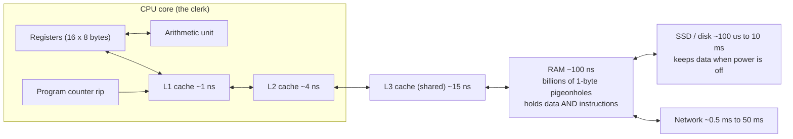

# Module 0.01: What a computer actually does

**Estimated hours:** 2

**What you will learn**

1. The four parts every computer has (CPU, memory, storage, program) and what each one does.
2. Why computers count in binary, and how to read a number in binary and hexadecimal.
3. What "running a program" really means: the CPU repeating fetch, decode, execute billions of times per second.

**Prerequisites:** none. This is the first module. You need a Windows PC and a web browser.

---

## 1. One-line intuition

A computer is a very fast, very obedient clerk that does one tiny instruction at a time, reading and writing numbers in a giant row of numbered boxes.

## 2. Real-life analogy

Picture a clerk sitting at a desk in a warehouse.

- **The clerk** is the **CPU** (central processing unit). The clerk can add, subtract, compare, and copy numbers. Nothing else. No creativity.
- **The desk** has a few **scratch cards**. These are **registers**. The clerk can only do arithmetic on numbers that are on the desk. There are only about 16 cards.
- **The warehouse wall** is covered in millions of **numbered pigeonholes**. This is **RAM** (random access memory, often just "memory"). Every pigeonhole has a number painted on it. That number is its **address**. Each pigeonhole holds one small number (one **byte**, explained below).
- **A recipe book** lies in some of those pigeonholes. The recipe is the **program**. Each line of the recipe is one **instruction**: "copy pigeonhole 40 onto card 1", "add card 1 and card 2", "if card 3 is zero, jump to line 90".
- **A metronome** ticks. On every tick the clerk does one step. That is the **clock**. A 3 GHz CPU ticks 3,000,000,000 times a second.
- **The basement** is **storage** (SSD or hard disk). It is huge and keeps things when the power goes off, but walking there is very slow. Before the clerk can use anything from the basement, it must be carried up into pigeonholes.

Running a program means: the clerk reads one line of the recipe, does it, moves to the next line. Forever, or until the recipe says "stop".

## 3. Why it exists: the problem it solves

Before 1945, a "computer" was a machine wired for one job. To do a different calculation, engineers physically rewired it for days.

The breakthrough (the **stored-program computer**, usually credited to John von Neumann and his colleagues) was this: store the instructions in the same memory as the data. Now changing the job means loading a different list of numbers into memory. No rewiring. Every phone, laptop and bank server today works this way.

What breaks without it: no software. No way to run a new program without building a new machine. Your whole career as a programmer exists because instructions are just numbers in memory.

## 4. Three layers of depth

### Layer 1 (beginner): the parts and the words

| Part | What it is | Analogy | Typical size today |
|---|---|---|---|
| CPU | The chip that executes instructions | The clerk | 4 to 16 cores in a laptop |
| Register | Tiny storage inside the CPU | Scratch card on the desk | 16 general registers, 8 bytes each |
| RAM | Fast memory that forgets when power is off | Wall of pigeonholes | 8 to 64 GB |
| Storage (SSD/HDD) | Slow memory that remembers when power is off | The basement | 256 GB to several TB |
| Program | A list of instructions stored in memory | The recipe | From a few KB to hundreds of MB |
| Clock | The tick that paces the CPU | Metronome | 2 to 5 GHz |

**Bits and bytes.** A **bit** is the smallest piece of information: on or off, 1 or 0. A **byte** is 8 bits together. One byte can hold 256 different values (0 to 255). Every pigeonhole in RAM holds exactly one byte. The RAM in a laptop with 16 GB has about 16 billion pigeonholes.

**Why binary?** Because a wire is either carrying voltage or not. Two states are cheap and reliable to build. Ten states (for decimal) would need ten voltage levels and would be error prone. So computers count with only two digits, 0 and 1.

**Reading binary.** In decimal, the columns are worth 1, 10, 100, 1000. In binary, the columns are worth 1, 2, 4, 8, 16, 32, 64, 128. You add up the columns that hold a 1.

```text
binary   1 1 0 1
column   8 4 2 1
value    8 + 4 + 0 + 1 = 13
```

So `1101` in binary is 13 in decimal.

**Hexadecimal (hex).** Binary is long to write. Hex uses 16 digits: 0-9 then A, B, C, D, E, F (A = 10, F = 15). One hex digit is exactly four bits, so one byte is exactly two hex digits. Programmers write hex with a `0x` prefix.

```text
binary   1111 1111
hex         F    F      -> 0xFF  = 255
binary   0000 1101
hex         0    D      -> 0x0D  = 13
```

You will see hex constantly: memory addresses in a crash dump, colour codes, file bytes. Learn to read it, not to fear it.

**What a program is.** The file `notepad.exe` on your disk is just bytes. Some of those bytes are instructions the CPU understands (machine code). When you double-click it, the operating system copies those bytes into RAM and tells the CPU "start reading instructions at address X". That is the whole magic.

### Layer 2 (working engineer): registers, caches, and the numbers that matter

**Instruction set.** Each CPU family understands a fixed vocabulary of instructions called its **instruction set architecture (ISA)**. Your Windows laptop almost certainly uses **x86-64** (Intel or AMD). Phones and new Macs use **ARM**. A program compiled for one does not run on the other. This is why you will later build for Linux x86-64 in WSL2 and separately for Windows.

**Registers.** The CPU can only compute on values sitting in registers. A typical x86-64 instruction looks like "add the number in register `rsi` to register `rdi`". Loading from RAM into a register is a separate, slower instruction. This is why compilers work hard to keep hot values in registers.

**Caches.** RAM is far slower than the CPU. If the clerk had to walk to the wall for every number, it would spend 99% of its time walking. So CPUs put small, very fast memories called **caches** between the registers and RAM. L1 is tiny and fastest. L2 is bigger. L3 is bigger still and shared between cores.

Rough latency numbers you should memorise, because every performance conversation for the rest of your career rests on them:

| Where the data is | Time to get it | Relative to 1 second |
|---|---|---|
| Register | about 0.3 ns (1 clock tick) | 1 second |
| L1 cache | about 1 ns | 3 seconds |
| L2 cache | about 4 ns | 13 seconds |
| L3 cache | about 15 ns | 50 seconds |
| RAM | about 100 ns | 5 minutes |
| NVMe SSD | about 50 to 100 µs | 2 to 4 days |
| Hard disk | about 5 to 10 ms | 6 months to 1 year |
| Network, same data centre | about 500 µs | 3 weeks |
| Network, another city | about 20 to 50 ms | 2 to 5 years |

The "relative" column scales one clock tick up to one second so you can feel the gaps. Reading from disk instead of RAM is not "a bit slower". It is the difference between glancing at your desk and waiting for a parcel to cross the country.

**Cores.** A modern CPU has several cores. Each core is a complete clerk with its own registers and L1/L2 cache. They share RAM. Running two programs at once on two cores is real parallelism. Running ten programs on two cores means the operating system switches between them very fast, which you will study in Phase 3.

**Clock speed is not program speed.** A 3 GHz CPU does not do 3 billion useful things per second. Some instructions take many ticks. A cache miss stalls the core for hundreds of ticks while it waits for RAM. Two programs can run on the same CPU and one can be 100 times faster because of how it uses memory. That is the whole subject of performance optimisation (module 2.13).

**Sizes of common types.** When you program in C and C++, each variable takes a fixed number of bytes:

| Type | Bytes | Range |
|---|---|---|
| `char` | 1 | -128 to 127 (or 0 to 255 unsigned) |
| `short` | 2 | about -32 thousand to +32 thousand |
| `int` | 4 | about -2.1 billion to +2.1 billion |
| `long long` / pointer on x86-64 | 8 | enormous (about 9 × 10^18) |
| `float` | 4 | about 7 significant digits |
| `double` | 8 | about 16 significant digits |

A loan balance of 25,000,000 fits in an `int`. A bank-wide total in paise does not. Choosing the wrong size is a real bug in real banking code.

### Layer 3 (internals): fetch, decode, execute, and what "a + b" becomes

Every core runs the same loop, billions of times per second:

1. **Fetch.** Read the instruction at the address held in a special register called the **program counter** (on x86-64 it is `rip`, the instruction pointer). Instructions are just bytes in RAM.
2. **Decode.** Work out what those bytes mean: which operation, which registers, which address.
3. **Execute.** Do it: add, load, store, compare, or jump by changing the program counter.
4. Move the program counter to the next instruction and repeat.

Modern CPUs overlap these steps for several instructions at once (**pipelining**), guess which way a branch will go (**branch prediction**), and even execute instructions out of order when it is safe. You will meet the consequences in module 2.13 (performance) and Phase 4 (why multithreaded code can see "impossible" orderings).

**From C to machine code.** Here is a C function that adds two numbers:

```c
int add(int a, int b) {
    return a + b;
}
```

A compiler turns it into x86-64 instructions. With GCC at optimisation level `-O2` the result is two instructions:

```asm
add:
        lea     eax, [rdi+rsi]
        ret
```

Read it like this:

- By convention, the first argument `a` arrives in register `rdi` and the second `b` in `rsi`.
- `lea eax, [rdi+rsi]` computes `rdi + rsi` and puts the result in `eax`. (`lea` means "load effective address"; compilers use it as a fast adder.)
- By convention the return value goes in `eax`, so `ret` returns to whoever called us.

Those two instructions are stored as a handful of bytes: `8D 04 37 C3`. That is what "a program is just bytes" means. You will see this yourself in the lab using Compiler Explorer.

**What a crash is.** Every address the program uses must be a real pigeonhole that the operating system has given to the program. If an instruction says "read address 0" or "read address 0x7FFFDEADBEEF" and that address is not mapped, the CPU raises a **fault**. The operating system catches it and kills the program. On Linux this is the famous **segmentation fault**. On Windows it is an **access violation** (error code `0xC0000005`). Capstone C6 is entirely about reading the leftovers of such crashes. Everything there starts from this fact: the CPU touched an address it should not have.

## 5. Architecture diagram



Arrows mean "data moves between". Every step away from the registers is roughly 4 to 100 times slower.

## 6. Code

This program shows how many bytes each type takes, prints one number in decimal, hex and binary, and shows the address (pigeonhole number) where each variable lives.

You have not installed a compiler yet. That happens in module 0.04. For now use a free online compiler: open <https://www.onlinegdb.com/>, choose language **C**, paste the code, and press **Run**. When your Linux lab exists, the local commands are given below the code.

```c
/* sizes_and_bytes.c
 * Shows: sizeof each type, one value in decimal/hex/binary,
 * and the memory address of each variable.
 */
#include <stdio.h>

/* Print a 32-bit value as binary, grouped in bytes. */
static void print_binary(unsigned int value) {
    for (int bit = 31; bit >= 0; --bit) {
        putchar(((value >> bit) & 1u) ? '1' : '0');
        if (bit % 8 == 0 && bit != 0) {
            putchar(' ');          /* space between bytes */
        }
    }
}

int main(void) {
    int    balance = 2500;      /* a loan balance in rupees */
    char   grade   = 'A';       /* a credit grade, one letter */
    double rate    = 8.5;       /* an interest rate in percent */

    printf("--- how many bytes each type takes ---\n");
    printf("sizeof(char)   = %zu\n", sizeof(char));
    printf("sizeof(short)  = %zu\n", sizeof(short));
    printf("sizeof(int)    = %zu\n", sizeof(int));
    printf("sizeof(long)   = %zu\n", sizeof(long));
    printf("sizeof(double) = %zu\n", sizeof(double));
    printf("sizeof(int*)   = %zu   (a pointer = an address)\n", sizeof(int *));

    printf("\n--- one value, three ways of writing it ---\n");
    printf("decimal : %d\n", balance);
    printf("hex     : 0x%08X\n", (unsigned int)balance);
    printf("binary  : ");
    print_binary((unsigned int)balance);
    printf("\n");

    printf("\n--- where each variable lives in memory ---\n");
    printf("address of balance : %p\n", (void *)&balance);
    printf("address of grade   : %p\n", (void *)&grade);
    printf("address of rate    : %p\n", (void *)&rate);

    printf("\nthe letter '%c' is stored as the number %d\n", grade, grade);
    printf("the rate %.1f is stored in %zu bytes\n", rate, sizeof(rate));
    return 0;
}
```

Local compile and run on Linux (after module 0.04):

```bash
gcc -Wall -Wextra -o sizes_and_bytes sizes_and_bytes.c
./sizes_and_bytes
```

Expected output (the addresses will be different on your machine, and different on every run; that is normal and is explained in module 1.10):

```text
--- how many bytes each type takes ---
sizeof(char)   = 1
sizeof(short)  = 2
sizeof(int)    = 4
sizeof(long)   = 8
sizeof(double) = 8
sizeof(int*)   = 8   (a pointer = an address)

--- one value, three ways of writing it ---
decimal : 2500
hex     : 0x000009C4
binary  : 00000000 00000000 00001001 11000100

--- where each variable lives in memory ---
address of balance : 0x7ffd3a2b1c4c
address of grade   : 0x7ffd3a2b1c4b
address of rate    : 0x7ffd3a2b1c40

the letter 'A' is stored as the number 65
the rate 8.5 is stored in 8 bytes
```

Check the binary by hand: 2048 + 256 + 128 + 64 + 4 = 2500. Those are the columns holding a 1. The hex `9C4` is the same bits grouped in fours: `1001` = 9, `1100` = C, `0100` = 4.

Note that `sizeof(long)` is 8 on Linux but 4 on Windows. The same source code gives a different answer on a different platform. This is one reason "C, C++ on Linux and Windows" is a real skill and not a buzzword.

## 7. Use case: core-banking loan-origination platform

A loan-origination server at a bank holds **master tables**: lists of branches, product codes, interest schemes, document types. A request like "create a loan application" needs ten or twenty of these lookups.

Where should those lookups come from?

| Option | Where the bytes are | Latency per lookup | 20 lookups per request |
|---|---|---|---|
| Query the database each time | Another machine, over the network, then its disk | about 0.5 to 2 ms | 10 to 40 ms |
| Keep a copy in the server's RAM | This machine's RAM | about 100 ns to 1 µs | under 0.02 ms |

That is the entire reason the resume says "an in-memory master-table cache that removes repeated joins from the hot request path" (claim H4). The decision was driven by the latency table in Layer 2: RAM is thousands of times closer than the database. You will build that cache in capstone C2 and measure exactly this difference.

The cost of the decision, which an interviewer will ask about: RAM forgets when the process restarts, so the cache must be reloaded. And if a master table changes in the database, the copy in RAM is stale until something refreshes it. Module 4.13 and module 10.03 cover how to handle that.

## 8. Lab

Work through all five parts. Write down your answers; you will use them in your first journal entry.

### Part A: binary by hand (15 minutes)

1. Convert these to binary: 5, 13, 32, 255. Use the column method (128, 64, 32, 16, 8, 4, 2, 1).
2. Convert these binary numbers to decimal: `1010`, `11111111`, `0001 0000`.
3. Count from 0 to 31 on one hand. Each finger is a bit: thumb = 1, index = 2, middle = 4, ring = 8, little = 16. Raise the fingers that add up to the number. This feels silly and it burns binary into your memory.

<details>
<summary>Answers</summary>

1. 5 = `101`, 13 = `1101`, 32 = `100000`, 255 = `11111111`.
2. `1010` = 10, `11111111` = 255, `0001 0000` = 16.
3. 31 is all five fingers raised. 4 is the middle finger alone, which is why programmers find this joke funny.

</details>

### Part B: Windows Calculator in programmer mode (10 minutes)

1. Open Calculator. Click the menu (three lines) and choose **Programmer**.
2. Type `2500`. Read the HEX, OCT and BIN lines. Confirm HEX shows `9C4` and BIN matches the program output above.
3. Click **HEX**, type `FF`. Read DEC. Then type `7FFFFFFF`. Read DEC. That second number is the largest value a 4-byte signed `int` can hold.
4. Click **DEC**, type `65`. Switch to HEX. Note the value. The letter `A` is stored as this number.

Expected: `FF` = 255. `7FFFFFFF` = 2147483647. 65 = `0x41`.

### Part C: look at your own machine (10 minutes)

1. Press `Ctrl+Shift+Esc` to open Task Manager. Click **Performance**.
2. Click **CPU**. Write down: the CPU name, "Base speed" (this is the clock in GHz), "Cores", "Logical processors", and the L1, L2, L3 cache sizes shown at the bottom right.
3. Click **Memory**. Write down the total (this is your RAM in GB) and "Speed".
4. Multiply your RAM in GB by about 1,073,741,824. That is roughly how many pigeonholes (bytes) your machine has.

Expected: a typical laptop shows 4 to 8 cores, 8 to 16 logical processors, a base speed between 2 and 4 GHz, L1 a few hundred KB, L2 a few MB, L3 8 to 32 MB. Notice that L3 is about one thousandth of RAM. Caches are small because fast memory is expensive.

### Part D: run the program (15 minutes)

1. Open <https://www.onlinegdb.com/>, set language to **C**, paste the program from section 6, press **Run**.
2. Compare the output with the expected output. The sizes and the decimal/hex/binary lines must match exactly. The addresses will differ.
3. Change `balance` to `255` and run again. Predict the hex and binary before you look.
4. Change `balance` to `-1` and run again. Look at the binary. All 32 bits are 1. This is called two's complement and is explained in module 1.02. For now just notice: negative numbers are not stored with a minus sign, they are stored as a pattern of bits.
5. Look at the three addresses. They are close together (within a few dozen bytes). All three variables live in the same small region. That region is called the stack, and module 1.04 explains it.

### Part E: watch C become machine code (15 minutes)

1. Open <https://godbolt.org/> (Compiler Explorer). Make sure the language is **C** and the compiler is a recent **x86-64 gcc**.
2. In the compiler options box type `-O2`.
3. Replace the source with:

```c
int add(int a, int b) {
    return a + b;
}

int add_three(int a, int b, int c) {
    return a + b + c;
}
```

4. Read the output on the right. `add` should be `lea eax, [rdi+rsi]` and `ret`. Find the instructions for `add_three`. How many are there?
5. Now change `-O2` to `-O0` (no optimisation). Watch the same function balloon to ten or more instructions that push values to memory and read them back. This is the difference between a debug build and a release build. You will use debug builds in GDB because every variable has a real memory slot, and release builds for measuring speed.

<details>
<summary>What you should see</summary>

At `-O2`, `add_three` is typically three instructions: an `add edi, esi` or `lea`, then another add, then `ret`. At `-O0`, each function stores its arguments to memory with `mov DWORD PTR [rbp-4], edi` and reads them back before adding, which is why unoptimised code is slow and why you never benchmark a debug build.

</details>

### Journal

Copy [journal/TEMPLATE.md](../journal/TEMPLATE.md) to `journal/YYYY-MM-DD-what-a-computer-does.md`. Fill in at least: the numbers from Part C (cores, GHz, RAM, cache sizes), the hex and binary for 255 and -1 from Part D, and the instruction count for `add_three` at `-O2` and `-O0` from Part E.

## 9. Common mistakes and misconceptions

| Mistake | Why it is wrong | Bug it causes later |
|---|---|---|
| "Memory" and "storage" are the same | RAM forgets at power off and is about 1000 times faster than an SSD | Designs that read from disk on every request; or caches that are assumed to survive a restart |
| A faster GHz number means a faster program | Memory stalls dominate; a cache miss costs hundreds of ticks | Blaming "slow hardware" instead of fixing memory access patterns |
| A program is the `.exe` file | The file is a frozen copy; the running program is bytes in RAM plus register state | Confusion when two copies of the same program behave differently |
| An address and the value at that address are the same thing | The pigeonhole number is not what is inside the pigeonhole | Almost every pointer bug in Phase 1 |
| Binary is for hardware people only | Every crash dump, every bit flag, every memory corruption shows up as hex bytes | Being unable to read a WinDbg or GDB session |
| `int` can hold any whole number | It holds 4 bytes, so about ±2.1 billion | Overflow when summing balances in paise across a bank |

## 10. Resume link

This module underpins every line, but speak about it through these three:

- **Claim B, "memory and ownership design, performance optimisation".** When an interviewer asks "why did you care about data layout?", answer with the latency table: "A cache miss to RAM is about 100 ns and an L1 hit is about 1 ns. In the master-table cache I kept the hot fields together so one lookup touched one or two cache lines." You will have the measurement from capstone C2.
- **Claim H4, "in-memory master-table cache that removes joins from the hot path".** The one-sentence justification is in section 7: RAM at 100 ns versus a network round trip to the database at about 1 ms.
- **Claim F, "crash dump analysis".** A crash is the CPU faulting on a bad address. Being comfortable reading an address like `0x7ffd3a2b1c4c` in hex is where that skill starts. Say: "The first thing I read in a dump is the faulting address and the instruction pointer."

Likely follow-up from an interviewer: "What is the approximate latency of a main-memory access versus an L1 hit versus a disk read?" You now know the answer. Say the numbers.

## 11. Interview questions

**Q1 (easy). What is the difference between RAM and disk storage?**

<details>
<summary>Model answer</summary>

RAM is fast, volatile memory: about 100 ns per access and it loses its contents when power is lost. Disk (SSD or HDD) is slow, persistent storage: tens of microseconds to milliseconds per access and it keeps data across power cycles. Programs and the data they are working on must be in RAM for the CPU to use them; disk is where they are kept between runs. Databases spend most of their engineering effort managing this exact boundary, which is the subject of Phase 6.

</details>

**Q2 (easy). Why do computers use binary rather than decimal?**

<details>
<summary>Model answer</summary>

A circuit element is cheapest and most reliable when it only has to distinguish two states, for example high voltage versus low voltage. Distinguishing ten levels would be slower and error prone. Binary also makes arithmetic hardware simple. Hexadecimal is just a compact way for humans to write binary, with one hex digit per four bits.

</details>

**Q3 (medium). Roughly how long does a main-memory access take compared to an L1 cache hit, and why does that matter for writing fast code?**

<details>
<summary>Model answer</summary>

An L1 hit is about 1 ns; a main-memory access is about 100 ns, so about 100 times slower. A core can execute hundreds of instructions in the time one cache miss takes. So the layout of data in memory, and whether consecutive accesses touch nearby addresses, often matters more than the instruction count. This is why a `std::vector` scanned in order is usually faster than a linked list with the same number of elements, and why the master-table cache in my app server kept hot fields contiguous.

</details>

**Q4 (medium). What does the CPU actually do when it "runs a program"? Describe the cycle.**

<details>
<summary>Model answer</summary>

It repeats fetch, decode, execute. Fetch reads the instruction bytes at the address in the program counter (`rip` on x86-64). Decode works out the operation and operands. Execute performs it, which may read or write registers or memory, or change the program counter for a jump or call. Modern CPUs pipeline these stages, predict branches and execute out of order, but the observable result is as if the simple loop ran. Instructions and data live in the same memory, which is the stored-program idea.

</details>

**Q5 (hard). A program crashes with "access violation reading 0x0000000000000000" on Windows, or a segmentation fault on Linux. In hardware terms, what happened, and what is the first thing you look at?**

<details>
<summary>Model answer</summary>

An instruction tried to load from or store to a virtual address that the operating system had not mapped for the process, here address zero, which is never mapped. The CPU raised a page-fault exception, the OS determined there was no valid mapping, and delivered a fatal signal (SIGSEGV on Linux) or exception (STATUS_ACCESS_VIOLATION, 0xC0000005, on Windows). The first things I read in the dump are the faulting address, the instruction pointer, and the call stack. Address zero or a small offset from zero almost always means a null pointer was dereferenced, often a struct field accessed through a null struct pointer. A large garbage address usually means a dangling or corrupted pointer, which points towards use-after-free or a buffer overflow, and I would then look at the heap around the object.

</details>

## 12. Revision

- A computer is a CPU running fetch-decode-execute on instructions stored, as bytes, in the same RAM as the data.
- Bits group into bytes; one byte is two hex digits; registers are about 0.3 ns, L1 about 1 ns, RAM about 100 ns, SSD about 100 µs, network about 1 ms.
- A crash is the CPU touching an unmapped address; a cache is bytes kept in RAM so the hot path never waits for disk or network.

---

Previous: [Course README](../README.md) | Next: [Module 0.02: The operating system, processes and files](module-02-operating-system-processes-files.md)
