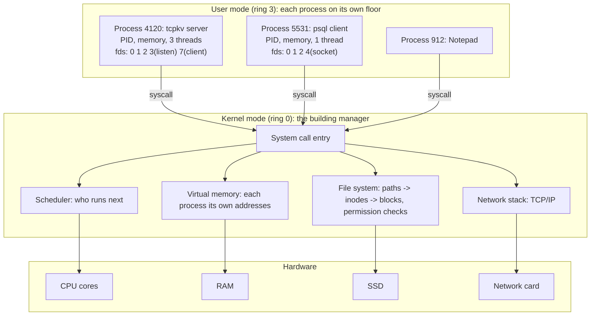

# Module 0.02: The operating system, processes and files

**Estimated hours:** 2

**What you will learn**

1. What an operating system is and why every program has to ask it for permission to touch hardware.
2. What a process is: a running program with its own memory, its own identity number and its own list of open files.
3. What a file and a path really are, and how permissions decide who may read or change them.

**Prerequisites:** [Module 0.01: What a computer actually does](module-01-what-a-computer-does.md).

---

## 1. One-line intuition

The operating system is the one program that owns the machine; every other program is a tenant that must ask it for memory, files, screen and network.

## 2. Real-life analogy

Think of a large office building.

- **The building manager** is the **operating system (OS)**: Windows, Linux, macOS, Android. The manager owns the building, the keys, the electricity and the phone lines.
- **A tenant company** is a **process**: a running copy of a program. Each tenant gets its own locked floor (its own memory) and a company number on the board in the lobby (its process ID, or **PID**).
- Two tenants can be the same kind of company (two copies of Notepad are two processes of one program). They have separate floors and cannot see each other's papers.
- **The archive in the basement** is the **file system**. Every document (**file**) has a location described by floor, room and cabinet (**path**). The archive clerk checks your badge (**permissions**) before handing you a document.
- A tenant who wants anything outside its floor, such as a document from the archive, a phone line, or more space, must fill in a request form at the manager's desk. That form is a **system call**.
- If a tenant starts a fire (crashes), the manager evacuates that floor only. The other tenants keep working. That isolation is the whole reason one buggy program does not take down the computer.

## 3. Why it exists: the problem it solves

In module 0.01 the CPU simply ran instructions from memory. Now imagine two programs loaded at once, both believing they own all of memory, both writing to the same disk. One overwrites the other's data. One hangs in an infinite loop and the other never runs. One reads the password file.

The operating system solves three problems:

1. **Sharing.** Many programs share one CPU, one RAM and one disk without knowing about each other. The OS switches the CPU between them (scheduling, Phase 3) and gives each one its own view of memory (virtual memory, module 3.04).
2. **Protection.** A program cannot read another program's memory, and cannot touch hardware directly. The CPU itself enforces this with two modes, explained in Layer 3.
3. **Abstraction.** A program says "open the file called `loans.dat`" rather than "spin the disk to cylinder 412, sector 9". The OS translates names into hardware operations. The same program works on an SSD, a hard disk, a USB stick or a network share.

What breaks without it: MS-DOS in the 1980s had no protection. One program with a bad pointer froze the whole machine and you pressed the reset button. Every "blue screen" you have seen on Windows is the one case where the OS itself, not a tenant, has crashed.

## 4. Three layers of depth

### Layer 1 (beginner): the words you need

**Kernel.** The core of the OS that is always in memory and has full power over the hardware. On Linux the kernel is literally a file called `vmlinuz`. On Windows it is `ntoskrnl.exe`. Everything else, including Explorer, the taskbar and the terminal, is an ordinary program running on top.

**User program.** Anything that is not the kernel: your browser, Notepad, the C programs you will write, and even big servers like PostgreSQL. They run with limited power.

**Process.** One running instance of a program. The program is the recipe file on disk. The process is the recipe being cooked: it has a PID, its own memory with the instructions and data loaded in, a current working directory, a list of open files, and the user it runs as. Start Notepad twice and you have one program and two processes.

**Thread.** A process has at least one thread, which is the thing that actually executes instructions. One process can have many threads sharing the same memory. Threads are the subject of Phases 3 and 4 and most of your resume. For now, one process equals one or more threads.

**File.** A named sequence of bytes kept by the file system. A text file, a photo, `notepad.exe` and your C source code are all files. The OS does not care what the bytes mean.

**Directory (folder).** A file that lists other files. Directories nest, forming a tree.

**Path.** The address of a file in that tree.

| | Windows | Linux |
|---|---|---|
| Root of the tree | One per drive: `C:\`, `D:\` | One for everything: `/` |
| Separator | backslash `\` | forward slash `/` |
| Example absolute path | `D:\System Engineer\README.md` | `/home/shakir/course/README.md` |
| Case | `Readme.md` and `README.md` are the same file | They are two different files |
| Home folder | `C:\Users\msi1` | `/home/shakir` |

An **absolute** path starts at the root. A **relative** path starts from the process's current working directory. `..` means "the parent folder" and `.` means "this folder".

**Permissions.** Every file records who may read it, write it, and execute it. On Linux there are three sets of three bits: owner, group, everyone else. `rw-r--r--` means the owner can read and write, everyone else can only read. On Windows the same idea is expressed in the **Security** tab of a file's Properties, with a longer list of allowed and denied actions per user or group.

**Administrator / root.** The one user the OS trusts with everything. On Linux that user is called `root`. On Windows, "Run as administrator". Servers should never run as this user, for reasons in section 7.

### Layer 2 (working engineer): what a process owns and how it talks to the kernel

A process is really a bundle of kernel bookkeeping. On Linux the kernel keeps one `task_struct` per thread; on Windows one `EPROCESS` per process. Either way, the bundle contains:

| Item | What it is | Why you will care |
|---|---|---|
| PID | A small integer identity | Every debugger, log line and crash dump names the process by PID |
| Address space | The set of memory addresses the process may use | Pointers (module 1.05) only mean something inside one address space |
| Threads | One or more execution contexts, each with its own registers and stack | Your thread pool in tcpkv is a set of these |
| File descriptor table (Windows: handle table) | A numbered list of open files, sockets, pipes | Every TCP connection in tcpkv is an entry here; leaking them is a classic server bug |
| Current working directory | Where relative paths start | "File not found" bugs when a service starts from an unexpected folder |
| User and group | Whose permissions apply | A server running as the wrong user either cannot read its config or can read everything |
| Environment variables | Named strings like `PATH` and `HOME` | How configuration and secrets often reach a server |
| Exit code | A number returned when the process ends; 0 means success | Scripts and CI pipelines test this number |
| Parent PID | The process that started this one | Process trees; who restarts a crashed server |

**System calls.** A user program cannot touch the disk, the network card or another process. Instead it calls into the kernel through a fixed menu of entry points. Linux has about 450 system calls; the ones you will use most are:

| Linux call | Windows equivalent | What it does |
|---|---|---|
| `open`, `read`, `write`, `close` | `CreateFile`, `ReadFile`, `WriteFile`, `CloseHandle` | Files, and on Linux also sockets and pipes |
| `fork`, `execve`, `exit`, `wait4` | `CreateProcess`, `ExitProcess`, `WaitForSingleObject` | Make, replace, end and wait for processes |
| `mmap`, `brk` | `VirtualAlloc` | Ask for memory (this is what `malloc` uses underneath) |
| `socket`, `bind`, `listen`, `accept` | Same names via Winsock | Networking (Phase 5) |
| `kill` / signals | `TerminateProcess`, exceptions | Stop a process, deliver events |

The C library functions you will learn in Phase 1, such as `fopen`, `printf` and `malloc`, are convenience wrappers that eventually make these calls. `printf` ends in a `write` system call to file descriptor 1, which is the screen.

**File descriptors.** When a process opens a file, the kernel returns a small integer called a file descriptor (fd). Every process starts with three: 0 is standard input (the keyboard), 1 is standard output (the screen), 2 is standard error (also the screen, kept separate so errors can be redirected elsewhere). The next file you open gets 3. On Windows the same concept is called a **handle** and is an opaque number rather than a small sequential one. Module 3.08 goes deep on this; tcpkv's "RAII socket and fd wrappers" from the resume exist to make sure every fd that is opened is also closed.

**Everything is a file.** On Linux the same `read` and `write` calls work on a disk file, a terminal, a network socket, a pipe between processes and even hardware devices under `/dev`. This single idea is why Linux server code is compact and why tcpkv can treat a TCP connection as "something I read lines from".

### Layer 3 (internals): two CPU modes and what happens on `open`

**User mode and kernel mode.** The CPU has a privilege level. On x86-64 it is called the ring: ring 0 for the kernel, ring 3 for user programs. In ring 3 certain instructions are forbidden and the page tables (module 3.04) only map the process's own memory. Trying to touch anything else raises a fault, exactly the crash from module 0.01, and the kernel ends the process.

To do anything privileged, a user program executes a special instruction (`syscall` on x86-64 Linux; Windows uses the same instruction behind `ntdll.dll`). The CPU switches to ring 0, jumps to a fixed kernel entry point, and the kernel reads the request number and arguments from registers. When the kernel is done it switches back to ring 3 and returns the result. This round trip costs roughly 100 to 300 nanoseconds plus whatever the work costs. That number matters: a server that makes one system call per byte is slow, one that reads 64 KB per call is fast. You will measure this in module 3.07.

**What happens when a program opens a file.** Say a C program calls `fopen("data/loans.dat", "r")` on Linux:

1. The C library calls the `openat` system call with the path and flags.
2. The kernel resolves the path one component at a time. It starts at the process's current working directory, looks up `data` in that directory's listing, finds the **inode** number for `data`, loads that inode, checks it is a directory and that the process may search it, then looks up `loans.dat` inside it.
3. An inode is the kernel's record for one file: its size, owner, permission bits, timestamps and the list of disk blocks holding its bytes. The file name is not in the inode; names live in directories. This is why one file can have several names (hard links) and why renaming is cheap.
4. The kernel checks the permission bits against the process's user and group. Fail here and `open` returns the error `EACCES` ("Permission denied").
5. The kernel creates an **open file description** (current position in the file, mode) and places a pointer to it in the first free slot of the process's file descriptor table. It returns that slot number, for example 3.
6. Later `read(3, buffer, 4096)` uses slot 3 to find the open file description, uses its position to find which block of the inode to read, fetches that block from the page cache or the disk, copies bytes into the process's buffer, and advances the position.

On Windows the steps are the same in spirit: `CreateFileW` goes through `ntdll` into the kernel, the Object Manager resolves `\??\D:\System Engineer\data\loans.dat`, NTFS looks up the file record in its Master File Table, the security descriptor is checked against the process token, and a handle is placed in the process's handle table.

**What happens when a process ends.** Whether it returns from `main`, calls `exit`, or is killed by a fault, the kernel reclaims everything: memory is unmapped, every file descriptor is closed, the exit code is stored for the parent to collect. This is why a leaked file descriptor does not matter in a one-shot tool but is fatal in a server that runs for months.

## 5. Architecture diagram



The thick line between the two top boxes is the privilege boundary. Nothing crosses it except a system call going down and a result coming back up.

## 6. Code

This program asks the OS who it is, writes a small file, reads it back, then deliberately tries to open a file that does not exist so you can see what an OS error looks like. Run it on <https://www.onlinegdb.com/> (language C) until your Linux lab exists in module 0.04. The program uses Linux-only headers for the PID, which is fine on onlinegdb.

```c
/* process_and_files.c
 * Shows: the PID, the current directory, writing and reading a file,
 * and what an operating-system error looks like.
 */
#include <stdio.h>
#include <string.h>
#include <errno.h>      /* errno: the number of the last OS error */
#include <unistd.h>     /* getpid, getcwd (Linux) */

int main(void) {
    char cwd[512];

    /* 1. Identity: ask the kernel for our process ID and working directory. */
    printf("my process id (PID) : %d\n", (int)getpid());
    printf("my parent's PID     : %d\n", (int)getppid());
    if (getcwd(cwd, sizeof cwd) != NULL) {
        printf("current directory   : %s\n", cwd);
    }

    /* 2. Write a file. fopen asks the kernel for a file descriptor. */
    FILE *out = fopen("loan_note.txt", "w");
    if (out == NULL) {
        printf("could not create file: %s\n", strerror(errno));
        return 1;
    }
    fprintf(out, "loan 1001: balance 2500, rate 8.5\n");
    fclose(out);    /* gives the descriptor back to the kernel */
    printf("wrote loan_note.txt\n");

    /* 3. Read it back. */
    FILE *in = fopen("loan_note.txt", "r");
    if (in == NULL) {
        printf("could not open for reading: %s\n", strerror(errno));
        return 1;
    }
    char line[128];
    while (fgets(line, sizeof line, in) != NULL) {
        printf("read back           : %s", line);
    }
    fclose(in);

    /* 4. Try a path that does not exist. The kernel refuses and sets errno. */
    FILE *missing = fopen("/no/such/folder/master.dat", "r");
    if (missing == NULL) {
        printf("opening a bad path  : errno=%d (%s)\n", errno, strerror(errno));
    }

    /* 5. Try a file we are not allowed to write. */
    FILE *forbidden = fopen("/etc/passwd", "w");
    if (forbidden == NULL) {
        printf("writing /etc/passwd : errno=%d (%s)\n", errno, strerror(errno));
    } else {
        fclose(forbidden);   /* only happens if you run as root; do not */
    }
    return 0;    /* exit code 0 = success */
}
```

Local compile and run on Linux (after module 0.04):

```bash
gcc -Wall -Wextra -o process_and_files process_and_files.c
./process_and_files
echo "exit code was $?"
cat loan_note.txt
```

Expected output (PIDs and directory will differ):

```text
my process id (PID) : 23817
my parent's PID     : 23801
current directory   : /home/shakir/course
wrote loan_note.txt
read back           : loan 1001: balance 2500, rate 8.5
opening a bad path  : errno=2 (No such file or directory)
writing /etc/passwd : errno=13 (Permission denied)
exit code was 0
loan 1001: balance 2500, rate 8.5
```

Two things to notice. First, `errno` 2 and 13 are plain numbers; the OS reports failures as numbers and the C library translates them to words. You will see these numbers in logs for the rest of your career (`ENOENT` = 2, `EACCES` = 13, `EADDRINUSE` = 98 when a server port is already taken). Second, every `fopen` is paired with an `fclose`. Forgetting the close is a file-descriptor leak. In Phase 2 you will learn RAII, the C++ technique that makes forgetting impossible.

## 7. Use case: core-banking loan-origination platform

The application server from resume claim H4 is one process. On a branch server it might be PID 4120, started at boot by a service manager, running as a dedicated low-privilege user called `loanapp`. This single fact shapes several real decisions:

- **Every client connection is a file descriptor.** Two hundred branch users connected means two hundred entries in the fd table plus one for the listening socket, one for the log file, and a handful for database connections. The OS limits how many a process may hold (often 1024 by default on Linux). A leaked descriptor per request would exhaust that limit in minutes and the server would refuse new logins with "Too many open files". This is why the server's connection handling owns and closes every descriptor, and why tcpkv wraps each one in an RAII type.
- **Least privilege.** The `loanapp` user can read its configuration and write its logs and nothing else. If an attacker finds a bug in the request parser, they get a process that cannot read customer files or install software. Running the server as administrator would turn every bug into a bank-wide incident. Module 11.02 returns to this.
- **Crash isolation.** When the server hit a memory-corruption bug (claim H5), the OS killed PID 4120 and wrote a dump file. PostgreSQL, running as a different process and user on the same machine, was untouched. The service manager restarted the server. The dump file, a copy of the process's memory at the moment of the fault, is what the RCA in capstone C6 is written from.
- **The working directory trap.** A classic production incident: the server runs fine when started by hand from its own folder, then fails with "No such file or directory" when started by the service manager, because the manager starts it from `/` and the config path was relative. The fix is always an absolute path or a path built from an environment variable.

## 8. Lab

### Part A: processes on your Windows machine (15 minutes)

1. Press `Ctrl+Shift+Esc` for Task Manager. Click **Details** (you may need "More details" first). Right-click a column header, choose **Select columns**, and tick **PID**, **User name**, **Memory (active private working set)**, **Threads** and **Handles**.
2. Open Notepad. Find `notepad.exe` in the list. Write down its PID, user name, thread count and handle count.
3. Open a second Notepad. You now see two `notepad.exe` rows with different PIDs. One program, two processes. Close one; its row disappears and the other is untouched.
4. Find `System` near the top. Note that its user is `SYSTEM` and its PID is 4. That is the kernel's own bookkeeping process on Windows.
5. Sort by **Handles**. The processes at the top hold thousands of open files, registry keys and events. Those are their handle tables from Layer 2.

Expected: Notepad has one or a few threads and a few hundred handles. Your browser has dozens of processes, each with many threads. Two Notepads have different PIDs.

### Part B: paths and permissions (15 minutes)

1. Open File Explorer, go to `D:\System Engineer`. Click in the address bar: it shows the absolute path. Click the **View** menu, **Show**, and tick **File name extensions**. Now `README.md` and `Shakir_Resume_CPP.pdf` show their real names. Always keep this on; a file called `report.pdf.exe` is a classic trick.
2. Right-click `README.md`, **Properties**, **Security** tab. You will see groups and users (`SYSTEM`, `Administrators`, your account) each with Allow or Deny for Read, Write, Modify, Full control. That is the Windows form of the permission bits from Layer 1.
3. Open PowerShell (right-click Start, "Terminal" or "Windows PowerShell"). Type these one at a time and read the output:

```powershell
Get-Location
Set-Location "D:\System Engineer"
Get-ChildItem
Get-ChildItem ..
Get-Process notepad
Get-Process | Sort-Object Handles -Descending | Select-Object -First 5 Name, Id, Handles, Threads
```

Expected: `Get-Location` prints your current working directory; the first `Get-ChildItem` lists the course folders; `..` lists the parent (`D:\`); `Get-Process notepad` prints a row per open Notepad with its Id (the PID). Module 0.03 teaches the Linux equivalents (`pwd`, `cd`, `ls`, `ps`).

### Part C: run the program (15 minutes)

1. Paste the program from section 6 into onlinegdb (language C) and run it.
2. Check that the error numbers match: 2 for the missing path, 13 for `/etc/passwd`.
3. Run it a second time. The PID changes. Same program, new process, new identity.
4. Change the `"w"` in the first `fopen` to `"r"` and run again. Now the program tries to read a file that does not exist yet and prints "could not open for reading". Change it back.
5. Delete the line `fclose(out);` and run again. Does the read-back still work? Often it does, because the OS closes everything at exit, which is exactly why fd leaks hide in small programs and bite in servers.

### Part D: one deliberate error (10 minutes)

In the Windows PowerShell window, try to create a file somewhere you are not allowed:

```powershell
"test" | Out-File "C:\Windows\test.txt"
```

Expected: a red error containing `Access to the path ... is denied`. That is the Windows form of `EACCES`. The OS refused because your process runs as your user, not as administrator. Now you have seen least privilege protect your own machine.

### Journal

Copy [journal/TEMPLATE.md](../journal/TEMPLATE.md) to `journal/YYYY-MM-DD-os-processes-files.md`. Record: the PID, thread and handle counts for Notepad; the two errno values and their meanings; what happened when you removed `fclose`; and the exact text of the Access denied error.

## 9. Common mistakes and misconceptions

| Mistake | Why it is wrong | Bug it causes later |
|---|---|---|
| "The program crashed" means the computer is damaged | The OS killed one process; everything else is fine | Panic instead of reading the crash dump |
| A program and a process are the same thing | One program file can be running as many processes, each with its own memory | Confusing two instances of a server, or expecting them to share variables |
| Relative paths are fine in a server | The working directory depends on who started the process | "File not found" only when started as a service |
| Files you open are closed automatically | Only at process exit; a long-running server never exits | Descriptor leak, then "Too many open files" under load |
| Running as administrator or root makes problems go away | It removes every safety check | One parser bug becomes full-machine compromise |
| The C library talks to the disk | It calls the kernel through system calls; the kernel talks to the disk | Misreading performance: the cost is in the syscalls, not in `printf` |
| Windows and Linux paths are interchangeable | Different separators, roots and case rules | Cross-platform build scripts that work on one machine only |

## 10. Resume link

- **Claim G, "Linux ... Windows (Win32)".** Interviewers test whether you understand the OS or just use it. Being able to say "a process is an address space plus threads plus a descriptor table, and a system call is the ring 3 to ring 0 transition that costs about 100 to 300 ns" separates the two.
- **Claim H4, "multithreaded application server ... RPC-over-TCP".** Every connection is a descriptor in one process's table. Say: "The server was a single long-running process; connection lifetime was tied to descriptor lifetime, and leaking either showed up as `EMFILE` under load, so ownership of every fd was explicit."
- **Claim I, "RAII socket and file-descriptor wrappers".** The justification is Layer 2 and section 7: descriptors are owned by the process, closed only at exit, and a server never exits. RAII makes the close automatic.
- **Claim H5, "crash-dump analysis".** The dump exists because the OS isolated the faulting process, stopped it, and copied its memory. You can now explain where a dump comes from before explaining how to read one.

Likely follow-up: "What is the difference between a process and a thread?" Answer: a process owns an address space and a descriptor table; threads are execution contexts inside one process that share both. Phase 3 fills in the rest.

## 11. Interview questions

**Q1 (easy). What is a process?**

<details>
<summary>Model answer</summary>

A process is a running instance of a program. The kernel gives it a process ID, its own virtual address space containing the program's code and data, at least one thread, a table of open file descriptors or handles, a current working directory, a user identity and environment variables. Two processes of the same program are fully separate; neither can read the other's memory without the kernel's help.

</details>

**Q2 (easy). What is the difference between a path and a file?**

<details>
<summary>Model answer</summary>

A file is the object: a sequence of bytes plus metadata such as size, owner and permissions, recorded on Linux in an inode. A path is a name for reaching it through the directory tree. The same file can have several paths (hard links), and the path can change (rename) while the file stays the same. Paths are resolved component by component with a permission check at each directory.

</details>

**Q3 (medium). What is a system call and why can't a program just write to the disk itself?**

<details>
<summary>Model answer</summary>

A system call is the controlled entry point from user mode into the kernel. User-mode code runs at a CPU privilege level (ring 3 on x86-64) where I/O instructions and other processes' memory are inaccessible; the hardware raises a fault if it tries. To use the disk, the program places a request number and arguments in registers and executes the `syscall` instruction. The CPU switches to ring 0 at a fixed kernel entry point, the kernel validates the arguments, performs the operation, and returns. This keeps a buggy or malicious program from corrupting the disk or other processes, at a cost of roughly 100 to 300 ns per call, which is why efficient servers batch I/O into large reads and writes.

</details>

**Q4 (medium). A service works when started by hand but fails with "No such file or directory" when started at boot. What do you check first?**

<details>
<summary>Model answer</summary>

The current working directory and the user. When started by hand the working directory is wherever I was standing, usually the application folder, so relative paths such as `config/app.ini` resolve. A service manager starts the process from a different directory, often `/` or `C:\Windows\System32`, so the same relative path points at nothing. The second suspect is permissions: the service user may not be allowed to read the file, which gives a different error, `EACCES`. The fix is an absolute path or a path derived from an environment variable or the executable's own location, and verifying the service user can read it.

</details>

**Q5 (hard). Walk through what happens inside the OS when a C program calls `fopen("data/loans.dat", "r")` and then reads from it.**

<details>
<summary>Model answer</summary>

The C library calls the `openat` system call. The kernel resolves the path starting from the process's current working directory: for each component it looks the name up in the directory, obtains the inode number, loads the inode, checks that the process has search permission on the directory, and continues. At `loans.dat` it checks read permission against the process's user and group. If that passes it allocates an open file description holding the file position and mode, points a free slot in the process's file descriptor table at it, and returns the slot number, say 3. The C library wraps that in a `FILE` with a user-space buffer. On `fread`, the library issues `read(3, buf, n)`; the kernel maps fd 3 to the open file description, uses the position to find the file block, fetches it from the page cache or schedules a disk read, copies bytes into the user buffer, advances the position, and returns the count. `fclose` flushes the buffer and calls `close(3)`, freeing the slot. On Windows the equivalents are `CreateFile`, the Object Manager and NTFS resolving the name against the Master File Table, a security descriptor check against the process token, and a handle in the handle table.

</details>

## 12. Revision

- The kernel runs in ring 0 and owns the hardware; user programs run in ring 3 and must use system calls (about 100 to 300 ns each) for anything outside their own memory.
- A process is a PID plus an address space, threads, a file descriptor table, a working directory and a user; a program is the file, a process is the running instance.
- A file is bytes plus an inode; a path names it through the directory tree with a permission check at every step; descriptors are freed only at exit, so servers must close what they open.

---

Previous: [Module 0.01: What a computer actually does](module-01-what-a-computer-does.md) | Next: [Module 0.03: The terminal and Bash basics](module-03-terminal-and-bash-basics.md)
