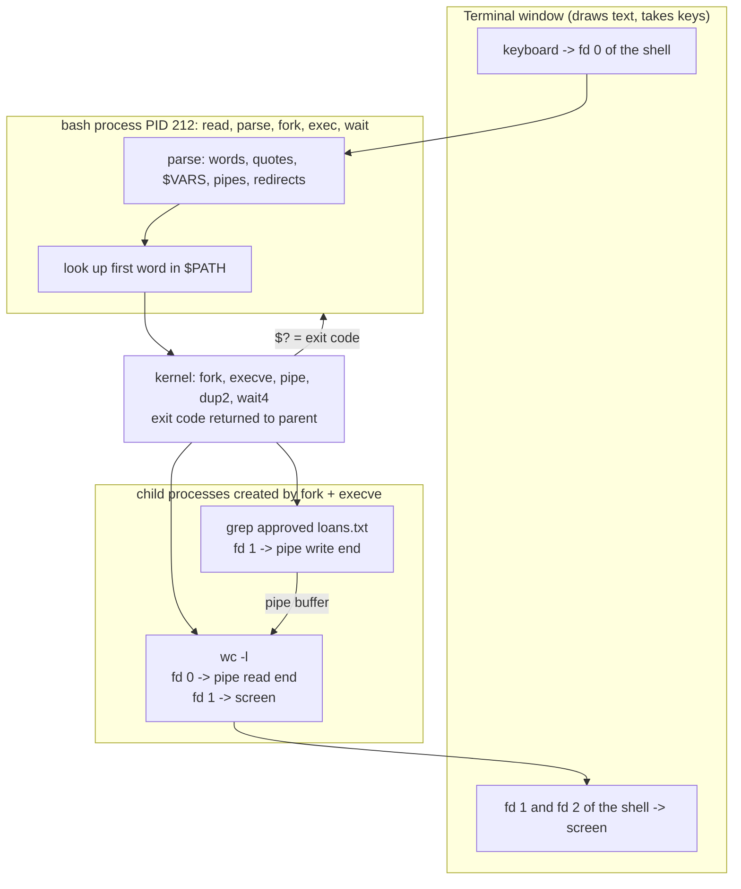

# Module 0.03: The terminal and Bash basics

**Estimated hours:** 3

**What you will learn**

1. What a terminal and a shell are, and why every systems engineer lives in one: the shell is just a program that starts other programs.
2. The twenty commands you will type every day (`pwd`, `ls`, `cd`, `mkdir`, `cp`, `mv`, `rm`, `cat`, `less`, `head`, `tail`, `grep`, `wc` and more), plus pipes and redirection to join them together.
3. How environment variables and `$PATH` tell the shell where programs live, and how to write and run your first shell script.

**Prerequisites:** [Module 0.02: The operating system, processes and files](module-02-operating-system-processes-files.md). You also need Git for Windows installed, because this module uses the **Git Bash** program that comes with it. Once Ubuntu exists in module 0.04, every command here works there unchanged.

---

## 1. One-line intuition

The shell is a program that reads one line you type, finds the program you named, starts it as a new process, waits for it to finish, and asks for the next line.

## 2. Real-life analogy

Go back to the office building from module 0.02. The building manager (the operating system) does not take orders from you directly. You talk to a **receptionist** at the front desk. That receptionist is the **shell**.

- You say "list the files in this cabinet". The receptionist does not list anything. She looks up a clerk called `ls` in the staff directory, sends him to the cabinet, and he reads the labels aloud. When he finishes, she turns back to you: "Next?"
- The **staff directory** is `$PATH`: a list of corridors where clerks have their offices. If you ask for a clerk who is in none of those corridors, she says "command not found".
- A **pipe** is the receptionist telling clerk A "whatever you would have said aloud, whisper it to clerk B instead". So `grep approved loans.txt | wc -l` means: clerk `grep` finds the approved lines and, instead of reading them to you, hands them to clerk `wc`, who counts them and tells you the number.
- **Redirection** (`>`) is "do not say it aloud, write it in this notebook".
- A **script** is a list of orders written on one sheet, so you can hand the receptionist the sheet instead of saying each order yourself.

The **terminal** is the room where you and the receptionist meet: the window that shows text and takes your typing. People say "terminal" and "shell" interchangeably, but they are two programs. The terminal draws characters. The shell interprets them.

## 3. Why it exists: the problem it solves

A graphical desktop is good for one task at a time with a mouse. It is bad at three things that systems work is made of:

1. **Repetition.** Renaming 400 log files, or running the same build on 12 machines, is unbearable with a mouse and one line in a shell.
2. **Composition.** No desktop app can "take the output of this and feed it into that". The shell does it with one character, `|`.
3. **Absence.** Servers have no screen. The database host in a bank's data centre has never had a monitor plugged in. Every interaction with it goes through a shell over the network. If you cannot drive a shell, you cannot touch production.

Everything else in this course assumes the shell: compiling (`gcc`), debugging (`gdb`), containers (`docker`), databases (`psql`), version control (`git`). Each of those is just another clerk the receptionist can call.

What breaks without it: you can still write code in an editor, but you cannot build it, test it, deploy it, or look at it when it crashes on a machine you cannot see.

## 4. Three layers of depth

### Layer 1 (beginner): the window, the prompt and the first commands

**Open Git Bash.** Press the Windows key, type `Git Bash`, press Enter. A black or purple window opens showing something like:

```text
msi1@DESKTOP-ABC123 MINGW64 ~
$
```

That line is the **prompt**. It says: user `msi1`, machine `DESKTOP-ABC123`, current folder `~` (which means your home folder). The `$` means "type here". Everything you type until Enter is one **command line**. The first word is the **command** (the program to run). The remaining words are **arguments** (what to run it on). Words starting with `-` are **options** (how to run it).

A note on paths. Git Bash is a small piece of Linux living on Windows. It shows Windows drives as folders: `C:\Users\msi1` is `/c/Users/msi1`, and `D:\System Engineer` is `/d/System Engineer`. Forward slashes, not backslashes. Case matters. This is exactly how real Linux paths look, which is why we learn here first.

Type each of the following, press Enter, and read the output before going on. The `$` is the prompt; do not type it.

**Where am I?**

```bash
$ pwd
/c/Users/msi1
```

`pwd` means "print working directory": the folder the shell is currently standing in (module 0.02 called this the process's current working directory; the shell is a process).

**Move to the course folder.** The space in the name must be protected with quotes, or the shell will think you gave it two arguments.

```bash
$ cd "/d/System Engineer"
$ pwd
/d/System Engineer
```

`cd` means "change directory". `cd ..` goes to the parent. `cd` alone (no argument) goes home. `cd -` goes back to where you were.

**What is here?**

```bash
$ ls
CLAUDE.md             phase-03-os-internals                       phase-09-build-test-delivery
README.md             phase-04-concurrency-deep-dive              phase-10-backend-fundamentals-and-system-design
Shakir_Resume_CPP.pdf phase-05-networking-and-servers             phase-11-security-and-banking-context
Shakir_Resume_CPP.tex phase-06-databases-from-zero-to-internals   phase-12-interview-mastery
capstones             phase-07-distributed-systems-and-yugabytedb solutions
journal               phase-08-debugging-performance-reliability
phase-00-how-a-computer-runs-a-program  phase-01-c-from-zero-to-systems  phase-02-cpp17-from-zero-to-modern
```

(The column layout depends on your window width.) `ls` lists the folder. `ls -l` gives one line per file with permissions, owner, size and date. `ls -a` also shows hidden files, which on Linux are simply files whose name starts with a dot, such as `.git` and `.gitignore`.

```bash
$ ls -la
total 329
drwxr-xr-x 1 msi1 197121     0 Oct 18 12:39 .
drwxr-xr-x 1 msi1 197121     0 Oct 18 12:39 ..
drwxr-xr-x 1 msi1 197121     0 Oct 18 12:39 .git
-rw-r--r-- 1 msi1 197121   300 Oct 18 12:25 .gitignore
-rw-r--r-- 1 msi1 197121 16204 Oct 18 12:39 CLAUDE.md
-rw-r--r-- 1 msi1 197121 61094 Oct 18 12:36 README.md
...
```

Read one line: `-rw-r--r--` is the permission string from module 0.02 (a leading `d` means directory). Then owner, group, size in bytes, last-modified date, name. Sizes and dates on your machine will differ.

**Make, copy, move, delete.** Build a scratch area so nothing in the course is at risk.

```bash
$ mkdir -p /c/Users/msi1/bashlab
$ cd /c/Users/msi1/bashlab
$ printf 'loan 1001 approved 250000\nloan 1002 rejected 80000\nloan 1003 approved 125000\n' > loans.txt
$ ls
loans.txt
$ cp loans.txt loans_backup.txt
$ mv loans_backup.txt old_loans.txt
$ ls
loans.txt  old_loans.txt
$ rm old_loans.txt
$ ls
loans.txt
```

`mkdir -p` creates a folder (and any missing parents; `-p` means "parents"). `cp source destination` copies. `mv` moves or renames (the same operation to the file system: it changes the name in the directory listing, module 0.02 Layer 3). `rm` deletes with no recycle bin and no confirmation. `rm -r folder` deletes a folder and everything in it. Treat `rm -r` with respect; there is no undo.

**Look inside files.**

```bash
$ cat loans.txt
loan 1001 approved 250000
loan 1002 rejected 80000
loan 1003 approved 125000
$ head -n 2 loans.txt
loan 1001 approved 250000
loan 1002 rejected 80000
$ tail -n 1 loans.txt
loan 1003 approved 125000
```

`cat` prints the whole file. `head -n N` prints the first N lines; `tail -n N` the last N. For a file longer than the screen use `less loans.txt`: it opens a pager where the arrow keys scroll, `/word` searches, and `q` quits. `tail -f server.log` keeps printing as a log file grows; you will watch servers this way for the rest of your career.

**Search and count.**

```bash
$ grep approved loans.txt
loan 1001 approved 250000
loan 1003 approved 125000
$ grep -n rejected loans.txt
2:loan 1002 rejected 80000
$ wc loans.txt
 3 12 77 loans.txt
$ wc -l loans.txt
3 loans.txt
```

`grep pattern file` prints every line containing the pattern (`-n` adds line numbers, `-i` ignores case, `-r` searches a whole folder tree). `wc` counts lines, words and bytes; `wc -l` counts only lines.

**Getting help.** `man ls` opens the manual page on Linux (Git Bash ships without most manuals; use `ls --help` instead, or search "man ls" online). Reading manual pages is a skill. Start with the SYNOPSIS line and the two or three options you need.

### Layer 2 (working engineer): streams, pipes, redirection, variables and scripts

**Three streams.** Module 0.02 said every process starts with three file descriptors: 0 (standard input, **stdin**), 1 (standard output, **stdout**) and 2 (standard error, **stderr**). The shell wires them for you: by default all three go to the terminal. Redirection and pipes re-wire them *before the program starts*, and the program never knows.

| Syntax | Meaning | Example |
|---|---|---|
| `cmd > file` | Send stdout to `file`, replacing it | `ls > listing.txt` |
| `cmd >> file` | Append stdout to `file` | `date >> run.log` |
| `cmd 2> file` | Send stderr (fd 2) to `file` | `gcc bad.c 2> errors.txt` |
| `cmd > out.txt 2>&1` | stdout to file, and stderr to wherever stdout now goes | Capture everything a build prints |
| `cmd < file` | Read stdin from `file` instead of the keyboard | `sort < names.txt` |
| `cmd1 \| cmd2` | Connect stdout of `cmd1` to stdin of `cmd2` | `grep approved loans.txt \| wc -l` |

Try the error stream now:

```bash
$ ls nofile.txt 2> errors.txt
$ echo "exit code was $?"
exit code was 2
$ cat errors.txt
ls: cannot access 'nofile.txt': No such file or directory
```

Nothing appeared on screen because the complaint went to `errors.txt`. `$?` holds the **exit code** of the last command (module 0.02: 0 means success, anything else means failure). Scripts and CI pipelines make every decision from this number.

Why is stderr separate from stdout? So that `./migrate > results.csv` gives you a clean CSV file while the error messages still appear on screen. Mixing them would corrupt the data file. Every tool you write in this course prints data to stdout and complaints to stderr.

**Pipes.** A pipeline is a chain of processes running at the same time, each one's output feeding the next one's input through a kernel buffer:

```bash
$ grep approved loans.txt | wc -l
2
$ cut -d' ' -f4 loans.txt | sort -n
80000
125000
250000
```

The second line: `cut` splits each line on spaces (`-d' '`) and keeps field 4 (`-f4`); `sort -n` sorts numerically. Four tiny programs, none of which knows about loans, together answer "what are the loan amounts in ascending order?". This is the Unix philosophy: small tools, text in, text out, joined by pipes.

**Environment variables.** Every process carries a list of `NAME=value` strings called its **environment** (module 0.02 listed it among what a process owns). The shell lets you read them with `$NAME`:

```bash
$ echo $HOME
/c/Users/msi1
$ echo $PATH
/c/Users/msi1/bin:/mingw64/bin:/usr/local/bin:/usr/bin:/bin:/mingw64/bin:/usr/bin:/c/Users/msi1/bin:/c/Windows/system32:...
```

(Your `$PATH` is longer and will differ.) `$PATH` is a colon-separated list of folders. When you type `ls`, the shell walks this list in order and runs the first `ls` it finds. `which` and `type` tell you which one won:

```bash
$ which git
/mingw64/bin/git
$ type ls
ls is hashed (/usr/bin/ls)
```

"Command not found" means no folder in `$PATH` contains a program with that name. Nine times out of ten the fix is installing the tool or adding its folder to `$PATH`. You will hit this in module 0.04 and 0.06.

Setting a variable: `name=value` with no spaces creates a shell variable. `export name=value` also passes it to every process the shell starts afterwards. The difference matters:

```bash
$ BANK=HDFC
$ echo $BANK
HDFC
$ bash -c 'echo "child sees: $BANK"'
child sees:
$ export BANK
$ bash -c 'echo "child sees: $BANK"'
child sees: HDFC
```

The first child shell saw nothing, because a plain variable belongs only to the current shell. After `export`, the variable is copied into the child's environment. Servers read their configuration this way: `DATABASE_URL`, `LOG_LEVEL`, `PORT`. Note that variables set in a window vanish when you close it. To make one permanent, add the `export` line to `~/.bashrc`, a script the shell runs every time it starts.

**Quoting.** `"double quotes"` keep spaces together but still expand `$VARIABLE`. `'single quotes'` keep everything literal. No quotes means the shell splits on spaces and expands `*` into matching file names (`ls *.txt`). Most beginner shell bugs are quoting bugs. The rule: quote every variable you expand, `"$file"`, unless you know why not.

**Your first script.** A script is a text file of commands. The first line, called the **shebang** (`#!`), names the program that should run the file:

```bash
$ printf '#!/bin/bash\necho "hello from script, PID $$"\n' > hi.sh
$ cat hi.sh
#!/bin/bash
echo "hello from script, PID $$"
$ chmod +x hi.sh
$ ls -l hi.sh
-rwxr-xr-x 1 msi1 197121 45 Oct 18 12:47 hi.sh
$ ./hi.sh
hello from script, PID 1219
```

`chmod +x` sets the execute permission bit (the `x` in `-rwxr-xr-x`). Without it, real Linux refuses to run the file with "Permission denied". Git Bash is lenient and often runs the file anyway; Ubuntu in module 0.04 will not be, so build the habit. `./hi.sh` means "the file `hi.sh` in this folder"; the `./` is needed because the current folder is deliberately not in `$PATH` (a security rule: otherwise a malicious `ls` dropped in a download folder would run when you typed `ls` there). `$$` is the PID of the shell running the script, which is a new process each run, so the number changes every time.

### Layer 3 (internals): what the shell actually does for one command line

Type `ls -l loans.txt` and press Enter. Here is what happens, in order, with the system calls from module 0.02 named:

1. **Read.** The shell has been blocked in a `read` on fd 0 (the terminal). Your Enter delivers the line.
2. **Parse.** It splits the line into words: `ls`, `-l`, `loans.txt`. It expands `$VARIABLES` and `*` patterns, and removes quotes. It notices any `|`, `>` or `<`.
3. **Look up.** If the first word is a **built-in** (such as `cd`, `echo`, `export`, `exit`), the shell does it itself. `cd` must be a built-in: changing the working directory of a child process would not change the shell's own. Otherwise the shell walks `$PATH` until it finds an executable file called `ls`.
4. **fork.** The shell calls `fork()`. The kernel makes a copy of the shell process: a child with a new PID, the same memory contents, the same open file descriptors, the same environment. Now there are two shells.
5. **Redirect, in the child.** If you wrote `> out.txt`, the child opens `out.txt` and uses `dup2` to make fd 1 point at it. For a pipe, the parent created a kernel pipe earlier with `pipe()`, and the left child's fd 1 and the right child's fd 0 are pointed at its two ends. The programs are not involved; they just write to fd 1 and read from fd 0 as always.
6. **exec.** The child calls `execve("/usr/bin/ls", ["ls", "-l", "loans.txt"], environment)`. The kernel throws away the child's memory and loads the `ls` program's bytes into it (module 0.01: a program is bytes copied into RAM). The PID and the file descriptors survive. The child is now `ls`, not a shell.
7. **wait.** The parent shell calls `wait4(child_pid)` and sleeps until the child exits. The kernel stores the child's exit code, the shell collects it into `$?`.
8. **Prompt.** The shell prints the prompt and goes back to step 1.

For `cmd1 | cmd2` the shell forks twice, connects them with the pipe, and waits for both. For `cmd &` it skips step 7 and the program runs in the background.

This is why the shell is "just a program". It has no special powers. Anything it does, your C program can do with the same five calls: `fork`, `execve`, `pipe`, `dup2`, `wait4`. You will write a toy shell in module 3.02 and see exactly these calls with `strace` in module 3.07. PowerShell on Windows does the same job with `CreateProcess` instead of fork and exec.

You can watch the process tree right now:

```bash
$ echo $$
212
$ bash
$ echo $$
987
$ ps
      PID    PPID    PGID     WINPID   TTY         UID    STIME COMMAND
      212       1     212      22288  ?         197609 12:47:23 /usr/bin/bash
      987     212     987      14120  ?         197609 12:52:01 /usr/bin/bash
     1004     987     987       7688  ?         197609 12:52:09 /usr/bin/ps
$ exit
$ echo $$
212
```

(PIDs differ on your machine.) The inner `bash` has PPID 212, the outer shell: it was forked by it. `ps` has PPID 987: forked by the inner shell. `exit` ends the inner shell, and the outer one, which was waiting, wakes up.

## 5. Architecture diagram



The shell never touches the data flowing through the pipe. It only sets up the plumbing and waits.

## 6. Code

Two pieces. The first is a real shell script you will use again: it summarises a loans file and demonstrates arguments, exit codes, redirection and pipes. The second is a 40-line C program that does what the shell does in Layer 3 (fork, exec, wait) so you can see there is no magic. Run the C program on <https://www.onlinegdb.com/> (language C) until Ubuntu exists in module 0.04.

**The script.** Save as `loan_report.sh` in your `bashlab` folder.

```bash
#!/bin/bash
# loan_report.sh: summarise a loans file.
# Usage: ./loan_report.sh loans.txt
# Exit codes: 0 ok, 1 wrong usage, 2 file missing.

set -u                       # error if we use an unset variable (catches typos)

if [ "$#" -ne 1 ]; then      # $# = number of arguments
    echo "usage: $0 <loans file>" >&2      # usage goes to stderr, not stdout
    exit 1
fi

file="$1"                    # $1 = first argument

if [ ! -f "$file" ]; then
    echo "error: '$file' not found" >&2
    exit 2
fi

total=$(wc -l < "$file")                      # $( ) captures a command's output
approved=$(grep -c approved "$file")          # -c counts matching lines
rejected=$(grep -c rejected "$file")
amount=$(grep approved "$file" | cut -d' ' -f4 | paste -sd+ | bc)   # sum column 4

echo "file     : $file"
echo "loans    : $total"
echo "approved : $approved"
echo "rejected : $rejected"
echo "approved amount : $amount"
exit 0
```

Run it three ways so you see all three exit codes:

```bash
$ chmod +x loan_report.sh
$ ./loan_report.sh loans.txt
file     : loans.txt
loans    : 3
approved : 2
rejected : 1
approved amount : 375000
$ echo $?
0
$ ./loan_report.sh
usage: ./loan_report.sh <loans file>
$ echo $?
1
$ ./loan_report.sh missing.txt 2> /dev/null
$ echo $?
2
```

The last run sent stderr to `/dev/null`, a special file that discards everything, so the error line vanished but the exit code still reported failure. That is the contract between tools and scripts: words for humans on stderr, a number for machines in the exit code.

**The mini shell in C.** This program runs one fixed command, `ls -l`, the way bash does.

```c
/* mini_shell.c
 * Runs "ls -l" exactly the way a shell does: fork, execvp, waitpid.
 * Shows that a shell is an ordinary program using ordinary system calls.
 */
#include <stdio.h>
#include <stdlib.h>
#include <unistd.h>      /* fork, execvp, getpid */
#include <sys/wait.h>    /* waitpid, WEXITSTATUS */

int main(void) {
    char *argv[] = { "ls", "-l", NULL };   /* the command line, split into words */

    printf("shell: I am PID %d, about to fork\n", (int)getpid());

    pid_t pid = fork();                    /* 1. duplicate this process */
    if (pid < 0) {
        perror("fork");
        return 1;
    }

    if (pid == 0) {
        /* 2. child: replace myself with the ls program. PATH is searched. */
        printf("child: I am PID %d, calling execvp\n", (int)getpid());
        fflush(stdout);                    /* push the line out before exec wipes us */
        execvp(argv[0], argv);
        perror("execvp");                  /* only reached if exec failed */
        _exit(127);                        /* 127 = command not found, by convention */
    }

    /* 3. parent: wait for the child and collect its exit code. */
    int status = 0;
    waitpid(pid, &status, 0);
    if (WIFEXITED(status)) {
        printf("shell: child %d exited with code %d\n", (int)pid, WEXITSTATUS(status));
    }
    return 0;
}
```

Local compile and run on Linux (after module 0.04):

```bash
gcc -Wall -Wextra -o mini_shell mini_shell.c
./mini_shell
```

Expected output (PIDs and the file listing will differ):

```text
shell: I am PID 4312, about to fork
child: I am PID 4313, calling execvp
total 24
-rwxr-xr-x 1 shakir shakir 16104 Oct 18 13:02 mini_shell
-rw-r--r-- 1 shakir shakir  1193 Oct 18 13:01 mini_shell.c
shell: child 4313 exited with code 0
```

The child's PID is the parent's plus one (typically; not guaranteed). The `ls` output appears in the middle because the child *became* `ls` and inherited fd 1, the screen. Change `"ls"` to `"nosuchcommand"` and run again: `execvp` fails, `perror` prints "No such file or directory", and the parent reports exit code 127. That is exactly what bash prints as "command not found".

## 7. Use case: core-banking loan-origination platform

Resume claim H1 describes a C migration engine moving Berkeley DB records into YugabyteDB in "restartable batches". The engine itself was C. But nobody ran it by typing a command. It was driven by a Bash script, and the shell's three ideas from Layer 2 shaped the design:

- **Exit codes as the control signal.** The migration binary returned 0 when a batch completed and verified, and a distinct non-zero code for "source unavailable", "target rejected rows" and "parity mismatch". The runner script was a loop: run batch N, check `$?`, on 0 record N as done and continue, on anything else stop and page a human. The decision this drove: the engine must never print "ok" and return 0 when something is wrong; the exit code is the only thing the automation reads.
- **stderr versus stdout.** Each batch wrote the IDs of migrated records to stdout, redirected into a per-batch file (`> batch_0042.ids`), and diagnostics to stderr, appended to one log (`2>> migrate.log`). The parity suite (claim H3) later consumed the `.ids` files. If a single warning had leaked onto stdout, the parity tool would have read it as a record ID. Separating the streams was not style; it was what made the pipeline composable.
- **Restartability through files.** Because every finished batch left a file behind, restarting after a crash was `ls batches/ | wc -l` to find where to resume. The shell's view of the world (files, exit codes, text) is what made "restartable" cheap to implement.

The cutover runbook for claim H3 was itself a numbered list of shell commands, each with its expected output written next to it, so that at 2 a.m. the operator compared screens instead of thinking. You will write that runbook in capstone C4.

## 8. Lab

Work in Git Bash, inside `/c/Users/msi1/bashlab` (make it with `mkdir -p` if you have not). Write down every output; the journal needs them.

### Part A: navigation and files (20 minutes)

1. Run `pwd`, then `cd "/d/System Engineer"`, then `pwd` again. Then `ls`, then `ls -la`, then `ls -l phase-00-how-a-computer-runs-a-program`.
2. Run `cd ..` and `pwd`. Then `cd -` and `pwd`. Then `cd` alone and `pwd`.
3. Go to `bashlab`. Create `bank/branches/mumbai` in one command with `mkdir -p`. Create three empty files in it with `touch bank/branches/mumbai/{a,b,c}.txt`. List the folder. Copy the whole tree with `cp -r bank bank2`. Delete `bank2` with `rm -r bank2`.
4. Run `ls /nonexistent` and then `echo $?`.

Expected: Part A step 2 ends in your home folder `/c/Users/msi1`. Step 3 lists `a.txt b.txt c.txt`. Step 4 prints an error on stderr and `$?` is 2 (the exit code `ls` uses for a missing argument).

### Part B: streams, pipes and redirection (25 minutes)

1. Recreate `loans.txt` with the `printf` from Layer 1 if it is gone. Add two more lines with `>>`:

```bash
echo "loan 1004 approved 500000" >> loans.txt
echo "loan 1005 rejected 30000" >> loans.txt
```

2. Run `cat loans.txt`, `wc -l loans.txt`, `grep -c approved loans.txt`, `grep -c rejected loans.txt`.
3. Run `grep approved loans.txt | cut -d' ' -f4 | sort -n | tail -n 1`. Predict the answer before pressing Enter.
4. Run `ls loans.txt nofile.txt > out.txt 2> err.txt`, then `cat out.txt` and `cat err.txt`. Then run `ls loans.txt nofile.txt > both.txt 2>&1` and `cat both.txt`.
5. Run `cat loans.txt | less`. Press `/rejected`, Enter, then `q`.

Expected: 5 lines, 3 approved, 2 rejected. Step 3 prints `500000`. In step 4, `out.txt` holds the one good name and `err.txt` holds the complaint; `both.txt` holds both lines.

### Part C: environment and PATH (20 minutes)

1. Run `echo $HOME`, `echo $USER`, `echo $PATH | tr ':' '\n'` (this turns colons into newlines so one folder prints per line). Count the folders with `echo $PATH | tr ':' '\n' | wc -l`.
2. Run `which ls`, `which git`, `which gcc`. The last one prints nothing (and exits 1) because no compiler exists yet. In module 0.04 the same command inside Ubuntu will print `/usr/bin/gcc`.
3. Do the `BANK=HDFC` experiment from Layer 2 exactly as printed: plain assignment, `bash -c`, `export`, `bash -c` again.
4. Run `env | wc -l` to count how many variables your shell carries. Run `env | grep -i path` to see every variable with "path" in its name.

Expected: typical Git Bash has 10 to 30 entries in `$PATH` and 50 to 120 environment variables. The first `bash -c` prints `child sees:` with nothing after it; the second prints `child sees: HDFC`.

### Part D: the script and the process tree (25 minutes)

1. Create `loan_report.sh` from section 6. Run `chmod +x loan_report.sh`, then run it on `loans.txt`, with no argument, and with `missing.txt`. Check `$?` after each.
2. Edit the script so a file with zero approved loans does not crash the `bc` line. (Hint: `grep -c` prints `0` but `grep approved ... | cut ... | paste ... | bc` prints nothing for an empty input. Test with a file containing only rejected lines. Simplest fix: `amount=${amount:-0}` after the line, which means "if empty, use 0".)
3. Run `echo $$`, then `bash`, then `echo $$`, then `ps`, then `exit`. Draw the parent-child tree from the PID and PPID columns.
4. Paste `mini_shell.c` into onlinegdb and run it. Then change `"ls"` to `"nosuchcommand"` and run again. Record both exit codes.

Expected: step 1 gives exit codes 0, 1, 2. Step 3 shows the inner bash with PPID equal to the outer bash's PID. Step 4 gives `exited with code 0` then `execvp: No such file or directory` and `exited with code 127`.

<details>
<summary>Why 127?</summary>

By convention shells return 127 when the command was not found and 126 when it was found but could not be executed (for example, missing the `x` bit). Exit codes above 128 mean the process was killed by a signal: 128 + signal number, so 139 is a segmentation fault (signal 11). You will see 139 in module 1.11.

</details>

### Journal

Copy [journal/TEMPLATE.md](../journal/TEMPLATE.md) to `journal/YYYY-MM-DD-terminal-and-bash.md`. Record: the number of folders in your `$PATH` and the number of environment variables; the exit codes from Part D step 1 and step 4; the PID tree from Part D step 3; and the fix you made in Part D step 2. Under "Problems I hit", write down every "command not found" or quoting error you made and what fixed it.

## 9. Common mistakes and misconceptions

| Mistake | Why it is wrong | Bug it causes later |
|---|---|---|
| "The terminal and the shell are the same thing" | The terminal draws text; the shell (bash) interprets commands and starts processes | Confusion when a script behaves differently in Windows Terminal, VS Code and over SSH |
| `cd "D:\System Engineer"` in Bash | Bash uses `/d/System Engineer`; backslashes are escape characters | Paths silently mangled; "No such file or directory" |
| Forgetting quotes around a path with spaces | The shell splits on spaces into two arguments | `cd` goes to the wrong place; `rm` deletes the wrong file |
| `rm -rf` without reading the path twice | No undo, no recycle bin | Deleting the wrong tree; the famous `rm -rf $DIR/` with `DIR` unset becomes `rm -rf /` |
| `>` when `>>` was meant | `>` truncates the file first | A log file wiped at every run |
| Printing errors to stdout | Downstream tools read them as data | Corrupt CSV, parity tool reading an error line as a record ID |
| "Running `./script.sh` and `source script.sh` are the same" | `./` runs in a child process; `source` runs in the current shell | `cd` and variables set in the script "do not work" when run with `./` |
| Treating `$?` as the result of the whole pipeline | It is the exit code of the last command only | A failing `grep` hidden behind a succeeding `wc`; use `set -o pipefail` |
| Putting `.` in `$PATH` | A malicious file named `ls` in any folder you enter would run | Classic privilege-escalation trick on shared servers |

## 10. Resume link

- **Claim A, "Bash".** An interviewer who sees Bash on a resume asks a practical question: "How would you count the error lines in a 2 GB log without opening it?" Answer: `grep -c ERROR app.log`, or `grep ERROR app.log | wc -l`, and explain that `grep` streams the file and never loads it all into memory. Then mention `tail -f` for live logs. Use your Part B numbers as the example.
- **Claim H1, "restartable leak-free batches".** The restartability story in section 7 is a shell story: per-batch output files, exit codes, a runner loop. Say: "The engine returned distinct exit codes for each failure class, and the Bash runner made every decision from `$?`, so a crash at batch 42 resumed at batch 42."
- **Claim G, "Linux".** Being able to explain fork, exec and wait when asked "what happens when you type `ls`" is the fastest way to show you understand Linux rather than just use it. The eight steps in Layer 3 are your answer.
- **Claim F, "incident triage".** Triage on a server is `ps`, `tail -f`, `grep`, `wc` and redirection, over SSH, under time pressure. Every lab from here on builds that fluency.

Likely follow-up: "What is the difference between `>` and `|`?" Answer: `>` sends a process's stdout to a file; `|` sends it to another process's stdin through a kernel pipe buffer, with both processes running at the same time.

## 11. Interview questions

**Q1 (easy). What is the difference between a terminal and a shell?**

<details>
<summary>Model answer</summary>

The terminal is the program that draws characters on screen and sends keystrokes: Windows Terminal, the Git Bash window, the VS Code terminal panel. The shell is the program running inside it that reads command lines, finds programs, starts them as processes and reports their results: bash, zsh, PowerShell. You can run the same shell in different terminals, and different shells in the same terminal. Over SSH there is no local terminal at all; the shell runs on the remote machine and the bytes travel over the network.

</details>

**Q2 (easy). What does `$PATH` do, and what does "command not found" mean?**

<details>
<summary>Model answer</summary>

`$PATH` is an environment variable holding a colon-separated list of directories. When a command is typed that is not a shell built-in and does not contain a slash, the shell searches those directories in order and executes the first matching executable file. "Command not found" means no directory in the list contains a file by that name. The fix is to install the program, add its directory to `$PATH` (usually with an `export PATH="$PATH:/new/dir"` line in `~/.bashrc`), or call it by its full path.

</details>

**Q3 (medium). Explain what `grep ERROR app.log | sort | uniq -c > counts.txt 2> errors.txt` does, including how many processes run.**

<details>
<summary>Model answer</summary>

The shell starts three processes at the same time: `grep`, `sort` and `uniq`. `grep` reads `app.log` and writes lines containing ERROR to its stdout, which is connected by a pipe to `sort`'s stdin. `sort` writes sorted lines into a second pipe read by `uniq -c`, which collapses repeated lines and prefixes each with its count. The `>` redirects `uniq`'s stdout to `counts.txt`, and `2>` redirects `uniq`'s stderr to `errors.txt`. Note the redirections apply only to the last command; errors from `grep` or `sort` still go to the terminal. By default `$?` afterwards is `uniq`'s exit code; with `set -o pipefail` it would be the first non-zero code in the pipeline.

</details>

**Q4 (medium). Why is `cd` a shell built-in rather than a separate program like `ls`?**

<details>
<summary>Model answer</summary>

Every external command runs in a child process created by `fork` and `exec`. The current working directory is a property of a process. If `cd` were an external program, it would change the child's directory, the child would exit, and the shell's own directory would be unchanged. So `cd` must be executed by the shell process itself, using the `chdir` system call. The same logic applies to `export` and `exit`: they change the state of the shell, so they cannot be delegated to a child. This is also why `source script.sh` behaves differently from `./script.sh`: `source` runs the commands in the current shell, so its `cd` and variables persist.

</details>

**Q5 (hard). Walk through the system calls a shell makes to run `ls -l > out.txt`, and explain why `ls` does not need to know about the redirection.**

<details>
<summary>Model answer</summary>

The shell reads the line from fd 0, parses it into the words `ls` and `-l` plus a redirection of fd 1 to `out.txt`, and resolves `ls` by searching `$PATH`. It calls `fork`, producing a child with a copy of its memory and file descriptor table. In the child, before exec, the shell opens `out.txt` with `open(O_WRONLY|O_CREAT|O_TRUNC)`, obtaining some descriptor such as 3, then calls `dup2(3, 1)` so that fd 1 now refers to the file, and closes 3. It then calls `execve("/usr/bin/ls", ["ls","-l"], envp)`, which replaces the child's code and data with the `ls` program while keeping the descriptor table. `ls` simply writes to fd 1 as it always does; it has no way to tell whether fd 1 is a terminal, a file or a pipe (it can ask with `isatty`, which is why `ls` drops colours when piped, but it does not need to). The parent calls `wait4` on the child's PID, gets its exit status, stores it in `$?`, and prints the next prompt. Redirection is therefore set up entirely by the shell in the gap between fork and exec, which is the design reason Unix separates those two calls.

</details>

## 12. Revision

- The shell (bash) is an ordinary program: read a line, find the program in `$PATH`, `fork`, set up redirections in the child, `execve`, `wait4`, store the exit code in `$?`, repeat.
- Every process has stdin (0), stdout (1), stderr (2); `>` and `>>` redirect stdout to a file, `2>` redirects stderr, `|` connects one process's stdout to the next one's stdin; data goes to stdout, complaints to stderr, success or failure to the exit code.
- `export` passes a variable to child processes; a script is a text file with `#!/bin/bash` on line 1 and the `x` permission bit, run with `./name.sh`.

---

Previous: [Module 0.02: The operating system, processes and files](module-02-operating-system-processes-files.md) | Next: [Module 0.04: Linux lab setup](module-04-linux-lab-setup.md)
