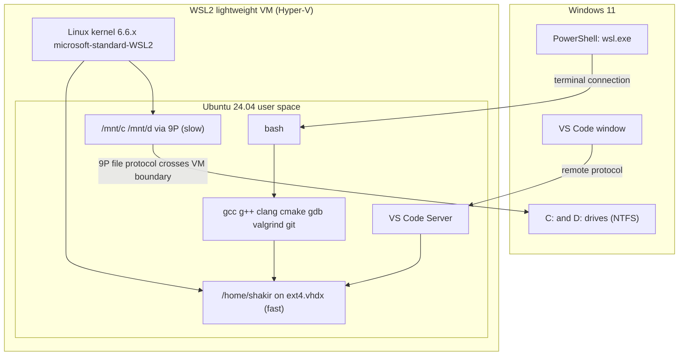

# Module 0.04: Linux lab setup

**Estimated hours:** 4

**What you will learn**

1. What WSL2 is (a real Linux kernel running in a lightweight virtual machine inside Windows) and how to install Ubuntu 24.04 with one command.
2. How to install and verify the Linux toolchain this whole course uses: GCC, Clang, CMake, GDB, Valgrind, Git, pkg-config, and VS Code connected to WSL.
3. What a compiler, a build system, a debugger and a memory checker each do, by building, debugging and leak-checking your first programs.

**Prerequisites:** [Module 0.03: The terminal and Bash basics](module-03-terminal-and-bash-basics.md). You need Windows 11, about 10 GB of free disk on `C:`, administrator rights on your PC, and an internet connection. Set aside an uninterrupted afternoon: installs involve a reboot and several downloads.

---

## 1. One-line intuition

WSL2 puts a complete, real Linux inside your Windows laptop, so you can build and break programs exactly the way they are built and broken on bank servers, without buying a second machine.

## 2. Real-life analogy

Imagine your Windows PC is a house. You want to practise plumbing the way it is done in another country, where the pipes, fittings and rules are different. You could buy a second house there (a second computer), or you could build a fully equipped workshop in your garage that follows the other country's rules exactly.

- **The garage workshop** is **WSL2**: a small, fast virtual machine that runs a genuine Linux kernel beside Windows. Windows still owns the house. Linux owns the garage.
- **Ubuntu** is the set of tools and shelves Canonical has arranged inside the workshop: the shell from module 0.03, a package manager, thousands of ready-made programs.
- **`apt`**, the package manager, is a hardware store with delivery. `sudo apt install gcc` means "please deliver a compiler and put it on the right shelf". No searching websites, no installers, no "next, next, finish".
- **GCC and Clang** are two brands of the same tool: a **compiler**, which turns the C text you write into the machine-code bytes from module 0.01.
- **CMake** is the foreman who reads one description of the job and tells the compiler exactly which files to build in which order.
- **GDB** is a pause button for a running program. You stop it on any line and look at every variable.
- **Valgrind** is an inspector who watches every byte of memory the program touches and reports what it forgot to give back.
- **VS Code** is the workbench with good light: an editor that opens files inside the garage while its window lives in the house.

## 3. Why it exists: the problem it solves

Every production system on your resume runs on Linux: the migration engine, the application server, PostgreSQL, YugabyteDB, Redis. Windows is where you read email. You could learn C on Windows with Visual Studio alone, and module 0.06 does set that up, but three things would be missing:

1. **The same tools as production.** GCC, GDB, Valgrind, `perf`, `strace`, core dumps, `/proc`: Linux-only, and they are what an interviewer for a C++ systems role expects you to know by hand.
2. **The same behaviour as production.** `sizeof(long)` is 8 on Linux and 4 on Windows (module 0.01). Paths, line endings, signals, file descriptors, threads all differ. A program tested only on Windows surprises you on the server.
3. **Reproducibility.** `apt install` gives everyone the same versions. "Works on my machine" dies here.

Before WSL2 (2019), the choices were dual boot (reboot to switch), a full virtual machine (slow, clumsy file sharing), or a cloud server (money, latency). WSL2 starts in about a second, shares your clipboard and network, and is a real Linux kernel, so everything from `gdb` to Docker works. Without it, half the labs in this course could not run on your laptop.

## 4. Three layers of depth

### Layer 1 (beginner): install Ubuntu and the tools

**Step 1: install WSL2 and Ubuntu 24.04.** Right-click the Start button, choose **Terminal (Admin)** (or **Windows PowerShell (Admin)**), accept the prompt, and type:

```powershell
wsl --install -d Ubuntu-24.04
```

Expected: several lines of "Installing: Windows Subsystem for Linux", "Installing: Ubuntu 24.04 LTS", and a progress bar. The download is about 500 MB to 1 GB. At the end it either says the install is complete or asks you to restart. **Restart the PC** when asked, even if it looks finished; the virtualisation features need a reboot.

If `wsl --install` says WSL is already installed, run `wsl --install -d Ubuntu-24.04` again; it will add just the distribution. If it complains that virtualisation is disabled, enable "Intel VT-x", "AMD-V" or "SVM" in your BIOS/UEFI settings; the exact menu depends on the laptop maker.

**Step 2: create your Linux user.** After the reboot an Ubuntu window opens by itself (if not, press Start, type `Ubuntu 24.04`, Enter). It asks:

```text
Enter new UNIX username: shakir
New password:
Retype new password:
```

Use a short lowercase name with no spaces. **Typing the password shows nothing on screen, not even stars.** That is normal on Linux. This user is separate from your Windows user, and this password is what `sudo` asks for later. You then land at a prompt:

```text
shakir@DESKTOP-ABC123:~$
```

Same shape as Git Bash in module 0.03: user, machine, folder, `$`. Everything from that module works here.

**Step 3: verify WSL from the Windows side.** In a normal (non-admin) PowerShell:

```powershell
wsl --version
wsl -l -v
```

Expected output (your version numbers will differ; the shape matters):

```text
WSL version: 2.5.9.0
Kernel version: 6.6.87.2-1
...
  NAME            STATE           VERSION
* Ubuntu-24.04    Running         2
```

The `2` in the VERSION column is what matters: WSL version 2, with the real kernel. If you ever see `1`, run `wsl --set-version Ubuntu-24.04 2`.

**Step 4: update Ubuntu and install the toolchain.** In the Ubuntu window:

```bash
sudo apt update && sudo apt install -y build-essential gcc g++ clang cmake gdb valgrind git pkg-config
```

`sudo` means "do this as the administrator (root)". It asks for the password you set in step 2. `apt update` refreshes the catalogue of available packages; `apt install -y` installs the listed ones and says yes to the confirmation. `build-essential` is a bundle containing `gcc`, `g++`, `make` and the C library headers. Expect 2 to 5 minutes and about 1 GB of downloads. The final lines look like:

```text
Setting up valgrind (1:3.22.0-0ubuntu3) ...
Setting up g++ (4:13.2.0-7ubuntu1) ...
Setting up build-essential (12.10ubuntu1) ...
Processing triggers for libc-bin (2.39-0ubuntu8.4) ...
```

**Step 5: verify every tool.** Run each command. Every one must print a version, not "command not found". Versions shown are typical for Ubuntu 24.04 in 2026; yours may be a patch release newer.

```bash
$ gcc --version
gcc (Ubuntu 13.3.0-6ubuntu2~24.04) 13.3.0
$ g++ --version
g++ (Ubuntu 13.3.0-6ubuntu2~24.04) 13.3.0
$ clang --version
Ubuntu clang version 18.1.3 (1ubuntu1)
$ cmake --version
cmake version 3.28.3
$ gdb --version
GNU gdb (Ubuntu 15.0.50.20240403-0ubuntu1) 15.0.50.20240403-git
$ valgrind --version
valgrind-3.22.0
$ git --version
git version 2.43.0
$ pkg-config --version
1.8.1
$ uname -r
6.6.87.2-microsoft-standard-WSL2
```

(Each `--version` prints extra copyright lines; only the first line is shown.) The last line is the kernel. `microsoft-standard-WSL2` tells you this is the Linux kernel Microsoft builds for WSL. It is a real Linux kernel, open source, based on the long-term-support 6.6 series.

**Step 6: install VS Code and connect it to WSL.** On Windows, download and install VS Code from <https://code.visualstudio.com/> (keep the default options; tick "Add to PATH" if offered). Open it, press `Ctrl+Shift+X` for Extensions, search **WSL**, and install the one published by Microsoft (its identifier is `ms-vscode-remote.remote-wsl`). Close VS Code.

Back in the Ubuntu window:

```bash
mkdir -p ~/labs/hello && cd ~/labs/hello
code .
```

The first time, `code .` prints a few lines about installing "VS Code Server" into Ubuntu, then a VS Code window opens on Windows. Look at the bottom-left corner: a green box saying **WSL: Ubuntu-24.04**. The window is on Windows; the files and every terminal inside it are in Linux. Inside that window press `Ctrl+Shift+X` again and install **C/C++** (`ms-vscode.cpptools`) and **CMake Tools** (`ms-vscode.cmake-tools`); you will see "Install in WSL: Ubuntu-24.04" on the button, which is correct.

Open a terminal inside VS Code with `` Ctrl+` ``. It is a bash shell inside Ubuntu. From now on you can work entirely in this window.

**Where your files live.** This is the one thing about WSL2 that confuses everyone, so read it twice:

| Path in Ubuntu | What it is | Speed for builds |
|---|---|---|
| `/home/shakir` (also written `~`) | Linux's own disk, stored as one big file (`ext4.vhdx`) under `C:\Users\msi1\AppData\Local\...` | Fast: native Linux file system |
| `/mnt/c/Users/msi1` | Your Windows `C:` drive, mounted into Linux | Slow: every file operation crosses from the VM to Windows |
| `/mnt/d/System Engineer` | The course folder on `D:` | Slow, same reason |

From Windows, your Linux home is reachable in File Explorer at `\\wsl.localhost\Ubuntu-24.04\home\shakir`. So both sides can see both worlds, but each side is fast only on its own disk. **Rule for this course: keep source code and build folders under `/home/<user>`. Use `/mnt/d` only to copy things across.** The lab measures the difference so you believe it.

Recommended: in module 0.07 you will clone the course repository itself into `~/course` inside Ubuntu and write journal entries there with Git. Until then, your journal files stay in `D:\System Engineer\journal`, which Ubuntu sees at `/mnt/d/System\ Engineer/journal`.

### Layer 2 (working engineer): what each tool is and how you drive it

**The compiler (gcc, g++, clang).** A compiler reads source text and produces an executable file. `gcc` compiles C; `g++` compiles C++; `clang` and `clang++` are the same jobs by a different team (the LLVM project). You install both because they catch different mistakes and because production code must build with whatever the customer uses. The flags you will type a thousand times:

| Flag | Meaning | Why |
|---|---|---|
| `-Wall -Wextra` | Turn on (almost) all warnings | Warnings are bugs the compiler can see; read every one |
| `-Werror` | Treat warnings as errors | Forces you to fix them; the resume says tcpkv is "clean under -Wall -Wextra -Werror" |
| `-g` | Include debugging information (line numbers, variable names) | Without it GDB shows addresses, not source |
| `-O0` / `-O2` | No optimisation / optimise for speed | Debug with `-O0` (module 0.01 Part E showed why), measure with `-O2` |
| `-std=c11` / `-std=c++17` | Which language version | The resume says C++17 |
| `-o name` | Name of the output file | Default is `a.out`, which is useless |
| `-pthread` | Enable threads | From Phase 3 on |
| `-l<lib>` | Link a library, for example `-ldb` for Berkeley DB | Module 0.05 |

**The build system (CMake).** For one file, `gcc hello.c` is enough. A real project has 50 files, three libraries, tests, and must build on Linux with GCC and on Windows with MSVC. CMake reads a file called `CMakeLists.txt` that describes *what* to build (targets, sources, libraries, flags) and generates the instructions for *how* on this machine (a Makefile on Linux, a Visual Studio solution on Windows). Two commands:

```bash
cmake -S . -B build          # configure: read CMakeLists.txt, write build/ (once, or after editing CMakeLists.txt)
cmake --build build          # build: compile what changed
```

`-S .` is the source folder, `-B build` the build folder. Keeping build output in its own folder (an **out-of-source build**) means `rm -rf build` is a clean slate and your source folder stays tidy. Every capstone uses this layout.

**The debugger (GDB).** GDB runs your program under its control. The commands you need today:

| Command | Short form | Does |
|---|---|---|
| `break main` | `b main` | Stop when `main` starts (you can also `b hello.c:12`) |
| `run` | `r` | Start the program |
| `next` | `n` | Run one source line, stepping over function calls |
| `step` | `s` | Run one source line, stepping into function calls |
| `print x` | `p x` | Show the value of variable `x` |
| `backtrace` | `bt` | Show the chain of function calls that led here |
| `continue` | `c` | Run until the next breakpoint or the end |
| `quit` | `q` | Leave GDB |

GDB only knows about lines and variables if you compiled with `-g`. Compile with `-g -O0` while debugging.

**The memory checker (Valgrind).** C makes you ask for memory (`malloc`) and give it back (`free`) yourself (module 1.07). Forgetting to free is a **leak**: a long-running server slowly eats all RAM and dies. Reading memory you never asked for is **undefined behaviour** that may work by luck today and crash tomorrow. Valgrind's Memcheck tool runs your program slowly (20 to 50 times slower is typical) and reports every leak and every bad read or write with the exact source line. Run as `valgrind --leak-check=full ./program`. The result you want is `ERROR SUMMARY: 0 errors` and `definitely lost: 0 bytes`.

**pkg-config.** A small helper that tells you the compiler flags a library needs: `pkg-config --cflags --libs gtest` prints the `-I` and `-l` flags. CMake uses it under the hood. You installed it so module 0.05 works.

**Keeping WSL healthy.** `wsl --shutdown` from PowerShell stops the VM (it restarts on the next Ubuntu command). `wsl --update` updates the WSL engine and kernel. `sudo apt update && sudo apt upgrade -y` inside Ubuntu updates the packages. Do the apt one monthly.

### Layer 3 (internals): what WSL2 is, what a compile is, how a breakpoint works

**WSL2 is a virtual machine, but a special one.** Windows runs a small, hidden VM on the Hyper-V platform, the same technology that runs cloud servers. Inside it runs a Linux kernel compiled by Microsoft from the standard kernel source (with patches for WSL and published on GitHub). It boots in under a second because the VM is tiny and the kernel is small. Memory is given to the VM on demand and returned to Windows when Linux frees it. Your Ubuntu distribution is a disk image (`ext4.vhdx`) attached to that VM. `wsl.exe` is the Windows program that talks to the VM, which is why typing `wsl` in PowerShell drops you into a Linux shell: it is a terminal connection into the VM, exactly like SSH to a server.

**Why `/mnt/d` is slow.** The Windows drives are not inside the VM. Linux reaches them through a network file protocol called 9P (originally from Plan 9) over a virtual connection to Windows. Every `open`, `read` and `stat` becomes a message across the VM boundary and a Windows NTFS operation. A C build does thousands of such calls (the compiler opens every header; `make` stats every file), so builds on `/mnt/d` are often several times slower than on `/home`. Inside `/home`, the ext4 file system talks to a virtual disk with no boundary crossing. You will time the difference in Part D.

**What "compiling" actually is.** `gcc -o hello hello.c` is a driver that runs four programs:

1. **Preprocessor** (`cpp`): handles `#include` and `#define` by pasting header files in and replacing macros. Output: one large C file. See it with `gcc -E hello.c`.
2. **Compiler proper** (`cc1`): turns C into assembly text, the instructions from module 0.01. See it with `gcc -S hello.c`, which writes `hello.s`.
3. **Assembler** (`as`): turns assembly text into machine-code bytes in an **object file** `hello.o`. See it with `gcc -c hello.c`.
4. **Linker** (`ld`): joins your object files with the C library (where `printf` lives) and writes the executable. On Linux this file format is **ELF**. `file hello` will tell you so.

Module 1.12 walks through all four in detail, including what a "symbol" is and why "undefined reference" is a linker error, not a compiler error.

**How GDB stops your program.** When you type `break main`, GDB looks up the address of `main`'s first instruction in the debug information (`-g` put it there in a format called DWARF). It then uses the `ptrace` system call, which lets one process control another, to write one byte at that address: `0xCC`, the x86 instruction `int3`. When the CPU reaches it, it raises a trap, the kernel sends the program `SIGTRAP`, and because GDB is attached, the kernel pauses the program and wakes GDB instead. GDB puts the original byte back, shows you the line, and waits. `next` is done by stepping instructions one at a time (the CPU has a single-step flag) until the line number in the DWARF table changes. `print x` reads the program's memory through `ptrace` at the address DWARF says `x` lives, which is why `-O2` code sometimes says "optimized out": the variable lives only in a register, or nowhere.

**How Valgrind sees every byte.** Valgrind does not run your program on the CPU directly. It reads the machine code, translates each block into its own intermediate form, adds instrumentation around every memory access, and compiles that back to machine code just in time. For every byte of your program's memory it keeps shadow bits: is this byte *addressable* (yours to touch) and is it *defined* (has it been written)? It replaces `malloc` and `free` with its own versions so it knows exactly which bytes you own. At exit it walks every pointer-sized value still in memory and registers to see which allocated blocks are reachable; blocks with no path to them are "definitely lost". This is why Valgrind needs no recompilation but runs 20 to 50 times slower, and why module 8.04 will show you AddressSanitizer, which does similar checks at compile time with roughly a 2 times slowdown.

## 5. Architecture diagram



The dashed idea to keep in mind: anything inside `VM` is Linux and fast on `/home`; anything that crosses the `VM` to `WIN` boundary is a message, and messages cost time.

## 6. Code

Three small programs: a hello program built with gcc and then with CMake, the same program under GDB, and a deliberately leaking program under Valgrind. Work in `~/labs/hello` inside Ubuntu (create it with `mkdir -p ~/labs/hello && cd ~/labs/hello`). Use VS Code (`code .`) or `nano` to create files.

**hello.c**

```c
/* hello.c
 * First program built on Linux. Computes one year of simple interest.
 */
#include <stdio.h>

int main(void) {
    int    principal = 250000;                      /* rupees */
    double rate      = 8.5;                         /* percent per year */
    double interest  = principal * rate / 100.0;    /* one year */

    printf("hello from Linux\n");
    printf("principal %d at %.1f%% -> interest %.2f\n", principal, rate, interest);
    return 0;
}
```

**Build with gcc directly:**

```bash
gcc -Wall -Wextra -g -O0 -o hello hello.c
./hello
```

Expected output:

```text
hello from Linux
principal 250000 at 8.5% -> interest 21250.00
```

**Build the same program with CMake.** Create `CMakeLists.txt` next to `hello.c`:

```cmake
# CMakeLists.txt: the smallest useful project description.
cmake_minimum_required(VERSION 3.16)
project(hello LANGUAGES C)

set(CMAKE_C_STANDARD 11)                 # which C version
set(CMAKE_C_STANDARD_REQUIRED ON)

add_executable(hello hello.c)            # target name, then its sources
target_compile_options(hello PRIVATE -Wall -Wextra)
```

```bash
cmake -S . -B build
cmake --build build
./build/hello
```

Expected output of the configure step (paths and versions will differ):

```text
-- The C compiler identification is GNU 13.3.0
-- Detecting C compiler ABI info
-- Detecting C compiler ABI info - done
-- Check for working C compiler: /usr/bin/cc - skipped
-- Detecting C compile features
-- Detecting C compile features - done
-- Configuring done (0.4s)
-- Generating done (0.0s)
-- Build files have been written to: /home/shakir/labs/hello/build
```

And of the build step:

```text
[ 50%] Building C object CMakeFiles/hello.dir/hello.c.o
[100%] Linking C executable hello
[100%] Built target hello
```

Then `./build/hello` prints the same two lines as before. Run `cmake --build build` a second time: it prints only `[100%] Built target hello` because nothing changed. That is the build system's job: do only the work that is needed.

**First GDB session.** Use the `hello` built with `-g -O0` by the first gcc command (the CMake build above has no `-g`; you will fix that in the lab).

```bash
gdb ./hello
```

Type the commands after `(gdb)`. Expected session (addresses and version lines will differ):

```text
GNU gdb (Ubuntu 15.0.50.20240403-0ubuntu1) 15.0.50.20240403-git
...
Reading symbols from ./hello...
(gdb) break main
Breakpoint 1 at 0x1151: file hello.c, line 7.
(gdb) run
Starting program: /home/shakir/labs/hello/hello
[Thread debugging using libthread_db enabled]
Using host libthread_db library "/lib/x86_64-linux-gnu/libthread_db.so.1".

Breakpoint 1, main () at hello.c:7
7           int    principal = 250000;                      /* rupees */
(gdb) next
8           double rate      = 8.5;                         /* percent per year */
(gdb) print principal
$1 = 250000
(gdb) print rate
$2 = 6.9533558070928052e-310
(gdb) next
9           double interest  = principal * rate / 100.0;    /* one year */
(gdb) next
11          printf("hello from Linux\n");
(gdb) print interest
$3 = 21250
(gdb) continue
Continuing.
hello from Linux
principal 250000 at 8.5% -> interest 21250.00
[Inferior 1 (process 4471) exited normally]
(gdb) quit
```

Look at `$2`. You printed `rate` *before* line 8 ran, so it held whatever garbage was in that stack slot (your garbage will differ, and may even be 0). This is your first look at an uninitialised variable, a bug class that Valgrind and module 1.11 return to. GDB shows the line *about to run*, not the line just finished.

**First Valgrind run.** Create `leak.c`:

```c
/* leak.c
 * Allocates memory and forgets to free it, on purpose.
 */
#include <stdio.h>
#include <stdlib.h>

int main(void) {
    int *balances = malloc(10 * sizeof(int));   /* 40 bytes from the heap */
    if (balances == NULL) {
        return 1;
    }
    balances[0] = 100;
    printf("first balance %d\n", balances[0]);
    return 0;                                   /* missing: free(balances); */
}
```

```bash
gcc -Wall -Wextra -g -O0 -o leak leak.c
valgrind --leak-check=full ./leak
```

Expected output (the `==NNNN==` prefix is the PID and will differ; the "1,064 bytes allocated" figure is typical and includes the buffer `printf` allocates for stdout):

```text
==4512== Memcheck, a memory error detector
==4512== Copyright (C) 2002-2022, and GNU GPL'd, by Julian Seward et al.
==4512== Using Valgrind-3.22.0 and LibVEX; rerun with -h for copyright info
==4512== Command: ./leak
==4512==
first balance 100
==4512==
==4512== HEAP SUMMARY:
==4512==     in use at exit: 40 bytes in 1 blocks
==4512==   total heap usage: 2 allocs, 1 frees, 1,064 bytes allocated
==4512==
==4512== 40 bytes in 1 blocks are definitely lost in loss record 1 of 1
==4512==    at 0x4846828: malloc (in /usr/libexec/valgrind/vgpreload_memcheck-amd64-linux.so)
==4512==    by 0x10919E: main (leak.c:8)
==4512==
==4512== LEAK SUMMARY:
==4512==    definitely lost: 40 bytes in 1 blocks
==4512==    indirectly lost: 0 bytes in 0 blocks
==4512==      possibly lost: 0 bytes in 0 blocks
==4512==    still reachable: 0 bytes in 0 blocks
==4512==         suppressed: 0 bytes in 0 blocks
==4512==
==4512== For lists of detected and suppressed errors, rerun with: -s
==4512== ERROR SUMMARY: 1 errors from 1 contexts (suppressed: 0 from 0)
```

Read the key line: `40 bytes in 1 blocks are definitely lost`, allocated by `malloc` called from `main (leak.c:8)`. That is the exact line of the `malloc` whose result was never freed. 10 ints times 4 bytes is 40 bytes, as module 0.01 taught. Add `free(balances);` before `return 0;`, rebuild, rerun: `definitely lost: 0 bytes` and `ERROR SUMMARY: 0 errors`. That pair of lines is what "leak-free" on your resume means, and you will demand it from every capstone.

## 7. Use case: core-banking loan-origination platform

Resume claim H1 says the Berkeley DB to YugabyteDB migration engine ran in "restartable leak-free batches". Leak-free is a measurable claim, and it was measured with exactly the tool you just installed.

The engine processed millions of records per batch, allocating a decoded record, a key buffer and a batch of SQL parameters for each one. A leak of 40 bytes per record, like the one in `leak.c`, becomes 40 MB per million records and kills a server that must run for two days. The decisions this drove:

- **Valgrind in the test pipeline, not just on a developer's laptop.** Every build of the engine ran a 10,000-record sample migration under `valgrind --leak-check=full --error-exitcode=1` in the test environment. A non-zero exit (module 0.03: exit codes drive automation) blocked the build from being promoted. The claim "leak-free" is backed by that log line, `definitely lost: 0 bytes`, on every release. You will set up the same gate in capstone C3.
- **One toolchain, pinned.** The engine was built on the same Ubuntu LTS and GCC version in development, test and production. When a crash dump arrived from production (claim H5), the debug symbols from the build server matched the binary exactly, so GDB showed real line numbers. Mixed versions would have turned every dump into guesswork.
- **Debug and release builds side by side.** A `-g -O0` build for GDB and Valgrind sessions, a `-g -O2` build for production. Note the `-g` on the release build too: debug information costs nothing at run time (it lives in sections the CPU never reads) and is what makes a production dump readable. Module 0.06 says the same thing about PDB files on Windows.

## 8. Lab

Everything happens inside the Ubuntu window or the VS Code WSL terminal. Record every version number and timing.

### Part A: prove the install (20 minutes)

1. Run all nine `--version` and `uname -r` commands from Layer 1 step 5. Paste the first line of each into your journal.
2. Run `which gcc g++ clang cmake gdb valgrind git`. Every one should print a path under `/usr/bin`. Compare with module 0.03 Part C, where `which gcc` printed nothing.
3. Run `echo $HOME`, `pwd`, `ls /mnt`, `ls "/mnt/d/System Engineer"`. The last command lists your course folder from inside Linux.
4. In File Explorer on Windows, type `\\wsl.localhost\Ubuntu-24.04\home\` in the address bar. You should see your user's folder. Both worlds see each other.

Expected: nine version strings, seven paths, `/mnt` containing `c` and `d`, and the course files listed from Linux.

### Part B: build with gcc and CMake, then make CMake produce a debug build (30 minutes)

1. Create `~/labs/hello/hello.c` and build it with the gcc command from section 6. Run it.
2. Create `CMakeLists.txt`, configure and build. Run `./build/hello`. Run `cmake --build build` a second time and note that it does nothing.
3. Run `gdb ./build/hello`, type `break main`, `run`. GDB stops but shows no source line and says something like `Breakpoint 1, 0x... in main ()`. Type `quit` (answer `y`). The CMake build has no debug info.
4. Fix it: reconfigure with `cmake -S . -B build -DCMAKE_BUILD_TYPE=Debug` and rebuild. `CMAKE_BUILD_TYPE=Debug` adds `-g -O0`; `Release` adds `-O3 -DNDEBUG`. Repeat step 3: now GDB shows `main () at hello.c:7`.
5. Change `rate` to `12.0` in `hello.c`, run `cmake --build build` only (no reconfigure), and run. The build system noticed the change.

Expected: step 5 prints `interest 30000.00`. Step 4's `cmake` output includes nothing new of note, but `gdb` now shows source lines.

### Part C: GDB and Valgrind by hand (30 minutes)

1. Repeat the GDB session from section 6 exactly. Record the garbage value `rate` showed before line 8 ran.
2. In GDB, after `break main` and `run`, type `step` repeatedly until you reach `printf`. Did GDB go *inside* `printf`? (It cannot: the C library has no debug info installed, so `step` behaves like `next` there.) Type `bt` at the breakpoint to see the call chain: one frame, `main`.
3. Create `leak.c`, build with `-g -O0`, run under Valgrind. Record the "definitely lost" line and the source line it names.
4. Add the `free`, rebuild, rerun. Record `ERROR SUMMARY`.
5. Now break it differently: change `balances[0] = 100;` to `balances[10] = 100;` (one past the end; valid indexes are 0 to 9). Rebuild and rerun under Valgrind. Record the new message. You have just caused and detected a heap buffer overflow, the bug class behind most memory-corruption incidents in Phase 8.

Expected: step 3 says 40 bytes definitely lost at `leak.c:8`. Step 4 says 0 errors. Step 5 says `Invalid write of size 4` ... `0 bytes after a block of size 40 alloc'd`, with the line number of the write.

### Part D: measure the /home versus /mnt difference (20 minutes)

1. Copy the hello project to the Windows side: `cp -r ~/labs/hello "/mnt/d/System Engineer/tmp-hello"`.
2. Time a clean configure-and-build in each place. `time` prefixes a command and reports how long it took:

```bash
cd ~/labs/hello && rm -rf build && time (cmake -S . -B build > /dev/null && cmake --build build > /dev/null)
cd "/mnt/d/System Engineer/tmp-hello" && rm -rf build && time (cmake -S . -B build > /dev/null && cmake --build build > /dev/null)
```

3. Read the `real` line of each. Divide the second by the first. Delete the copy: `rm -rf "/mnt/d/System Engineer/tmp-hello"`.

Expected: the `/mnt/d` build is slower, often by a factor of 3 to 10 for this tiny project, and the gap grows with project size. The number on *your* laptop is what goes in the journal; do not copy anyone else's.

### Journal

Copy [journal/TEMPLATE.md](../journal/TEMPLATE.md) to `journal/YYYY-MM-DD-linux-lab-setup.md`. Record: every version string from Part A; the garbage value of `rate` from Part C; the exact Valgrind messages for the leak and the overflow; both `real` times from Part D and their ratio. Under "Problems I hit", record anything the installer or `apt` complained about and how you fixed it; install problems are the most common interview story for "tell me about a time you debugged an environment issue".

## 9. Common mistakes and misconceptions

| Mistake | Why it is wrong | Bug it causes later |
|---|---|---|
| "WSL2 is an emulator or a compatibility layer" | It is a real Linux kernel in a lightweight VM; WSL1 was the translation layer | Expecting Docker or `perf` to fail when they work fine |
| Keeping source code under `/mnt/d` | Every file operation crosses the VM boundary via 9P | Builds several times slower; file-watchers in VS Code missing changes |
| Running `sudo apt install` and giving up when the password shows nothing | Linux never echoes passwords | Thinking the keyboard is broken |
| Debugging a build made without `-g` | GDB has no line or variable information | "No symbol table" and addresses instead of source lines |
| Benchmarking a `-O0` build | Unoptimised code stores every variable to memory (module 0.01 Part E) | Wrong performance conclusions by 5 to 10 times |
| Trusting a program because it "runs fine" | Leaks and buffer overflows are silent until load or a lucky layout | A server that dies after 40 hours; the bug Valgrind would have shown in one second |
| Editing `CMakeLists.txt` and only running `cmake --build` | Changes to the project description need a reconfigure (`cmake -S . -B build`) | "I added the file but it does not compile" |
| Installing the C/C++ extension on the Windows side of VS Code only | WSL-side extensions run inside Linux and see Linux headers | IntelliSense errors on `<unistd.h>`; debugger cannot start |

## 10. Resume link

- **Claim G, "Linux, GCC/Clang, CMake".** You can now say exactly what each is: GCC and Clang are compiler drivers running preprocessor, compiler, assembler and linker; CMake generates platform build files from one `CMakeLists.txt`; `-Wall -Wextra -Werror` is the warning policy you build everything under. Have the nine version strings ready: "Ubuntu 24.04, GCC 13, Clang 18, CMake 3.28".
- **Claim F, "Valgrind ... memory corruption and leak investigation".** Your Part C results are a complete, true story: "I introduced a 40-byte leak and a 4-byte overflow one past the end of a heap block; Valgrind reported `definitely lost` with the allocating line and `Invalid write of size 4` with the writing line." That is the smallest version of every leak investigation on the resume.
- **Claim F, "GDB".** Being able to say "I compile with `-g -O0`, break on the function, step, and print; and I know a breakpoint is an `int3` byte written through `ptrace`" shows depth beyond button-pressing.
- **Claim H1, "leak-free batches".** The gate from section 7: Valgrind with `--error-exitcode=1` in the pipeline. When asked "how did you know it was leak-free?", the answer is a tool and a number, not a feeling.

Likely follow-up: "What is the difference between a compiler and a build system?" Answer: the compiler turns one source file into machine code; the build system decides which files need compiling, in what order, with what flags and libraries, and only redoes what changed.

## 11. Interview questions

**Q1 (easy). What is WSL2 and how does it differ from a traditional virtual machine?**

<details>
<summary>Model answer</summary>

WSL2 runs a real Linux kernel, built by Microsoft, inside a lightweight virtual machine on the Hyper-V platform. Unlike a traditional VM it starts in about a second, shares the host's network and clipboard, grows and shrinks memory on demand, and exposes Windows drives inside Linux under `/mnt` and Linux files to Windows under `\\wsl.localhost`. Because the kernel is real, system-level tools such as Docker, `strace`, `perf` and core dumps work. The trade-off is that files on the Windows side are reached through the 9P file protocol across the VM boundary, so source trees should live on the Linux file system.

</details>

**Q2 (easy). What do `-Wall -Wextra -Werror` and `-g` do, and when would you leave `-g` out?**

<details>
<summary>Model answer</summary>

`-Wall` and `-Wextra` enable most of the compiler's warnings, which are diagnoses of likely bugs: unused variables, comparisons between signed and unsigned, missing returns. `-Werror` turns every warning into a compile error so none can be ignored. `-g` embeds DWARF debug information, which maps machine addresses to source lines and variables, so GDB and Valgrind can report in source terms. I almost never leave `-g` out: it does not change the generated instructions or run-time speed, only the file size, and a production binary without it produces unreadable crash dumps. Optimisation level is a separate choice: `-O0` for debugging sessions, `-O2` for anything measured or shipped.

</details>

**Q3 (medium). What does Valgrind's "definitely lost" mean, and how does Valgrind know?**

<details>
<summary>Model answer</summary>

"Definitely lost" means a heap block was allocated and, at program exit, no pointer anywhere in the program's memory or registers still points into it, so it can never be freed: a true leak. Valgrind knows because it intercepts `malloc` and `free`, so it has a list of every live block, and because it runs the program on its own instrumented translation of the machine code, tracking which bytes are addressable and defined. At exit it scans all reachable memory for values that look like pointers into live blocks. Blocks reachable through a pointer are "still reachable", blocks reachable only through other lost blocks are "indirectly lost", blocks reached only through interior pointers are "possibly lost", and the rest are definitely lost. The report names the allocation stack, which is why the fix is usually fast once the report exists.

</details>

**Q4 (medium). Why are builds slower on `/mnt/c` than on `/home` in WSL2, and what would you do about it in a team?**

<details>
<summary>Model answer</summary>

`/home` is on the Linux ext4 file system inside the VM's virtual disk, so file operations are native. `/mnt/c` is the Windows NTFS drive, reached from Linux through the 9P network file protocol over a virtual channel to a file server on the Windows side. Each `open`, `stat` and `read` becomes a round trip across the VM boundary, and builds perform tens of thousands of them: the compiler opens every header, the build system checks every timestamp. Measured on my laptop the difference for a small project was a factor of several times. In a team I would standardise on cloning repositories inside the Linux file system, use VS Code's WSL extension so editors work there natively, and reserve `/mnt` for occasional copies.

</details>

**Q5 (hard). Explain what happens, from the moment you type `break main` and `run` in GDB, until the program stops on the first line of `main`.**

<details>
<summary>Model answer</summary>

GDB reads the executable's DWARF debug information to find the address of `main`'s first instruction after the prologue and the source line it belongs to. On `run`, GDB forks a child, which calls `ptrace(PTRACE_TRACEME)` so the kernel will stop it and notify its parent on signals, and then execs the program. The kernel stops the new process before it runs, and GDB is woken. GDB uses `ptrace(PTRACE_POKETEXT)` to overwrite one byte at `main`'s address with `0xCC`, the x86 `int3` instruction, remembering the original byte, and resumes the process with `PTRACE_CONT`. The program runs normally until the CPU fetches the `int3`, which raises a breakpoint trap; the kernel converts it to `SIGTRAP`, stops the traced process, and notifies GDB through `waitpid`. GDB reads the registers with `PTRACE_GETREGS`, sees the instruction pointer just past its breakpoint, restores the original byte, rewinds the instruction pointer by one, looks the address up in DWARF, and prints `Breakpoint 1, main () at hello.c:7` with the source line. When you continue, GDB single-steps the original instruction, re-inserts `0xCC`, and resumes. The whole mechanism rests on three things: a one-byte trap instruction, the kernel's `ptrace` interface, and the compiler's address-to-line table from `-g`, which is why a binary built without `-g` stops at an address but cannot name a line.

</details>

## 12. Revision

- WSL2 is a real Linux kernel in a lightweight Hyper-V VM; install with `wsl --install -d Ubuntu-24.04`, keep code under `/home/<user>` (ext4, fast), treat `/mnt/d` as a slow bridge (9P).
- The toolchain: `gcc`/`g++`/`clang` compile (preprocess, compile, assemble, link), CMake generates builds from `CMakeLists.txt` (`cmake -S . -B build && cmake --build build`), GDB pauses and inspects (`break`, `run`, `next`, `print`, `bt`), Valgrind reports leaks and bad memory accesses (`--leak-check=full`, aim for 0 errors).
- Always build with `-Wall -Wextra -g`; use `-O0` to debug and `-O2` to measure; `definitely lost: 0 bytes` is what "leak-free" means.

---

Previous: [Module 0.03: The terminal and Bash basics](module-03-terminal-and-bash-basics.md) | Next: [Module 0.05: Data lab setup](module-05-data-lab-setup.md)
