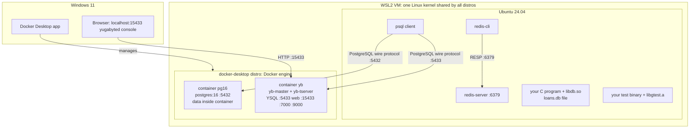

# Module 0.05: Data lab setup

**Estimated hours:** 4

**What you will learn**

1. What Docker is (a way to run a program with its whole environment packed in a box) and how to run PostgreSQL 16 and YugabyteDB on your laptop with one command each.
2. How to install and verify the four other data tools this course needs: the `psql` client, Berkeley DB (a library, not a server), Redis, and GoogleTest.
3. The shape of each tool before you study it: what is a server, what is a library, what listens on which port, and where the data actually lives.

**Prerequisites:** [Module 0.04: Linux lab setup](module-04-linux-lab-setup.md). You need Ubuntu 24.04 in WSL2 working, about 10 GB of free disk on `C:`, and realistically 16 GB of RAM in the laptop. Docker Desktop plus a YugabyteDB node together want about 4 GB of RAM free while they run. With 8 GB of RAM it still works if you run one database at a time and close the browser.

---

## 1. One-line intuition

Docker lets you run a database as if it came in a sealed box: one command to start, one to stop, one to throw away and start clean, with nothing installed on your machine itself.

## 2. Real-life analogy

A bank branch needs a vault, a ledger room and a cash counter. You could build each one into your house, with months of work and no way to remove them. Or you could rent **shipping containers** already fitted out: a vault container, a ledger container. Each arrives complete, plugs into power and a door, and leaves without a trace.

- **Docker** is the crane and the yard. An **image** is the container's blueprint (PostgreSQL 16, exactly as its makers built it). A **container** is one running instance of it (module 0.02: program versus process; image versus container is the same idea).
- **PostgreSQL** is the ledger room: a server process that keeps tables on disk and answers SQL questions over a network port.
- **YugabyteDB** is a chain of ledger rooms in different cities that behave like one: a distributed SQL database that speaks PostgreSQL's language. Today you run one room; in Phase 7 you run three.
- **Berkeley DB** is not a room at all. It is a very good filing cabinet you bolt inside your own office: a library linked into your program that stores key-value pairs in a file. No server, no port, no network.
- **Redis** is the sticky-note board by the cash counter: everything in memory, answers in microseconds, used for caching and counters.
- **GoogleTest** is the auditor's checklist: a framework that runs each of your C++ functions against expected answers and prints PASSED or FAILED.
- **`psql`** is the telephone you use to talk to any ledger room that speaks PostgreSQL, which both PostgreSQL and YugabyteDB do.

## 3. Why it exists: the problem it solves

Installing a database the old way means a package per operating system, config files in system folders, a service that starts at boot, and a version you cannot easily change. Installing two versions, or three nodes of the same database, on one laptop was nearly impossible. Uninstalling left debris.

Docker solves this by packing the program and every file it needs into an image and running it in an isolated box with its own file system view and network ports. The consequences for you:

1. **Reproducibility.** `postgres:16` on your laptop is byte-for-byte the image used on millions of other machines. "Works on my machine" disappears.
2. **Disposability.** A broken database is `docker rm` and `docker run` away from new. You will deliberately break databases in Phase 6 and 7.
3. **Multiplicity.** Capstone C4 needs a three-node YugabyteDB cluster to rehearse a zero-downtime cutover. Three containers on one laptop. No bank will lend you three servers to learn on.

The other tools are not in Docker for good reasons. Berkeley DB is a library your C program links against, so it must be on the same machine as your compiler. GoogleTest likewise. Redis and `psql` are small and start instantly from `apt`. The rule of thumb this teaches: put *servers* in containers, install *libraries and clients* natively.

What breaks without this module: the second half of the course. Capstones C2 to C5 all talk to a database.

## 4. Three layers of depth

### Layer 1 (beginner): install and verify each tool

Do these in order. Each step ends with a command whose output proves the tool works. Write every output in your journal.

**Step 1: Docker Desktop with the WSL2 backend.** On Windows, download Docker Desktop from <https://www.docker.com/products/docker-desktop/> and run the installer. Keep **Use WSL 2 instead of Hyper-V** ticked. Finish, start Docker Desktop, accept the service agreement (free for personal use and learning). Wait until the whale icon in the system tray stops animating.

Open Docker Desktop **Settings** (gear icon). Under **Resources** > **WSL integration**, tick **Enable integration with my default WSL distro** and switch on **Ubuntu-24.04**. Click **Apply & restart**.

Now in the Ubuntu window:

```bash
$ docker --version
Docker version 28.3.2, build 578ccf6
$ docker run hello-world
Unable to find image 'hello-world:latest' locally
latest: Pulling from library/hello-world
e6590344b1a5: Pull complete
Digest: sha256:...
Status: Downloaded newer image for hello-world:latest

Hello from Docker!
This message shows that your installation appears to be working correctly.

To generate this message, Docker took the following steps:
 1. The Docker client contacted the Docker daemon.
 2. The Docker daemon pulled the "hello-world" image from the Docker Hub.
    (amd64)
 3. The Docker daemon created a new container from that image which runs the
    executable that produces the output you are currently reading.
 4. The Docker daemon streamed that output to the Docker client, which sent it
    to your terminal.
...
```

(Version numbers and the digest will differ.) Read the four numbered steps in that message: they are the Docker architecture in miniature. The `docker` command you typed is a **client**. It talked to a background **daemon** (server process) that fetched the image and ran the container. If you get `permission denied` or `Cannot connect to the Docker daemon`, Docker Desktop is not running or WSL integration is not enabled for Ubuntu-24.04.

**Step 2: PostgreSQL 16 in Docker, and the `psql` client.**

```bash
$ docker run -d --name pg16 -e POSTGRES_PASSWORD=postgres -p 5432:5432 postgres:16
Unable to find image 'postgres:16' locally
16: Pulling from library/postgres
...
3f0c7a9f4c1e8b2d...   (a 64-character container ID; yours will differ)
```

Read the command once, word by word, because you will type variations of it all course long:

| Part | Meaning |
|---|---|
| `docker run` | Create and start a container |
| `-d` | Detached: run in the background and give me my prompt back |
| `--name pg16` | Call it `pg16` so later commands can say `docker stop pg16` |
| `-e POSTGRES_PASSWORD=postgres` | Set an environment variable (module 0.03) inside the container; this image requires a password |
| `-p 5432:5432` | Publish port: connections to port 5432 on your machine go to port 5432 inside the container |
| `postgres:16` | Image name and tag: PostgreSQL major version 16, latest minor release |

Check it is running, then install the client:

```bash
$ docker ps
CONTAINER ID   IMAGE         COMMAND                  CREATED          STATUS          PORTS                    NAMES
3f0c7a9f4c1e   postgres:16   "docker-entrypoint.s…"   10 seconds ago   Up 9 seconds    0.0.0.0:5432->5432/tcp   pg16
$ sudo apt install -y postgresql-client
$ psql --version
psql (PostgreSQL) 16.10 (Ubuntu 16.10-0ubuntu0.24.04.1)
```

Now connect and ask the server who it is. The `PGPASSWORD=...` prefix sets an environment variable for just this one command (module 0.03 Layer 2):

```bash
$ PGPASSWORD=postgres psql -h localhost -U postgres -c "SELECT version();"
                                                        version
------------------------------------------------------------------------------------------------------------------------
 PostgreSQL 16.10 (Debian 16.10-1.pgdg12+1) on x86_64-pc-linux-gnu, compiled by gcc (Debian 12.2.0-14) 12.2.0, 64-bit
(1 row)
```

`-h localhost` is the host, `-U postgres` the database user, `-c` runs one SQL command and exits. The minor version (`16.10` here) will be whatever is current when you pull; the major version `16` is what matters. Notice the server inside the container was compiled with a *different* GCC on Debian: the container has its own operating system files, which is the whole point.

**Step 3: YugabyteDB, single node, in Docker.** Start it:

```bash
docker run -d --name yb \
  -p 7000:7000 -p 9000:9000 -p 5433:5433 -p 15433:15433 \
  yugabytedb/yugabyte:latest bin/yugabyted start --background=false
```

(The backslashes continue the command on the next line.) The image is large, typically 2 to 3 GB, so the pull takes minutes. Older tutorials write the last flag as `--daemon=false`; `--background=false` is the current spelling and means "stay in the foreground so the container stays alive". After about 30 to 60 seconds:

```bash
$ docker logs yb
Starting yugabyted...
✅ YugabyteDB Started
✅ UI ready
✅ Data placement constraint successfully verified

+----------------------------------------------------------------------------------------------------------+
|                                                yugabyted                                                 |
+----------------------------------------------------------------------------------------------------------+
| Status              : Running.                                                                           |
| YSQL                : bin/ysqlsh -h 172.17.0.2  -U yugabyte -d yugabyte                                  |
| Web console         : http://172.17.0.2:15433                                                            |
...
```

Four ports, four jobs: **5433** is YSQL, the PostgreSQL-compatible SQL endpoint (deliberately not 5432 so it can sit beside real PostgreSQL); **15433** is the yugabyted web console (open <http://localhost:15433> in your Windows browser); **7000** is the yb-master admin page and **9000** the yb-tserver admin page, both of which Phase 7 uses to watch tablets move between nodes.

Connect with the same `psql` client. YugabyteDB speaks PostgreSQL's wire protocol, so the client cannot tell the difference, which is exactly why the application server from resume claim H4 moved from PostgreSQL to YugabyteDB without changing its driver:

```bash
$ psql -h localhost -p 5433 -U yugabyte -c "SELECT version();"
                                                                                          version
--------------------------------------------------------------------------------------------------------------------------------------------------------------------------------------------
 PostgreSQL 15.12-YB-2025.2.0.0-b0 on x86_64-pc-linux-gnu, compiled by clang version 17.0.6 ( ... ), 64-bit
(1 row)
```

Read the version string. It says PostgreSQL *and* `-YB-`: YugabyteDB's SQL layer literally is the PostgreSQL code, with a different storage engine underneath. Current releases are based on PostgreSQL 15; releases from the 2024 series report `PostgreSQL 11.2-YB-2024...`. The default user `yugabyte` has no password in this development setup.

**Step 4: Berkeley DB, the library.** This one is `apt`, not Docker, because your C programs link against it:

```bash
$ sudo apt install -y libdb-dev libdb++-dev
$ ls /usr/include/db.h /usr/include/db_cxx.h
/usr/include/db.h  /usr/include/db_cxx.h
$ grep DB_VERSION_STRING /usr/include/db.h
#define DB_VERSION_STRING       "Berkeley DB 5.3.28: (September  9, 2013)"
```

Ubuntu ships Berkeley DB 5.3.28, the last release under the licence that allows free redistribution, and the version most banks still run. The real verification is the 25-line program in section 6, which you compile with `-ldb`.

**Step 5: Redis.**

```bash
$ sudo apt install -y redis-server
$ sudo service redis-server start
 * Starting redis-server redis-server                                      [ OK ]
$ redis-cli ping
PONG
$ redis-server --version
Redis server v=7.0.15 sha=00000000:0 malloc=jemalloc-5.3.0 bits=64 build=...
```

`PONG` is the whole verification. If you prefer Docker: `docker run -d --name redis7 -p 6379:6379 redis:7` and the same `redis-cli ping` (do not run both; they fight over port 6379). The `apt` version starts automatically on later boots if your Ubuntu has systemd enabled, which new WSL installs do; if `redis-cli ping` ever says "Connection refused", run the `service` command again.

**Step 6: GoogleTest.**

```bash
$ sudo apt install -y libgtest-dev libgmock-dev
$ ls /usr/lib/x86_64-linux-gnu/libgtest*
/usr/lib/x86_64-linux-gnu/libgtest.a  /usr/lib/x86_64-linux-gnu/libgtest_main.a
```

`libgmock-dev` adds GoogleMock for Phase 9. The real verification is the CMake test project in section 6.

**Disk and memory check.** After all six steps, run `docker system df` to see image sizes and `free -h` to see Ubuntu's memory. Typical: images total 3 to 4 GB, with YugabyteDB the largest. If Ubuntu reports less than about 6 GB total memory and you have 16 GB in the laptop, create the file `C:\Users\msi1\.wslconfig` on Windows containing:

```ini
[wsl2]
memory=8GB
processors=4
```

then run `wsl --shutdown` in PowerShell and reopen Ubuntu. Docker Desktop's engine runs inside the same WSL2 virtual machine as Ubuntu, so this one file sets the ceiling for both.

**Stopping and starting.** Containers keep running until you stop them, and they use RAM while they do. `docker stop yb pg16` stops both; `docker start pg16` brings one back with its data intact; `docker rm pg16` deletes the container and its data. `docker ps -a` shows stopped ones too. When you are not using a database, stop it.

### Layer 2 (working engineer): what kind of thing each tool is

The six tools fall into three categories, and the category decides how you talk to each:

| Tool | Category | How your program reaches it | Where the data lives | Port |
|---|---|---|---|---|
| PostgreSQL | Server process | Network connection, SQL text, PostgreSQL wire protocol (`libpq` library or `psql`) | Files under `/var/lib/postgresql/data` *inside the container* | 5432 |
| YugabyteDB | Cluster of server processes (yb-master, yb-tserver) | Same wire protocol as PostgreSQL | Files under `/root/var/data` inside the container, split into tablets | 5433 (YSQL), 15433/7000/9000 (web) |
| Redis | Server process | Network connection, RESP text protocol (`hiredis` library or `redis-cli`) | RAM, with optional snapshots to `/var/lib/redis` | 6379 |
| Berkeley DB | Library (`libdb.so`) | Function calls in your own process: `db_create`, `put`, `get`, cursors | One file you name, for example `loans.db`, in your folder | none |
| GoogleTest | Library (`libgtest.a`) | Macros in your test file; linked into a test executable | none | none |
| `psql` | Client program | You type SQL; it sends it over the wire | none | connects to 5432 or 5433 |

Three consequences worth stating plainly:

**A server is a separate process; a library runs inside yours.** When your C program calls Berkeley DB's `put`, the B-tree code runs on your thread, in your address space, and a crash in it is a crash in your program. When it sends `INSERT` to PostgreSQL, a different process (PID, memory, user) does the work; your program waits on a socket. This is the deepest difference between resume claims H1 (Berkeley DB cursor traversal in C) and H4 (SQL against a distributed database over the network), and Phase 6 builds on it.

**Container data is inside the container.** The `pg16` container's tables live on a writable layer that belongs to that container. `docker stop` keeps it; `docker rm` destroys it. For anything you want to survive, add a **volume**: `-v pgdata:/var/lib/postgresql/data` names a Docker-managed disk area that outlives the container. For this course's labs, disposable is a feature; capstone C4 adds volumes when the cutover rehearsal needs data to persist.

**Ports are addresses for processes.** Module 0.02 gave each process a PID. On the network, a process that waits for connections also has a **port** number, 0 to 65535. `-p 5432:5432` says "connections arriving at this machine's port 5432 go to the container's port 5432". Two servers cannot listen on the same port, which is why YugabyteDB chose 5433 and why running both the `apt` Redis and a Docker Redis fails. Phase 5 covers ports properly; for now, memorise 5432, 5433 and 6379.

**Versions you have installed, and why they were chosen:**

| Tool | Version here | Why this one |
|---|---|---|
| PostgreSQL | 16.x | Current stable major with years of support; YugabyteDB's new releases are based on PostgreSQL 15, so 16 is close enough for everything in Phase 6 |
| YugabyteDB | latest stable (2025.x series) | Capstones need the current yugabyted tooling; for the 3-node cluster in C4, pin a specific tag so all three nodes match |
| Berkeley DB | 5.3.28 | The last freely redistributable release and what the resume's migration source actually was |
| Redis | 7.0.x (Ubuntu package) | Stable, enough for caching labs; Phase 6 discusses Redis 7 versus newer forks |
| GoogleTest | 1.14 (Ubuntu package) | CMake `find_package(GTest)` works out of the box |

### Layer 3 (internals): what a container is, and what each server is doing when it starts

**A container is not a virtual machine.** Module 0.04's WSL2 is a VM: it has its own kernel. A container has no kernel of its own. It is an ordinary Linux process (or several) that the kernel has been told to lie to, using two features:

- **Namespaces** give the process its own view of the system: its own PID numbering (inside the container, PostgreSQL is PID 1), its own network interfaces and ports, its own mount table (so `/var/lib/postgresql/data` inside is a folder on the host that the process cannot see the real path of), its own hostname.
- **Control groups (cgroups)** cap what it may use: memory, CPU share, I/O.

Plus a **layered image**: the `postgres:16` image is a stack of read-only directory snapshots (a Debian base, then the PostgreSQL packages, then the entry script) joined together by an overlay file system, with a thin writable layer on top for the running container. Starting a container is therefore as cheap as starting a process, because that is all it is. `docker exec -it pg16 bash` drops you into a shell *inside* the namespaces; type `ps aux` there and you will see PID 1 is `postgres`. Module 9.06 (Docker internals) takes this apart with `unshare` and `/proc`.

On your laptop there is one extra layer: Docker Desktop's engine runs inside the same WSL2 virtual machine as your Ubuntu, in a separate distribution called `docker-desktop`. So the containers are Linux processes in that VM, sharing its kernel with your Ubuntu, and `-p 5432:5432` forwards traffic so that `localhost:5432` works from both Ubuntu and Windows.

**What PostgreSQL does when it starts.** The entry script runs `initdb` the first time, creating the data directory: a `base/` folder with one subfolder per database holding one file per table and index (each a sequence of 8 KB pages), `pg_wal/` for the **write-ahead log** (every change is written here before the table page, so a crash loses nothing committed), and configuration files. Then the **postmaster** process starts, opens port 5432, and forks helper processes: a checkpointer that flushes dirty pages, a background writer, a WAL writer, an autovacuum launcher. For every client that connects, the postmaster forks one more **backend** process that lives for the length of the connection. One process per connection is why connection pooling exists (module 6.14). Phase 6 goes deep into every one of these.

**What yugabyted does when it starts.** It launches two kinds of process. **yb-master** keeps the catalogue: which tables exist, which **tablets** (shards) each is split into, and which server holds each tablet's copies. **yb-tserver** stores and serves the tablets. The SQL layer, **YSQL**, is a modified PostgreSQL that parses and plans your query, then instead of reading 8 KB pages from local files, sends reads and writes to the tablets through **DocDB**, a document store built on RocksDB (a log-structured key-value engine). With one node, every tablet has one copy; with three nodes, each tablet has three copies kept in agreement by the **Raft** consensus protocol. Phase 7 is about exactly this stack, and about why the resume's move to a "multi-node cluster" was a change in storage, not in SQL.

**What Berkeley DB does on `open`.** It opens or creates the file, reads its 4 KB (default) metadata page to find the B-tree root page, and keeps a cache of pages in your process's memory. `put` finds the leaf page for the key by walking from the root, inserts the key and value, and splits the page if full. With no environment and no transactions (today's setup), a crash halfway through a write can corrupt the file, which is why the real migration source in claim H1 ran inside a transactional **environment** with its own write-ahead log. Module 6.16 covers environments, cursors and the exact record layouts the migration engine decoded.

**What Redis does.** One process, one thread executing commands (plus helpers for I/O and persistence since version 6), with every key in a hash table in RAM. A `GET` is a hash lookup: typically under a microsecond of CPU, with the network round trip dominating. That single-threaded loop is why Redis commands are atomic without locks and why one slow command stalls everyone, both of which matter when Phase 6 and 10 use Redis as a cache.

**What GoogleTest does.** The `TEST(Suite, Name)` macro expands into a class and a global object whose constructor registers the test in a list *before `main` runs* (static initialisation, module 2.04). `gtest_main` provides a `main` that runs the list, catches failures from `EXPECT_*` macros, and prints the report. Linking `GTest::gtest_main` is what gives your test file a `main` without you writing one.

## 5. Architecture diagram



Note what has no arrow to a server: the Berkeley DB program and the test binary. They are complete in themselves. Everything else is a client talking to a server over a port.

## 6. Code

Two programs that verify the two library installs, plus the SQL you use to verify the two servers. Work in `~/labs` inside Ubuntu.

**Berkeley DB: open, put, get.** Save as `~/labs/bdb/bdb_hello.c`.

```c
/* bdb_hello.c
 * Opens a Berkeley DB B-tree file, stores one key/value pair, reads it back.
 * Compile: gcc -Wall -Wextra -o bdb_hello bdb_hello.c -ldb
 */
#include <stdio.h>
#include <string.h>
#include <db.h>                /* the Berkeley DB API */

int main(void) {
    DB *dbp = NULL;
    int ret;

    printf("library: %s\n", db_version(NULL, NULL, NULL));

    /* 1. Create a handle, then open (or create) the file as a B-tree. */
    ret = db_create(&dbp, NULL, 0);
    if (ret != 0) { fprintf(stderr, "db_create: %s\n", db_strerror(ret)); return 1; }

    ret = dbp->open(dbp, NULL, "loans.db", NULL, DB_BTREE, DB_CREATE, 0664);
    if (ret != 0) { dbp->err(dbp, ret, "open loans.db"); return 1; }

    /* 2. A DBT describes a block of bytes: pointer + size. Keys and values are just bytes. */
    char key_bytes[]   = "loan:1001";
    char value_bytes[] = "principal=250000;rate=8.5;status=approved";
    DBT key, value, found;
    memset(&key, 0, sizeof key);
    memset(&value, 0, sizeof value);
    memset(&found, 0, sizeof found);
    key.data   = key_bytes;    key.size   = sizeof key_bytes;     /* includes the final NUL */
    value.data = value_bytes;  value.size = sizeof value_bytes;

    /* 3. Put, then get the same key back. NULL = no transaction (today). */
    ret = dbp->put(dbp, NULL, &key, &value, 0);
    if (ret != 0) { dbp->err(dbp, ret, "put"); return 1; }
    printf("put : %s -> %s\n", key_bytes, value_bytes);

    ret = dbp->get(dbp, NULL, &key, &found, 0);
    if (ret != 0) { dbp->err(dbp, ret, "get"); return 1; }
    printf("get : %s -> %s (%u bytes)\n", key_bytes, (char *)found.data, found.size);

    dbp->close(dbp, 0);        /* flushes pages to loans.db and releases the handle */
    return 0;
}
```

```bash
cd ~/labs/bdb
gcc -Wall -Wextra -o bdb_hello bdb_hello.c -ldb
./bdb_hello
ls -l loans.db
```

Expected output (file size and date will differ slightly):

```text
library: Berkeley DB 5.3.28: (September  9, 2013)
put : loan:1001 -> principal=250000;rate=8.5;status=approved
get : loan:1001 -> principal=250000;rate=8.5;status=approved (42 bytes)
-rw-r--r-- 1 shakir shakir 8192 Oct 18 15:02 loans.db
```

The `-ldb` at the end tells the linker to join your object file with `libdb.so`. Leave it out and you get `undefined reference to 'db_create'`: the compiler is happy (it saw the declaration in `db.h`) but the linker cannot find the code. Module 1.12 explains that split. The 8192-byte file is two 4 KB pages: metadata and one leaf. No server was involved; the B-tree code ran inside your process.

**GoogleTest: a first test with CMake.** Save these two files in `~/labs/gtest-hello/`.

`interest_test.cpp`:

```cpp
// interest_test.cpp: two tests for a one-line function.
#include <gtest/gtest.h>

// The function under test. In a real project this lives in its own file.
double simple_interest(double principal, double rate_percent) {
    return principal * rate_percent / 100.0;
}

TEST(InterestTest, ComputesOneYear) {
    EXPECT_DOUBLE_EQ(simple_interest(250000.0, 8.5), 21250.0);
}

TEST(InterestTest, ZeroRateGivesZero) {
    EXPECT_DOUBLE_EQ(simple_interest(250000.0, 0.0), 0.0);
}
```

`CMakeLists.txt`:

```cmake
cmake_minimum_required(VERSION 3.16)
project(gtest_hello LANGUAGES CXX)

set(CMAKE_CXX_STANDARD 17)
set(CMAKE_CXX_STANDARD_REQUIRED ON)

find_package(GTest REQUIRED)             # finds the apt-installed library
enable_testing()

add_executable(interest_test interest_test.cpp)
target_compile_options(interest_test PRIVATE -Wall -Wextra -Werror)
target_link_libraries(interest_test PRIVATE GTest::gtest_main)   # provides main()

include(GoogleTest)
gtest_discover_tests(interest_test)      # lets ctest list each TEST separately
```

```bash
cd ~/labs/gtest-hello
cmake -S . -B build
cmake --build build
./build/interest_test
```

Expected output of the test binary:

```text
[==========] Running 2 tests from 1 test suite.
[----------] Global test environment set-up.
[----------] 2 tests from InterestTest
[ RUN      ] InterestTest.ComputesOneYear
[       OK ] InterestTest.ComputesOneYear (0 ms)
[ RUN      ] InterestTest.ZeroRateGivesZero
[       OK ] InterestTest.ZeroRateGivesZero (0 ms)
[----------] 2 tests from InterestTest (0 ms total)

[----------] Global test environment tear-down
[==========] 2 tests from 1 test suite ran. (0 ms total)
[  PASSED  ] 2 tests.
```

And through CTest, which is how CI will run it in Phase 9:

```bash
$ ctest --test-dir build
Test project /home/shakir/labs/gtest-hello/build
    Start 1: InterestTest.ComputesOneYear
1/2 Test #1: InterestTest.ComputesOneYear .....   Passed    0.00 sec
    Start 2: InterestTest.ZeroRateGivesZero
2/2 Test #2: InterestTest.ZeroRateGivesZero ...   Passed    0.00 sec

100% tests passed, 0 tests failed out of 2
```

**SQL to verify both servers.** The same three statements against PostgreSQL (port 5432) and YugabyteDB (port 5433):

```sql
CREATE TABLE loans (id INT PRIMARY KEY, principal NUMERIC(12,2), rate NUMERIC(5,2));
INSERT INTO loans VALUES (1001, 250000, 8.5), (1002, 80000, 9.0);
SELECT id, principal * rate / 100 AS yearly_interest FROM loans ORDER BY id;
```

```bash
PGPASSWORD=postgres psql -h localhost -p 5432 -U postgres -f verify.sql
psql -h localhost -p 5433 -U yugabyte -f verify.sql
```

Expected (identical from both servers):

```text
CREATE TABLE
INSERT 0 2
  id  | yearly_interest
------+-----------------
 1001 |   21250.0000000
 1002 |    7200.0000000
(2 rows)
```

Same SQL, same answer, two completely different storage engines underneath. That is the promise YugabyteDB makes and that Phase 7 tests to its limits.

## 7. Use case: core-banking loan-origination platform

Resume claim H3 describes a data-parity regression suite "gating a zero-downtime cutover to a multi-node cluster". Before the real cutover, the team had to rehearse it, many times, and that rehearsal is where this module's tools were decided.

The problem: the only YugabyteDB cluster was the shared test environment, used by twenty people. Rehearsing a cutover there meant booking it for a day and restoring it afterwards. Nobody rehearsed often enough. The decision that fixed it: **every engineer runs a disposable three-node YugabyteDB cluster in Docker on their own laptop**, plus a Berkeley DB environment copied from a masked production sample, and runs the parity suite locally before touching the shared cluster. The consequences:

- Rehearsal became `docker compose up`, run, `docker compose down`. It happened daily instead of monthly, and the cutover runbook (capstone C4) was tested dozens of times before the night it mattered.
- The migration engine (claim H1) was pinned to Berkeley DB 5.3, the exact `libdb` version of the production source, by installing the same `libdb-dev` package everywhere. A newer 6.x library would have read the files but written a different format, which is a silent way to break a rollback.
- The parity suite itself was a GoogleTest binary, so a parity failure was a red test with a record ID in the message, and CI could refuse a build on it. The same `find_package(GTest)` line you wrote today is the first line of that suite.
- Redis entered the design later, as the cache behind the application server's master-table lookups (claim H4). Running it locally made the cache-versus-database latency measurement in capstone C2 a one-laptop experiment.

Every one of these decisions is "make the production shape reproducible on a laptop". That is what Docker is for.

## 8. Lab

Work in Ubuntu. Keep a text file of every version string and output; the journal needs them.

### Part A: Docker and PostgreSQL (30 minutes)

1. Run `docker run hello-world` and `docker --version`. Record the version.
2. Start `pg16` with the command from Layer 1. Run `docker ps`. Record the `STATUS` and `PORTS` columns.
3. Install `postgresql-client`. Run the `SELECT version();` command. Record the full version string.
4. Save the three SQL statements from section 6 as `~/labs/verify.sql` and run them against PostgreSQL.
5. Open an interactive session: `PGPASSWORD=postgres psql -h localhost -U postgres`. Type `\dt` (list tables), `SELECT * FROM loans;`, `\q`. The backslash commands belong to `psql`, not to SQL.
6. Run `docker exec -it pg16 bash`, then inside the container `ps aux | head -20`, then `exit`. Count the PostgreSQL processes and note which one is PID 1.

Expected: the table has 2 rows; inside the container you see `postgres` as PID 1 and about five helper processes (checkpointer, background writer, walwriter, autovacuum launcher, logical replication launcher).

### Part B: YugabyteDB (30 minutes, mostly waiting for the pull)

1. Start `yb` with the command from Layer 1. While it pulls, run `docker system df` in a second terminal and watch the image size appear.
2. When `docker logs yb` shows the "YugabyteDB Started" table, open <http://localhost:15433> in your Windows browser. Record the node count (1) and the YugabyteDB version shown.
3. Run `SELECT version();` on port 5433. Record the string and underline the PostgreSQL version it is based on.
4. Run `verify.sql` against port 5433. Compare the output with Part A step 4 line by line.
5. Open <http://localhost:7000/tables> and find your `loans` table. Click it. Note how many tablets it has (typically 1 on a single node for a small table, or a handful; the number is a sharding decision Phase 7 explains).
6. Run `free -h` and `docker stats --no-stream`. Record how much memory `yb` uses. Then `docker stop yb` and run `free -h` again.

Expected: identical query results on both ports. The `yb` container typically uses between 1 and 2.5 GB of RAM at idle; your number goes in the journal.

### Part C: Berkeley DB and Redis (30 minutes)

1. Install `libdb-dev` and `libdb++-dev`. Build and run `bdb_hello.c`. Record the library version line and the file size of `loans.db`.
2. Run `./bdb_hello` a second time. Does it fail? (No: `put` with flag 0 overwrites the existing key. Change the flag to `DB_NOOVERWRITE` and run again; now `put` reports `DB_KEYEXIST`. Change it back.)
3. Build *without* `-ldb` and read the error. Write down the exact text of the first `undefined reference` line.
4. Install Redis, start it, `redis-cli ping`. Then:

```bash
redis-cli SET loan:1001:status approved
redis-cli GET loan:1001:status
redis-cli INCR loans:approved:count
redis-cli INCR loans:approved:count
redis-cli DBSIZE
```

Expected: `OK`, `"approved"`, `(integer) 1`, `(integer) 2`, `(integer) 2`. Note the same key `loan:1001` you stored in Berkeley DB now also exists in Redis, in RAM, on a server; and in PostgreSQL as a row. Three stores, three shapes, one loan.

### Part D: GoogleTest, then clean shutdown (30 minutes)

1. Create the two files from section 6 in `~/labs/gtest-hello`, build, run the binary, run `ctest --test-dir build`. Record the summary lines.
2. Break a test on purpose: change `21250.0` to `21000.0`, rebuild, rerun. Read the failure message: it names the file, line, both values and the difference. Change it back.
3. Add a third test, `NegativePrincipalIsCallerBug`, that checks `simple_interest(-1000.0, 8.5)` equals `-85.0`. Rebuild and run. (It passes. Ask yourself whether the function *should* accept a negative principal. Write your answer in the journal; module 2.09 on exceptions versus error codes picks it up.)
4. Housekeeping: `docker stop pg16 yb` (and `redis7` if you used Docker for Redis). Run `docker ps -a` to see them stopped, and `docker system df` for the final disk usage. Record it. Tomorrow, `docker start pg16` brings PostgreSQL back with your `loans` table intact.

Expected: step 2 prints a block beginning `interest_test.cpp:10: Failure` with `Expected equality of these values` (wording may differ slightly between GoogleTest versions) and ends with `[  FAILED  ] 1 test`.

### Journal

Copy [journal/TEMPLATE.md](../journal/TEMPLATE.md) to `journal/YYYY-MM-DD-data-lab-setup.md`. Record: Docker, PostgreSQL, YugabyteDB (and the PostgreSQL version it embeds), Berkeley DB, Redis and GoogleTest version strings; the process list inside `pg16`; the RAM used by `yb` and total image disk usage; the exact linker error from Part C step 3; the GoogleTest failure text from Part D step 2; and your answer about negative principal. Under "Problems I hit", anything Docker Desktop or WSL memory did that you had to fix.

## 9. Common mistakes and misconceptions

| Mistake | Why it is wrong | Bug it causes later |
|---|---|---|
| "A container is a small virtual machine" | It is a normal process with namespaces and cgroups, sharing the host kernel | Wrong mental model for performance, security and why `docker exec` shows PID 1 |
| Expecting data to survive `docker rm` | The writable layer dies with the container | Losing a day of test data; forgetting volumes in capstone C4 |
| Running two servers on one port | A port belongs to one listening process | `address already in use` when `apt` Redis and Docker Redis both start, or two PostgreSQL containers both publish 5432 |
| Connecting to YugabyteDB on 5432 | YSQL listens on 5433 | Silently querying the wrong database and "my table is missing" |
| Forgetting `-ldb` or putting it before the `.c` file | The linker resolves symbols left to right; the library must come after the code that uses it | `undefined reference to db_create` |
| Treating Berkeley DB like a server | It is a library inside your process; no port, no concurrent processes without an environment | Two programs opening the same `.db` file without an environment corrupt it |
| Leaving every container running | Each one holds RAM; YugabyteDB alone wants 1 to 2.5 GB | Laptop swapping; Docker Desktop killed by Windows under memory pressure |
| Pulling `latest` for a multi-node cluster | Nodes pulled days apart may run different versions | Mixed-version cluster that refuses to form, in capstone C4; pin a tag |
| Writing tests without `find_package(GTest)` and hand-typing `-lgtest -lpthread` | Works today, breaks on another machine or Windows | Non-portable builds; CMake's imported target handles it |

## 10. Resume link

- **Claim G, "Docker".** You can now say what an image and a container are, that a container is a namespaced process rather than a VM, and that Docker Desktop on Windows runs its engine inside the WSL2 VM. Your Part A step 6 (PID 1 is `postgres` inside the container) is the concrete proof.
- **Claim D, "PostgreSQL, YugabyteDB, Berkeley DB, Redis".** Four tools, three categories: two SQL servers sharing a wire protocol, one in-process library, one in-memory server. Interviewers often ask "what is the difference between Berkeley DB and PostgreSQL?" The one-line answer from Layer 2: a library in your address space with a B-tree in a file versus a separate server process you reach over a socket.
- **Claim H3 and H1, "cutover to a multi-node cluster", "Berkeley DB environment".** Section 7's decision, reproducing production shape in Docker on a laptop so rehearsals happen daily, is your story for "how did you de-risk the cutover?". The `DB_VERSION_STRING` check is your story for "how did you make sure the migration read the files correctly?".
- **Claim G, "GoogleTest".** `find_package(GTest)`, `GTest::gtest_main`, `gtest_discover_tests`, red test with file and line: you have run all four today.

Likely follow-up: "Why does YugabyteDB use port 5433?" Answer: so it can run beside a real PostgreSQL on 5432 while speaking the same protocol, which is exactly what you did in Part B.

## 11. Interview questions

**Q1 (easy). What is the difference between a Docker image and a container?**

<details>
<summary>Model answer</summary>

An image is a read-only, layered snapshot of a file system plus metadata about what to run: `postgres:16` contains a Debian base, the PostgreSQL binaries and an entry script. A container is a running instance created from an image: a process started in its own namespaces with a thin writable layer on top of the image's layers. One image can back many containers, just as one program file can back many processes. Stopping a container keeps its writable layer; removing it discards that layer, which is why persistent data goes in a volume.

</details>

**Q2 (easy). Berkeley DB and PostgreSQL both store data. What is the fundamental difference in how a C program uses them?**

<details>
<summary>Model answer</summary>

Berkeley DB is a library. The program links `libdb`, calls `db_create`, `open`, `put`, `get` and cursor functions, and the B-tree code runs on the program's own thread in its own address space, reading and writing a file the program names. There is no server, no port and no SQL; keys and values are raw bytes. PostgreSQL is a separate server process. The program opens a TCP connection, sends SQL text over the PostgreSQL wire protocol using `libpq`, and a backend process in the server does the work. The migration engine on my resume read Berkeley DB through cursors in-process and wrote to YugabyteDB over the wire, so it had both shapes in one program.

</details>

**Q3 (medium). Why can `psql` connect to YugabyteDB without modification, and what does the version string `PostgreSQL 15.x-YB-...` tell you?**

<details>
<summary>Model answer</summary>

YugabyteDB's SQL layer, YSQL, is a fork of the actual PostgreSQL source code, so it speaks the same wire protocol, accepts the same SQL dialect, the same system catalogues and most of the same client-side behaviour. Any PostgreSQL client or driver works, which is what made moving an application server from PostgreSQL to YugabyteDB mostly a connection-string change. The version string shows which PostgreSQL release the fork tracks (15 for current releases, 11.2 for the 2024 series) and the YugabyteDB release after `-YB-`. What is different is below the SQL layer: instead of local 8 KB heap pages, YSQL writes to DocDB, a distributed document store on RocksDB, sharded into tablets and replicated with Raft. Features that live in storage, such as how locks, MVCC and indexes behave under distribution, are where the two diverge, and that is what Phase 7 studies.

</details>

**Q4 (medium). A colleague runs two PostgreSQL containers and the second one fails with "port is already allocated". Explain what happened and two ways to fix it.**

<details>
<summary>Model answer</summary>

Both containers were started with `-p 5432:5432`, which asks Docker to bind the host's port 5432 and forward it into each container. A host port can be bound by one listener, so the second bind fails. Inside the containers there is no conflict: each has its own network namespace and both can listen on 5432 internally. Fix one: publish the second on a different host port, `-p 5434:5432`, and connect with `-p 5434`. Fix two: do not publish at all and let the two containers talk over a Docker network by name, which is how a multi-container setup such as a three-node YugabyteDB cluster in `docker compose` is wired. The general lesson is that `-p host:container` maps two separate port spaces.

</details>

**Q5 (hard). Explain how a container is isolated from the host without a separate kernel, and what that means for a database running in one.**

<details>
<summary>Model answer</summary>

A container is one or more ordinary processes started with Linux namespaces and control groups. The PID namespace gives the container its own process numbering, so PostgreSQL appears as PID 1 inside and as some large PID on the host. The mount namespace gives it a private root file system assembled by an overlay driver from the image's read-only layers plus one writable layer. The network namespace gives it its own interfaces and port table, and Docker connects it to a bridge and installs forwarding rules for published ports. UTS, IPC and user namespaces isolate hostname, shared memory and user IDs. Cgroups then cap memory, CPU and I/O. All of this is kernel bookkeeping; the process executes directly on the host kernel with no virtualisation, so a system call from the containerised PostgreSQL is a normal system call. For a database this has three consequences. Performance is near native, including disk I/O, unlike a VM. Memory limits are enforced by the cgroup, so a PostgreSQL configured with more shared buffers than the cgroup allows is killed by the OOM killer, not slowed down. And durability depends on where the data directory lives: on the container's writable layer it is lost on `docker rm`, so production uses volumes bound to real disks, and `fsync` behaviour is the host's. On Docker Desktop for Windows, the host kernel is the WSL2 VM's kernel, so there is one virtualisation layer under everything, shared with the Ubuntu distribution.

</details>

## 12. Revision

- Servers go in containers (PostgreSQL 16 on 5432, YugabyteDB with YSQL on 5433 and the console on 15433, optionally Redis on 6379); libraries and clients go through `apt` (`postgresql-client`, `libdb-dev`, `redis-server`, `libgtest-dev`).
- A container is a namespaced process on the shared kernel, not a VM; its data dies with `docker rm` unless a volume is used; one host port, one listener.
- Berkeley DB runs inside your process on a file (`-ldb`); PostgreSQL and YugabyteDB share one wire protocol over different storage engines; GoogleTest links with `GTest::gtest_main` and runs under `ctest`.

---

Previous: [Module 0.04: Linux lab setup](module-04-linux-lab-setup.md) | Next: [Module 0.06: Windows lab setup](module-06-windows-lab-setup.md)
