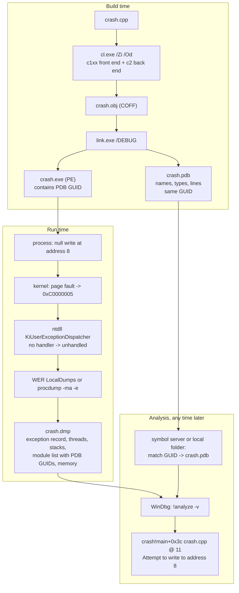

# Module 0.06: Windows lab setup

**Estimated hours:** 3

**What you will learn**

1. How to install Visual Studio 2022 Community with the C++ workload, and build a program three ways: with `cl` from the command line, inside the IDE, and with MSBuild.
2. What a PDB file is, why it is the difference between a readable crash dump and a pile of hex, and why you build with debug information even for release.
3. How to capture a crash dump of a program that writes through a null pointer, open it in WinDbg, run `!analyze -v`, and read the faulting address and line.

**Prerequisites:** [Module 0.05: Data lab setup](module-05-data-lab-setup.md). You need Windows 11, about 15 GB of free disk on `C:` (Visual Studio is big), and administrator rights. Module 0.01's explanation of a crash (the CPU touching an unmapped address) and module 0.02's process and handle ideas are used directly here.

---

## 1. One-line intuition

Windows is the second half of your resume: the same C and C++ code, a different compiler, a different executable format, and a debugger (WinDbg) that reads the memory of a program after it has died.

## 2. Real-life analogy

Module 0.04 built a Linux workshop in the garage. Now you fit out the main house for the same trade, because half the bank's software, and the application server on your resume, runs there.

- **Visual Studio** is a whole workshop in one delivery: the compiler, the linker, the editor, the debugger, the project files and the Windows SDK (the headers and libraries that describe every Windows system call).
- **MSVC (`cl.exe`)** is the Microsoft compiler, the Windows equivalent of `gcc`. Same job, different flags, different habits.
- **MSBuild** is the Windows foreman, the equivalent of `make` driven by CMake. It reads `.vcxproj` and `.sln` files instead of Makefiles.
- **A PDB file** is the index at the back of a book. The executable is the book with the page numbers torn out; the PDB says "page 0x1A4C is chapter `main`, line 11". Without the index you can see the bytes but not the names.
- **A crash dump** is a photograph of the whole office at the instant the fire alarm went off: every desk (stack), every cabinet (heap), every clerk's scratch cards (registers).
- **WinDbg** is the investigator who looks at the photograph with the index in hand and says "the clerk at desk 3 was writing to cabinet number 8, which does not exist".

## 3. Why it exists: the problem it solves

Three resume lines cannot be done on Linux:

1. **Claim G, "Windows (Win32, MSVC, Visual Studio, MSBuild)".** A C++ engineer at a bank is expected to build on both. The application server from claim H4 had a Win32 variant of its thread-synchronisation layer (critical sections and wait objects; capstone C2), and a Windows build pipeline.
2. **Claim F and H5, "crash dump analysis (WinDbg)"**. When a Windows service dies in production at 2 a.m., what the support team receives is a `.dmp` file. Nobody gets to attach a debugger to the live process. Reading that file is a skill in itself, and capstone C6 is built around it.
3. **The habit of two compilers.** MSVC warns about different things than GCC and Clang. Code that builds clean under all three is far more likely to be correct. The resume's tcpkv builds under `-Wall -Wextra -Werror`; its Windows cousin builds under `/W4 /WX`.

What breaks without this module: capstone C2's Win32 variant, all of capstone C6's Windows half, and your ability to say "I have read a dump in WinDbg" truthfully.

## 4. Three layers of depth

### Layer 1 (beginner): install, then build the same program three ways

**Step 1: install Visual Studio 2022 Community.** Download the installer from <https://visualstudio.microsoft.com/vs/community/> and run it. When the workload page appears, tick exactly one workload: **Desktop development with C++**. In the right-hand "Installation details" panel keep the defaults ticked: MSVC v143 build tools, Windows 11 SDK, C++ CMake tools for Windows, and Just-In-Time debugger. Click **Install**. Typical download 3 to 4 GB, typical disk use 8 to 10 GB, typical time 20 to 40 minutes. Sign in with a Microsoft account when asked (Community edition is free for individual learning).

**Step 2: open the right command prompt.** Press Start and type `x64 Native`. Open **x64 Native Tools Command Prompt for VS 2022**. Not the plain "Developer Command Prompt": that one targets 32-bit x86 by default, and every dump you read in this course is 64-bit. The prompt sets `PATH`, `INCLUDE` and `LIB` (module 0.03: environment variables) so that `cl`, `link` and `msbuild` are found and know where the headers are. In that window:

```text
C:\Program Files\Microsoft Visual Studio\2022\Community>cl
Microsoft (R) C/C++ Optimizing Compiler Version 19.44.35215 for x64
Copyright (C) Microsoft Corporation.  All rights reserved.

usage: cl [ option... ] filename... [ /link linkoption... ]
```

The version will be 19.4x on a current VS 2022; the important words are `for x64`. This is a `cmd.exe` prompt, not Bash: paths use backslashes, there is no `ls` (use `dir`), and `$?` is `%ERRORLEVEL%`. Make a working folder: `mkdir C:\labs\win && cd C:\labs\win`.

**Step 3: build from the command line with `cl`.** Create `hello.cpp` (Notepad is fine: `notepad hello.cpp`):

```cpp
// hello.cpp: first program built with MSVC.
#include <cstdio>

int main() {
    int    principal = 250000;
    double rate      = 8.5;
    double interest  = principal * rate / 100.0;
    std::printf("hello from MSVC\n");
    std::printf("principal %d at %.1f%% -> interest %.2f\n", principal, rate, interest);
    return 0;
}
```

```text
C:\labs\win>cl /W4 /EHsc hello.cpp
Microsoft (R) C/C++ Optimizing Compiler Version 19.44.35215 for x64
Copyright (C) Microsoft Corporation.  All rights reserved.

hello.cpp
Microsoft (R) Incremental Linker Version 14.44.35215.0
Copyright (C) Microsoft Corporation.  All rights reserved.

/out:hello.exe
hello.obj

C:\labs\win>hello.exe
hello from MSVC
principal 250000 at 8.5% -> interest 21250.00
```

Two flags, both of which you will type forever: `/W4` is warning level 4, the MSVC equivalent of `-Wall -Wextra`; `/EHsc` selects the standard C++ exception-handling model, which the compiler nags you about if omitted. Notice `cl` ran the compiler *and* the linker in one go and left behind `hello.obj` (the object file, like `.o` on Linux) and `hello.exe`. `dir` shows them.

**Step 4: build in the IDE and with MSBuild.** Open Visual Studio 2022. Choose **Create a new project**, filter language to C++, pick **Console App**, click Next, name it `HelloVs`, location `C:\labs\win`, click Create. Visual Studio writes `HelloVs.sln` (a **solution**: a list of projects), `HelloVs.vcxproj` (the **project**: files, flags, configurations) and `HelloVs.cpp`. Replace the generated `HelloVs.cpp` contents with the `hello.cpp` code. Look at the toolbar: the two dropdowns say **Debug** and **x64**. Press `Ctrl+F5` (run without debugging). A console window opens with the two lines of output and "Press any key to close".

Now build the same solution without the IDE, from the x64 Native Tools prompt:

```text
C:\labs\win>cd HelloVs
C:\labs\win\HelloVs>msbuild HelloVs.sln /p:Configuration=Debug /p:Platform=x64
MSBuild version 17.14.8+a7a4d5af0 for .NET Framework
Build started 18-10-2026 16:02:11.

Project "C:\labs\win\HelloVs\HelloVs.sln" on node 1 (default targets).
...
  HelloVs.cpp
  HelloVs.vcxproj -> C:\labs\win\HelloVs\x64\Debug\HelloVs.exe
Done Building Project "C:\labs\win\HelloVs\HelloVs.vcxproj" (default targets).

Build succeeded.
    0 Warning(s)
    0 Error(s)

Time Elapsed 00:00:03.41

C:\labs\win\HelloVs>x64\Debug\HelloVs.exe
hello from MSVC
principal 250000 at 8.5% -> interest 21250.00
```

That `msbuild` line is what a build server runs (claim G: Azure DevOps and GitHub Actions on Windows agents, Phase 9). `/p:Configuration=Release` builds the optimised version into `x64\Release\`. Look in `x64\Debug\`: next to `HelloVs.exe` sits `HelloVs.pdb`. Keep that file in mind; it is the subject of Layer 2.

**Step 5: install WinDbg.** Open the Microsoft Store, search **WinDbg**, install the one published by Microsoft Corporation (this is the modern WinDbg, which used to be called WinDbg Preview). Alternatively, in PowerShell: `winget install Microsoft.WinDbg`. Launch it once so it finishes setting up; you will see a dark window with **Start debugging** options on the left. The old `windbg.exe` from the Windows SDK's "Debugging Tools for Windows" still works and uses the same commands; this course uses the Store version.

**Step 6: install ProcDump.** Download Sysinternals ProcDump from <https://learn.microsoft.com/sysinternals/downloads/procdump> (or `winget install Microsoft.Sysinternals.ProcDump`), put `procdump.exe` somewhere on your `PATH` (for example `C:\labs\tools`, then add that folder in Settings > System > About > Advanced system settings > Environment Variables, or just run it by full path). Run `procdump -accepteula` once. ProcDump writes a dump of a process on demand or when the process crashes.

### Layer 2 (working engineer): PDBs, Debug versus Release, and where dumps come from

**The MSVC flags that matter.** The Linux table from module 0.04, translated:

| GCC / Clang | MSVC | Meaning |
|---|---|---|
| `-Wall -Wextra` | `/W4` | Most warnings on |
| `-Werror` | `/WX` | Warnings are errors |
| `-g` | `/Zi` (compiler) plus `/DEBUG` (linker; `cl` passes it when `/Zi` is used) | Produce debug information, written to a `.pdb` |
| `-O0` | `/Od` | No optimisation |
| `-O2` | `/O2` | Optimise for speed |
| `-std=c++17` | `/std:c++17` | Language version |
| `-o name` | `/Fe:name.exe` | Output name |
| `-lfoo` | `foo.lib` on the command line, or `#pragma comment(lib, "foo.lib")` | Link a library |
| `-pthread` | not needed | Threads are part of the Windows API |

The debug-friendly build you will use for every lab: `cl /W4 /EHsc /Zi /Od program.cpp`. Visual Studio's **Debug** configuration uses `/Zi /Od` plus the debug runtime (`/MDd`), and adds run-time checks. **Release** uses `/O2` but, by default in Visual Studio projects, *still* generates a PDB. That default is deliberate and is the single most important fact in this module.

**What a PDB is.** `/Zi` tells the compiler to write a **Program Database**, `name.pdb`, beside the executable. It holds, for every function and variable: its name, its type, which address range it occupies, and which source file and line each instruction came from. The executable itself contains none of this, only a small record naming the PDB file and a unique ID (a GUID plus an "age" counter). The linker stamps the same ID into both files. A debugger opening the executable, or a dump of it, reads the ID and refuses any PDB whose ID does not match, because a PDB from a different build would give confidently wrong line numbers.

So:

| What you have | What WinDbg can show |
|---|---|
| Dump only | Addresses, module names (`crash+0x1a4c`), register values |
| Dump plus matching PDB | Function names, source file and line, local variables, types |
| Dump plus matching PDB plus source files | The actual line of code, highlighted |

The PDB is not shipped to the customer; it is archived on a **symbol server** (a folder tree indexed by GUID; Microsoft runs a public one for Windows' own DLLs at `https://msdl.microsoft.com/download/symbols`). When a dump arrives, the debugger fetches the matching PDB automatically. Lose the PDB for a shipped build and every dump from that build is nearly worthless. This is why "Debug builds matter for dumps" is slightly misleading as a slogan: what matters is *debug information*, which you can and must keep for Release builds too. Debug builds matter in the lab because `/Od` keeps every variable in a real memory slot, so `dv` (display locals) shows true values rather than "optimized away".

**Where a dump comes from.** When a Windows process touches an unmapped address, the CPU faults, the kernel converts it into the exception `STATUS_ACCESS_VIOLATION` (`0xC0000005`, module 0.01), and offers it to the process's exception handlers. If nobody handles it, the process is dead, and one of these writes the dump:

| Mechanism | When used | How |
|---|---|---|
| **Windows Error Reporting (WER) LocalDumps** | Production servers | A registry key tells WER to write a `.dmp` of any crashing process into a folder. Set once, works forever, needs nobody present. |
| **ProcDump `-e`** | Reproducing in the lab, or watching a suspect process | `procdump -ma -e name.exe` waits attached and writes a dump on the unhandled exception |
| **Task Manager, "Create memory dump file"** | Hangs and live inspection | Right-click a running process in Details; writes the process's current state, no crash needed |
| **Running under WinDbg** | Development | The debugger stops at the exception; `.dump /ma file.dmp` saves it |

`-ma` means "full memory": everything the process had mapped, so the heap is there. A default minidump is small (stacks, module list, some registers) and often enough for a null-pointer crash but useless for heap corruption. Capstone C6 needs full dumps.

**Reading the Win32 API.** `GetCurrentProcessId()` and `MessageBoxA()` in section 6 are two of the few thousand functions in the Windows API, declared in `<windows.h>`. The Linux equivalents from module 0.02 (`getpid`, `fork`, `open`) are POSIX; Windows has its own set with its own conventions: `DWORD` is a 32-bit unsigned integer, `HANDLE` is an opaque reference to a kernel object (module 0.02's handle table), the `A` suffix means the 8-bit-character version of a function that also exists as `W` for 16-bit Unicode, and errors are read with `GetLastError()` instead of `errno`. Phase 3 and 4 use this API for threads, critical sections and wait objects.

### Layer 3 (internals): what MSVC produces, and what is in a dump

**PE, not ELF.** Linux executables are ELF files (module 0.04). Windows executables are **PE** (Portable Executable) files: a header saying "x64, console, entry point at address X", then sections: `.text` (code), `.rdata` (constants), `.data` (globals), and an import table listing the DLLs and functions the program needs (`KERNEL32.dll!GetCurrentProcessId`, `USER32.dll!MessageBoxA`). The loader in `ntdll.dll` reads that table, maps each DLL into the process, and patches the addresses in. Run `dumpbin /headers hello.exe` and `dumpbin /imports hello.exe` from the developer prompt to see all of this; `dumpbin` is MSVC's equivalent of `readelf` and `objdump`.

**What `cl` runs.** Like `gcc`, `cl.exe` is a driver. The preprocessor and front end (`c1xx.dll`) parse C++ into an intermediate form; the back end (`c2.dll`) generates x64 machine code into `.obj` files (COFF format); `link.exe` joins them with the C runtime (`msvcrt` or `libcmt`) and the import libraries (`kernel32.lib`, `user32.lib`, which are thin stubs that say "this function lives in that DLL"). `/Zi` makes the compiler emit CodeView debug records; the linker merges them into the PDB and writes the PDB's GUID into the executable's debug directory.

**How `main` is reached.** The PE entry point is not `main`; it is `mainCRTStartup` in the C runtime, which initialises the heap, the standard streams and global constructors, then calls `__scrt_common_main_seh`, which calls `invoke_main`, which calls your `main`. You will see exactly these three frames below `main` in every WinDbg stack. The `seh` stands for Structured Exception Handling, the Windows mechanism that catches hardware faults and turns them into exceptions.

**What happens at the null write.** The instruction `mov qword ptr [rax+8], xmm0`-style store (the compiler's choice varies) executes with `rax` = 0. The CPU raises a page fault for address 8. The kernel finds no mapping at that address, so it builds an `EXCEPTION_RECORD`: code `0xC0000005`, the faulting instruction address, and two parameters: whether it was a read (0), write (1) or instruction fetch (8), and the address. It returns to user mode at `ntdll!KiUserExceptionDispatcher`, which walks the SEH handler chain. No handler claims it, so it is an *unhandled exception*; the default handler invokes WER, which (if configured, or if ProcDump is attached) writes the dump and terminates the process with exit code `0xC0000005` (as a signed number, -1073741819). Memorise that number; it is in every Windows crash log.

**What is in the dump.** A `.dmp` is a **minidump** file: a header and a list of streams. Streams include the exception record above, the thread list with each thread's registers and stack memory, the module list with each module's path, timestamp and PDB GUID, the handle table, system information, and (with `-ma`) every readable memory region. WinDbg's `!analyze -v` reads the exception stream, loads the PDB named in the module stream, unwinds the faulting thread's stack using unwind data from the PE file, and prints a report. It cannot run the program; everything it says is reconstructed from those streams. That is why a missing PDB or a dump without memory (`-ma` forgotten) limits you, and why module 8.02 teaches the discipline of collecting the right dump the first time.

## 5. Architecture diagram



The GUID is the thread through the whole diagram: written at link time, carried in the executable, copied into the dump's module list, and used by WinDbg to find the one PDB that tells the truth.

## 6. Code

Two programs. The first is your first Win32 call. The second crashes on purpose so you can capture and read its dump. Work in `C:\labs\win` in the x64 Native Tools Command Prompt.

**First Win32 program.** Save as `win32_hello.cpp`.

```cpp
// win32_hello.cpp: two calls into the Windows API.
// Build: cl /W4 /EHsc win32_hello.cpp user32.lib
#include <windows.h>     // the Win32 API: types, constants, function declarations
#include <cstdio>

int main() {
    DWORD pid = GetCurrentProcessId();      // DWORD = 32-bit unsigned; same idea as getpid()

    char message[80];
    std::snprintf(message, sizeof message, "Hello from Win32. My PID is %lu.", pid);
    std::printf("%s\n", message);

    // MessageBoxA: the 'A' means 8-bit (ANSI) strings; MessageBoxW takes wide strings.
    // Lives in user32.dll, so the linker needs user32.lib.
    MessageBoxA(nullptr, message, "First Win32 program", MB_OK | MB_ICONINFORMATION);
    return 0;
}
```

```text
C:\labs\win>cl /W4 /EHsc win32_hello.cpp user32.lib
...
/out:win32_hello.exe
win32_hello.obj

C:\labs\win>win32_hello.exe
Hello from Win32. My PID is 18244.
```

A message box with the same text pops up; click OK and the program exits. The PID differs each run (module 0.02). `user32.lib` is required: leave it out and the linker says `unresolved external symbol __imp_MessageBoxA`, the MSVC spelling of GCC's "undefined reference". `GetCurrentProcessId` needs `kernel32.lib`, which the linker includes by default.

**The program that crashes.** Save as `crash.cpp`.

```cpp
// crash.cpp: writes through a null pointer on purpose, after waiting for Enter
// so that you have time to attach procdump or take a Task Manager dump.
// Build (debug info, no optimisation): cl /W4 /EHsc /Zi /Od crash.cpp
#include <windows.h>
#include <cstdio>

struct Loan {
    int    id;        // 4 bytes at offset 0
    double balance;   // 8 bytes at offset 8 (4 bytes of padding before it)
};

int main() {
    std::printf("PID %lu. Press Enter to crash...\n", GetCurrentProcessId());
    std::getchar();

    Loan *loan = nullptr;            // a null pointer: address 0
    loan->balance = 100.0;           // writes 8 bytes at address 0 + 8 -> access violation

    std::printf("never printed: %f\n", loan->balance);
    return 0;
}
```

```text
C:\labs\win>cl /W4 /EHsc /Zi /Od crash.cpp
...
C:\labs\win>dir /b crash.*
crash.cpp
crash.exe
crash.ilk
crash.obj
crash.pdb
```

The `crash.pdb` is what `/Zi` produced (`crash.ilk` is incremental-link scratch; ignore it). Now capture the crash. Open a **second** developer prompt and run ProcDump there first, then press Enter in the first window:

```text
Window 1:
C:\labs\win>crash.exe
PID 20112. Press Enter to crash...

Window 2:
C:\labs\win>procdump -ma -e crash.exe
ProcDump v11.0 - Sysinternals process dump utility
Copyright (C) 2009-2022 Mark Russinovich and Andrew Richards
Sysinternals - www.sysinternals.com

Process:               crash.exe (20112)
CPU threshold:         n/a
Performance counter:   n/a
Commit threshold:      n/a
Threshold seconds:     n/a
Hung window check:     Disabled
Log debug strings:     Disabled
Exception monitor:     Unhandled
Exception filter:      [Includes]
                       *
                       [Excludes]
Terminate monitor:     Disabled
Cloning type:          Disabled
Concurrent limit:      n/a
Avoid outage:          n/a
Number of dumps:       1
Dump folder:           C:\labs\win\
Dump filename/mask:    PROCESSNAME_YYMMDD_HHMMSS
Queue to WER:          Disabled
Kill after dump:       Disabled

Press Ctrl-C to end monitoring without terminating the process.

(now press Enter in window 1)

[16:21:04] Exception: C0000005.ACCESS_VIOLATION
[16:21:04] Unhandled: C0000005.ACCESS_VIOLATION
[16:21:04] Dump 1 initiated: C:\labs\win\crash.exe_261018_162104.dmp
[16:21:04] Dump 1 writing: Estimated dump file size is 7 MB.
[16:21:04] Dump 1 complete: 7 MB written in 0.1 seconds
[16:21:05] Dump count reached.
```

(Version lines, PID, timestamps and size vary.) The dump file is in `C:\labs\win`. Window 1's program simply vanishes: that is what an unhandled exception looks like from the outside. Run `echo %ERRORLEVEL%` in window 1 and you get `-1073741819`, which is `0xC0000005` as a signed 32-bit number.

**Open the dump in WinDbg.** Start WinDbg, choose **Open dump file**, pick the `.dmp`. In the command box at the bottom type the commands after `0:000>`:

```text
0:000> .sympath+ C:\labs\win
0:000> .symfix+
0:000> .reload
0:000> !analyze -v
*******************************************************************************
*                                                                             *
*                        Exception Analysis                                   *
*                                                                             *
*******************************************************************************

KEY_VALUES_STRING: 1
...
EXCEPTION_RECORD:  (.exr -1)
ExceptionAddress: 00007ff6b2a11a4c (crash!main+0x3c)
   ExceptionCode: c0000005 (Access violation)
  ExceptionFlags: 00000000
NumberParameters: 2
   Parameter[0]: 0000000000000001
   Parameter[1]: 0000000000000008
Attempt to write to address 0000000000000008

PROCESS_NAME:  crash.exe

WRITE_ADDRESS:  0000000000000008

ERROR_CODE: (NTSTATUS) 0xc0000005 - The instruction at 0x%p referenced memory at 0x%p. The memory could not be %s.
...
STACK_TEXT:
000000d1`5a4ffc40 00007ff6`b2a11cf4 : ... : crash!main+0x3c [C:\labs\win\crash.cpp @ 17]
000000d1`5a4ffc80 00007ff6`b2a11b9e : ... : crash!invoke_main+0x34
000000d1`5a4ffcd0 00007ff6`b2a11a5e : ... : crash!__scrt_common_main_seh+0x10c
000000d1`5a4ffd40 00007ffc`1a2e7374 : ... : crash!mainCRTStartup+0xe
000000d1`5a4ffd70 00007ffc`1b4fcc91 : ... : KERNEL32!BaseThreadInitThunk+0x14
000000d1`5a4ffda0 00000000`00000000 : ... : ntdll!RtlUserThreadStart+0x21

FAULTING_SOURCE_LINE:  C:\labs\win\crash.cpp
FAULTING_SOURCE_FILE:  C:\labs\win\crash.cpp
FAULTING_SOURCE_LINE_NUMBER:  17
FAULTING_SOURCE_CODE:
    13:     std::getchar();
    14:
    15:     Loan *loan = nullptr;            // a null pointer: address 0
    16:     loan->balance = 100.0;           // writes 8 bytes at address 0 + 8 -> access violation
>   17: ...
SYMBOL_NAME:  crash!main+3c
MODULE_NAME: crash
IMAGE_NAME:  crash.exe
FAILURE_BUCKET_ID:  NULL_CLASS_PTR_WRITE_c0000005_crash.exe!main
```

(Addresses, the exact line number reported, offsets and the amount of surrounding text vary; the report is long.) `.sympath+` adds the folder holding `crash.pdb`; `.symfix+` adds Microsoft's public symbol server for `ntdll` and `KERNEL32`; `.reload` loads symbols; `!analyze -v` does the analysis. Read these five things, in this order, every time:

1. `ExceptionCode: c0000005`: an access violation.
2. `Parameter[0]: 1` and `Attempt to write`: a write, not a read.
3. `Parameter[1]: 8`: the address was 8. Not 0: the pointer was null and the program added the field offset of `balance`, which is 8 because `int id` takes 4 bytes and 4 bytes of padding keep the `double` 8-byte aligned (module 0.01's sizes table). A small address like 8, 16 or 0x40 almost always means "null pointer plus a field offset", and the offset tells you *which field*.
4. `STACK_TEXT`: `main` called from `invoke_main` from `__scrt_common_main_seh` from `mainCRTStartup`, exactly as Layer 3 said. The `[crash.cpp @ 16]` or `@ 17` is the line.
5. `FAILURE_BUCKET_ID: NULL_CLASS_PTR_WRITE`: WinDbg's own classification, right in this case.

Three more commands worth typing now: `k` (stack only), `dv` (display local variables of the current frame: `loan = 0x0000000000000000`), and `lm` (list modules; find `crash` and note it says "private pdb symbols" with the path to `crash.pdb`).

## 7. Use case: core-banking loan-origination platform

Resume claim H5 is "production crash-dump and live-incident debugging with formal RCA documents delivered under support SLAs". The Windows application server at a bank branch would, a few times a year, die with an access violation under load. Nobody could attach a debugger to a branch server during business hours. Everything in the RCA came from a `.dmp` file. Two decisions made that possible, and both were made before the first crash, not after:

- **Archive the PDB for every build that ships.** The build pipeline (MSBuild, Release configuration with `/Zi` and `/DEBUG` left on) published `AppServer.exe` to the release share and `AppServer.pdb` to a symbol store indexed by GUID. A dump from branch 0412 running build 3.7.1 opened in WinDbg with full names and line numbers within minutes. The alternative, a dump from a build whose PDB had been deleted to save disk, happened once early on and produced an RCA that said "somewhere in request handling". The decision this drove: PDBs are release artefacts, kept for as long as the build is in service, and a build without a matching archived PDB is not allowed into production.
- **Configure WER LocalDumps on every server.** One registry key, set by the installer, so that any crash wrote a full dump to a known folder that the support team collected. Without it, a crash left only an event-log line with an exception code and an address. With it, the first RCA under SLA read, in effect, what you read in section 6: write to a small address, null master-table cache pointer plus a field offset, during a refresh window. The fix was in the cache's lifetime handling (capstone C2 builds that cache; capstone C6 rehearses that exact RCA).

Debug builds mattered too, but in the lab: reproducing the crash locally with `/Od` so that `dv` showed every local variable, then confirming the fix against the production Release build.

## 8. Lab

Everything happens in the x64 Native Tools Command Prompt, Visual Studio and WinDbg. Save every output; the journal needs them.

### Part A: install and build with `cl` (30 minutes, plus install time)

1. Install Visual Studio 2022 Community with the C++ workload. Open the x64 Native Tools prompt and run `cl` with no arguments. Record the version line; confirm it says `for x64`.
2. Run `echo %INCLUDE%` and `echo %LIB%`. These environment variables point the compiler at the Windows SDK headers and libraries. Count the folders.
3. Build `hello.cpp` with `cl /W4 /EHsc hello.cpp`, run it, run `dir` and list the files `cl` produced.
4. Add `/WX` and introduce an unused variable `int unused = 5;` in `main`. Rebuild. Record the warning number and text (it begins `C4189`). Remove the variable.
5. Run `dumpbin /headers hello.exe | findstr /i "machine entry subsystem"` and `dumpbin /imports hello.exe | findstr /i "dll"`. Record which DLLs `hello.exe` imports.

Expected: step 4 fails the build with `warning C4189 ... treated as an error`. Step 5 shows `8664 machine (x64)`, the `console` subsystem, and imports from `KERNEL32.dll` plus the C runtime DLL (`VCRUNTIME140.dll`, `api-ms-win-crt-*.dll`).

### Part B: the IDE and MSBuild (30 minutes)

1. Create the `HelloVs` console project, paste in the code, run with `Ctrl+F5`.
2. Put the cursor on the `double interest` line and press `F9` to set a breakpoint, then `F5` to debug. When it stops, hover over `principal` and read its value; open **Debug > Windows > Locals** and **Debug > Windows > Disassembly**. You are looking at the same thing GDB showed you in module 0.04, with a mouse. Press `F10` twice (step over), then `Shift+F5` to stop.
3. Build from the command line with `msbuild HelloVs.sln /p:Configuration=Debug /p:Platform=x64`, then with `/p:Configuration=Release`. Record `Build succeeded` and the two output paths.
4. Run `dir x64\Debug` and `dir x64\Release`. Confirm both folders contain a `.pdb`. Compare the two `.exe` sizes.
5. Open `HelloVs.vcxproj` in Notepad. Find the `<ClCompile>` block for `Release|x64` and read the `Optimization` and `DebugInformationFormat` settings. This XML is what MSBuild reads.

Expected: both configurations produce `HelloVs.exe` and `HelloVs.pdb`; the Release executable is typically smaller. The project file shows `MaxSpeed` for Release optimisation and `ProgramDatabase` for debug information in both.

### Part C: first Win32 program and a live dump (30 minutes)

1. Build and run `win32_hello.cpp`. Record the PID the message box shows. While the box is open, press `Ctrl+Shift+Esc`, go to **Details**, find `win32_hello.exe`, and confirm the PID column matches.
2. Build it again *without* `user32.lib` and record the exact linker error.
3. Build `crash.cpp` with `/Zi /Od`. Run it; while it waits for Enter, go to Task Manager > Details, right-click `crash.exe`, choose **Create memory dump file**. Note the path it reports (typically under `C:\Users\msi1\AppData\Local\Temp\`).
4. Open that dump in WinDbg (**Open dump file**), run `.sympath+ C:\labs\win`, `.symfix+`, `.reload`, then `k`. You are looking at a *live* process, not a crash: the stack shows `main` waiting inside `getchar`, down through the C runtime into `KERNEL32!ReadFile` or `ntdll!NtReadFile`. This is how hangs are investigated: take a dump of the stuck process and read where every thread is waiting. Type `~` to list threads (one, here) and `q` to close.
5. Go back to the waiting `crash.exe` and press `Ctrl+C` to end it without crashing (or just press Enter and ignore the crash; you will do it properly next).

Expected: step 2 says `error LNK2019: unresolved external symbol __imp_MessageBoxA referenced in function main`. Step 4's stack contains `crash!main` with `crash.cpp @ 13` (the `getchar` line) near the top and `ntdll!NtReadFile` at the bottom.

### Part D: capture the crash and analyse it (45 minutes)

1. Run `crash.exe` in window 1 and `procdump -ma -e crash.exe` in window 2 as in section 6. Press Enter in window 1. Record the dump file name and size, and `echo %ERRORLEVEL%` in window 1.
2. Open the dump in WinDbg. Run `.sympath+ C:\labs\win`, `.symfix+`, `.reload`, `!analyze -v`. Record: `ExceptionCode`, both `Parameter` values, the `Attempt to write to address` line, the top `STACK_TEXT` frame with its file and line, and the `FAILURE_BUCKET_ID`.
3. Run `k`, `dv`, `lm m crash`. Record the value of `loan` and the PDB path `lm` reports.
4. Now break the symbols: rename `crash.pdb` to `crash.pdb.bak`, close and reopen the dump, run the same commands. Record what `STACK_TEXT` looks like now (`crash+0x1a4c` style, no file or line) and what `lm m crash` says (`no symbols` or `export symbols`). Rename the PDB back. This ten-minute exercise is the whole argument for archiving PDBs.
5. Change `double balance` to be the *first* field of `Loan` (put `int id` second), rebuild, recapture, re-analyse. Predict the new faulting address before you look.
6. Optional but recommended: the production way. In an **administrator** PowerShell, create the WER LocalDumps key so every future crash on this machine leaves a full dump in `C:\dumps`:

```powershell
New-Item -Path "HKLM:\SOFTWARE\Microsoft\Windows\Windows Error Reporting\LocalDumps" -Force | Out-Null
New-ItemProperty -Path "HKLM:\SOFTWARE\Microsoft\Windows\Windows Error Reporting\LocalDumps" -Name DumpFolder -Value "C:\dumps" -PropertyType ExpandString -Force | Out-Null
New-ItemProperty -Path "HKLM:\SOFTWARE\Microsoft\Windows\Windows Error Reporting\LocalDumps" -Name DumpType -Value 2 -PropertyType DWord -Force | Out-Null
New-Item -ItemType Directory -Path C:\dumps -Force | Out-Null
```

Then run `crash.exe` with no ProcDump, press Enter, and look in `C:\dumps`. `DumpType` 2 means full dump. Capstone C6 relies on this key.

Expected: step 5 reports `Attempt to write to address 0000000000000000` because `balance` is now at offset 0. Step 6 produces `crash.exe.<pid>.dmp` in `C:\dumps` within a second of the crash.

### Journal

Copy [journal/TEMPLATE.md](../journal/TEMPLATE.md) to `journal/YYYY-MM-DD-windows-lab-setup.md`. Record: the `cl` and MSBuild version lines; the `C4189` warning text; the DLLs `hello.exe` imports; the `LNK2019` error; the live-dump stack from Part C; from Part D the exception code, both parameters, the faulting line, the bucket ID, and the before/after of removing the PDB; the predicted and actual address from Part D step 5. Under "Decisions and why", write one sentence on why you would archive PDBs for release builds, in your own words.

## 9. Common mistakes and misconceptions

| Mistake | Why it is wrong | Bug it causes later |
|---|---|---|
| Using the plain "Developer Command Prompt" | It targets 32-bit x86 by default | 32-bit binaries, dumps that confuse you with 4-byte pointers, libraries that will not link |
| "Release builds have no debug info" | Visual Studio generates a PDB for Release by default; `/O2` and `/Zi` are independent | Deleting the PDB, then receiving an unreadable production dump |
| Treating the PDB as optional output | It is the only map from addresses to names; the GUID must match the exact build | `lm` says `no symbols`; stack shows `module+0x1234` |
| "Address 0 means null pointer; address 8 means something else" | A null pointer plus a field offset gives a small non-zero address | Missing the obvious diagnosis; the offset names the field |
| Taking a Task Manager dump *after* the crash | The process is gone; there is nothing to dump | Use WER LocalDumps or ProcDump `-e` for crashes; Task Manager for hangs |
| Default minidump for a heap-corruption bug | It contains stacks but not the heap | `-ma` or `DumpType=2`, or the RCA cannot inspect the corrupted object |
| Forgetting `user32.lib` | `MessageBoxA` lives in `user32.dll`; the import library is not linked by default | `LNK2019 unresolved external symbol __imp_MessageBoxA` |
| Reading the first line of `!analyze -v` and stopping | The report is long; the exception record, the parameters, the stack and the bucket each carry different facts | Wrong root cause in the RCA |
| Running `cl` from a normal prompt | `PATH`, `INCLUDE` and `LIB` are not set | `'cl' is not recognized` or `cannot open include file 'stdio.h'` |

## 10. Resume link

- **Claim G, "Windows (Win32, MSVC, Visual Studio, MSBuild)".** You have built with `cl /W4 /EHsc`, in the IDE, and with `msbuild ... /p:Configuration=Release /p:Platform=x64`. Say the flags. Mention that you keep `/WX` on so warnings cannot accumulate.
- **Claim F, "crash dump ... analysis (WinDbg)".** Your Part D is a complete, true story in miniature: "I captured a full dump with ProcDump on the unhandled exception, loaded the matching PDB, ran `!analyze -v`, and read an access violation writing to address 8: a null struct pointer plus the 8-byte offset of the `balance` field, at line 16 of `main`." That sentence, with your own numbers, is what an interviewer wants to hear.
- **Claim H5, "production crash-dump ... RCA documents delivered under support SLAs".** The two decisions in section 7, PDBs archived per build and WER LocalDumps on every server, are what you cite when asked "how did you get a dump from a branch you could not access?". Your Part D step 4 (the dump with the PDB removed) is your evidence for why the archive matters.
- **Claim H4, "Win32 synchronisation (critical sections, wait objects)".** Today's `GetCurrentProcessId` and `MessageBoxA` are your first two Win32 calls. The synchronisation API comes in Phase 4 and capstone C2, using this toolchain.

Likely follow-up: "What is in a PDB and why must it match the build?" Answer from Layer 2: names, types, address ranges and line mappings; the linker stamps a GUID into both the executable and the PDB; a debugger refuses a mismatch because a wrong PDB gives confidently wrong lines.

## 11. Interview questions

**Q1 (easy). What is a PDB file and what happens if you lose it?**

<details>
<summary>Model answer</summary>

A PDB (Program Database) is the file MSVC writes when compiling with `/Zi` and linking with `/DEBUG`. It maps every address in the executable to a function name, a source file and line, and describes every type and variable. The executable holds only a GUID that identifies the matching PDB. Without the PDB, a debugger can still show the stack as module-plus-offset addresses and the registers, but not function names, lines or local variables, so a crash dump becomes very hard to read. That is why release builds are made with debug information on and the PDB is archived on a symbol server for every build that ships.

</details>

**Q2 (easy). What does exception code 0xC0000005 mean, and what are its two parameters?**

<details>
<summary>Model answer</summary>

`0xC0000005` is `STATUS_ACCESS_VIOLATION`: an instruction touched a virtual address that was not mapped or not mapped with the needed permission. The exception record carries two parameters: the first says what the access was, 0 for read, 1 for write, 8 for instruction fetch (a DEP violation); the second is the address. So "parameters 1 and 8" means "a write to address 8". The faulting instruction's address is in the exception record too, and with symbols it resolves to a function and line.

</details>

**Q3 (medium). A dump shows an access violation writing to address 0x18. What is your first hypothesis and how do you confirm it?**

<details>
<summary>Model answer</summary>

A small address is almost always a null pointer plus a field offset: the code dereferenced a null struct or class pointer and accessed a member at offset 0x18 (24 bytes in). I confirm it by looking at the faulting instruction in `!analyze -v` or with `u` at the exception address, which will show a store through a register plus 0x18, then `dv` and `dt` in the faulting frame to find which pointer is zero and which type has a member at that offset. With the type known, the next question is why the pointer was null: not yet initialised, already freed and nulled, or a lookup that returned null and was not checked. The stack tells me the call path, and in a server dump I would check whether other threads were in a code path that could have reset it, which is how a cache-refresh race shows up.

</details>

**Q4 (medium). How would you make sure that a Windows service crashing on a customer's machine, where you have no access, leaves you enough to diagnose it?**

<details>
<summary>Model answer</summary>

Three things, all set up before the first crash. First, build with debug information even in Release (`/Zi`, `/DEBUG`) and archive the PDB for every shipped build on a symbol server indexed by GUID, because a dump is only readable with the matching PDB. Second, configure Windows Error Reporting LocalDumps in the registry on the customer's machine, with `DumpType` set to 2 for a full dump and a known `DumpFolder`, so any unhandled exception writes a dump automatically with nobody present; the installer sets that key. Third, make the service log its build version and the dump folder location so support can collect the right file. Then analysis is: open the dump in WinDbg, point the symbol path at the archive, `!analyze -v`, read the exception record and stack, and write the RCA from facts rather than guesses.

</details>

**Q5 (hard). Walk through what happens from the null-pointer store instruction to a `.dmp` file on disk, and what WinDbg does with that file when you run `!analyze -v`.**

<details>
<summary>Model answer</summary>

The CPU executes a store through a register holding zero plus a field offset. The address is in the lowest page of the process's address space, which Windows never maps, so the memory management unit raises a page fault. The kernel's fault handler finds no valid mapping and no way to satisfy the fault, so it builds an `EXCEPTION_RECORD` with code `STATUS_ACCESS_VIOLATION`, the faulting instruction address, and parameters 1 (write) and the address, and dispatches it back to user mode by setting the thread's context to `ntdll!KiUserExceptionDispatcher`. That routine walks the structured-exception-handling chain using the unwind tables in each module; vectored handlers and any `__try`/`__except` frames get a chance. If nothing handles it, the unhandled-exception filter runs, which calls Windows Error Reporting. If LocalDumps is configured, or if ProcDump is attached with `-e`, a minidump is written: the exception record, each thread's context and stack, the module list with paths, timestamps and PDB GUIDs, the handle table, and with full-memory mode every readable region. The process is then terminated with exit code `0xC0000005`. When WinDbg opens the file it reads the module list, matches each module's GUID against the symbol path and symbol servers to load the right PDBs, and sets the current context to the exception's thread. `!analyze -v` reads the exception record, unwinds that thread's stack with the modules' unwind data, resolves each return address to function, file and line through the PDBs, disassembles around the faulting instruction to classify the access, and prints the exception, the stack, the faulting source line and a failure bucket such as `NULL_CLASS_PTR_WRITE`. Nothing executes; it is all reconstruction from the streams, which is why a missing PDB or a stack-only dump limits what the tool can tell you.

</details>

## 12. Revision

- Visual Studio 2022 with the C++ workload gives `cl` (`/W4 /WX /EHsc /Zi /Od` for lab builds), MSBuild (`msbuild X.sln /p:Configuration=Release /p:Platform=x64`) and the Windows SDK; always use the x64 Native Tools prompt.
- `/Zi` writes a PDB whose GUID is stamped into the executable; keep PDBs for every shipped build, including Release, or dumps are unreadable.
- Capture crashes with WER LocalDumps or `procdump -ma -e`, hangs with Task Manager; in WinDbg run `.sympath+`, `.symfix+`, `.reload`, `!analyze -v`, then read the exception code, the two parameters (write, address), the stack with file and line, and remember a small address is null plus a field offset.

---

Previous: [Module 0.05: Data lab setup](module-05-data-lab-setup.md) | Next: [Module 0.07: Git from zero](module-07-git-from-zero.md)
