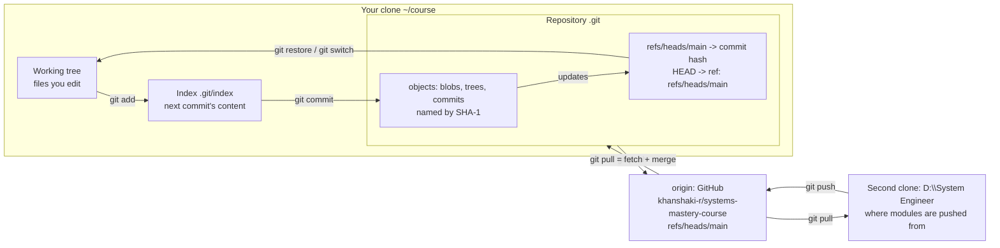

# Module 0.07: Git from zero

**Estimated hours:** 3

**What you will learn**

1. What Git is (a history of snapshots of a folder, stored next to the folder) and the three places a change lives: the working tree, the index and the repository.
2. The daily commands: `clone`, `status`, `add`, `commit`, `log`, `diff`, `branch`, `switch`, `merge`, `push`, `pull`, plus `.gitignore`, `restore` and `revert` for mistakes, and how to resolve a merge conflict calmly.
3. What a commit really is underneath: a snapshot (tree) plus a parent pointer plus a message, named by the SHA-1 hash of its contents, stored as a file under `.git/objects`.

**Prerequisites:** [Module 0.06: Windows lab setup](module-06-windows-lab-setup.md), and modules 0.03 and 0.04 for Bash and Ubuntu. You need your GitHub account (the course repository `khanshaki-r/systems-mastery-course` is private under it), Ubuntu in WSL2, and Git for Windows still installed, because we borrow its credential helper.

---

## 1. One-line intuition

Git is a save-game system for a folder: every commit is a complete snapshot you can go back to, compare against, or branch from, and the whole history lives in a hidden `.git` folder you can copy anywhere.

## 2. Real-life analogy

Think of a loan file at a bank, before computers.

- **The working tree** is the loan file open on your desk. You write on it, cross things out, add pages. Nobody else sees it.
- **The index** (also called the **staging area**) is the tray marked "to be filed". Before anything goes into the archive you place exactly the pages you want filed in the tray. You can put one page in and leave another on the desk.
- **The repository** is the archive in the basement. Filing the tray makes a **commit**: a sealed envelope containing a snapshot of the whole file as of now, a note saying what changed and why, your name, the date, and a reference to the previous envelope. Envelopes are never edited. A mistake is corrected with a new envelope that says "undo envelope 42".
- Every envelope has a **seal number** computed from its contents (the **SHA-1 hash**). Change one letter inside and the seal number changes. So the archive cannot be silently altered.
- A **branch** is a bookmark pointing at the latest envelope of a line of work. "main" is the official line. "rate-change" is a bookmark on a side line where you try something. **Merging** files the side line's changes into the official line.
- The **remote** is the head office's copy of the archive (GitHub). **Push** sends your new envelopes there; **pull** fetches theirs. Two clerks who changed the same sentence of the same page produce a **conflict**, and a human must decide which sentence wins.

## 3. Why it exists: the problem it solves

Without version control, a team's code is `server_final.cpp`, `server_final2.cpp`, `server_final_REAL.cpp` and an email thread. Nobody knows which one is in production. A bad change cannot be undone precisely. Two people editing the same file overwrite each other. A bug found in production cannot be traced to the change that caused it.

Git solves each one:

1. **History.** Every commit is a full snapshot with a message, an author and a time. `git log` answers "what changed, when, by whom, why".
2. **Undo.** Any file, or the whole tree, can be returned to any earlier state. A bad commit is reversed with `git revert`, leaving a record that it was reversed.
3. **Parallel work.** Branches let two people (or you on two ideas) work without stepping on each other, then merge. Conflicts are detected, not silently overwritten.
4. **Distribution.** Every clone has the whole history. GitHub going down does not lose a byte. A laptop dying loses only what was not pushed.
5. **Integrity.** Content-addressed storage means a corrupted or tampered object is detected by its hash.

For this course specifically: the course itself is delivered through Git (new modules are pushed to GitHub, you `git pull` to receive them), your journal entries are your commits, and every capstone ends with a CI-green repository (claim I). What breaks without this module: you cannot receive the course, submit your work, or claim "Git" on the resume honestly.

## 4. Three layers of depth

### Layer 1 (beginner): clone the course, make your first commit, push it

**Step 1: tell Git who you are.** In Ubuntu, once, with your real name and the email you use on GitHub:

```bash
git config --global user.name "Shakir Khan"
git config --global user.email "you@example.com"
git config --global init.defaultBranch main
git config --global --list
```

The last line prints the three settings back. They are stored in `~/.gitconfig`. Every commit you make carries this name and email.

**Step 2: let Ubuntu's Git use the Windows credential helper.** GitHub needs to know it is you before it lets you read a private repository. Git for Windows installed **Git Credential Manager (GCM)**, which signs you in through your browser and remembers the token. Ubuntu's Git can call it across the WSL boundary. First check it exists, then point Git at it:

```bash
ls "/mnt/c/Program Files/Git/mingw64/bin/" | grep credential
git config --global credential.helper "/mnt/c/Program\ Files/Git/mingw64/bin/git-credential-manager.exe"
```

The `ls` should list `git-credential-manager.exe` (on older Git for Windows the file is `git-credential-manager-core.exe`; use whichever name you see). The backslash before the space is required in the config value.

Alternative if that fails: install GitHub's command-line tool with `sudo apt install -y gh`, run `gh auth login` (choose GitHub.com, HTTPS, log in with a browser), then `gh auth setup-git`. Either way, the first `git clone` of a private repository below opens a browser window on Windows asking you to sign in to GitHub; after that it is remembered.

**Step 3: clone the course inside Ubuntu.** Module 0.04 explained why: `/home` is fast and `/mnt/d` is slow. From now on, this clone is where you work.

```bash
cd ~
git clone https://github.com/khanshaki-r/systems-mastery-course.git course
```

Expected (numbers vary):

```text
Cloning into 'course'...
remote: Enumerating objects: 64, done.
remote: Counting objects: 100% (64/64), done.
remote: Compressing objects: 100% (48/48), done.
remote: Total 64 (delta 21), reused 58 (delta 15), pack-reused 0
Receiving objects: 100% (64/64), 212.34 KiB | 2.10 MiB/s, done.
Resolving deltas: 100% (21/21), done.
```

`clone` copied the entire history, every commit ever made, into `~/course/.git`, and checked out the latest snapshot into `~/course`. Note that `D:\System Engineer` on Windows is *also* a clone of this same repository; that is where the course modules are written and pushed from. Two clones, one repository on GitHub in the middle.

```bash
cd ~/course
ls -a
git status
git log --oneline | head -5
```

Expected:

```text
.  ..  .git  .gitignore  CLAUDE.md  README.md  Shakir_Resume_CPP.pdf  Shakir_Resume_CPP.tex  capstones  journal  phase-00-how-a-computer-runs-a-program  ...
On branch main
Your branch is up to date with 'origin/main'.

nothing to commit, working tree clean
a1b2c3d Module 07: Git from zero
9f8e7d6 Module 06: Windows lab setup
...
```

(The hashes and messages will be whatever the latest commits are.) `origin` is Git's default name for the remote you cloned from. `git status` is the command you will type most; "working tree clean" means the desk matches the latest envelope exactly.

**Step 4: the cycle: change, stage, commit.** Bring your journal entries from the Windows side into this clone, then commit them. (If you have been writing them in `D:\System Engineer\journal`, they are reachable from Ubuntu at `/mnt/d/System Engineer/journal`.)

```bash
cp "/mnt/d/System Engineer/journal/"*.md ~/course/journal/
git status
```

Expected (file names are yours):

```text
On branch main
Your branch is up to date with 'origin/main'.

Untracked files:
  (use "git add <file>..." to include in what will be committed)
        journal/2026-10-18-what-a-computer-does.md
        journal/2026-10-19-os-processes-files.md
        ...

nothing added to commit but untracked files present (use "git add" to track)
```

**Untracked** means Git sees the files but has never been told to care about them. Stage them, check, commit:

```bash
git add journal/
git status
git commit -m "Journal: Phase 0 entries for modules 0.01 to 0.06"
git log --oneline | head -3
```

Expected:

```text
On branch main
Changes to be committed:
  (use "git restore --staged <file>..." to unstage)
        new file:   journal/2026-10-18-what-a-computer-does.md
        ...
[main 7c4e2a1] Journal: Phase 0 entries for modules 0.01 to 0.06
 6 files changed, 212 insertions(+)
 create mode 100644 journal/2026-10-18-what-a-computer-does.md
 ...
7c4e2a1 Journal: Phase 0 entries for modules 0.01 to 0.06
a1b2c3d Module 07: Git from zero
9f8e7d6 Module 06: Windows lab setup
```

`7c4e2a1` is the first seven characters of your commit's hash; yours will differ. Git shortens 40-character hashes when the prefix is unique.

**Step 5: push.**

```bash
git push origin main
```

Expected:

```text
Enumerating objects: 10, done.
Counting objects: 100% (10/10), done.
Delta compression using up to 8 threads
Compressing objects: 100% (8/8), done.
Writing objects: 100% (8/8), 14.21 KiB | 2.84 MiB/s, done.
Total 8 (delta 2), reused 0 (delta 0), pack-reused 0
To https://github.com/khanshaki-r/systems-mastery-course.git
   a1b2c3d..7c4e2a1  main -> main
```

Open the repository on GitHub in a browser or the GitHub app: your journal files are there. If push says `rejected ... fetch first`, someone (the course author, from the Windows clone) pushed before you. Run `git pull`, which fetches their commits and merges them with yours, then push again. That is the normal rhythm: **pull, work, commit, pull, push.**

**Step 6: receiving new modules.** Whenever the course tells you a new module is pushed:

```bash
cd ~/course && git pull
```

Expected: a list of the new files and `Fast-forward`, meaning your branch simply moved forward to include the new commits because you had nothing they lacked.

### Layer 2 (working engineer): the three areas, branches, conflicts, and undoing things

**The three areas.** Every command in Git moves content between these three places, and `git status` reports the differences between them:

| Area | Where | What it holds | Commands that write to it |
|---|---|---|---|
| Working tree | Your files in `~/course` | What you are editing now | your editor; `git restore`, `git switch`, `git merge` |
| Index (staging area) | `.git/index`, one binary file | The exact content the next commit will contain | `git add`, `git rm`, `git restore --staged` |
| Repository | `.git/objects` and `.git/refs` | Every commit ever made, and the branch pointers | `git commit`, `git merge`, `git pull`, `git revert` |

`git diff` shows working tree versus index (what you changed but have not staged). `git diff --staged` shows index versus the last commit (what the next commit will contain). `git diff HEAD` shows both together. Most confusion with Git disappears once you ask, for every command, "which of the three areas does this touch?".

Why have an index at all? So a commit can be a *chosen* set of changes. You fixed a bug and also reformatted a file: `git add` only the bug fix, commit it with a message about the bug, then stage and commit the formatting separately. Reviewers and `git log` thank you. `git add -p` lets you stage individual hunks within a file.

**Branches.** A branch is a 41-byte file in `.git/refs/heads/` containing a commit hash. That is all. Creating one is instant and costs nothing:

```bash
git switch -c rate-change        # create and switch to a new branch
git branch                       # list branches; * marks the current one
```

Expected:

```text
Switched to a new branch 'rate-change'
  main
* rate-change
```

(`git checkout -b` is the older spelling of `git switch -c`; both work. `git switch` exists since Git 2.23 and is clearer because `checkout` also restores files.) Commits made now move `rate-change` forward and leave `main` where it was. `git switch main` puts the working tree back to `main`'s snapshot. `git log --oneline --graph --all` draws the picture.

**Merging.** On `main`, `git merge rate-change` brings the branch's commits in. Two cases:

- **Fast-forward:** `main` has not moved since the branch was made, so Git just moves `main`'s pointer to the branch's commit. No new commit.
- **Three-way merge:** both moved. Git finds the common ancestor (the **merge base**), computes what each side changed relative to it, applies both sets of changes, and records a **merge commit** with two parents.

**Conflicts.** If both sides changed the *same lines* of the same file, Git cannot choose. It stops, marks the file, and `git status` says `both modified`. The file now contains:

```text
<<<<<<< HEAD
rate = 8.5
=======
rate = 9.0
>>>>>>> rate-change
```

Between `<<<<<<<` and `=======` is your side (`HEAD`, the branch you are on); between `=======` and `>>>>>>>` is the other branch. You edit the file to contain exactly what you want (one of the two lines, or something new), delete the three marker lines, then `git add` the file to say "resolved", then `git commit`. Nothing is lost: both versions are in the history. `git merge --abort` cancels the whole merge if you panic. The lab makes you cause and resolve one on purpose, because the first conflict is scary and the second is routine.

**Undoing things, by area.**

| Situation | Command | Which area it touches |
|---|---|---|
| I edited a file and want the last committed version back | `git restore path` | Working tree (the edit is gone for good) |
| I staged a file by mistake | `git restore --staged path` | Index only; the edit stays on disk |
| I committed something bad and have **not** pushed | `git reset --soft HEAD~1` to uncommit and keep the changes staged | Repository pointer; use with care |
| I committed something bad and **have** pushed | `git revert <hash>` | Makes a *new* commit that undoes the old one; history stays honest |
| I want to see an old version of a file | `git show <hash>:path` | Nothing; read-only |
| I deleted a file and want it back | `git restore path` (if not yet committed) or `git checkout <hash> -- path` | Working tree |

The rule a bank enforces and this course enforces (see CLAUDE.md's "never rewrite history"): once a commit is pushed to a shared branch, correct it with `revert`, never with `reset --hard` or `push --force`. Rewriting shared history makes everyone else's clone disagree with the server and destroys the audit trail.

**`.gitignore`.** A text file listing patterns of files Git should pretend not to see. The course already has one at the repository root; read it with `cat .gitignore`. It ignores `build/`, `*.o`, `*.exe`, `*.pdb`, `*.dmp` and editor folders, so your CMake build folders and Windows dumps never get committed. Rules: one pattern per line, `#` comments, a trailing `/` means directory, `*` is a wildcard, a leading `!` re-includes. `git status --ignored` shows what is being ignored. Committing build output is the most common beginner mistake in a repository; the file is there to stop you.

**Reading history.** `git log --oneline --graph --decorate -20` is the view to memorise. `git log -p path` shows every change to one file with diffs. `git blame path` shows, for each line, the commit and author that last touched it, which is how you find *why* a line exists. `git show <hash>` prints one commit in full.

### Layer 3 (internals): what a commit really is

Everything Git stores lives in `.git/objects` as **objects** of four kinds, each named by the **SHA-1 hash** of its contents:

| Object | Contains | Named by |
|---|---|---|
| **blob** | The bytes of one file (no name, no permissions) | SHA-1 of `"blob <size>\0<bytes>"` |
| **tree** | A directory listing: for each entry, mode, name, and the hash of a blob or sub-tree | SHA-1 of that listing |
| **commit** | The hash of one tree (the snapshot), zero or more parent commit hashes, author, committer, timestamps, message | SHA-1 of that text |
| **tag** | A name, a message and a signature pointing at a commit (annotated tags) | SHA-1 of that text |

So a commit is literally a small text file:

```text
tree aaa96ced2d9a1c8e72c56b253a0e2fe78393feb7
parent 9f8e7d6c5b4a39281706f5e4d3c2b1a0f9e8d7c6
author Shakir Khan <you@example.com> 1792331136 +0530
committer Shakir Khan <you@example.com> 1792331136 +0530

Journal: Phase 0 entries for modules 0.01 to 0.06
```

Three consequences fall out of this design, and they are the real answers to "why is Git like that":

1. **A commit is a snapshot, not a diff.** The `tree` line points at the *whole* directory as of that commit. `git diff` computes differences on demand by comparing two trees. This is why checking out any commit is fast: Git reads one tree, not a chain of patches. Unchanged files are not copied: their blobs already exist, so the new tree simply points at the old blobs. A commit that changes one file adds one blob, one or two trees and one commit object.
2. **The hash is the identity and the integrity check.** The commit's hash is computed over text that includes the tree hash, which is computed over the blob hashes. Change one byte in any file in any ancestor and every hash above it changes. Two clones that agree on a commit hash agree on the entire history below it. This is also why "editing" a commit is impossible: you can only make a new one with a new hash, which is what `commit --amend` and `rebase` really do.
3. **Branches and HEAD are just pointers.** `.git/refs/heads/main` is a file containing a commit hash. `.git/HEAD` contains `ref: refs/heads/main`. `git switch rate-change` rewrites one line in `HEAD`. `git commit` writes the new objects, then updates the file that `HEAD` points at. `git merge` in the fast-forward case changes one file. That is why branches are free, and why "where am I?" is `cat .git/HEAD`.

**The index** is a binary file listing every tracked path with its blob hash, mode, and a copy of the file's size and modification time from the last time Git looked. `git status` is fast because it compares the current `stat` of each file with the index and only re-hashes files whose size or time changed. `git add` hashes the file, writes the blob object if it is new, and updates the entry. `git commit` turns the index into tree objects (one per directory), writes the commit object, and moves the branch.

**Storage.** Each object is zlib-compressed and stored at `.git/objects/<first two hex chars>/<remaining 38>`. Thousands of small files get slow, so `git gc` (run automatically) packs them into `.git/objects/pack/*.pack` with deltas between similar objects; the content-addressed names are unchanged. SHA-1 produces 160 bits, written as 40 hex characters. Git can also use SHA-256 for new repositories, but SHA-1 remains the default and is what GitHub stores.

**Push and pull, in object terms.** `git push` asks the remote which commits it has for `main`, sends every object reachable from your `main` that the remote lacks (packed on the fly, which is what "Compressing objects" means), and asks the remote to move its `refs/heads/main` to your commit. The remote refuses if that move would discard commits it has and you do not (the "rejected, fetch first" message). `git pull` is `git fetch`, which downloads the remote's new objects and updates `refs/remotes/origin/main`, followed by `git merge origin/main` into your branch. The module's code section lets you watch all the objects appear.

## 5. Architecture diagram



Two clones, one remote. Every arrow on the left is local and instant; only `push` and `pull` touch the network.

## 6. Code

A Bash script (module 0.03) that builds a throwaway repository in `/tmp` and prints the objects, so you can see Layer 3 with your own eyes. Save as `~/labs/git_anatomy.sh` in Ubuntu.

```bash
#!/bin/bash
# git_anatomy.sh: build a tiny repository and show what a commit is made of.
set -e                                    # stop at the first error

rm -rf /tmp/anatomy && mkdir /tmp/anatomy && cd /tmp/anatomy
git init -q -b main                       # -q quiet, -b main: initial branch name
git config user.name "Lab"
git config user.email "lab@example.com"

printf 'hello\n' > hello.txt              # 6 bytes: h e l l o newline

echo "--- 1. a blob's name is the SHA-1 of 'blob <size>\\0<content>'"
printf 'blob 6\0hello\n' | sha1sum        # computed by hand
git hash-object hello.txt                 # computed by git: must match

echo "--- 2. after git add: one object exists, and the index names it"
git add hello.txt
find .git/objects -type f
git ls-files --stage

echo "--- 3. after git commit: the commit object is plain text"
git commit -q -m "first"
git cat-file -t HEAD                      # -t: type of the object HEAD points to
git cat-file -p HEAD                      # -p: pretty-print its contents

echo "--- 4. the tree it points to"
git cat-file -p 'HEAD^{tree}'

echo "--- 5. a branch is a file containing a hash"
cat .git/HEAD
cat .git/refs/heads/main

echo "--- 6. the object store now holds blob, tree, commit"
find .git/objects -type f | sort
```

```bash
chmod +x ~/labs/git_anatomy.sh
~/labs/git_anatomy.sh
```

Expected output. The blob and tree hashes are *exactly* these on every machine, because they depend only on content. The commit hash differs every run, because the commit contains your name and the timestamp:

```text
--- 1. a blob's name is the SHA-1 of 'blob <size>\0<content>'
ce013625030ba8dba906f756967f9e9ca394464a  -
ce013625030ba8dba906f756967f9e9ca394464a
--- 2. after git add: one object exists, and the index names it
.git/objects/ce/013625030ba8dba906f756967f9e9ca394464a
100644 ce013625030ba8dba906f756967f9e9ca394464a 0	hello.txt
--- 3. after git commit: the commit object is plain text
commit
tree aaa96ced2d9a1c8e72c56b253a0e2fe78393feb7
author Lab <lab@example.com> 1792331136 +0530
committer Lab <lab@example.com> 1792331136 +0530

first
--- 4. the tree it points to
100644 blob ce013625030ba8dba906f756967f9e9ca394464a	hello.txt
--- 5. a branch is a file containing a hash
ref: refs/heads/main
813cae5f2a7b4c1d9e0f6a8b7c5d4e3f2a1b0c9d
--- 6. the object store now holds blob, tree, commit
.git/objects/81/3cae5f2a7b4c1d9e0f6a8b7c5d4e3f2a1b0c9d
.git/objects/aa/a96ced2d9a1c8e72c56b253a0e2fe78393feb7
.git/objects/ce/013625030ba8dba906f756967f9e9ca394464a
```

Read it top to bottom. Step 1: `sha1sum` of the header plus content equals what `git hash-object` says; Git's object names are nothing more mysterious than that. Step 2: `git add` created exactly one object, the blob, and recorded it in the index with mode `100644` (a regular, non-executable file). Step 3: the commit is five lines of text; there is no `parent` line because it is the first commit. Step 4: the tree lists one entry pointing at the blob. Step 5: `HEAD` is an indirection to the branch file, and the branch file is the commit's hash. Step 6: three objects, one per kind, each in a folder named by the first two hex characters of its hash.

Now, in the same `/tmp/anatomy`, change the file and commit again, then print the new commit:

```bash
cd /tmp/anatomy
printf 'hello\nworld\n' > hello.txt
git commit -qam "second"
git cat-file -p HEAD
git log --oneline
```

Expected (hashes vary except where noted):

```text
tree 5e1b9c0d...
parent 813cae5f2a7b4c1d9e0f6a8b7c5d4e3f2a1b0c9d
author Lab <lab@example.com> 1792331200 +0530
committer Lab <lab@example.com> 1792331200 +0530

second
2f0a1b3 second
813cae5 first
```

The second commit has a `parent` line naming the first. That one line is the whole of "history". The chain of parent pointers is what `git log` walks.

## 7. Use case: core-banking loan-origination platform

Resume claim H5 says RCA documents were delivered under support SLAs, and claim H3 says a parity suite gated the cutover. Both rested on one question Git answers in seconds and nothing else answers at all: *exactly which code was running when this happened?*

The team's rules, and the decisions behind them:

- **Every production build is a tag on a commit.** The build pipeline refused to produce a release artefact unless the working tree was clean (`git status` empty) and tagged `release/3.7.1`. The binary and its PDB (module 0.06) were stamped with the commit hash. When a dump arrived from a branch server, the RCA began with `git switch --detach release/3.7.1`, which reproduced the exact source for the line WinDbg named. The decision this drove: no build from an untagged or dirty tree, ever, because an RCA that cannot name the commit is a guess.
- **Hotfixes by `revert`, never by rewriting.** When a release introduced the master-table cache null dereference, the fix in the field was `git revert` of the offending commit on the release branch, built and tagged as `3.7.2`, while the proper fix went through review on `main`. History kept both the mistake and its reversal, which is what an auditor wants to see. `push --force` was disabled on shared branches at the server.
- **A branch per change, merged only when the parity suite is green.** The migration engine (H1) and the parity suite (H3) lived in one repository. Every change went on a branch, and the CI pipeline (Phase 9) ran the GoogleTest parity suite against a Docker YugabyteDB (module 0.05) before the branch could merge to `main`. A merge conflict in the record-layout decoder was a signal that two people had changed the same packed-record format, and the rule was to resolve it in a call, not alone.
- **The journal was a commit log.** The engineer's notes on each incident, the numbers measured, and the decisions taken were committed alongside the code. Two years later, that log is what lets a resume line be defended with specifics. That is exactly what `journal/` in this repository is for.

## 8. Lab

All of this happens in Ubuntu inside `~/course`. Keep the outputs; they are the journal.

### Part A: clone and look around (25 minutes)

1. Do Layer 1 steps 1 to 3: configure your identity, set up the credential helper, clone to `~/course`. Record the `Receiving objects` line.
2. Run `git log --oneline | wc -l` (how many commits so far), `git log --oneline -5`, and `git log -1 --format='%H %an %ad'` (full hash, author, date of the latest commit).
3. Run `ls .git`, `cat .git/HEAD`, `cat .git/refs/heads/main` (or `git rev-parse main` if the file is missing because the ref is packed). Confirm the hash matches `git log -1 --format=%H`.
4. Run `git cat-file -p HEAD` and then `git cat-file -p 'HEAD^{tree}'`. Find the entry for `journal` and note it is a `tree`, and the entry for `README.md` and note it is a `blob`.
5. Run `cat .gitignore` and `git status --ignored` and identify anything already being ignored.

Expected: the hash from step 3 equals the one from step 2; the top-level tree lists the phase folders as trees and the root files as blobs.

### Part B: your first commits and push (25 minutes)

1. Copy your journal entries in as in Layer 1 step 4. Run `git status`, `git add journal/`, `git status`, `git diff --staged --stat`.
2. Commit with the message `Journal: Phase 0 entries for modules 0.01 to 0.06`. Run `git log --oneline -3` and `git cat-file -p HEAD`. Record the `parent` line: it is the course's latest commit.
3. Write a new journal entry for this module now, `journal/YYYY-MM-DD-git-from-zero.md`, with at least the header table filled in; you will finish it at the end. `git add` it and commit with `Journal: 0.07 Git from zero (draft)`.
4. `git push origin main`. Record the `a1b2c3d..7c4e2a1  main -> main` line. Check GitHub in the browser or app.
5. Run `git pull`. Expected: `Already up to date.`

### Part C: branch, conflict, resolve (40 minutes)

1. Create a scratch file for the exercise on `main` and commit it:

```bash
mkdir -p labs/git-lab
printf 'product: home-loan\nrate: 8.5\nterm: 240\n' > labs/git-lab/rates.txt
git add labs/git-lab/rates.txt
git commit -m "Git lab: starting rates file"
```

2. Branch and change the rate on the branch:

```bash
git switch -c rate-change
sed -i 's/rate: 8.5/rate: 9.0/' labs/git-lab/rates.txt
git commit -am "Git lab: raise rate to 9.0 on branch"
```

(`-a` stages every already-tracked file that changed; new files still need `git add`.)

3. Switch back to `main` and change the *same line* differently:

```bash
git switch main
sed -i 's/rate: 8.5/rate: 8.75/' labs/git-lab/rates.txt
git commit -am "Git lab: raise rate to 8.75 on main"
git log --oneline --graph --all -5
```

4. Merge and read the conflict:

```bash
git merge rate-change
git status
cat labs/git-lab/rates.txt
```

Expected: `CONFLICT (content): Merge conflict in labs/git-lab/rates.txt` and `Automatic merge failed; fix conflicts and then commit the result.` The file shows the `<<<<<<< HEAD` / `=======` / `>>>>>>> rate-change` block around the two `rate:` lines.

5. Resolve it: edit the file so it contains `rate: 9.0` only (the branch wins), with no marker lines. Then `git add labs/git-lab/rates.txt`, `git commit` (accept the default message in the editor; if `nano` opens, `Ctrl+O`, Enter, `Ctrl+X`), `git log --oneline --graph -5`. You should see a merge commit with two parents; confirm with `git cat-file -p HEAD | grep parent` (two lines).
6. Delete the branch: `git branch -d rate-change`. Push: `git push origin main`.

### Part D: undo three ways, and .gitignore (30 minutes)

1. **Working-tree undo.** Edit `labs/git-lab/rates.txt` to change `term: 240` to `term: 120`. `git diff`. Now `git restore labs/git-lab/rates.txt` and `git diff` again (empty). The edit is gone.
2. **Index undo.** Change the term again, `git add` the file, `git status` (staged), `git restore --staged labs/git-lab/rates.txt`, `git status` (modified, not staged). The edit is still on disk. Now `git restore` it to clean up.
3. **Revert a pushed commit.** Append a bad line: `echo "rate: 99.0" >> labs/git-lab/rates.txt`, commit as `Git lab: wrong rate (to be reverted)`, push. Now `git revert HEAD` (accept the message), `cat labs/git-lab/rates.txt` (the line is gone), `git log --oneline -3` (both the bad commit and the revert are there), push again. This is how a bad change is undone on a shared branch.
4. **.gitignore in action.** Run `mkdir -p labs/git-lab/build && echo x > labs/git-lab/build/junk.o && echo y > labs/git-lab/notes.txt`, then `git status`. Only `notes.txt` appears; `build/` and `*.o` are ignored by the root `.gitignore`. Run `git status --ignored` to see them listed as ignored. Delete both: `rm -rf labs/git-lab/build labs/git-lab/notes.txt`.
5. Run `~/labs/git_anatomy.sh` from section 6 and confirm the blob hash `ce0136...` and tree hash `aaa96c...` match exactly.
6. Finish your journal entry for this module, commit it as `Journal: 0.07 Git from zero`, and push. From now on, every lab's journal entry is a commit, with a message of the form `Journal: <module> <topic>`.

Expected: after step 3, `git log --oneline -3` shows `Revert "Git lab: wrong rate (to be reverted)"` above the bad commit; after step 5 the two content hashes match the module text character for character.

### Journal

Your entry `journal/YYYY-MM-DD-git-from-zero.md` is itself the deliverable. Record: the commit count from Part A; the full hash of your first journal commit and its `parent`; the exact conflict text from Part C and how you resolved it; the three undo commands from Part D and which area each touched; and the output of `git_anatomy.sh`. Under "Decisions and why", write why a pushed mistake is fixed with `revert` and not `reset`.

## 9. Common mistakes and misconceptions

| Mistake | Why it is wrong | Bug it causes later |
|---|---|---|
| "A commit stores the diff" | A commit points at a full tree (snapshot); diffs are computed on demand | Fear that old history is "lost" or that checkout is slow; misunderstanding of merges |
| Forgetting `git add` and wondering why `commit` says nothing to commit | Commits come from the index, not the working tree | Half-committed changes; "it works here but not in CI" |
| `git commit -am` for new files | `-a` stages only already-tracked files | New files silently left out of the commit |
| Editing the conflict file but not running `git add` afterwards | `add` is how you tell Git the conflict is resolved | Commit refused, or marker lines committed into the file |
| Committing `build/`, `*.exe`, `*.dmp` | Binary output does not belong in history and bloats every clone forever | 200 MB repository; merge conflicts in files no human can read |
| `git push --force` to "fix" a shared branch | Rewrites history everyone else has; destroys the audit trail | Colleagues' clones diverge; lost commits; the course rule forbids it |
| `git reset --hard` as a general undo | It throws away working-tree changes permanently | Losing a day's work; use `restore` for files and `revert` for commits |
| Working in `/mnt/d` instead of `~/course` | Slow (module 0.04) and two clones of one repository on one machine invite confusion | Builds crawl; commits made in one clone, pushed from the other |
| Pulling only when push is rejected | The longer two clones drift, the bigger the conflict | Painful merges; pull before starting work |
| Treating the hash as random | It is the SHA-1 of the content; the same content always hashes the same | Not understanding why "editing" a commit creates a new one |

## 10. Resume link

- **Claim G, "Git".** You can now say what a commit is in object terms: "a tree hash, parent hashes, author, message, named by the SHA-1 of that text, stored under `.git/objects`." Most candidates cannot. Add the three areas and the `restore` / `restore --staged` / `revert` distinction and you are ahead of most working engineers.
- **Claim H5, "RCA documents under SLAs".** Section 7's first rule, every production build is a tag on a clean commit, is the Git half of your dump-analysis story: "the dump named the line; the tag named the commit; I checked out that tag and had the exact source." Your lab's `git switch` and `git cat-file` work is the evidence that you understand why that works.
- **Claim I, "tcpkv ... CI".** Capstone C1 ends with a repository where every push runs the build, the tests and the sanitizers. That pipeline is a `.github/workflows` file committed with Git, triggered by Git. The branch-and-merge rhythm from Part C is the daily workflow there.
- **Claim H3, "gating a zero-downtime cutover".** The gate was "the parity suite is green on the branch before it merges". Say: "merges to main were blocked unless CI passed the parity suite against a Docker YugabyteDB."

Likely follow-up: "What is the difference between `git pull` and `git fetch`?" Answer: `fetch` downloads the remote's new objects and updates `origin/main` without touching your branch; `pull` is `fetch` followed by `merge` into your current branch.

## 11. Interview questions

**Q1 (easy). What are the working tree, the index and the repository, and which command moves content between them?**

<details>
<summary>Model answer</summary>

The working tree is the set of files on disk that I edit. The index, or staging area, is a file inside `.git` that records exactly what the next commit will contain, path by path with a blob hash. The repository is the object store and the branch pointers under `.git`. `git add` copies content from the working tree into the index, `git commit` turns the index into tree and commit objects in the repository and moves the current branch, and `git restore` moves content back from the index or a commit into the working tree, with `--staged` resetting the index from the last commit instead. `git status` reports the differences between the three, and `git diff` versus `git diff --staged` show working-tree-to-index and index-to-HEAD respectively.

</details>

**Q2 (easy). What is a branch in Git, and why is creating one cheap?**

<details>
<summary>Model answer</summary>

A branch is a named pointer to a commit: literally a small file under `.git/refs/heads/` containing a 40-character hash, or an entry in the packed-refs file. `HEAD` points at the current branch. Committing writes new objects and advances the pointer. Creating a branch writes one file; no files are copied, because every commit is a snapshot shared through the object store. Switching branches updates `HEAD` and rewrites the working tree and index to match the target commit's tree, touching only files that differ.

</details>

**Q3 (medium). Describe what happens during `git merge feature` when both branches have new commits, and what a conflict is.**

<details>
<summary>Model answer</summary>

Git finds the merge base, the most recent commit that both branches have as an ancestor, then performs a three-way merge: for each file it compares the base version with each side's version. Changes made on only one side are taken; identical changes are taken once; hunks changed differently on both sides are a conflict. For files without conflicts Git writes the merged content to the working tree and index; for conflicted files it writes the content with `<<<<<<<`, `=======` and `>>>>>>>` markers, records all three versions in the index, and stops. I edit each conflicted file to the correct content, `git add` it to mark it resolved, and `git commit` creates a merge commit with two parent lines. If the current branch had no new commits of its own, no merge commit is needed; Git fast-forwards the pointer to the feature branch's commit.

</details>

**Q4 (medium). A colleague pushed a commit that broke production. What do you do, and why not `git reset --hard` and force-push?**

<details>
<summary>Model answer</summary>

I run `git revert <hash>` on the shared branch, which creates a new commit that applies the inverse of the bad change, test it, push it, and build and tag a new release from it. History now contains both the mistake and its reversal, which is what the audit trail and the RCA need, and everyone else's clone simply pulls one new commit. `git reset --hard` followed by `push --force` would instead rewrite the branch to pretend the commit never happened. Every clone that already has the commit now disagrees with the server, their next pull creates a messy merge or they lose work, any commits built on top of the bad one are orphaned, and the record of what was in production at the time of the incident is destroyed. On shared branches, history is append-only, and most teams disable force-push at the server to enforce that.

</details>

**Q5 (hard). Explain what a commit is physically inside `.git`, how its hash is computed, and why that design makes the history tamper-evident.**

<details>
<summary>Model answer</summary>

A commit is a zlib-compressed text object stored at `.git/objects/xx/yyyy...`, where the path is its SHA-1 hash. The text has a `tree` line naming the hash of a tree object, zero or more `parent` lines naming earlier commits, `author` and `committer` lines with name, email and timestamp, and the message. A tree object lists directory entries, each with a mode, a name and the hash of a blob or a sub-tree. A blob is the raw bytes of a file. Every object's hash is SHA-1 over a header of its type and size, a NUL byte, and its content, so a blob of `hello` plus newline is always `ce0136...` on every machine. Because the commit text contains the tree hash, the tree contains blob and sub-tree hashes, and the commit contains its parents' hashes, each commit hash is a function of the entire snapshot and the entire history before it. Changing any byte in any historical file or message changes that object's hash, which changes every tree and commit above it, so the tip hash would no longer match what collaborators and the server hold. Tampering therefore cannot be silent; it can only produce a visibly different history. The same property is why operations that "edit" history, such as amend or rebase, are really creating new commits with new hashes, why branches are just pointers to hashes, and why two clones agreeing on one tip hash agree on everything beneath it. Git supports SHA-256 as an alternative object format for new repositories, but SHA-1 remains the default and the format GitHub uses.

</details>

## 12. Revision

- Three areas: working tree (edit), index (`git add`, what the next commit contains), repository (`git commit`); `restore` undoes the working tree, `restore --staged` the index, `revert` a pushed commit with a new commit; never rewrite shared history.
- Daily rhythm in `~/course`: `git pull`, work, `git add`, `git commit -m "Journal: ..."`, `git push origin main`; branches are pointer files, `switch -c` creates one, `merge` joins, conflicts are resolved by editing out the markers and `git add`.
- A commit is a text object: tree hash (full snapshot), parent hashes, author, message, named by the SHA-1 of that text, stored under `.git/objects`; blobs and trees are shared between commits, so history is cheap and tamper-evident.

---

Previous: [Module 0.06: Windows lab setup](module-06-windows-lab-setup.md) | Next: [Module 1.01: Your first C program](../phase-01-c-from-zero-to-systems/module-01-first-c-program.md)
