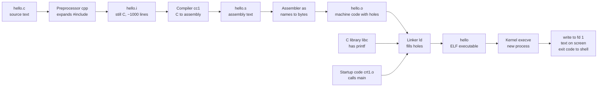

# Module 1.01: Your first C program

**Estimated hours:** 3

**What you will learn**

1. What a C source file is, what a compiler does to it, and how to compile and run a program on your Ubuntu machine with one command.
2. The four separate stages hidden inside that one command (preprocess, compile, assemble, link) and what each one produces.
3. How a program reports success or failure with an exit code, how `printf` formats numbers and text, and why this course always compiles with `-Wall -Wextra -Werror`.

**Prerequisites:** [Module 0.07: Git from zero](../phase-00-how-a-computer-runs-a-program/module-07-git-from-zero.md). You need the Ubuntu lab from module 0.04 (WSL2 with `gcc`, `gdb`, `git` and VS Code).

---

## 1. One-line intuition

A C program is a recipe written in a language humans can read; the compiler translates it into the bytes the CPU can execute, and the operating system runs those bytes as a process.

## 2. Real-life analogy

In module 0.01 the CPU was a clerk who only understands a tiny vocabulary of numeric instructions. Nobody wants to write recipes in that vocabulary. So we hire a **translator**.

- **You** write the recipe in a language with words like `int`, `return` and `printf`. That recipe is the **source file** `hello.c`.
- **The translator** is the **compiler** (`gcc`, the GNU C Compiler). It reads your recipe and writes a new one in the clerk's numeric language. That output is the **executable** file `hello`.
- The translator is strict. If you spell a word wrong or forget a full stop, it refuses to translate and tells you the line number. That refusal is a **compile error**. It is your friend: a mistake caught here costs seconds; the same mistake caught in a bank's production server costs an incident.
- The translator also gives **advice** when a sentence is legal but suspicious ("you defined this ingredient and never used it"). That advice is a **warning**. This course tells the translator to treat every warning as a refusal, so suspicious recipes never reach the clerk.
- Translation happens once. Running happens as many times as you like. The clerk never sees your English; it only ever sees the translated bytes.

## 3. Why it exists: the problem it solves

The CPU understands only machine code: bytes such as `8D 04 37 C3`. In the 1940s and 1950s people wrote programs as those bytes, by hand, on punched cards. It was slow, and every error was invisible until the machine did something strange.

Two inventions fixed this.

1. **Assembly language** gave each instruction a short name (`add`, `mov`, `ret`) and a program called an **assembler** translated names to bytes. Better, but still one line per CPU instruction, and a program written for one CPU family was useless on another.
2. **High-level languages** let you write `total = principal + interest;` and have a **compiler** work out which instructions, which registers and which memory addresses that needs. The same source can be compiled for x86-64, ARM, Linux or Windows.

C was created in 1972 by Dennis Ritchie at Bell Labs to write the Unix operating system. It is still the language of the Linux kernel, PostgreSQL, Redis, Berkeley DB, the C library that every other language leans on, and the migration engine on your resume (claim H1). It survives because it is small, it maps closely to what the machine does, and it gives you direct control of memory. That control is also why C programs can crash in spectacular ways, which is why Phase 1 spends so long on pointers and undefined behaviour.

What breaks without a compiler: you would write bytes by hand, you would have no error checking before running, and nothing you wrote would be portable.

## 4. Three layers of depth

### Layer 1 (beginner): hello.c, one token at a time

Here is the whole program.

```c
#include <stdio.h>

int main(void) {
    printf("Hello, loan system!\n");
    return 0;
}
```

Read it one piece at a time. A **token** is one meaningful piece of text: a word, a symbol, a number.

| Token | What it means |
|---|---|
| `#include <stdio.h>` | "Before translating, paste in the file `stdio.h`." That file describes the **standard input/output** functions, including `printf`. Lines beginning with `#` are instructions to the **preprocessor**, explained in Layer 2. |
| `int` | The function that follows gives back a whole number (an **integer**) when it finishes. |
| `main` | The name of the function the operating system calls to start your program. Every C program has exactly one `main`. |
| `(void)` | The list of inputs this function takes. `void` means "none". |
| `{` | Start of the function's body. |
| `printf(` | Call the function named `printf` ("print formatted"). The round brackets hold its inputs. |
| `"Hello, loan system!\n"` | A **string literal**: text in double quotes. `\n` is one special character, the **newline**, which moves the cursor to the next line. |
| `)` | End of the inputs to `printf`. |
| `;` | End of a **statement**. C uses a semicolon the way English uses a full stop. Forgetting it is the most common first error. |
| `return 0;` | Finish `main` and hand the number 0 back to the operating system. By convention 0 means "success". |
| `}` | End of the function body. |

A **function** is a named block of code you can call. `main` is one you write; `printf` is one someone else wrote and the compiler links in for you (module 1.04 is all about functions).

**Compile and run.** Open your Ubuntu terminal and type:

```bash
mkdir -p ~/course/phase01 && cd ~/course/phase01
code hello.c          # opens VS Code; paste the program, save, come back
gcc -std=c17 -Wall -Wextra -Werror -g -o hello hello.c
./hello
```

Expected output:

```text
Hello, loan system!
```

What each part of the command means:

| Part | Meaning |
|---|---|
| `gcc` | Run the GNU C compiler. |
| `-std=c17` | Use the 2017 edition of the C standard. The standard is the rulebook that says what C means. |
| `-Wall -Wextra` | Turn on all the common warnings plus the extra ones. |
| `-Werror` | Treat every warning as an error: refuse to produce a program. |
| `-g` | Include **debug information** so `gdb` can show source lines and variable names (module 1.04). |
| `-o hello` | Name the output file `hello`. Without this, GCC names it `a.out`. |
| `hello.c` | The source file to translate. |
| `./hello` | Run the file called `hello` in the current directory (`.`). The `./` is needed because Linux only searches the `PATH` folders for commands, and your folder is not one of them. |

**The exit code.** Right after running, type:

```bash
echo $?
```

Expected output:

```text
0
```

`$?` is a shell variable holding the **exit code** (also called exit status or return code) of the last command. It is the number your `return 0;` handed back. Change it to `return 3;`, recompile, run, and `echo $?` prints `3`. This is how scripts, CI pipelines and service managers learn whether a program succeeded without reading its text output. The convention is: 0 means success, anything else means failure, and different non-zero values can mean different failures.

### Layer 2 (working engineer): the four stages, warnings, and printf

**One command, four programs.** `gcc` is a driver. It runs four separate tools in a row and deletes the intermediate files. You can run them yourself:

```bash
gcc -E hello.c -o hello.i        # 1. preprocess
gcc -S hello.i -o hello.s        # 2. compile to assembly
gcc -c hello.s -o hello.o        # 3. assemble to machine code
gcc hello.o -o hello             # 4. link into an executable
```

| Stage | Tool | Input | Output | What happens |
|---|---|---|---|---|
| Preprocess | `cpp` | `hello.c` | `hello.i` (still C) | Every `#include` is replaced by the file's contents; `#define` macros are expanded; comments are removed. `hello.i` is typically several hundred to about a thousand lines, almost all from `stdio.h`. |
| Compile | `cc1` | `hello.i` | `hello.s` (assembly text) | The real translation: C becomes x86-64 instructions, written as text. |
| Assemble | `as` | `hello.s` | `hello.o` (object file) | Instruction names become bytes. The result is machine code but not yet runnable: it has a hole where `printf` should be. |
| Link | `ld` | `hello.o` plus the C library | `hello` (executable) | Fills the holes by connecting `main`'s call to the real `printf` in the C library, and adds the startup code that calls `main`. |

Module 1.12 goes through each stage in detail. For now the point is: an error message tells you which stage failed. "expected ';'" is the compiler. "undefined reference to `prinft`" is the linker, and it means you called a function that exists nowhere.

**Why the course always uses `-Wall -Wextra -Werror`.** The C standard allows many things that are almost always mistakes: using a variable you never set, comparing a signed and an unsigned number, passing a `double` to `%d`. The compiler can spot most of them, but only warns. In a 200,000-line banking codebase a warning scrolls past and is forgotten. `-Werror` makes the build stop, so the warning is fixed the moment it appears, by the person who understands the code best. Resume claim I says tcpkv is "clean under -Wall -Wextra -Werror"; this habit starts today.

Two examples of what the flags catch. First, a variable that is set and never read:

```c
int main(void) {
    int unused = 5;
    printf("Hello\n");
    return 0;
}
```

```text
hello.c:4:9: error: unused variable 'unused' [-Werror=unused-variable]
    4 |     int unused = 5;
      |         ^~~~~~
cc1: all warnings being treated as errors
```

Second, the wrong format specifier (explained next):

```c
printf("%d\n", 8.75);
```

```text
hello.c:5:14: error: format '%d' expects argument of type 'int', but argument 2 has type 'double' [-Werror=format=]
    5 |     printf("%d\n", 8.75);
      |             ~^     ~~~~
      |              |     |
      |              int   double
      |             %f
cc1: all warnings being treated as errors
```

Read the message structure: file, line, column, then what is wrong, then the flag in brackets that triggered it. The flag name is searchable. Without `-Werror` the second program compiles and prints garbage, because `printf` reads 8 bytes of a `double` as if they were a 4-byte `int`.

**printf and format specifiers.** `printf` takes a **format string** and then one value for each `%` marker in it. Each marker says how to print the value that follows:

| Specifier | Prints | Matching type | Example |
|---|---|---|---|
| `%d` | Decimal integer | `int` | `printf("%d", 42)` prints `42` |
| `%u` | Unsigned decimal integer | `unsigned int` | `printf("%u", 42u)` prints `42` |
| `%c` | One character | `char` (or `int`) | `printf("%c", 'A')` prints `A` |
| `%s` | A string | `char *` (text) | `printf("%s", "Asha")` prints `Asha` |
| `%f` | Decimal fraction, 6 places by default | `double` | `printf("%f", 8.75)` prints `8.750000` |
| `%.2f` | Decimal fraction, 2 places | `double` | `printf("%.2f", 8.75)` prints `8.75` |
| `%zu` | Size in bytes | `size_t` (what `sizeof` gives) | `printf("%zu", sizeof(int))` prints `4` |
| `%p` | A memory address, in hex | `void *` (cast any pointer to it) | `printf("%p", (void *)&x)` prints `0x7ffd...` |
| `%x` / `%X` | Hex, lower/upper case | `unsigned int` | `printf("%X", 255u)` prints `FF` |
| `%%` | A literal percent sign | none | `printf("8%%")` prints `8%` |

The specifier and the type must match. `printf` has no way to check; it trusts the format string. That is exactly why the compiler checks it for you under `-Wall`.

**Two output streams.** `printf` writes to **standard output** (file descriptor 1 from module 0.02). Errors should go to **standard error** (descriptor 2) with `fprintf(stderr, ...)`, so that a script can capture the real output in a file while errors still appear on screen:

```bash
./hello > output.txt      # standard output goes to the file
./hello 2> errors.txt     # standard error goes to the file
```

### Layer 3 (internals): what happens between `./hello` and the text appearing

1. **The shell asks the kernel to start a process.** Bash calls `fork` to make a copy of itself, then `execve("./hello", ...)` to replace that copy with your program (module 0.02).
2. **The kernel reads the file header.** `hello` is an **ELF** file (Executable and Linkable Format). Its header says which bytes are code, which are data, and that the program needs the C library. The kernel maps the code and data into the new process's memory and hands control to the **dynamic linker**, `/lib64/ld-linux-x86-64.so.2`.
3. **The dynamic linker loads `libc.so.6`**, the shared C library that contains `printf`, and connects your call to it. Shared means one copy on disk is used by every program; `hello` is about 16 KB on disk because `printf`'s code is not inside it.
4. **Start-up code runs before `main`.** A function called `_start` (from a small object file the linker added, `crt1.o`) sets up the stack and calls `__libc_start_main`, which prepares the C library and finally calls your `main`.
5. **`printf` formats the text into a buffer.** It does not go to the screen immediately. The C library keeps an in-memory **buffer** for standard output. When the output is a terminal, the buffer is **line-buffered**: flushed whenever a `\n` is written. When output is a file or pipe, it is **fully buffered**: flushed when it fills (typically 4096 bytes) or at exit.
6. **Flushing is a `write` system call**: `write(1, "Hello, loan system!\n", 20)`. The kernel copies the bytes to the terminal device.
7. **`main` returns 0.** `__libc_start_main` passes that to `exit(0)`, which flushes any remaining buffers, closes files, and makes the `exit_group` system call. The kernel tears down the process and stores 0 for the shell, which puts it in `$?`.

You can watch step 6 with `strace`, a tool that prints every system call a process makes (`sudo apt install strace` if missing):

```bash
strace -e trace=write ./hello
```

Expected output (the `write` line is the one that matters):

```text
write(1, "Hello, loan system!\n", 20Hello, loan system!
) = 20
+++ exited with 0 +++
```

The number 20 is the byte count: 19 visible characters plus the newline.

**The buffering trap.** Because `printf` buffers, a program that prints "step 3 reached" without a `\n` and then crashes may show nothing. The text was in the buffer; the crash killed the process before the flush. When debugging a crash, always end debug prints with `\n` or call `fflush(stdout)`. You will need this in module 1.04 and in capstone C6.

**Looking at the pieces.** The `file` command reports what a file is, and `nm` lists the names (symbols) in an object file:

```bash
file hello.o
file hello
nm hello.o
```

Typical output:

```text
hello.o: ELF 64-bit LSB relocatable, x86-64, version 1 (SYSV), not stripped
hello:   ELF 64-bit LSB pie executable, x86-64, version 1 (SYSV), dynamically linked, interpreter /lib64/ld-linux-x86-64.so.2, for GNU/Linux 3.2.0, not stripped
0000000000000000 T main
                 U puts
```

`T main` means `main` is defined here in the text (code) section. `U puts` means `puts` is **undefined** here: the object file calls it but does not contain it. The linker's job is to find it in the C library. (GCC quietly replaced your `printf` of a plain string ending in `\n` with the simpler `puts`; it does this because the result is identical and `puts` is faster.)

## 5. Architecture diagram



Everything left of `hello` happens once, at build time. Everything right of it happens every time you run the program.

## 6. Code

This program prints one value with each format specifier you will use in this phase, then exits with code 0. Save it as `first_program.c`.

```c
/* first_program.c
 * Shows: printf with every format specifier needed in Phase 1,
 * output to standard error, and an exit code.
 */
#include <stdio.h>

int main(void) {
    int         loan_id  = 1001;          /* a whole number */
    char        grade    = 'B';           /* one character, in single quotes */
    double      rate     = 8.75;          /* a number with a fraction */
    const char *customer = "Asha Verma";  /* text: a string */

    printf("loan id     : %d\n", loan_id);
    printf("customer    : %s\n", customer);
    printf("grade       : %c (stored as the number %d)\n", grade, grade);
    printf("rate        : %f percent (default 6 decimals)\n", rate);
    printf("rate        : %.2f percent (2 decimals)\n", rate);
    printf("sizeof(int) : %zu bytes\n", sizeof(int));
    printf("loan_id is at address %p\n", (void *)&loan_id);
    printf("progress    : 100%% formatted\n");

    /* Errors and diagnostics go to standard error, not standard output. */
    fprintf(stderr, "note: this line went to standard error\n");

    return 0;    /* 0 = success; the shell will see it in $? */
}
```

Compile and run:

```bash
gcc -std=c17 -Wall -Wextra -Werror -g -o first_program first_program.c
./first_program
echo "exit code: $?"
```

Expected output (the address will differ on your machine and on every run):

```text
loan id     : 1001
customer    : Asha Verma
grade       : B (stored as the number 66)
rate        : 8.750000 percent (default 6 decimals)
rate        : 8.75 percent (2 decimals)
sizeof(int) : 4 bytes
loan_id is at address 0x7ffd5c1e2a3c
progress    : 100% formatted
note: this line went to standard error
exit code: 0
```

Now prove that the two streams are separate:

```bash
./first_program > out.txt
cat out.txt
```

Expected: the terminal shows only `note: this line went to standard error`; `cat out.txt` shows the other eight lines. The `>` sent standard output to the file and left standard error on the screen.

Three things to notice. `grade` printed as `B` with `%c` and as `66` with `%d`: the same byte, two ways of showing it (module 1.02). `%p` needed `(void *)` in front of `&loan_id`: the standard says `%p` takes a pointer to `void`, so we convert. And `const char *customer` is how C holds text; it is really an address of the first letter, which module 1.06 explains.

## 7. Use case: core-banking loan-origination platform

The migration engine from resume claim H1 (capstone C3) is a C program that a Bash runbook starts for each batch of Berkeley DB records. The runbook has to decide what to do when a batch finishes, and it cannot read English log lines reliably. It reads the exit code.

The decision this drove: an **exit-code contract**, agreed before the first line of the engine was written.

| Exit code | Meaning | Runbook action |
|---|---|---|
| 0 | Batch written and verified | Start the next batch |
| 1 | Bad command-line arguments | Stop; a human made a mistake |
| 2 | Source data failed validation | Stop; log the record key; do not retry |
| 3 | Database unavailable or timed out | Wait 30 seconds and retry the same batch |
| 4 | Internal error (should never happen) | Stop and page the on-call engineer |

Because batches were restartable (module 1.14 and capstone C3), code 3 could be retried safely. A single `return` statement in `main` is what makes a whole night of unattended migration possible.

The second decision is the build itself. The engine, the parity suite (H3) and tcpkv (I) all build with `-Wall -Wextra -Werror`. The reason is cost: a format-string mismatch that the compiler catches in one second would otherwise appear as corrupted log output or, worse, as a wrong value written to the new database, found days later by the parity suite. Interviewers who ask "how did you keep the migration code reliable?" expect this answer: the compiler was the first test.

## 8. Lab

Work in `~/course/phase01`. Keep every file; you will commit them with Git at the end.

### Part A: the four stages, one at a time (30 minutes)

1. Create `hello.c` with the program from Layer 1. Compile with the full course command and run it. Confirm you see `Hello, loan system!` and that `echo $?` prints `0`.
2. Run the four stages separately and look at each result:

```bash
gcc -E hello.c -o hello.i
wc -l hello.i
tail -n 8 hello.i
```

Expected: `wc -l` reports several hundred to about a thousand lines. The last lines of `hello.i` are your own six lines, now with the `#include` replaced by the contents of `stdio.h` above them.

```bash
gcc -S hello.i -o hello.s
cat hello.s
```

Expected: about 30 lines of assembly. Find `main:`, a line with `call puts@PLT`, a line `movl $0, %eax` (that is your `return 0`), and `.string "Hello, loan system!"`. Lines beginning with `.cfi` are bookkeeping for debuggers; ignore them. Note the `%` before register names and the order `source, destination`: GCC writes AT&T syntax, while Compiler Explorer in module 0.01 showed Intel syntax. Same instructions, two spellings.

```bash
gcc -c hello.s -o hello.o
nm hello.o
gcc hello.o -o hello
./hello
ls -l hello.c hello.i hello.s hello.o hello
```

Expected: `nm` shows `T main` and `U puts`. The final `hello` runs exactly as before. The sizes grow from a few dozen bytes of source to an executable of roughly 16 KB (typical; the exact number varies).

3. Delete `hello.i`, `hello.s` and `hello.o`. The one-step command recreates them in a temporary folder and deletes them; you only needed to see them once.

### Part B: exit codes (15 minutes)

1. Change `return 0;` to `return 3;`. Recompile, run, and run `echo $?`. Expected: `3`.
2. Try `return 256;`. Expected from `echo $?`: `0`. The shell only keeps the lowest 8 bits of the exit code, so valid codes are 0 to 255. Write that down; it is a real bug when a program returns an error count that happens to be 256.
3. Run `./hello && echo "success branch"` with `return 0`, then with `return 3`. Expected: the message appears only when the exit code is 0. `&&` means "run the next command only if the previous one succeeded". Then try `./hello || echo "failure branch"`. `||` means "only if it failed". This is how every shell script and CI pipeline reacts to your program.
4. Put `return 0;` back.

### Part C: break the build on purpose (30 minutes)

Make each change on its own, compile, read the message, then undo it.

1. Remove the semicolon after `printf(...)`. Expected: `error: expected ';' before 'return'`. The compiler names the line *after* the missing semicolon, because that is where it noticed. Learn to look one line up.
2. Spell `printf` as `prinft`. Expected with GCC 13 or newer: an error such as `implicit declaration of function 'prinft'` with a suggestion `did you mean 'printf'?`. The compiler has never heard of `prinft` because `stdio.h` does not declare it.
3. Remove the line `#include <stdio.h>`. Expected: an error about `printf` being implicitly declared, with a hint to include `<stdio.h>`. The compiler no longer knows what `printf` is.
4. Add `int unused = 5;` as the first line inside `main`. Expected: `error: unused variable 'unused' [-Werror=unused-variable]`. Now compile the same file **without** `-Werror`: `gcc -std=c17 -Wall -Wextra -o hello hello.c`. Expected: the same text, but as `warning:`, and the program is produced anyway. This is the difference `-Werror` makes.
5. Change the `printf` to `printf("%d\n", 8.75);`. Expected: the format error shown in Layer 2. Compile without any warning flags (`gcc -o hello hello.c`) and run it. Expected: it compiles silently and prints some unrelated integer. Nothing checked the mismatch, so `printf` read the bits of a `double` as an `int`. Restore the file.

### Part D: format specifiers (20 minutes)

1. Compile and run `first_program.c` from section 6. Match the output line by line.
2. Change `rate` to `-0.5` and `grade` to `'z'`. Predict the `%c` and `%d` lines before running. Expected: `z` and `122`.
3. Add a line `printf("%5d|%-5d|%05d\n", 42, 42, 42);`. Expected output: `   42|42   |00042`. The number between `%` and `d` is a minimum width; `-` pads on the right; `0` pads with zeros. You will use widths to line up tables of loan records.
4. Add `printf("%.3f %10.2f\n", rate, rate);` and read the output. Width and precision combine.
5. Run the program a few times and watch the `%p` address change each run. Module 1.10 explains why (address randomisation).

### Journal

Copy [journal/TEMPLATE.md](../journal/TEMPLATE.md) to `journal/YYYY-MM-DD-first-c-program.md`. Record: the line count of `hello.i`; the two symbols `nm` showed; the exit code you got from `return 256`; the exact text of one warning and one error from Part C; and one sentence in your own words on what `-Werror` buys you. Then `git add` your source files and the journal entry and commit with the message `Module 1.01: first C program lab`.

## 9. Common mistakes and misconceptions

| Mistake | Why it is wrong | Bug it causes later |
|---|---|---|
| "Compiling" and "running" are the same step | Compiling translates once; running executes the result many times | Editing source and wondering why the program did not change (you forgot to recompile) |
| The error is on the line the compiler names | For a missing `;` the compiler reports where it noticed, which is the next line | Staring at a correct line |
| Warnings are optional noise | Each one is a probable bug the compiler found for free | Format mismatches, unused results and signed/unsigned bugs reaching production |
| `printf` checks that the values match the `%` markers | It trusts the format string completely; only the compiler checks | Garbage output or a crash when the types disagree |
| Text printed before a crash was never executed | It may be sitting in the output buffer, lost when the process died | Debugging the wrong part of the program; fix: end with `\n` or `fflush(stdout)` |
| Any number works as an exit code | Only 0 to 255 reach the shell | A program returning 256 looks like success |
| `main` is where the program starts | `_start` and `__libc_start_main` run first and set things up | Confusion when a debugger backtrace shows frames below `main` |
| `./hello` and `hello` are the same command | Linux only searches `PATH`; the current folder is not in it | "command not found" for a program that is right there |

## 10. Resume link

- **Claim A, "Languages: C".** The resume says you write C. From today you can describe exactly what the toolchain does: "GCC drives four tools: the preprocessor expands includes, the compiler proper emits assembly, the assembler produces an object file with unresolved symbols, and the linker resolves them against libc and adds the start-up code that calls `main`."
- **Claim I, "clean under -Wall -Wextra -Werror".** You now know what each flag does and have seen the two most common catches (unused variables and format mismatches). Say: "I treat warnings as errors from the first commit because a warning that is allowed to exist once will be ignored forever."
- **Claim G, "GCC/Clang".** Both compilers accept the same flags used here. In module 1.12 you compile the same file with `clang` and compare.

Likely follow-up: "What does `return 0` from `main` actually do?" Answer: it is passed to `exit`, which flushes the stdio buffers and ends the process with that status; the parent (the shell or a service manager) reads it, and only the low 8 bits survive.

## 11. Interview questions

**Q1 (easy). What does a compiler do?**

<details>
<summary>Model answer</summary>

It translates source code written in a human-readable language into machine code the CPU executes, checking the source against the language rules on the way. With GCC the work is split into preprocessing, compiling to assembly, assembling to an object file, and linking object files and libraries into an executable. Errors stop the build; warnings flag legal but suspicious code, and with `-Werror` they stop the build too.

</details>

**Q2 (easy). What does the exit code of a program mean, and how do you read it in a shell?**

<details>
<summary>Model answer</summary>

It is the integer `main` returns (or that `exit` is called with), stored by the kernel when the process ends and collected by the parent. In Bash it is in `$?` immediately after the command. Zero means success; non-zero means failure, and a program can use different values to mean different failures so that scripts can react. Only the low 8 bits are kept, so the useful range is 0 to 255.

</details>

**Q3 (medium). Why compile with `-Wall -Wextra -Werror`? What is the downside?**

<details>
<summary>Model answer</summary>

`-Wall` and `-Wextra` enable checks for the most common real bugs: unused or uninitialised variables, format-string mismatches, signed/unsigned comparisons, missing switch cases, implicit fall-through. `-Werror` turns them into build failures so they are fixed immediately rather than accumulating. The downside is that a new compiler version can add a warning and break an existing build, and some third-party headers are noisy. The usual answer is to pin the compiler version in CI, and to wrap noisy third-party includes with pragmas that disable specific warnings locally rather than disabling `-Werror` globally.

</details>

**Q4 (medium). Describe the stages GCC goes through to turn `hello.c` into an executable, and what the output of each stage is.**

<details>
<summary>Model answer</summary>

Preprocessing (`gcc -E`) handles `#include` and `#define` and produces a single translation unit of pure C, `hello.i`. Compilation proper (`gcc -S`) translates that into assembly text, `hello.s`. Assembly (`gcc -c`) turns the text into machine code in an ELF relocatable object, `hello.o`, which contains defined symbols such as `main` and undefined ones such as `puts`. Linking resolves the undefined symbols against the C library and other objects, adds the start-up code `crt1.o` that calls `main`, lays out the final addresses and writes the ELF executable `hello`. On Linux the executable is usually dynamically linked, so `printf` is resolved at run time by the dynamic linker against `libc.so.6`.

</details>

**Q5 (hard). A C program prints "reached checkpoint 3" and then crashes, but when you run it the message never appears. Nothing is wrong with the `printf`. What is happening, and how do you fix it?**

<details>
<summary>Model answer</summary>

Standard output is buffered by the C library. When stdout is a terminal it is line-buffered, so a message without a trailing `\n` stays in the user-space buffer; when stdout is redirected to a file or pipe it is fully buffered and nothing is written until the buffer fills or the program exits normally. A crash kills the process before the flush, so the text is lost even though the `printf` executed. Fixes: end diagnostic messages with `\n` when writing to a terminal, call `fflush(stdout)` after important messages, write diagnostics to `stderr` which is unbuffered by default, or disable buffering with `setvbuf(stdout, NULL, _IONBF, 0)` during debugging. The deeper lesson for crash analysis is to trust the core dump and the debugger's backtrace over the log, because the log can lie by omission.

</details>

## 12. Revision

- A C source file is translated once by `gcc` (preprocess, compile, assemble, link) into an ELF executable; the kernel runs that file as a process, start-up code calls `main`, and `main`'s return value becomes the exit code in `$?` (0 to 255, 0 means success).
- `printf` formats values according to `%d %u %c %s %f %zu %p %x`; the types must match, `printf` cannot check, so `-Wall` checks for you; `-Wextra -Werror` make every such finding stop the build.
- Output is buffered until a newline (terminal) or until the buffer fills (file or pipe); a crash can lose buffered text, so end diagnostics with `\n` or `fflush`.

---

Previous: [Module 0.07: Git from zero](../phase-00-how-a-computer-runs-a-program/module-07-git-from-zero.md) | Next: [Module 1.02: Variables, types and how numbers live in memory](module-02-variables-types-and-memory.md)
