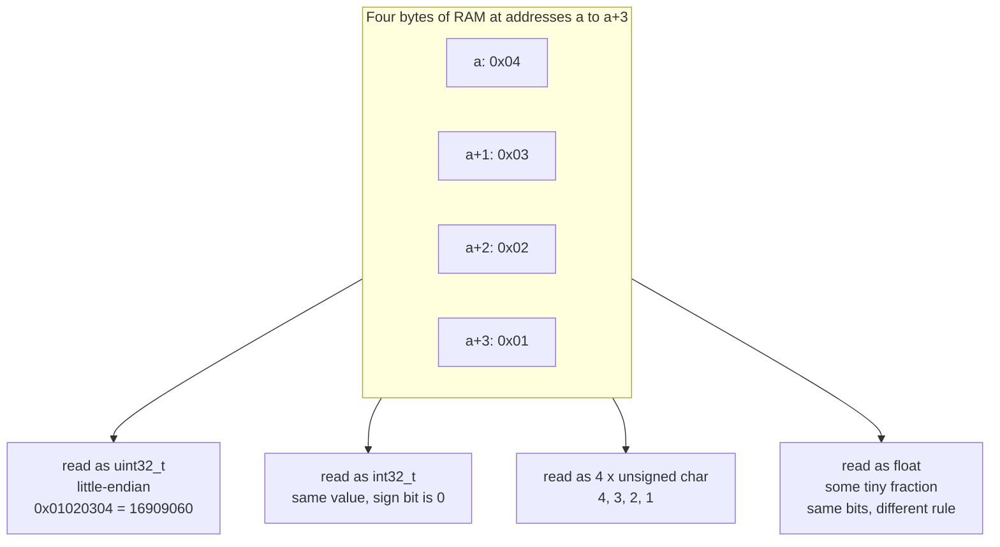

# Module 1.02: Variables, types and how numbers live in memory

**Estimated hours:** 3

**What you will learn**

1. What a variable is in C: a named group of bytes with a type that says how many bytes and how to read them.
2. How negative numbers are stored (two's complement), what happens when a number gets too big (overflow), and why signed overflow is a bug while unsigned wrap-around is a rule.
3. Why `0.1 + 0.2` is not `0.3`, why banks store money as whole paise in a 64-bit integer, and how the same 4 bytes can mean different numbers on different machines (endianness).

**Prerequisites:** [Module 1.01: Your first C program](module-01-first-c-program.md).

---

## 1. One-line intuition

A variable is a labelled box of a fixed number of bytes; the type is the rule for turning those bytes into a number, and every surprise in this module comes from forgetting which rule applies.

## 2. Real-life analogy

Think of a bank form with boxes for numbers.

- A box with **four squares** can hold at most `9999`. That is the box's **size**. In C, `int` is a box of 4 bytes.
- The form says whether a box may hold a **minus sign**. A box that may be negative has less room for digits: `-999` to `+999` instead of `0` to `9999`. In C this is **signed** versus **unsigned**.
- If you try to write `10000` in a four-square box, something has to give. On a paper form the clerk writes over the edge. In a computer the extra digit falls off. That is **overflow**.
- A box marked "rupees and paise" with **two decimal places** cannot hold one-third of a rupee exactly. You write `0.33` and lose a little. Floating-point numbers have the same problem, but in binary, so even `0.10` cannot be held exactly.
- The form's **reading direction** matters. If one clerk writes the thousands square on the left and another writes it on the right, they read each other's forms wrong. That is **endianness**.

The computer never knows what a box "means". It holds bytes. The type you declare is a promise about how to read them.

## 3. Why it exists: the problem it solves

RAM is a row of bytes (module 0.01). A byte holds 0 to 255. Real programs need numbers in the billions, negative numbers, fractions and letters. So the language has to answer four questions for every value:

1. **How many bytes?** One for a letter, four for a typical count, eight for a bank's total loan book in paise.
2. **Can it be negative?** A count of records cannot; a ledger adjustment can.
3. **Is it a whole number or a fraction?** Interest rates have fractions; loan IDs do not.
4. **In which order are the bytes written?** The CPU decides this, and two CPUs can disagree.

The **type system** is C's answer. `int`, `unsigned char`, `double` and `int64_t` are not decoration: each one fixes the size, the sign rule and the arithmetic rule. Without types the compiler could not know whether `a + b` should add two 4-byte integers or two 8-byte fractions, and it could not warn you when you put a 10-digit number into a 4-byte box.

What breaks without it: in 1996 the Ariane 5 rocket exploded 37 seconds after launch because a 64-bit floating-point value was converted into a 16-bit signed integer that could not hold it. In banking, the same class of bug is a balance that silently goes negative when it passes 2,147,483,647 paise, which is only about 2.1 crore rupees.

## 4. Three layers of depth

### Layer 1 (beginner): declaring variables and the basic types

A **declaration** creates a variable: a type, a name, and optionally a starting value.

```c
int     loan_count = 12;      /* whole number, can be negative */
char    grade      = 'B';     /* one byte, usually a letter */
double  rate       = 8.75;    /* fraction, 8 bytes */
float   small_rate = 8.75f;   /* fraction, 4 bytes, less precise */
unsigned int age   = 34u;     /* whole number, never negative */
long long book     = 95000000000LL;   /* big whole number, 8 bytes */
```

Rules you must follow:

- Declare before use. The compiler reads top to bottom.
- Always give a starting value. An **uninitialised** variable holds whatever bytes were already there. Reading it is undefined behaviour (module 1.11), and `-Wall` will often catch it as `-Wmaybe-uninitialized`.
- Names are letters, digits and underscores, cannot start with a digit, and are case-sensitive: `Rate` and `rate` are different.

**The basic types and their sizes on x86-64 Linux** (`sizeof` gives the size in bytes; the standard only promises minimums, and these are the sizes you will see on Ubuntu):

| Type | Bytes | Holds | Range on this platform |
|---|---|---|---|
| `char` | 1 | One byte, usually a character | -128 to 127 (signed on x86-64) |
| `unsigned char` | 1 | One byte as a plain number | 0 to 255 |
| `short` | 2 | Small whole number | -32,768 to 32,767 |
| `int` | 4 | Whole number | -2,147,483,648 to 2,147,483,647 |
| `unsigned int` | 4 | Whole number, no sign | 0 to 4,294,967,295 |
| `long` | 8 on Linux, **4 on Windows** | Whole number | depends on platform |
| `long long` | 8 | Big whole number | about ±9.2 × 10^18 |
| `float` | 4 | Fraction, about 7 significant digits | about ±3.4 × 10^38 |
| `double` | 8 | Fraction, about 15 to 16 significant digits | about ±1.8 × 10^308 |

The exact limits live in the header `<limits.h>` as named constants: `INT_MAX`, `INT_MIN`, `UINT_MAX`, `LLONG_MAX`, `CHAR_BIT` (bits in a byte, 8). Never type the digits yourself; use the names.

**A character is a number.** `'B'` is the number 66 in the ASCII table. `'0'` is 48, `'A'` is 65, `'a'` is 97. `printf("%c", 66)` prints `B`; `printf("%d", 'B')` prints `66`. There is no separate "character" inside the machine, only a byte and a decision about how to show it.

**Arithmetic.** `+ - * /` work as expected, with one trap: dividing two integers throws away the fraction. `7 / 2` is `3`, not `3.5`. `7 % 2` is the remainder, `1`. `7.0 / 2` is `3.5` because one side is a `double`.

**Casting** converts between types explicitly: `(int)3.99` is `3` (the fraction is cut off, not rounded). `(double)7 / 2` is `3.5`. `(unsigned char)300` is `44`, because 300 does not fit in a byte and only the low 8 bits (300 - 256 = 44) survive.

### Layer 2 (working engineer): fixed-width types, overflow, money and `sizeof`

**Fixed-width types from `<stdint.h>`.** Because `long` is 8 bytes on Linux and 4 on Windows, and `int` is only "at least 2 bytes" by the standard, serious code names the size it needs:

| Type | Bytes | Range |
|---|---|---|
| `int8_t` / `uint8_t` | 1 | -128 to 127 / 0 to 255 |
| `int16_t` / `uint16_t` | 2 | ±32,767 / 0 to 65,535 |
| `int32_t` / `uint32_t` | 4 | ±2.1 billion / 0 to 4.29 billion |
| `int64_t` / `uint64_t` | 8 | ±9.22 × 10^18 / 0 to 1.84 × 10^19 |

To print them, `<inttypes.h>` provides format macros: `PRId64` for `int64_t`, `PRIu32` for `uint32_t`, `PRIX32` for hex. They are strings you glue into the format: `printf("%" PRId64 "\n", total);`. It looks odd; it is portable.

Banking code uses these for two reasons. A record written to disk or sent over the network by a Linux server and read by a Windows tool must have the same field sizes on both sides, and `long` breaks that promise. And amounts must be `int64_t`: a loan book of 1,000 crore rupees is 10^12 paise, far past `INT32_MAX`.

**`sizeof`** is an operator that gives the size in bytes of a type or a variable, as a value of type `size_t` (an unsigned integer type, printed with `%zu`). `sizeof(int)` is 4; `sizeof rate` is 8. It is computed by the compiler, not at run time.

**Signed versus unsigned arithmetic.** Here is the rule you must memorise:

| | Unsigned (`unsigned int`, `uint32_t`, `size_t`) | Signed (`int`, `int64_t`) |
|---|---|---|
| Going past the maximum | **Wraps around** to 0. `UINT32_MAX + 1 == 0`. Defined by the standard. | **Undefined behaviour.** The compiler may assume it never happens. |
| Going below zero | Wraps to the maximum. `0u - 1 == 4294967295`. Defined. | Undefined behaviour. |
| Typical use | Sizes, counts, bit patterns, hashes | Amounts, differences, anything that can be negative |

"Undefined behaviour" means the standard places no requirement at all on what happens. In practice, with optimisation on, GCC will delete a check like `if (x + 1 < x)` because it reasons "signed overflow cannot happen, so this is always false". Module 1.11 has the full story. Today you only need the rule: never let a signed integer overflow, and use `-fsanitize=undefined` to catch it while testing.

**Mixing signed and unsigned.** When an `int` meets an `unsigned int` in a comparison, the `int` is converted to unsigned. So `-1 > 1u` is **true**, because -1 becomes 4,294,967,295. This is a real bug class in loops over sizes. `-Wextra` enables `-Wsign-compare`, which refuses to build such a comparison under `-Werror`. You will see the message in the lab.

**Floating point and money.** `float` and `double` store a number as a binary fraction times a power of two. Just as 1/3 is `0.333...` forever in decimal, 1/10 is `0.000110011...` forever in binary. So `0.1` is stored as the nearest representable value, about `0.1000000000000000055`. Add enough of these and the error shows:

```text
0.1 + 0.2 = 0.30000000000000004
```

A bank cannot have a ledger that is off by 4 × 10^-17 rupees, because after a billion transactions it is off by real paise, and because two systems computing the same total must agree to the byte. The rule across the industry is: **store money as an integer count of the smallest unit** (paise in India, cents in the US) in a 64-bit signed integer, and do rounding in one documented place. `double` is fine for interest rates, statistics and charts; it is not fine for balances.

**Characters and `char` signedness.** Whether plain `char` is signed or unsigned is up to the platform: signed on x86-64, usually unsigned on ARM. When you treat bytes as numbers, say `unsigned char` explicitly. This matters when you read bytes from a file or a network and compare them to values above 127.

### Layer 3 (internals): two's complement, endianness and the IEEE 754 layout

**Two's complement.** The CPU has no minus sign. For a signed type of N bits, the top bit (the **sign bit**) is worth -2^(N-1) instead of +2^(N-1). Everything else is unchanged. For 8 bits the columns are worth:

```text
column  -128  64  32  16  8  4  2  1
```

So `1111 1011` is -128 + 64 + 32 + 16 + 8 + 2 + 1 = -5. And `0000 0101` is 5.

The shortcut to negate a number: **invert every bit, then add 1.**

```text
 5        = 0000 0101
invert    = 1111 1010
add 1     = 1111 1011   = -5   (0xFB; as an unsigned byte it is 251)
```

Check it: 5 + (-5) should be 0.

```text
  0000 0101
+ 1111 1011
-----------
1 0000 0000   -> the 9th bit falls off the end; 8 bits remain: 0000 0000 = 0
```

That carry falling off the end is why two's complement is used: the same adder circuit handles signed and unsigned numbers, and subtraction is just addition of the negated value.

Worked examples in 32 bits:

| Value | Hex (32-bit) | How |
|---|---|---|
| 0 | `0x00000000` | |
| 1 | `0x00000001` | |
| -1 | `0xFFFFFFFF` | invert 0x00000001 to 0xFFFFFFFE, add 1 |
| 2500 | `0x000009C4` | from module 0.01 |
| -2500 | `0xFFFFF63C` | invert 0x000009C4 to 0xFFFFF63B, add 1 |
| 2,147,483,647 (`INT_MAX`) | `0x7FFFFFFF` | sign bit 0, all others 1 |
| -2,147,483,648 (`INT_MIN`) | `0x80000000` | sign bit 1, all others 0 |

To read a negative value back: if the top bit is 1, take the unsigned value and subtract 2^N. `0xFB` as unsigned is 251; 251 - 256 = -5.

Now overflow is obvious. `INT_MAX + 1` in hardware is `0x7FFFFFFF + 1 = 0x80000000`, which reads as `INT_MIN`. The CPU does exactly this and sets a flag. C says the result is undefined so that compilers are free to assume it never happens. The C17 standard still permits other representations of signed numbers; C23 finally requires two's complement, matching every CPU you will ever meet.

**Endianness.** A 4-byte `int` occupies four consecutive addresses. Which byte goes first? x86-64 (and ARM in its usual mode) is **little-endian**: the least significant byte is at the lowest address.

```text
uint32_t pattern = 0x01020304;

address    a      a+1    a+2    a+3
byte       0x04   0x03   0x02   0x01      little-endian (x86-64, your laptop)
byte       0x01   0x02   0x03   0x04      big-endian (network byte order, some mainframes)
```

Inside one program you never notice. You notice the moment bytes leave the program: written to a file, sent over TCP, or used as a key in a database that compares keys byte by byte. Network protocols fix big-endian ("network byte order") and provide `htonl`/`ntohl` to convert (Phase 5). The code in section 6 reads the bytes of an integer through an `unsigned char *` so you can see the order on your own machine. (An `unsigned char *` is a pointer, which is the subject of module 1.05. For today: `&pattern` is the address of the variable, and viewing it as `unsigned char` means "treat it as a row of single bytes".)

**IEEE 754 doubles.** A `double` is 64 bits: 1 sign bit, 11 exponent bits, 52 fraction bits (plus an implied leading 1, so 53 bits of precision, about 15.95 decimal digits). The value is `(-1)^sign × 1.fraction × 2^(exponent - 1023)`. Whole numbers up to 2^53 (about 9 × 10^15) are exact; 0.1 is not, because it needs an infinite binary fraction. A `float` has 23 fraction bits, so only whole numbers up to 2^24 = 16,777,216 are exact: `16777217.0f` silently becomes `16777216.0f`. A `float` cannot even count paise in a modest loan book.

## 5. Architecture diagram



The bytes never change. The type is the rule that turns them into a number. Every bug in this module is a mismatch between the rule used to write and the rule used to read.

## 6. Code

Save as `numbers_in_memory.c`. The helper `print_bytes` uses a `for` loop (module 1.03) to walk over bytes one at a time; read it as "for each byte, print it in hex".

```c
/* numbers_in_memory.c
 * Shows: limits from limits.h, two's complement, unsigned wrap-around,
 * endianness seen through an unsigned char view, float imprecision,
 * and money kept as int64_t paise.
 */
#include <stdio.h>
#include <stdint.h>     /* int32_t, uint32_t, int64_t ... */
#include <inttypes.h>   /* PRId64, PRIu32, PRIX32 for printing them */
#include <limits.h>     /* INT_MAX, UINT_MAX, CHAR_BIT ... */

/* Print the bytes of any object, lowest address first. */
static void print_bytes(const char *label, const void *object, size_t size) {
    const unsigned char *bytes = (const unsigned char *)object;
    printf("%s: ", label);
    for (size_t i = 0; i < size; ++i) {
        printf("%02X ", bytes[i]);
    }
    printf("\n");
}

int main(void) {
    printf("--- sizes and limits (limits.h) ---\n");
    printf("CHAR_BIT  = %d bits in a byte\n", CHAR_BIT);
    printf("INT_MIN   = %d\n", INT_MIN);
    printf("INT_MAX   = %d\n", INT_MAX);
    printf("UINT_MAX  = %u\n", UINT_MAX);
    printf("LLONG_MAX = %lld\n", LLONG_MAX);
    printf("sizeof(long) on this machine = %zu\n", sizeof(long));

    printf("\n--- two's complement: the same bits, read two ways ---\n");
    int32_t  negative  = -5;
    uint32_t same_bits = (uint32_t)negative;   /* reinterpret, no bits change */
    printf("int32_t -5 as hex        : 0x%08" PRIX32 "\n", same_bits);
    printf("same bits as uint32_t    : %" PRIu32 "\n", same_bits);
    int32_t minus_2500 = -2500;
    printf("int32_t -2500 as hex     : 0x%08" PRIX32 "\n", (uint32_t)minus_2500);

    printf("\n--- unsigned wrap-around is defined behaviour ---\n");
    uint32_t top = UINT32_MAX;
    top = top + 1u;
    printf("UINT32_MAX + 1 = %" PRIu32 "\n", top);
    uint32_t zero = 0;
    zero = zero - 1u;
    printf("0u - 1         = %" PRIu32 "\n", zero);

    printf("\n--- endianness: bytes of a value, lowest address first ---\n");
    uint32_t pattern = 0x01020304;
    print_bytes("uint32_t 0x01020304", &pattern, sizeof pattern);
    int16_t small = -2;
    print_bytes("int16_t  -2        ", &small, sizeof small);
    int64_t paise = 1234567;
    print_bytes("int64_t  1234567   ", &paise, sizeof paise);

    printf("\n--- floating point cannot hold 0.1 exactly ---\n");
    double a = 0.1;
    double b = 0.2;
    printf("0.1 + 0.2 with %%.1f  : %.1f\n", a + b);
    printf("0.1 + 0.2 with %%.17f : %.17f\n", a + b);
    printf("0.3       with %%.17f : %.17f\n", 0.3);
    printf("0.1 + 0.2 == 0.3 ?     %d   (1 = yes, 0 = no)\n", (a + b) == 0.3);
    float big_float = 16777217.0f;
    printf("float 16777217.0f    : %.1f\n", big_float);

    printf("\n--- money the banking way: integer paise in int64_t ---\n");
    int64_t paise_a = 10;     /* Rs 0.10 */
    int64_t paise_b = 20;     /* Rs 0.20 */
    int64_t total   = paise_a + paise_b;
    printf("10 + 20 paise = %" PRId64 " paise = Rs %" PRId64 ".%02" PRId64 "\n",
           total, total / 100, total % 100);
    int64_t loan_book = 1000000000000LL;   /* Rs 1,000 crore in paise */
    printf("loan book %" PRId64 " paise fits int64_t (max %" PRId64 ")\n",
           loan_book, INT64_MAX);
    printf("but not int32_t (max %" PRId32 ")\n", INT32_MAX);
    return 0;
}
```

Compile and run:

```bash
gcc -std=c17 -Wall -Wextra -Werror -g -o numbers_in_memory numbers_in_memory.c
./numbers_in_memory
```

Expected output (identical on any x86-64 Linux machine; no addresses are printed):

```text
--- sizes and limits (limits.h) ---
CHAR_BIT  = 8 bits in a byte
INT_MIN   = -2147483648
INT_MAX   = 2147483647
UINT_MAX  = 4294967295
LLONG_MAX = 9223372036854775807
sizeof(long) on this machine = 8

--- two's complement: the same bits, read two ways ---
int32_t -5 as hex        : 0xFFFFFFFB
same bits as uint32_t    : 4294967291
int32_t -2500 as hex     : 0xFFFFF63C

--- unsigned wrap-around is defined behaviour ---
UINT32_MAX + 1 = 0
0u - 1         = 4294967295

--- endianness: bytes of a value, lowest address first ---
uint32_t 0x01020304: 04 03 02 01 
int16_t  -2        : FE FF 
int64_t  1234567   : 87 D6 12 00 00 00 00 00 

--- floating point cannot hold 0.1 exactly ---
0.1 + 0.2 with %.1f  : 0.3
0.1 + 0.2 with %.17f : 0.30000000000000004
0.3       with %.17f : 0.29999999999999999
0.1 + 0.2 == 0.3 ?     0   (1 = yes, 0 = no)
float 16777217.0f    : 16777216.0

--- money the banking way: integer paise in int64_t ---
10 + 20 paise = 30 paise = Rs 0.30
loan book 1000000000000 paise fits int64_t (max 9223372036854775807)
but not int32_t (max 2147483647)
```

Check three lines by hand. `-2` in 16 bits is `0xFFFE`; little-endian puts `FE` first. `1234567` is `0x12D687`; the bytes come out `87 D6 12` followed by five zero bytes. And `4294967291` is `4294967296 - 5`: the bits of -5 read as unsigned.

## 7. Use case: core-banking loan-origination platform

The migration engine (claim H1, capstone C3) reads records out of Berkeley DB, where each record is a **packed** block of bytes: fixed-size fields laid end to end with no names, written years ago by a C program on the bank's servers. Three decisions in that engine come straight from this module.

1. **Every field in the record layout is a fixed-width `stdint.h` type.** The layout document says "bytes 8 to 15: `int64_t` sanctioned amount in paise". It never says `long`, because the parity tooling (claim H3) also runs on Windows, where `long` is 4 bytes and the whole record would be misread from byte 12 onwards.
2. **Amounts are integer paise, never `double`.** The parity suite compares the old and new databases byte for byte. If either side had used floating point, two correct systems could disagree in the 17th digit and every record would be flagged. Integer paise made "equal" mean equal.
3. **Integer keys are stored big-endian.** Berkeley DB's default B-tree compares keys as raw bytes, left to right. A little-endian `uint32_t` key would sort 256 before 1 (bytes `00 01 00 00` versus `01 00 00 00`). Writing keys in big-endian order makes byte order equal numeric order, so cursor traversal (module 6.13) walks the loans in ID order. The decision was made once, in the layout document, and every reader and writer converts with the same two functions.

The one interviewers probe: "Why not `double` for amounts? It has 15 digits." Answer with the `0.1 + 0.2` line and the parity suite: exactness, not range, was the requirement.

## 8. Lab

### Part A: two's complement by hand (20 minutes)

1. Write these as 8-bit two's complement, using invert-and-add-1: `-1`, `-5`, `-128`, `-100`.
2. Read these 8-bit patterns as signed and as unsigned: `1000 0001`, `0111 1111`, `1111 0000`.
3. Add `0111 1111` + `0000 0001` in 8 bits. What signed value is the result? This is what `INT8_MAX + 1` becomes in hardware.
4. Write `-2500` as 32-bit hex without looking at the table in Layer 3, then check.

<details>
<summary>Answers</summary>

1. `-1` = `1111 1111` (0xFF); `-5` = `1111 1011` (0xFB); `-128` = `1000 0000` (0x80); `-100`: 100 = `0110 0100`, invert `1001 1011`, add 1 `1001 1100` (0x9C).
2. `1000 0001` = -127 signed, 129 unsigned. `0111 1111` = 127 both ways. `1111 0000` = -16 signed, 240 unsigned.
3. `1000 0000` = -128. The maximum plus one becomes the minimum.
4. `0xFFFFF63C`.

</details>

### Part B: run and modify the program (25 minutes)

1. Compile and run `numbers_in_memory.c`. Every line must match the expected output.
2. Change `pattern` to `0xDEADBEEF` and predict the byte line before running. Expected: `EF BE AD DE`.
3. Change `small` to `-1` and then to `256`. Predict both. Expected: `FF FF` and `00 01`.
4. Change `paise_a` and `paise_b` to `double` values `0.10` and `0.20` and print their sum with `%.17f`. Expected: the sum is not exactly `0.30000000000000000`. Restore the integers.
5. Replace `int64_t loan_book = 1000000000000LL;` with `int32_t loan_book = 1000000000000LL;` and compile. Expected: the build fails with `error: overflow in conversion from 'long long int' to 'int32_t' {aka 'int'} changes value from '1000000000000' to '-727379968' [-Werror=overflow]`. The compiler computed the wrong value for you so you could see it. Restore the line.

### Part C: signed overflow caught by the sanitizer (25 minutes)

Create `overflow.c`:

```c
/* overflow.c: signed overflow is undefined behaviour. */
#include <stdio.h>
#include <limits.h>

int main(void) {
    int big = INT_MAX;
    printf("big     = %d\n", big);
    big = big + 1;               /* undefined behaviour */
    printf("big + 1 = %d\n", big);

    unsigned int ubig = UINT_MAX;
    ubig = ubig + 1u;            /* defined: wraps to 0 */
    printf("ubig + 1 = %u\n", ubig);
    return 0;
}
```

1. Compile with the usual flags and run. Expected: it builds without complaint and typically prints `big + 1 = -2147483648`. The hardware wrapped, as Layer 3 predicts. Nothing told you anything was wrong.
2. Compile again with the undefined-behaviour sanitizer and run:

```bash
gcc -std=c17 -Wall -Wextra -Werror -g -fsanitize=address,undefined -o overflow overflow.c
./overflow
```

Expected: the program still prints, but between the lines appears a report like:

```text
overflow.c:8:15: runtime error: signed integer overflow: 2147483647 + 1 cannot be represented in type 'int'
```

The line and column point at the `+`. No such line appears for `ubig`, because unsigned wrap is legal.

3. Write in your notes: the sanitizer finds UB only on the path that actually ran. A test that never adds to `INT_MAX` never triggers it. That is why the capstones run their test suites under sanitizers, not just the program once.

### Part D: the signed/unsigned trap (20 minutes)

Create `compare.c`:

```c
#include <stdio.h>

int main(void) {
    int          balance_change = -1;
    unsigned int record_count   = 1;
    if (balance_change > record_count) {
        printf("-1 is greater than 1 ???\n");
    } else {
        printf("-1 is less than 1, as expected\n");
    }
    return 0;
}
```

1. Compile with the course flags. Expected: the build fails:

```text
compare.c:6:24: error: comparison of integer expressions of different signedness: 'int' and 'unsigned int' [-Werror=sign-compare]
```

2. Compile without `-Werror` and `-Wextra` (`gcc -std=c17 -Wall -o compare compare.c`) and run. Expected: `-1 is greater than 1 ???`. The `-1` was converted to `4294967295` before comparing.
3. Fix it properly: make `record_count` an `int`, or cast deliberately with a comment explaining why the value can never be negative. Rebuild with the full flags. Expected: builds, prints the sane line.
4. Run `./numbers_in_memory` one more time and look at `sizeof(long)`. On Windows with MSVC (module 0.06) the same program prints 4. Write both numbers down; it is the shortest proof you have that fixed-width types matter.

### Journal

Copy [journal/TEMPLATE.md](../journal/TEMPLATE.md) to `journal/YYYY-MM-DD-variables-types-memory.md`. Record: your hand-worked `-100` and `-2500`; the byte order you saw for `0xDEADBEEF`; the exact sanitizer line from Part C; the exact `-Wsign-compare` error from Part D; and one sentence on why the migration engine stores amounts in `int64_t` paise. Commit with `Module 1.02: variables and types lab`.

## 9. Common mistakes and misconceptions

| Mistake | Why it is wrong | Bug it causes later |
|---|---|---|
| `int` can hold any whole number | 4 bytes, so about ±2.1 billion; 2.1 crore rupees in paise | A bank-wide total that goes negative |
| Signed overflow "just wraps" | In hardware yes; in C it is undefined and the optimiser assumes it never happens | Overflow checks silently deleted by the compiler |
| Unsigned is safer because it cannot be negative | `0u - 1` is 4,294,967,295; mixing with signed converts the signed side | Loops that never end, comparisons that go the wrong way |
| `double` is accurate enough for money | 0.1 is not representable; errors accumulate and two systems disagree | Ledgers that do not balance; parity checks that fail on correct data |
| `long` is 8 bytes | Only on Linux/macOS; 4 bytes on Windows | Record layouts misread across platforms |
| `char` is a letter, not a number | It is a 1-byte integer; `'A'` is 65 | Confusion between `'7'` (55) and `7`; wrong arithmetic on digits |
| `(int)3.99` rounds to 4 | Casting truncates toward zero: 3 | Interest calculations off by one paisa |
| Bytes are stored "in order" | Little-endian puts the low byte first on x86-64 | Keys that sort wrongly in a byte-compared B-tree; corrupt network messages |
| Uninitialised variables start at 0 | They hold leftover bytes; reading them is undefined | Random behaviour that changes between debug and release builds |

## 10. Resume link

- **Claim H2, "decoding packed key/record layouts".** You can now say precisely what "packed" means: fixed-width integer fields at fixed byte offsets, with a declared endianness, read through `unsigned char` views. Say: "Every field was a `stdint.h` type with its byte order written in the layout document; amounts were `int64_t` paise; keys were big-endian so byte order matched numeric order in the B-tree."
- **Claim B, "undefined-behaviour-aware coding".** The first UB you can name from experience is signed overflow. Say: "I keep sums in `int64_t`, I know unsigned wraps and signed does not, and I run the tests under `-fsanitize=undefined` because the compiler is allowed to delete overflow checks that look correct."
- **Claim H3, "data-parity regression suite".** Byte-for-byte equality is only meaningful when both sides use integers. The parity suite's whole premise rests on section 7, point 2.

Likely follow-up: "What is the largest value an `int` holds and what happens one past it?" Answer: `INT_MAX` is 2,147,483,647; one past it is undefined behaviour in C, and on the hardware the bit pattern `0x80000000` reads as -2,147,483,648.

## 11. Interview questions

**Q1 (easy). Why is `0.1 + 0.2 == 0.3` false, and how should a banking system store money?**

<details>
<summary>Model answer</summary>

`double` stores binary fractions. 0.1, 0.2 and 0.3 are repeating fractions in binary, so each is stored as the nearest representable value. The rounding errors of 0.1 and 0.2 do not cancel, and the sum is 0.30000000000000004, which differs from the stored 0.3 in the last bit. Money must be exact and must compare equal across systems, so it is stored as an integer number of the smallest unit (paise) in a 64-bit signed integer, with rounding rules applied in one documented place.

</details>

**Q2 (easy). How is -1 stored in a 32-bit `int`?**

<details>
<summary>Model answer</summary>

As `0xFFFFFFFF`, all 32 bits set, using two's complement. The top bit is worth -2^31 and the remaining 31 bits are all 1, summing to 2^31 - 1; the total is -1. Equivalently, take 1, invert every bit to get `0xFFFFFFFE`, and add 1. The same bits read as `unsigned int` are 4,294,967,295.

</details>

**Q3 (medium). What is the difference between signed and unsigned overflow in C?**

<details>
<summary>Model answer</summary>

Unsigned arithmetic is defined to wrap modulo 2^N: `UINT_MAX + 1` is 0 and `0u - 1` is `UINT_MAX`. Signed overflow is undefined behaviour: the standard imposes no requirement, and compilers exploit that by assuming it never happens, which can delete checks like `if (a + b < a)` or turn a loop with a signed counter into something unexpected. The practical rules are: use wide enough signed types for quantities that can be negative, check before the operation rather than after, use unsigned types for bit patterns and sizes, and run tests under `-fsanitize=undefined`, which reports the exact line of a signed overflow at run time.

</details>

**Q4 (medium). What is endianness, and where in a database or network system does it matter?**

<details>
<summary>Model answer</summary>

Endianness is the order in which the bytes of a multi-byte integer are placed in memory. Little-endian (x86-64, most ARM) stores the least significant byte at the lowest address; big-endian stores the most significant first. It is invisible inside one program but matters whenever bytes cross a boundary: a binary file format, a network message, or a key-value store that compares keys as byte strings. Network protocols standardise on big-endian and provide `htonl`/`ntohl`. In Berkeley DB, keys compare lexicographically by byte, so integer keys must be written big-endian for the B-tree to order them numerically; a little-endian key would sort 256 before 1. The migration engine fixed byte order in the record layout document and converted at the boundary in one place.

</details>

**Q5 (hard). You write `if (count + 1 < count) { handle_overflow(); }` to guard a signed `int`, and in the release build the handler is never called even when `count` is `INT_MAX`. Why, and what is the correct guard?**

<details>
<summary>Model answer</summary>

Because signed overflow is undefined behaviour, the compiler is entitled to assume `count + 1` does not overflow, and under that assumption `count + 1 < count` is always false, so the optimiser removes the branch entirely. The check "worked" in the debug build only because `-O0` did not simplify it. The correct guard tests before the operation using the limits: `if (count > INT_MAX - 1) { handle_overflow(); } else { count = count + 1; }`, or for general addition `if (b > 0 && a > INT_MAX - b)`. Alternatively use GCC's `__builtin_add_overflow(a, b, &result)`, which returns true on overflow using the hardware flag without invoking UB. Running the tests with `-fsanitize=undefined` would have flagged the original overflow on the first failing input.

</details>

## 12. Revision

- A variable is a fixed number of bytes plus a type that says how to read them; `sizeof` gives the bytes, `<limits.h>` gives the ranges, `<stdint.h>` gives exact widths (`int32_t`, `uint64_t`) that are the same on Linux and Windows.
- Negative numbers use two's complement (invert and add 1; top bit worth -2^(N-1)); unsigned arithmetic wraps by definition, signed overflow is undefined behaviour, and `-1 > 1u` is true because the signed side is converted.
- x86-64 is little-endian (low byte at the low address), which matters at every file, network and byte-compared-key boundary; `double` cannot hold 0.1 exactly, so money lives in `int64_t` paise.

---

Previous: [Module 1.01: Your first C program](module-01-first-c-program.md) | Next: [Module 1.03: Control flow](module-03-control-flow.md)
