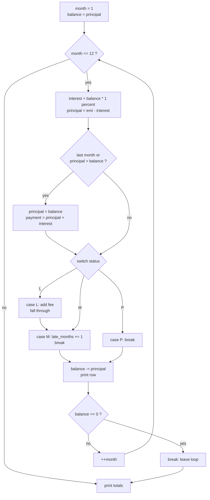

# Module 1.03: Control flow

**Estimated hours:** 3

**What you will learn**

1. How a program makes decisions (`if`, `else`, `switch`) and repeats work (`while`, `do/while`, `for`), using a loan repayment schedule as the running example.
2. How `break` and `continue` change a loop, how `&&` and `||` stop early (short-circuit evaluation), and why `switch` cases fall through unless you stop them.
3. The two bugs every beginner writes (the off-by-one and the missing `break`), how the compiler helps you catch one of them, and what a decision looks like to the CPU.

**Prerequisites:** [Module 1.02: Variables, types and how numbers live in memory](module-02-variables-types-and-memory.md).

---

## 1. One-line intuition

Control flow is the set of rules for which line runs next: by default the next one down, but `if` lets you skip, loops let you go back, and `switch` lets you jump to a labelled case.

## 2. Real-life analogy

A bank's collections clerk works through a loan's repayment schedule with a rulebook.

- **"If the payment arrived on time, mark it paid; otherwise add a late fee."** That is an **`if`/`else`**: one of two paths, chosen by a yes/no test.
- **"For each month from 1 to 12, compute the interest, subtract the principal, write the row."** That is a **`for` loop**: a fixed number of repetitions with a counter.
- **"Keep adding interest until the amount has doubled."** That is a **`while` loop**: repeat as long as a condition holds; you do not know in advance how many times.
- **"Ask the customer for a menu choice; if it is not valid, ask again."** That is a **`do/while`**: the body always runs at least once, because you must ask before you can check.
- **"Look up the status code in a table: P means paid, L means late, M means missed."** That is a **`switch`**: jump straight to the matching row.
- **"Stop the schedule early if the balance hits zero."** That is **`break`**.
- **"Skip the months that are not quarter-ends."** That is **`continue`**.
- **"Only divide the total by the count if the count is not zero."** That is **short-circuit evaluation**: the clerk checks the cheap, safe thing first and does not bother with the second check if the first already decided.

## 3. Why it exists: the problem it solves

In module 0.01 the CPU runs instructions one after another, and the only way to do anything interesting is a **jump**: change the program counter to some other address, possibly depending on a comparison. Every `if`, loop and `switch` in every language compiles down to compares and jumps.

Writing jumps by hand (`goto` in C) is possible and was normal in the 1960s. It produced programs nobody could follow: "spaghetti code", where control arrived at a line from six different places. Structured control flow, introduced by languages like ALGOL and adopted by C, limits you to a few shapes: a choice, a loop with a condition at the top, a loop with the condition at the bottom, a counted loop, a multi-way branch. Each shape has one entry and one exit, so you can read a function top to bottom and know what it does.

What breaks without it: nothing stops you writing `goto` in C today, and you will meet one legitimate use (cleanup on error, module 1.14). Everywhere else, a `goto` in a code review is a sign the author could not see the shape of the problem.

## 4. Three layers of depth

### Layer 1 (beginner): the six shapes

**Conditions.** A condition is any expression; `0` means false and anything else means true. Comparisons produce `1` or `0`:

| Operator | Meaning | Example (`a = 5`, `b = 3`) |
|---|---|---|
| `==` | equal to | `a == b` is 0 |
| `!=` | not equal to | `a != b` is 1 |
| `<` `<=` `>` `>=` | less than, and so on | `a > b` is 1 |
| `&&` | and (both true) | `a > 0 && b > 0` is 1 |
| `\|\|` | or (at least one true) | `a < 0 \|\| b > 0` is 1 |
| `!` | not | `!(a == b)` is 1 |

The classic mistake: `if (status = 'L')` with one `=` **assigns** `'L'` to `status` and then tests the result, which is always true. Under `-Wall` GCC flags this with `-Wparentheses` ("suggest parentheses around assignment used as truth value") and `-Werror` stops the build. You will see it in the lab.

`<stdbool.h>` gives you `bool`, `true` and `false`. Use them when a variable is genuinely yes/no; it tells the reader what the variable means.

**`if` / `else if` / `else`.**

```c
if (days_late == 0) {
    status = 'P';
} else if (days_late <= 30) {
    status = 'L';
} else {
    status = 'M';
}
```

Always use braces, even for one statement. The bug `if (x) a(); b();` where `b()` runs every time has shipped in production more than once.

**`while`.** Test first, then run the body, repeat.

```c
while (amount < 2000000) {
    amount = amount + amount * 8 / 100;
    years = years + 1;
}
```

If the condition is false at the start, the body never runs.

**`do/while`.** Run the body, then test, repeat. The body always runs at least once. Use it for "ask, then check":

```c
do {
    printf("choice? ");
    scanf("%d", &choice);
} while (choice < 0 || choice > 2);
```

**`for`.** A counted loop. Three parts in the brackets: start; test; step.

```c
for (int month = 1; month <= 12; ++month) {
    /* body runs with month = 1, 2, ..., 12 */
}
```

`++month` means `month = month + 1`. Declaring `month` inside the `for` keeps it from leaking out. A `for` is exactly a `while` with the start before it and the step at the end of the body. Choose `for` when you know the count, `while` when you are waiting for something to change.

**`switch`.** Jump to the `case` matching an integer (or character) value.

```c
switch (status) {
case 'P':
    paid_on_time += 1;
    break;
case 'L':
    late += 1;
    break;
default:
    printf("unknown status\n");
    break;
}
```

Each `case` is a label, not a box. After the code under a label runs, execution continues into the next label unless a `break` stops it. That is **fall-through**. Forgetting a `break` is the second classic bug, and it is sometimes used on purpose: two cases sharing one block. Always have a `default`; it catches values you did not plan for.

**`break` and `continue`.** Inside any loop, `break` leaves the loop immediately. `continue` skips the rest of the current iteration and goes to the next test (in a `for`, the step still runs). Inside a `switch`, `break` leaves the `switch`, not the surrounding loop; that trips people up.

### Layer 2 (working engineer): short-circuit, off-by-one, fall-through and loop shape

**Short-circuit evaluation.** `a && b` evaluates `a` first; if `a` is false, `b` is never evaluated, because the result is already known. `a || b` skips `b` when `a` is true. This is guaranteed by the standard and is used constantly to make the second test safe:

```c
if (count > 0 && total / count > limit)   /* division only happens when count != 0 */
if (p != NULL && *p == 'X')               /* pointer only used when it is not NULL (module 1.05) */
```

Swap the order and you divide by zero or dereference `NULL`. Integer division by zero on x86-64 raises a hardware exception; Linux delivers signal `SIGFPE` and the shell prints `Floating point exception (core dumped)`, even though no floating point was involved. The lab makes you cause this on purpose.

**Off-by-one errors.** The question "does the loop run 11 times or 12?" has ended careers. The rules:

| Loop header | Runs with | Count |
|---|---|---|
| `for (i = 1; i <= 12; ++i)` | 1, 2, ..., 12 | 12 |
| `for (i = 1; i < 12; ++i)` | 1, ..., 11 | 11 |
| `for (i = 0; i < 12; ++i)` | 0, ..., 11 | 12 |
| `for (i = 0; i <= 12; ++i)` | 0, ..., 12 | 13 |

C counts from zero (arrays start at index 0, module 1.06), so the idiom is `i = 0; i < n`. A 12-month schedule written as `month = 1; month < 12` silently drops December; a 12-element array walked with `i <= 12` reads one element past the end, which is the buffer overflow of module 1.06 and capstone C6.

**Fall-through and `-Wimplicit-fallthrough`.** `-Wextra` turns on a check: if the code under a `case` can run into the next `case` without a `break`, `return` or `goto`, GCC warns `this statement may fall through`. Under `-Werror` the build stops. If the fall-through is intended, you write the comment `/* fall through */` as the last thing before the next label, and GCC accepts it. The comment is not decoration; it is an instruction to the compiler and a message to the reviewer. The code in section 6 does exactly this.

**Which loop shape?** Three practical rules.

1. A counted walk over a known range: `for`.
2. Waiting for a state change (a balance to reach zero, a connection to close, a queue to empty): `while`.
3. Reading input that must be read before it can be validated: `do/while`.

**Loop invariants.** A professional habit: write a comment at the top of the body stating what is true every time the body starts. For the schedule: "balance is the amount still owed before this month's payment". When the loop breaks, you can reason about the result instead of guessing. This is how you will convince yourself that the batched write loop in capstone C3 can be restarted safely.

**Reading input safely.** `scanf("%d", &choice)` returns the number of values it successfully read. If the user types `abc`, it returns 0 and `choice` is unchanged. Always check the return value; a loop that ignores it spins forever on bad input. (`&choice` means "the address of `choice`", so that `scanf` can write into it; module 1.05 explains the mechanism.)

### Layer 3 (internals): compares, jumps, jump tables and branch prediction

**An `if` is a compare and a conditional jump.** The CPU has a `cmp` instruction that subtracts two values and sets flags (zero, negative, carry, overflow) without storing the result. Conditional jump instructions (`je` jump if equal, `jl` jump if less, `jg`, `jne`, ...) look at the flags. GCC compiles

```c
if (days_late > 30) { status = 'M'; }
```

into roughly (AT&T syntax, as `gcc -S` prints it; the details vary with optimisation):

```asm
        cmpl    $30, -4(%rbp)      # compare days_late with 30
        jle     .L2                # if days_late <= 30, jump past the body
        movb    $77, -5(%rbp)      # status = 'M' (77 is ASCII 'M')
.L2:
```

Notice the compiler flipped the test: it jumps when the condition is **false**, so the body is the next instruction when it is true. A loop is the same thing plus a jump backwards at the end of the body.

**A `switch` can become a jump table.** With a handful of dense cases (say `case 0` to `case 7`), GCC builds a table of eight addresses and compiles the `switch` as "bounds-check the value, load `table[value]`, jump there": constant time, however many cases. With sparse values (`case 1`, `case 1000`, `case 50000`) it emits a chain of compares or a binary search. This is why a state machine in a request handler is usually written as a `switch` on a small enum rather than a chain of `if`s.

**Branch prediction.** A modern core does not wait to know which way a jump goes. It guesses, based on history, and starts executing the guessed path. A correct guess costs nothing. A wrong guess throws away the work: typically 10 to 20 cycles. A loop that runs 12 times is predicted almost perfectly (backwards jump, taken, taken, taken). An `if` whose outcome is random per record, such as "is this loan in default?" on a shuffled file, is mispredicted about half the time. You will measure this in module 2.13 and it is one reason sorted or batched data is faster.

**Short-circuit is a jump too.** `a && b` compiles to "evaluate `a`; if false, jump to the false path; evaluate `b`". The guarantee that `b` is not evaluated is simply that the jump skips over its instructions.

## 5. Architecture diagram



Every diamond is a compare-and-jump. The arrow from `STEP` back to `TEST` is the backwards jump that makes it a loop.

## 6. Code

Save as `repayment_schedule.c`. A loan of Rs 1,20,000 at 12% per year (1% per month) repaid over 12 months with an equal monthly instalment (EMI) of Rs 10,661.85. All money is `int64_t` paise (module 1.02). Months 5 and 9 are pretended to be late so the `switch` has work to do.

```c
/* repayment_schedule.c
 * Shows: while, for, if/else, switch with a deliberate fall-through,
 * break and continue, using a 12-month loan repayment schedule.
 * All money is int64_t paise.
 */
#include <stdio.h>
#include <stdint.h>
#include <inttypes.h>

/* Print paise as rupees with two decimals, right-aligned in 12 columns. */
static void print_money(int64_t paise) {
    printf("%9" PRId64 ".%02" PRId64, paise / 100, paise % 100);
}

int main(void) {
    printf("--- 1. while: how many years to double at 8 percent ---\n");
    int64_t amount = 1000000;            /* Rs 10,000.00 in paise */
    int     years  = 0;
    while (amount < 2000000) {
        amount = amount + amount * 8 / 100;   /* integer maths: fraction dropped */
        years  = years + 1;
    }
    printf("doubled after %d years, amount is now ", years);
    print_money(amount);
    printf("\n");

    printf("\n--- 2. for + if + switch + break: the repayment schedule ---\n");
    const int64_t principal_paise = 12000000;   /* Rs 1,20,000.00 */
    const int64_t emi_paise       = 1066185;    /* Rs 10,661.85 per month */
    const int64_t late_fee_paise  = 25000;      /* Rs 250.00 */
    const int     months          = 12;

    int64_t balance        = principal_paise;
    int64_t total_interest = 0;
    int64_t total_fees     = 0;
    int64_t total_paid     = 0;
    int     late_months    = 0;

    printf("month status      payment    interest   principal     balance\n");
    for (int month = 1; month <= months; ++month) {
        /* invariant: balance is what is still owed before this payment */
        int64_t interest  = (balance + 50) / 100;   /* 1 percent, rounded */
        int64_t principal = emi_paise - interest;
        int64_t payment   = emi_paise;

        if (month == months || principal > balance) {
            principal = balance;              /* final month absorbs rounding */
            payment   = principal + interest;
        }

        char status = 'P';                    /* P = paid on time */
        if (month == 5 || month == 9) {
            status = 'L';                     /* L = late */
        }

        switch (status) {
        case 'L':                             /* late: charge a fee, then count it */
            payment    += late_fee_paise;
            total_fees += late_fee_paise;
            /* fall through */
        case 'M':                             /* M = missed: count it (not used here) */
            late_months += 1;
            break;
        case 'P':
            break;
        default:
            printf("unknown status %c\n", status);
            return 1;
        }

        balance        -= principal;
        total_interest += interest;
        total_paid     += payment;

        printf("%5d  %c     ", month, status);
        print_money(payment);
        print_money(interest);
        print_money(principal);
        print_money(balance);
        printf("\n");

        if (balance == 0) {
            printf("loan closed in month %d\n", month);
            break;                            /* leave the for loop early */
        }
    }
    printf("total interest : "); print_money(total_interest); printf("\n");
    printf("total fees     : "); print_money(total_fees);     printf("\n");
    printf("total paid     : "); print_money(total_paid);     printf("\n");
    printf("late months    : %d\n", late_months);

    printf("\n--- 3. continue: only the quarter-end months ---\n");
    for (int month = 1; month <= 12; ++month) {
        if (month % 3 != 0) {
            continue;                         /* skip to ++month */
        }
        printf("quarter end: month %d\n", month);
    }
    return 0;
}
```

Compile and run:

```bash
gcc -std=c17 -Wall -Wextra -Werror -g -o repayment_schedule repayment_schedule.c
./repayment_schedule
```

Expected output (exact; there are no addresses or timings):

```text
--- 1. while: how many years to double at 8 percent ---
doubled after 10 years, amount is now     21589.21

--- 2. for + if + switch + break: the repayment schedule ---
month status      payment    interest   principal     balance
    1  P         10661.85     1200.00     9461.85   110538.15
    2  P         10661.85     1105.38     9556.47   100981.68
    3  P         10661.85     1009.82     9652.03    91329.65
    4  P         10661.85      913.30     9748.55    81581.10
    5  L         10911.85      815.81     9846.04    71735.06
    6  P         10661.85      717.35     9944.50    61790.56
    7  P         10661.85      617.91    10043.94    51746.62
    8  P         10661.85      517.47    10144.38    41602.24
    9  L         10911.85      416.02    10245.83    31356.41
   10  P         10661.85      313.56    10348.29    21008.12
   11  P         10661.85      210.08    10451.77    10556.35
   12  P         10661.91      105.56    10556.35        0.00
loan closed in month 12
total interest :      7942.26
total fees     :       500.00
total paid     :    128442.26
late months    : 2

--- 3. continue: only the quarter-end months ---
quarter end: month 3
quarter end: month 6
quarter end: month 9
quarter end: month 12
```

Check two rows by hand. Month 1: interest is 1% of 12,000,000 paise = 120,000 paise = Rs 1,200.00; principal is 1,066,185 - 120,000 = 946,185 = Rs 9,461.85; balance becomes 11,053,815. Month 12: the rounding over eleven months left 6 paise more than one EMI would clear, so the final payment is Rs 10,661.91 instead of Rs 10,661.85. Real schedules do exactly this. The "doubled after 10 years" line is the rule of 72 (72 / 8 = 9 years) plus one more, because integer rounding drops fractions of a paisa each year and the 9th year lands just under double.

## 7. Use case: core-banking loan-origination platform

A loan application moves through states: `LEAD`, `KYC_PENDING`, `KYC_DONE`, `CREDIT_CHECK`, `SANCTIONED`, `DISBURSED`, `REJECTED`. The application server (claim H4, capstone C2) receives a request such as "advance application 4471 to the next state" and must decide what is allowed. In the original code base this logic was a `switch` on the current state inside the request handler, and it drove two decisions.

1. **Every `switch` on a state has a `default` that rejects and logs.** Early on, a new state (`DOCS_RESUBMIT`) was added to the database enumeration but not to the handler. Without a `default`, the request silently did nothing and the application sat in limbo for days. After that incident the rule became: `default:` writes an error with the state value and returns a failure code; `-Wswitch-enum` was added to the build so the compiler lists every enum value a `switch` fails to mention.
2. **Fall-through is written down or it is a bug.** The `KYC_DONE` and `CREDIT_CHECK` states shared the same validation block through an intentional fall-through with no comment. A later edit added a `break` in the wrong place and credit checks stopped running for one path. `-Wimplicit-fallthrough` under `-Werror`, plus the mandatory `/* fall through */` comment, made the intent visible to the compiler and to the reviewer.

The second decision, moving this validation and workflow logic into PL/pgSQL stored procedures (claim H6, capstone C5), came later and for a different reason: round trips. The `switch` shape stayed the same; it just moved closer to the data.

## 8. Lab

### Part A: run, then change the schedule (30 minutes)

1. Compile and run `repayment_schedule.c`. Every line must match the expected output.
2. Change `emi_paise` to `2000000` (Rs 20,000 per month). Predict: the loan closes early. Expected: the table stops after month 7 with `loan closed in month 7`, and the final row shows a payment of `4385.53`. The `break` did that.
3. Restore the EMI. Change the loop test from `month <= months` to `month < months`. Expected: only 11 rows, no "loan closed" line, and a balance of `10556.35` still owed. That is an off-by-one error: December never happened. Restore it.
4. Change `if (month == 5 || month == 9)` to `if (month = 5)`. Compile. Expected: the build fails with `error: suggest parentheses around assignment used as truth value [-Werror=parentheses]`. Restore it.
5. Change the late-fee months to 2 and 11 and check that `late months` still prints 2 and `total fees` is still 500.00, while the payment column moves.

### Part B: short-circuit and the division by zero (20 minutes)

Create `average.c`:

```c
/* average.c: short-circuit evaluation keeps the division safe. */
#include <stdio.h>

int main(void) {
    int total = 0;     /* sum of balances */
    int count = 0;     /* number of records: none today */

    if (count > 0 && total / count > 100) {
        printf("high average\n");
    } else {
        printf("no records, or low average\n");
    }
    return 0;
}
```

1. Compile with the course flags and run. Expected: `no records, or low average`. The division never ran because `count > 0` was false.
2. Swap the two sides of the `&&`: `total / count > 100 && count > 0`. Compile and run. Expected: `Floating point exception (core dumped)`. Run `echo $?` and note the exit code (136, which is 128 + 8, where 8 is the signal number of `SIGFPE`).
3. Compile the swapped version with `-fsanitize=address,undefined` and run. Expected: a line such as `average.c:8:15: runtime error: division by zero` before the crash. The sanitizer names the line; the plain crash did not.
4. Put the order back. Write in your notes: the cheap, safe test goes first.

### Part C: fall-through and the compiler (20 minutes)

1. In `repayment_schedule.c`, delete the line `/* fall through */`. Compile. Expected:

```text
repayment_schedule.c:46:24: error: this statement may fall through [-Werror=implicit-fallthrough=]
   46 |             total_fees += late_fee_paise;
      |             ~~~~~~~~~~~^~~~~~~~~~~~~~~~~
repayment_schedule.c:48:9: note: here
   48 |         case 'M':
      |         ^~~~
```

(Line numbers depend on your file.) The compiler cannot tell a deliberate fall-through from a forgotten `break`, so it demands the comment. Put the comment back.

2. Delete the `break;` after `late_months += 1;`. Compile and run. Expected: GCC accepts this one silently, because falling into a `case` that consists of nothing but `break;` changes nothing, and the output is identical. Now imagine `case 'P'` later gains a statement: the fall-through becomes a real bug and only then does the warning appear. This is why the course rule is "every `case` ends in `break` or `return`, and every intentional fall-through carries the comment": do not rely on the warning alone. Restore the `break`.

3. Change `default:` to print and `break` instead of `return 1`, then change the status assignment to `'X'`. Run. Expected: twelve lines of `unknown status X` and the schedule still printed, because a `break` inside the `switch` leaves the `switch`, not the `for`. Restore both.

### Part D: a do/while input loop and the EMI formula (30 minutes)

Create `menu.c`:

```c
/* menu.c: a do/while loop that asks, checks, and asks again. */
#include <stdio.h>

int main(void) {
    int choice = -1;
    do {
        printf("1) show balance  2) pay EMI  0) quit\n> ");
        if (scanf("%d", &choice) != 1) {     /* not a number: stop */
            printf("\nthat was not a number, quitting\n");
            return 1;
        }
        switch (choice) {
        case 1:  printf("balance: Rs 1,20,000.00\n"); break;
        case 2:  printf("EMI of Rs 10,661.85 paid\n"); break;
        case 0:  printf("bye\n"); break;
        default: printf("unknown choice %d\n", choice); break;
        }
    } while (choice != 0);
    return 0;
}
```

1. Compile and run. Type `1`, Enter, `2`, Enter, `7`, Enter, `0`, Enter. Expected: the balance line, the EMI line, `unknown choice 7`, then `bye` and the program ends with exit code 0.
2. Run again and type `abc`. Expected: `that was not a number, quitting` and exit code 1. Delete the `!= 1` check, run again with `abc`, and watch the loop spin forever printing the menu (press `Ctrl+C` to stop). `scanf` left `abc` unread, failed again, and `choice` never changed. Restore the check.

Then create `emi.c` to compute the EMI used in section 6 with the standard formula `EMI = P * r * (1+r)^n / ((1+r)^n - 1)`, where `r` is the monthly rate as a fraction:

```c
/* emi.c: the EMI formula, computed in double, rounded once to paise. */
#include <stdio.h>
#include <math.h>          /* pow: needs -lm when linking */

int main(void) {
    double principal   = 120000.0;
    double annual_rate = 12.0;
    int    months      = 12;

    double r      = annual_rate / 100.0 / 12.0;        /* 0.01 per month */
    double factor = pow(1.0 + r, months);              /* (1+r)^n */
    double emi    = principal * r * factor / (factor - 1.0);

    printf("EMI = %.2f rupees per month\n", emi);
    long long emi_paise = (long long)(emi * 100.0 + 0.5);   /* round half up, once */
    printf("EMI = %lld paise\n", emi_paise);
    return 0;
}
```

```bash
gcc -std=c17 -Wall -Wextra -Werror -g -o emi emi.c -lm
./emi
```

Expected output:

```text
EMI = 10661.85 rupees per month
EMI = 1066185 paise
```

`-lm` tells the linker to add the maths library, where `pow` lives; leave it out and you get `undefined reference to 'pow'`, a linker error of the kind described in module 1.01. This program is the one place `double` is used for money in this module: a rate formula, rounded exactly once to paise, after which everything is integers.

### Journal

Copy [journal/TEMPLATE.md](../journal/TEMPLATE.md) to `journal/YYYY-MM-DD-control-flow.md`. Record: the month in which the Rs 20,000 EMI closed the loan; the exact `-Wparentheses` and `-Wimplicit-fallthrough` messages; the exit code from the `SIGFPE` crash and the sanitizer's line; and what happened to the `do/while` without the `scanf` check. Commit with `Module 1.03: control flow lab`.

## 9. Common mistakes and misconceptions

| Mistake | Why it is wrong | Bug it causes later |
|---|---|---|
| `if (x = 5)` | Assigns, then tests 5, which is always true | A branch that always runs; caught by `-Wparentheses` |
| `for (i = 1; i < n; ...)` to run `n` times | Runs `n - 1` times | Last record never processed; last month never billed |
| `for (i = 0; i <= n; ...)` over `n` elements | Runs `n + 1` times | Reads one past the end of an array: buffer overflow |
| A `case` is a box that ends by itself | It is a label; execution continues into the next label | Two cases merge silently; caught by `-Wimplicit-fallthrough` |
| `break` inside a `switch` inside a loop leaves the loop | It leaves only the `switch` | Loops that keep running after "stop" was decided |
| Order inside `&&` does not matter | The left side runs first and may prevent the right side | Division by zero or `NULL` dereference when the guard is on the wrong side |
| A `while` body always runs at least once | Only `do/while` guarantees that | Input prompts that never appear; "initialisation" loops that skip |
| Ignoring the return value of `scanf` | On bad input nothing is stored and the input is not consumed | Infinite loop on the first typo |
| Braces are optional for one statement | Legal, but the next edit adds a second statement outside the `if` | Code that runs unconditionally while looking conditional |

## 10. Resume link

- **Claim H4, "application server handling loan-origination requests".** A request handler is a `switch` over message type and then a `switch` over application state. Say: "Every state machine in the handler had an explicit `default` that rejected unknown states, we built with `-Wswitch-enum` and `-Wimplicit-fallthrough`, and intentional fall-throughs were commented so the compiler and the reviewer both saw them."
- **Claim H6, "PL/pgSQL layer centralising validation and workflow rules".** The same `if`/`CASE` logic exists in SQL procedures (module 6.11). Being able to explain why the `switch` moved from C to the database, and that its shape did not change, shows you understood both sides.
- **Claim H1, "restartable batches".** A restartable loop is one with a stated invariant: "every record before the checkpoint is committed; every record after it is untouched". You wrote your first invariant comment today.

Likely follow-up: "What is short-circuit evaluation and when have you relied on it?" Answer with the `count > 0 && total / count` guard and the `p != NULL && *p` guard, and mention that the standard guarantees the order.

## 11. Interview questions

**Q1 (easy). What is the difference between `while` and `do/while`?**

<details>
<summary>Model answer</summary>

`while` tests the condition before each iteration, so the body may run zero times. `do/while` runs the body first and tests afterwards, so the body runs at least once. `do/while` fits "read input, then validate it" loops; `while` fits "wait until a condition holds" loops. A `for` loop is a `while` with the initialisation and step written in the header, used when the number of iterations is known.

</details>

**Q2 (easy). What do `break` and `continue` do, and what does `break` do inside a `switch` that is inside a loop?**

<details>
<summary>Model answer</summary>

`break` leaves the innermost enclosing loop or `switch` immediately. `continue` skips the rest of the current loop iteration and goes to the loop's next test (running the step of a `for`). A `break` inside a `switch` that is inside a loop leaves only the `switch`; the loop continues. To leave the loop from inside the `switch` you set a flag and test it, or restructure the code into a function and `return`.

</details>

**Q3 (medium). Explain short-circuit evaluation and give an example where the order of operands prevents a crash.**

<details>
<summary>Model answer</summary>

For `a && b`, C evaluates `a` first and evaluates `b` only if `a` is true; for `a || b`, `b` is evaluated only if `a` is false. The standard guarantees both the order and the skipping. The common use is to guard an unsafe operation with a cheap check: `if (count > 0 && total / count > limit)` never divides by zero, and `if (p != NULL && p->status == ACTIVE)` never dereferences a null pointer. Reversing the operands removes the guarantee: the division or dereference happens first and the process receives `SIGFPE` or `SIGSEGV`. At the machine level the compiler emits a conditional jump after evaluating `a` that skips the instructions for `b`.

</details>

**Q4 (medium). What is switch fall-through, when is it useful, and how do you keep it from being a bug?**

<details>
<summary>Model answer</summary>

`case` labels are jump targets, not blocks; after the statements under one label execute, control continues into the next label unless a `break`, `return` or `goto` intervenes. Fall-through is useful when several values share one block (`case 'L': case 'M': count_late++; break;`) or when one case does extra work and then shares the rest with the next case. To keep it safe: compile with `-Wimplicit-fallthrough` (part of `-Wextra`) and `-Werror`, so every unterminated case is a build error, and mark intentional fall-throughs with a `/* fall through */` comment or the `[[fallthrough]]` attribute in C23 and C++17, which the compiler recognises. Always include a `default` that handles or rejects unexpected values, and with enums use `-Wswitch-enum` so adding a value forces every `switch` to be revisited.

</details>

**Q5 (hard). How does a compiler implement a `switch`, and why might a `switch` on a small dense enum be faster than a chain of `if`/`else if` in a hot request-handling loop?**

<details>
<summary>Model answer</summary>

For dense case values the compiler emits a jump table: it subtracts the smallest case value, bounds-checks the result, loads an address from a table indexed by it, and jumps there. That is a constant number of instructions regardless of the number of cases, plus one indirect jump. For sparse values it emits a balanced tree of compares and conditional jumps, roughly log2(n) compares, or a plain chain for very few cases. A chain of `if`/`else if` is always sequential compares, so with many cases it costs more compares on average. The deeper cost is prediction: each conditional jump in a chain is a separately predicted branch, and in a request loop where the message type varies unpredictably, each one can mispredict at roughly 10 to 20 cycles per miss. The jump table has a single indirect branch, which modern predictors handle well when the pattern repeats. In practice I measure before claiming a win, because compilers also convert `if` chains to tables when they can, and because the handler body usually dominates the dispatch cost.

</details>

## 12. Revision

- `if`/`else` chooses, `while` tests first, `do/while` tests after, `for` counts, `switch` jumps to a label; `break` leaves the innermost loop or `switch`, `continue` jumps to the next iteration.
- `&&` and `||` evaluate left to right and stop as soon as the answer is known, so put the safe test first; `case` labels fall through unless you `break`, and `-Wimplicit-fallthrough` plus a `/* fall through */` comment make intent visible.
- Count iterations by writing the first and last value (`1..12` needs `<=`, `0..n-1` needs `<`); at the machine level every decision is `cmp` plus a conditional jump, dense switches become jump tables, and unpredictable branches cost tens of cycles each.

---

Previous: [Module 1.02: Variables, types and how numbers live in memory](module-02-variables-types-and-memory.md) | Next: [Module 1.04: Functions and the call stack](module-04-functions-and-the-call-stack.md)
