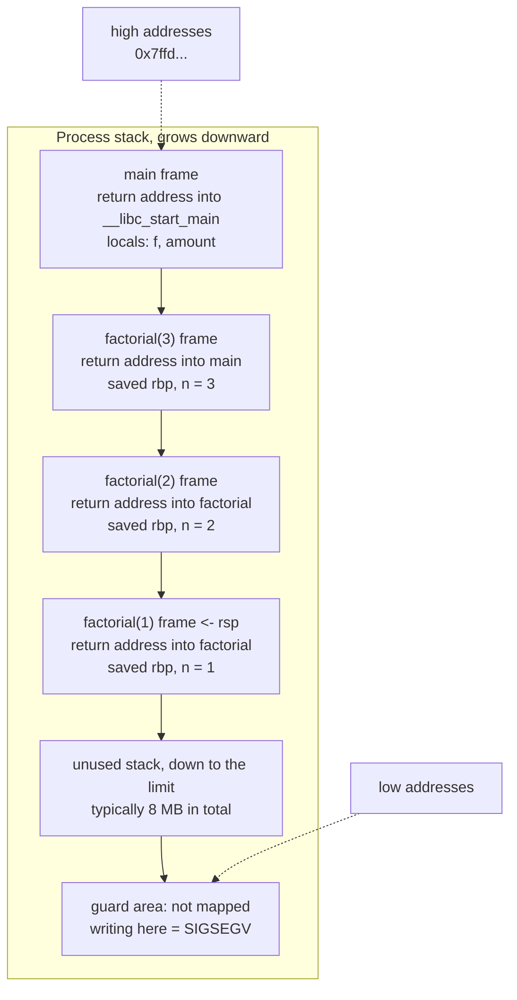

# Module 1.04: Functions and the call stack

**Estimated hours:** 4

**What you will learn**

1. How to write and call a function: parameters, return values, scope, and the difference between a declaration and a definition.
2. What really happens on a call: a **stack frame** is pushed, arguments are copied in, the function runs, the frame is popped; and how to see those frames in `gdb` with `backtrace` and `info frame`.
3. What recursion is, why a function that calls itself without end crashes with a segmentation fault, and what that stack overflow looks like in a core dump.

**Prerequisites:** [Module 1.03: Control flow](module-03-control-flow.md).

---

## 1. One-line intuition

A function is a named block of code you can call from anywhere; each call gets its own fresh scratch space on a stack of such spaces, and the space is thrown away when the function returns.

## 2. Real-life analogy

A loan officer's desk has an in-tray of **task sheets**, stacked.

- When the officer needs a sub-task done ("compute the EMI for this application"), they take a **fresh sheet**, write the inputs at the top (**parameters**: the copies of the values the caller passed in), and put it on top of the stack. They also write on it where they were in the previous sheet, so they can go back (**the return address**).
- They work only on the top sheet. The sheet's scratch area holds the sub-task's temporary numbers (**local variables**).
- When done, they write the answer in a fixed place (**the return value**), throw the sheet away, pick up the sheet below and continue from the noted place.
- The sheets are stacked: the most recent on top, finished sheets removed from the top. That is **the call stack**, and each sheet is a **stack frame**.
- The officer copies the input values onto the new sheet. Changing a number on the new sheet does nothing to the old one. That is **pass by value**, and it is the only kind of passing C has.
- If a sub-task says "to compute this, first compute the same thing for one month less", the officer takes another sheet, then another. That is **recursion**. If the instructions never say "stop at month zero", the tray overflows onto the floor: a **stack overflow**.

## 3. Why it exists: the problem it solves

Without functions, a program is one long list. To compute an EMI in three places you paste the same twenty lines three times; when you fix a bug, you fix it in two of them. Functions give one name to one piece of logic, so it is written once, tested once and reused.

The harder problem is **re-entrancy**: what if `compute_interest` is running, and it calls `round_to_paise`, and later `round_to_paise` is called again from somewhere else? If each function's temporaries lived in fixed memory slots, the second call would overwrite the first call's values. The stack solves this: every call gets a new frame, so a function can even call itself.

What breaks without it: the earliest FORTRAN compilers gave each function fixed slots and recursion was simply impossible. Today, every thread in the application server (claim H4) has its own stack, so two threads can run the same function on two different requests at the same time without sharing a single local variable. The stack is why that works.

## 4. Three layers of depth

### Layer 1 (beginner): writing and calling a function

A **function definition** has four parts: return type, name, parameter list, body.

```c
int64_t monthly_interest(int64_t balance_paise, int rate_percent) {
    int64_t interest = (balance_paise * rate_percent + 50) / 100;
    return interest;
}
```

- `int64_t` before the name is the **return type**: what the function hands back.
- `balance_paise` and `rate_percent` are **parameters**: variables that receive copies of the caller's values.
- `return interest;` ends the function and sends the value back.
- A function that returns nothing has return type `void` and uses plain `return;` or just reaches the closing brace.

Calling it:

```c
int64_t i = monthly_interest(12000000, 1);   /* 12000000 and 1 are the arguments */
```

The values you pass are **arguments**; the names inside the function are **parameters**. The argument values are copied into the parameters.

**Declaration versus definition.** The compiler reads top to bottom and must know a function's shape before you call it. A **declaration** (also called a **prototype**) gives the shape without the body:

```c
int64_t monthly_interest(int64_t balance_paise, int rate_percent);   /* declaration */
```

The **definition** is the version with the body. You may declare a function many times; you may define it exactly once. Prototypes go at the top of the file, or in a header file (module 1.13), so that `main` can be written first and call functions defined below it. Calling a function with no visible declaration is an error under this course's flags (`-Werror=implicit-function-declaration`), and in GCC 14 and later it is an error even without them.

**Scope.** A variable declared inside a function exists only inside that function, and only from the line of its declaration to the closing brace of the block it is in. Two functions can both have a variable called `total`; they are unrelated. A variable declared outside every function is **global**: visible to every function below its declaration, alive for the whole program. Globals are where bugs hide in multithreaded code (Phase 4); use them rarely.

**Pass by value, and only by value.** When you pass a variable, the function receives a copy. Changing the parameter does not change the caller's variable. This is the one rule in this module that beginners refuse to believe until they see it, so section 6 proves it. The way to let a function change the caller's variable is to pass its address, which is module 1.05.

**`static` inside a function.** A local declared `static` keeps its value between calls. It is initialised once, at program start, and lives outside the stack:

```c
int next_loan_id(void) {
    static int counter = 1000;   /* set once, remembered forever */
    counter += 1;
    return counter;
}
```

Three calls return 1001, 1002, 1003. A `static` placed before a **function's** name means something different: the function is private to this source file (module 1.12). You will see `static` on most helper functions in this course for that reason.

**Order of evaluation.** In `printf("%d %d", f(), g())`, C does not say whether `f` or `g` runs first. Never write code that depends on it; call them on separate lines.

### Layer 2 (working engineer): the stack frame, drawn

On x86-64 Linux the stack is a region of memory that **grows downward**: each new frame is at a lower address than the one before. Two registers track it: `rsp` (stack pointer) points at the top (lowest address in use) and, in debug builds, `rbp` (base pointer) points at a fixed spot in the current frame so locals can be found as `rbp - 8`, `rbp - 12` and so on.

A `call` instruction does two things: pushes the **return address** (the address of the instruction after the `call`) onto the stack, and jumps to the function. A `ret` pops that address and jumps back. Everything else about the frame is set up by the function itself in its first few instructions (the **prologue**) and torn down in its last few (the **epilogue**).

Here is `factorial(3)` from section 6 at the moment the innermost call is running, compiled at `-O0`. The addresses are an example; yours will differ, but the shape and the spacing will not.

| Address (example) | Contents | Belongs to |
|---|---|---|
| `0x7ffd1c40aed0` | locals of `main` | `main`'s frame (highest, oldest) |
| `0x7ffd1c40aec8` | return address into `main` | pushed by `main`'s `call factorial` |
| `0x7ffd1c40aec0` | saved `rbp` of `main` | `factorial(3)`'s frame |
| `0x7ffd1c40aeac` | `n = 3` | `factorial(3)`'s frame |
| `0x7ffd1c40aea8` | return address into `factorial` | pushed by the `call` inside `factorial(3)` |
| `0x7ffd1c40aea0` | saved `rbp` | `factorial(2)`'s frame |
| `0x7ffd1c40ae8c` | `n = 2` | `factorial(2)`'s frame |
| `0x7ffd1c40ae88` | return address into `factorial` | pushed by the `call` inside `factorial(2)` |
| `0x7ffd1c40ae80` | saved `rbp` | `factorial(1)`'s frame (lowest, newest) |
| `0x7ffd1c40ae6c` | `n = 1` | `factorial(1)`'s frame, `rsp` points near here |

Each frame holds: the return address, the caller's saved `rbp`, the parameters (copied in from registers at `-O0`), and the locals. The first six integer or pointer arguments travel in registers (`rdi`, `rsi`, `rdx`, `rcx`, `r8`, `r9`) and the return value comes back in `rax`; this is the **System V calling convention** used by Linux. Windows uses a different convention (`rcx`, `rdx`, `r8`, `r9`), which is one reason a Linux object file cannot be linked into a Windows program.

**How big is the stack?** The main thread's stack limit on Linux is set by `ulimit -s`, typically 8192 KB (8 MB). Each thread the application server creates gets its own stack, typically also 8 MB by default. A frame for a small function is tens of bytes; a frame that declares a large local array (module 1.06) can be kilobytes. Divide the limit by the frame size and you have the maximum recursion depth.

**What `-O2` changes.** Optimised code keeps values in registers, skips `rbp`, inlines small functions into their callers, and turns some recursion into loops. A backtrace from an optimised build can be missing frames or show a function that "cannot" be there because it was inlined. That is why you debug at `-O0 -g`, and why production builds often add `-fno-omit-frame-pointer` so that crash dumps still have usable backtraces (capstone C6).

**Seeing it in gdb.** `gdb` reads the `-g` debug information and the saved return addresses to rebuild the chain of frames:

| Command | What it shows |
|---|---|
| `break show_frame` | Stop whenever this function is entered |
| `run` | Start the program |
| `bt` (`backtrace`) | The chain of frames, newest first: `#0` is where you are |
| `bt 3` / `bt -3` | Only the newest 3 / only the oldest 3 frames |
| `info frame` | Addresses of the current frame, saved registers, return address |
| `frame 2` | Switch to frame `#2` so `info locals` shows its variables |
| `info locals` / `info args` | Local variables / parameters of the selected frame |
| `finish` | Run until the current function returns, show the return value |
| `next` / `step` | Next line, stepping over / into calls |
| `continue` | Run to the next breakpoint |

### Layer 3 (internals): prologue, epilogue, and what a stack overflow is

Compile `factorial` at `-O0` and `gcc -S` shows (AT&T syntax, trimmed; your labels and offsets may differ):

```asm
factorial:
        pushq   %rbp              # prologue: save caller's base pointer
        movq    %rsp, %rbp        #   this frame's base = current top
        subq    $16, %rsp         #   reserve 16 bytes for locals
        movl    %edi, -4(%rbp)    #   copy parameter n from register edi into the frame
        cmpl    $1, -4(%rbp)      # if (n <= 1)
        jg      .L2
        movl    $1, %eax          #   return 1 (result goes in eax/rax)
        jmp     .L3
.L2:
        movl    -4(%rbp), %eax    # n
        subl    $1, %eax          # n - 1
        movl    %eax, %edi        # first argument goes in edi
        call    factorial         # push return address, jump; a NEW frame begins
        imulq   -4(%rbp), %rax    # rax = factorial(n - 1) * n
.L3:
        leave                     # epilogue: rsp = rbp; pop rbp
        ret                       # pop return address and jump to it
```

Read the prologue as "make a new sheet and note where the old one was"; the epilogue as "throw the sheet away and pick up the old one". `-O2` compiles the same function into a short loop with no frame at all; the compiler noticed the recursion can be replaced by iteration.

**The stack has a floor.** The kernel maps the stack region with a limit (`ulimit -s`). Below it is an unmapped **guard** area. When a function's prologue tries to write a new frame below the mapped region, the CPU raises a page fault on an address the kernel refuses to map, and the process receives `SIGSEGV`: the segmentation fault from module 0.01. The kernel does grow the main thread's stack on demand up to the limit, so small programs never notice; infinite recursion reaches the limit in a fraction of a second.

**What it looks like in a core dump.** Three fingerprints tell a stack overflow apart from every other crash:

1. The backtrace is enormous and repetitive: tens or hundreds of thousands of frames of the same function (or the same cycle of functions).
2. The faulting address is just below the lowest address of the `[stack]` region (`info proc mappings` in gdb, or `/proc/PID/maps` for a live process), and `rsp` is right there.
3. The faulting instruction is in a prologue (`push`, `sub rsp`, or the first store into the new frame), not in the middle of some data manipulation.

A null-pointer crash, by contrast, has a short backtrace and a faulting address at or near zero. Memory corruption usually has a garbage address nowhere near the stack. Capstone C6 trains you to classify a dump from these fingerprints before reading any source.

**Return value and side effects.** The return value is copied into `rax` just before `ret`. If a function "returns" the address of one of its locals, that address points into a frame that no longer exists; the next call overwrites it. That is the **dangling pointer** of module 1.05, and GCC refuses the simple case with `-Wreturn-local-addr`.

## 5. Architecture diagram



Each `call` adds a box below; each `ret` removes the lowest box. Recursion without a stop condition adds boxes until it hits the guard.

## 6. Code

Save as `call_stack.c`. It defines four functions, declared first and defined after `main`, so you see declaration and definition separately.

```c
/* call_stack.c
 * Shows: declaration vs definition, return values, recursion,
 * one frame per call (addresses go down), pass by value,
 * and a static local that survives between calls.
 */
#include <stdio.h>
#include <stdint.h>
#include <inttypes.h>

/* Declarations (prototypes): the shapes, no bodies. */
static int64_t factorial(int n);
static void    show_frame(const char *who, int depth);
static void    try_to_change(int value);
static int     next_loan_id(void);

int main(void) {
    printf("--- 1. a call and its return value ---\n");
    int64_t f = factorial(5);
    printf("factorial(5)  = %" PRId64 "\n", f);
    printf("factorial(20) = %" PRId64 "\n", factorial(20));

    printf("\n--- 2. each call gets a new frame, lower in memory ---\n");
    show_frame("main", 0);

    printf("\n--- 3. pass by value: the function gets a copy ---\n");
    int amount = 100;
    try_to_change(amount);
    printf("after try_to_change, amount in main = %d\n", amount);

    printf("\n--- 4. a static local survives between calls ---\n");
    int id1 = next_loan_id();      /* separate statements: C does not promise */
    int id2 = next_loan_id();      /* the order in which arguments to one   */
    int id3 = next_loan_id();      /* printf would be evaluated             */
    printf("ids: %d %d %d\n", id1, id2, id3);
    return 0;
}

/* Definitions. */

/* n! = n * (n-1) * ... * 1. Recursive: the function calls itself with n-1. */
static int64_t factorial(int n) {
    if (n <= 1) {
        return 1;                              /* the stop condition */
    }
    return (int64_t)n * factorial(n - 1);      /* a new frame for each level */
}

/* Prints the address of a local; each deeper call has a lower address. */
static void show_frame(const char *who, int depth) {
    int local = depth;                         /* lives in THIS call's frame */
    printf("%-5s depth %d: local at %p\n", who, depth, (void *)&local);
    if (depth < 3) {
        show_frame("child", depth + 1);
    }
}

/* Receives a copy of the caller's value; changing it changes only the copy. */
static void try_to_change(int value) {
    value = value * 2;
    printf("inside try_to_change, value = %d\n", value);
}

/* A static local is initialised once and keeps its value between calls. */
static int next_loan_id(void) {
    static int counter = 1000;
    counter += 1;
    return counter;
}
```

Compile and run:

```bash
gcc -std=c17 -Wall -Wextra -Werror -g -o call_stack call_stack.c
./call_stack
```

Expected output (addresses differ per machine and per run; the spacing between them is typically 32 to 64 bytes and is the same between every pair):

```text
--- 1. a call and its return value ---
factorial(5)  = 120
factorial(20) = 2432902008176640000

--- 2. each call gets a new frame, lower in memory ---
main  depth 0: local at 0x7ffd1c40aecc
child depth 1: local at 0x7ffd1c40ae9c
child depth 2: local at 0x7ffd1c40ae6c
child depth 3: local at 0x7ffd1c40ae3c

--- 3. pass by value: the function gets a copy ---
inside try_to_change, value = 200
after try_to_change, amount in main = 100

--- 4. a static local survives between calls ---
ids: 1001 1002 1003
```

Three things to check. The four addresses go **down** by a constant step: that is one frame per call, stacked. `amount` is still 100 in `main`: pass by value. And `factorial(20)` fits in `int64_t` but `factorial(21)` would not (it is about 5.1 × 10^19, past `INT64_MAX`), which is the overflow rule of module 1.02 waiting to bite anyone who changes the 20.

## 7. Use case: core-banking loan-origination platform

The application server (claim H4) evaluates eligibility rules that can nest: a rule can reference a rule group, which can reference other rules. The natural code is recursive: `evaluate(rule)` calls `evaluate` on each child. A production incident of exactly the kind described by claim H5 (and reproduced in capstone C6) comes from this shape: a misconfigured rule group that referenced itself. Every request that touched it recursed until the thread's stack hit the guard, the server died with `SIGSEGV`, and the service manager restarted it, in a loop, every few seconds.

The dump had the three fingerprints from Layer 3: a backtrace of roughly a hundred thousand `evaluate` frames, `rsp` just below the thread's stack mapping, and a faulting instruction in the prologue. Reading that took minutes; the fix took longer. The decisions it drove:

1. **Recursion over external data gets a depth limit.** `evaluate` took a `depth` parameter and failed the request with a clear error past depth 32. A rule that needs more than 32 levels is a configuration bug, not a reason to crash the server.
2. **Thread stack sizes are chosen, not inherited.** Pool threads were created with an explicit stack size (Phase 3), and the limit in point 1 was checked against it.
3. **The RCA template starts with the backtrace classification.** "Stack exhaustion by self-referencing rule group" was the one-line root cause; the first page of the RCA shows `bt -5` and the `[stack]` mapping so that a reader can verify the classification without trusting the author.

An interviewer who hears "stack overflow" will ask how you knew. The answer is the three fingerprints, and you will have produced them yourself in the lab.

## 8. Lab

### Part A: frames in gdb (40 minutes)

1. Compile and run `call_stack.c`. Match the output shape. Compute the step between the four addresses: typically 48 bytes (`0x30`); write yours down.
2. Start the debugger: `gdb -q ./call_stack`. At the `(gdb)` prompt type the following, one at a time, and read each result:

```text
break show_frame
run
continue
continue
continue
bt
info frame
frame 2
info locals
info args
frame 0
finish
```

Expected (addresses and line numbers vary):

```text
Breakpoint 1, show_frame (who=0x555555556010 "child", depth=3) at call_stack.c:46
46          int local = depth;
(gdb) bt
#0  show_frame (who=0x555555556010 "child", depth=3) at call_stack.c:46
#1  0x0000555555555289 in show_frame (who=0x555555556010 "child", depth=2) at call_stack.c:49
#2  0x0000555555555289 in show_frame (who=0x555555556010 "child", depth=1) at call_stack.c:49
#3  0x0000555555555289 in show_frame (who=0x555555556016 "main", depth=0) at call_stack.c:49
#4  0x0000555555555334 in main () at call_stack.c:25
(gdb) info frame
Stack level 0, frame at 0x7fffffffe0b0:
 rip = 0x55555555525a in show_frame (call_stack.c:46); saved rip = 0x555555555289
 called by frame at 0x7fffffffe0e0
 source language c.
 Arglist at 0x7fffffffe0a0, args: who=0x555555556010 "child", depth=3
 Locals at 0x7fffffffe0a0, Previous frame's sp is 0x7fffffffe0b0
 Saved registers:
  rbp at 0x7fffffffe0a0, rip at 0x7fffffffe0a8
```

Read `info frame`: "frame at" is this frame's top; "called by frame at" is the caller's, a few dozen bytes higher; "saved rip" is the return address; "rbp at ... rip at ..." are where the saved base pointer and return address sit, 8 bytes apart. Compare "frame at" with "called by frame at": the difference is your frame size from step 1.

3. Note that under gdb the code addresses start with `0x5555...` and the stack with `0x7fffffff...` on every run. gdb switches off address randomisation so that sessions are repeatable; module 1.10 covers randomisation.
4. Type `quit` (answer `y`).

### Part B: a stack overflow, in the terminal, in gdb, and in a core dump (45 minutes)

Create `stack_overflow.c`:

```c
/* stack_overflow.c: recursion with no practical stop until the stack is gone. */
#include <stdio.h>

static void recurse(long depth) {
    long marker = depth;                       /* one local per frame */
    if (depth % 10000 == 0) {
        printf("depth %ld, frame local at %p\n", depth, (void *)&marker);
        fflush(stdout);                        /* on screen BEFORE the crash */
    }
    if (depth < 1000000000L) {                 /* never false in practice */
        recurse(depth + 1);
    }
}

int main(void) {
    recurse(0);
    return 0;
}
```

1. Compile with the usual flags (no `-O`; at `-O2` GCC may turn this into a loop and it would never crash) and run. Expected: lines every 10,000 levels with addresses going down, then `Segmentation fault (core dumped)`. The last depth printed is typically in the range of one to three hundred thousand. Divide the address difference between two consecutive lines by 10,000: that is the frame size. Divide 8 MB (`ulimit -s` prints 8192, in KB) by the frame size and compare with the depth reached.
2. Run `ulimit -s 2048` in this terminal and run the program again. Expected: it dies at roughly a quarter of the depth. Restore with `ulimit -s 8192`.
3. Run it under gdb:

```text
gdb -q ./stack_overflow
run
bt 3
bt -3
info frame
p $rsp
info proc mappings
quit
```

Expected: `Program received signal SIGSEGV, Segmentation fault.` with the stopped line inside `recurse`. `bt 3` shows three identical `recurse` frames and `(More stack frames follow...)`. `bt -3` shows `recurse (depth=1)`, `recurse (depth=0)` and `main`. `p $rsp` prints an address; in `info proc mappings` find the line ending in `[stack]` and confirm `$rsp` is at or just below its start address. Those are fingerprints 1, 2 and 3 from Layer 3.

4. Make a real core dump. Ubuntu normally hands crashes to a reporting tool, so point the kernel at a plain file (this setting resets when WSL restarts):

```bash
ulimit -c unlimited
echo core | sudo tee /proc/sys/kernel/core_pattern
./stack_overflow
ls -l core*
gdb -q ./stack_overflow core
```

Expected: a file named `core` (or `core.<pid>`) of several megabytes. In gdb, `bt -3` and `info frame` work exactly as in step 3, on a process that no longer exists. This is the workflow of capstone C6: a dump, the matching binary with `-g`, and a backtrace. Type `quit` and delete the core file.

### Part C: pass by value and the swap that does nothing (20 minutes)

Create `swap_by_value.c`:

```c
#include <stdio.h>

static void swap(int a, int b) {     /* receives copies */
    int tmp = a;
    a = b;
    b = tmp;
    printf("inside swap: a=%d b=%d\n", a, b);
}

int main(void) {
    int x = 1;
    int y = 2;
    swap(x, y);
    printf("in main:     x=%d y=%d\n", x, y);
    return 0;
}
```

Expected: `inside swap: a=2 b=1` then `in main: x=1 y=2`. The swap worked on the copies in `swap`'s frame and the frame is gone. Module 1.05 fixes this with pointers. Keep this file; you will edit it there.

### Part D: declaration, definition and static (20 minutes)

1. In `call_stack.c`, delete the prototype line for `next_loan_id` and compile. Expected: `error: implicit declaration of function 'next_loan_id' [-Werror=implicit-function-declaration]`. The compiler reached the call before it had seen the shape. Restore the line.
2. Copy the whole definition of `next_loan_id` and paste it a second time. Compile. Expected: `error: redefinition of 'next_loan_id'` with a note pointing at the first definition. One definition only. Remove the copy.
3. Change the prototype to `static int next_loan_id(int);` without changing the definition. Expected: `error: conflicting types for 'next_loan_id'`. Declaration and definition must agree. Restore it.
4. Remove the word `static` from `static int counter = 1000;` and run. Expected: `ids: 1001 1001 1001`. Without `static`, `counter` is a fresh local, created and set to 1000 on every call, and lost on every return.

### Journal

Copy [journal/TEMPLATE.md](../journal/TEMPLATE.md) to `journal/YYYY-MM-DD-functions-call-stack.md`. Record: your frame size from Part A; the maximum depth reached and the `[stack]` mapping line from Part B; the three fingerprints of a stack overflow in your own words; the four error messages from Part D. Commit with `Module 1.04: functions and call stack lab`.

## 9. Common mistakes and misconceptions

| Mistake | Why it is wrong | Bug it causes later |
|---|---|---|
| A function can change the caller's variable by assigning to its parameter | Parameters are copies in the callee's frame | `swap` that does nothing; "updates" that vanish |
| Returning the address of a local variable | The frame is destroyed at `return`; the address points into dead space | Dangling pointer: garbage or a crash on the next call (`-Wreturn-local-addr` catches the obvious case) |
| Recursion is always fine if it terminates | It also has to terminate within the stack limit | Stack overflow on deep or self-referencing data |
| A `static` local is like any other local | It is initialised once and lives outside the stack | Shared state between calls, and between threads (Phase 4) |
| Arguments are evaluated left to right | The order is unspecified | Different output with a different compiler or flags |
| A declaration and a definition are the same thing | A declaration gives the shape; the definition gives the body, exactly once | Linker errors (missing definition) or compile errors (conflicting types) |
| The debug backtrace is what production will show | `-O2` inlines and drops frames | Misread crash dumps; fix: `-fno-omit-frame-pointer` and symbols for release builds |
| `main` is the bottom of the stack | `_start` and `__libc_start_main` are below it | Confusion at the last frames of a backtrace |

## 10. Resume link

- **Claim F, "crash dump and core dump analysis (WinDbg, GDB)".** You have now produced a core dump, loaded it, and classified a stack overflow by its three fingerprints. Say: "The first thing I do with a dump is `bt`, then I check the faulting address against the memory map. A repetitive backtrace with `rsp` just under the stack mapping is stack exhaustion; a tiny address is a null dereference; a garbage address is corruption."
- **Claim H5, "production crash-dump and live-incident debugging with formal RCA".** Section 7 is the shape of such an RCA: fingerprint, root cause, the decision (depth limit, explicit thread stack sizes) that prevents recurrence.
- **Claim C / H4, "multithreaded application server".** Each thread has its own stack; that is why the same function can run concurrently on different requests. You can now say why.

Likely follow-up: "How would you tell a stack overflow from a heap corruption in a core dump?" Use the fingerprints, and add: heap corruption usually shows up inside `malloc` or `free` with a sane-looking backtrace and a strange address; module 1.08 and capstone C6 give you that half.

## 11. Interview questions

**Q1 (easy). What is a stack frame and what does it contain?**

<details>
<summary>Model answer</summary>

A stack frame is the block of stack memory that belongs to one call of a function. It contains the return address pushed by the `call` instruction, the caller's saved base pointer in debug builds, the function's local variables, and at `-O0` copies of the parameters. Frames are pushed on each call and popped on each return, so the stack at any moment is the chain of calls that are currently active, newest at the lowest address on x86-64.

</details>

**Q2 (easy). C passes arguments by value. What does that mean and how do you let a function modify the caller's variable?**

<details>
<summary>Model answer</summary>

The argument's value is copied into the callee's parameter, which lives in the callee's frame. Assigning to the parameter changes the copy only; the caller's variable is untouched. To let a function change the caller's variable you pass the variable's address with `&x`, and the function writes through the pointer with `*p = value`. That is still pass by value; what is passed by value is the address.

</details>

**Q3 (medium). How do you recognise a stack overflow in a core dump, and how does it differ from a null-pointer crash?**

<details>
<summary>Model answer</summary>

A stack overflow has three fingerprints: the backtrace is extremely long and repetitive, usually one function or a short cycle repeated tens or hundreds of thousands of times; the faulting address and `rsp` are at or just below the lowest address of the thread's stack mapping, visible with `info proc mappings` in gdb or `/proc/PID/maps`; and the faulting instruction is in a function prologue (a push or a store into the newly reserved frame). A null-pointer crash has a short backtrace, a faulting address of zero or a small offset from zero, and the faulting instruction is a load or store through a register holding zero. Both deliver `SIGSEGV`, so the signal alone does not distinguish them.

</details>

**Q4 (medium). What is the difference between a local variable, a `static` local and a global, in terms of where they live and how long?**

<details>
<summary>Model answer</summary>

A plain local lives in the current stack frame, is created when its declaration is reached and destroyed when the block ends; each call and each thread has its own. A `static` local lives in the program's data segment, is initialised once before `main` runs, keeps its value between calls, and is shared by every thread that calls the function, so it needs synchronisation in multithreaded code. A global also lives in the data segment for the whole program and is visible to every function that sees its declaration. Choosing a local keeps state per call and per thread for free; choosing `static` or global is choosing shared state, which must be justified.

</details>

**Q5 (hard). Describe what happens at the machine level when `main` calls `factorial(3)` on x86-64 Linux, through to the return, and explain why an optimised build's backtrace can differ from the debug build's.**

<details>
<summary>Model answer</summary>

`main` places the argument 3 in register `edi` per the System V calling convention and executes `call factorial`, which pushes the return address and jumps. The prologue pushes `rbp`, sets `rbp = rsp` and subtracts from `rsp` to reserve space for locals; at `-O0` it stores `edi` into that space. The body compares `n` with 1, and for `n > 1` computes `n - 1` into `edi` and executes another `call`, creating a new frame at a lower address; this repeats until `n == 1`. Each level returns its result in `rax`, multiplies by its own `n` and returns via `leave` (which restores `rsp` and `rbp`) and `ret` (which pops the return address into `rip`). At `-O2` the compiler keeps `n` in a register, omits the frame pointer, and typically converts the self-recursion into a loop or inlines calls, so there may be a single frame or none for `factorial`; a backtrace then shows fewer frames than the source suggests, and without frame pointers the debugger must rely on unwind tables. For production crash dumps the usual choice is `-O2 -g -fno-omit-frame-pointer` so that both speed and a reliable backtrace are available.

</details>

## 12. Revision

- A function is declared (prototype, many times) and defined (body, once); arguments are copied by value into parameters; a `static` local keeps its value and lives outside the stack.
- Each call pushes a frame (return address, saved `rbp`, locals) at a lower address; `gdb`'s `bt` walks the chain, `info frame` shows one frame's addresses; frames are typically tens of bytes and the main stack is typically 8 MB.
- Recursion without a reachable stop runs off the bottom of the stack into the guard area and dies with `SIGSEGV`; in a dump it shows as a huge repetitive backtrace with `rsp` just below the `[stack]` mapping.

---

Previous: [Module 1.03: Control flow](module-03-control-flow.md) | Next: [Module 1.05: Pointers](module-05-pointers.md)
