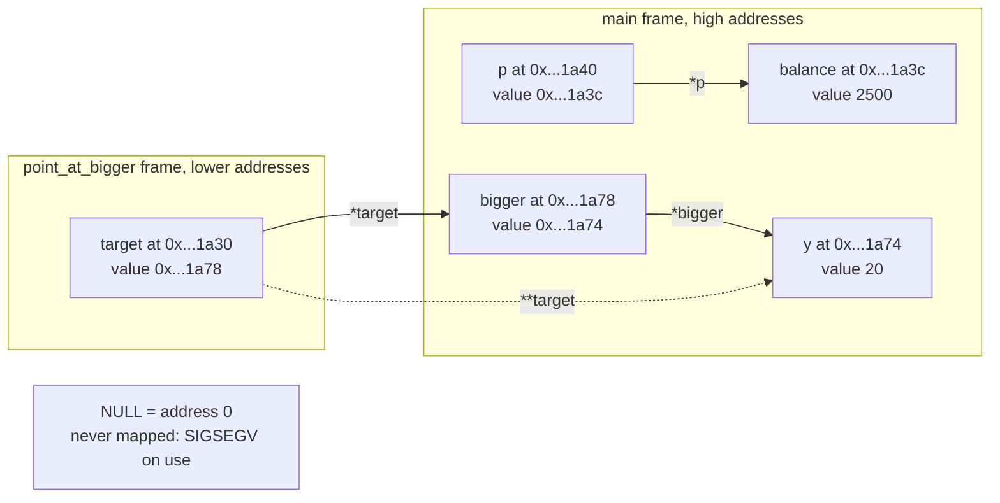

# Module 1.05: Pointers

**Estimated hours:** 5

**What you will learn**

1. What a pointer is (a variable that holds an address), how `&` gets an address and `*` follows one, and how to draw memory so that every pointer question becomes a lookup in a table.
2. Why a pointer has a type, how `int *` and `char *` move by different amounts, how pointers let a function change the caller's variables or hand back several results, and what a pointer to a pointer is for.
3. The two ways pointers kill programs: `NULL` dereference and dangling pointers; how each looks in `gdb` and AddressSanitizer; and how `const` on a pointer documents what may be changed.

**Prerequisites:** [Module 1.04: Functions and the call stack](module-04-functions-and-the-call-stack.md).

---

## 1. One-line intuition

A pointer is a variable whose value is the address of another variable; `&x` asks "where is `x`?", and `*p` says "go to the address in `p` and use what is there".

## 2. Real-life analogy

Return to the warehouse of module 0.01: a wall of numbered pigeonholes, each holding one byte.

- A variable is a few pigeonholes in a row with a label stuck on them: `balance` is four pigeonholes starting at number 1a3c.
- A **pointer** is a slip of paper on which someone has written a pigeonhole number. The slip itself is kept in its own pigeonholes (eight of them, because a number as large as a modern address needs 8 bytes).
- `&balance` is the question "what number is painted on `balance`'s first pigeonhole?" The answer is 1a3c. Writing that on a slip is `int *p = &balance;`.
- `*p` is the instruction "read the slip, walk to that pigeonhole, and use the four bytes there". `*p = 3000` means "walk there and overwrite them".
- The slip says what kind of thing lives at the address: "an `int` lives here" or "a single byte lives here". That is the **pointer type**. It tells the clerk how many pigeonholes to read, and how far to step to reach "the next one".
- A **blank slip** is `NULL`. Walking to "pigeonhole nothing" is the crash from module 0.01.
- A slip with the number of a pigeonhole that was on a task sheet that has since been thrown away (module 1.04) is a **dangling** pointer. The number looks valid; the contents are whatever the next task wrote there.
- A slip that holds the number of the pigeonhole where another slip is kept is a **pointer to a pointer**.

Every pointer bug is one of: a blank slip, a stale slip, or a slip read as the wrong kind of thing.

## 3. Why it exists: the problem it solves

Module 1.04 left a problem open. A function receives copies, so `swap(x, y)` cannot swap the caller's variables, and a function can `return` only one value. Real work needs both: "divide this amount into shares and tell me the share **and** the remainder", "read a record into this buffer", "find this key and give me the position". Without pointers, every function would have to copy every large thing in and copy the whole thing back out.

Pointers solve it by passing the **address** instead of the value. The function still receives a copy, but a copy of an address is as good as the original address: writing through it changes the caller's memory.

They also solve a problem you have not met yet. Every variable so far has had a fixed size known when you wrote the program. A loan book has as many loans as the bank has written; a network message is as long as the sender made it. Memory that is requested at run time (module 1.08) is handed to you as an address, and the only way to use it is through a pointer. Linked lists, trees, hash maps, B-tree pages, the arena allocator of claim H1: all of them are structures made of pointers.

What breaks without them: C would be a calculator. And what breaks with them is the subject of capstone C6: most memory-corruption crashes are a pointer that was blank, stale, or pointed one step too far.

## 4. Three layers of depth

### Layer 1 (beginner): address, `&`, `*`, and the drawing you must always make

Start with one variable.

```c
int balance = 2500;
```

Draw memory as a table. The address column is an example; the pattern is what matters. `2500` is `0x000009C4`, stored little-endian (module 1.02).

| Address | Name | Bytes | Meaning |
|---|---|---|---|
| `0x7ffe3b9c1a3c` to `...1a3f` | `balance` | `C4 09 00 00` | the `int` 2500 |

Now a pointer to it.

```c
int *p = &balance;
```

Read the declaration from the name outwards: "`p` is a pointer (`*`) to an `int`". `&balance` is the address of `balance`. So `p` now holds `0x7ffe3b9c1a3c`, and `p` itself is 8 bytes somewhere nearby:

| Address | Name | Bytes | Meaning |
|---|---|---|---|
| `0x7ffe3b9c1a3c` | `balance` | `C4 09 00 00` | 2500 |
| `0x7ffe3b9c1a40` to `...1a47` | `p` | `3C 1A 9C 3B FE 7F 00 00` | the address `0x7ffe3b9c1a3c` |

The bytes of `p` are the address written little-endian. A pointer is a number; it is only special because of what you do with it. (The compiler decides where in the frame each local goes; on your machine `p` may sit above or below `balance`, and not necessarily next to it.)

Three operations:

| Expression | Read it as | Value here |
|---|---|---|
| `&balance` | the address of `balance` | `0x7ffe3b9c1a3c` |
| `p` | the address stored in `p` | `0x7ffe3b9c1a3c` |
| `*p` | the `int` at the address stored in `p` | 2500 |
| `&p` | the address of the pointer itself | `0x7ffe3b9c1a40` |

Now write through the pointer:

```c
*p = 3000;
```

"Go to the address in `p` and store 3000 as an `int`." The table becomes:

| Address | Name | Bytes | Meaning |
|---|---|---|---|
| `0x7ffe3b9c1a3c` | `balance` | `B8 0B 00 00` | 3000 |
| `0x7ffe3b9c1a40` | `p` | `3C 1A 9C 3B FE 7F 00 00` | unchanged: still points at `balance` |

`balance` is now 3000, although no line mentioned `balance`. That is the whole power and the whole danger.

**The two meanings of `*`.** In a declaration, `int *p`, the star says "`p` is a pointer". In an expression, `*p`, the star means "the thing `p` points at" (**dereferencing**). Same symbol, two jobs. Beginners mix them up for about a week; the drawing fixes it.

**Printing a pointer.** Use `%p` and cast to `void *`: `printf("%p", (void *)p)`. The output is hex, like `0x7ffe3b9c1a3c`. Every pointer is 8 bytes on x86-64 whatever it points at: `sizeof(int *)`, `sizeof(char *)` and `sizeof(double *)` are all 8.

**`NULL`.** A pointer that points at nothing. `#include <stddef.h>` (or `<stdio.h>`) defines it; its value is address 0. You give a pointer `NULL` when it does not point anywhere yet, and you test `if (p != NULL)` before using it. Reading or writing `*p` when `p` is `NULL` is the null-pointer crash from module 0.01; the lab makes you do it.

**Uninitialised pointers.** `int *p;` with no value holds whatever bytes were in those 8 pigeonholes: a random address. Using it is undefined behaviour and usually a crash somewhere far from the bug. Always initialise: with an address, or with `NULL`.

### Layer 2 (working engineer): types, arithmetic, out-parameters, pointer to pointer, const

**Why the type matters: arithmetic.** `p + 1` does not add 1 to the address. It adds `sizeof(*p)`: the size of the thing pointed at. The compiler needs the type to know the step.

```c
int32_t ledger[4] = {100, 200, 300, 400};      /* four int32_t side by side (module 1.06) */
int32_t       *ip = ledger;                    /* address of ledger[0] */
unsigned char *cp = (unsigned char *)ledger;   /* the SAME address, as bytes */
```

| Address | Contents (bytes) | As `int32_t` | Reached by |
|---|---|---|---|
| `0x7ffe3b9c1a50` | `64 00 00 00` | 100 | `*ip`, `ip[0]`; `*cp` is the byte `0x64` = 100 |
| `0x7ffe3b9c1a51` | | | `*(cp + 1)` is the byte `0x00` |
| `0x7ffe3b9c1a54` | `C8 00 00 00` | 200 | `*(ip + 1)`, `ip[1]`; `*(cp + 4)` is `0xC8` = 200 |
| `0x7ffe3b9c1a58` | `2C 01 00 00` | 300 | `*(ip + 2)` |
| `0x7ffe3b9c1a5c` | `90 01 00 00` | 400 | `*(ip + 3)` |

`ip + 1` is `0x...1a54` (4 bytes on); `cp + 1` is `0x...1a51` (1 byte on). `p[i]` is defined as `*(p + i)`, which is why arrays and pointers look alike (module 1.06). Subtracting two pointers of the same type gives the number of **elements** between them, not bytes: `(ip + 3) - ip` is 3. The result has type `ptrdiff_t`, printed with `%td`.

Stepping a pointer past the thing it points into is undefined behaviour even if you never dereference it, with one exception: one past the end is allowed as a stopping point. `ip + 4` may be computed and compared; `*(ip + 4)` reads memory you do not own.

**Out-parameters: more than one result.** Pass the addresses of the caller's variables; the function writes through them and returns a status code:

```c
static int divide_paise(int64_t amount, int64_t parts,
                        int64_t *share, int64_t *remainder) {
    if (parts == 0) {
        return 1;                    /* error: leave the outputs untouched */
    }
    *share     = amount / parts;     /* write into the CALLER's variable */
    *remainder = amount % parts;
    return 0;
}
```

Called as `divide_paise(100000, 3, &share, &rest)`. While `divide_paise` runs, memory looks like this (two frames, module 1.04):

| Frame | Address | Name | Value |
|---|---|---|---|
| `main` | `0x7ffe3b9c1a60` | `share` | 0, becomes 33333 |
| `main` | `0x7ffe3b9c1a68` | `rest` | 0, becomes 1 |
| `divide_paise` | `0x7ffe3b9c1a20` | `share` (parameter) | `0x7ffe3b9c1a60`: points up into `main`'s frame |
| `divide_paise` | `0x7ffe3b9c1a28` | `remainder` (parameter) | `0x7ffe3b9c1a68` |

The pattern "return a status, deliver results through pointers" is how most C library and OS functions work (`scanf`, `getcwd`, every Berkeley DB call). It also fixes `swap`:

```c
static void swap(int *a, int *b) {
    int tmp = *a;      /* read the caller's x */
    *a = *b;           /* write the caller's x */
    *b = tmp;
}
/* called as swap(&x, &y) */
```

**Pointer to a pointer.** If a function must change *which thing a pointer points at*, pass the address of the pointer:

```c
static void point_at_bigger(int **target, int *x, int *y) {
    if (*y > *x) {
        *target = y;     /* change the caller's POINTER */
    } else {
        *target = x;
    }
}
```

With `int x = 10, y = 20; int *bigger = NULL; point_at_bigger(&bigger, &x, &y);`:

| Address | Name | Type | Value |
|---|---|---|---|
| `0x7ffe3b9c1a70` | `x` | `int` | 10 |
| `0x7ffe3b9c1a74` | `y` | `int` | 20 |
| `0x7ffe3b9c1a78` | `bigger` | `int *` | `NULL`, becomes `0x7ffe3b9c1a74` (address of `y`) |
| `0x7ffe3b9c1a30` (callee frame) | `target` | `int **` | `0x7ffe3b9c1a78` (address of `bigger`) |

Inside the function, `target` is the address of `bigger`; `*target` is `bigger` itself; `**target` would be the `int` that `bigger` points at. Every extra `*` is one more "follow the slip". You will use `int **` and `char **` constantly: `main(int argc, char **argv)` receives the command-line arguments this way, and in module 1.08 a function that allocates memory and hands the new address back takes a pointer to the caller's pointer.

**`const` and pointers.** `const` can protect the pointed-to thing, the pointer, or both. Read the declaration right to left:

| Declaration | Read as | May change `*p`? | May change `p`? |
|---|---|---|---|
| `int *p` | pointer to int | yes | yes |
| `const int *p` | pointer to const int | **no** | yes |
| `int *const p` | const pointer to int | yes | **no** |
| `const int *const p` | const pointer to const int | **no** | **no** |

`const int *p` is a promise to the caller: "I will only read through this". Every function parameter that only reads should be declared that way; it documents intent and lets the compiler stop you writing through it (`error: assignment of read-only location '*p'`). `int *const` is rare; you will mostly see it as "this pointer is set once".

**`void *`.** A pointer to "something, type unknown". It can hold any object address and is what memory allocators and byte-copying functions use (module 1.08). You cannot dereference it or do arithmetic on it without first converting to a typed pointer, because the compiler does not know the step size.

**Dangling pointers.** A pointer is dangling when the thing it pointed at no longer exists. The commonest beginner form is returning the address of a local:

```c
static int *make_balance(void) {
    int balance = 500;
    return &balance;        /* balance dies when the function returns */
}
```

GCC refuses this with `error: function returns address of local variable [-Werror=return-local-addr]`. The next-simplest form, storing a local's address through an out-parameter (`*where = &balance;`), is caught by GCC 13 as `storing the address of local variable 'balance' in '*where' [-Werror=dangling-pointer=]`. But the check only follows the address while it stays in plain sight inside one function. As soon as the address passes through another function call before being stored, which is what real code does all the time, the compiler loses track, the program builds cleanly, and the bug is undefined behaviour at run time: it may print the right value, a wrong value, or crash, depending on what the next call overwrote. The lab shows the one tool that catches it reliably: AddressSanitizer.

### Layer 3 (internals): what `*p` compiles to, why `NULL` crashes, and how ASan sees a stale address

**A dereference is a load through a register.** `int v = *p;` compiles at `-O0` to roughly:

```asm
        movq    -8(%rbp), %rax      # rax = p   (load the 8-byte address from p's slot)
        movl    (%rax), %eax        # eax = *p  (load 4 bytes from the address in rax)
        movl    %eax, -12(%rbp)     # v = eax
```

`(%rax)` means "the memory at the address in `rax`". That is all a dereference is. `*p = 3000` is the same with the direction reversed: `movl $3000, (%rax)`. Pointer arithmetic becomes scaled addressing: `ip[i]` is `movl (%rax,%rdx,4), %eax`, where the 4 is `sizeof(int32_t)` baked in by the compiler, which is why the type must be known at compile time.

**Why `NULL` crashes.** Address 0 is a perfectly good number, but the kernel never maps the lowest part of a process's address space. On Linux the first `vm.mmap_min_addr` bytes, typically 64 KB, can never be mapped by a normal process. When `movl (%rax), %eax` runs with `rax = 0`, the CPU asks the page tables for address 0, finds no mapping, and raises a page fault; the kernel turns it into `SIGSEGV`. The 64 KB gap matters: a field at offset 24 inside a struct reached through a null struct pointer touches address 24, also unmapped, also a clean crash. A faulting address below about `0x10000` is the signature of a null dereference, and you will read it in every crash dump for the rest of your career.

**Why a dangling pointer does not crash.** The stack frame that held `balance` is gone, but the memory is still mapped: it is just part of the stack below `rsp`, waiting for the next call. Reading it succeeds and returns whatever is there now. This is why dangling pointers are worse than null pointers: null fails loudly at the point of use, dangling fails quietly somewhere else.

**How AddressSanitizer finds it.** `-fsanitize=address` makes the compiler insert a check before every load and store: it looks up the address in a **shadow memory** table (one shadow byte per 8 bytes of program memory) that records whether those bytes are currently valid. For stack-use-after-return, ASan moves each function's locals onto a separate "fake stack" that it poisons on return rather than reusing, so a later access through the stale address hits poisoned shadow and ASan prints a report naming the variable, the function whose frame it was in, and both stack traces. Module 8.03 explains the mechanism fully; today you only need to run it.

**Alignment.** A 4-byte `int` is normally at an address divisible by 4, an 8-byte pointer at one divisible by 8. x86-64 tolerates misaligned loads (slower); ARM and some sanitizer checks do not. Casting a `char *` that points at an odd address to `int *` and dereferencing is undefined behaviour; UBSan reports it as `load of misaligned address`. The byte view in Layer 2 goes the safe direction: any pointer may be viewed as `unsigned char *`, because character types are allowed to alias anything.

## 5. Architecture diagram



An arrow is "the value stored here is the address of the box it points at". Two arrows in a row is a pointer to a pointer. A box pointing at `NULL` has no arrow at all.

## 6. Code

Save as `pointers.c`. Every section matches one of the tables above; run it with the tables beside you.

```c
/* pointers.c
 * Shows: & and *, pointer arithmetic by type, out-parameters,
 * swap through pointers, pointer to pointer, NULL, const with pointers.
 */
#include <stdio.h>
#include <stdint.h>
#include <inttypes.h>
#include <stddef.h>      /* NULL, ptrdiff_t */

/* Returns 0 on success, 1 on error; results come back through pointers. */
static int divide_paise(int64_t amount, int64_t parts,
                        int64_t *share, int64_t *remainder) {
    if (parts == 0) {
        return 1;
    }
    *share     = amount / parts;
    *remainder = amount % parts;
    return 0;
}

/* The swap from module 1.04, now working: we receive ADDRESSES. */
static void swap(int *a, int *b) {
    int tmp = *a;
    *a = *b;
    *b = tmp;
}

/* Changes which int the caller's pointer points at. */
static void point_at_bigger(int **target, int *x, int *y) {
    if (*y > *x) {
        *target = y;
    } else {
        *target = x;
    }
}

int main(void) {
    printf("--- 1. a variable, its address, and a pointer to it ---\n");
    int  balance = 2500;
    int *p       = &balance;
    printf("balance   = %d\n", balance);
    printf("&balance  = %p\n", (void *)&balance);
    printf("p         = %p   (same address)\n", (void *)p);
    printf("*p        = %d   (the value found at that address)\n", *p);
    printf("&p        = %p   (the pointer itself lives somewhere too)\n", (void *)&p);
    printf("sizeof(p) = %zu bytes\n", sizeof p);
    *p = 3000;
    printf("after *p = 3000, balance = %d\n", balance);

    printf("\n--- 2. pointer arithmetic moves by the size of the pointed-to type ---\n");
    int32_t        ledger[4] = {100, 200, 300, 400};
    int32_t       *ip = ledger;                      /* address of ledger[0] */
    unsigned char *cp = (unsigned char *)ledger;     /* same address, byte view */
    printf("ip     = %p  *ip     = %" PRId32 "\n", (void *)ip, *ip);
    printf("ip + 1 = %p  *(ip+1) = %" PRId32 "   (moved 4 bytes)\n", (void *)(ip + 1), *(ip + 1));
    printf("ip + 3 = %p  *(ip+3) = %" PRId32 "   (moved 12 bytes)\n", (void *)(ip + 3), *(ip + 3));
    printf("cp     = %p  *cp     = %u\n", (void *)cp, *cp);
    printf("cp + 1 = %p  *(cp+1) = %u     (moved 1 byte: 2nd byte of 100)\n", (void *)(cp + 1), *(cp + 1));
    printf("cp + 4 = %p  *(cp+4) = %u   (1st byte of ledger[1])\n", (void *)(cp + 4), *(cp + 4));
    printf("(ip + 3) - ip = %td elements\n", (ip + 3) - ip);

    printf("\n--- 3. pointers as out-parameters: several results from one call ---\n");
    int64_t share = 0;
    int64_t rest  = 0;
    int err = divide_paise(100000, 3, &share, &rest);
    printf("err=%d  share=%" PRId64 "  remainder=%" PRId64 "\n", err, share, rest);
    err = divide_paise(100000, 0, &share, &rest);
    printf("err=%d  share and remainder untouched: %" PRId64 ", %" PRId64 "\n", err, share, rest);

    printf("\n--- 4. swap, fixed with pointers ---\n");
    int a = 1;
    int b = 2;
    swap(&a, &b);
    printf("a=%d b=%d\n", a, b);

    printf("\n--- 5. pointer to pointer: changing where a pointer points ---\n");
    int  x      = 10;
    int  y      = 20;
    int *bigger = NULL;
    point_at_bigger(&bigger, &x, &y);
    printf("bigger points at %s, value %d\n", bigger == &y ? "y" : "x", *bigger);

    printf("\n--- 6. NULL: the pointer that points nowhere ---\n");
    int *nothing = NULL;
    printf("nothing = %p\n", (void *)nothing);
    if (nothing == NULL) {
        printf("nothing is NULL, so we must not read or write *nothing\n");
    }

    printf("\n--- 7. const and pointers ---\n");
    int        rate      = 8;
    const int *read_only = &rate;    /* may not change rate THROUGH read_only */
    int *const fixed     = &rate;    /* may not point fixed anywhere else */
    *fixed = 9;                      /* allowed: fixed's target is not const */
    printf("rate via read_only = %d\n", *read_only);
    return 0;
}
```

Compile and run:

```bash
gcc -std=c17 -Wall -Wextra -Werror -g -o pointers pointers.c
./pointers
```

Expected output (addresses differ per machine and per run; the differences between them do not):

```text
--- 1. a variable, its address, and a pointer to it ---
balance   = 2500
&balance  = 0x7ffe3b9c1a3c
p         = 0x7ffe3b9c1a3c   (same address)
*p        = 2500   (the value found at that address)
&p        = 0x7ffe3b9c1a40   (the pointer itself lives somewhere too)
sizeof(p) = 8 bytes
after *p = 3000, balance = 3000

--- 2. pointer arithmetic moves by the size of the pointed-to type ---
ip     = 0x7ffe3b9c1a50  *ip     = 100
ip + 1 = 0x7ffe3b9c1a54  *(ip+1) = 200   (moved 4 bytes)
ip + 3 = 0x7ffe3b9c1a5c  *(ip+3) = 400   (moved 12 bytes)
cp     = 0x7ffe3b9c1a50  *cp     = 100
cp + 1 = 0x7ffe3b9c1a51  *(cp+1) = 0     (moved 1 byte: 2nd byte of 100)
cp + 4 = 0x7ffe3b9c1a54  *(cp+4) = 200   (1st byte of ledger[1])
(ip + 3) - ip = 3 elements

--- 3. pointers as out-parameters: several results from one call ---
err=0  share=33333  remainder=1
err=1  share and remainder untouched: 33333, 1

--- 4. swap, fixed with pointers ---
a=2 b=1

--- 5. pointer to pointer: changing where a pointer points ---
bigger points at y, value 20

--- 6. NULL: the pointer that points nowhere ---
nothing = (nil)
nothing is NULL, so we must not read or write *nothing

--- 7. const and pointers ---
rate via read_only = 9
```

Check against the tables: `ip + 1` is exactly 4 more than `ip`, `cp + 1` exactly 1 more; `*(cp + 1)` is 0 because 100 is `64 00 00 00` in little-endian; `*(cp + 4)` is the first byte of 200 (`C8`). glibc prints a null pointer as `(nil)`. And `rate` became 9 through `fixed` even though `read_only` could not have done it: `const` restricts the path, not the variable.

Try one change: add `*read_only = 10;` and compile. Expected: `error: assignment of read-only location '*read_only'`. Remove it.

## 7. Use case: core-banking loan-origination platform

Berkeley DB, the source side of the migration in claim H1 (capstone C3), hands records to C code through pointers and nothing else. A cursor read fills a small struct (`DBT`) whose `data` field is a `void *` to the record bytes and whose `size` field is their length. The documentation says the memory behind that pointer is valid **only until the next operation on the same cursor or database handle**. After `cursor->get(...)` for the next record, the previous `data` pointer is dangling: it may still show the old bytes, or the new ones, or garbage.

The first version of the migration engine kept those pointers in a batch of 500 records and wrote the batch to YugabyteDB at the end. Under test with a handful of records it worked, because the memory had not been reused. Under a real load it wrote the same record 500 times, silently. ASan with the stack- and heap-use-after-free checks found it in one run; without ASan the parity suite (claim H3) would have found it days later as a mismatch count.

The decision this drove: an **ownership contract on every pointer that crosses a boundary**, written in the layout and API document and enforced in code review. Each function that receives or returns a pointer states who owns the memory and until when. Concretely, the engine copies every record out of the `DBT` into its own arena allocator (module 3.06) before advancing the cursor, so the batch owns stable memory and the Berkeley DB pointer is never kept past the call that produced it. Out-parameters in the engine's own API follow the pattern from section 6: return a status code, deliver results through `*out`, and leave outputs untouched on error so a caller cannot mistake stale data for a result. Interviewers who ask about "arena allocator with explicit ownership contracts" are asking about this exact bug.

## 8. Lab

Draw the memory table **before** running each experiment, then check it against the output. The drawing is the skill; the program is just the answer key.

### Part A: drawing and predicting (30 minutes)

1. Run `pointers.c`. Fill in the real addresses from your run into the tables of Layer 1 and Layer 2. Note how far `&p` is from `&balance` (the compiler chooses the order of locals in the frame, so it may be a few bytes or a few dozen, above or below) and confirm that `ip + 1` is exactly 4 more than `ip` and `cp + 1` exactly 1 more than `cp`.
2. Change `ledger` to `int64_t ledger[4]` and `ip` to `int64_t *`, and change the two `PRId32` to `PRId64`. Predict the three `ip` addresses before running. Expected: `ip + 1` is now 8 more than `ip`, `ip + 3` is 24 more, and `*(cp + 4)` is 0 (the fifth byte of a 64-bit 100).
3. Add after section 1: `int **pp = &p; printf("**pp = %d\n", **pp);`. Draw `pp` in the table (8 bytes, holding `&p`). Expected: `**pp = 3000`.
4. Change `swap(&a, &b)` to `swap(&a, &a)`. Predict. Expected: `a=1 b=2`; swapping a variable with itself through two pointers to the same address is harmless here. Restore it.

### Part B: the null-pointer crash, three ways (30 minutes)

Create `null_crash.c`:

```c
/* null_crash.c: writing through a NULL pointer. */
#include <stdio.h>
#include <stddef.h>

int main(void) {
    int *p = NULL;
    printf("about to write through p = %p\n", (void *)p);
    *p = 42;                            /* address 0 is never mapped */
    printf("never printed\n");
    return 0;
}
```

1. Compile with the course flags and run. Expected: the first line prints, then `Segmentation fault (core dumped)`. `echo $?` prints 139 (128 + 11; 11 is `SIGSEGV`).
2. Run it under gdb (`gdb -q ./null_crash`, then `run`). Expected:

```text
Program received signal SIGSEGV, Segmentation fault.
0x0000555555555171 in main () at null_crash.c:8
8           *p = 42;
(gdb) p p
$1 = (int *) 0x0
(gdb) x/i $pc
=> 0x555555555171 <main+40>:    movl   $0x2a,(%rax)
(gdb) p $rax
$2 = 0
```

(Exact addresses vary.) `x/i $pc` shows the faulting instruction: a store of `0x2a` (42) to the address in `rax`, and `rax` is 0. This is Layer 3 in one screen. Type `quit`.

3. Compile with `-fsanitize=address,undefined` and run. Expected, trimmed:

```text
about to write through p = (nil)
null_crash.c:8:8: runtime error: store to null pointer of type 'int'
AddressSanitizer:DEADLYSIGNAL
=================================================================
==12345==ERROR: AddressSanitizer: SEGV on unknown address 0x000000000000 (pc ... bp ... sp ... T0)
==12345==The signal is caused by a WRITE memory access.
==12345==Hint: address points to the zero page.
    #0 0x... in main null_crash.c:8
```

The first report is from the undefined-behaviour sanitizer, which checked the pointer before the store; the second is AddressSanitizer catching the fault itself. Both say WRITE, address 0, line 8, without opening a debugger. Write down the exit code and all three descriptions (shell, gdb, sanitizer) of the same event.

### Part C: the dangling pointer, caught by the compiler and then by ASan (45 minutes)

1. Create `dangling_simple.c`:

```c
#include <stdio.h>

static int *make_balance(void) {
    int balance = 500;
    return &balance;          /* balance's frame dies at return */
}

int main(void) {
    int *p = make_balance();
    printf("%d\n", *p);
    return 0;
}
```

Compile with the course flags. Expected: `error: function returns address of local variable [-Werror=return-local-addr]`. The compiler saw the whole pattern inside one function. Do not "fix" it by removing `-Werror`.

2. Try the out-parameter form: change `make_balance` to `static void remember_balance(int **where) { int balance = 500; *where = &balance; }` and call it as `remember_balance(&p);`. Compile. Expected: `error: storing the address of local variable 'balance' in '*where' [-Werror=dangling-pointer=]`. GCC 13 still sees it, because the address goes straight from `&balance` into the store.

3. Now let the address travel through one more function before it is stored. Create `dangling.c`:

```c
/* dangling.c: keeps an address whose variable is already gone. */
#include <stdio.h>

/* Returns its argument unchanged. This is enough to hide the address's
 * origin from the compiler's dangling-pointer check. */
static int *pass_through(int *p) {
    return p;
}

static void remember_balance(int **where) {
    int balance = 500;
    *where = pass_through(&balance);    /* the address outlives the variable */
}

static void scribble(void) {
    int junk = 7777;                    /* reuses the same stack area */
    printf("scribble wrote %d\n", junk);
}

int main(void) {
    int *p = NULL;
    remember_balance(&p);               /* p now points into a dead frame */
    scribble();
    printf("balance through p = %d\n", *p);
    return 0;
}
```

Compile without sanitizers and run:

```bash
gcc -std=c17 -Wall -Wextra -Werror -g -o dangling dangling.c
./dangling
```

Expected: it builds cleanly, and prints `scribble wrote 7777` followed by some value for `balance through p`: on one laptop it printed `500`, which looks completely correct. It is not. The frame of `remember_balance` is gone; the 500 is a leftover that nothing has overwritten yet. Run it three times; the value may or may not change. (Add `-O2` and the compiler inlines `pass_through`, sees the pattern again, and the warning returns. Optimisation level should never be what stands between you and a dangling pointer.)

4. Now build with AddressSanitizer and tell it to track dead stack frames:

```bash
gcc -std=c17 -Wall -Wextra -Werror -g -fsanitize=address,undefined -o dangling dangling.c
ASAN_OPTIONS=detect_stack_use_after_return=1 ./dangling
```

Expected, trimmed (addresses vary):

```text
scribble wrote 7777
=================================================================
==12345==ERROR: AddressSanitizer: stack-use-after-return on address 0x7a... at pc ... bp ... sp ...
READ of size 4 at 0x7a... thread T0
    #0 0x... in main dangling.c:24
    ...
Address 0x7a... is located in stack of thread T0 at offset 32 in frame
    #0 0x... in remember_balance dangling.c:10

  This frame has 1 object(s):
    [32, 36) 'balance' (line 11) <== Memory access at offset 32 is inside this variable
SUMMARY: AddressSanitizer: stack-use-after-return dangling.c:24 in main
```

Read it from the bottom: the bad read is at `dangling.c:24` in `main`; the address belonged to the variable `balance` in a frame of `remember_balance` that no longer exists. That is a complete diagnosis of a bug that printed a plausible number a minute ago. (Current GCC and Clang sanitizer runtimes have this check on by default; the `ASAN_OPTIONS` setting makes sure of it on older ones.)

5. Fix it the right way: make `remember_balance` take an `int *out` and write the **value** (`*out = balance;`), delete `pass_through`, and in `main` declare `int balance_copy = 0;`, pass `&balance_copy`, and print `balance_copy`. Rebuild with and without ASan. Expected: `balance through p = 500` and no report. The caller owns the memory; the callee only fills it. Write that sentence in your journal; it is the ownership contract of section 7 in miniature.

### Part D: const and reading declarations (20 minutes)

1. Create `const_pointers.c` with these lines inside `main` and compile:

```c
int rate = 8;
const int *ro = &rate;
int *const fx = &rate;
*ro = 9;        /* line A */
fx  = &rate;    /* line B */
```

Expected: two errors, `assignment of read-only location '*ro'` for line A and `assignment of read-only variable 'fx'` for line B (plus a third, `variable 'fx' set but not used`, because nothing reads `fx` yet). Delete lines A and B; add `*fx = 9; ro = &rate; printf("%d\n", *ro);`. Expected: builds, prints `9`.

2. Write the English reading, right to left, for each of these before checking the table in Layer 2: `const char *name`, `char *const buffer`, `const int *const limit`, `int **pp`, `const int **q`. Note that `const int **q` is "pointer to pointer to const int": you may change `q` and `*q`, not `**q`.

3. Write a function `static void describe(const int *value)` that prints `*value`, and call it with `&rate`. Then try to add `*value = 0;` inside it. Expected: build error. The `const` in the parameter is the promise to the caller that you did not need to read the function body to know it is safe.

### Journal

Copy [journal/TEMPLATE.md](../journal/TEMPLATE.md) to `journal/YYYY-MM-DD-pointers.md`. Record: your completed memory table from Part A with real addresses; the three descriptions of the null write from Part B (shell exit code, gdb instruction and register, sanitizer lines); the value the dangling program printed without ASan and the exact ASan `SUMMARY` line; and the one-sentence ownership rule from Part C step 5. Commit with `Module 1.05: pointers lab`.

## 9. Common mistakes and misconceptions

| Mistake | Why it is wrong | Bug it causes later |
|---|---|---|
| `int *p; *p = 5;` (uninitialised pointer) | `p` holds leftover bytes: a random address | Crash, or silent corruption of whatever lives there |
| Thinking `*` in `int *p` and `*p = 5` mean the same | Declaration star says "is a pointer"; expression star says "the thing pointed at" | Writing `int *p = 5;` and wondering why the compiler complains |
| `p + 1` adds one byte | It adds `sizeof(*p)` bytes | Walking a record with the wrong step; reading the wrong field |
| A pointer can be used after the variable it points at is gone | The address is still a number but the memory is reused | Dangling pointer: wrong values, heisenbugs, corruption; ASan `stack-use-after-return` / `heap-use-after-free` |
| Returning several values is impossible in C | Out-parameters through pointers do it | Over-complicated code, or globals |
| Passing a pointer is "pass by reference" | The pointer is itself copied; only what it points at is shared | Assigning to the pointer parameter and expecting the caller's pointer to change (you needed `int **`) |
| `const int *p` makes the `int` constant | It makes this *path* read-only; another pointer may still write | Surprise when a "const" value changes |
| `NULL` crashes are hard to find | They fault at address 0 to about 64 KB, at the exact line of use | Not checking the faulting address first in a dump |
| Any pointer can be cast to any other and dereferenced | Only character types may alias; misalignment and strict aliasing are undefined behaviour | Silent miscompiles at `-O2`; faults on non-x86 hardware |
| `sizeof(p)` tells you how much `p` points at | It is always 8 on x86-64; the pointee size is `sizeof(*p)` | Buffer sizes off by a factor of 8 |

## 10. Resume link

- **Claim H1, "arena allocator with explicit ownership contracts".** The contract is a sentence per pointer: who owns the memory and until when. Say: "Berkeley DB's returned `DBT.data` is valid only until the next cursor call, so the engine copied each record into its arena before advancing; every API in the engine returned a status and delivered results through out-pointers that were left untouched on error."
- **Claim F, "memory corruption and leak investigation, ASan".** You have now classified a null write from its faulting address and found a stack-use-after-return from an ASan report. Say: "A faulting address under 64 KB is a null dereference; a plausible value from a dead frame is a dangling pointer, and ASan's `stack-use-after-return` names the variable and the frame."
- **Claim B, "memory and ownership design, undefined-behaviour-aware coding".** `const` on every read-only pointer parameter, `NULL`-initialised pointers, no address of a local escaping its frame: these are the habits that claim refers to.

Likely follow-up: "What is the difference between `const int *` and `int *const`?" Read right to left, give both, and add that function parameters that only read should be `const T *` so the signature documents the contract.

## 11. Interview questions

**Q1 (easy). What is a pointer, and what do `&` and `*` do?**

<details>
<summary>Model answer</summary>

A pointer is a variable whose value is a memory address, 8 bytes on x86-64, with a type that says what kind of object lives at that address. `&x` yields the address of `x`. `*p` dereferences `p`: it reads or writes the object at the address stored in `p`. In a declaration, `int *p` means "`p` is a pointer to `int`"; in an expression, `*p` is the `int` it points at. A pointer holding `NULL` (address 0) points at nothing and must not be dereferenced.

</details>

**Q2 (easy). Why does `p + 1` give a different address for `int *p` than for `char *p`?**

<details>
<summary>Model answer</summary>

Pointer arithmetic counts in elements, not bytes. `p + 1` advances by `sizeof(*p)`: 4 bytes for `int *`, 1 for `char *`, 8 for `double *`. The compiler needs the pointee type to compute the step, which is why `void *` cannot be used for arithmetic without a cast. `p[i]` is defined as `*(p + i)`, so array indexing is the same scaled arithmetic, and subtracting two pointers into the same array yields the element count between them.

</details>

**Q3 (medium). How does a function in C return more than one value, and what should the function do with the outputs when it fails?**

<details>
<summary>Model answer</summary>

It takes the addresses of the caller's result variables as pointer parameters (out-parameters), writes the results through them with `*out = value`, and returns a status code. For a pointer result that the function must change, it takes a pointer to the pointer, `T **out`. On failure it should return the error and leave the outputs untouched, or set them to a documented sentinel, so the caller cannot mistake stale data for a result; and the contract (who owns any memory the outputs point at, and for how long) should be written in the function's documentation. This is the shape of most C library and OS APIs, and of the migration engine's own API.

</details>

**Q4 (medium). Explain `const int *p` versus `int *const p`, and why read-only function parameters should be `const`.**

<details>
<summary>Model answer</summary>

Read right to left. `const int *p` is a pointer to a `const int`: `p` may be reassigned, but writing `*p = v` is a compile error. `int *const p` is a `const` pointer to `int`: `*p = v` is allowed, reassigning `p` is not. `const int *const p` forbids both. `const` restricts the access path, not the object; another non-const pointer to the same `int` can still modify it. Declaring read-only parameters as `const T *` makes the signature state that the function will not modify the caller's data, lets the compiler enforce it, allows callers to pass pointers to const data, and is the first line of an ownership contract.

</details>

**Q5 (hard). A function stores the address of one of its locals into a pointer the caller keeps. Describe what happens at run time, why it often appears to work, how you would detect it, and how the fix relates to ownership.**

<details>
<summary>Model answer</summary>

When the function returns, its stack frame is released by moving `rsp` up; the bytes are not cleared and the memory stays mapped. The caller's pointer now holds an address below `rsp`. Reading it immediately usually returns the old value, because nothing has reused that area yet, so the bug is invisible in simple tests. Any later call, including `printf`, pushes a new frame over the same addresses, and the pointer then reads or corrupts that frame's data, giving wrong values or crashes far from the cause. It is undefined behaviour, so the optimiser may also produce something else entirely. Detection: GCC rejects the direct `return &local` form with `-Wreturn-local-addr` and catches some stored-address forms with `-Wdangling-pointer`; for the rest, AddressSanitizer with `detect_stack_use_after_return=1` moves locals to a fake stack that is poisoned on return and reports `stack-use-after-return` with the variable name, the dead function's frame and both stack traces. The fix is an ownership decision: the caller owns the result memory and passes its address for the callee to fill, or the callee allocates on the heap and the documentation states that the caller must free it. Memory must never outlive its owner, and the owner must be named.

</details>

## 12. Revision

- A pointer holds an address and has a type; `&x` gives an address, `*p` uses the object at the address in `p`; draw the memory table (address, name, bytes, meaning) and every pointer question becomes a lookup.
- `p + 1` moves by `sizeof(*p)`; out-parameters (`T *out`) let a function fill the caller's variables and return a status; `T **` lets it change the caller's pointer; `const T *` promises read-only access through that path.
- `NULL` dereference faults at an address under about 64 KB and is caught at the line of use; a dangling pointer to a dead frame reads reused memory and looks like it works, and only AddressSanitizer with stack-use-after-return reliably names the dead variable.

---

Previous: [Module 1.04: Functions and the call stack](module-04-functions-and-the-call-stack.md) | Next: [Module 1.06: Arrays and strings](module-06-arrays-and-strings.md)
