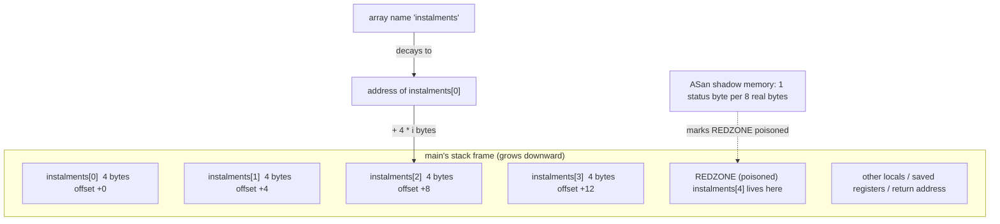

# Module 1.06: Arrays and strings

**Estimated hours:** 4

**What you will learn**

1. What an array really is: a row of equal-sized boxes with no gaps, reached by address arithmetic, and why `sizeof` "lies" once you pass it to a function.
2. What a C string really is: a `char` array that ends in a hidden zero byte (the NUL terminator), and how `strlen`, `strcmp`, `strcpy`, `strncpy`, `snprintf` and `strtok` behave.
3. How a one-byte mistake becomes a buffer overflow, and how AddressSanitizer catches it and reports exactly where.

**Prerequisites:** [Module 1.05: Pointers](module-05-pointers.md).

---

## 1. One-line intuition

An array is a block of identical boxes laid end to end in memory; a C string is just a `char` array with a zero byte on the end that says "the text stops here".

## 2. Real-life analogy

Think of a row of post-office boxes bolted to a wall.

- Every box is the **same size** (say, one box per `int`, four bytes each). There are **no gaps** between them.
- The row has a **starting address**, painted on the first box. That is the array's address.
- To find box number 3 you do not walk and count. You compute: start address + 3 × box size. That is **address arithmetic**, and it is why reaching any element takes the same tiny time no matter how long the row is.
- The row's label on the wall ("Instalments, 4 boxes") only exists where the row was installed. If you phone a colleague and say "go use the Instalments row", you can only give them the **starting address**, not the label. So the colleague no longer knows how many boxes there are. You must tell them the count separately. That lost label is exactly what happens when an array is passed to a function: the size information does not travel with it.

For a **C string**, imagine the boxes hold one letter each, and the rule is: **the first empty box (a box holding the number 0) means the word is over**. "MUM01" uses six boxes: `M`, `U`, `M`, `0`, `1`, and then a box holding 0. Every tool that works on the text walks from the start until it hits that 0 box. If someone forgets to put the 0 box there, the tools keep walking into whatever boxes come next, reading rubbish or crashing. That single missing 0 box is the source of a huge share of real C bugs.

## 3. Why it exists: the problem it solves

You almost never have just one loan, one instalment or one branch code. You have lists of them. An array is the simplest, fastest way to keep a list of the same kind of thing together in memory.

Why not a separate named variable for each? Because you cannot loop over named variables, you cannot decide the count at run time, and the compiler would have to find room for each one separately. An array gives you:

- **One name** for the whole list.
- **O(1) access** to any element by index: one multiply and one add, then one memory read.
- **Contiguous layout**, so scanning the list in order is friendly to the CPU cache (module 0.01: nearby bytes come along for free).

C strings exist because C has no built-in text type. In 1972, when C was designed, the cheapest possible way to store text was "bytes in a row, with a marker for the end". The marker chosen was the zero byte, written `'\0'` and called **NUL** (one L). This choice is fast and uses almost no memory, but it has a famous cost: the length is not stored, so finding the length means walking the whole string, and if the NUL is missing, the walk never stops safely. Decades of buffer-overflow security bugs trace back to this one decision. You are learning both the power and the danger.

What breaks without understanding this: you write past the end of an array and corrupt memory (capstone C6), or you build a string with no NUL and the next `printf` reads far past it, leaking data or crashing.

## 4. Three layers of depth

### Layer 1 (beginner): declaring, indexing, and the NUL terminator

**Declaring an array.** You give the element type, a name, and a count in square brackets:

```c
int emi[4];                       /* four ints, uninitialised (garbage) */
int emi[4] = { 2500, 2500, 2500, 2600 };  /* four ints, given values */
int emi[]  = { 2500, 2500, 2600 };         /* count inferred: 3 */
```

**Indexing.** `emi[0]` is the first element, `emi[3]` is the fourth. Indexing starts at 0, always. The valid indexes for `emi[4]` are 0, 1, 2 and 3. There is no `emi[4]`; using it is a bug (you will see it caught in section 6).

**The length is not stored.** An `int emi[4]` knows it is 16 bytes only where it was declared. C does not keep a hidden length field. You, the programmer, must remember the count and pass it around.

**A C string is a `char` array.** This line:

```c
char branch[8] = "MUM01";
```

puts six bytes into the array: `M`, `U`, `M`, `0`, `1`, and a NUL byte (value 0). The other two bytes are set to 0 as well because you gave fewer initialisers than the size. The double-quote form `"MUM01"` is called a **string literal**, and the compiler always adds the NUL for you.

**`strlen` counts letters, not boxes.** `strlen(branch)` walks from the start until the NUL and returns 5. `sizeof(branch)` returns 8, the number of bytes the array owns. These two numbers are different and confusing them is a classic bug.

| Idea | Beginner mental model |
|---|---|
| Array | A fixed-length row of same-type boxes, indexed from 0 |
| Index | Box number; valid range is 0 to count − 1 |
| C string | A `char` array ending in a NUL (`'\0'`, value 0) byte |
| `strlen(s)` | Letters before the NUL (walks the string) |
| `sizeof(arr)` | Total bytes of the array, where it was declared |

### Layer 2 (working engineer): decay, address arithmetic, and the string functions

**Address arithmetic.** The expression `emi[i]` is defined to mean `*(emi + i)`. The compiler takes the start address, adds `i` times the size of one element, and reads there. For `int` on x86-64 (4 bytes each), element `i` sits at `start + 4*i` bytes. This table shows a real run (your addresses will differ; the offsets never do):

| Expression | Value | Address (one run) | Offset from start |
|---|---|---|---|
| `emi[0]` | 2500 | `0x7ffe13ad1cb0` | 0 bytes |
| `emi[1]` | 2500 | `0x7ffe13ad1cb4` | 4 bytes |
| `emi[2]` | 2500 | `0x7ffe13ad1cb8` | 8 bytes |
| `emi[3]` | 2600 | `0x7ffe13ad1cbc` | 12 bytes |

Each address is exactly 4 higher than the one above. That is the box size. This is also why `emi[i]` and `i[emi]` compile to the same thing: addition is symmetric. You will never write `i[emi]`, but knowing why it works proves you understand that indexing is just arithmetic.

**Array-to-pointer decay.** In almost every expression, an array's name turns into a pointer to its first element. This is called **decay**. So `emi` on its own is the same address as `&emi[0]`. You can write `int *p = emi;` and then `p[2]` or `*(p + 2)` to reach elements. Decay is why these are all the same address:

```text
emi      = 0x7ffe13ad1cb0
&emi[0]  = 0x7ffe13ad1cb0
p        = 0x7ffe13ad1cb0
```

**Why `sizeof` "lies" inside a function.** When you pass an array to a function, decay happens: only the address travels, not the size. The parameter `int values[]` is a polite fiction; the compiler treats it exactly as `int *values`. So inside the function `sizeof(values)` is the size of a **pointer** (8 bytes on x86-64), not the array. The real program in section 6 prints:

```text
sizeof(emi)                    = 16   (where emi was declared)
sizeof(values) inside function = 8    (a pointer, not the array)
```

This is the single most common beginner surprise in C. The rule you must internalise: **an array does not know its own length once it is passed anywhere. Always pass the count as a separate argument.** Every well-designed C function that takes an array also takes a length, for example `read(fd, buf, count)` and `memcpy(dst, src, n)`.

**The string function family.** These live in `<string.h>`. Learn what each does to the NUL, because that is where bugs hide:

| Function | What it does | NUL behaviour | Danger |
|---|---|---|---|
| `strlen(s)` | Returns letters before the NUL | Reads until it finds a NUL | Infinite/over-read if no NUL |
| `strcpy(dst, src)` | Copies src into dst | Copies the NUL too | **No size check: overflows dst if src is longer** |
| `strncpy(dst, src, n)` | Copies at most n bytes | **May NOT write a NUL** if src is n or longer | dst can be left un-terminated |
| `snprintf(dst, n, fmt, ...)` | Formats into dst | **Always** writes a NUL (unless n is 0) | Safe; returns the length it *wanted* |
| `strcmp(a, b)` | Compares letter by letter | Stops at either NUL | Returns 0 equal, <0 or >0 for order |
| `strcat(dst, src)` | Appends src to dst | Needs room for both plus NUL | **No size check: classic overflow** |
| `strtok(s, delims)` | Splits s into tokens | **Overwrites delimiters with NUL**, keeps hidden state | Modifies input; not reentrant |

**The safe default.** For building strings into a fixed buffer, prefer `snprintf`. It never writes past the buffer and always leaves a NUL. It returns the number of characters it *would* have written; if that is greater than or equal to your buffer size, the output was **truncated** and you can detect it. `strncpy` was designed for an old fixed-width-field format, not for safe strings, and its "maybe no NUL" rule surprises everyone. Avoid `strcpy` and `strcat` in new code unless you have already checked the sizes.

**`strtok` is a trap.** It splits a string like `"MUM01|HOME|2500000"` on a delimiter. But it does two surprising things: it **writes NUL bytes over the delimiters** (so it destroys your input string), and it **keeps hidden internal state** between calls (so two pieces of code using it at once corrupt each other, and it cannot be used from two threads). For real parsing use `strtok_r` (the reentrant version, you pass your own state) or write the scan by hand. You will meet exactly this in capstone C3 when parsing fixed-width fields out of Berkeley DB records.

### Layer 3 (internals): the stack layout, redzones, and how ASan catches an overflow

**Where a local array lives.** A local array like `int instalments[4]` lives on the **stack** (module 1.04): a region of memory that grows and shrinks as functions are called and return. The four ints sit in 16 contiguous bytes inside `main`'s stack frame. Right next to them are other locals, saved registers and the **return address** (the place the CPU jumps back to when `main` returns).

**What a one-past-the-end write does.** If you write to `instalments[4]` (one past the last valid index, 3), you touch the 4 bytes just after the array. On the stack that might be another variable, or padding, or part of the saved return address. Nothing stops you at run time by default: C does not check array bounds, because a check on every access would cost speed, and in 1972 speed was everything. The corruption is silent until something downstream behaves wrongly or the program jumps to a garbage address and crashes. A corrupted **return address** is the heart of the classic "stack smashing" security exploit (module 11.01).

**How AddressSanitizer (ASan) catches it.** When you compile with `-fsanitize=address`, the compiler and a runtime library cooperate. Around every stack array they place **redzones**: small regions of memory marked "poisoned, never touch". A second region of memory, called **shadow memory**, records one status byte for every 8 bytes of your program's memory: addressable, partially addressable, or poisoned. Every load and store your program does is rewritten to first check the shadow byte. Touching a redzone is caught instantly and reported with the exact file, line, and a map of the stack frame. You saw the raw report in section 6: it names the frame, says `'instalments' (line 8)`, and prints `<== Memory access at offset 48 overflows this variable`. This is capstone C6's bread and butter: the sanitizer turns an invisible corruption into a precise accusation.

**UndefinedBehaviorSanitizer (UBSan)** adds a separate, cheaper check: `index 4 out of bounds for type 'int [4]'`. It flags the out-of-bounds index even before the poisoned read, because reading `instalments[4]` is **undefined behaviour** in the language itself (module 1.11), independent of what happens to be in that memory.

**Why this matters for layout.** Because arrays are contiguous and access is address arithmetic, the compiler and CPU can prefetch the next elements while you work on the current one. A linear scan of an array is one of the fastest things a CPU does. This is the foundation for why `std::vector` beats a linked list in Phase 2, and why the in-memory master-table cache in the banking server (module 0.01 section 7) stores records in arrays.

## 5. Architecture diagram



The array name becomes the start address; indexing is start + 4×i. Element 4 does not exist; ASan puts a poisoned redzone there so a write is caught instead of silently corrupting the return address.

## 6. Code

Two programs. The first is the main lesson and compiles clean under the strict flags. The second contains a deliberate off-by-one bug so you can see the sanitizer report.

**Program 1: arrays, decay and strings.** The branch code is read from the command line so the compiler cannot statically prove its length; this lets the truncation demo run without `-Werror` rejecting it.

```c
/* arrays_and_strings.c
 * Shows: an array as contiguous bytes, pointer decay, why sizeof lies
 * inside a function, the NUL terminator, and safe string copying.
 */
#include <stdio.h>
#include <string.h>

/* int values[] as a parameter is really int *values: the array decays. */
static void show_decay(int *values, size_t count) {
    printf("inside function : sizeof(values) = %zu (a pointer, not the array)\n",
           sizeof(values));
    printf("inside function : count passed in = %zu\n", count);
    printf("inside function : values[2]       = %d\n", values[2]);
}

/* Print every byte of a buffer in hex, including any NUL bytes. */
static void dump_bytes(const char *label, const char *buf, size_t len) {
    printf("%-18s", label);
    for (size_t i = 0; i < len; ++i) {
        printf("%02X ", (unsigned char)buf[i]);
    }
    printf("\n");
}

int main(int argc, char **argv) {
    /* Default is 11 characters, longer than the small buffers below. */
    const char *code = (argc > 1) ? argv[1] : "MUM01BRANCH";

    /* --- 1. an array is a row of boxes with no gaps --- */
    int emi[4] = { 2500, 2500, 2500, 2600 };   /* four monthly instalments */

    printf("--- array in memory ---\n");
    printf("sizeof(emi)      = %zu bytes (4 ints x 4 bytes)\n", sizeof(emi));
    printf("element count    = %zu\n", sizeof(emi) / sizeof(emi[0]));
    for (size_t i = 0; i < 4; ++i) {
        printf("emi[%zu] = %d at %p  (offset %zu bytes from start)\n",
               i, emi[i], (void *)&emi[i],
               (size_t)((char *)&emi[i] - (char *)emi));
    }

    /* --- 2. the array name decays to a pointer to its first element --- */
    int *p = emi;                 /* same as &emi[0] */
    printf("\n--- decay to pointer ---\n");
    printf("emi      = %p\n", (void *)emi);
    printf("&emi[0]  = %p\n", (void *)&emi[0]);
    printf("p        = %p\n", (void *)p);
    printf("*(p + 3) = %d   (same as emi[3])\n", *(p + 3));
    show_decay(emi, sizeof(emi) / sizeof(emi[0]));

    /* --- 3. a C string is a char array ending in a 0 byte --- */
    char branch[8] = "MUM01";    /* 5 letters + NUL + 2 unused bytes */
    printf("\n--- C strings ---\n");
    printf("branch           = \"%s\"\n", branch);
    printf("strlen(branch)   = %zu   (letters before the NUL)\n", strlen(branch));
    printf("sizeof(branch)   = %zu   (bytes the array owns)\n", sizeof(branch));
    dump_bytes("bytes:", branch, sizeof(branch));

    /* --- 4. copying: strncpy may leave no NUL; snprintf always NUL-terminates --- */
    char small[6];
    strncpy(small, code, sizeof(small));    /* fills 6 bytes, no room for NUL */
    dump_bytes("strncpy result:", small, sizeof(small));
    printf("strncpy left no NUL inside small[]; printing it with %%s is unsafe\n");

    char safe[6];
    int needed = snprintf(safe, sizeof(safe), "%s", code);
    dump_bytes("snprintf result:", safe, sizeof(safe));
    printf("safe             = \"%s\" (truncated, but always NUL-terminated)\n", safe);
    printf("snprintf wanted  = %d chars; buffer held %zu + a NUL\n",
           needed, sizeof(safe) - 1);

    /* --- 5. comparing: == compares addresses, strcmp compares letters --- */
    char a[] = "HOME";
    char b[] = "HOME";
    char *pa = a, *pb = b;       /* decay to pointers so we compare addresses */
    printf("\n--- comparing ---\n");
    printf("pa == pb      -> %s  (different arrays, different addresses)\n",
           (pa == pb) ? "true" : "false");
    printf("strcmp(a, b)  -> %d  (0 means equal letters)\n", strcmp(a, b));
    printf("strcmp(\"AUTO\", \"HOME\") -> %s\n",
           strcmp("AUTO", "HOME") < 0 ? "negative (AUTO sorts first)" : "non-negative");
    return 0;
}
```

Compile and run:

```bash
gcc -std=c17 -Wall -Wextra -Werror -g -o arrays_and_strings arrays_and_strings.c
./arrays_and_strings
```

Expected output (addresses differ on your machine; everything else matches):

```text
--- array in memory ---
sizeof(emi)      = 16 bytes (4 ints x 4 bytes)
element count    = 4
emi[0] = 2500 at 0x7ffe13ad1cb0  (offset 0 bytes from start)
emi[1] = 2500 at 0x7ffe13ad1cb4  (offset 4 bytes from start)
emi[2] = 2500 at 0x7ffe13ad1cb8  (offset 8 bytes from start)
emi[3] = 2600 at 0x7ffe13ad1cbc  (offset 12 bytes from start)

--- decay to pointer ---
emi      = 0x7ffe13ad1cb0
&emi[0]  = 0x7ffe13ad1cb0
p        = 0x7ffe13ad1cb0
*(p + 3) = 2600   (same as emi[3])
inside function : sizeof(values) = 8 (a pointer, not the array)
inside function : count passed in = 4
inside function : values[2]       = 2500

--- C strings ---
branch           = "MUM01"
strlen(branch)   = 5   (letters before the NUL)
sizeof(branch)   = 8   (bytes the array owns)
bytes:            4D 55 4D 30 31 00 00 00
strncpy result:   4D 55 4D 30 31 42
strncpy left no NUL inside small[]; printing it with %s is unsafe
snprintf result:  4D 55 4D 30 31 00
safe             = "MUM01" (truncated, but always NUL-terminated)
snprintf wanted  = 11 chars; buffer held 5 + a NUL

--- comparing ---
pa == pb      -> false  (different arrays, different addresses)
strcmp(a, b)  -> 0  (0 means equal letters)
strcmp("AUTO", "HOME") -> negative (AUTO sorts first)
```

Read the two byte dumps carefully. `4D 55 4D 30 31` is `M U M 0 1` in ASCII hex. In `bytes:` the sixth byte is `00`, the NUL. In `strncpy result:` the sixth byte is `42` (the letter `B` from "MUM01BRANCH"), **not** a NUL: `strncpy` filled all 6 bytes and had no room to terminate. In `snprintf result:` the sixth byte is `00`: `snprintf` truncated the text to fit and still placed the NUL.

**Program 2: a deliberate off-by-one overflow.**

```c
/* overflow.c
 * Deliberate bug: reads one element past the end of a stack array.
 * Build with -fsanitize=address to see the report.
 */
#include <stdio.h>

int main(void) {
    int instalments[4] = { 2500, 2500, 2500, 2600 };
    int total = 0;

    /* BUG: <= should be <. The last iteration reads instalments[4]. */
    for (int i = 0; i <= 4; ++i) {
        total += instalments[i];
    }
    printf("total = %d\n", total);
    return 0;
}
```

Compile with the sanitizers and run:

```bash
gcc -std=c17 -Wall -Wextra -g -fsanitize=address,undefined -o overflow overflow.c
./overflow
```

Expected output (addresses, PIDs and BuildId differ; the shape is what matters):

```text
overflow.c:13:29: runtime error: index 4 out of bounds for type 'int [4]'
=================================================================
==164==ERROR: AddressSanitizer: stack-buffer-overflow on address 0x... at pc 0x... bp 0x... sp 0x...
READ of size 4 at 0x... thread T0
    #0 0x... in main .../overflow.c:13
    #1 0x... in __libc_start_call_main ...
    #2 0x... in __libc_start_main_impl ...
    #3 0x... in _start ...

Address 0x... is located in stack of thread T0 at offset 48 in frame
    #0 0x... in main .../overflow.c:7

  This frame has 1 object(s):
    [32, 48) 'instalments' (line 8) <== Memory access at offset 48 overflows this variable
SUMMARY: AddressSanitizer: stack-buffer-overflow .../overflow.c:13 in main
```

The three facts you read first, every time: the **kind** (`stack-buffer-overflow`), the **location** (`overflow.c:13`), and the **object** (`'instalments'`, and the access overflows it). Fixing it is changing `<=` to `<`. Note the UBSan line at the very top catches the same bug more cheaply as an out-of-bounds index.

## 7. Use case: core-banking loan-origination platform

In capstone C3 you migrate records out of a Berkeley DB environment. Berkeley DB stores each record as a raw block of bytes. A loan record begins with fixed-width fields, for example a 6-character branch code stored in a 6-byte field with no NUL (space-padded, like `MUM01 `), followed by a product code and amounts.

Two decisions in that code come straight from this module:

1. **Never treat a fixed-width field as a C string directly.** The 6-byte branch field has no NUL terminator; it is not a C string. If you pass its address to `strlen` or `printf("%s", ...)`, the walk runs off the end of the field into the next field, then into the rest of the record, until it accidentally hits a zero byte, printing garbage or crashing. The migration parser copies exactly 6 bytes into a 7-byte buffer and sets the seventh byte to NUL itself, using `memcpy` plus an explicit terminator, not `strcpy`. This is the "parsing fixed-width fields" skill behind resume claims H1 and H2.

2. **Always carry the length.** Every parse function takes `(const unsigned char *record, size_t record_len)` and checks `offset + field_width <= record_len` before reading a field. Because an array does not know its own length once passed (Layer 2), a parser that forgot the length argument would read past the end of a short or truncated record. During migration, a single malformed record with the wrong length would otherwise overflow and corrupt the migration process's own memory, which on a production cutover is a data-integrity incident, not just a crash.

The decision these drove: the record parser was written bounds-first (length checked before every read) and NUL-safe (fields copied into sized buffers and terminated by hand), and it was run under ASan over the whole source database before the real migration. That is why the resume can say the migration was "leak-free" and survived "restartable batches" over a live environment: the parser could not walk off a record.

## 8. Lab

Work through all four parts. Keep your outputs for the journal.

### Part A: arrays and decay (20 minutes)

1. Save Program 1 as `arrays_and_strings.c`. Compile with the exact command in section 6 and run it with no arguments. Confirm `sizeof(emi)` is 16 and `sizeof(values)` inside the function is 8.
2. Add a line in `main` that prints `sizeof(p)` where `p` is the `int *`. Predict the value before you run. (Expected: 8, because `p` is a pointer.)
3. Change the loop bound so it also prints the address of `emi[4]` (do **not** read its value, just print `(void *)&emi[4]`). Confirm it is 16 bytes past the start. This address exists as a concept; reading through it is the bug in Part C.

Expected: the pointer sizes are 8; element addresses rise by 4; `&emi[4]` is start + 16.

### Part B: strings and the NUL (20 minutes)

1. Run `./arrays_and_strings` again and study the three byte dumps. Write down, for each, whether byte 6 is `00` or a letter, and say why.
2. Run `./arrays_and_strings HOME` (a short argument). Now `code` is 4 characters. Look at the `strncpy result:` dump: the bytes after `HOME` are now `00` because `strncpy` **does** pad short sources with NUL bytes. This is the opposite surprise: `strncpy` either leaves no NUL (long source) or writes many (short source). Record both behaviours.
3. Run `./arrays_and_strings VERYLONGBRANCHNAME`. Confirm `snprintf` still truncates safely to 5 letters plus a NUL and reports the length it wanted.

Expected: byte 6 is `00` for the literal and for `snprintf`; it is a letter for `strncpy` with a long source; it is `00` for `strncpy` with a short source.

### Part C: catch an overflow with ASan (25 minutes)

1. Save Program 2 as `overflow.c`. First compile it **without** sanitizers using the strict flags: `gcc -std=c17 -Wall -Wextra -Werror -g -o overflow overflow.c`. It may compile clean and print a wrong total (it reads one garbage int). Run it a few times; the total may vary or stay the same. This is the danger: a real bug that does not announce itself.
2. Now recompile with `-fsanitize=address,undefined` as in section 6 and run. Read the report. Find the three facts: kind, location, object.
3. Fix the bug (change `<=` to `<`), recompile with the sanitizers, and run. The report is gone and `total = 10100`.

Expected: without sanitizers, a silent wrong or unstable total; with sanitizers, a `stack-buffer-overflow` at `overflow.c:13` naming `instalments`; after the fix, `total = 10100` and no error.

### Part D: the `strtok` trap (20 minutes)

1. Create `strtok_demo.c`:

```c
/* strtok_demo.c
 * Shows that strtok modifies its input and keeps hidden state.
 */
#include <stdio.h>
#include <string.h>

int main(void) {
    char line[] = "MUM01|HOME|2500000";
    printf("before: \"%s\"\n", line);

    char *field = strtok(line, "|");
    int n = 0;
    while (field != NULL) {
        printf("field %d: \"%s\" at offset %td\n", n++, field, field - line);
        field = strtok(NULL, "|");
    }
    /* The separators were overwritten with NUL bytes. */
    printf("after : \"%s\"  (the first NUL cuts the string short)\n", line);
    for (size_t i = 0; i < sizeof(line); ++i) {
        printf("%02X ", (unsigned char)line[i]);
    }
    printf("\n");
    return 0;
}
```

2. Compile with the strict flags and run:

```bash
gcc -std=c17 -Wall -Wextra -Werror -g -o strtok_demo strtok_demo.c
./strtok_demo
```

Expected output:

```text
before: "MUM01|HOME|2500000"
field 0: "MUM01" at offset 0
field 1: "HOME" at offset 6
field 2: "2500000" at offset 11
after : "MUM01"  (the first NUL cuts the string short)
4D 55 4D 30 31 00 48 4F 4D 45 00 32 35 30 30 30 30 30 00
```

3. In the final byte dump, find the two `00` bytes at offsets 5 and 10. Those were the `|` characters (`7C`); `strtok` overwrote them with NUL. That is why `line` now prints as only "MUM01": the first NUL stops it. Write down why you must never `strtok` a string you still need intact, and why you would use `strtok_r` in multithreaded code (capstone C3's parser).

### Journal

Copy [journal/TEMPLATE.md](../journal/TEMPLATE.md) to `journal/YYYY-MM-DD-arrays-and-strings.md`. Record: the two `sizeof` values (array vs pointer in a function) and why they differ; byte 6 of each of the three dumps from Part B and the reason; the three facts you read from the ASan report in Part C; and what `strtok` did to the `|` bytes in Part D. Add one sentence connecting this to the fixed-width record parser in capstone C3.

## 9. Common mistakes and misconceptions

| Mistake | Why it is wrong | Bug it causes later |
|---|---|---|
| `sizeof(arr)` works inside a function | The array decayed to a pointer; you get the pointer size (8) | Loops that run over 8 bytes instead of the whole array, or buffers sized wrong |
| An array knows its own length | C stores no length; only the declaration site knows the size | Reading past the end; forgetting to pass the count |
| `strlen` and `sizeof` give the same number | `strlen` counts letters to the NUL; `sizeof` counts bytes owned | Allocating or copying the wrong number of bytes |
| `strncpy` always NUL-terminates | It does not when the source is as long as or longer than `n` | Un-terminated string, then an over-read in the next `printf` |
| `strcpy`/`strcat` are fine | They have no size limit and overflow silently | Buffer overflow, the classic memory-corruption and security bug |
| `a == b` compares string contents | For arrays/pointers it compares addresses | Two equal-looking strings test as "not equal"; use `strcmp` |
| `strtok` is a safe splitter | It overwrites delimiters with NUL and keeps global state | Destroyed input; data races across threads |
| Index `n` is valid for an array of size `n` | Valid indexes are 0 to n − 1; index `n` is one past the end | Off-by-one overflow (the Part C bug) |

## 10. Resume link

- **Claim A/B, "C ... undefined-behaviour-aware coding".** The off-by-one in Part C is undefined behaviour; being able to say "I build array-handling code under `-fsanitize=address,undefined` and read the report down to the frame offset" is a concrete, senior-sounding answer. You have the report from your own lab.
- **Claim H1/H2, "decoding packed key/record layouts ... fixed-width fields".** Section 7 is this skill. Say: "Fixed-width fields in the Berkeley DB records had no NUL, so I never passed them to string functions; I copied a known width into a sized buffer and terminated it myself, and every parse checked `offset + width <= record_len` first." That is exactly what claims H1 and H2 describe.
- **Claim F, "memory corruption ... investigation" and claim I, "clean under -Wall -Wextra -Werror ... ASan".** The three-fact reading method (kind, location, object) is how you triage a buffer-overflow report fast.

Likely follow-up: "What is the difference between `strncpy` and `snprintf` for copying into a fixed buffer?" Answer: `strncpy` copies up to `n` bytes and may leave the buffer without a NUL (or pad it with many NULs for a short source); `snprintf` always writes exactly one NUL within the buffer and returns the length it wanted, so you can detect truncation. Prefer `snprintf`.

## 11. Interview questions

**Q1 (easy). What is the NUL terminator and why does C need it?**

<details>
<summary>Model answer</summary>

C strings are plain `char` arrays and C does not store a separate length. The NUL terminator is a byte with value 0 (`'\0'`) placed after the last character to mark where the text ends. Functions like `strlen`, `printf("%s")` and `strcmp` walk from the start until they hit that byte. If a string has no NUL, those functions keep reading past the end of the buffer, which leaks memory contents or crashes. The length of "MUM01" is 5, but it occupies 6 bytes including the NUL.

</details>

**Q2 (easy). Why does `sizeof` give a different answer for an array inside the function where it is declared versus a function it is passed to?**

<details>
<summary>Model answer</summary>

Where the array is declared, `sizeof` knows the full type, for example `int[4]`, so it returns 16 bytes. When you pass the array to a function, the array name decays to a pointer to its first element, and the parameter `int values[]` is really `int *values`. Inside that function `sizeof(values)` is the size of a pointer, 8 bytes on x86-64, not the array. That is why every C function that takes an array also takes its element count as a separate argument.

</details>

**Q3 (medium). Explain array-to-pointer decay and give one case where it does NOT happen.**

<details>
<summary>Model answer</summary>

In most expressions an array's name is automatically converted to a pointer to its first element; `emi` becomes `&emi[0]`. This is decay, and it is why you can assign `int *p = emi;` and why passing an array passes only its address. Decay does **not** happen in a few contexts: as the operand of `sizeof` (you get the array's byte size), as the operand of unary `&` (you get a pointer to the whole array, type `int(*)[4]`), and when binding a string literal to initialise a `char` array. Those are exactly the places where the array keeps its full type.

</details>

**Q4 (medium). You must copy a variable-length branch code into a fixed 8-byte buffer and then print it. Which function do you use and what do you check?**

<details>
<summary>Model answer</summary>

I use `snprintf(buf, sizeof(buf), "%s", code)`. It copies at most `sizeof(buf) - 1` characters and always writes a NUL within the buffer, so the result is a valid C string I can print safely. I check the return value: `snprintf` returns the number of characters it wanted to write; if that is greater than or equal to `sizeof(buf)`, the code was truncated and I handle that as an error or log it, rather than silently storing a shortened branch code. I avoid `strcpy` (no size limit, overflows) and `strncpy` (may leave no NUL). If the source is a fixed-width field with no terminator, I `memcpy` a known width and set the terminator by hand.

</details>

**Q5 (hard). A server reads records from a file. Each record has a 6-byte branch field that is space-padded with no NUL. A junior passes `&record->branch[0]` to `printf("%s", ...)` and sometimes it prints garbage or crashes. Explain exactly what happens and how you fix it.**

<details>
<summary>Model answer</summary>

The 6-byte field is not a C string: it has no NUL terminator. `printf("%s")` and the `strlen` inside it walk forward from the field's start looking for a zero byte. Since there is none within the field, they read into the next fields of the record, then into adjacent memory, until they happen to hit a zero byte or touch an unmapped page. If a zero byte is found late, you get garbage characters (the following fields) printed; if the walk reaches unmapped memory first, the process takes a segmentation fault. The output is unstable because what lies after the field depends on the record contents and memory layout, which vary.

The fix: never treat a fixed-width field as a C string. Copy exactly 6 bytes into a 7-byte local buffer and set the seventh byte to `'\0'` yourself: `char b[7]; memcpy(b, record->branch, 6); b[6] = '\0';` then print `b`. More generally, every field read checks that the offset plus the width is within the record length before copying, and I run the whole parser under AddressSanitizer so any over-read is caught at the exact line instead of producing intermittent garbage in production. This is precisely how the fixed-width parser in the Berkeley DB migration was written.

</details>

## 12. Revision

- An array is contiguous same-type boxes indexed from 0; `emi[i]` means `*(emi + i)`, so access is start address + i × element size, and the length is never stored.
- An array name decays to a pointer to its first element whenever passed, so `sizeof` gives the pointer size inside a function; always pass the element count alongside.
- A C string is a `char` array ending in a NUL; prefer `snprintf` (always terminates, reports truncation) over `strcpy`/`strncpy`, never pass a fixed-width field to `%s`, and build array code under `-fsanitize=address,undefined` to catch overflows at the exact line.

---

Previous: [Module 1.05: Pointers](module-05-pointers.md) | Next: [Module 1.07: Structs, unions and packed record layouts](module-07-structs-unions-packed-layouts.md)
