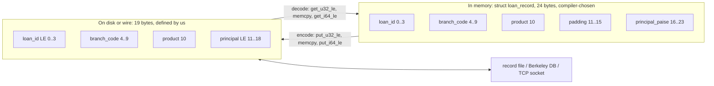

# Module 1.07: Structs, unions and packed record layouts

**Estimated hours:** 4

**What you will learn**

1. How a `struct` is laid out in memory byte by byte, why the compiler inserts padding, and how `_Alignof` and `offsetof` let you see it.
2. What unions and bit fields are, what the rules for reading "the same bytes as another type" really say, and what `__attribute__((packed))` costs.
3. How to turn a loan record into a fixed, portable sequence of bytes with explicit little-endian encode and decode helpers, and why `fwrite(&struct)` is the wrong tool for a file or a wire.

**Prerequisites:** [Module 1.06: Arrays and strings](module-06-arrays-and-strings.md).

---

## 1. One-line intuition

A `struct` is a box with named compartments of different sizes; the compiler decides where each compartment sits, and if you want those bytes to mean the same thing on another machine or in a file, you must decide the layout yourself.

## 2. Real-life analogy

Picture a loan application form at a bank branch.

- The form has **named fields**: loan number, branch code, product type, principal amount. That is a **struct**. Each field has a fixed size and a fixed place on the page.
- Some fields must start on a **fresh line** (alignment). The form printer refuses to start an 8-digit amount in the middle of a line, so it leaves blank space until the next line begins. That blank space is **padding**. The form is longer than the sum of its fields.
- If you **reorder** the fields so the big ones come first, fewer blank gaps appear and the form gets shorter. Same information, fewer pages.
- A **union** is a single field with a printed note: "write EITHER a PAN number OR a passport number here". Only one is valid at a time; they share the same space on the page.
- A **bit field** is the row of tiny tick boxes: approved yes/no, KYC done yes/no. Each takes one bit, not a whole byte.
- Now the branch must **fax the form to head office**, where a different printer uses different line widths. If you fax the page as-is (that is `fwrite(&struct)`), head office's reader will misalign every field. Instead you agree on a strict **wire format**: "byte 0 to 3 is the loan number, least-significant byte first; bytes 4 to 9 the branch code; ..." and both sides read and write exactly that. Those are the encode and decode helpers you build in this module.

## 3. Why it exists: the problem it solves

An array (module 1.06) holds many things of **one** type. A real loan record is a bundle of **different** types: a 4-byte id, a 6-character branch code, a 1-byte product code, an 8-byte amount in paise. Without structs you would carry four separate variables around and pass four arguments to every function. A struct lets you name the bundle once and pass one pointer.

But a struct raises a hard question: **where exactly does each member sit in memory?** The CPU prefers (and on some CPUs, requires) a 4-byte value to sit at an address divisible by 4, and an 8-byte value at an address divisible by 8. This is **alignment**. To obey it the compiler inserts invisible gaps, **padding**. Padding depends on the compiler, the target CPU and the compile flags. So the in-memory layout of a struct is **not a stable contract**.

That is fine while the struct lives only inside one running program. It is a disaster the moment the bytes leave the process: to a file, to a network socket, to a Berkeley DB record, or to a program compiled with a different compiler. Then the receiver may read padding as data, read the amount at the wrong offset, or interpret the bytes with the opposite byte order. Resume claims H1 and H2 ("decoding packed key/record layouts") are exactly the work of defining a byte layout explicitly and converting to and from it. Capstone C3 is built on the encode/decode helpers you write here.

What breaks without it: a migration that reads every amount off by four bytes; a record file that cannot be read after a compiler upgrade; a wire protocol that works between two Linux x86 boxes and silently corrupts data to an ARM box.

## 4. Three layers of depth

### Layer 1 (beginner): declaring and using a struct

A `struct` groups named members of different types:

```c
struct loan_record {
    uint32_t loan_id;          /* 4 bytes, unsigned */
    char     branch_code[6];   /* 6 bytes, fixed width, no NUL */
    uint8_t  product;          /* 1 byte */
    int64_t  principal_paise;  /* 8 bytes, signed */
};
```

`uint32_t`, `uint8_t` and `int64_t` come from `<stdint.h>`. They are integers of an exact width: 32-bit unsigned, 8-bit unsigned, 64-bit signed. Prefer them over `int` and `long` whenever the size matters, which in record layouts is always (`long` is 8 bytes on Linux and 4 on Windows, as module 0.01 showed).

You create one and reach members with a dot:

```c
struct loan_record r;
r.loan_id = 1001;
r.product = 7;
r.principal_paise = 250000000;   /* Rs 25,00,000 in paise */
```

Or initialise by name with **designated initialisers**, which are clearer and survive member reordering:

```c
struct loan_record r = { .loan_id = 1001, .product = 7, .principal_paise = 250000000 };
```

Through a pointer you use the arrow: `p->loan_id`, which is short for `(*p).loan_id`. Functions almost always take `const struct loan_record *r` rather than a copy, because copying 24 bytes into every call is waste and because the function may need to modify the caller's record.

**Sum of members is not the size.** The members above add up to 4 + 6 + 1 + 8 = 19 bytes. `sizeof(struct loan_record)` on x86-64 Linux with GCC is **24**. The missing 5 bytes are padding. Layer 2 shows exactly where.

| Term | Meaning |
|---|---|
| Member | One named field inside a struct |
| `.` and `->` | Reach a member of a struct value or through a pointer |
| Alignment | The address boundary a type wants to start on (its size, for the basic types) |
| Padding | Invisible bytes the compiler inserts to keep members aligned |
| Union | Members that share the same bytes; only one is meaningful at a time |
| Bit field | A member with a width in bits, packed into an integer |

### Layer 2 (working engineer): padding byte by byte, reordering, packing, unions, bit fields

**The alignment rule.** On x86-64 with GCC, every basic type has a natural alignment equal to its size: `uint8_t` 1, `uint16_t` 2, `uint32_t` 4, `int64_t` 8, pointers 8. A struct's alignment is the largest alignment of any member, and its total size is rounded up to a multiple of that, so that an array of structs keeps every element aligned. You can ask the compiler: `_Alignof(type)` (C11; `<stdalign.h>` also gives `alignof`) and `offsetof(struct, member)` from `<stddef.h>`.

**Drawing the padding.** Take this deliberately bad order:

```c
struct loan_naive {
    uint8_t  product;      /* 1 byte  */
    uint32_t loan_id;      /* 4 bytes */
    uint8_t  flags;        /* 1 byte  */
    int64_t  principal;    /* 8 bytes */
};
```

Byte by byte on x86-64 GCC (verified by the program in section 6):

```text
offset: 0        4        8        12       16                       24
        +--------+--------+--------+--------+------------------------+
        |P|. . . |loan_id |F|. . . |. . . . |principal               |
        +--------+--------+--------+--------+------------------------+
         ^ ^^^^^           ^ ^^^^^^^^^^^^^^^
         | 3 pad           | 7 pad
         product (1)       flags (1)
```

- `product` at offset 0.
- `loan_id` wants a multiple of 4, so 3 padding bytes, then offset 4.
- `flags` at offset 8.
- `principal` wants a multiple of 8, so 7 padding bytes, then offset 16.
- Total 24; 10 of those bytes are padding, 14 are data.

**Reorder to shrink.** Put the biggest members first:

```c
struct loan_tight {
    int64_t  principal;    /* offset 0  */
    uint32_t loan_id;      /* offset 8  */
    uint8_t  product;      /* offset 12 */
    uint8_t  flags;        /* offset 13 */
};                         /* 2 bytes tail padding -> sizeof 16 */
```

Same four members, 16 bytes instead of 24. The rule of thumb: **sort members by alignment, largest first**. In the in-memory master-table cache (capstone C2) with a million rows, 8 bytes per row is 8 MB and many more cache lines touched per scan.

**Forcing no padding: packed structs.** GCC and Clang accept `struct __attribute__((packed)) name { ... }`; MSVC uses `#pragma pack(push, 1)` ... `#pragma pack(pop)`. The compiler then removes all padding: the packed `loan_record` becomes exactly 19 bytes. It is tempting to use this as a file format. Do not. Three costs:

1. **Misaligned access.** A packed `int64_t` at offset 11 is misaligned. On x86-64 the CPU tolerates this with a small speed penalty (typically a few percent on a hot loop; it can be worse when the value straddles a cache line). On some ARM and older RISC CPUs, a misaligned 8-byte load is a hardware fault (`SIGBUS`). The compiler must generate byte-wise loads for packed members, which is slower everywhere.
2. **Taking a pointer to a packed member** gives a misaligned pointer. Passing it to any ordinary function that dereferences it is undefined behaviour; GCC warns with `-Waddress-of-packed-member`.
3. **It fixes padding, not byte order.** A packed struct written on a little-endian x86 box still reads wrongly on a big-endian box, and it still ties your file format to one compiler's attribute.

The portable answer is section 6: define the byte layout yourself and convert with helpers.

**Unions.** A union is a struct whose members all start at offset 0 and overlap. Its size is the largest member (rounded to alignment). Use it when a value is one of several types and you track which:

```c
union punner { uint32_t as_u32; uint8_t as_bytes[4]; };
```

Write `as_u32 = 0x11223344` and read `as_bytes` and you see `44 33 22 11` on x86-64: the least-significant byte first. That is **little-endian** byte order (module 1.02), now observed directly.

**The type-punning rule (what is allowed).** In C (since C99, clarified in C11), reading a union member other than the one last written is allowed: the bytes are reinterpreted as the new type, and if the pattern is not valid for that type the result is unspecified, but it is not undefined behaviour. The C++ rules are stricter: reading an inactive union member is undefined behaviour in C++, and the portable tool there is `std::memcpy` (or `std::bit_cast` in C++20). What is **never** allowed in either language is the cast trick `*(uint32_t *)some_char_buffer`: that violates the strict-aliasing rule and may also be misaligned. Use `memcpy` into a properly typed local, which the compiler optimises to a single load anyway.

**Bit fields.** Members can be given a width in bits:

```c
struct flags { unsigned approved:1; unsigned kyc_done:1; unsigned product_type:4; unsigned reserved:2; };
```

This packs 8 bits of information into one `unsigned` storage unit; `sizeof(struct flags)` is 4 on GCC x86-64. Bit fields are convenient inside a program. They are **not** portable as a layout: the standard leaves the order of bits within the unit, whether fields straddle units, and the unit size up to the implementation. For a file or wire format, use explicit shifts and masks on a `uint8_t` or `uint32_t` instead.

### Layer 3 (internals): why alignment exists, what the CPU does on a misaligned load, and endianness

**Why the hardware cares.** Memory is moved between RAM, caches and registers in fixed chunks: 64-byte cache lines, and within them, naturally aligned words. A 4-byte load whose address is a multiple of 4 falls entirely inside one 8-byte or 16-byte internal bus transfer. A load at an odd address may straddle two transfers, or two cache lines, or even two pages. x86-64 handles this by issuing two transfers and stitching bytes together; the penalty is small unless a line boundary is crossed. Many ARM cores handle it too, but some configurations and most older or embedded cores raise an alignment fault, and atomic operations (Phase 4) generally **require** natural alignment on every architecture. The compiler pads structs so that ordinary code never has to think about this.

**What `offsetof` compiles to.** `offsetof(struct loan_naive, principal)` is a compile-time constant, 16. The compiler computes member offsets once when it sees the struct declaration, using the same rule you drew above. Member access `r->principal` becomes a single instruction: load 8 bytes from `[register + 16]`. Padding costs nothing at run time; it only costs memory and cache space.

**Endianness, concretely.** A 32-bit value `0x000003E9` (1001) occupies 4 bytes. Little-endian machines (x86-64, most ARM in practice) store the least-significant byte at the lowest address: `E9 03 00 00`. Big-endian (traditional network byte order, some older RISC, and the conventional order for many wire protocols) stores `00 00 03 E9`. The CPU's load instruction knows its own convention; it does not know the file's. So if you write a struct with `fwrite` on x86 and read it on a big-endian box, every multi-byte integer is reversed.

**Why the helpers are the right internals.** `put_u32_le` writes `v & 0xFF`, then `(v >> 8) & 0xFF`, and so on. This expresses the byte order in arithmetic, which the language defines, not in memory layout, which the hardware defines. The same source gives the same bytes on every CPU. With optimisation on, GCC recognises the pattern and emits a single `mov` on little-endian targets (and a `bswap`+`mov` on big-endian ones), so you pay nothing for portability. The decode side (`p[0] | p[1]<<8 | ...`) avoids both the alignment problem (it reads bytes, never a misaligned word) and the aliasing problem (no cast of a `char *` to `uint32_t *`). This is exactly how PostgreSQL, SQLite, and most serialisation libraries read integers out of a page or a packet.

## 5. Architecture diagram



The in-memory struct and the byte layout are two different things joined by explicit helpers. Nothing ever does `fwrite(&r, sizeof r, 1, f)`.

## 6. Code

Two programs. The first makes padding, reordering and the union visible. The second is the capstone C3 core: encode and decode a loan record to a fixed byte layout.

**Program 1: layout, offsets and a union.**

```c
/* struct_layout.c
 * Shows padding and alignment, offsetof, member reordering,
 * and a union for observing byte order.
 */
#include <stdio.h>
#include <stdint.h>
#include <stddef.h>   /* offsetof */

/* A naive layout: members in a size-unfriendly order. */
struct loan_naive {
    uint8_t  product;      /* 1 byte  */
    uint32_t loan_id;      /* 4 bytes */
    uint8_t  flags;        /* 1 byte  */
    int64_t  principal;    /* 8 bytes */
};

/* A reordered layout: big members first shrinks padding. */
struct loan_tight {
    int64_t  principal;    /* 8 bytes */
    uint32_t loan_id;      /* 4 bytes */
    uint8_t  product;      /* 1 byte  */
    uint8_t  flags;        /* 1 byte  */
};

/* A union: the same bytes read as different types. */
union punner {
    uint32_t as_u32;
    uint8_t  as_bytes[4];
};

static void dump(const char *label, const void *p, size_t n) {
    const unsigned char *b = p;
    printf("%-20s", label);
    for (size_t i = 0; i < n; ++i) printf("%02X ", b[i]);
    printf("\n");
}

int main(void) {
    printf("--- sizes and alignment ---\n");
    printf("sizeof(struct loan_naive) = %zu, _Alignof = %zu\n",
           sizeof(struct loan_naive), _Alignof(struct loan_naive));
    printf("sizeof(struct loan_tight) = %zu, _Alignof = %zu\n",
           sizeof(struct loan_tight), _Alignof(struct loan_tight));

    printf("\n--- offsets in loan_naive (padding shows as gaps) ---\n");
    printf("product   at offset %zu\n", offsetof(struct loan_naive, product));
    printf("loan_id   at offset %zu\n", offsetof(struct loan_naive, loan_id));
    printf("flags     at offset %zu\n", offsetof(struct loan_naive, flags));
    printf("principal at offset %zu\n", offsetof(struct loan_naive, principal));

    printf("\n--- offsets in loan_tight ---\n");
    printf("principal at offset %zu\n", offsetof(struct loan_tight, principal));
    printf("loan_id   at offset %zu\n", offsetof(struct loan_tight, loan_id));
    printf("product   at offset %zu\n", offsetof(struct loan_tight, product));
    printf("flags     at offset %zu\n", offsetof(struct loan_tight, flags));

    printf("\n--- a union reads the same bytes as different types ---\n");
    union punner u;
    u.as_u32 = 0x11223344u;
    printf("as_u32 = 0x%08X\n", u.as_u32);
    dump("as_bytes =", u.as_bytes, 4);
    printf("byte 0 is 0x%02X: this machine is %s-endian\n",
           u.as_bytes[0],
           (u.as_bytes[0] == 0x44) ? "little" : "big");
    return 0;
}
```

```bash
gcc -std=c17 -Wall -Wextra -Werror -g -o struct_layout struct_layout.c
./struct_layout
```

Expected output (identical on any x86-64 Linux with GCC or Clang):

```text
--- sizes and alignment ---
sizeof(struct loan_naive) = 24, _Alignof = 8
sizeof(struct loan_tight) = 16, _Alignof = 8

--- offsets in loan_naive (padding shows as gaps) ---
product   at offset 0
loan_id   at offset 4
flags     at offset 8
principal at offset 16

--- offsets in loan_tight ---
principal at offset 0
loan_id   at offset 8
product   at offset 12
flags     at offset 13

--- a union reads the same bytes as different types ---
as_u32 = 0x11223344
as_bytes =          44 33 22 11
byte 0 is 0x44: this machine is little-endian
```

**Program 2: the packed loan record, encoded and decoded by hand.**

```c
/* record_serialise.c
 * The core of capstone C3: a packed loan record written to bytes with
 * explicit little-endian encode/decode helpers, NOT fwrite(&struct).
 * Portable across compilers, alignments and CPU byte orders.
 */
#include <stdio.h>
#include <stdint.h>
#include <string.h>
#include <inttypes.h>   /* PRId64 */

/* The in-memory record. We never write this struct to disk directly. */
struct loan_record {
    uint32_t loan_id;
    char     branch_code[6];   /* fixed width, space-padded, no NUL */
    uint8_t  product;
    int64_t  principal_paise;
};

/* The on-disk layout is exactly 19 bytes, defined by us, not the compiler:
 * [0..3]   loan_id        little-endian uint32
 * [4..9]   branch_code    6 raw bytes
 * [10]     product        uint8
 * [11..18] principal      little-endian int64
 */
#define WIRE_SIZE 19

/* --- little-endian encode helpers: least significant byte first --- */
static void put_u32_le(unsigned char *p, uint32_t v) {
    p[0] = (unsigned char)(v & 0xFF);
    p[1] = (unsigned char)((v >> 8) & 0xFF);
    p[2] = (unsigned char)((v >> 16) & 0xFF);
    p[3] = (unsigned char)((v >> 24) & 0xFF);
}
static void put_i64_le(unsigned char *p, int64_t sv) {
    uint64_t v = (uint64_t)sv;   /* reinterpret bit pattern, defined for unsigned */
    for (int i = 0; i < 8; ++i) p[i] = (unsigned char)((v >> (8 * i)) & 0xFF);
}

/* --- little-endian decode helpers --- */
static uint32_t get_u32_le(const unsigned char *p) {
    return (uint32_t)p[0]
         | ((uint32_t)p[1] << 8)
         | ((uint32_t)p[2] << 16)
         | ((uint32_t)p[3] << 24);
}
static int64_t get_i64_le(const unsigned char *p) {
    uint64_t v = 0;
    for (int i = 0; i < 8; ++i) v |= (uint64_t)p[i] << (8 * i);
    return (int64_t)v;
}

/* Serialise a record into exactly WIRE_SIZE bytes. */
static void encode(const struct loan_record *r, unsigned char out[WIRE_SIZE]) {
    put_u32_le(out + 0, r->loan_id);
    memcpy(out + 4, r->branch_code, 6);   /* raw bytes, no terminator */
    out[10] = r->product;
    put_i64_le(out + 11, r->principal_paise);
}

/* Parse WIRE_SIZE bytes back into a record. */
static void decode(const unsigned char in[WIRE_SIZE], struct loan_record *r) {
    r->loan_id = get_u32_le(in + 0);
    memcpy(r->branch_code, in + 4, 6);
    r->product = in[10];
    r->principal_paise = get_i64_le(in + 11);
}

static void hexdump(const unsigned char *b, size_t n) {
    for (size_t i = 0; i < n; ++i) {
        printf("%02X ", b[i]);
        if ((i + 1) % 8 == 0) printf(" ");
    }
    printf("\n");
}

int main(void) {
    struct loan_record r = {
        .loan_id = 1001,
        .branch_code = { 'M', 'U', 'M', '0', '1', ' ' },
        .product = 7,                    /* 7 = home loan */
        .principal_paise = 250000000     /* Rs 25,00,000 in paise */
    };

    printf("in-memory sizeof(struct loan_record) = %zu (compiler-chosen, padded)\n",
           sizeof(struct loan_record));
    printf("on-disk WIRE_SIZE                    = %d (we define it)\n\n", WIRE_SIZE);

    unsigned char wire[WIRE_SIZE];
    encode(&r, wire);
    printf("encoded %d bytes:\n", WIRE_SIZE);
    hexdump(wire, WIRE_SIZE);

    printf("\nfield by field:\n");
    printf("  [0..3]   loan_id   = %02X %02X %02X %02X  (little-endian 1001)\n",
           wire[0], wire[1], wire[2], wire[3]);
    printf("  [4..9]   branch    = %02X %02X %02X %02X %02X %02X  (\"MUM01 \")\n",
           wire[4], wire[5], wire[6], wire[7], wire[8], wire[9]);
    printf("  [10]     product   = %02X\n", wire[10]);
    printf("  [11..18] principal = %02X %02X %02X %02X %02X %02X %02X %02X\n",
           wire[11], wire[12], wire[13], wire[14], wire[15], wire[16], wire[17], wire[18]);

    struct loan_record back;
    decode(wire, &back);
    char b[7];
    memcpy(b, back.branch_code, 6);
    b[6] = '\0';                       /* make a printable C string (module 1.06) */
    printf("\ndecoded back: loan_id=%u branch=\"%s\" product=%u principal_paise=%" PRId64 "\n",
           back.loan_id, b, back.product, back.principal_paise);

    int ok = (back.loan_id == r.loan_id)
          && (memcmp(back.branch_code, r.branch_code, 6) == 0)
          && (back.product == r.product)
          && (back.principal_paise == r.principal_paise);
    printf("round-trip %s\n", ok ? "OK" : "FAILED");
    return 0;
}
```

```bash
gcc -std=c17 -Wall -Wextra -Werror -g -o record_serialise record_serialise.c
./record_serialise
```

Expected output (identical on every machine, which is the whole point):

```text
in-memory sizeof(struct loan_record) = 24 (compiler-chosen, padded)
on-disk WIRE_SIZE                    = 19 (we define it)

encoded 19 bytes:
E9 03 00 00 4D 55 4D 30  31 20 07 80 B2 E6 0E 00  00 00 00

field by field:
  [0..3]   loan_id   = E9 03 00 00  (little-endian 1001)
  [4..9]   branch    = 4D 55 4D 30 31 20  ("MUM01 ")
  [10]     product   = 07
  [11..18] principal = 80 B2 E6 0E 00 00 00 00

decoded back: loan_id=1001 branch="MUM01 " product=7 principal_paise=250000000
round-trip OK
```

Check the arithmetic yourself: 1001 is `0x3E9`, so little-endian is `E9 03 00 00`. 250,000,000 is `0x0EE6B280`, so the 8 little-endian bytes are `80 B2 E6 0E 00 00 00 00`. `4D 55 4D 30 31 20` is `M U M 0 1 space`. You can now read a hex dump of a loan record by eye, which is a real skill in capstone C3 and in any core-dump session.

## 7. Use case: core-banking loan-origination platform

The migration engine (capstone C3, resume claims H1 and H2) reads loan records out of a Berkeley DB environment. Berkeley DB stores keys and values as opaque byte blobs: it does not know or care about structs. The records were originally written years earlier by a C program, so their layout is a fixed byte format: a 4-byte id, a 6-byte space-padded branch code, a product byte, an 8-byte amount, and more fields after that.

The decision this module drove: **the migration engine never casts a record buffer to a struct pointer and never uses `fwrite`/`fread` on a struct.** Every record is decoded with helpers like `get_u32_le` and `get_i64_le` at documented offsets into a clean in-memory struct, and every row sent to YugabyteDB is built from that struct. Three reasons the team chose this, each of which an interviewer may probe:

1. **Padding.** The in-memory struct is 24 bytes, the record is 19. A cast would read the amount at offset 16 instead of 11, giving nonsense balances for every loan. The explicit decode reads offset 11.
2. **Endianness and portability.** The legacy writer ran on little-endian x86. The migration tool ran on x86 too, but the parity suite (capstone C4) and later tooling ran on other hardware. Decoding by arithmetic, not by memory layout, meant one parser worked everywhere.
3. **Alignment.** A record blob returned by a Berkeley DB cursor is a `char *` at an arbitrary address. Casting it to `int64_t *` and dereferencing is misaligned and violates strict aliasing: undefined behaviour that happens to work on x86 until the optimiser changes something. Byte-wise decode is always defined.

Composite keys (claim H2) were handled the same way: a key such as branch code + loan id was encoded big-endian so that Berkeley DB's default byte-wise key comparison sorted keys in numeric order within a branch. Knowing that big-endian sorts correctly as bytes and little-endian does not is the kind of detail that shows real experience with packed layouts.

## 8. Lab

### Part A: see the padding (20 minutes)

1. Save and run Program 1. Confirm the two sizes (24 and 16) and all eight offsets.
2. On paper, draw `struct loan_naive` byte by byte as in Layer 2. Mark every padding byte. Count: data bytes 14, padding 10.
3. Add a third struct `loan_worst` with the order `uint8_t a; int64_t b; uint8_t c; uint32_t d;`. Predict `sizeof` and every offset before running. Then add `printf` lines and check.

Expected: `loan_worst` is 24 bytes: `a` at 0, `b` at 8, `c` at 16, `d` at 20. (7 bytes of padding after `a`, 3 after `c`.)

### Part B: pack it and feel the cost (20 minutes)

1. Create `packed_demo.c`:

```c
#include <stdio.h>
#include <stdint.h>
struct normal { uint32_t loan_id; char branch[6]; uint8_t product; int64_t principal; };
struct __attribute__((packed)) packed { uint32_t loan_id; char branch[6]; uint8_t product; int64_t principal; };
struct flags { unsigned approved:1; unsigned kyc_done:1; unsigned product_type:4; unsigned reserved:2; };
int main(void) {
    printf("normal sizeof = %zu\n", sizeof(struct normal));
    printf("packed sizeof = %zu\n", sizeof(struct packed));
    printf("bitfield struct sizeof = %zu\n", sizeof(struct flags));
    struct flags f = { .approved = 1, .kyc_done = 1, .product_type = 7, .reserved = 0 };
    printf("flags approved=%u kyc=%u product=%u\n", f.approved, f.kyc_done, f.product_type);
    return 0;
}
```

2. Compile with the strict flags and run.

Expected output:

```text
normal sizeof = 24
packed sizeof = 19
bitfield struct sizeof = 4
flags approved=1 kyc=1 product=7
```

3. Now add this to `main` and recompile with the strict flags: `struct packed p = {0}; int64_t *q = &p.principal; printf("%p\n", (void *)q);`. GCC refuses with `-Werror=address-of-packed-member`. Read the message. That warning is the compiler telling you the pointer is misaligned and that dereferencing it elsewhere is undefined behaviour. Remove the lines.

### Part C: write the record format and break it on purpose (30 minutes)

1. Save and run Program 2. Confirm the 19-byte dump matches exactly.
2. Change `principal_paise` to `-1` and run. Predict the 8 bytes first. (Expected: `FF FF FF FF FF FF FF FF`, two's complement from module 1.02.)
3. Change `loan_id` to `0x01020304` and run. Confirm bytes `[0..3]` are `04 03 02 01`.
4. Deliberate bug: in `decode`, change `get_i64_le(in + 11)` to `get_i64_le(in + 10)`. Run. The round-trip now prints `FAILED` and a wrong principal. Compute by hand what value it decoded (the bytes from offset 10 are `07 80 B2 E6 0E 00 00 00`, which is `0x0EE6B28007` = 64000000007). This is the "off by one offset" bug that silently corrupts every amount in a migration. Fix it.
5. Deliberate bug: replace the whole `encode` call with `memcpy(wire, &r, WIRE_SIZE);` (copying the raw struct). Run. The dump now shows the padded in-memory layout truncated to 19 bytes, and the decode reads garbage for the amount. Record the wrong principal it prints, then restore `encode`.

Expected: steps 4 and 5 both print `round-trip FAILED` with nonsense amounts; the restored program prints `round-trip OK`.

### Part D: a second record type (20 minutes)

Define a `struct branch_master { uint16_t branch_id; char code[6]; uint8_t region; }` and a 9-byte wire layout: `[0..1] branch_id LE`, `[2..7] code`, `[8] region`. Write `put_u16_le`, `get_u16_le`, `encode_branch` and `decode_branch` following the pattern. Encode `{ .branch_id = 513, .code = "MUM01 ", .region = 4 }`, hex-dump it, decode it, and check the round-trip.

Expected dump: `01 02 4D 55 4D 30 31 20 04` (513 is `0x0201`, little-endian `01 02`). Note the compiler's `sizeof(struct branch_master)` is 10 (one tail byte of padding), not 9; your wire layout is 9.

### Journal

Copy [journal/TEMPLATE.md](../journal/TEMPLATE.md) to `journal/YYYY-MM-DD-structs-and-packed-layouts.md`. Record: the `sizeof` and offsets for `loan_naive`, `loan_tight` and your `loan_worst`; the three costs of a packed struct in your own words; the exact 19-byte dump from Program 2 and the wrong amounts you got from the two deliberate bugs in Part C; and your 9-byte dump from Part D. Add one sentence on why the migration engine decodes by offset instead of casting.

## 9. Common mistakes and misconceptions

| Mistake | Why it is wrong | Bug it causes later |
|---|---|---|
| `sizeof(struct)` equals the sum of its members | The compiler inserts padding for alignment and rounds the total | Buffers sized from the member sum; wrong file record sizes |
| Member order does not matter | Order decides padding; largest-first is smallest | Caches and arrays of structs 30-50% larger than needed |
| `fwrite(&r, sizeof r, 1, f)` is a file format | It writes padding and native byte order, tied to one compiler and CPU | Files unreadable after a compiler, flag or platform change |
| `__attribute__((packed))` makes a struct portable | It only removes padding; byte order and the attribute itself are not portable, and misaligned access is slow or faults | Wrong values on another platform; `SIGBUS` on strict CPUs |
| Casting a `char *` buffer to `int64_t *` is fine | Misaligned and violates strict aliasing; undefined behaviour | Works at `-O0`, breaks at `-O2`, crashes on ARM |
| A union is a free type converter | Reading an inactive member reinterprets bytes (C), and is UB in C++ | Non-portable code; silent miscompiles in C++ |
| Bit fields define a wire layout | Bit order and packing are implementation-defined | Flags read in the wrong order by another compiler |
| Little-endian keys sort numerically as bytes | Byte-wise compare sees the least-significant byte first | Berkeley DB cursor traversal returns keys in a "random" order |

## 10. Resume link

- **Claim H1, "C migration engine ... packed record layouts"** and **claim H2, "decoding packed key/record layouts and composite keys".** This module is the literal skill. Say: "Records were fixed byte layouts with documented offsets; I wrote little-endian `get_u32`/`get_i64` helpers and decoded by offset into a clean struct. I never cast the buffer, because the in-memory struct was 24 bytes with padding and the record was 19, and because the buffer from the cursor was not aligned. Composite keys were encoded big-endian so byte-order comparison in the B-tree matched numeric order." Each sentence is backed by your lab output.
- **Claim B, "memory and ownership design, performance optimisation".** The 24-to-16 byte reordering is a concrete, measurable layout optimisation you can describe with numbers.
- **Claim B, "undefined-behaviour-aware coding".** Knowing the type-punning difference between C and C++, and why `memcpy` is the portable answer, is an interview differentiator.

Likely follow-up: "Why not just use a packed struct?" Answer with the three costs from Layer 2: misaligned access (slow on x86, faults on some ARM), misaligned pointers to members (UB when dereferenced), and it still does not fix byte order.

## 11. Interview questions

**Q1 (easy). Why is `sizeof` a struct often larger than the sum of its members?**

<details>
<summary>Model answer</summary>

Because of alignment padding. Each member type wants to start at an address that is a multiple of its alignment (4 for a 4-byte integer, 8 for an 8-byte one on x86-64). The compiler inserts unused bytes before a member to reach that boundary, and rounds the struct's total size up to a multiple of its largest alignment so arrays of the struct stay aligned. For example `uint8_t, uint32_t, uint8_t, int64_t` has 14 data bytes but `sizeof` is 24: 3 bytes of padding after the first byte and 7 after the third.

</details>

**Q2 (easy). What is the difference between a struct and a union?**

<details>
<summary>Model answer</summary>

In a struct every member has its own storage and they sit one after another (with padding), so the size is at least the sum of members. In a union all members start at offset 0 and overlap; the size is that of the largest member. Only one union member holds a meaningful value at a time, and the program must track which. Unions are used for "one of several types" values and, in C, for inspecting the bytes of a value as another type, for example reading a `uint32_t` as four bytes to observe endianness.

</details>

**Q3 (medium). How would you reduce the memory used by a struct without removing any members?**

<details>
<summary>Model answer</summary>

Reorder the members by alignment, largest first: 8-byte members, then 4, then 2, then 1. This minimises the padding the compiler must insert. In my lab, the same four members went from 24 bytes to 16 just by reordering. I verify with `offsetof` and `sizeof`. I would not use `__attribute__((packed))` for this, because it makes member access misaligned, which is slower on x86 and can fault on other CPUs, and because taking pointers to packed members is undefined behaviour. Reordering is free at run time and fully portable.

</details>

**Q4 (medium). Why is `fwrite(&record, sizeof record, 1, file)` a bad way to write a record file, and what do you do instead?**

<details>
<summary>Model answer</summary>

It writes the struct's in-memory image, which includes compiler-chosen padding and the CPU's native byte order. The resulting file depends on the compiler, its version, the target architecture, and even flags. A reader built differently, or on a big-endian machine, reads fields at the wrong offsets or with reversed bytes. The padding bytes are also uninitialised, which leaks stack contents into the file. Instead I define an explicit byte layout: a documented offset and width for every field and a fixed byte order, usually little-endian or big-endian by convention. I write encode and decode helpers that build each integer from bytes with shifts and masks, and copy fixed-width text fields with `memcpy`. The format is then the same on every platform and compiler, and the helpers compile down to single loads on matching hardware.

</details>

**Q5 (hard). A Berkeley DB cursor returns a record as a `void *` and a length. A colleague does `struct loan_record *r = data; printf("%ld", r->principal_paise);`. It works in testing but a release build prints wrong amounts for some records and crashes on a new server. Explain every problem and the correct code.**

<details>
<summary>Model answer</summary>

Four problems. First, layout: the on-disk record is a packed 19-byte format while `struct loan_record` is 24 bytes with padding, so `r->principal_paise` reads at offset 16 instead of 11; whether the printed value looks right depends on what happens to be at offset 16, which explains "some records". Second, alignment: the cursor's buffer is a `char *` at an arbitrary address, so `r->principal_paise` may be a misaligned 8-byte load; x86 tolerates that, but the new server (say ARM, or any strict platform) raises `SIGBUS`. Third, strict aliasing: accessing bytes that were written as `char` through an `int64_t` lvalue is undefined behaviour, and at `-O2` the optimiser may reorder or drop the load, which is why debug builds hide it. Fourth, no length check: if `len < 19` the read runs past the buffer.

Correct code: check `len >= WIRE_SIZE`; decode each field by offset with byte arithmetic, `r.principal_paise = get_i64_le((const unsigned char *)data + 11);`, which reads bytes individually, is always aligned, never aliases, and expresses byte order explicitly; copy the 6-byte branch code with `memcpy` into a 7-byte buffer and NUL-terminate it before printing. I would also run the parser over the whole source database under AddressSanitizer and UBSan before migration, and have the parity suite compare decoded values against the source to catch any offset error.

</details>

## 12. Revision

- A struct's members sit at compiler-chosen offsets with padding for alignment; `offsetof` and `_Alignof` reveal them, and ordering members largest-first minimises size (24 to 16 bytes in the lab).
- Packed structs remove padding but not byte-order or alignment problems; unions overlap members (reading an inactive member is reinterpretation in C, UB in C++); bit fields are convenient but not a portable layout.
- Anything that leaves the process gets an explicit byte layout: documented offsets, fixed endianness, and `put_u32_le`/`get_i64_le` helpers that work on bytes, never `fwrite(&struct)` or a cast of the buffer.

---

Previous: [Module 1.06: Arrays and strings](module-06-arrays-and-strings.md) | Next: [Module 1.08: Dynamic memory: malloc and free](module-08-dynamic-memory.md)
