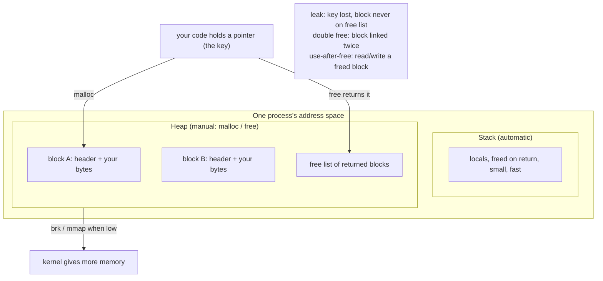

# Module 1.08: Dynamic memory: malloc and free

**Estimated hours:** 4

**What you will learn**

1. What the heap is, how it differs from the stack, and how `malloc`, `calloc`, `realloc` and `free` give you memory whose size and lifetime you choose at run time.
2. The ownership rule that keeps heap code sane ("whoever allocates documents who frees"), and how to build a growing array on top of `realloc`.
3. What the three classic heap bugs look like (leak, double free, use-after-free), how Valgrind and AddressSanitizer report each one, and how to read those reports.

**Prerequisites:** [Module 1.07: Structs, unions and packed record layouts](module-07-structs-unions-packed-layouts.md).

---

## 1. One-line intuition

The heap is a large pool of memory you borrow from at run time with `malloc` and must return with `free`; every borrowed block needs exactly one owner responsible for returning it once.

## 2. Real-life analogy

Think of a bank branch with two kinds of storage.

- **The stack** is the clerk's desk tray. When a clerk starts a task they put a form on the tray; when the task ends the form is removed automatically. It is fast and tidy, but the tray is small, and a form cannot outlive the task that created it. That is a local variable (module 1.04).
- **The heap** is the branch's **locker room**. Any clerk can walk to the locker desk and say "I need a locker big enough for 500 pages" (`malloc(500)`). The attendant finds a free locker of that size, hands back a **key with the locker number** (the pointer), and notes it in a ledger. The locker stays yours after the clerk's task ends, after their shift ends, until someone **returns the key** (`free`). Lockers can be any size and there are thousands of them.

Now the rules, and the bug each one prevents:

- **Return every key you take.** Forget, and that locker is lost for the rest of the day even though nobody is using it. Do it a million times and the room is full. That is a **memory leak**.
- **Return a key only once.** Return it twice and the attendant's ledger gets confused: the locker may be handed to two clerks at once. That is a **double free**.
- **After returning a key, do not go back to the locker.** Someone else may hold it now; reading it gives their papers, writing corrupts theirs. That is a **use-after-free**.
- **Every key has exactly one clerk responsible for returning it.** If two clerks each assume the other returns it, it leaks; if both try, it is double-freed. That is the **ownership rule**.

## 3. Why it exists: the problem it solves

Stack variables and fixed-size arrays have two limits: you must know the size at compile time, and the data dies when the function returns. A loan-origination server does not know at compile time how many loans a branch has today, how long a customer's name is, or how many connections will arrive. And data such as the master-table cache must live for the whole life of the process, not for one function call.

The heap solves both:

1. **Size decided at run time.** `malloc(n)` for any `n` computed from the input.
2. **Lifetime decided by you.** The block lives until you call `free`, across any number of function calls.

The price is responsibility. The compiler does not know when you are finished with a block; only you do. So the language gives you `free` and the whole discipline of ownership. In Phase 2 you will learn RAII and smart pointers, which make the compiler do most of this bookkeeping in C++. In C you do it by hand, and the migration engine of capstone C3 (claims H1 and H2) is written in C precisely because the Berkeley DB API is a C API. That is why the resume says "arena allocator with explicit ownership contracts" and "leak-free batches": the arena you build in module 3.06 sits on top of what you learn here.

What breaks without discipline: a server that leaks 64 bytes per request exhausts memory after a few million requests, usually in the middle of the night. A use-after-free in a request handler corrupts another request's data, and the crash appears somewhere unrelated hours later. Those are the incidents in capstone C6.

## 4. Three layers of depth

### Layer 1 (beginner): the four functions

All four live in `<stdlib.h>`.

**`malloc(size)`** asks for a block of at least `size` bytes. It returns a `void *` (a pointer to memory of no particular type) that you assign to a typed pointer. The bytes are **uninitialised**: they hold whatever was there before. If the request cannot be met it returns `NULL`.

```c
int *p = malloc(sizeof *p);     /* room for one int; sizeof *p is 4 */
if (p == NULL) { /* handle out-of-memory */ }
*p = 42;
```

Note the idiom `sizeof *p`, not `sizeof(int)`. It reads "the size of what `p` points to", so if you later change `p`'s type the allocation stays correct. This is a habit that prevents a whole class of size bugs.

**`calloc(count, size)`** allocates `count` objects of `size` bytes each **and sets every byte to zero**. Use it when you want a zeroed array. It also checks `count * size` for overflow, which a hand-written `malloc(count * size)` does not.

```c
int *a = calloc(4, sizeof *a);  /* four ints, all 0 */
```

**`realloc(ptr, new_size)`** resizes an existing block. It may extend it in place, or move the contents to a bigger block and return a new address. You must assign its result and check it:

```c
int *bigger = realloc(a, 8 * sizeof *a);
if (bigger == NULL) { /* a is still valid; handle failure */ }
a = bigger;
```

**`free(ptr)`** returns a block to the heap. After `free(p)`, `p` still holds the old address but that address is no longer yours; using it is a use-after-free. `free(NULL)` is defined and does nothing, which is useful.

| Function | Gives you | Initialised? | Returns NULL when |
|---|---|---|---|
| `malloc(n)` | n bytes | No (garbage) | out of memory |
| `calloc(c, n)` | c×n bytes | Yes, all zero | out of memory or overflow |
| `realloc(p, n)` | n bytes, old contents kept | Extra bytes uninitialised | out of memory (old block stays valid) |
| `free(p)` | nothing | — | — (`free(NULL)` is a no-op) |

The one rule to memorise now: **every successful `malloc`/`calloc`/`realloc` is matched by exactly one `free`.** Not zero (leak), not two (double free).

### Layer 2 (working engineer): ownership, the growing-array pattern, and NULL-after-free

**The ownership contract.** The hardest part of C is not the four functions; it is deciding *who frees what*. The rule that scales: **the function or module that allocates a block documents, in a comment next to the function, who is responsible for freeing it.** Three common contracts:

- *Caller owns the result.* "Returns a malloc'd string; the caller must `free` it." (Like `strdup`.)
- *The object owns its block.* A struct holds a pointer; an `init` function allocates it and a matching `free`/`destroy` function releases it. Nothing else frees it.
- *Borrowed, not owned.* A function takes a pointer, uses it, and does **not** free it; the caller keeps ownership.

Every heap pointer in a well-written C program fits one of these, and the comment says which. Capstone C3's "explicit ownership contracts" is exactly this discipline written down. Module 1.14 formalises it.

**The growing-array pattern.** You rarely know how many items you will collect. The standard pattern: keep a block, a `count` of used items, and a `capacity`. When full, `realloc` to double the capacity. Doubling (rather than adding a fixed amount) means the average cost of each push stays constant, because the expensive copies happen rarely and get rarer as the array grows. This is exactly how `std::vector` grows in Phase 2. The struct and its contract:

```c
struct loan_list {
    uint32_t *items;     /* heap block OWNED by this struct */
    size_t    count;     /* items in use */
    size_t    capacity;  /* items that fit before a realloc */
};
/* OWNERSHIP: loan_list_init allocates items; loan_list_free releases it.
 * Nothing else frees ->items. */
```

**Why `realloc` can move.** If the bytes right after your block are already in use, `realloc` cannot extend in place; it allocates a fresh, larger block, copies your data, frees the old one, and returns the new address. That is why you must never keep a second pointer into a block you are about to `realloc`: it may become a dangling pointer. Always update every pointer from `realloc`'s return value.

**Set the pointer to NULL after freeing.** A cheap, powerful habit:

```c
free(l->items);
l->items = NULL;   /* a later accidental free(l->items) is now free(NULL): harmless */
```

This turns a potential double-free into a no-op and makes a use-after-free crash immediately (null dereference) instead of silently reading recycled memory. It is not a complete defence, but it is nearly free and catches real bugs.

**Check every allocation.** `malloc` can fail. In a small tool, printing an error and exiting is fine. In a server, you must handle it without leaking what you already hold. The `realloc` idiom matters here: if you write `l->items = realloc(l->items, n)` and it returns `NULL`, you have **leaked** the old block, because you overwrote the only pointer to it. Always realloc into a temporary, check, then assign.

### Layer 3 (internals): where the heap comes from, and what the three bugs actually corrupt

**The heap is memory the C library manages for you.** When your program starts, the C library (glibc on Ubuntu) owns a region called the heap. `malloc` is not a system call; it is a library function that hands out pieces of memory the library already owns, and asks the kernel for more only when it runs low, using the `brk` system call to extend the heap, or `mmap` to get a large separate region (module 3.05 goes deep; module 1.10 shows both regions). This is why `malloc` is fast: most calls never reach the kernel.

**What a block really looks like.** glibc stores a small **header** just before the address it gives you, recording the block's size and some flags. `free(p)` reads the header at `p - header_size` to know how big the block is and to link it into a free list for reuse. This is why:

- **`free` of a pointer not returned by `malloc`** corrupts the heap: glibc reads garbage as a header.
- **Writing past the end of a block** (a heap overflow, module 11.01) overwrites the *next* block's header, and the crash appears later, inside some unrelated `malloc` or `free`.
- **Double free** tries to link the same block into the free list twice, which can create a cycle or let the same block be handed out twice. Modern glibc detects many double frees and aborts with `free(): double free detected in tcache 2`, but not all, so you still need the sanitizers.

**How the tools catch the bugs.** Two tools, two mechanisms:

- **Valgrind** runs your program on a synthetic CPU and tracks every byte of heap memory. It does not need recompilation. At exit it reports every block that was never freed, with the exact allocation stack. It is thorough but slows the program roughly 10-50x, so it is a testing tool, not a production one. It is the right tool for **leaks**.
- **AddressSanitizer (ASan)** is compiled into the program with `-fsanitize=address`. It wraps `malloc`/`free`, puts poisoned **redzones** around every block, and keeps freed blocks in a **quarantine** so the memory is not reused immediately. A read or write to a freed or out-of-bounds address is caught at the instruction, with the allocation stack, the free stack, and the access stack all printed. It adds roughly 2-3x slowdown. It is the right tool for **use-after-free, double free and overflows**. Module 8.04 and 8.05 go deep on both.

The practical workflow, used throughout this course and in capstone C6: build with `-g` always, run tests under ASan+UBSan during development, and run Valgrind's leak check before calling a batch "leak-free".

## 5. Architecture diagram



The stack is automatic; the heap is yours to manage. A pointer is the only link to a block; lose it without freeing and the block leaks.

## 6. Code

One main program that exercises all four functions, the growing array with its ownership contract, and safe double-free avoidance. Then three tiny deliberate-bug programs for the tools.

**Program 1: correct dynamic memory.**

```c
/* dynamic_memory.c
 * Shows: malloc returns void*, NULL check, calloc zeroing, realloc growth,
 * a growing array of loan ids with an ownership contract, free(NULL).
 */
#include <stdio.h>
#include <stdlib.h>
#include <stdint.h>

/* A growing array. OWNERSHIP: loan_list_init allocates ->items;
 * loan_list_free releases it. Nothing else frees ->items. */
struct loan_list {
    uint32_t *items;
    size_t    count;
    size_t    capacity;
};

static int loan_list_init(struct loan_list *l, size_t initial) {
    l->items = calloc(initial, sizeof *l->items);   /* zeroed */
    if (l->items == NULL) return -1;                 /* always check */
    l->count = 0;
    l->capacity = initial;
    return 0;
}

static int loan_list_push(struct loan_list *l, uint32_t id) {
    if (l->count == l->capacity) {
        size_t new_cap = l->capacity * 2;            /* growth: double */
        uint32_t *bigger = realloc(l->items, new_cap * sizeof *bigger);
        if (bigger == NULL) return -1;               /* l->items still valid */
        printf("  grew: capacity %zu -> %zu, block %s\n", l->capacity, new_cap,
               (bigger == l->items) ? "extended in place" : "moved");
        l->items = bigger;
        l->capacity = new_cap;
    }
    l->items[l->count++] = id;
    return 0;
}

static void loan_list_free(struct loan_list *l) {
    free(l->items);          /* free(NULL) is fine, so a second call is safe */
    l->items = NULL;         /* poison: a later free becomes free(NULL) */
    l->count = l->capacity = 0;
}

int main(void) {
    printf("--- malloc returns void*, you must check for NULL ---\n");
    int *one = malloc(sizeof *one);
    if (one == NULL) { fprintf(stderr, "out of memory\n"); return 1; }
    *one = 42;
    printf("heap int at %p holds %d\n", (void *)one, *one);
    free(one);
    one = NULL;

    printf("\n--- calloc zeroes, malloc does not ---\n");
    int *z = calloc(4, sizeof *z);
    if (z == NULL) return 1;
    printf("calloc'd: %d %d %d %d\n", z[0], z[1], z[2], z[3]);
    free(z);

    printf("\n--- a growing array (capacity doubles) ---\n");
    struct loan_list l;
    if (loan_list_init(&l, 2) != 0) return 1;
    for (uint32_t id = 1001; id <= 1009; ++id) {
        if (loan_list_push(&l, id) != 0) { loan_list_free(&l); return 1; }
    }
    printf("count=%zu capacity=%zu first=%u last=%u\n",
           l.count, l.capacity, l.items[0], l.items[l.count - 1]);
    loan_list_free(&l);
    loan_list_free(&l);      /* second call: free(NULL), harmless */
    printf("freed twice safely because the pointer was set to NULL\n");

    printf("\n--- free(NULL) is a no-op ---\n");
    free(NULL);
    printf("done\n");
    return 0;
}
```

```bash
gcc -std=c17 -Wall -Wextra -Werror -g -o dynamic_memory dynamic_memory.c
./dynamic_memory
```

Expected output (the heap address differs on your machine):

```text
--- malloc returns void*, you must check for NULL ---
heap int at 0x57581a8302b0 holds 42

--- calloc zeroes, malloc does not ---
calloc'd: 0 0 0 0

--- a growing array (capacity doubles) ---
  grew: capacity 2 -> 4, block extended in place
  grew: capacity 4 -> 8, block extended in place
  grew: capacity 8 -> 16, block extended in place
count=9 capacity=16 first=1001 last=1009
freed twice safely because the pointer was set to NULL

--- free(NULL) is a no-op ---
done
```

Note the capacity doubling: 2, 4, 8, 16. Nine pushes triggered three reallocs, not nine. On this run each realloc extended in place; on a busier heap some would print "moved". The word is machine-dependent, so do not treat "extended in place" as guaranteed.

**Program 2: a leak (for Valgrind).**

```c
/* leak.c  Deliberate bug: a block is allocated and never freed. */
#include <stdio.h>
#include <stdlib.h>

static char *make_label(unsigned id) {
    char *s = malloc(32);              /* contract: caller must free; nobody does */
    if (s == NULL) return NULL;
    snprintf(s, 32, "LOAN-%u", id);
    return s;
}

int main(void) {
    for (unsigned i = 0; i < 3; ++i) {
        char *label = make_label(1000 + i);
        printf("%s\n", label);
        /* BUG: missing free(label); */
    }
    return 0;
}
```

```bash
gcc -std=c17 -Wall -Wextra -Werror -g -o leak leak.c
valgrind --leak-check=full ./leak
```

Expected output (PIDs shown as `==PID==`; addresses differ):

```text
==PID== LOAN-1000
==PID== LOAN-1001
==PID== LOAN-1002
==PID== HEAP SUMMARY:
==PID==     in use at exit: 96 bytes in 3 blocks
==PID==   total heap usage: 4 allocs, 1 frees, 4,192 bytes allocated
==PID== 96 bytes in 3 blocks are definitely lost in loss record 1 of 1
==PID==    at 0x...: malloc (...)
==PID==    by 0x...: make_label (leak.c:6)
==PID==    by 0x...: main (leak.c:14)
==PID== LEAK SUMMARY:
==PID==    definitely lost: 96 bytes in 3 blocks
==PID== ERROR SUMMARY: 1 errors from 1 contexts (suppressed: 0 from 0)
```

Read it top down: 96 bytes (3 × 32) **definitely lost**, allocated at `make_label` line 6, called from `main` line 14. "Definitely lost" means no pointer to the block survives, so it can never be freed. The fix: `free(label);` at the end of the loop body.

**Program 3: a double free (for ASan).**

```c
/* double_free.c  Deliberate bug: the same block is freed twice. */
#include <stdlib.h>
#include <string.h>

int main(void) {
    char *buf = malloc(64);
    if (buf == NULL) return 1;
    strcpy(buf, "loan 1001");
    free(buf);
    free(buf);      /* BUG: second free of the same pointer */
    return 0;
}
```

```bash
gcc -std=c17 -Wall -Wextra -g -fsanitize=address,undefined -o double_free double_free.c
./double_free
```

Expected output (addresses, PID and BuildId differ; shape is what matters):

```text
=================================================================
==PID==ERROR: AddressSanitizer: attempting double-free on 0x... in thread T0:
    #0 ... in free ...
    #1 ... in main .../double_free.c:10
...
0x... is located 0 bytes inside of 64-byte region [...]
freed by thread T0 here:
    #0 ... in free ...
    #1 ... in main .../double_free.c:9
previously allocated by thread T0 here:
    #0 ... in malloc ...
    #1 ... in main .../double_free.c:6
SUMMARY: AddressSanitizer: double-free ... in free
==PID==ABORTING
```

Three stacks: where the second free happened (line 10), where it was freed the first time (line 9), where it was allocated (line 6). That trio is how you pin down a double free. (GCC's own `-Wuse-after-free` also warns about this one at compile time, because the bug is simple enough to see statically; in real code it rarely is.)

**Program 4: a use-after-free (for ASan).**

```c
/* use_after_free.c  Deliberate bug: a block is used after it was freed. */
#include <stdio.h>
#include <stdlib.h>

int main(void) {
    int *balance = malloc(sizeof *balance);
    if (balance == NULL) return 1;
    *balance = 2500;
    free(balance);
    printf("balance = %d\n", *balance);   /* BUG: reading freed memory */
    return 0;
}
```

```bash
gcc -std=c17 -Wall -Wextra -g -fsanitize=address,undefined -o use_after_free use_after_free.c
./use_after_free
```

Expected output (shape):

```text
=================================================================
==PID==ERROR: AddressSanitizer: heap-use-after-free on address 0x... at pc 0x...
READ of size 4 at 0x... thread T0
    #0 ... in main .../use_after_free.c:10
0x... is located 0 bytes inside of 4-byte region [...]
freed by thread T0 here:
    #0 ... in free ...
    #1 ... in main .../use_after_free.c:9
previously allocated by thread T0 here:
    #0 ... in malloc ...
    #1 ... in main .../use_after_free.c:6
SUMMARY: AddressSanitizer: heap-use-after-free .../use_after_free.c:10 in main
```

The read of the freed block is caught at line 10; the free was at line 9; the allocation at line 6. Had you set `balance = NULL` after `free`, the `printf` would instead crash with a null dereference at the exact line, which is also easy to find. Either way the bug surfaces immediately instead of silently reading recycled memory.

## 7. Use case: core-banking loan-origination platform

The migration engine (capstone C3) reads records from Berkeley DB in **batches**: it opens a cursor, reads a few thousand records into heap buffers, transforms them, writes them to YugabyteDB, then moves to the next batch. Each batch allocates working memory; each batch must free it before the next, or a migration of tens of millions of records runs the process out of memory halfway through, which on a production cutover is a serious incident.

Two decisions this module drove:

1. **One owner per batch buffer, documented.** Every allocation in the batch path had a comment naming who frees it and when. The decode buffers were owned by the batch loop and freed at the end of each batch iteration, in both the success and the error path. This is the "explicit ownership contracts" phrase on the resume, and it is why the migration could be described as "restartable" and "leak-free": a batch that failed partway cleaned up its own memory and could be retried from its start without leaking the previous attempt.

2. **The arena allocator (module 3.06) replaced thousands of tiny `free` calls with one.** Because each batch allocated many small pieces and freed them all at once at the batch boundary, the natural design was a bump allocator (an arena): `malloc` one large block per batch, hand out pieces by advancing a pointer, and at the batch end `free` the whole block once. This is faster than thousands of `malloc`/`free` pairs and makes leaks structurally impossible within a batch: there is exactly one block to free. The ownership rule from Layer 2 is what makes the arena correct: the arena owns all its sub-allocations, and no sub-allocation is freed individually.

The validation: the whole batch path was run under Valgrind's `--leak-check=full` over a sample database until it reported "definitely lost: 0 bytes", and under ASan for the whole regression suite. That is the measured evidence behind "leak-free batches".

## 8. Lab

### Part A: the four functions and the growing array (25 minutes)

1. Save and run Program 1 with the exact command. Confirm the capacity sequence 2, 4, 8, 16 and that 9 pushes caused 3 reallocs.
2. Change the initial capacity in `loan_list_init` from 2 to 4. Predict the new capacity sequence before running. (Expected: 4, 8, 16; two reallocs for 9 pushes.)
3. Add a deliberate bug: change the realloc line to `l->items = realloc(l->items, new_cap * sizeof *l->items);` (assigning directly). Explain in a comment why this leaks the old block if realloc returns NULL. Then revert it.

Expected: the sequences match your predictions; you can state the realloc-into-a-temporary rule in one sentence.

### Part B: find a leak with Valgrind (20 minutes)

1. Save and build Program 2. Run it once normally: it prints three labels and exits 0, with no visible sign of the leak. That is the danger.
2. Run it under `valgrind --leak-check=full ./leak`. Read the report. Find: the number of bytes lost, the number of blocks, and the exact line the lost blocks were allocated on.
3. Fix the bug (`free(label);` inside the loop, after the `printf`). Rerun under Valgrind. Confirm `definitely lost: 0 bytes` and `All heap blocks were freed -- no leaks are possible`.

Expected: before the fix, 96 bytes in 3 blocks definitely lost at `leak.c:6`; after, zero.

### Part C: catch double free and use-after-free with ASan (25 minutes)

1. Build and run Program 3 under `-fsanitize=address,undefined`. Read the report: identify the three stacks (freed here, previously allocated here, and the faulting free). Fix it by removing the second `free`.
2. Build and run Program 4 the same way. Identify the free line and the use line. Fix it two ways and test each: (a) remove the use; (b) keep a copy of the value before freeing, `int saved = *balance; free(balance); printf("%d", saved);`.
3. Add `balance = NULL;` immediately after `free(balance);` in the original buggy Program 4 and run again (still with the buggy `printf`). The error changes from a sanitizer "heap-use-after-free" to a crash on a null pointer at the same line. Note how setting the pointer to NULL turned a subtle recycled-memory read into an obvious immediate crash.

Expected: ASan reports `double-free` and `heap-use-after-free` with line numbers; after the fixes, both programs run clean under ASan.

### Part D: ownership on paper (15 minutes)

For each of these functions, write the one-line ownership comment it should carry, choosing from the three contracts in Layer 2:

1. `char *loan_label(unsigned id);` that returns a `malloc`'d string.
2. `void print_loan(const struct loan_record *r);` that only reads.
3. `int loan_list_init(struct loan_list *l, size_t n);` and `void loan_list_free(struct loan_list *l);`.

<details>
<summary>Answers</summary>

1. "Returns a malloc'd string; the caller owns it and must `free` it." (Caller owns the result.)
2. "Borrows `r`; does not free it. The caller keeps ownership." (Borrowed.)
3. "`loan_list_init` allocates `l->items`; `loan_list_free` releases it; nothing else frees it." (The object owns its block.)

</details>

### Journal

Copy [journal/TEMPLATE.md](../journal/TEMPLATE.md) to `journal/YYYY-MM-DD-dynamic-memory.md`. Record: the capacity-doubling sequences from Part A for both starting capacities; the exact bytes/blocks/line from the Valgrind leak report in Part B; the three stacks you read from the double-free report and the two lines from the use-after-free report in Part C; and the three ownership comments from Part D. Add one sentence connecting the "one block freed per batch" idea to the arena allocator you will build in module 3.06.

## 9. Common mistakes and misconceptions

| Mistake | Why it is wrong | Bug it causes |
|---|---|---|
| Not checking `malloc`'s return | It returns `NULL` on failure; dereferencing NULL crashes | Null-pointer crash under memory pressure |
| `l->items = realloc(l->items, n)` | If realloc returns NULL you overwrote the only pointer | Memory leak exactly when memory is scarce |
| Using a pointer after `free` | The block may be reused by another allocation | Use-after-free: corrupted data, crash elsewhere |
| Freeing the same pointer twice | Corrupts glibc's free list | Double free: abort or heap corruption |
| Keeping a second pointer across `realloc` | realloc may move the block | Dangling pointer into freed memory |
| `malloc(count * size)` for an array | `count * size` can overflow | Too-small allocation, then a heap overflow |
| Assuming `malloc` zeroes memory | Only `calloc` zeroes; `malloc` gives garbage | Uninitialised reads, non-deterministic bugs |
| "It ran fine, so there is no leak" | Leaks are invisible to the program; the OS reclaims at exit | A one-shot tool hides a leak that kills a server |

## 10. Resume link

- **Claim H1, "arena allocator with explicit ownership contracts ... restartable leak-free batches".** Section 7 is this line. Say: "Each migration batch owned its working memory and freed it at the batch boundary; I documented one owner per allocation. I moved the per-record allocations behind an arena so a batch freed one block instead of thousands, which made leaks within a batch structurally impossible and let a failed batch restart cleanly. I verified with Valgrind `--leak-check=full` showing zero bytes lost and ran the suite under ASan." You have the Valgrind and ASan output from your own lab.
- **Claim F, "memory corruption and leak investigation ... Valgrind, ASan".** The three bugs in this module and the exact reports are capstone C6's material. Be able to say which tool you reach for: Valgrind for leaks, ASan for use-after-free and double free.
- **Claim B, "memory and ownership design".** The ownership-contract vocabulary (caller owns / object owns / borrowed) is how you talk about this at a senior level.

Likely follow-up: "How do you know your code has no leaks?" Answer: "I run it under Valgrind's leak check and under AddressSanitizer in the test suite, and I design ownership so every allocation has exactly one documented owner; for batch-structured work I use an arena so there is one free per batch."

## 11. Interview questions

**Q1 (easy). What is the difference between the stack and the heap?**

<details>
<summary>Model answer</summary>

The stack holds local variables and is managed automatically: memory is reserved when a function is entered and released when it returns, in strict last-in-first-out order. It is small and fast, and data on it cannot outlive the function. The heap is a large pool managed manually with `malloc` and `free`; you choose the size at run time and the lifetime, so a heap block lives until you free it, across any number of function calls. The cost is that you are responsible for freeing each block exactly once.

</details>

**Q2 (easy). What does `free(NULL)` do, and why set a pointer to NULL after freeing it?**

<details>
<summary>Model answer</summary>

`free(NULL)` is defined by the standard to do nothing, so it is always safe. Setting a pointer to NULL right after `free(p)` means that if the same pointer is accidentally freed again, it becomes `free(NULL)`, a harmless no-op instead of a double free. It also turns an accidental later use into an immediate, obvious null-pointer crash rather than a silent read of recycled memory. It is a cheap habit that defuses two of the three classic heap bugs.

</details>

**Q3 (medium). Why does a growing array double its capacity instead of adding a fixed amount, and what must you be careful about when calling `realloc`?**

<details>
<summary>Model answer</summary>

Doubling makes the amortised cost of each append constant: the expensive copy happens on 1 in every n appends and gets rarer as the array grows, so n appends cost O(n) total. Adding a fixed amount each time would make growth O(n^2) because copies happen too often. When calling `realloc` I must assign its result to a temporary and check for NULL before overwriting my pointer, because `realloc` may move the block to a new address and returns NULL on failure while leaving the old block valid. If I wrote `p = realloc(p, n)` and it failed, I would leak the old block. I must also update every pointer that referred into the old block, since it may have moved.

</details>

**Q4 (medium). You suspect a long-running server is leaking memory. How do you confirm it and find the source?**

<details>
<summary>Model answer</summary>

First confirm the growth: watch the process's resident memory over time under steady load; a leak shows as monotonic growth that never comes back down. To find the source I run a representative workload under Valgrind with `--leak-check=full`, which reports each lost block with the allocation call stack, or I build with AddressSanitizer and use its leak detector. The report points at the exact allocation site. Then I trace the ownership: who was supposed to free that block, and on which path it was missed, usually an error path that returns early without freeing. The fix is to give the block a single clear owner and free on every exit path, or to restructure so the allocation is tied to an object's lifetime (RAII in C++, or an arena freed in bulk in C).

</details>

**Q5 (hard). A server handler does `record = malloc(n); ... ; free(record);` and returns. Under load it occasionally crashes inside an unrelated `malloc` in a different handler. Walk through what is likely happening and how you would find it.**

<details>
<summary>Model answer</summary>

A crash inside `malloc`/`free` far from the buggy code is the signature of **heap corruption**: something wrote outside its block and damaged an adjacent block's header, and the damage is only discovered later when the allocator walks that header. The likely causes are a heap buffer overflow (writing past the end of `record`, for example copying `n+k` bytes into an `n`-byte block, often an off-by-one or a missing bounds check on input), a use-after-free (writing through `record` after it was freed, while the block has been reused by the other handler), or a double free. It is load-dependent because corruption only crashes when the damaged block is later reallocated, which depends on timing and traffic.

To find it I rebuild with AddressSanitizer and reproduce under load; ASan catches the overflow or use-after-free at the exact instruction, with the allocation and free stacks, turning an intermittent far-away crash into a precise local report. I also run the handler under Valgrind. If it is specifically an overflow, ASan names the block and the overflowing access; if use-after-free, it shows the free stack and the later access. The fix is bounds-checking every write against the block size, setting freed pointers to NULL, and ensuring one owner per block. This is exactly the kind of incident the crash-dump and RCA capstone is built around.

</details>

## 12. Revision

- The heap gives run-time-sized, caller-controlled-lifetime memory via `malloc`/`calloc`/`realloc`/`free`; always check the return, use `sizeof *p`, and match every allocation with exactly one free.
- Give every block one documented owner (caller owns / object owns / borrowed); grow arrays by doubling and realloc into a temporary; set pointers to NULL after freeing.
- Leaks (no free) are found with Valgrind `--leak-check=full`; double free and use-after-free (free then reuse) are found with AddressSanitizer, which prints the allocate, free and access stacks.

---

Previous: [Module 1.07: Structs, unions and packed record layouts](module-07-structs-unions-packed-layouts.md) | Next: [Module 1.09: File I/O and binary files](module-09-file-io-and-binary-files.md)
