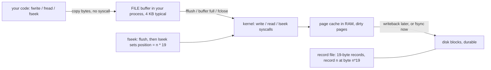

# Module 1.09: File I/O and binary files

**Estimated hours:** 3

**What you will learn**

1. How to open, read, write and close files from C with `fopen`, `fgets`, `fprintf`, `fread`, `fwrite` and `fclose`, and what the mode strings mean.
2. The difference between a text file and a binary file, why Windows and Linux disagree about line endings, and why a record file is binary.
3. How to build a fixed-size record file of loans, jump straight to record N with `fseek`, detect end-of-file and errors with `feof` and `ferror`, and why `fflush` and buffering matter.

**Prerequisites:** [Module 1.08: Dynamic memory: malloc and free](module-08-dynamic-memory.md).

---

## 1. One-line intuition

A file is a sequence of bytes on disk; the C library gives you a cursor into it, and if every record has the same size you can jump to any record with one multiplication.

## 2. Real-life analogy

Think of a ledger book in the branch's record room.

- **Opening the book** (`fopen`) means asking the record clerk for it. You say how you want it: to read (`"r"`), to start a fresh book and write (`"w"`), or to add pages at the end (`"a"`). The clerk hands you the book with a **bookmark** at page one. That bookmark is the **file position**.
- **Reading a line** (`fgets`) moves the bookmark forward one line. **Writing a line** (`fprintf`) adds text at the bookmark and moves it on.
- A **text ledger** is written for humans: lines of letters, one entry per line, lengths vary. To find entry 500 you must read 499 lines first.
- A **binary ledger** is a pre-printed form book: every entry is exactly 19 boxes, no gaps. Entry 500 begins at box 500 × 19. You flip the bookmark straight there (`fseek`), read 19 boxes (`fread`), done. That is the fixed-size record file.
- The clerk does not write every word into the book as you speak it. They **note it on a pad** and copy a full page into the book at once. That pad is the **buffer**. If the building catches fire before the page is copied, the pad is lost. **`fflush`** says "copy the pad into the book now"; **`fclose`** copies it and returns the book.
- The **English and Indian branches use different end-of-line marks** in their text ledgers. One writes a single mark (Linux: `\n`), the other two marks (Windows: `\r\n`). A text ledger moved between them looks subtly wrong unless somebody translates. A binary form book has no lines, so no translation applies, and translation would corrupt it.

## 3. Why it exists: the problem it solves

Everything you have done so far lives in RAM and vanishes when the process ends (module 0.02). A bank needs loans to survive a restart, a power cut and a decade. Files are how bytes are made durable.

Two distinct needs appear immediately:

1. **Human-readable data**: configuration, logs, CSV exports. Text files. Variable-length lines, easy to look at with `cat`, easy to edit, slow to search by position.
2. **Machine-readable records**: millions of loans, each a fixed layout of bytes (module 1.07). Binary files. Not readable with `cat`, but every record is the same size, so record N is at byte N × size and can be read with one seek and one read, in constant time, no matter how big the file.

This is exactly the shape of a database's storage layer. PostgreSQL stores tables as files of fixed-size 8 KB pages and reaches page N by seeking to N × 8192 (Phase 6). Berkeley DB stores B-tree pages the same way. The record file you build here is the simplest ancestor of both, and the migration engine of capstone C3 reads Berkeley DB's binary pages through its API in exactly this spirit: byte offsets, fixed layouts, explicit decode.

What breaks without care: a text/binary mix-up on Windows silently inserts `\r` bytes into a record file and every record after the first is misaligned; an unchecked `fwrite` on a full disk reports success in your logs while the file is truncated; a missing `fflush` loses the last batch of writes when the process is killed.

## 4. Three layers of depth

### Layer 1 (beginner): `FILE *`, modes, and the basic calls

All file functions live in `<stdio.h>`. You work with a `FILE *`, a pointer to a library object that holds the file descriptor from the kernel (module 0.02), a buffer, the current position, and error flags.

**Opening.** `FILE *f = fopen(path, mode);` returns `NULL` on failure and sets `errno`. Modes:

| Mode | Meaning | If the file exists | If it does not |
|---|---|---|---|
| `"r"` | read | opens at the start | fails (`ENOENT`) |
| `"w"` | write | **truncates to empty** | creates it |
| `"a"` | append | opens, all writes go to the end | creates it |
| `"r+"` | read and write | opens at the start | fails |
| `"w+"` | read and write | truncates | creates |
| Add `b` (`"rb"`, `"wb"`) | binary mode | no newline translation | same as above |

Always use `b` for record files. On Linux it changes nothing, which is exactly why people forget it and then get burned on Windows (Layer 2).

**Text: lines.** `fgets(buf, size, f)` reads one line (up to `size - 1` characters, including the `\n`, always NUL-terminated) and returns `NULL` at end-of-file or on error. `fprintf(f, fmt, ...)` writes formatted text, just like `printf` but to a file. `fputs(str, f)` writes a string.

**Binary: bytes.** `fread(buf, size, count, f)` reads up to `count` items of `size` bytes and returns how many **items** it read. `fwrite(buf, size, count, f)` writes `count` items and returns how many it wrote. Any shortfall means end-of-file or error.

**Position.** `fseek(f, offset, whence)` moves the position; `whence` is `SEEK_SET` (from start), `SEEK_CUR` (from here) or `SEEK_END` (from end). `ftell(f)` returns the current byte offset. `rewind(f)` goes to the start.

**Closing.** `fclose(f)` flushes the buffer, closes the descriptor, and frees the `FILE`. It can fail (the final flush may hit a full disk), so check its return in code that writes.

The shape of every correct file operation:

```c
FILE *f = fopen("loans.dat", "rb");
if (f == NULL) { /* report strerror(errno); return error */ }
/* ... read or write, checking each return value ... */
if (fclose(f) != 0) { /* report */ }
```

### Layer 2 (working engineer): buffering, error flags, seeking, and the CRLF trap

**Buffering.** `FILE` is a user-space buffer (typically 4 KB on glibc; you saw its 4,096-byte allocation in Valgrind's "total heap usage" in module 1.08) sitting in front of the kernel's `read`/`write` system calls. Each system call costs roughly 100-300 ns of overhead (module 0.02), so writing one record per syscall would be slow; `fwrite` just copies into the buffer, and the library issues one `write` when the buffer fills. Three consequences:

- **Data you have written may not be in the file yet.** If the process crashes or is killed before the buffer is flushed, those bytes are lost. `fflush(f)` pushes the buffer to the kernel now. `fclose` does it too.
- **Even after `fflush`, the bytes are in the kernel's page cache, not necessarily on disk.** A power cut can still lose them. Making bytes durable on the physical disk needs `fsync(fileno(f))`, which is what databases call before acknowledging a commit (Phase 6, write-ahead logging). For this module, `fflush` is enough; remember that `fsync` exists.
- **Standard output is line-buffered on a terminal and fully buffered when redirected to a file**, which is why `printf` output sometimes appears "late" in logs; `stderr` is unbuffered, so error messages appear immediately. That is why the programs in this course print errors to `stderr`.

**Error flags: `feof` and `ferror`.** Every `FILE` carries two flags. After a short read, ask which happened:

```c
size_t got = fread(buf, 1, 19, f);
if (got != 19) {
    if (feof(f))   /* hit end of file */
    if (ferror(f)) /* a real I/O error; errno says what */
}
```

The classic mistake is `while (!feof(f)) { fread(...); use(...); }`: `feof` only becomes true **after** a read fails, so the loop body runs one extra time with stale data. Always loop on the return value of the read, and check `feof`/`ferror` afterwards to explain why it stopped.

**Seeking to a record.** With fixed-size records of `R` bytes, record `n` starts at byte `n * R`:

```c
fseek(f, (long)n * R, SEEK_SET);
fread(buf, 1, R, f);
```

`fseek` succeeds even if the offset is past the end of the file (the position is just a number); the following `fread` returns 0 and sets the end-of-file flag. So "record does not exist" is detected by the read, not the seek. Writing past the end with `fwrite` after such a seek creates a **hole**, which reads back as zero bytes; database files use this to grow.

**Why `fseek` + `fread` scales.** Reading record 3 of 5 and record 3 of 50 million cost the same: one seek (which is just setting a number) and one read of 19 bytes (one system call, possibly one disk access). A text CSV would need to scan 3 lines or 3 million. This constant-time-by-position property is the entire reason binary record files, and database pages, exist.

**The CRLF trap.** Windows text files end lines with two bytes, `\r\n` (carriage return, line feed; hex `0D 0A`). Linux uses one, `\n` (`0A`). When a file is opened in **text mode** on Windows, the C library translates: writing `\n` produces `\r\n` on disk, and reading `\r\n` returns `\n`. In **binary mode** no translation happens. On Linux text and binary modes are identical, which is why code tested only on Linux often omits `b`. Then on Windows:

- A record file written in text mode gets an extra `0D` byte inserted before every `0A` that happens to appear in a record's data (for example a loan id of 10, which is `0A 00 00 00` in little-endian). Every record after it is shifted by one byte and decodes as garbage.
- Reading a record file in text mode drops `0D` bytes and stops early at byte `1A` (Ctrl-Z, the old DOS end-of-file marker).

The rule: **text files, text mode; byte layouts, binary mode, always `b`.** The same source then behaves identically on Linux and Windows, which matters for a team building on both (resume claim G).

### Layer 3 (internals): what the library and kernel do on `fwrite` and `fseek`

**`fwrite` path.** `fwrite(wire, 19, 1, f)` copies 19 bytes into the `FILE`'s buffer and advances a pointer inside it. No system call. When the buffer would overflow, or on `fflush`/`fclose`, the library calls `write(fd, buffer, len)`. The kernel copies the bytes into the **page cache** (RAM pages that mirror the file), marks them dirty, and returns. A kernel thread writes dirty pages to disk later (typically within tens of seconds, or sooner under memory pressure). This is why `write` is fast and why unflushed data survives a process crash but not a power cut: the page cache belongs to the kernel, not the process. `fsync` forces the dirty pages to the device and waits.

**`fseek` path.** `fseek` first flushes any pending write buffer (so your writes land at the right place), discards any read-ahead in the buffer, then calls `lseek(fd, offset, whence)`, which only updates the file position in the kernel's open-file description (module 0.02 Layer 3). No disk access. The next `fread` calls `read(fd, buffer, 4096)`: the kernel finds the file's block for that offset through the inode, serves it from the page cache if present or schedules a disk read if not, and copies into the library buffer. Your 19 bytes are then copied out of that buffer. Reading record 3 and then record 4 typically costs one system call, not two, because record 4 is already in the 4 KB buffer.

**Why "items" and "size" are separate in `fread`.** `fread(buf, 19, 1, f)` reads one 19-byte item and returns 1 or 0: all-or-nothing, which is what you want for a record. `fread(buf, 1, 19, f)` reads up to 19 one-byte items and returns how many it got, which tells you how short a partial read was. The program in section 6 uses the first form to write (a record either fully written or not) and the second to read (so the error message can say how many bytes arrived).

**Where this leads.** A database page file is a binary file of fixed-size pages reached by `offset = page_no * page_size`; a write-ahead log is an append-only binary file flushed and `fsync`'d before each commit is acknowledged. Module 6.04 and 6.06 build on exactly the calls in this module.

## 5. Architecture diagram



Bytes pass through two buffers before the disk: the library's and the kernel's. `fflush` crosses the first boundary; `fsync` crosses the second.

## 6. Code

One program: it writes five 19-byte loan records (the wire format from module 1.07) to `loans.dat`, jumps straight to record 3, reads it, tries a record that does not exist, and then writes and reads a small CSV to contrast text mode. Every I/O call is checked.

```c
/* loan_file.c
 * Writes a fixed-size record file of loans (19-byte wire records from
 * module 1.07), then jumps straight to record 3 with fseek and reads it.
 * Also writes and reads a text file to show the difference.
 * Every I/O call's return value is checked.
 */
#include <stdio.h>
#include <stdint.h>
#include <string.h>
#include <errno.h>
#include <inttypes.h>

struct loan_record {
    uint32_t loan_id;
    char     branch_code[6];
    uint8_t  product;
    int64_t  principal_paise;
};

#define WIRE_SIZE 19

static void put_u32_le(unsigned char *p, uint32_t v) {
    for (int i = 0; i < 4; ++i) p[i] = (unsigned char)((v >> (8 * i)) & 0xFF);
}
static void put_i64_le(unsigned char *p, int64_t sv) {
    uint64_t v = (uint64_t)sv;
    for (int i = 0; i < 8; ++i) p[i] = (unsigned char)((v >> (8 * i)) & 0xFF);
}
static uint32_t get_u32_le(const unsigned char *p) {
    uint32_t v = 0;
    for (int i = 0; i < 4; ++i) v |= (uint32_t)p[i] << (8 * i);
    return v;
}
static int64_t get_i64_le(const unsigned char *p) {
    uint64_t v = 0;
    for (int i = 0; i < 8; ++i) v |= (uint64_t)p[i] << (8 * i);
    return (int64_t)v;
}
static void encode(const struct loan_record *r, unsigned char out[WIRE_SIZE]) {
    put_u32_le(out, r->loan_id);
    memcpy(out + 4, r->branch_code, 6);
    out[10] = r->product;
    put_i64_le(out + 11, r->principal_paise);
}
static void decode(const unsigned char in[WIRE_SIZE], struct loan_record *r) {
    r->loan_id = get_u32_le(in);
    memcpy(r->branch_code, in + 4, 6);
    r->product = in[10];
    r->principal_paise = get_i64_le(in + 11);
}

static void print_record(const char *label, const struct loan_record *r) {
    char b[7];
    memcpy(b, r->branch_code, 6);
    b[6] = '\0';
    printf("%s loan_id=%u branch=\"%s\" product=%u principal_paise=%" PRId64 "\n",
           label, r->loan_id, b, r->product, r->principal_paise);
}

/* --- 1. write five records, one after another --- */
static int write_records(const char *path) {
    FILE *f = fopen(path, "wb");             /* b = binary: no newline translation */
    if (f == NULL) {
        fprintf(stderr, "fopen(%s, wb): %s\n", path, strerror(errno));
        return -1;
    }
    const char *branches[5] = { "MUM01 ", "DEL02 ", "BLR03 ", "CHN04 ", "KOL05 " };
    for (uint32_t i = 0; i < 5; ++i) {
        struct loan_record r;
        r.loan_id = 1001 + i;
        memcpy(r.branch_code, branches[i], 6);
        r.product = (uint8_t)(1 + i);
        r.principal_paise = (int64_t)(i + 1) * 100000000;   /* 10 lakh, 20 lakh, ... */
        unsigned char wire[WIRE_SIZE];
        encode(&r, wire);
        if (fwrite(wire, WIRE_SIZE, 1, f) != 1) {           /* 1 item of 19 bytes */
            fprintf(stderr, "fwrite failed: %s\n", strerror(errno));
            fclose(f);
            return -1;
        }
    }
    if (fclose(f) != 0) {                    /* fclose can fail: the last flush */
        fprintf(stderr, "fclose: %s\n", strerror(errno));
        return -1;
    }
    printf("wrote 5 records of %d bytes = %d bytes to %s\n", WIRE_SIZE, 5 * WIRE_SIZE, path);
    return 0;
}

/* --- 2. jump to record n (0-based) without reading the ones before --- */
static int read_record(const char *path, long n, struct loan_record *out) {
    FILE *f = fopen(path, "rb");
    if (f == NULL) {
        fprintf(stderr, "fopen(%s, rb): %s\n", path, strerror(errno));
        return -1;
    }
    if (fseek(f, n * WIRE_SIZE, SEEK_SET) != 0) {   /* byte offset from start */
        fprintf(stderr, "fseek: %s\n", strerror(errno));
        fclose(f);
        return -1;
    }
    printf("after fseek, ftell = %ld (record %ld x %d bytes)\n", ftell(f), n, WIRE_SIZE);
    unsigned char wire[WIRE_SIZE];
    size_t got = fread(wire, 1, WIRE_SIZE, f);       /* 19 items of 1 byte */
    if (got != WIRE_SIZE) {
        if (feof(f))        fprintf(stderr, "record %ld: hit end of file after %zu bytes\n", n, got);
        else if (ferror(f)) fprintf(stderr, "record %ld: read error: %s\n", n, strerror(errno));
        fclose(f);
        return -1;
    }
    decode(wire, out);
    fclose(f);
    return 0;
}

/* --- 3. text mode for comparison --- */
static int text_demo(const char *path) {
    FILE *f = fopen(path, "w");
    if (f == NULL) return -1;
    fprintf(f, "loan_id,branch,principal_paise\n");
    fprintf(f, "%u,%s,%" PRId64 "\n", 1001u, "MUM01", (int64_t)100000000);
    fprintf(f, "%u,%s,%" PRId64 "\n", 1002u, "DEL02", (int64_t)200000000);
    if (fclose(f) != 0) return -1;

    f = fopen(path, "r");
    if (f == NULL) return -1;
    char line[128];
    int lines = 0;
    while (fgets(line, sizeof line, f) != NULL) {   /* one line at a time, NUL-terminated */
        printf("text line %d: %s", ++lines, line);
    }
    if (ferror(f)) { fclose(f); return -1; }
    fclose(f);
    return 0;
}

int main(void) {
    if (write_records("loans.dat") != 0) return 1;

    struct loan_record r;
    if (read_record("loans.dat", 3, &r) != 0) return 1;   /* the 4th record, 0-based */
    print_record("record 3:", &r);

    if (read_record("loans.dat", 1, &r) != 0) return 1;
    print_record("record 1:", &r);

    printf("\ntrying record 7, which does not exist:\n");
    if (read_record("loans.dat", 7, &r) != 0) {
        printf("read_record reported failure, as it should\n");
    }

    printf("\n--- text file for comparison ---\n");
    if (text_demo("loans.csv") != 0) return 1;
    return 0;
}
```

```bash
gcc -std=c17 -Wall -Wextra -Werror -g -o loan_file loan_file.c
./loan_file
ls -l loans.dat loans.csv
```

Expected output (the `record 7` error line goes to `stderr`, which is unbuffered, so it may appear slightly earlier than its neighbours on screen):

```text
wrote 5 records of 19 bytes = 95 bytes to loans.dat
after fseek, ftell = 57 (record 3 x 19 bytes)
record 3: loan_id=1004 branch="CHN04 " product=4 principal_paise=400000000
after fseek, ftell = 19 (record 1 x 19 bytes)
record 1: loan_id=1002 branch="DEL02 " product=2 principal_paise=200000000

trying record 7, which does not exist:
after fseek, ftell = 133 (record 7 x 19 bytes)
record 7: hit end of file after 0 bytes
read_record reported failure, as it should

--- text file for comparison ---
text line 1: loan_id,branch,principal_paise
text line 2: 1001,MUM01,100000000
text line 3: 1002,DEL02,200000000
-rw-r--r-- 1 shakir shakir 73 ... loans.csv
-rw-r--r-- 1 shakir shakir 95 ... loans.dat
```

Three things to see. `loans.dat` is exactly 95 bytes: 5 × 19, no headers, no separators. Record 3 was found at byte 57 (3 × 19) without reading records 0-2. The seek to byte 133 succeeded even though the file is 95 bytes long; it was the `fread` that returned 0 and set the end-of-file flag.

Now look at the raw bytes:

```bash
xxd loans.dat
```

```text
00000000: e903 0000 4d55 4d30 3120 0100 e1f5 0500  ....MUM01 ......
00000010: 0000 00ea 0300 0044 454c 3032 2002 00c2  .......DEL02 ...
00000020: eb0b 0000 0000 eb03 0000 424c 5230 3320  ..........BLR03
00000030: 0300 a3e1 1100 0000 00ec 0300 0043 484e  .............CHN
00000040: 3034 2004 0084 d717 0000 0000 ed03 0000  04 .............
00000050: 4b4f 4c30 3520 0500 65cd 1d00 0000 00    KOL05 ..e......
```

The first four bytes `e9 03 00 00` are loan id 1001 in little-endian; `4d 55 4d 30 31 20` is `MUM01 `; `01` is the product; `00 e1 f5 05 00 00 00 00` is 100,000,000 (`0x05F5E100`). Record 3 begins at offset `0x39` = 57: `ec 03 00 00` = 1004. You can read a record file by eye now, which is a genuine skill for capstone C3 and for examining a corrupt file in an incident.

## 7. Use case: core-banking loan-origination platform

Two places in the platform are exactly this module.

**The data-parity suite (capstone C4, claim H3)** compares records between Berkeley DB and YugabyteDB. Its snapshot of the source side is a fixed-size binary record file, written with `fwrite` of encoded records and read back with `fseek` + `fread`. The decision this drove: **the snapshot is a binary record file, not CSV.** The parity run has to re-read specific records by number when a mismatch is reported (record 3,417,208, say), and with fixed-size records that is one seek, whereas a CSV would need a scan from the top for every lookup. The snapshot was also opened with `"wb"`/`"rb"` from the first commit, because the parity tooling was run on a Windows workstation as well as the Linux migration host; a text-mode file would have been silently corrupted on the Windows side by CRLF translation.

**The application server's audit log (claim H4)** is a text file in append mode (`"a"`): one line per request, human-readable, grep-able, and never truncated because append mode always writes at the end. The decision there was the opposite: human readers and `grep` matter more than seek-by-position. The server calls `fflush` after each line so a crash does not lose the last requests, a lesson learned from an incident where the final 4 KB of log before a crash was missing and the RCA (claim H5) had to be written without it. The log's `fprintf` return value was also checked, because a full disk made the server's log silently stop, which hid the real cause of a later outage.

The general rule the team wrote down: text with text mode and `fflush` for logs; fixed-size binary with `b` and explicit encode/decode for records; never `fwrite(&struct)`.

## 8. Lab

### Part A: build and read the record file (20 minutes)

1. Save and build the program with the exact command. Run it and check that every line of the expected output matches (apart from the `ls` timestamps).
2. Run `xxd loans.dat`. Find record 1 at offset `0x13` (19) and confirm its first four bytes are `ea 03 00 00` (1002).
3. Run `xxd -s 57 -l 19 loans.dat` to dump exactly record 3. Match each field to the expected output's `record 3:` line.

Expected: 95-byte file; record 3's dump begins `ec03 0000 4348 4e30 3420 04 ...`.

### Part B: corrupt one byte and see it decode (20 minutes)

1. Overwrite byte 11 of the file (the first byte of record 0's principal) with `0xFF`, without truncating the file:

```bash
printf '\xff' | dd of=loans.dat bs=1 seek=11 conv=notrunc
```

2. Change `main` temporarily to read record 0 and print it. Predict the new principal before running: the bytes become `ff e1 f5 05 00 00 00 00`, which is `0x05F5E1FF`.
3. Run and confirm. Then rerun the unmodified program to rewrite a clean file (`"wb"` truncates and starts over).

Expected: record 0 now shows `principal_paise=100000255`. One byte changed one amount by 255 paise. This is what a single-bit or single-byte corruption on disk looks like, and why databases keep checksums on pages (Phase 6).

### Part C: `feof` the wrong way and the right way (15 minutes)

1. Write a small loop that reads `loans.dat` sequentially 19 bytes at a time with `while (!feof(f)) { fread(...); print(...); }`. Run it. It prints **six** records: the five real ones and a stale repeat (or garbage) of the fifth, because `feof` only turns true after a read fails.
2. Rewrite as `while (fread(wire, 1, WIRE_SIZE, f) == WIRE_SIZE) { print(...); }` and run. Five records.

Expected: the first version shows the classic extra iteration; the second is correct. Write down the one-sentence rule.

### Part D: buffering and `fflush` (15 minutes)

1. Create `nofflush.c`:

```c
#include <stdio.h>
#include <stdlib.h>
int main(int argc, char **argv) {
    FILE *f = fopen("audit.log", "w");
    if (f == NULL) return 1;
    fprintf(f, "request 1 ok\n");
    fprintf(f, "request 2 ok\n");
    if (argc > 1) fflush(f);     /* any argument enables the flush */
    abort();                     /* simulate a crash: no fclose runs */
}
```

2. Build with the strict flags. Run `./nofflush; cat audit.log` and then `./nofflush now; cat audit.log`. (The shell prints `Aborted (core dumped)` each time; that is the simulated crash.)

Expected: without the argument `audit.log` is **empty**, because the two lines were still in the `FILE` buffer when the process died; with the argument both lines are present. This is the audit-log incident from section 7 reproduced in ten lines.

3. Finally, on the text side, look at how Windows would have written the CSV: run `printf 'loan 1001\r\nloan 1002\n' | xxd` and find the `0d 0a` pair on the first line versus the lone `0a` on the second. That `0d` is the byte text mode inserts on Windows and binary mode never does.

### Journal

Copy [journal/TEMPLATE.md](../journal/TEMPLATE.md) to `journal/YYYY-MM-DD-file-io-and-binary-files.md`. Record: the file size and the byte offset of record 3; the corrupted principal from Part B and the arithmetic; the extra-iteration count from the wrong `feof` loop; and what `audit.log` contained with and without `fflush`. Add one sentence on why the parity snapshot in capstone C4 is a binary record file rather than CSV.

## 9. Common mistakes and misconceptions

| Mistake | Why it is wrong | Bug it causes |
|---|---|---|
| Not checking `fopen`'s return | It returns NULL on a missing file or no permission | Null `FILE *` crash, often as a service with a bad working directory |
| Ignoring `fwrite`/`fclose` return values | A full disk or I/O error is reported there and nowhere else | Silently truncated record files, missing log lines |
| `while (!feof(f))` loops | `feof` is true only after a read has already failed | One extra iteration processing stale data |
| Opening a record file without `b` | Text mode translates `\n` on Windows | Records shifted by one byte per `0A`; file corrupted on Windows only |
| `fwrite(&struct, sizeof struct, 1, f)` | Writes padding and native byte order (module 1.07) | File unreadable by another compiler or platform |
| Assuming `fwrite` put data on disk | It went into a buffer; `fflush` sends it to the kernel; `fsync` to the disk | Lost data on crash or power cut |
| Treating a successful `fseek` as "the record exists" | `fseek` beyond the end succeeds; only the read fails | Reading zero bytes and decoding garbage |
| `"w"` to add to an existing file | `"w"` truncates to empty first | Yesterday's log wiped at startup; use `"a"` |

## 10. Resume link

- **Claim H3, "data-parity regression suite diffing Berkeley DB vs YugabyteDB record by record".** Say: "The source-side snapshot was a fixed-size binary record file; a mismatch report named a record number and I could `fseek` to it in constant time and re-decode it. I opened it in binary mode from the start because the tooling ran on both Linux and Windows." Your lab shows you can read such a file byte by byte with `xxd`.
- **Claim H5, "crash-dump and live-incident debugging with formal RCA".** The missing-last-4KB-of-log story (section 7, reproduced in Part D) is the kind of specific, checkable detail an interviewer trusts: "the log was fully buffered, the process died before the flush, so I added `fflush` after each line and we lost nothing in the next incident."
- **Claim G, "Linux ... Windows".** The CRLF and `b`-mode explanation is a classic cross-platform question; you now have the bytes to show.

Likely follow-up: "What is the difference between `fflush` and `fsync`?" Answer: `fflush` moves bytes from the C library's buffer into the kernel (page cache); `fsync` makes the kernel write them to the physical device and waits. A crash of the process loses unflushed data; a power cut loses un-synced data. Databases `fsync` the log before acknowledging a commit.

## 11. Interview questions

**Q1 (easy). What is the difference between a text file and a binary file?**

<details>
<summary>Model answer</summary>

Both are sequences of bytes; the difference is intent and handling. A text file holds human-readable characters organised in lines of variable length, ended by `\n` on Linux or `\r\n` on Windows, and is read with functions like `fgets`. A binary file holds raw bytes in a layout defined by the program, usually fixed-size records, read with `fread` at computed offsets. On Windows, text mode translates line endings while binary mode (`"rb"`, `"wb"`) leaves bytes untouched, so record files must always use binary mode or they are corrupted on that platform.

</details>

**Q2 (easy). How do you read the 500th record from a file of fixed 19-byte records?**

<details>
<summary>Model answer</summary>

Open the file in binary mode, call `fseek(f, 500L * 19, SEEK_SET)` to move the position to byte 9500, then `fread` 19 bytes into a buffer and decode it. This is constant time regardless of file size, because the offset is computed, not searched. I check that `fread` returned 19 bytes; if it returned fewer, `feof` tells me the record does not exist and `ferror` tells me there was an I/O error.

</details>

**Q3 (medium). Why is `while (!feof(f))` a bug, and what is the correct loop?**

<details>
<summary>Model answer</summary>

`feof` reports whether a previous read operation already hit end-of-file; it does not predict whether the next read will. After the last successful read the flag is still false, so the loop runs once more, the read inside fails and returns 0 or NULL, and the body processes stale or uninitialised data before the flag finally becomes true. The correct pattern loops on the read's return value, for example `while (fgets(buf, sizeof buf, f) != NULL)` or `while (fread(buf, 1, n, f) == n)`, and only afterwards checks `feof` and `ferror` to distinguish a clean end from an error.

</details>

**Q4 (medium). A service writes an audit log with `fprintf`. After a crash the last several seconds of entries are missing. Why, and what are the options?**

<details>
<summary>Model answer</summary>

`FILE` output is buffered in user space, typically in a 4 KB block; `fprintf` only copies into that buffer and the library issues a `write` system call when it fills or on `fflush`/`fclose`. When the process crashes, that buffer is lost with the process's memory, so the last partial block of entries never reaches the kernel. Options, in increasing cost: call `fflush` after each entry so every line reaches the kernel's page cache and survives a process crash; use line buffering with `setvbuf`; or, if entries must survive a power failure too, call `fsync` on the descriptor, which forces the kernel to write to the device, at a much higher per-call cost. For an audit log I would `fflush` per line and `fsync` periodically or on important events, and I would check `fprintf`'s return value so a full disk is noticed rather than silently dropping entries.

</details>

**Q5 (hard). A binary record file written by a Linux tool reads correctly on Linux but a Windows build of the same reader decodes garbage from the second record onwards. The code uses `fopen(path, "r")` and `fread`. Explain precisely what is happening at the byte level and how you fix and verify it.**

<details>
<summary>Model answer</summary>

On Windows, `"r"` opens the file in text mode, and the C runtime translates on read: every `\r\n` pair (`0D 0A`) is collapsed to a single `\n` (`0A`), and a `1A` byte (Ctrl-Z) is treated as end of file. The record file contains arbitrary bytes, so somewhere in the first record or soon after there is a `0D` immediately followed by `0A`, for instance inside a little-endian integer, and the runtime deletes the `0D`. From that point every subsequent byte arrives one position early, so each later record is decoded from a shifted window and every field is wrong. If a `1A` appears, reading stops early instead. On Linux text and binary mode are identical, so the bug is invisible there, which is why it slipped through testing.

The fix is to open with `"rb"` (and the writer with `"wb"`), which disables translation; the same source then behaves identically on both platforms. I verify by comparing the file's byte count with `records * record_size` and by hex-dumping (`xxd` or a small dump helper) the first few records on both platforms and checking a known field, such as a loan id at a known offset, decodes identically. I would also add an assertion that `fread` returned exactly the record size for every record, so a shifted or truncated file fails loudly rather than producing garbage.

</details>

## 12. Revision

- `fopen` with a mode (`r`, `w` truncates, `a` appends; add `b` for binary), check every return value including `fwrite` and `fclose`, and loop on the read's result, not on `feof`.
- Fixed-size records make record `n` live at byte `n * size`: `fseek` there and `fread` once, constant time at any file size; text files are lines for humans and need text mode, record files are bytes and need `b` or Windows CRLF translation corrupts them.
- `fwrite` fills a user buffer; `fflush` pushes it to the kernel's page cache (survives a process crash); `fsync` pushes it to disk (survives a power cut); a crash before `fflush` loses the buffer.

---

Previous: [Module 1.08: Dynamic memory: malloc and free](module-08-dynamic-memory.md) | Next: [Module 1.10: Process memory layout](module-10-process-memory-layout.md)
