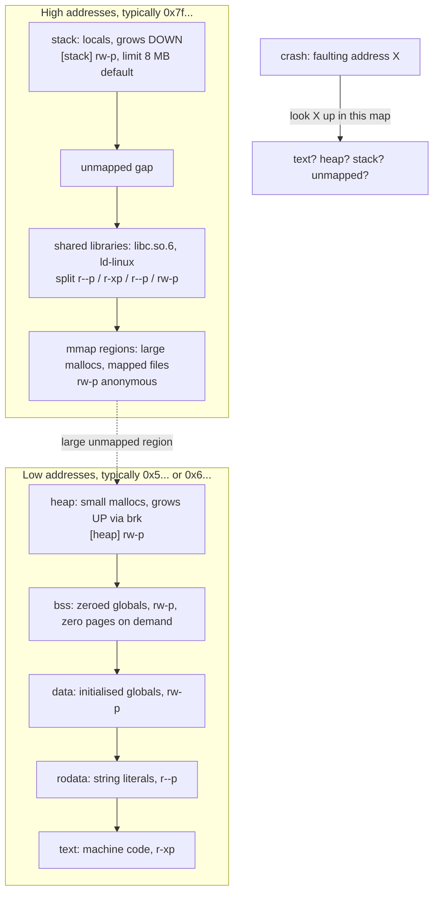

# Module 1.10: Process memory layout

**Estimated hours:** 3

**What you will learn**

1. The regions of a running program's memory (text, rodata, data, bss, heap, mmap, shared libraries, stack), what lives in each, and how to print an address from every one.
2. How to read the kernel's map of a process in `/proc/PID/maps`, what the `size` command reports, which direction the stack grows, and why addresses differ between runs.
3. Why "which region does this address belong to?" is the first question when reading a core dump.

**Prerequisites:** [Module 1.09: File I/O and binary files](module-09-file-io-and-binary-files.md).

---

## 1. One-line intuition

A process's memory is a short list of named regions, each with a purpose and a permission; every address you will ever see in a debugger belongs to exactly one of them.

## 2. Real-life analogy

Picture a city map of the branch office's town, with districts.

- **The library district** is the **text** segment: the machine code. Everyone may read it; nobody may change it; it is the same for every copy of the program.
- **The museum** next door is **rodata** (read-only data): string literals such as `"loan not found"` and constant tables. Also read-only.
- **The notice board with pre-filled values** is **data**: global variables that start with a specific value, such as `int limit = 42;`.
- **The empty notice board** is **bss**: global variables that start at zero. The city does not ship the zeros; it just promises the board is blank. That is why a 100 MB zeroed global costs nothing in the executable file.
- **The warehouse district** is the **heap** (module 1.08): starts just past the notice boards and grows outward when `malloc` needs more.
- **Rented halls across town** are **mmap regions**: large allocations and the shared libraries such as `libc`, each mapped in its own block.
- **The tower at the far end** is the **stack**: it starts at the top address and grows **downward**, one floor per function call.

Every district has a sign at its boundary. The kernel keeps the list of signs, and you can read it in `/proc/PID/maps`. When a crash report says "fault at address X", the first thing a debugger does is find X on this map. "X is in the heap" and "X is in no district at all" lead to very different investigations.

## 3. Why it exists: the problem it solves

The kernel does not hand a process one undifferentiated block of memory. It builds the address space from parts with different needs:

| Need | Region | Permission |
|---|---|---|
| Instructions must not be overwritten by a stray pointer | text | read + execute |
| Constants should be shared between processes running the same binary | rodata | read |
| Globals need to be writable, with initial values from the file | data | read + write |
| Zeroed globals should not inflate the executable | bss | read + write, zero-filled on demand |
| Run-time sized memory that outlives a function | heap and mmap | read + write |
| Per-call locals that vanish on return | stack | read + write |

Separating them buys three things. **Protection**: a bug that writes through a bad pointer into text is stopped by the CPU (the page is not writable) and reported as a fault, instead of silently changing the program. **Sharing**: two hundred processes running the same server binary share one physical copy of text and rodata. **Diagnosis**: a faulting address tells you which kind of bug to suspect before you read a single line of code.

What breaks without this understanding: you see `0x7ffc99d47924` in a crash and have no idea whether it is a local variable, a heap block or garbage; you cannot explain why a 1 MB `malloc` lands at a completely different address than a 64-byte one; and you cannot read the first page of a core dump, which is where capstone C6 begins.

## 4. Three layers of depth

### Layer 1 (beginner): the regions and what you put in each

A program file (an ELF executable on Linux) is divided into **sections**. When the kernel starts the process it maps those sections into memory and adds the dynamic regions.

| Region | What goes there | Comes from | Example in C |
|---|---|---|---|
| text | machine code of all functions | the executable file | `static void a_function(void) {}` |
| rodata | string literals, `const` tables | the executable file | `"hello"` |
| data | globals and statics with a non-zero initial value | the executable file | `int global_initialised = 42;` |
| bss | globals and statics with zero (or no) initial value | nothing: zero pages on demand | `int global_zero;` `static int static_zero;` |
| heap | `malloc` blocks (small and medium) | grows at run time | `malloc(64)` |
| mmap | large `malloc` blocks, shared libraries, memory-mapped files | mapped at run time | `malloc(1024 * 1024)`, `libc.so.6` |
| stack | locals, arguments, return addresses | grows at run time | `int local = argc;` |

**bss** stands for "block started by symbol", a historical name; think of it as "zeroed globals".

**Where `malloc` memory comes from.** glibc serves small requests from the heap region, which it grows by asking the kernel to move the heap's end (the `brk` system call). For large requests (by default 128 KB and above, a threshold glibc can adjust at run time), it asks the kernel for a separate mapping with `mmap`, which lands near the shared libraries rather than in the heap. That is why the 64-byte and 1 MB allocations in section 6 print addresses in completely different places. Module 3.05 covers the allocator in depth.

**The two address neighbourhoods on x86-64 Linux.** Addresses starting around `0x5...` or `0x6...` (12 hex digits) are typically the executable's own regions and the heap. Addresses starting `0x7f...` or `0x7e...` are typically mmap regions, shared libraries and the stack, with the stack highest of all. Learning to glance at an address and say "that looks like a stack address" is a real skill, and section 6 trains it.

### Layer 2 (working engineer): reading `/proc/PID/maps`, `size`, and stack direction

**`/proc/PID/maps`** is a text file the kernel generates on demand, listing every mapped region of process `PID`. `/proc/self/maps` is the same for "the process reading it". One line per region:

```text
6297ad497000-6297ad498000 r-xp 00001000 00:46 28710447624716969  /home/shakir/course/memory_layout
```

| Column | Meaning |
|---|---|
| `6297ad497000-6297ad498000` | start and end address (end is exclusive); here one 4 KB page |
| `r-xp` | permissions: read, write, execute; `p` private (copy-on-write) or `s` shared |
| `00001000` | offset into the mapped file where this region's bytes begin |
| `00:46` | device major:minor of the file's filesystem |
| `28710447624716969` | inode number of the file (module 0.02) |
| path | the file, or `[heap]`, `[stack]`, `[vdso]`, or blank for anonymous memory |

Reading a real map (section 6 shows the whole thing), you find the executable split into several mappings: a read-only one holding the ELF headers, an `r-xp` one holding text, one or two `r--p` holding rodata and relocation data, and an `rw-p` holding data and bss. Then `[heap]`. Then, far away, `libc.so.6` with the same five-way split, anonymous `rw-p` regions (large mallocs and library scratch), `[vdso]` (a tiny kernel-provided library for fast `gettimeofday`-style calls), the dynamic loader `ld-linux-x86-64.so.2`, and finally `[stack]`.

**Permissions are the first diagnostic.** A crash writing to an address inside an `r-xp` or `r--p` region means something tried to modify code or constants: usually a pointer that was supposed to point at a heap buffer but points at a string literal, as in `char *s = "abc"; s[0] = 'x';`. A crash at an address in no region at all means a wild or null pointer. A crash just below `[stack]` can mean stack exhaustion from deep recursion (module 1.04).

**`size`** prints the static section sizes of an executable:

```text
   text    data     bss     dec     hex filename
   3417     692      24    4133    1025 memory_layout
```

`text` here bundles code and read-only data; `data` is initialised globals; `bss` is the zeroed ones. Add a `static char big[1 << 20];` and `bss` grows by 1 MB while the file on disk does not; initialise it to non-zero and both `data` and the file grow by 1 MB. This is a quick way to answer "why is this binary 50 MB?".

**The stack grows downward.** Each call pushes a new frame at a lower address than its caller's. In section 6's second program, each nested call's local sits 48 bytes (`0x30`) below the previous one on this build; the exact gap depends on frame size and compiler flags. The stack's maximum size is a process limit, `ulimit -s`, 8192 KB by default on Ubuntu. Recursing deeper than that faults just below the `[stack]` region: the classic stack overflow.

**Addresses change between runs.** Run the program twice and every region moves. The kernel places the executable, heap, libraries and stack at randomised base offsets on each start; this is called **address space layout randomisation (ASLR)**, controlled by `/proc/sys/kernel/randomize_va_space` (value 2 on Ubuntu). The practical consequences for you: never hard-code an address, never compare addresses across runs, and when reading a core dump always use the map captured with that dump, not a fresh run. Module 11.02 discusses why the kernel does this.

### Layer 3 (internals): pages, lazy mapping, and what a core dump captures

**Everything is pages.** The kernel manages memory in 4 KB pages (on x86-64; larger "huge pages" exist). Every region in `maps` starts and ends on a page boundary, which is why the executable's tiny text segment occupies a whole 4 KB page and why a 1-byte `mmap` costs 4 KB. The permission bits are enforced per page by the CPU's page tables (module 3.04): a write to a read-only page raises a page fault, the kernel sees there is no legal way to satisfy it, and delivers `SIGSEGV`.

**Mappings are lazy.** When the kernel maps `libc.so.6`, it does not read the 2 MB file into RAM. It records "addresses A to B correspond to file offset O" and returns. The first time the program touches a page in that range, the CPU faults, the kernel loads that one page from the file (or finds it already in the page cache, shared with every other process using libc), fixes the page table, and resumes the program. bss and the heap work the same way with zero-filled pages: the region exists in `maps` long before any physical memory is assigned. This is why "virtual size" and "resident size" of a process differ (module 3.04), and why `malloc(1 GB)` can succeed instantly on a machine with 8 GB of RAM.

**The heap's starting point.** `[heap]` begins just above the executable's data/bss, at a randomised gap, and `brk` moves its end upward. glibc's `malloc` carves blocks out of this region with the headers you met in module 1.08. Large blocks go to `mmap` instead so that freeing them can return the pages to the kernel immediately; heap memory freed in the middle of the region cannot be returned, only reused.

**What a core dump is.** When a process dies from a signal such as `SIGSEGV`, the kernel can write a **core dump**: a file containing the process's register state and a copy of its writable regions (and, depending on settings, read-only ones), together with the `maps`-style list of what was where. GDB loads the executable plus the core, reconstructs the address space from that list, and lets you inspect variables as they were at the moment of death. The faulting address and the instruction pointer are the first two numbers you read, and the map is how you classify them: text (code tried to execute from a bad place, or write to code), heap (likely a heap bug: overflow, use-after-free), stack (likely a stack-array overflow or a dangling pointer to a dead frame), unmapped (null or wild pointer). Module 8.02 turns this into a seven-step method; capstone C6 applies it to real dumps.

## 5. Architecture diagram



Top to bottom is high to low address. The stack grows down from the top; the heap grows up from just above the executable; libraries and large allocations sit in between. Every region's base moves between runs.

## 6. Code

Two programs. The first prints one address from every region and then the kernel's own map of the process. The second shows the stack growing downward.

**Program 1: an address from every region, then `/proc/self/maps`.**

```c
/* memory_layout.c
 * Prints one address from each region of the process, then shows the
 * kernel's own map of the process from /proc/self/maps.
 */
#include <stdio.h>
#include <stdlib.h>
#include <string.h>
#include <unistd.h>

int global_initialised = 42;        /* .data: initialised global */
int global_zero;                    /* .bss: zero-initialised global */
static int static_zero;             /* .bss too */
const char *const text_literal = "hello";   /* the bytes live in .rodata */

static void a_function(void) { }    /* .text: machine code */

int main(int argc, char **argv) {
    (void)argv;
    int   local = argc;                          /* stack */
    void *small_heap = malloc(64);               /* heap via brk */
    void *big_heap   = malloc(1024 * 1024);      /* 1 MiB: glibc uses mmap for this */
    if (small_heap == NULL || big_heap == NULL) return 1;

    printf("pid                      : %d\n", (int)getpid());
    printf("text   (a_function)      : %p\n", (void *)a_function);
    printf("rodata (string literal)  : %p\n", (const void *)text_literal);
    printf("data   (global = 42)     : %p\n", (void *)&global_initialised);
    printf("bss    (global = 0)      : %p\n", (void *)&global_zero);
    printf("bss    (static = 0)      : %p\n", (void *)&static_zero);
    printf("heap   (malloc 64)       : %p\n", small_heap);
    printf("mmap   (malloc 1 MiB)    : %p\n", big_heap);
    printf("stack  (local)           : %p\n", (void *)&local);
    printf("libc   (printf)          : %p\n", (void *)printf);

    printf("\n--- /proc/self/maps (the kernel's view) ---\n");
    FILE *maps = fopen("/proc/self/maps", "r");
    if (maps == NULL) { perror("fopen /proc/self/maps"); return 1; }
    char line[512];
    while (fgets(line, sizeof line, maps) != NULL) {
        fputs(line, stdout);
    }
    fclose(maps);

    free(big_heap);
    free(small_heap);
    return 0;
}
```

```bash
gcc -std=c17 -Wall -Wextra -Werror -g -o memory_layout memory_layout.c
./memory_layout
```

Expected output from one run (every address and the PID differ on your machine and on every run; the ordering and the permissions do not; the inode and device numbers depend on where the file lives):

```text
pid                      : 629
text   (a_function)      : 0x6297ad497279
rodata (string literal)  : 0x6297ad498008
data   (global = 42)     : 0x6297ad49a010
bss    (global = 0)      : 0x6297ad49a024
bss    (static = 0)      : 0x6297ad49a028
heap   (malloc 64)       : 0x6297e651d2a0
mmap   (malloc 1 MiB)    : 0x7b3e5fe7f010
stack  (local)           : 0x7ffc99d47924
libc   (printf)          : 0x7b3e5fc60100

--- /proc/self/maps (the kernel's view) ---
6297ad496000-6297ad497000 r--p 00000000 08:30 1234567   /home/shakir/course/memory_layout
6297ad497000-6297ad498000 r-xp 00001000 08:30 1234567   /home/shakir/course/memory_layout
6297ad498000-6297ad499000 r--p 00002000 08:30 1234567   /home/shakir/course/memory_layout
6297ad499000-6297ad49a000 r--p 00002000 08:30 1234567   /home/shakir/course/memory_layout
6297ad49a000-6297ad49b000 rw-p 00003000 08:30 1234567   /home/shakir/course/memory_layout
6297e651d000-6297e653e000 rw-p 00000000 00:00 0         [heap]
7b3e5fc00000-7b3e5fc28000 r--p 00000000 08:30 41378     /usr/lib/x86_64-linux-gnu/libc.so.6
7b3e5fc28000-7b3e5fdb1000 r-xp 00028000 08:30 41378     /usr/lib/x86_64-linux-gnu/libc.so.6
7b3e5fdb1000-7b3e5fe00000 r--p 001b1000 08:30 41378     /usr/lib/x86_64-linux-gnu/libc.so.6
7b3e5fe00000-7b3e5fe04000 r--p 001ff000 08:30 41378     /usr/lib/x86_64-linux-gnu/libc.so.6
7b3e5fe04000-7b3e5fe06000 rw-p 00203000 08:30 41378     /usr/lib/x86_64-linux-gnu/libc.so.6
7b3e5fe06000-7b3e5fe13000 rw-p 00000000 00:00 0
7b3e5fe7f000-7b3e5ff83000 rw-p 00000000 00:00 0
7b3e5ff8d000-7b3e5ff8f000 rw-p 00000000 00:00 0
7b3e5ff8f000-7b3e5ff93000 r--p 00000000 00:00 0         [vvar]
7b3e5ff93000-7b3e5ff95000 r--p 00000000 00:00 0         [vvar_vclock]
7b3e5ff95000-7b3e5ff97000 r-xp 00000000 00:00 0         [vdso]
7b3e5ff97000-7b3e5ff98000 r--p 00000000 08:30 41375     /usr/lib/x86_64-linux-gnu/ld-linux-x86-64.so.2
7b3e5ff98000-7b3e5ffc3000 r-xp 00001000 08:30 41375     /usr/lib/x86_64-linux-gnu/ld-linux-x86-64.so.2
7b3e5ffc3000-7b3e5ffcd000 r--p 0002c000 08:30 41375     /usr/lib/x86_64-linux-gnu/ld-linux-x86-64.so.2
7b3e5ffcd000-7b3e5ffcf000 r--p 00036000 08:30 41375     /usr/lib/x86_64-linux-gnu/ld-linux-x86-64.so.2
7b3e5ffcf000-7b3e5ffd1000 rw-p 00038000 08:30 41375     /usr/lib/x86_64-linux-gnu/ld-linux-x86-64.so.2
7ffc99d28000-7ffc99d49000 rw-p 00000000 00:00 0         [stack]
```

Now match the printed addresses to the map. This is the whole skill of the module:

| Printed line | Address | Falls in map line | Region |
|---|---|---|---|
| text (a_function) | `0x6297ad497279` | `6297ad497000-...498000 r-xp` | executable code |
| rodata (literal) | `0x6297ad498008` | `6297ad498000-...499000 r--p` | read-only data |
| data (global = 42) | `0x6297ad49a010` | `6297ad49a000-...49b000 rw-p` | data |
| bss (global = 0) | `0x6297ad49a024` | same `rw-p` mapping, just after data | bss |
| heap (malloc 64) | `0x6297e651d2a0` | `[heap]` | heap |
| mmap (malloc 1 MiB) | `0x7b3e5fe7f010` | `7b3e5fe7f000-...ff83000 rw-p` (anonymous, 1 MiB plus one page) | mmap |
| libc (printf) | `0x7b3e5fc60100` | `libc.so.6 r-xp` | library code |
| stack (local) | `0x7ffc99d47924` | `[stack]` | stack |

The 1 MiB block landed in an anonymous mapping of `0x104000` bytes (1 MiB plus one 4 KB page for the allocator's header), nowhere near `[heap]`, exactly as Layer 1 said. Note also that `data` and `bss` share one `rw-p` mapping: the file supplies the first part (`global_initialised` at offset `0x10` of the page) and the kernel zero-fills the rest.

**Program 2: which way the stack grows.**

```c
/* stack_grows.c  Shows which direction the stack grows. */
#include <stdio.h>
static void inner(int depth, void *caller_local) {
    int mine = depth;
    printf("depth %d local at %p, %s the caller's\n", depth, (void *)&mine,
           ((void *)&mine < caller_local) ? "below (lower address than)" : "above");
    if (depth < 3) inner(depth + 1, &mine);
}
int main(void) {
    int top = 0;
    printf("depth 0 local at %p\n", (void *)&top);
    inner(1, &top);
    return 0;
}
```

```bash
gcc -std=c17 -Wall -Wextra -Werror -g -o stack_grows stack_grows.c
./stack_grows
```

Expected output (addresses differ; the direction and the constant step do not):

```text
depth 0 local at 0x7ffe3f6c18b4
depth 1 local at 0x7ffe3f6c1894, below (lower address than) the caller's
depth 2 local at 0x7ffe3f6c1864, below (lower address than) the caller's
depth 3 local at 0x7ffe3f6c1834, below (lower address than) the caller's
```

Each deeper call's local is `0x30` = 48 bytes lower on this build. The stack grows toward lower addresses; `main`'s frame is highest.

## 7. Use case: core-banking loan-origination platform

The application server (claim H4) crashed in production with a `SIGSEGV` and the kernel wrote a core dump (claim H5). The first ten minutes of the investigation were this module.

GDB reported the faulting address and the instruction pointer. The investigator's first action was `info proc mappings` in GDB (the core's copy of `/proc/PID/maps`) and a lookup of both addresses:

- The instruction pointer was inside the server's `r-xp` text mapping, in the master-table cache lookup function. Good: the code being executed was legitimate.
- The faulting address was `0x7f...` in an anonymous `rw-p` mapping of several megabytes: a large `malloc`-backed mmap region, which in that server was the cache's row array. Not null, not stack, not unmapped. So this was not a null pointer and not stack exhaustion; it was a bad index or a stale pointer into a heap array.

That classification drove the decision: skip the "is it a null check" and "is it recursion" hypotheses and go straight to the cache's row indexing and refresh logic, where a row count had been updated before the array was reallocated. The fix took the rest of the afternoon; the triage took ten minutes because the map said heap. The RCA document recorded both addresses, the map lines they fell in, and the reasoning, which is the format you will use in capstone C6.

The same knowledge shaped a design choice: the master-table cache was placed in one large contiguous allocation rather than thousands of small heap blocks, partly for cache-line locality (module 0.01) and partly so that in any future dump "address in the cache mapping" would be a one-line classification.

## 8. Lab

### Part A: match every address to its region (20 minutes)

1. Save and build Program 1. Run it and build the same eight-row table as in section 6 from **your** output: for each printed address, find the map line whose range contains it and name the region.
2. Add `static char big_zero[1 << 20];` (1 MB, zeroed) and print `(void *)big_zero`. Rebuild, run, and find it. It is in the executable's `rw-p` mapping, which is now much larger. Then run `ls -l memory_layout` and `size memory_layout`: the file did not grow by 1 MB but `bss` did.
3. Change it to `static char big_init[1 << 20] = { 1 };`. Rebuild. Now `data` grew by 1 MB and so did the file on disk.

Expected: all eight addresses classified; `bss` of about 1,048,600 bytes in step 2 with the file size unchanged; `data` of about 1,049,000 bytes and a file about 1 MB larger in step 3. (Exact numbers vary by a few bytes with the toolchain.)

### Part B: the map from outside the process (15 minutes)

1. Add `getchar();` as the last line before the two `free` calls in Program 1 so the process waits for a key press. Rebuild.
2. Run it in one terminal: `./memory_layout`. It prints and then waits.
3. In a second WSL terminal run `cat /proc/$(pidof memory_layout)/maps`. You see the same map the program printed about itself, produced by the kernel for another process. Press Enter in the first terminal to let it finish.
4. Also from the second terminal, while it is waiting: `ls -l /proc/$(pidof memory_layout)/fd` shows its open descriptors (0, 1, 2 from module 0.02) and `head -20 /proc/$(pidof memory_layout)/status` shows `VmSize`, `VmRSS` and the PID.

Expected: identical map contents from inside and outside; three descriptors; a `VmRSS` of a few MB and a `VmSize` a few MB larger (the 1 MiB mapping is counted in `VmSize` but barely touched, so little of it is resident).

### Part C: addresses move between runs (10 minutes)

1. Run `./memory_layout | head -10` three times. Every address is different each time: text, heap, mmap, libc and stack all move.
2. Run `cat /proc/sys/kernel/randomize_va_space`. Expected `2` on Ubuntu 24.04.
3. Note which **digits** stay stable: the low three hex digits of `a_function`, `global_initialised` and the others (`279`, `010`, `024`) do not change, because the kernel moves whole pages (4 KB = `0x1000`) and the position within the page is fixed by the executable.

Expected: three runs with different page addresses but identical low-12-bit offsets within the executable's regions.

### Part D: classify crash addresses on paper (15 minutes)

Using **your** map from Part A, say which region each of these hypothetical faulting addresses would fall in and what bug you would suspect first. Substitute your own ranges; the pattern is what matters.

1. An address inside your executable's `r--p` mapping just after text, with the fault reported as a write.
2. An address 16 bytes above the top of your `[stack]` mapping.
3. `0x0000000000000018`.
4. An address inside `[heap]`, with the fault reported as a read, immediately after a `free` of a nearby block.

<details>
<summary>Answers</summary>

1. rodata: a write to a string literal or constant table, for example modifying a `"..."` literal through a `char *`.
2. Just beyond the stack's end: stack exhaustion from deep or infinite recursion, or a very large local array.
3. Unmapped, near zero: a null pointer with a struct member at offset 24 dereferenced (`p->field` where `p` is NULL).
4. Heap: a use-after-free or a read past the end of a heap block; reach for AddressSanitizer (module 1.08).

</details>

### Journal

Copy [journal/TEMPLATE.md](../journal/TEMPLATE.md) to `journal/YYYY-MM-DD-process-memory-layout.md`. Record: your eight-row address-to-region table; the `size` numbers before and after the 1 MB `bss` and `data` globals and the file sizes; the `VmSize`/`VmRSS` values from Part B; and your four classifications from Part D with the reasoning. Add one sentence on why the address lookup is the first step of a core-dump analysis.

## 9. Common mistakes and misconceptions

| Mistake | Why it is wrong | Bug it causes later |
|---|---|---|
| All `malloc` memory is in `[heap]` | Large blocks (128 KB and up by default) come from separate `mmap` regions | Confusion when an address "is not in the heap" during a dump analysis |
| A zeroed 100 MB global makes a 100 MB executable | bss is not stored in the file; the kernel zero-fills on demand | Misjudging binary size; or, the reverse, bloating the binary with an initialised table |
| The stack grows upward | On x86-64 Linux it grows toward lower addresses | Misreading which frame is the caller in a dump |
| Addresses from one run are meaningful in another | The kernel moves every region per run | Hard-coded addresses in tests; comparing a fresh run against an old dump |
| String literals can be modified | They live in read-only rodata pages | `SIGSEGV` on `s[0] = 'x'` with `char *s = "abc"` |
| A crash address tells you nothing by itself | Its region narrows the bug class before reading any code | Hours spent on the wrong hypothesis |
| `VmSize` is how much RAM the process uses | It counts mapped virtual bytes; `VmRSS` counts resident pages | Wrong capacity planning; false memory-leak alarms |

## 10. Resume link

- **Claim F, "crash dump and core dump analysis (WinDbg, GDB)"** and **claim H5, "production crash-dump ... debugging with formal RCA".** The classification step in section 7 is step one of the method you will formalise in module 8.02. Say: "The first thing I do with a dump is take the faulting address and the instruction pointer and place them on the process map: text, heap, mmap, stack or unmapped. That decides whether I am looking at a null pointer, a heap bug, stack exhaustion or a wild write, before I read any source." You can show the table from Part A as evidence that you can do it.
- **Claim H4, "in-memory master-table cache".** The cache lived in one large allocation; you can now explain why large allocations land in their own mapping and how that made dump triage a one-line lookup.
- **Claim G, "Linux".** Reading `/proc/PID/maps`, `/proc/PID/status` and `size` fluently is the kind of operational Linux knowledge interviewers probe.

Likely follow-up: "Where does `malloc` get its memory?" Answer: from the heap region grown with `brk` for small blocks, and from separate `mmap` regions for large ones (128 KB and above by default in glibc), which is why they appear in different parts of the map.

## 11. Interview questions

**Q1 (easy). Name the main regions of a Linux process's memory and what each holds.**

<details>
<summary>Model answer</summary>

Text holds the machine code and is read-only and executable. Rodata holds string literals and constants, read-only. Data holds initialised globals and statics; bss holds zero-initialised ones and is zero-filled on demand rather than stored in the file. The heap holds `malloc` memory and grows upward via `brk`. Mmap regions hold shared libraries, large allocations and memory-mapped files. The stack holds locals, arguments and return addresses and grows downward from the top of the address space. Each region has its own permissions enforced per page by the CPU.

</details>

**Q2 (easy). Why does a program with `static char buf[100 * 1024 * 1024];` produce a small executable file?**

<details>
<summary>Model answer</summary>

Because `buf` has no initialiser, it goes in bss. The executable records only the size of bss, not its contents; when the program starts the kernel maps that many zero pages on demand. So the file stays small while the running process reserves 100 MB of virtual space, and physical pages are only assigned as they are touched. If the array were initialised with non-zero data it would move to the data section and the file would grow by 100 MB.

</details>

**Q3 (medium). Explain the columns of a `/proc/PID/maps` line and what the permission letters tell you during debugging.**

<details>
<summary>Model answer</summary>

Each line is one mapping: the start and end virtual address, the permissions (`r` read, `w` write, `x` execute, then `p` private copy-on-write or `s` shared), the offset into the backing file, the device number, the inode, and the path or a tag such as `[heap]`, `[stack]` or `[vdso]`; anonymous memory has no path. During debugging the permissions classify a fault: a write fault in an `r-xp` or `r--p` region means code or constants were targeted, typically through a pointer that should have pointed at a buffer; a fault at an address matching no line is a null or wild pointer; a fault in `[heap]` or an anonymous `rw-p` region points at a heap bug; and one just past `[stack]` suggests stack exhaustion.

</details>

**Q4 (medium). You call `malloc(64)` and `malloc(1 << 20)` and the addresses are in completely different places. Why?**

<details>
<summary>Model answer</summary>

glibc's allocator serves small requests from the main heap, the `[heap]` region that it grows with the `brk` system call, placing the block among other small blocks with a header before it. For requests at or above its mmap threshold, 128 KB by default (the threshold adapts upward at run time), it instead asks the kernel for a dedicated mapping with `mmap`, which the kernel places in the mmap area near the shared libraries. This lets a large block be returned to the kernel immediately on `free` with `munmap`, whereas memory freed in the middle of the heap can only be reused, not released. So the 64-byte block is at a `[heap]` address and the 1 MiB block is in an anonymous `rw-p` mapping of 1 MiB plus one page.

</details>

**Q5 (hard). A server's core dump shows a `SIGSEGV` with the instruction pointer inside libc's `memcpy` and a faulting address in an anonymous `rw-p` mapping of 8 MB. Walk through your reasoning and next steps.**

<details>
<summary>Model answer</summary>

The instruction pointer in `memcpy` means the crash is inside a library routine, so the real culprit is the caller: I take the backtrace to find which function in our code called `memcpy` and with what arguments. The faulting address is in an anonymous 8 MB `rw-p` mapping, which is too large for the main heap and has no file behind it, so it is a large `malloc` (served by `mmap`) or an explicit `mmap`, or possibly a thread's stack, since thread stacks are also anonymous mappings of around 8 MB. I check the thread list and each thread's stack range in the dump to distinguish those cases. If it is a large heap block, the likely bugs are a copy length larger than the block (an overrun walking past the end of the mapping into the unmapped gap, which is exactly where a fault occurs), or a stale pointer into a block that was freed and unmapped. I compare the faulting address with the mapping's end: a fault at or just past the end strongly indicates an overrun by `memcpy`'s length argument. If it is a thread stack, a fault near its low end indicates stack exhaustion in that thread. Next steps: inspect the `memcpy` arguments in the caller's frame, verify the destination block's allocated size against the length, reproduce under AddressSanitizer which reports the exact overflowing access with allocation and free stacks, and record the addresses, mapping lines and reasoning in the RCA.

</details>

## 12. Revision

- A process is text (code, r-x), rodata (constants, r), data (initialised globals), bss (zeroed globals, not stored in the file), heap (small mallocs, grows up via `brk`), mmap regions (libraries, large mallocs), and the stack (grows down, 8 MB default).
- `/proc/PID/maps` lists every region with its range, permissions and backing file; `size` shows text/data/bss of the binary; every region's base moves between runs, only offsets within a page are stable.
- The first step of reading any crash is placing the faulting address and instruction pointer on the map: text, heap, mmap, stack or unmapped each point to a different bug class.

---

Previous: [Module 1.09: File I/O and binary files](module-09-file-io-and-binary-files.md) | Next: [Module 1.11: Undefined behaviour](module-11-undefined-behaviour.md)
