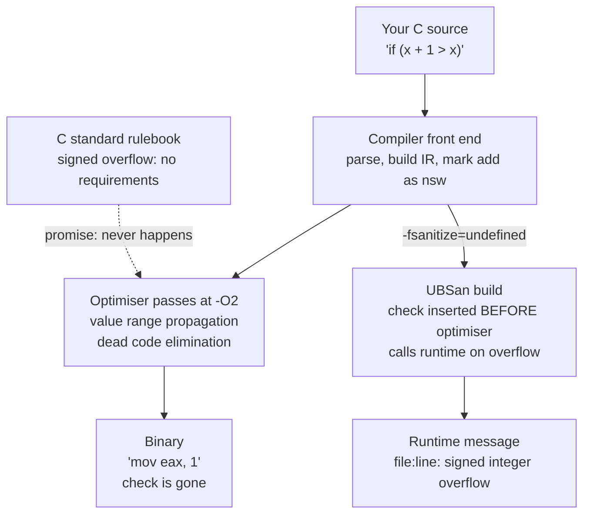

# Module 1.11: Undefined behaviour

**Estimated hours:** 4

**What you will learn**

1. What "undefined behaviour" (UB) means precisely, and how it differs from "unspecified" and "implementation-defined" behaviour.
2. Why an optimising compiler is allowed to delete your safety checks, and the three classic examples you can see with your own eyes in Compiler Explorer.
3. The common kinds of UB, how `-fsanitize=undefined` catches most of them, and a short checklist of UB-aware coding rules you will follow for the rest of the course.

**Prerequisites:** [Module 1.10: Process memory layout](module-10-process-memory-layout.md). You need pointers, arrays, signed integers and the `gcc` command line.

---

## 1. One-line intuition

Undefined behaviour is a promise you made to the compiler ("this never happens") that the compiler is allowed to take literally, so when it does happen, anything at all may follow.

## 2. Real-life analogy

A bank hires a courier and gives him a rulebook. One rule says: "You will never be handed a parcel heavier than 20 kg." The courier reads that rule and buys a cheap bicycle with a 20 kg basket, because the rule says he will never need more.

One day someone hands him a 40 kg parcel. What happens? The rulebook does not say. The basket may bend. The bike may tip over at a junction. He may drop a different parcel. He may even deliver it fine today and crash tomorrow. Nobody can predict it, because the situation was declared impossible, and everything he bought and planned assumed it was impossible.

The C standard is that rulebook. "Signed integers never overflow" is one of its rules. The compiler is the courier: it builds the fastest code it can on the assumption that the rules hold. When your program breaks a rule, the compiler has no obligation to do anything sensible. That is undefined behaviour.

## 3. Why it exists: the problem it solves

C was designed in the 1970s to be fast on every machine. Different CPUs did different things on overflow, on reading unaligned memory, on dividing by zero. If the standard had said "overflow wraps around", then on a CPU that traps on overflow the compiler would have had to add a check before every addition. That would have made C slow everywhere to protect code that was already wrong.

So the standard chose a different deal. For a list of situations it says: "the standard imposes no requirements". The programmer promises not to cause those situations. In return the compiler may assume they never happen, and it uses that assumption to generate faster code:

- It can keep a loop counter in a register and assume `i + 1` is always bigger than `i`.
- It can skip a null check after a pointer has already been dereferenced, because dereferencing null was "impossible".
- It can drop a loop that has no side effects, because an infinite loop with no side effects is "impossible".

What breaks without the deal: either C becomes slow (every operation checked), or every CPU needs its own version of the language. What breaks *with* the deal when a programmer forgets it: silent wrong answers, deleted safety checks, security holes. Many famous vulnerabilities are a programmer writing a check that the compiler legally removed.

Your job for the rest of this course is simple to state and hard to do: never break a rule, and use tools that tell you when you have.

## 4. Three layers of depth

### Layer 1 (beginner): three different words

The C standard uses three terms that beginners mix up. They are not the same.

| Term | Meaning | Example | Can you rely on the result? |
|---|---|---|---|
| **Implementation-defined** | The compiler must pick a behaviour and document it | How many bits in `int`; whether `char` is signed; what `-7 >> 1` gives | Yes, on that compiler. Check the docs. |
| **Unspecified** | The compiler may pick from a list of allowed behaviours and need not document or be consistent | The order in which `f()` and `g()` are called in `f() + g()` | No. Any of the allowed options may happen, even differently on each run. |
| **Undefined** | The standard imposes **no requirements at all** | Signed overflow, reading outside an array, using freed memory | No. Anything may happen, including nothing, including something that looks correct. |

The exact words of the standard for undefined behaviour are worth memorising because interviewers like them: "behaviour, upon use of a nonportable or erroneous program construct or of erroneous data, for which this International Standard imposes no requirements."

Key consequences:

- UB is a property of a **program execution**, not of a line of code. `a + b` is fine on most inputs and UB on one specific pair.
- UB has no time limit. The compiler may act on UB *before* the offending line runs (see the null-check example in Layer 3). People call this "time travel".
- "It worked when I tested it" proves nothing. One of the allowed outcomes of UB is working correctly.

### Layer 2 (working engineer): the common list and the tools

Here are the kinds of UB you will actually hit in C systems code, roughly in order of how often they appear in real bug reports.

| UB | Looks like | What usually happens in practice | Tool that catches it |
|---|---|---|---|
| Out-of-bounds read or write | `arr[4]` on a 4-element array; `strcpy` into a short buffer | Corrupts a neighbour variable, the return address, or heap metadata; crashes later somewhere unrelated | ASan (`-fsanitize=address`), Valgrind, UBSan for arrays of known size |
| Use after free | `free(p); ... p->field` | Reads garbage or another object that reused the memory; corrupts the allocator | ASan, Valgrind |
| Uninitialised read | `int x; if (x > 0)` | Whatever was on the stack; changes with build flags | Valgrind (memcheck), MSan on clang; the compiler warns in simple cases |
| Null pointer dereference | `p->field` with `p == NULL` | Segfault at address 0 or a small offset, if you are lucky | ASan, UBSan (`-fsanitize=null`) |
| Signed integer overflow | `INT_MAX + 1`, `balance * 100` | Wraps at `-O0`; at `-O2` the compiler may fold your overflow check away | UBSan (`-fsanitize=signed-integer-overflow`) |
| Shift by too much or by negative | `1 << 40` on a 32-bit `int`; `x << -1` | x86 masks the count, so you get `1 << 8`; ARM gives 0 | UBSan |
| Shift into the sign bit | `1 << 31` on `int` | Usually "works", still UB before C23 | UBSan |
| Division by zero | `total / count` with `count == 0` | `SIGFPE` crash on x86 | UBSan |
| Strict aliasing violation | `*(int *)&some_float`, reading a `uint32_t` through a `char*` buffer with a cast | Compiler reorders loads and stores because it assumes an `int*` and a `float*` cannot overlap; wrong values at `-O2` | Nothing reliable; `-Wstrict-aliasing` catches some. Use `memcpy` instead. |
| Misaligned access | Casting a `char*` buffer to `uint64_t*` at offset 3 | Works on x86 (slower), crashes with `SIGBUS` on some ARM | UBSan (`-fsanitize=alignment`) |
| Data race | Two threads write the same variable without a lock or atomic | Lost updates, torn values, stale reads for ever | TSan (`-fsanitize=thread`), Phase 4 |
| Modifying a string literal | `char *s = "abc"; s[0] = 'x';` | Segfault: literals live in read-only `.rodata` (module 1.10) | The crash itself |
| Reading a `va_arg` of the wrong type | `printf("%d", some_long_long)` | Garbage, or the next argument's bytes | `-Wformat` (part of `-Wall`) |
| Returning the address of a local | `return buf;` where `buf` is a local array | Works until the next call overwrites the stack | `-Wreturn-local-addr`, ASan with `detect_stack_use_after_return` |

Two things that are **not** UB and that people often think are:

- **Unsigned overflow.** `unsigned` arithmetic wraps modulo 2^N by definition. Hash functions rely on this. That is why the FNV hash in module 1.15 uses `uint64_t`.
- **Converting a large `uint64_t` to `int64_t`.** Implementation-defined before C23 (GCC documents that it wraps), not undefined.

**The sanitiser.** `-fsanitize=undefined` (UBSan) asks the compiler to insert a runtime check before each operation that could be UB. When the check fails it prints a message with the file, line and column, and by default keeps running. Add `-fno-sanitize-recover=all` to make the first error exit with status 1, which is what you want in tests and CI. UBSan costs typically 10 to 50 percent speed, so it is a test-time tool, not a production flag.

UBSan is good at arithmetic UB (overflow, shifts, bounds on arrays whose size the compiler knows, null, alignment). It does **not** catch uninitialised reads, use-after-free or heap overflows through pointers. For those you use ASan and Valgrind (module 8.04 and 8.05). You will see this split in the lab.

**Why `-O0` versus `-O2` matters.** At `-O0` the compiler translates each line almost literally, so UB usually produces the "natural" hardware result: overflow wraps, out-of-bounds reads the next bytes. At `-O2` the compiler reasons about the whole function using the "never happens" assumptions, and that is when checks vanish. The dangerous moment is the day a project switches its release build from `-O0` to `-O2` and code that "always worked" starts failing. That is exactly the migration-engine story in section 7.

### Layer 3 (internals): watching the optimiser take the promise literally

Put this file into <https://godbolt.org/>, choose **x86-64 gcc 13** (or clang 18) and the flag `-O2`:

```c
/* fold.c : three functions to read in Compiler Explorer at -O2 */
int plus_one_is_bigger(int x) {
    return x + 1 > x;
}

int read_then_check(int *p) {
    int v = *p;                 /* dereference first ... */
    if (p == 0) {               /* ... then check for null */
        return -1;
    }
    return v;
}

int spin(unsigned n) {
    unsigned i = 0;
    while (i != n) {            /* no side effects inside the loop */
        i += 2;                 /* if n is odd this never ends ... in maths */
    }
    return 1;
}
```

What clang 18 produces at `-O2` (verified locally; GCC gives the same for the first two):

```asm
plus_one_is_bigger:
        mov     eax, 1
        ret
read_then_check:
        mov     eax, dword ptr [rdi]
        ret
spin:
        mov     eax, 1
        ret
```

Read each one slowly.

1. **`plus_one_is_bigger` returns 1 unconditionally.** There is no add and no compare. The compiler reasoned: "if `x + 1` overflowed, that would be UB, and UB never happens; therefore `x + 1 > x` is always true." The one input where you wanted this function to say 0 (`x == INT_MAX`) is precisely the input the compiler was allowed to ignore. Code like `if (len + 1 > len)` as an overflow guard is a check that does not exist in the binary.

2. **`read_then_check` has no null check.** The compiler reasoned: "`*p` was evaluated on line 1. If `p` were null that would be UB. So `p` is not null, so the `if` on line 2 is dead code." The check was removed because of UB that happens *before* it. The Linux kernel had exactly this bug in 2009 (CVE-2009-1897): a `struct` field was read before the null test, the compiler deleted the test, and an attacker who could map page zero got kernel code execution. The kernel now compiles with `-fno-delete-null-pointer-checks`.

3. **`spin` returns 1 without looping.** In C11 and later, a loop whose controlling expression is not a constant and whose body has no side effects (no I/O, no volatile access, no atomics) may be assumed by the compiler to terminate. Clang took that permission: it reasoned "the loop ends eventually, and after it ends we return 1, so just return 1." GCC 13 keeps a loop here but still relies on the same rule elsewhere. If you wrote a "wait until a flag changes" busy loop without `volatile` or an atomic, the compiler is allowed to delete it. That is why Phase 4 will insist on atomics for flags shared between threads.

**How the compiler does this.** After parsing, GCC and Clang translate your code into an intermediate form (GIMPLE in GCC, LLVM IR in Clang). Optimisation passes walk that form carrying facts: "this value is non-null", "this add has the `nsw` flag" (no signed wrap, meaning overflow is UB). A pass called *value range propagation* uses `nsw` to decide `x + 1 > x` is always true. A pass called *dead code elimination* then removes the branch. Each pass is locally correct given the standard's rules; the surprising result comes from combining them. There is no "evil" pass; there is just a program that broke a promise.

**UBSan internals in one paragraph.** With `-fsanitize=undefined` the compiler emits, before each risky operation, an explicit check in the intermediate form: for `a + b` on `int`, it emits an add-with-overflow intrinsic and branches to a call into the UBSan runtime library (`__ubsan_handle_add_overflow`) when the overflow flag is set. The runtime looks up the source location it was given and prints the message. Because the check is inserted *before* the optimiser's folding, the optimiser cannot delete it. The one exception you will meet in the lab: GCC's front end folds `x + 1 > x` to `1` even at `-O0`, before UBSan sees it, so to catch that overflow the add must be stored in a variable first.

## 5. Architecture diagram



The dotted line is the whole story: the standard's "no requirements" becomes the optimiser's "never happens", and your check disappears on the way to the binary. UBSan works because it hooks in before that happens.

## 6. Code

This program contains four pieces of UB. All dangerous inputs come from the command line so the compiler cannot see them at compile time (if it could, `-Werror` would reject the file, which is a lesson in itself: let the compiler warn, and treat warnings as errors).

```c
/* ub_demo.c
 * Four pieces of undefined behaviour. Each one looks harmless.
 * Build it at -O0, then -O2, then with -fsanitize=undefined,
 * and compare the answers.
 */
#include <stdio.h>
#include <stdlib.h>
#include <limits.h>

/* UB 1: signed overflow. For any int x, is x + 1 > x?
 * A mathematician says yes. C says: yes, unless x == INT_MAX;
 * then the standard imposes no requirements at all. */
static int plus_one_is_bigger(int x) {
    int y = x + 1;          /* overflows when x == INT_MAX */
    return y > x;
}

/* UB 2: shifting a 32-bit int by 32 or more bits. */
static int shift_left(int value, int by) {
    return value << by;
}

/* UB 3: reading an array slot that was never given a value.
 * Only slots 0 and 1 are set. Reading slot k >= 2 is UB.
 * The compiler cannot prove k >= 2 here, so no warning. */
static int uninitialised(int k) {
    int vals[8];
    vals[0] = 1;
    vals[1] = 2;
    return vals[k];
}

int main(int argc, char **argv) {
    /* All inputs come from the command line so the compiler cannot
     * see the dangerous values at compile time and warn about them. */
    int x   = (argc > 1) ? atoi(argv[1]) : INT_MAX;
    int by  = (argc > 2) ? atoi(argv[2]) : 40;
    int idx = (argc > 3) ? atoi(argv[3]) : 4;
    int k   = (argc > 4) ? atoi(argv[4]) : 5;
    int arr[4] = {10, 20, 30, 40};

    printf("x = %d\n", x);
    printf("x + 1 > x          -> %d\n", plus_one_is_bigger(x));
    printf("1 << %d            -> %d\n", by, shift_left(1, by));
    /* UB 4: reading one past the end of an array. */
    printf("arr[%d] (size 4)    -> %d\n", idx, arr[idx]);
    printf("vals[%d] never set  -> %d\n", k, uninitialised(k));
    return 0;
}
```

Build it three ways and run each with no arguments (the defaults are all UB):

```bash
gcc -std=c17 -Wall -Wextra -Werror -g -O0 -o ub_demo_O0 ub_demo.c
gcc -std=c17 -Wall -Wextra -Werror -g -O2 -o ub_demo_O2 ub_demo.c
gcc -std=c17 -Wall -Wextra -Werror -g -fsanitize=undefined -o ub_demo_san ub_demo.c
./ub_demo_O0
./ub_demo_O2
./ub_demo_san
```

Output of `./ub_demo_O0` (the `arr[4]` line is garbage and changes every run; the `vals[5]` line is whatever was on the stack):

```text
x = 2147483647
x + 1 > x          -> 0
1 << 40            -> 256
arr[4] (size 4)    -> -335082416
vals[5] never set  -> 0
```

Output of `./ub_demo_O2` on the same machine:

```text
x = 2147483647
x + 1 > x          -> 1
1 << 40            -> 256
arr[4] (size 4)    -> 6
vals[5] never set  -> 0
```

Same source, same input, different answer on line 2. At `-O0` the add wrapped to `INT_MIN` and the compare was false. At `-O2` the compiler folded the compare to true. Neither answer is "the right one"; both are permitted, because there is no right one. `1 << 40` gives 256 on x86-64 because the CPU's shift instruction masks the count to 5 bits (40 mod 32 = 8); on an ARM machine you would typically get 0.

Output of `./ub_demo_san` (addresses differ):

```text
ub_demo.c:14:9: runtime error: signed integer overflow: 2147483647 + 1 cannot be represented in type 'int'
ub_demo.c:20:18: runtime error: shift exponent 40 is too large for 32-bit type 'int'
ub_demo.c:46:51: runtime error: index 4 out of bounds for type 'int [4]'
ub_demo.c:46:5: runtime error: load of address 0x7ffd217e8df0 with insufficient space for an object of type 'int'
0x7ffd217e8df0: note: pointer points here
 28 00 00 00  90 8e 7e 21 fd 7f 00 00  00 3f df 62 df b3 4a ac  50 aa a7 ce 03 7a 00 00  38 8f 7e 21
              ^
x = 2147483647
x + 1 > x          -> 0
1 << 40            -> 256
arr[4] (size 4)    -> 561942160
vals[5] never set  -> 32765
```

Read the messages: file, line, column, the exact rule broken, the exact values. Three of the four UBs were caught. The fourth, the uninitialised read of `vals[5]`, was **not** reported, because UBSan does not track whether memory was written. Valgrind does:

```bash
valgrind -q ./ub_demo_O0 5 3 2 5
```

```text
==138== Conditional jump or move depends on uninitialised value(s)
==138==    at 0x48CE0CB: __printf_buffer (vfprintf-process-arg.c:58)
==138==    by 0x48CF73A: __vfprintf_internal (vfprintf-internal.c:1544)
==138==    by 0x48C41B2: printf (printf.c:33)
==138==    by 0x109385: main (ub_demo.c:47)
```

The arguments `5 3 2 5` make the first three operations legal (5 + 1, `1 << 3`, `arr[2]`) and leave only the uninitialised read, which Valgrind flags at line 47. Different tools, different UB. You need both.

## 7. Use case: core-banking loan-origination platform

The Berkeley DB to YugabyteDB migration engine (resume claim H1, capstone C3) reads packed records with a layout like the one in module 1.07: a 12-byte loan number, a 6-byte branch code, then little-endian integers at fixed offsets. The obvious way to read the 8-byte principal at offset 24 is one line:

```c
long long principal = *(long long *)(raw + 24);   /* UB: alignment and aliasing */
```

That line is UB twice. `raw + 24` is only guaranteed 1-byte aligned, and reading a `long long` through a pointer into a `char` buffer breaks the strict-aliasing rule. On the x86 development machines it worked. On the first run with `-O2` against a real export, some records came back with the wrong principal, because the optimiser reordered the load relative to a nearby `memcpy` into the same buffer, which the aliasing rule allows it to do.

**The decision it drove:** every field decode in the engine goes through a tiny byte-by-byte function (`rd_u64le` in module 1.15), the whole codebase is built with `-Wall -Wextra -Werror` plus a UBSan and ASan job in CI, and the records-per-second number in the design document was measured on the `-O2` build *with* the sanitised build passing first. The cost was a code-review rule and a slower CI job; the benefit was that a batch of several million records could be trusted on both x86 and ARM hardware. This is what "undefined-behaviour-aware coding" on the resume means in practice, and it is what you will show in the C3 journal.

## 8. Lab

### Part A: see the optimiser delete your check (30 minutes)

1. Open <https://godbolt.org/>, language **C**, compiler **x86-64 clang 18**, options `-O2`. Paste `fold.c` from Layer 3. Confirm all three functions collapse as shown.
2. Switch the compiler to **x86-64 gcc 13**. Note which functions still collapse (the first two) and what GCC does with `spin`.
3. Change `-O2` to `-O0` on either compiler. Now `plus_one_is_bigger` contains a real add and compare. Note how many instructions it has at each level.
4. Add the flag `-fwrapv` next to `-O2`. This flag tells GCC and Clang to define signed overflow as wrapping. Watch `plus_one_is_bigger` get its compare back. Then remove the flag: you are not going to rely on it, you are going to write code that does not overflow.
5. Change `int` to `unsigned` in `plus_one_is_bigger`. Unsigned wraps by definition, so the compiler must keep the compare. Confirm it does.

Expected: at `-O2`, `plus_one_is_bigger` is `mov eax, 1` / `ret`; with `-fwrapv` or `unsigned` it becomes a `lea`/`cmp`/`setg` sequence (three to four instructions). Write down the instruction counts.

### Part B: run the demo three ways (30 minutes)

1. Build and run `ub_demo.c` exactly as in section 6. Record the value of `x + 1 > x` at `-O0` and at `-O2`.
2. Run `./ub_demo_O0` five times. The `arr[4]` value changes between runs (stack layout randomisation from module 1.10). Run `./ub_demo_O2` five times: on one laptop it printed 6 every time, because at `-O2` the compiler read a different register. Neither is stable across compilers.
3. Run `./ub_demo_san 5 3 2 1`. All four operations are now legal and the sanitiser prints nothing. Then try `./ub_demo_san 2147483647 3 2 1` (only the overflow), `./ub_demo_san 5 32 2 1` (only the shift), `./ub_demo_san 5 3 4 1` (only the bounds). Each prints exactly one runtime error.
4. Rebuild with `-fno-sanitize-recover=all` added:

```bash
gcc -std=c17 -Wall -Wextra -Werror -g -fsanitize=undefined -fno-sanitize-recover=all -o ub_demo_trap ub_demo.c
./ub_demo_trap; echo "exit code $?"
```

Expected: the first runtime error prints, nothing else prints, and the exit code is 1. This is the setting you will use in test runs: fail fast.

### Part C: the compiler as a first line of defence (20 minutes)

1. Add this function to `ub_demo.c` and call it from `main`:

```c
static int never_set(void) {
    int n;
    return n;
}
```

2. Build with the standard flags. Expected: the build **fails** with `error: 'n' is used uninitialized [-Werror=uninitialized]`. This is why the course insists on `-Wall -Wextra -Werror`: the cheapest UB detector is the compiler, and `-Werror` stops you ignoring it.
3. Now change `return n;` to `return n + 0 * 1;` and rebuild. Still caught? Try hiding it in an array like `uninitialised()` does. Note the point where the compiler gives up. That point is where Valgrind and sanitisers take over.
4. Remove the function again so the file matches section 6.

### Part D: adopt the rules (20 minutes)

Copy this checklist into `journal/ub-rules.md`. From now on every lab in this course, every capstone, and every code review you do must pass it. You will be asked about these rules in the capstone C3 and C6 resume-defence sessions.

**UB-aware coding rules**

1. Build everything with `-std=c17 -Wall -Wextra -Werror -g`. Never silence a warning; fix it.
2. Before anything ships, it runs clean under `-fsanitize=undefined -fno-sanitize-recover=all`, under `-fsanitize=address`, and under Valgrind. Three tools, because each sees different UB.
3. Every array index and every pointer arithmetic step has a bound you can point at. `for (i = 0; i < n; ++i)` with `n` being the real size; never `<=`.
4. Signed arithmetic on values from outside the program (file, network, user) is checked before it happens, or done in a wider type, or done in `unsigned`. For money, use a 64-bit integer in the smallest unit (paise) and check the range at the boundary.
5. Decode binary data byte by byte or with `memcpy`. Never cast a `char*` buffer to `int*`, `long long*` or a struct pointer.
6. After `free(p)`, set `p = NULL` if `p` lives on. Never read, compare or pass a freed pointer.
7. Every variable is initialised at the point it is declared, or in a branch the compiler can see.
8. Shift counts are checked against the width of the type; left shifts are done on unsigned types.
9. Null checks come **before** the first dereference, not after.
10. Shared mutable data between threads uses a mutex or an atomic. No "it is only an int".
11. Assume `-O2` in production. Anything that only works at `-O0` is a bug, not a quirk.

### Journal

Copy [journal/TEMPLATE.md](../journal/TEMPLATE.md) to `journal/YYYY-MM-DD-undefined-behaviour.md`. Record: the instruction counts from Part A at `-O2`, with `-fwrapv`, and at `-O0`; the two values of `x + 1 > x` from Part B; the exact `-Werror` message from Part C and the smallest change that made the compiler stop catching it; and a link to `journal/ub-rules.md`.

## 9. Common mistakes and misconceptions

| Mistake | Why it is wrong | Bug it causes later |
|---|---|---|
| "Signed overflow wraps around" | It wraps at `-O0` on x86 by accident; the standard says UB, and the optimiser uses that | Overflow guards like `if (a + b < a)` compiled away; wrong interest totals |
| "If it is UB the program will crash" | Crashing is only one allowed outcome; silently wrong output is another | Weeks of "works on my machine" before a production mismatch |
| "UB only matters at the line where it happens" | The compiler may act on it earlier or later in the function | A null check that exists in the source and not in the binary |
| "UBSan catches all UB" | It catches arithmetic, shifts, bounds on known arrays, null and alignment; not uninitialised reads, not use-after-free | Clean UBSan run, then a Valgrind report full of uninitialised reads |
| "Unsigned arithmetic is also UB on overflow" | Unsigned wraps by definition | Rewriting correct hash code to avoid a problem that is not there |
| "Casting a byte buffer to a struct pointer is normal C" | It breaks alignment and strict aliasing rules | Fields decoded wrongly after turning on `-O2`, especially on ARM |
| "`-fwrapv` fixes overflow bugs" | It defines one behaviour on one compiler; the program is still non-portable and the maths is still wrong | A wrong value that is now reproducibly wrong |
| "The compiler is being malicious" | Each optimisation pass is correct under the standard; the program broke the contract | Arguing with the toolchain instead of fixing the code |

## 10. Resume link

- **Claim B, "undefined-behaviour-aware coding".** Interviewers test this with one question: "give me an example of UB that an optimiser exploits." Answer with Layer 3: "`x + 1 > x` folds to true at `-O2` because signed overflow is UB; a null check after a dereference is deleted; I have watched both happen in Compiler Explorer." Then name your rules: byte-wise decoding, `-Werror`, UBSan and ASan in CI, Valgrind before merge.
- **Claim H1, the migration engine.** Say: "The record decoder never casts the byte buffer; it reads little-endian fields byte by byte, which is both alignment-safe and aliasing-safe. We ran the sanitised build over the full export before trusting the `-O2` numbers." You will have the measurement from capstone C3.
- **Claim F, "memory corruption and leak investigation".** Most memory corruption *is* UB: out-of-bounds writes and use-after-free. Being able to say which tool catches which class (UBSan for arithmetic, ASan for bounds and use-after-free, Valgrind for uninitialised reads, TSan for races) is what the "ASan/TSan" line on the resume means.

Likely follow-up: "What is the difference between undefined, unspecified and implementation-defined behaviour?" Give the three-row table from Layer 1 with one example each.

## 11. Interview questions

**Q1 (easy). What does "undefined behaviour" mean in C?**

<details>
<summary>Model answer</summary>

It is behaviour for which the C standard imposes no requirements. If a program does something the standard lists as undefined, such as overflowing a signed integer, reading outside an array or using memory after it is freed, the standard says nothing about what happens next: the program may crash, give wrong answers, appear to work, or behave differently at different optimisation levels. It is a property of a particular execution with particular inputs, not of a line of code in isolation.

</details>

**Q2 (easy). Name five common kinds of undefined behaviour and the tool you would use to detect each.**

<details>
<summary>Model answer</summary>

Signed integer overflow and over-long shifts: UBSan with `-fsanitize=undefined`. Out-of-bounds access and use-after-free: AddressSanitizer or Valgrind. Uninitialised reads: Valgrind memcheck or MemorySanitizer, plus compiler warnings for the simple cases. Null pointer dereference: UBSan's null check, or the crash itself. Data races between threads: ThreadSanitizer. Strict-aliasing violations have no reliable detector, which is why the rule is to use `memcpy` or byte-wise decoding instead of pointer casts.

</details>

**Q3 (medium). Why does `if (x + 1 > x)` not protect against overflow, and what should you write instead?**

<details>
<summary>Model answer</summary>

Because signed overflow is undefined, the compiler may assume `x + 1` never overflows, and under that assumption `x + 1 > x` is always true, so at `-O2` the condition folds to a constant and the branch disappears. The check must be done without performing the overflowing operation: `if (x < INT_MAX)` before adding, or `if (b > 0 && a > INT_MAX - b)` for a general add, or compute in a wider type such as `long long` and range-check the result, or use `__builtin_add_overflow`. For money I keep amounts in 64-bit paise and validate ranges at the input boundary.

</details>

**Q4 (medium). Explain how the compiler can remove a null check that appears in the source code.**

<details>
<summary>Model answer</summary>

If a pointer is dereferenced before it is checked, the dereference is undefined when the pointer is null. The optimiser records the fact "this pointer is non-null after this point" and then sees that the later `if (p == NULL)` can never be true, so dead-code elimination removes the branch. The source still shows a check; the binary has none. This caused a real Linux kernel privilege escalation in 2009, after which the kernel adopted `-fno-delete-null-pointer-checks`. The fix in ordinary code is to check before the first dereference.

</details>

**Q5 (hard). You switch a C service from `-O0` to `-O2` and a record decoder starts returning wrong values for some fields. Walk through how you would find and fix the cause.**

<details>
<summary>Model answer</summary>

A change only in optimisation level that changes results almost always means UB that the optimiser is now exploiting. First I rebuild with `-fsanitize=undefined -fno-sanitize-recover=all` and run the failing input; alignment and shift errors appear immediately with file and line. If UBSan is quiet I rebuild with `-fsanitize=address` and then run under Valgrind to catch out-of-bounds reads and uninitialised values. In a decoder the usual suspect is a cast of the byte buffer to a wider type, such as `*(uint64_t *)(buf + 24)`, which violates both alignment and strict aliasing; the optimiser may reorder that load across a `memcpy` into the same buffer. The fix is to decode each field through a small function that assembles the value byte by byte, or `memcpy` into a local of the right type, then add the sanitised build to CI so the class of bug cannot return. I would also diff the `-O0` and `-O2` assembly for the decode function in Compiler Explorer to confirm the reordering, and put that evidence in the RCA.

</details>

## 12. Revision

- Undefined behaviour means the standard imposes no requirements; the compiler assumes it never happens and optimises on that assumption, so checks written after the fact can vanish (`x + 1 > x` folds to true; a null test after a dereference is deleted).
- The frequent offenders are out-of-bounds access, use-after-free, uninitialised reads, signed overflow, bad shifts, aliasing casts and data races; UBSan catches the arithmetic kinds, ASan and Valgrind the memory kinds, TSan the races.
- Rules for the rest of the course: `-Wall -Wextra -Werror`, sanitised and Valgrind-clean before merge, byte-wise decoding instead of casts, checks before dereferences, assume `-O2`.

---

Previous: [Module 1.10: Process memory layout](module-10-process-memory-layout.md) | Next: [Module 1.12: Preprocessor, compiler and linker](module-12-preprocessor-compiler-linker.md)
