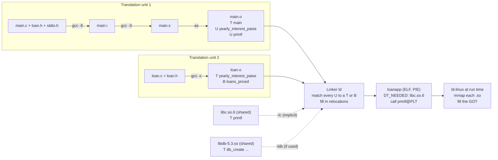

# Module 1.12: Preprocessor, compiler and linker

**Estimated hours:** 4

**What you will learn**

1. The four stages that turn a `.c` file into a running program (preprocess, compile, assemble, link) and how to stop after each one with `gcc -E`, `-S` and `-c`.
2. What a translation unit, an object file and a symbol are, how to read `nm` output, and what "undefined reference" actually means.
3. How static and shared libraries differ, why `-ldb` (Berkeley DB) is a shared library on your system, and what `-O0`, `-O2`, `-g`, `-Wall`, `-Wextra` and `-Werror` each do.

**Prerequisites:** [Module 1.11: Undefined behaviour](module-11-undefined-behaviour.md). You need functions, the `#include` line you have been typing since module 1.01, and a working `gcc`.

---

## 1. One-line intuition

`gcc` is not one program: it is a pipeline of four tools, and each one hands the next a file you can look at.

## 2. Real-life analogy

Think of how a bank produces its printed annual report.

- **The preprocessor** is the clerk who assembles the draft: wherever the draft says "insert the standard legal notice here" (`#include`), the clerk pastes in the full text; wherever it says "the bank's name" (`#define`), the clerk writes the actual name. The result is one long, flat document with nothing left to look up.
- **The compiler** is the translator who turns that document into a language the printing press understands (assembly), one chapter at a time. Each chapter is translated separately; the translator does not need the other chapters, only a list of the terms they define (the header).
- **The assembler** is the typesetter who turns each translated chapter into metal plates (object files). Each plate has blank spaces labelled "page number of the chapter on lending goes here", because the typesetter does not yet know where the other chapters will land.
- **The linker** is the binder who takes all the plates, decides the order, fills in every blank cross-reference with the real page number, and binds one book (the executable). If a chapter refers to "Appendix F" and nobody wrote Appendix F, the binder stops with "undefined reference to Appendix F".
- **A library** is a box of ready-made plates from another department (`libm` for maths, `libdb` for Berkeley DB). A **static** library has its plates bound straight into your book. A **shared** library stays on the shelf, and your book just says "see the standard appendix on the shelf", which is looked up each time the book is opened.

## 3. Why it exists: the problem it solves

A bank's application server is hundreds of thousands of lines of C. If the compiler had to read all of it every time you changed one line, a build would take minutes and nobody would ever test anything.

The pipeline solves that by splitting the work:

1. **Separate compilation.** Each `.c` file is translated on its own into an object file. Change one file, recompile one file. Module 1.13 shows `make` automating exactly that.
2. **Headers as contracts.** A `.c` file only needs to know the *shape* of the functions it calls (name, parameters, return type). That shape lives in a header. The body lives somewhere else and is joined in at link time.
3. **Reuse.** The C library, the maths library and Berkeley DB are compiled once by someone else. Your program links against the result. Nobody recompiles `printf`.
4. **One copy of shared code in memory.** Every process on the machine uses the same `libc.so` in RAM. Without shared libraries a server with 200 processes would hold 200 copies of the C library.

What breaks without it: no libraries, no incremental builds, no way to ship a bug fix in `libdb` without rebuilding every program that uses it. And without understanding it, every "undefined reference" or "cannot open shared object file" error is a mystery instead of a five-second fix.

## 4. Three layers of depth

### Layer 1 (beginner): the four stages and the files they make

| Stage | Tool | Input | Output | Stop here with |
|---|---|---|---|---|
| 1. Preprocess | `cpp` | `main.c` | `main.i` (pure C, no `#` lines) | `gcc -E main.c -o main.i` |
| 2. Compile | `cc1` | `main.i` | `main.s` (assembly text) | `gcc -S main.c -o main.s` |
| 3. Assemble | `as` | `main.s` | `main.o` (object file: machine code with blanks) | `gcc -c main.c -o main.o` |
| 4. Link | `ld` (via `collect2`) | `main.o`, `loan.o`, libraries | `loanapp` (executable) | `gcc -o loanapp main.o loan.o` |

`gcc` is a **driver**: it looks at the file extension and the flags and runs the right tools in order. `gcc -o app main.c` runs all four stages for you and deletes the intermediate files.

**The preprocessor** is a text editor that runs before the compiler. It knows nothing about C; it only knows lines starting with `#`:

- `#include <stdio.h>` pastes in the whole file `/usr/include/stdio.h` (angle brackets: search the system directories). `#include "loan.h"` pastes in `loan.h` from the current directory first (quotes: search here, then the system).
- `#define PAISE_PER_RUPEE 100LL` replaces every later `PAISE_PER_RUPEE` with `100LL`. No types, no scope, just text.
- `#ifdef`, `#ifndef`, `#endif` keep or drop blocks of text. Module 1.13 uses this for header guards.

**A translation unit** is one `.c` file after preprocessing: the file plus everything it included. It is the unit the compiler sees. The compiler compiles translation units one at a time and never sees two at once. That one fact explains most linker errors.

**An object file** (`.o`) is machine code for one translation unit, plus a table of **symbols**: names it defines (functions and global variables it contains) and names it needs from elsewhere.

**The linker** reads all the object files and libraries, matches every "needed" name against a "defined" name, patches the addresses, and writes the executable. A name that is needed but never defined is an **undefined reference**. A name defined twice is a **multiple definition**.

### Layer 2 (working engineer): symbols, libraries, flags

**Reading `nm`.** The `nm` tool lists an object file's symbol table. Each line is an address (blank for undefined), a one-letter type, and the name:

| Letter | Meaning | Where it lives (module 1.10) |
|---|---|---|
| `T` | Defined function (text), visible to other files | `.text` |
| `t` | Defined function, `static` (this file only) | `.text` |
| `D` / `d` | Defined, initialised global variable | `.data` |
| `B` / `b` | Defined, zero-initialised global variable | `.bss` |
| `R` / `r` | Read-only data such as string literals | `.rodata` |
| `U` | **Undefined**: used here, must come from another object or a library | nowhere yet |
| `W` / `w` | Weak: may be overridden by another definition | various |

Lower case means internal linkage (`static`); upper case means the linker may match it from other files. You will see real output in section 6.

**Static versus shared libraries.**

| | Static library | Shared library |
|---|---|---|
| File | `libloan.a` (an archive of `.o` files made with `ar`) | `libloan.so` (one ELF file, position-independent code) |
| When code is copied into your program | At link time | Never; loaded into the process at start-up by `ld-linux.so` |
| Executable size | Larger | Smaller |
| Update the library | Relink every program | Replace the `.so`; every program picks it up on next start |
| Memory on a machine with 200 processes | 200 copies of the code | One copy of the code pages, shared |
| Start-up | Fastest | Slightly slower (symbol lookup) |
| Deployment risk | None: self-contained | "cannot open shared object file" if the `.so` is missing or the wrong version |
| Link flag | `-L. -lloan` (finds `libloan.a`) | `-L. -lloan` (prefers `libloan.so` if both exist) |

`-lname` means "search for `libname.so`, then `libname.a`, in the standard directories plus any `-L` directories". `-ldb` therefore means `libdb.so`. On Ubuntu 24.04 the package `libdb5.3t64` installs `/usr/lib/x86_64-linux-gnu/libdb-5.3.so` and the `libdb-dev` package adds the header `/usr/include/db.h` and a symlink `libdb.so` pointing at the versioned file. Berkeley DB is shipped shared so that one copy serves every program on the machine and a security fix to the library does not need a rebuild of the bank's application server.

**Finding shared libraries at run time.** The linker only checks that the `.so` exists at link time. At run time the dynamic loader searches, in order: the executable's `RPATH`/`RUNPATH` if set, the `LD_LIBRARY_PATH` environment variable, the cache in `/etc/ld.so.cache` (built from `/etc/ld.so.conf` by `ldconfig`), then `/lib` and `/usr/lib`. `ldd ./program` shows what it would find. A library in your current directory is **not** found unless you tell the loader (you will see this fail on purpose in the lab).

**Link order matters.** The linker walks the command line left to right. When it meets a static library or a shared library marked as-needed, it pulls in only the symbols that are *currently* undefined. If `main.o` comes *after* `-lloan`, the linker has no undefined symbols yet when it reads `libloan`, takes nothing, then reads `main.o`, finds `yearly_interest_paise` undefined, and fails. Rule: objects first, then libraries, with lower-level libraries last. `gcc -o app main.o -lloan -lm` is right; `gcc -o app -lloan main.o` is wrong.

**The flags you type every day.**

| Flag | What it does | Why you use it |
|---|---|---|
| `-std=c17` | Compile against the 2017 C standard, no GNU extensions by default | Portable code; same rules on GCC, Clang and MSVC. Note: `strdup` and other POSIX functions are then hidden unless you define `_POSIX_C_SOURCE`; module 1.15 writes its own copy function for this reason |
| `-Wall` | Enable the most useful warnings: unused variables, missing return, wrong `printf` format, uninitialised in simple cases | Cheapest UB detector (module 1.11) |
| `-Wextra` | Add more: unused parameters, signed/unsigned comparison, missing field initialisers | Catches the comparison bugs that hide loop errors |
| `-Werror` | Turn every warning into a compile error | Nobody can ignore a warning |
| `-g` | Emit debug information in DWARF format: which address belongs to which line, where each variable lives, the layout of each struct | Required for GDB, Valgrind line numbers, and readable core dumps (Phase 8). Does not change the generated instructions |
| `-O0` | No optimisation; each statement is translated literally, every variable lives in memory | Debugging: what you see in GDB matches the source |
| `-O2` | Standard optimisation: inlining, register allocation, loop transformation, dead-code elimination | Production and benchmarks; also where UB bites (module 1.11) |
| `-c` | Stop after assembling; produce `.o` | Separate compilation; `make` uses this |
| `-I dir` | Add a directory to the `#include "..."` and `<...>` search path | Headers in a `include/` folder |
| `-L dir`, `-lname` | Add a library search directory; link `libname` | Berkeley DB: `-ldb`; maths: `-lm`; threads: `-pthread` |
| `-fPIC -shared` | Produce position-independent code and build a `.so` | Making your own shared library |
| `-MMD -MP` | Also write a `.d` file listing the headers this file included | Automatic dependency tracking in `make` (module 1.13) |

**What `-g` costs.** On one laptop the two-file program in section 6 was 16,072 bytes at `-O0`, 16,080 bytes at `-O2`, and 18,024 bytes at `-O0 -g`. Debug information is kept in separate ELF sections (`.debug_info`, `.debug_line`, `.debug_str` and others) that are never loaded into memory when the program runs, so `-g` has no run-time cost. Production binaries at a bank are typically built with `-O2 -g` so that the crash dumps in capstone C6 can be read.

### Layer 3 (internals): what the linker actually does

**Sections and relocations.** The assembler writes each object file in **ELF** format (Executable and Linkable Format). Inside are sections you met in module 1.10: `.text` (code), `.data`, `.bss`, `.rodata`, plus a symbol table and a **relocation table**. A relocation is a note that says "at offset 0x21 in `.text` there is a 4-byte field that must hold the address of `yearly_interest_paise`, relative to the next instruction". The assembler writes a zero there and leaves the note, because it cannot know the final address.

**Symbol resolution.** The linker reads every input in order and builds one global symbol table. For each object it adds the defined symbols and records the undefined ones. For each archive (`.a`) it scans the index and pulls in only members that define a currently undefined symbol. At the end, any symbol still undefined is reported with the object and source line that needed it (which is why the error message in section 6 names `main.c:10`).

**Layout and relocation.** The linker concatenates all `.text` sections into one output `.text`, all `.data` into one `.data`, and so on, assigning each input section a final address. Then it walks every relocation note and writes the real value into the field. For a call it writes the distance from the call instruction to the target. After this step the blanks are filled and the code can run.

**Position-independent code and the PLT.** Ubuntu builds executables as **PIE** (position-independent executables) by default, so the kernel can load them at a random address (ASLR, module 1.10). Calls into a shared library cannot be patched at link time because the library's address is unknown until the process starts. Instead the compiler emits `call printf@PLT`: a jump into a small table, the **Procedure Linkage Table**, whose entries the dynamic loader fills in at start-up (or lazily on first call) using the **Global Offset Table**. You saw `call printf@PLT` in the `-S` output; that is the mechanism.

**The dynamic loader.** The executable's ELF header names an interpreter, `/lib64/ld-linux-x86-64.so.2`. The kernel maps the executable, then maps that loader and jumps to it. The loader reads the `DT_NEEDED` entries (the list `ldd` shows), maps each `.so` into the process with `mmap`, resolves the symbols, fills the GOT, and only then calls your `main`. Every shared library's code pages are mapped read-only and shared between all processes using them, which is the memory saving from Layer 2.

**Why `-fPIC` for shared libraries.** A `.so` may be mapped at a different address in each process, so its code must not contain absolute addresses. `-fPIC` makes the compiler address everything relative to the instruction pointer (`loans_priced(%rip)` in the assembly) and through the GOT. Without it the loader would have to patch the code pages per process and they could no longer be shared.

## 5. Architecture diagram



Solid arrows are link-time copies; dotted arrows are references that stay unresolved until the loader runs.

## 6. Code

Three files. `loan.h` is the contract, `loan.c` the implementation, `main.c` the user.

```c
/* loan.h : declarations only. No code lives here. */
#ifndef LOAN_H
#define LOAN_H

/* Simple interest in paise for one year.
 * principal_paise: amount lent, in paise (100 paise = 1 rupee)
 * rate_bp: yearly rate in basis points (100 bp = 1 percent) */
long long yearly_interest_paise(long long principal_paise, int rate_bp);

/* Number of loans this library has priced since the program started. */
extern int loans_priced;

#endif
```

```c
/* loan.c : the definitions that loan.h promised. */
#include "loan.h"

int loans_priced = 0;           /* defined here, declared extern in loan.h */

long long yearly_interest_paise(long long principal_paise, int rate_bp) {
    loans_priced = loans_priced + 1;
    return principal_paise * rate_bp / 10000;   /* 10000 bp = 100 percent */
}
```

```c
/* main.c : uses loan.h without knowing how loan.c works. */
#include <stdio.h>
#include "loan.h"

#define BRANCH_CODE "MUM001"            /* a text macro */
#define PAISE_PER_RUPEE 100LL           /* a number macro */

int main(void) {
    long long principal = 250000 * PAISE_PER_RUPEE;   /* 2.5 lakh rupees */
    long long interest  = yearly_interest_paise(principal, 850);  /* 8.50 % */

    printf("branch %s: principal %lld paise, interest %lld paise\n",
           BRANCH_CODE, principal, interest);
    printf("loans priced so far: %d\n", loans_priced);
    return 0;
}
```

**Stage 1: preprocess.**

```bash
gcc -std=c17 -E main.c -o main.i
wc -l main.i
grep -n "yearly_interest_paise\|MUM001\|PAISE" main.i
```

```text
569 main.i
552:long long yearly_interest_paise(long long principal_paise, int rate_bp);
563:    long long interest = yearly_interest_paise(principal, 850);
566:           "MUM001", principal, interest);
```

Nine lines of `main.c` became 569 lines, because `stdio.h` and everything it includes were pasted in. `BRANCH_CODE` and `PAISE_PER_RUPEE` are gone: the text `"MUM001"` is in their place. Line counts vary slightly with the glibc version.

**Stage 2: compile to assembly.**

```bash
gcc -std=c17 -O0 -S main.c -o main.s
grep -n "call\|\.string\|^main:" main.s
```

```text
5:	.string	"MUM001"
8:	.string	"branch %s: principal %lld paise, interest %lld paise\n"
10:	.string	"loans priced so far: %d\n"
14:main:
28:	call	yearly_interest_paise@PLT
39:	call	printf@PLT
45:	call	printf@PLT
```

The calls name functions that do not exist in this file. The compiler does not care; it emits the call and leaves a blank.

**Stage 3: assemble, and read the symbols.**

```bash
gcc -std=c17 -Wall -Wextra -Werror -g -c main.c -o main.o
gcc -std=c17 -Wall -Wextra -Werror -g -c loan.c -o loan.o
nm main.o
echo ---
nm loan.o
```

```text
                 U loans_priced
0000000000000000 T main
                 U printf
                 U yearly_interest_paise
---
0000000000000000 B loans_priced
0000000000000000 T yearly_interest_paise
```

`main.o` defines `main` and needs three things. `loan.o` defines two of them. `loans_priced` is `B` (bss) because it is initialised to zero. `printf` is defined by nobody here; it will come from `libc.so.6`.

**Stage 4: link, first wrongly, then correctly.**

```bash
gcc -o loanapp main.o
```

```text
/usr/bin/ld: main.o: in function `main':
main.c:10:(.text+0x21): undefined reference to `yearly_interest_paise'
/usr/bin/ld: main.c:14:(.text+0x57): undefined reference to `loans_priced'
collect2: error: ld returned 1 exit status
```

Read it like this: the linker (`ld`), while processing `main.o`, inside `main`, at source line 10, needed `yearly_interest_paise` and nobody provided it. The fix is always one of: add the object or library that defines it, spell the name the same in both files, or put the library after the object on the command line.

```bash
gcc -o loanapp main.o loan.o
./loanapp
```

```text
branch MUM001: principal 25000000 paise, interest 2125000 paise
loans priced so far: 1
```

`nm loanapp | grep -i " [TBU] "` on the finished executable shows `T main`, `T yearly_interest_paise`, `B loans_priced` and `U printf@GLIBC_2.2.5`: `printf` is still undefined, deliberately, because it will be found in the shared C library at start-up.

## 7. Use case: core-banking loan-origination platform

The migration engine in resume claim H1 (capstone C3) is a C program that links against Berkeley DB and, through the YugabyteDB client library `libpq`, against PostgreSQL's wire protocol. Both are shared libraries: `libdb-5.3.so` and `libpq.so.5`. Early in that project the engine was packaged as a single binary and copied to the migration host, where it failed at start with `error while loading shared libraries: libdb-5.3.so: cannot open shared object file`. The development machine had `libdb-dev` installed; the migration host had a different Berkeley DB version under a different file name.

**The decision it drove:** the team chose to link Berkeley DB **statically** into the engine (`libdb.a`, so the exact version that was tested is the version that runs) and `libpq` **dynamically** (so the bank's security team could patch TLS in `libpq` without rebuilding the engine). The engine's `ldd` output became part of the deployment runbook, and the CI job ran `ldd` and failed the build if any library resolved to "not found". The trade-off: a larger binary and a rebuild whenever Berkeley DB itself changed, in exchange for a migration that could not fail at start-up because of a library mismatch on the host. You will reproduce the failure and the fix in Part C of the lab.

## 8. Lab

Create a folder `m12` with the three files from section 6.

### Part A: walk the four stages (25 minutes)

1. Run the `-E`, `-S`, `-c` and link commands from section 6 one at a time. After each, run `ls -l` and note the new file and its size.
2. Open `main.i` in VS Code and scroll to the bottom. Your nine lines are there, with the macros replaced. Everything above them is `stdio.h`.
3. Open `main.s`. Find the three `.string` lines and the three `call` lines. Find `loans_priced(%rip)`: that is how a global variable is addressed in position-independent code.
4. Run `nm main.o` and `nm loan.o`. For each symbol, write down the letter and what it means using the table in Layer 2.
5. Add `static` in front of `int loans_priced = 0;` in `loan.c`, recompile `loan.o`, run `nm loan.o`, then try to link. Expected: `nm` shows `b loans_priced` (lower case), and the link fails with `undefined reference to 'loans_priced'`, because a `static` symbol is invisible to other files. Remove the `static`.

### Part B: static library (20 minutes)

```bash
ar rcs libloan.a loan.o
ar t libloan.a
nm libloan.a
gcc -o loanapp_static main.o -L. -lloan
./loanapp_static
gcc -o loanapp_bad -L. -lloan main.o
```

Expected: `ar t` lists `loan.o`; `nm` shows the same two symbols as `loan.o`; `loanapp_static` prints the same two lines as before; the last command **fails** with the same undefined references as in section 6, because the library came before the object that needed it. Write the error in your journal with the sentence "link order: objects before libraries".

### Part C: shared library and the loader (30 minutes)

```bash
gcc -std=c17 -Wall -Wextra -Werror -g -fPIC -shared -o libloan.so loan.c
gcc -std=c17 -Wall -Wextra -Werror -g -o loanapp_shared main.c -L. -lloan
./loanapp_shared
```

Expected: the link succeeds and the run **fails**:

```text
./loanapp_shared: error while loading shared libraries: libloan.so: cannot open shared object file: No such file or directory
```

This is the error from section 7. Now investigate and fix it:

```bash
ldd ./loanapp_shared
LD_LIBRARY_PATH=. ./loanapp_shared
LD_LIBRARY_PATH=. ldd ./loanapp_shared | grep loan
gcc -std=c17 -g -o loanapp_rpath main.c -L. -lloan -Wl,-rpath,'$ORIGIN'
./loanapp_rpath
```

Expected: the first `ldd` shows `libloan.so => not found` alongside `libc.so.6 => /lib/x86_64-linux-gnu/libc.so.6`; with `LD_LIBRARY_PATH=.` the program runs and `ldd` shows `libloan.so => ./libloan.so`; the `-rpath,'$ORIGIN'` build runs without any environment variable because the executable now records "look in my own directory". `$ORIGIN` is how real deployments ship private libraries next to the binary.

Then look at Berkeley DB on your system:

```bash
ls -l /usr/lib/x86_64-linux-gnu/libdb*
ls -l /usr/include/db.h
```

Expected: `libdb-5.3.so` (the real file, typically about 1.8 MB) and `libdb.so` as a symlink to it, plus the header. That symlink is what `-ldb` finds. Module 1.13 links a program against it.

### Part D: flags (20 minutes)

1. Create `warn.c`:

```c
#include <stdio.h>
int f(int a, int b) { int unused; return a; }
int main(void) {
    unsigned u = 1; int s = -1;
    if (u > s) puts("u > s is true");
    printf("%d\n", f(1, 2));
    return 0;
}
```

2. Compile four times and count the warnings:

```bash
gcc -std=c17 -c warn.c -o /dev/null
gcc -std=c17 -Wall -c warn.c -o /dev/null
gcc -std=c17 -Wall -Wextra -c warn.c -o /dev/null
gcc -std=c17 -Wall -Wextra -Werror -c warn.c -o /dev/null; echo "exit $?"
```

Expected: no flags, no warnings. `-Wall` adds `unused variable 'unused'`. `-Wextra` adds `unused parameter 'b'` and `comparison of integer expressions of different signedness`. `-Werror` turns them into errors and the exit code becomes 1. The signedness warning is the important one: `u > s` is true because `-1` converts to `4294967295`, a classic loop-bound bug.

3. Build the section 6 program three ways and compare sizes and debug sections:

```bash
gcc -std=c17 -O0 -o app_O0 main.c loan.c
gcc -std=c17 -O2 -o app_O2 main.c loan.c
gcc -std=c17 -O0 -g -o app_O0g main.c loan.c
ls -l app_O0 app_O2 app_O0g
readelf -S app_O0g | grep -o "\.debug_[a-z_]*" | sort -u
readelf -S app_O0 | grep -c debug
objdump -d --no-show-raw-insn app_O2 | grep -A 12 "<yearly_interest_paise>:"
```

Expected: `app_O0g` is about 2 KB larger than the other two; it has `.debug_abbrev .debug_aranges .debug_info .debug_line .debug_line_str .debug_str`; `app_O0` has zero debug sections. In the `-O2` disassembly the division by 10000 has become a multiply by the magic constant `0x346dc5d63886594b` and a shift: the optimiser replaced a slow `idiv` with a multiply. At `-O0` the same function is about 22 instructions with loads and stores to the stack.

### Journal

Copy [journal/TEMPLATE.md](../journal/TEMPLATE.md) to `journal/YYYY-MM-DD-compiler-and-linker.md`. Record: the line count of `main.i`; the full `nm` output of both object files with your explanation of each letter; the exact text of the undefined-reference error and the wrong-order error; the `ldd` output before and after `LD_LIBRARY_PATH`; the three binary sizes; and the warning each of `-Wall` and `-Wextra` added.

## 9. Common mistakes and misconceptions

| Mistake | Why it is wrong | Bug it causes later |
|---|---|---|
| "Including the header links the library" | `#include` pastes declarations; the code comes from an object or library at link time | `undefined reference to 'db_create'` because `-ldb` was forgotten |
| Putting `-lloan` before `main.o` | The linker only pulls symbols that are undefined at that moment | Undefined references even though the library is right there |
| Defining a variable in a header | Every `.c` that includes it defines it again | `multiple definition of 'loans_priced'` at link time |
| "The `.so` linked fine, so it will run" | Link-time search and run-time search are different | `cannot open shared object file` on the deployment host |
| Shipping a binary built with `-O0` | Debug builds are typically 2 to 10 times slower | Performance numbers that are meaningless; a server that cannot keep up |
| Shipping without `-g` to "save space" | Debug info is not loaded at run time; it only enlarges the file | Core dumps with no line numbers (Phase 8) |
| Treating warnings as noise | Each `-Wall`/`-Wextra` warning is a likely bug the compiler proved | Signed/unsigned loop bugs, wrong `printf` formats, uninitialised reads |
| "`gcc` is the compiler" | It is a driver over preprocessor, compiler, assembler and linker | Not knowing which stage an error comes from, so not knowing how to fix it |

## 10. Resume link

- **Claim G, "GCC/Clang, CMake"**. An interviewer who asks "what happens when you type `gcc main.c`" wants the four stages, the words translation unit, object file, symbol and relocation, and the difference between link-time and run-time library search. You now have real `nm` and `ldd` output in your journal to quote.
- **Claim H1, the migration engine, and claim D, Berkeley DB**. Say: "The engine linked `libdb` statically so the tested version shipped inside the binary, and `libpq` dynamically so TLS fixes did not need a rebuild; `ldd` was part of the release checklist." That is the decision from section 7, and you will make it for real in capstone C3.
- **Claim I, tcpkv, "clean under `-Wall -Wextra -Werror`"**. You can now say exactly what each flag adds and give the signed/unsigned comparison as the example of a bug `-Wextra` catches and `-Wall` does not.
- **Claim F, crash dumps**. "We built production at `-O2 -g`; `-g` adds DWARF sections that are never loaded, so there is no run-time cost, and the dumps have line numbers." Phase 8 depends on this.

Likely follow-up: "Static or shared library, and why?" Give the table from Layer 2 and then a concrete choice with its trade-off, as in section 7.

## 11. Interview questions

**Q1 (easy). What are the four stages of building a C program, and what does each produce?**

<details>
<summary>Model answer</summary>

Preprocessing expands `#include` and `#define` and produces a single pure-C translation unit (`.i`). Compilation translates that into assembly for the target CPU (`.s`). Assembling turns the assembly into an object file (`.o`) containing machine code, a symbol table and relocation entries for addresses not yet known. Linking combines object files and libraries, resolves every undefined symbol against a definition, applies the relocations and writes the executable. `gcc` is a driver that runs all four; `-E`, `-S` and `-c` stop after stages one, two and three.

</details>

**Q2 (easy). What does "undefined reference to `foo`" mean and how do you fix it?**

<details>
<summary>Model answer</summary>

It is a linker error: some object file uses the symbol `foo` (it appears as `U foo` in `nm`), but no object file or library on the link line defines it. Causes are a missing `.o` or `-l` flag, a library placed before the object that needs it, a typo or different spelling between declaration and definition, or the definition being `static` in another file. The fix is to add the right object or library after the objects that need it, or to make the definition externally visible.

</details>

**Q3 (medium). Compare static and shared libraries, and explain why a program can link successfully and still fail to start.**

<details>
<summary>Model answer</summary>

A static library is an archive of object files; the linker copies the needed members into the executable, so the result is self-contained but larger and must be relinked to pick up library fixes. A shared library is position-independent code loaded at start-up by the dynamic loader; the executable only records the library's name, so it is smaller, one copy of the code is shared in memory by all processes, and the library can be updated independently. The failure case: at link time `-L. -lfoo` found `libfoo.so`, but at run time the loader searches `RPATH`/`RUNPATH`, `LD_LIBRARY_PATH`, the `ld.so` cache and the system directories, not the build directory. `ldd` shows "not found". The fixes are installing the library in a standard directory, setting `LD_LIBRARY_PATH`, or linking with `-Wl,-rpath,'$ORIGIN'`.

</details>

**Q4 (medium). What does `-g` add to a binary, and does it make the program slower?**

<details>
<summary>Model answer</summary>

`-g` adds DWARF debug information in extra ELF sections such as `.debug_info`, `.debug_line` and `.debug_str`: a mapping from instruction addresses to source lines, the location of each variable at each point, and type and struct layouts. These sections are not loaded into memory at run time and the generated instructions are identical, so there is no run-time cost, only a larger file on disk. Production builds are typically `-O2 -g` so that core dumps and profilers show function names and line numbers; the debug sections can be split out with `objcopy --only-keep-debug` if the shipped file must be small.

</details>

**Q5 (hard). Walk through what happens from `gcc -o app main.o loan.o -ldb` to `main` being called, including how a call to `db_create` reaches the right code.**

<details>
<summary>Model answer</summary>

The linker reads `main.o` and `loan.o`, merging their sections and symbol tables and recording undefined symbols such as `db_create` and `printf`. It then processes `-ldb`, finds `libdb.so`, and because it is a shared library it does not copy code; it records that `db_create` will be provided by `libdb-5.3.so` and adds a `DT_NEEDED` entry naming it. The implicit `-lc` does the same for `printf`. For each call to a shared-library function the compiler had emitted `call db_create@PLT`; the linker creates the Procedure Linkage Table and Global Offset Table entries and writes the executable as a position-independent ELF with an interpreter field naming `/lib64/ld-linux-x86-64.so.2`. At `execve`, the kernel maps the executable at a randomised base, maps the interpreter and jumps to it. The loader reads the `DT_NEEDED` list, searches `RPATH`, `LD_LIBRARY_PATH`, the `ld.so.cache` and system directories, `mmap`s `libdb-5.3.so` and `libc.so.6`, applies their relocations, resolves symbols into the GOT (eagerly, or lazily on first call through the PLT stub), runs library initialisers, and finally calls `_start`, which calls `main`. When `main` calls `db_create`, the PLT entry jumps through the GOT slot that now holds the address inside the mapped `libdb-5.3.so`.

</details>

## 12. Revision

- `gcc` runs four tools: preprocessor (`-E`, text substitution into one translation unit), compiler (`-S`, assembly), assembler (`-c`, object file with symbols and relocations), linker (matches every `U` to a `T`/`B`/`D` and fills in addresses).
- `nm` shows the symbol table; "undefined reference" means a `U` with no definition on the link line; objects go before libraries; `-lname` finds `libname.so` or `libname.a`; shared libraries are resolved again at run time by `ld-linux` (`ldd`, `LD_LIBRARY_PATH`, `RPATH`).
- `-Wall -Wextra -Werror` make the compiler your first UB detector; `-g` adds DWARF with no run-time cost; `-O2` is what ships and what you benchmark; `-O0` is what you debug.

---

Previous: [Module 1.11: Undefined behaviour](module-11-undefined-behaviour.md) | Next: [Module 1.13: Multi-file programs, headers and Make](module-13-multi-file-programs-and-make.md)
