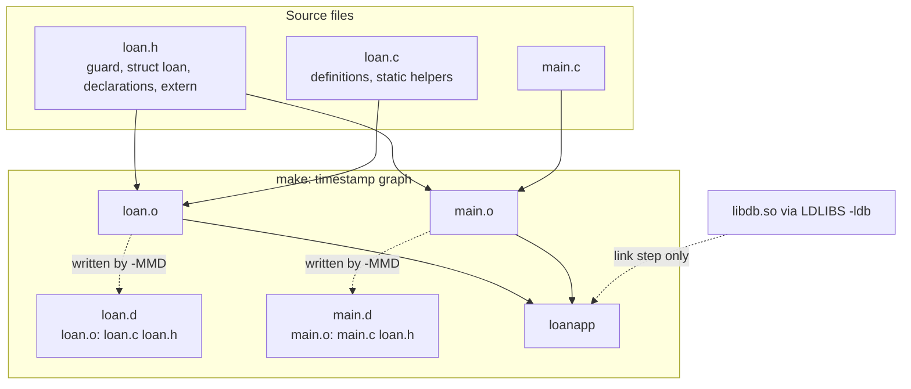

# Module 1.13: Multi-file programs, headers and Make

**Estimated hours:** 3

**What you will learn**

1. How to split a C program into headers and source files correctly: header guards, declaration versus definition, `static` versus `extern`.
2. How to write a real Makefile with variables, pattern rules, automatic dependency tracking, `.PHONY` targets and `clean`, so that changing one file rebuilds only what depends on it.
3. How to build a program that links Berkeley DB with `-ldb`, and read a 40-line program that creates a B-tree file, stores a key and reads it back.

**Prerequisites:** [Module 1.12: Preprocessor, compiler and linker](module-12-preprocessor-compiler-linker.md). You need the four build stages, `nm`, and the meaning of `-c`, `-l` and link order.

---

## 1. One-line intuition

A header is a promise, a `.c` file keeps the promise, and `make` is the clerk who remembers which promises changed and rebuilds only those.

## 2. Real-life analogy

A bank's lending department publishes a one-page **service catalogue**: "we offer `price_loan(amount, rate)`; call extension 4120". That page is the **header**. Other departments read the page and call the extension; they never see how the pricing desk does the work. The desk itself is the **`.c` file**.

Two rules keep the catalogue honest:

- The catalogue is posted on every floor, but each floor needs only **one copy**. If the same page were pinned twice on one notice board, people would complain about duplicates. That is the **header guard**: "if this page is already up here, do not pin it again".
- The catalogue says the service exists; it does not say who the clerk is or where the files are. Only the desk has those. That is **declaration** (the promise) versus **definition** (the thing itself).

`make` is the building's maintenance clerk with a list: "the lending desk depends on the catalogue and the pricing manual; the catalogue was reprinted at 10:05; the desk was last briefed at 09:50; so brief the desk again, but leave the deposits desk alone." It compares timestamps and does the minimum work.

## 3. Why it exists: the problem it solves

Module 1.12 showed that `gcc -c` compiles one translation unit at a time. That gives three practical problems as soon as a program has more than one file.

1. **Consistency.** `main.c` and `loan.c` must agree on the exact signature of every shared function. If `main.c` thinks `loan_total_interest` takes an `int` and `loan.c` defines it taking a `struct loan *`, the linker will happily join them and the program will read garbage. A single header, included by both, makes the compiler check both sides against the same text.
2. **Duplicates.** Headers include other headers. `main.c` includes `loan.h` and `report.h`, and `report.h` also includes `loan.h`. Without a guard, `struct loan` is defined twice in one translation unit and the compiler stops with `redefinition of 'struct loan'`.
3. **Rebuild cost.** A real C codebase has hundreds of `.c` files. Recompiling all of them after every edit typically takes minutes. Rebuilding only the files whose inputs changed takes seconds, but only if something tracks which `.c` file includes which headers. That is `make` with dependency files.

What breaks without these: silent signature mismatches, "redefinition" errors that appear only when a new include is added, and builds so slow that engineers stop running the tests.

**About CMake.** The modern tool for C and C++ builds is CMake, which generates Makefiles (or Ninja files) from a higher-level description. It is covered in module 9.01 and used for every capstone. Make is taught here first because CMake *produces* Make, because real C codebases (the Linux kernel, PostgreSQL, Berkeley DB itself) still ship Makefiles, and because interviewers for C roles still ask you to read one.

## 4. Three layers of depth

### Layer 1 (beginner): what goes in a header and what does not

**Declaration versus definition.**

| | Declaration | Definition |
|---|---|---|
| What it says | "This exists somewhere, and here is its type" | "Here it is" |
| Function | `long long loan_total_interest(const struct loan *l);` | the same line followed by `{ ... }` |
| Variable | `extern int loans_priced;` | `int loans_priced = 0;` |
| Struct type | `struct loan;` (incomplete, can only be used through a pointer) | `struct loan { ... };` |
| How many allowed per program | Any number, as long as they agree | Exactly one (for functions and variables with external linkage) |
| Where it goes | Header | One `.c` file |

The rule is simple: **headers contain declarations, type definitions, macros and `static inline` functions; never a function body or a variable definition.** Put `int loans_priced = 0;` in a header and every file that includes it defines it again, and the linker says `multiple definition of 'loans_priced'`.

**Header guards.** Every header starts and ends like this:

```c
#ifndef LOAN_H
#define LOAN_H
/* ... contents ... */
#endif /* LOAN_H */
```

The first time the preprocessor sees the file, `LOAN_H` is not defined, so it defines it and keeps the contents. The second time, `LOAN_H` is already defined, so the whole body is skipped. The macro name must be unique per header; the convention is the file name in capitals with `_H`.

`#pragma once` at the top of the header does the same job in one line. Every compiler you will use (GCC, Clang, MSVC) supports it, but it is not in the C standard, and it identifies the file by path, so two copies of the same header reached through different symlinks can be included twice. Many codebases use `#pragma once`; many banks' coding standards require the classic guard. This course uses the classic guard so that your code builds everywhere without discussion.

**`static` and `extern`.**

- `static` on a function or a file-scope variable gives it **internal linkage**: only this translation unit can see it. In `nm` it shows as lower-case `t` or `b`. Use it for every helper that is not part of the header. Two files can each have their own `static void helper(void)` with no clash.
- `extern int loans_priced;` in a header **declares** a variable that is **defined** in exactly one `.c` file. Without `extern` that line would be a definition.
- A function declaration in a header is `extern` by default; writing `extern` on it is allowed and changes nothing.

### Layer 2 (working engineer): a Makefile you can reuse

`make` reads a file called `Makefile` made of rules:

```make
target: prerequisites
	recipe            # this line MUST start with a TAB, not spaces
```

"If any prerequisite is newer than the target, or the target does not exist, run the recipe." Running `make` with no arguments builds the first target in the file.

Here is the Makefile you will use for every C project in this phase, line by line.

```make
CC      := gcc
CFLAGS  := -std=c17 -Wall -Wextra -Werror -g -MMD -MP
LDFLAGS :=
LDLIBS  :=

TARGET  := loanapp
SRCS    := main.c loan.c
OBJS    := $(SRCS:.c=.o)
DEPS    := $(OBJS:.o=.d)

.PHONY: all run clean

all: $(TARGET)

$(TARGET): $(OBJS)
	$(CC) $(LDFLAGS) -o $@ $^ $(LDLIBS)

%.o: %.c
	$(CC) $(CFLAGS) -c -o $@ $<

run: $(TARGET)
	./$(TARGET)

clean:
	rm -f $(TARGET) $(OBJS) $(DEPS)

-include $(DEPS)
```

| Line | What it means |
|---|---|
| `CC := gcc` | A variable. `:=` assigns once, now. (`=` assigns lazily, re-expanded at every use; `:=` is the one to use.) |
| `CFLAGS` | Flags for the compile step. `-MMD` makes gcc also write `main.d`, a Makefile fragment listing the headers `main.c` included. `-MP` adds an empty rule for each header so that deleting a header does not break the build. |
| `LDFLAGS`, `LDLIBS` | Flags for the link step: `-L` directories go in `LDFLAGS`, `-l` libraries go in `LDLIBS` so that they land **after** the objects (link order, module 1.12). |
| `OBJS := $(SRCS:.c=.o)` | Substitution: `main.c loan.c` becomes `main.o loan.o`. |
| `.PHONY: all run clean` | These targets are not files. Without this line, a file called `clean` in the directory would make `make clean` say "nothing to do". |
| `all: $(TARGET)` | First target, so plain `make` builds the program. |
| `$(TARGET): $(OBJS)` | The link rule. `$@` is the target (`loanapp`), `$^` is all prerequisites (`main.o loan.o`). |
| `%.o: %.c` | A **pattern rule**: how to make any `.o` from the `.c` of the same name. `$<` is the first prerequisite (`main.c`). |
| `-include $(DEPS)` | Pull in `main.d` and `loan.d` if they exist; the leading `-` means "no error if they do not" (first build). |

What `main.d` contains after the first build:

```make
main.o: main.c loan.h
loan.h:
```

This is the line that makes `make` rebuild `main.o` when `loan.h` changes. You did not write it; gcc did, from the actual `#include` lines, so it can never go stale.

**Useful options.** `make -j8` runs up to eight recipes in parallel (use your core count). `make -n` prints what would run without running it. `make -B` rebuilds everything. `make V=1` is a common convention for verbose output; `make CFLAGS="-O2"` overrides a variable from the command line.

**Linking a library: Berkeley DB.** To build a program that uses Berkeley DB you add exactly two things: `#include <db.h>` in the source and `LDLIBS := -ldb` in the Makefile. The header comes from the `libdb-dev` package; `-ldb` resolves to `/usr/lib/x86_64-linux-gnu/libdb.so`, a symlink to `libdb-5.3.so` (module 1.12). Section 6 shows the program and its Makefile.

### Layer 3 (internals): how `make` decides, and what the first Berkeley DB calls do

**The dependency graph.** When you run `make`, it parses the Makefile and every included `.d` file into a graph: `loanapp` depends on `main.o` and `loan.o`; `main.o` depends on `main.c` and `loan.h`; `loan.o` depends on `loan.c` and `loan.h`. It then walks the graph from the requested target, depth first. For each node it calls `stat()` on the file to get its modification time (`mtime`, the timestamp from module 0.02's inode). If any prerequisite's `mtime` is newer than the target's, or the target is missing, the recipe runs, which updates the target's `mtime`, which may in turn make its parent out of date. Nothing is hashed; it is timestamps all the way. This is why `touch loan.h` rebuilds both objects even though the contents did not change, and why a clock set wrong on a build server causes "nothing to be done" when everything should rebuild.

**Why the `.d` trick works.** `-MMD` tells the preprocessor to record every file it opened for `#include "..."` (and, with `-MD`, system headers too) and write them as a Make rule next to the object. Because the dependency list is a by-product of the real compile, it is exact. `-MP` adds a target with no prerequisites for each header, so if you delete `old.h` and remove its include, `make` does not fail with "No rule to make target old.h".

**Pattern rules and automatic variables.** `%.o: %.c` is matched by stripping the suffix: to build `loan.o`, `%` is `loan`, so the prerequisite is `loan.c`. Inside the recipe `$@`, `$<` and `$^` are substituted before the shell sees the line. Each recipe line runs in its own shell (`/bin/sh`), which is why `cd dir; cmd` must be on one line.

**What `db_create`, `open`, `put`, `get`, `close` do.** Berkeley DB is a library, not a server: it runs inside your process and reads and writes a file directly.

1. `db_create(&db, NULL, 0)` allocates a `DB` handle struct in your process and fills it with function pointers. That is why the later calls look like `db->open(db, ...)`: C has no methods, so the handle carries its own function table (you will see this pattern again as "virtual dispatch" in Phase 2).
2. `db->open(db, NULL, "loans.db", NULL, DB_BTREE, DB_CREATE, 0664)` opens or creates the file as a **B-tree** access method (module 6.13 explains the alternatives). Inside the file, data lives in fixed-size **pages** (4 KB by default) organised as a B-tree keyed by the bytes of your keys. The library keeps a small in-process cache of pages (typically 256 KB unless you configure an environment).
3. `db->put` builds a **DBT** pair (`data` pointer plus `size`), walks the B-tree to the leaf page where the key sorts, and inserts or replaces the item on that page, splitting the page if full. Without a transactional environment the page is written to the OS when the cache evicts it or at `close`.
4. `db->get` walks the tree to the matching key and returns a pointer into the library's own page cache. The pointer is **borrowed**: valid until the next operation on the handle. Module 1.14 gives this word a precise meaning.
5. `db->close(db, 0)` flushes dirty pages, closes the file descriptor and frees the handle. Forgetting it is a data loss bug, not just a leak.

Resume claims H1 and H2 are about reading millions of these records through a cursor instead of one `get` at a time. Module 6.13 and capstone C3 build that.

## 5. Architecture diagram



Arrows point from prerequisite to target. `make` rebuilds a node when any arrow into it comes from a newer file. The `.d` files are how the arrows from `loan.h` get drawn without you writing them.

## 6. Code

### Part 1: a three-file project

```c
/* loan.h : the public face of the loan library.
 * Only declarations live here. Definitions live in loan.c. */
#ifndef LOAN_H
#define LOAN_H

/* A loan as the pricing code sees it. */
struct loan {
    long long principal_paise;   /* amount lent, in paise */
    int       rate_bp;           /* yearly rate in basis points, 850 = 8.50 % */
    int       tenure_months;
};

/* Simple interest over the full tenure, in paise. */
long long loan_total_interest(const struct loan *l);

/* How many loans have been priced since the program started. */
extern int loans_priced;

#endif /* LOAN_H */
```

```c
/* loan.c : definitions promised by loan.h, plus private helpers. */
#include "loan.h"

int loans_priced = 0;

/* static = internal linkage: only this file can see this function.
 * Another .c file may define its own months_to_years without a clash. */
static long long months_to_years_x100(int months) {
    return (months * 100LL) / 12;      /* years scaled by 100 to avoid floats */
}

long long loan_total_interest(const struct loan *l) {
    loans_priced = loans_priced + 1;
    long long yearly = l->principal_paise * l->rate_bp / 10000;
    return yearly * months_to_years_x100(l->tenure_months) / 100;
}
```

```c
/* main.c : uses the loan library through its header only. */
#include <stdio.h>
#include "loan.h"
#include "loan.h"          /* included twice on purpose: the guard makes this harmless */

int main(void) {
    struct loan car  = { 500000LL * 100, 950, 36 };    /* 5 lakh, 9.50 %, 3 years */
    struct loan home = { 2500000LL * 100, 850, 240 };  /* 25 lakh, 8.50 %, 20 years */

    printf("car loan interest : %lld paise\n", loan_total_interest(&car));
    printf("home loan interest: %lld paise\n", loan_total_interest(&home));
    printf("loans priced      : %d\n", loans_priced);
    return 0;
}
```

The `Makefile` is the one from Layer 2, exactly as printed there. Remember: recipe lines start with a real TAB. In VS Code, open the file, click the "Spaces: 4" indicator at the bottom right and choose "Indent Using Tabs" for this file, or the build fails with `*** missing separator`.

```bash
make
./loanapp
make
```

Expected output:

```text
gcc -std=c17 -Wall -Wextra -Werror -g -MMD -MP -c -o main.o main.c
gcc -std=c17 -Wall -Wextra -Werror -g -MMD -MP -c -o loan.o loan.c
gcc  -o loanapp main.o loan.o
car loan interest : 14250000 paise
home loan interest: 425000000 paise
loans priced      : 2
make: Nothing to be done for 'all'.
```

Check the arithmetic: 5 lakh at 9.5 percent is 47,500 rupees a year, times 3 years is 142,500 rupees, which is 14,250,000 paise. The second `make` did nothing because every target is newer than its prerequisites.

### Part 2: a program that links Berkeley DB

```c
/* bdb_hello.c : open a Berkeley DB B-tree file, store one record, read it back.
 * Build: make -f Makefile.bdb      (links with -ldb) */
#include <stdio.h>
#include <string.h>
#include <db.h>

int main(void) {
    DB *db = NULL;
    int ret;

    /* 1. Create the handle. Nothing touches the disk yet. */
    ret = db_create(&db, NULL, 0);
    if (ret != 0) {
        fprintf(stderr, "db_create: %s\n", db_strerror(ret));
        return 1;
    }

    /* 2. Open (and create if missing) the file loans.db as a B-tree. */
    ret = db->open(db, NULL, "loans.db", NULL, DB_BTREE, DB_CREATE, 0664);
    if (ret != 0) {
        db->err(db, ret, "open loans.db");
        db->close(db, 0);
        return 1;
    }

    /* 3. Put one key/value pair. DBT = "data base thing": a pointer + a size. */
    char keytext[]   = "LN00001001";
    char valuetext[] = "MUM001|25000000|850";
    DBT key, value;
    memset(&key, 0, sizeof key);
    memset(&value, 0, sizeof value);
    key.data   = keytext;
    key.size   = (u_int32_t)strlen(keytext);     /* no NUL stored in the key */
    value.data = valuetext;
    value.size = (u_int32_t)sizeof valuetext;    /* NUL stored, so we can print it */

    ret = db->put(db, NULL, &key, &value, 0);
    if (ret != 0) {
        db->err(db, ret, "put");
        db->close(db, 0);
        return 1;
    }

    /* 4. Get it back. found.data is BORROWED: it points into memory owned by
     *    the DB handle and is valid only until the next call on this handle. */
    DBT found;
    memset(&found, 0, sizeof found);
    ret = db->get(db, NULL, &key, &found, 0);
    if (ret == 0) {
        printf("get %.*s -> %s (%u bytes)\n",
               (int)key.size, (const char *)key.data,
               (const char *)found.data, (unsigned)found.size);
    } else {
        db->err(db, ret, "get");
    }

    /* 5. Close: flushes to disk and frees the handle. */
    db->close(db, 0);
    return ret == 0 ? 0 : 1;
}
```

`Makefile.bdb`:

```make
CC      := gcc
CFLAGS  := -std=c17 -Wall -Wextra -Werror -g -MMD -MP
LDLIBS  := -ldb

.PHONY: all clean

all: bdb_hello

bdb_hello: bdb_hello.o
	$(CC) -o $@ $^ $(LDLIBS)

%.o: %.c
	$(CC) $(CFLAGS) -c -o $@ $<

clean:
	rm -f bdb_hello bdb_hello.o bdb_hello.d loans.db

-include $(wildcard *.d)
```

```bash
make -f Makefile.bdb
./bdb_hello
ls -l loans.db
ldd ./bdb_hello | grep db
```

Expected output (the file size is typical for an empty B-tree with one record and may differ by a page):

```text
gcc -std=c17 -Wall -Wextra -Werror -g -MMD -MP -c -o bdb_hello.o bdb_hello.c
gcc -o bdb_hello bdb_hello.o -ldb
get LN00001001 -> MUM001|25000000|850 (20 bytes)
-rw-r--r-- 1 shakir shakir 12288 Oct 19 10:00 loans.db
	libdb-5.3.so => /lib/x86_64-linux-gnu/libdb-5.3.so (0x00007f...)
```

Run `./bdb_hello` a second time: it prints the same line, because `put` with flag 0 replaces the existing key, and the file was already there (`DB_CREATE` only creates if missing). If you see `fatal error: db.h: No such file or directory`, the `libdb-dev` package is missing: `sudo apt install libdb-dev`. If you see `undefined reference to 'db_create'`, `-ldb` is missing or is before the object file.

## 7. Use case: core-banking loan-origination platform

The data-parity suite from resume claim H3 (capstone C4) started as one 3,000-line `parity.c`. Every change meant recompiling everything and, worse, two engineers kept editing the same file. It also included a copy of the record-decoding code from the migration engine, pasted in, which drifted: a field width changed in the engine and not in the suite, and the suite reported thousands of false mismatches for a day.

**The decision it drove:** the record layout and decoder were moved into one small library, `librecord` with a single header `record.h`, built by its own Makefile and linked by both the migration engine and the parity suite. The header became the one place where the packed layout was defined; a change there failed the build of anything that disagreed, instead of failing silently at run time. The Makefile used `-MMD -MP` so that touching `record.h` rebuilt exactly the eleven objects that included it, and the full rebuild dropped from minutes to seconds on the migration host. The cost was a few hours of restructuring and a rule that nobody copies a decoder. You will build this library in capstone C3 and link it from C4.

## 8. Lab

Create a folder `m13` with the files from section 6, Part 1.

### Part A: watch `make` do the minimum (20 minutes)

1. Run `make`. Three commands run. Run `make` again: "Nothing to be done".
2. `cat main.d` and `cat loan.d`. Both list `loan.h`.
3. `touch loan.h` then `make`. Expected: **both** objects recompile and the program relinks, because both `.d` files name `loan.h`.
4. `touch loan.c` then `make`. Expected: only `loan.o` recompiles, then the link.
5. Edit `main.c` to change the car loan rate to 1050. `make`. Expected: only `main.o` recompiles. Run `./loanapp`; the car interest becomes 15,750,000 paise.
6. `make -n clean` shows the `rm` command without running it. Then `make clean` and `ls`: only the sources and the Makefile remain.
7. Replace the TAB at the start of the link recipe with four spaces and run `make`. Expected: `Makefile:16: *** missing separator.  Stop.` Put the TAB back. You will meet this error once in your career and never again.

### Part B: break the header rules on purpose (20 minutes)

1. Remove the three guard lines from `loan.h` (the `#ifndef`, `#define` and `#endif`). Run `make`. Expected:

```text
loan.h:7:8: error: redefinition of 'struct loan'
```

because `main.c` includes `loan.h` twice. Restore the guard. Then replace it with `#pragma once` and confirm the build passes again. Choose one and keep it (the course uses the classic guard).

2. Move the line `int loans_priced = 0;` from `loan.c` into `loan.h` (replacing the `extern` line). Run `make`. Expected: the objects compile, the link fails with `multiple definition of 'loans_priced'`. Put it back.
3. Add `static` in front of `long long loan_total_interest` in `loan.c`. Run `make`. Expected: `undefined reference to 'loan_total_interest'` from `main.o`, and `nm loan.o` shows `t loan_total_interest` in lower case. Remove the `static`.
4. Run `nm loan.o` on the clean build and record the three lines: `T loan_total_interest`, `B loans_priced`, `t months_to_years_x100`. Explain each letter in your journal.

### Part C: build with Berkeley DB (25 minutes)

1. Create `bdb_hello.c` and `Makefile.bdb` from section 6, Part 2. Build and run. Record the `get` line and the `ldd` line.
2. Change `valuetext` to `"DEL002|50000000|925"`, rebuild, run. Expected: the new value, because `put` replaced it. Then run `strings loans.db | grep LN` to see your key sitting inside the B-tree page on disk.
3. Change the `key.size` line to `sizeof keytext` (so the NUL is now part of the key). Rebuild and run. Expected: the output still looks right, but now `strings loans.db` shows **two** `LN00001001` entries, because `"LN00001001"` (10 bytes) and `"LN00001001\0"` (11 bytes) are different keys. This is the single most common Berkeley DB bug: keys are byte strings, and whether you include the terminator is part of your record format. Revert and `make -f Makefile.bdb clean` to delete the file.
4. Delete `-ldb` from `LDLIBS`, rebuild. Expected: `undefined reference to 'db_create'` and the others. Put it back. Then move `$(LDLIBS)` before `$^` in the link rule and rebuild: on Ubuntu this also fails, because the linker's default `--as-needed` drops a shared library that nothing has referenced yet. Restore the order.

### Part D: a Makefile for your own project (15 minutes)

Take the program from module 1.09 (file I/O) or 1.10 and split it into three files: a header, an implementation and a `main.c`. Write a Makefile using the template from Layer 2 by changing only `TARGET` and `SRCS`. It must build with zero warnings, `make` twice must do nothing the second time, and `make clean` must leave only sources. Keep this template; module 1.15 and every C lab after it use it.

### Journal

Copy [journal/TEMPLATE.md](../journal/TEMPLATE.md) to `journal/YYYY-MM-DD-multi-file-and-make.md`. Record: which files recompiled after `touch loan.h` versus `touch loan.c`; the exact text of the redefinition, multiple-definition and missing-separator errors; the `nm loan.o` lines with your explanation; the `get` and `ldd` output from the Berkeley DB program; and what happened to `strings loans.db` when the key size included the NUL.

## 9. Common mistakes and misconceptions

| Mistake | Why it is wrong | Bug it causes later |
|---|---|---|
| Defining a variable or function body in a header | Every including file defines it again | `multiple definition` at link time, or, with `static`, a separate copy per file that silently disagrees |
| Forgetting the header guard | A header reached twice redefines its types | `redefinition of 'struct loan'` appearing only when someone adds an include elsewhere |
| Using spaces instead of a TAB in a recipe | `make` requires a TAB to recognise a recipe line | `*** missing separator` |
| Leaving out `.PHONY` | A file named `clean` or `test` makes the target "up to date" | `make test` does nothing and nobody notices for a week |
| Writing header dependencies by hand | They go stale the first time an include changes | Objects not rebuilt after a header change; a struct layout mismatch between two objects, which is a memory corruption bug |
| Putting `-ldb` in `CFLAGS` or before the objects | Libraries must come after the objects that need them | `undefined reference to 'db_create'` with the library plainly on the line |
| Using `=` instead of `:=` for variables | `=` is re-expanded at every use; a self-reference like `CFLAGS = $(CFLAGS) -g` loops | "Recursive variable references itself" or surprising flag values |
| Including the NUL in some Berkeley DB keys and not others | Keys are compared byte by byte; 10 bytes and 11 bytes are different keys | Duplicate records that `get` cannot find and the parity suite reports |
| Believing CMake makes Make irrelevant | CMake generates Makefiles; reading them is how you debug a CMake build | Unable to explain why a target did not rebuild |

## 10. Resume link

- **Claim A, "C"**, and **claim G, "GCC/Clang, CMake"**. Interviewers for C roles ask you to read a Makefile or explain header guards and `static`. You can now say: "declarations in headers, definitions in one `.c`, guards against double inclusion, `static` for internal linkage, `-MMD -MP` for exact dependencies."
- **Claims H1 and H2, the migration engine**. "The packed record layout lived in one header in a small library that both the engine and the parity suite linked, so a layout change failed the build instead of corrupting a cutover." That is section 7, built for real in capstone C3.
- **Claim D, "Berkeley DB"**. You have now written the five-call lifecycle (`db_create`, `open`, `put`, `get`, `close`), know that `-ldb` links a shared library, and know the NUL-in-key trap. Module 6.13 adds cursors, environments and transactions.

Likely follow-up: "What is the difference between a declaration and a definition?" Answer with the table in Layer 1 and the `extern int loans_priced;` versus `int loans_priced = 0;` example.

## 11. Interview questions

**Q1 (easy). What is a header guard and why is it needed?**

<details>
<summary>Model answer</summary>

A header guard is the `#ifndef NAME` / `#define NAME` / `#endif` wrapper around a header's contents. The first inclusion defines the macro and keeps the body; any later inclusion in the same translation unit sees the macro already defined and skips the body. It is needed because headers include other headers, so the same file is often reached twice, and a second copy of a `struct` or `typedef` definition is a compile error. `#pragma once` is a widely supported non-standard alternative.

</details>

**Q2 (easy). What is the difference between a declaration and a definition in C?**

<details>
<summary>Model answer</summary>

A declaration tells the compiler that a name exists and what type it has, for example `long long f(int);` or `extern int count;`. A definition creates the thing: the function body, or `int count = 0;` which allocates storage. A program may declare a name any number of times, as long as the declarations agree, but must define each externally visible function or variable exactly once, or the linker reports either an undefined reference or a multiple definition. Declarations belong in headers; definitions belong in one source file.

</details>

**Q3 (medium). What does `static` mean at file scope, and when would you use it?**

<details>
<summary>Model answer</summary>

At file scope, `static` gives a function or variable internal linkage: its name is visible only inside that translation unit, and it appears in `nm` as a lower-case `t` or `b`. Use it for every helper function and every file-private variable that is not part of the header's contract. Benefits are that other files cannot accidentally call or modify it, two files can use the same helper name without a link clash, and the compiler can optimise more aggressively because it sees every caller. A function that is meant to be called from other files must not be static, or the linker reports an undefined reference.

</details>

**Q4 (medium). Explain how a Makefile with `-MMD -MP` rebuilds the right files when a header changes.**

<details>
<summary>Model answer</summary>

`-MMD` tells gcc, while compiling `main.c`, to also write `main.d`, a Makefile fragment such as `main.o: main.c loan.h` listing every user header the preprocessor actually opened. `-MP` adds an empty rule for each header so that deleting one does not break the build. The Makefile ends with `-include $(DEPS)`, which pulls these fragments in on every run (the dash suppresses errors on the first build when they do not exist). `make` then has an exact dependency graph: when `loan.h`'s modification time is newer than `main.o`'s, the pattern rule `%.o: %.c` reruns for `main.o`, and the link rule reruns because `main.o` is now newer than the executable. Objects whose `.d` file does not mention the header are untouched. Because the list is generated from the real compile, it cannot drift from the source.

</details>

**Q5 (hard). Describe what happens, inside your process and on disk, when a C program calls `db_create`, `DB->open` with `DB_BTREE | DB_CREATE`, `DB->put`, `DB->get` and `DB->close`. What are the ownership rules for the memory `get` returns?**

<details>
<summary>Model answer</summary>

Berkeley DB is an in-process library. `db_create` mallocs a `DB` handle and fills it with function pointers; no file is touched. `open` with `DB_BTREE` and `DB_CREATE` opens the named file, creating it if absent, writes or reads the metadata page describing the access method and page size (4 KB by default), and sets up a small page cache in the process. `put` wraps key and value as `DBT`s (pointer plus length), descends the B-tree from the root page comparing key bytes, and inserts or replaces the item on the leaf page, splitting it if full; with no transactional environment the dirty page reaches the OS when evicted or on close. `get` descends the same way and, by default, sets `found.data` to point into the library's page cache, so the pointer is borrowed: it is valid only until the next call on the handle, and the caller must not free it; passing `DB_DBT_MALLOC` or `DB_DBT_USERMEM` changes that to library-allocated or caller-supplied memory. `close` flushes dirty pages, closes the file descriptor and frees the handle; skipping it can lose the last writes. Keys are raw bytes, so including or omitting the NUL terminator produces different keys, which must be fixed by the record format.

</details>

## 12. Revision

- Headers hold declarations, types and macros inside a guard; one `.c` file holds each definition; `static` hides helpers inside a file; `extern` declares a variable defined elsewhere.
- A Makefile is targets, prerequisites and TAB-indented recipes; `:=` variables, a `%.o: %.c` pattern rule, `.PHONY`, `clean`, and `-MMD -MP` with `-include $(DEPS)` give exact, automatic rebuilds.
- Linking Berkeley DB is `#include <db.h>` plus `LDLIBS := -ldb` after the objects; the lifecycle is `db_create`, `open` (`DB_BTREE`, `DB_CREATE`), `put`, `get` (borrowed result), `close`; CMake (module 9.01) generates these Makefiles.

---

Previous: [Module 1.12: Preprocessor, compiler and linker](module-12-preprocessor-compiler-linker.md) | Next: [Module 1.14: Error handling and ownership contracts in C](module-14-error-handling-and-ownership-in-c.md)
