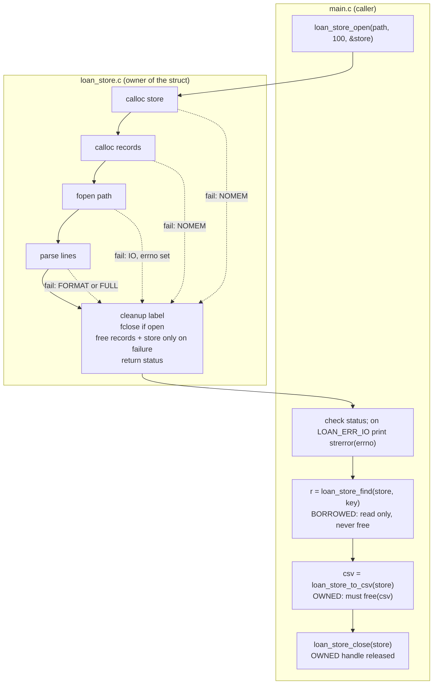

# Module 1.14: Error handling and ownership contracts in C

**Estimated hours:** 3

**What you will learn**

1. How C programs report failure without exceptions: return codes from an `enum`, out-parameters, `errno` with `perror` and `strerror`, and the `goto cleanup` idiom with one exit point.
2. What an ownership contract is, the vocabulary (owned, borrowed, valid until), and how to write it into a header so a reviewer can check every caller.
3. How `const` and opaque handle types (`typedef struct loan_db loan_db;`) turn those contracts into things the compiler enforces.

**Prerequisites:** [Module 1.13: Multi-file programs, headers and Make](module-13-multi-file-programs-and-make.md). You need `malloc`/`free` (module 1.08), file I/O (1.09), and headers with declarations.

---

## 1. One-line intuition

In C nothing cleans up after you and nothing tells the caller what went wrong, so every function must say in its signature how it fails and, in its header, who frees what.

## 2. Real-life analogy

A bank's document room lends files to officers. Three rules keep it from losing papers.

- **Every request gets a receipt with a reason code.** "Approved", "file not found", "you are not authorised", "the room is closed". The officer reads the code before touching anything. That is the **return code**. The file itself is handed over separately, in a tray the officer brought (the **out-parameter**).
- **Every file is stamped either TAKE or READ-HERE.** A TAKE file is now the officer's responsibility: they must return it to the shredder when done (**owned**: the caller frees it). A READ-HERE file stays the room's property: look, do not keep it, and it may be re-shelved the moment the next officer arrives (**borrowed**: valid until the next call; never free it).
- **If anything goes wrong halfway through a request, the clerk undoes every step in reverse order before writing the reason code.** Pulled a file, then found the second file missing: re-shelve the first, then report. That is **`goto cleanup`**: one exit path that releases everything acquired so far.

Lose any of these rules and you get the two classic bugs: a file shredded twice (double free) or a file nobody ever returns (leak).

## 3. Why it exists: the problem it solves

C++ (Phase 2) has exceptions and destructors: a failure unwinds the stack and every object cleans itself up. C has neither. A function that opens a file, allocates two buffers and then hits a bad line must put the file and both buffers back by hand, on every failure path, or the program leaks. Multiply that by hundreds of functions and thousands of lines and you get a server that grows a few kilobytes per failed request until the OS kills it.

The second problem is subtler. When a function returns a pointer, nothing in the C type system says whether the caller now owns that memory. `char *p = get_name(db);` might be a fresh `malloc` the caller must free, or a pointer into the database's buffer that will be overwritten on the next call. Guess wrong one way and you leak; guess wrong the other way and you free memory you do not own, corrupting the heap for everybody (module 1.08, and the crashes in capstone C6).

The solutions in this module are conventions, not language features. They work because every engineer on the team follows them and every reviewer checks them. That is what "explicit ownership contracts" on the resume (claim H1) means: the contract is written down in the header, in the same words every time, and the code review checks every caller against it.

What breaks without it: leaks under load, double frees that corrupt the allocator, and the worst kind of bug, a use-after-free that only appears when memory is reused in a particular order.

## 4. Three layers of depth

### Layer 1 (beginner): the four ways C reports failure

**1. Return codes.** The function returns a number; zero means success. Do not use magic numbers; define an `enum` so the codes have names:

```c
typedef enum {
    LOAN_OK = 0,
    LOAN_ERR_ARG,        /* a NULL pointer or an invalid argument */
    LOAN_ERR_NOMEM,      /* malloc failed */
    LOAN_ERR_IO,         /* file problem; errno describes which */
    LOAN_ERR_FORMAT,     /* a line in the file did not parse */
    LOAN_ERR_FULL,
    LOAN_ERR_NOTFOUND
} loan_status;
```

and a function that turns a code into words for logs: `const char *loan_status_str(loan_status st);`.

**2. Out-parameters.** If the return value is the status, the result must come back another way: the caller passes the address of a variable and the function writes into it.

```c
loan_status loan_store_open(const char *path, size_t capacity, loan_store **out);
```

The double pointer `loan_store **out` means "the address of the caller's `loan_store *` variable". On success the function stores the new handle there. On failure it stores `NULL`, so the caller can never accidentally use a half-built object.

**3. `errno`.** When a C library or system call fails (`fopen`, `read`, `malloc`), it returns a failure value (`NULL`, `-1`) **and** sets the global variable `errno` (from `<errno.h>`) to a number saying why: 2 is `ENOENT` (no such file), 13 is `EACCES` (permission denied), 12 is `ENOMEM`. `strerror(errno)` turns the number into text; `perror("open")` prints `open: No such file or directory`. Rules: read `errno` immediately after the failing call, because the next library call may overwrite it; never test `errno` to decide *whether* something failed, only *why*. Your own functions should return their own status code and leave `errno` set for the caller to inspect when the code is `LOAN_ERR_IO`.

**4. The `goto cleanup` idiom.** A function that acquires several resources has one label at the end that releases them in reverse order. Every failure sets the status and jumps there. There is exactly one `return`.

```c
loan_status loan_store_open(const char *path, size_t capacity, loan_store **out) {
    loan_status st = LOAN_OK;
    loan_store *s  = NULL;
    FILE       *f  = NULL;

    s = calloc(1, sizeof *s);                              /* resource 1 */
    if (s == NULL) { st = LOAN_ERR_NOMEM; goto cleanup; }
    s->records = calloc(capacity, sizeof *s->records);     /* resource 2 */
    if (s->records == NULL) { st = LOAN_ERR_NOMEM; goto cleanup; }
    f = fopen(path, "r");                                  /* resource 3 */
    if (f == NULL) { st = LOAN_ERR_IO; goto cleanup; }
    /* ... read lines; any failure: set st and goto cleanup ... */

    *out = s;          /* success: hand ownership to the caller */
    s = NULL;          /* so cleanup below does not free it */

cleanup:               /* single exit point: release in reverse order */
    if (f != NULL) fclose(f);
    if (s != NULL) { free(s->records); free(s); }   /* only on failure */
    return st;
}
```

The trick that makes it work: every resource variable starts as `NULL`, and `cleanup` frees only what is non-`NULL`. On success, `s` is set to `NULL` *after* being handed to the caller, so the cleanup block releases the file but not the store. You were taught "never use `goto`". This is the one accepted use, and it is everywhere in the Linux kernel, PostgreSQL and Berkeley DB.

### Layer 2 (working engineer): writing the contract down

**The vocabulary.** Every pointer that crosses a function boundary gets one of these words in the header comment:

| Word | Meaning | Caller's duty |
|---|---|---|
| **OWNED** (or "caller owns", "transfers ownership") | The caller receives the object and is responsible for releasing it | Must call the matching `free` / `close` / `destroy` exactly once |
| **BORROWED** (or "valid until X", "do not free") | The pointer belongs to the callee's object | Use it only within the stated lifetime; never free it; copy it if it must outlive that |
| **TAKES ownership** (for an argument) | The callee becomes responsible for the thing passed in | Caller must not free it afterwards, and must not use it |
| **Does not retain** (for an argument) | The callee only reads it during the call | Caller may free or change it the moment the call returns |

Three example comments from the header in section 6:

```c
/* On LOAN_OK, *out is an OWNED handle: caller must call loan_store_close().
 * On any error, *out is set to NULL and nothing is leaked.
 * On LOAN_ERR_IO, errno holds the reason. */
loan_status loan_store_open(const char *path, size_t capacity, loan_store **out);

/* BORROWED: the returned record belongs to the store and is valid until
 * loan_store_close(). Returns NULL if not found. */
const loan_record *loan_store_find(const loan_store *s, const char *loan_no);

/* OWNED: returns a malloc'd CSV string; caller must free() it. */
char *loan_store_to_csv(const loan_store *s);
```

**`const` as a borrow marker.** A borrowed pointer is almost always returned as `const T *`. That does two jobs. The compiler stops the caller modifying the store's internal data through it. And `free()` takes a `void *`, not a `const void *`, so `free(r)` on a `const loan_record *` produces a warning (an error under `-Werror`): the type system is now enforcing "never free a borrowed pointer". Similarly, an argument declared `const char *path` tells the reader "I only read this during the call; I do not keep it".

**Opaque handles.** The header says `typedef struct loan_store loan_store;` and nothing else about the struct. The full `struct loan_store { ... }` lives in the `.c` file. Callers can hold a `loan_store *` and pass it to the API, but cannot touch its fields, cannot allocate one on the stack (its size is unknown), and cannot `free` one correctly (they do not know what is inside). The only way in is `loan_store_open`; the only way out is `loan_store_close`. The pair of functions *is* the ownership contract, and the compiler enforces that nobody bypasses it. Berkeley DB's `DB *` from module 1.13 is exactly this pattern, as are `FILE *` and the `pg_conn` you will meet in module 6.12.

**Pairing rule.** Every `_open`/`_create` has exactly one `_close`/`_destroy`, named to match, documented together, and `_close(NULL)` is a safe no-op so cleanup blocks can call it unconditionally. Every `_find` or `_get` that returns borrowed memory states what invalidates it: "until close", "until the next put or remove", "until the next call on this handle".

**How a reviewer checks it.** For each call site:

1. Find the function in the header. Read the ownership comment.
2. If the result is OWNED: find the matching release on *every* path out of the calling function, including the error paths. If one is missing, that is a leak; ask for `goto cleanup`.
3. If the result is BORROWED: find the stated lifetime. Check that nothing between the borrow and the last use could invalidate it (another call on the same handle, a `close`). Check that it is never passed to `free`.
4. If an argument TAKES ownership: check the caller does not use or free it afterwards, and that on a *failed* call the header says who owns it (module 1.15's `hmap_put` says: on failure the caller still owns the value).
5. Run Valgrind on the test that exercises the error path. "All heap blocks were freed" on the failure path is the proof.

**When not to return a code.** Functions that cannot fail (`loan_store_count`) return their value directly. Functions that return a pointer and can fail only by running out of memory may return `NULL` as the error, as `malloc` does, *if the header says so*. Mixing styles inside one library is the real mistake.

### Layer 3 (internals): what these conventions cost and what the compiler does with them

**Return codes are free.** A status returned in `eax` and tested with one `cmp`/`jne` costs under a nanosecond and is predicted correctly nearly always, because the success path is taken nearly always. This is why high-performance C code (and the C++ in Phase 2 that chooses error codes over exceptions on hot paths) uses them. The cost is in the source, not the binary: every call site must check the code, and nothing forces it to. GCC's `__attribute__((warn_unused_result))` on a declaration makes ignoring the return a warning, hence an error under `-Werror`; use it on every function whose failure must not be ignored.

**`errno` is thread-local.** It looks like a global, but in glibc `errno` is a macro that expands to `(*__errno_location())`, a function returning a pointer to this thread's own copy. Two threads failing at once do not overwrite each other's reason. You will rely on this in the multithreaded server of capstone C2.

**`goto cleanup` compiles to the same code as nested `if`s.** The compiler turns labels and gotos into jumps exactly as it does for `if`/`else`; there is no penalty. What you gain is one place to audit. What you lose is the ability to declare a variable after the first `goto` that jumps past its initialisation: C allows jumping past a declaration only if the variable is not a variable-length array, but the variable is then uninitialised in the cleanup block, so declare and `NULL`-initialise every resource at the top.

**Why an opaque struct cannot be allocated by the caller.** `sizeof(loan_store)` is a compile error in `main.c`, because the type is incomplete there. The compiler literally does not know how many bytes it needs, so the only way to get one is from a function in the file that knows. This is also why the implementation can add fields without recompiling callers: the layout is nobody else's business. The price is one `malloc` per handle and one pointer indirection per access, which for a store opened once per process is nothing.

**What `free` actually needs.** `free(p)` reads bookkeeping that `malloc` placed just before `p` (module 3.05 goes inside). Pass it a pointer into the middle of a block, a stack address, or a block already freed, and it reads the wrong bookkeeping and corrupts the allocator's lists. The failure usually appears *later*, in an unrelated `malloc`. That delay is why ownership mistakes are among the hardest bugs in Phase 8, and why the convention "only the owner frees, exactly once" is worth the ceremony.

**The arena connection.** Capstone C3's migration engine processes millions of records in batches. Instead of a `malloc` and a `free` per record (two allocator calls and the risk of missing one), it allocates every object in a batch from an **arena**: one large block with a bump pointer, released all at once when the batch commits. The ownership contract becomes "every pointer handed out by this arena is BORROWED and valid until `arena_reset`". Module 3.06 builds it; the vocabulary you are learning now is the vocabulary that header will use.

## 5. Architecture diagram



Every dotted arrow lands on the same label. The caller sees one status code and either a valid owned handle or `NULL`, never a half-built object.

## 6. Code

Three files: the header with the contracts, the implementation, and a caller that honours them. Build with the Makefile template from module 1.13 (`TARGET := loanstore`, `SRCS := main.c loan_store.c`) or with the one-line command below.

```c
/* loan_store.h : a tiny in-memory loan store with explicit ownership contracts.
 *
 * Ownership vocabulary used in this header:
 *   OWNED    - the caller receives the object and MUST free/close it.
 *   BORROWED - the pointer belongs to the store; do not free it; it is valid
 *              only for the lifetime stated in the comment.
 */
#ifndef LOAN_STORE_H
#define LOAN_STORE_H

#include <stddef.h>

/* Every function that can fail returns one of these. 0 means success. */
typedef enum {
    LOAN_OK = 0,
    LOAN_ERR_ARG,        /* a NULL pointer or an invalid argument */
    LOAN_ERR_NOMEM,      /* malloc failed */
    LOAN_ERR_IO,         /* file problem; errno describes which */
    LOAN_ERR_FORMAT,     /* a line in the file did not parse */
    LOAN_ERR_FULL,       /* store capacity reached */
    LOAN_ERR_NOTFOUND
} loan_status;

/* BORROWED: points to a string literal; valid forever; never free it. */
const char *loan_status_str(loan_status st);

/* One loan. Public so callers can read the fields. */
typedef struct loan_record {
    char      loan_no[16];
    long long principal_paise;
} loan_record;

/* Opaque handle: callers never see the fields. */
typedef struct loan_store loan_store;

/* Loads "LOAN_NO PRINCIPAL_PAISE" lines from path.
 * On LOAN_OK, *out is an OWNED handle: caller must call loan_store_close().
 * On any error, *out is set to NULL and nothing is leaked.
 * On LOAN_ERR_IO, errno holds the reason. */
loan_status loan_store_open(const char *path, size_t capacity, loan_store **out);

/* Releases everything. Safe to call with NULL. */
void loan_store_close(loan_store *s);

/* BORROWED: the returned record belongs to the store and is valid until
 * loan_store_close(). Returns NULL if not found. */
const loan_record *loan_store_find(const loan_store *s, const char *loan_no);

/* OWNED: returns a malloc'd CSV string; caller must free() it.
 * Returns NULL if out of memory. */
char *loan_store_to_csv(const loan_store *s);

size_t loan_store_count(const loan_store *s);

#endif /* LOAN_STORE_H */
```

```c
/* loan_store.c : implementation. The struct is defined here, so only this
 * file can touch its fields. */
#include "loan_store.h"
#include <stdio.h>
#include <stdlib.h>
#include <string.h>

struct loan_store {
    loan_record *records;    /* OWNED by the store */
    size_t       count;
    size_t       capacity;
};

const char *loan_status_str(loan_status st) {
    switch (st) {
    case LOAN_OK:           return "ok";
    case LOAN_ERR_ARG:      return "invalid argument";
    case LOAN_ERR_NOMEM:    return "out of memory";
    case LOAN_ERR_IO:       return "I/O error";
    case LOAN_ERR_FORMAT:   return "bad line format";
    case LOAN_ERR_FULL:     return "store full";
    case LOAN_ERR_NOTFOUND: return "not found";
    }
    return "unknown status";
}

loan_status loan_store_open(const char *path, size_t capacity, loan_store **out) {
    loan_status st = LOAN_OK;
    loan_store *s  = NULL;
    FILE       *f  = NULL;
    char        line[128];

    if (path == NULL || out == NULL || capacity == 0) {
        return LOAN_ERR_ARG;
    }
    *out = NULL;

    s = calloc(1, sizeof *s);                              /* resource 1 */
    if (s == NULL) { st = LOAN_ERR_NOMEM; goto cleanup; }

    s->records = calloc(capacity, sizeof *s->records);     /* resource 2 */
    if (s->records == NULL) { st = LOAN_ERR_NOMEM; goto cleanup; }
    s->capacity = capacity;

    f = fopen(path, "r");                  /* resource 3; sets errno on failure */
    if (f == NULL) { st = LOAN_ERR_IO; goto cleanup; }

    while (fgets(line, sizeof line, f) != NULL) {
        if (s->count == s->capacity) { st = LOAN_ERR_FULL; goto cleanup; }
        loan_record *r = &s->records[s->count];
        if (sscanf(line, "%15s %lld", r->loan_no, &r->principal_paise) != 2) {
            st = LOAN_ERR_FORMAT;
            goto cleanup;
        }
        s->count++;
    }
    if (ferror(f)) { st = LOAN_ERR_IO; goto cleanup; }

    *out = s;          /* success: hand ownership to the caller */
    s = NULL;          /* so cleanup below does not free it */

cleanup:               /* single exit point: release in reverse order */
    if (f != NULL) fclose(f);
    if (s != NULL) {                /* only non-NULL on failure */
        free(s->records);           /* free(NULL) is allowed */
        free(s);
    }
    return st;
}

void loan_store_close(loan_store *s) {
    if (s == NULL) return;
    free(s->records);
    free(s);
}

const loan_record *loan_store_find(const loan_store *s, const char *loan_no) {
    if (s == NULL || loan_no == NULL) return NULL;
    for (size_t i = 0; i < s->count; ++i) {
        if (strcmp(s->records[i].loan_no, loan_no) == 0) {
            return &s->records[i];
        }
    }
    return NULL;
}

char *loan_store_to_csv(const loan_store *s) {
    /* worst case per line: 15 chars + comma + 20 digits + newline */
    size_t cap = s->count * 40 + 1;
    char  *buf = malloc(cap);
    if (buf == NULL) return NULL;
    size_t used = 0;
    for (size_t i = 0; i < s->count; ++i) {
        int n = snprintf(buf + used, cap - used, "%s,%lld\n",
                         s->records[i].loan_no, s->records[i].principal_paise);
        if (n < 0 || (size_t)n >= cap - used) { free(buf); return NULL; }
        used += (size_t)n;
    }
    buf[used] = '\0';
    return buf;                      /* OWNED by the caller from here on */
}

size_t loan_store_count(const loan_store *s) {
    return s == NULL ? 0 : s->count;
}
```

```c
/* main.c : a caller that honours the contracts written in loan_store.h. */
#include <stdio.h>
#include <stdlib.h>
#include <string.h>
#include <errno.h>
#include "loan_store.h"

int main(int argc, char **argv) {
    const char *path = (argc > 1) ? argv[1] : "loans.txt";
    loan_store *store = NULL;

    loan_status st = loan_store_open(path, 100, &store);
    if (st != LOAN_OK) {
        fprintf(stderr, "open %s failed: %s", path, loan_status_str(st));
        if (st == LOAN_ERR_IO) {
            fprintf(stderr, " (errno %d: %s)", errno, strerror(errno));
        }
        fputc('\n', stderr);
        return 1;
    }
    printf("loaded %zu loans\n", loan_store_count(store));

    /* BORROWED pointer: we read it, we never free it. */
    const loan_record *r = loan_store_find(store, "LN00001002");
    if (r != NULL) {
        printf("found %s: %lld paise\n", r->loan_no, r->principal_paise);
    } else {
        printf("LN00001002: %s\n", loan_status_str(LOAN_ERR_NOTFOUND));
    }

    /* OWNED string: we must free it. */
    char *csv = loan_store_to_csv(store);
    if (csv == NULL) {
        fprintf(stderr, "csv: %s\n", loan_status_str(LOAN_ERR_NOMEM));
        loan_store_close(store);
        return 1;
    }
    printf("--- csv ---\n%s", csv);
    free(csv);

    loan_store_close(store);        /* OWNED handle: we close it */
    return 0;
}
```

Create the input files and build:

```bash
printf 'LN00001001 25000000\nLN00001002 50000000\nLN00001003 7500000\n' > loans.txt
printf 'LN00001001 25000000\nthis line is broken\n' > bad.txt
gcc -std=c17 -Wall -Wextra -Werror -g -o loanstore main.c loan_store.c
./loanstore; echo "exit $?"
./loanstore missing.txt; echo "exit $?"
./loanstore bad.txt; echo "exit $?"
```

Expected output:

```text
loaded 3 loans
found LN00001002: 50000000 paise
--- csv ---
LN00001001,25000000
LN00001002,50000000
LN00001003,7500000
exit 0
open missing.txt failed: I/O error (errno 2: No such file or directory)
exit 1
open bad.txt failed: bad line format
exit 1
```

Now the proof that the error paths leak nothing:

```bash
valgrind --leak-check=full ./loanstore 2>&1 | grep -E "total heap|All heap|ERROR SUMMARY"
valgrind --leak-check=full ./loanstore bad.txt 2>&1 | grep -E "All heap|ERROR SUMMARY"
```

```text
==142==   total heap usage: 6 allocs, 6 frees, 11,209 bytes allocated
==142== All heap blocks were freed -- no leaks are possible
==142== ERROR SUMMARY: 0 errors from 0 contexts (suppressed: 0 from 0)
==144== All heap blocks were freed -- no leaks are possible
==144== ERROR SUMMARY: 0 errors from 0 contexts (suppressed: 0 from 0)
```

Six allocations on the success path: the store, the records array, the `FILE` and its buffer, the CSV string, and one inside `printf`. Six frees. On the `bad.txt` path the store and array were allocated, the file opened, the second line failed, and `cleanup` released all three. That line, "All heap blocks were freed", is the standard you hold every lab to from now on.

## 7. Use case: core-banking loan-origination platform

The migration engine in resume claim H1 streams records from a live Berkeley DB environment into YugabyteDB in batches of a few thousand. Each record is decoded into several heap objects (the record, its composite key, the SQL parameter strings). An early version used `malloc` per object and `free` in a dozen different places. A code review found three paths out of the batch function that freed the key but not the parameters, and one path that freed a record that was still referenced by the retry list. Under a test with a flaky network, the engine leaked roughly a record's worth of memory per retry and, once, crashed on a double free inside the allocator.

**The decision it drove:** every batch allocates from one arena (module 3.06) and the header of every module states its contract in the three words from Layer 2. `batch_decode` returns records that are BORROWED from the arena and valid until `batch_commit` or `batch_abort`; `batch_abort` resets the arena, so a restarted batch starts from zero bytes with nothing to free individually; the YugabyteDB connection is an OWNED opaque handle with exactly one `close`. Leak checking became a CI gate: the test suite runs the engine over a 10,000-record sample under Valgrind, and the build fails unless the output contains "All heap blocks were freed". The cost was rewriting the batch layer once; the benefit was the resume line "restartable leak-free batches", which an interviewer can verify by asking exactly how you knew. The answer is section 8, Part C, at scale.

## 8. Lab

Create a folder `m14` with the three files from section 6 and the Makefile template from module 1.13.

### Part A: read the contract, check the caller (15 minutes)

1. Build and run the three cases from section 6. Confirm the outputs and exit codes.
2. For each of the five calls in `main.c` that touch the store, write one line in your journal: the function, the ownership word from the header, and the line in `main.c` that honours it (the `free(csv)`, the `loan_store_close`, the absence of a `free(r)`).
3. Add `free((void *)r);` after the `found` line, build and run under Valgrind. Expected: `Invalid free() / delete / delete[] / realloc()` with a stack trace, because `r` points into the middle of the records array. Note that you needed a cast to even compile it: `const` was doing its job. Remove the line.

### Part B: break the cleanup, see the leak (20 minutes)

1. In `loan_store_open`, change `goto cleanup;` on the `LOAN_ERR_FORMAT` line to `return st;`. Build. Run `valgrind --leak-check=full ./loanstore bad.txt`. Expected:

```text
==N== 2,400 bytes in 1 blocks are definitely lost in loss record 2 of 3
==N==    by 0x...: loan_store_open (loan_store.c:...)
```

plus a second loss record for the 24-byte store and an open `FILE` reported as "still reachable". One early `return` leaked three resources. Restore the `goto`.

2. Delete the line `s = NULL;` after `*out = s;`. Build, run `./loanstore` (the good file). Expected: it prints the three loans and then crashes, or Valgrind reports `Invalid read` inside `loan_store_count` and later a double free, because `cleanup` freed the store that was just handed to the caller. This is the mistake the comment on that line warns about. Restore it.

3. Change the capacity in `main.c` from 100 to 2 and run with `loans.txt`. Expected: `open loans.txt failed: store full`, exit 1, and Valgrind still clean. The `LOAN_ERR_FULL` path goes through the same cleanup.

### Part C: `errno` discipline (15 minutes)

1. In `main.c`, insert `printf("about to report\n");` between the `loan_store_open` call and the `if (st != LOAN_OK)` block. Run `./loanstore missing.txt`. Expected: the errno text may still be right, or may have changed, depending on what `printf` did internally. On one laptop it still printed `No such file or directory`, which is luck, not correctness. Remove the line and instead save `int saved_errno = errno;` immediately after the call and print `saved_errno`. This is the habit: capture `errno` first, log later.
2. Run `./loanstore /root/secret.txt`. Expected: `I/O error (errno 13: Permission denied)`. Same status code, different `errno`: the status says what kind of failure, `errno` says which.

### Part D: write a contract of your own (20 minutes)

Add to the library a function `loan_status loan_store_add(loan_store *s, const char *loan_no, long long principal_paise);` that appends a record (returning `LOAN_ERR_FULL` when at capacity and `LOAN_ERR_ARG` for a loan number longer than 15 characters), and a function `char *loan_record_describe(const loan_record *r);` that returns an OWNED string like `"LN00001001: 25000000 paise"`. Write the header comments first, in the vocabulary of Layer 2, then the code, then a call in `main.c` that honours them. Valgrind must print "All heap blocks were freed" on both the success path and a `LOAN_ERR_FULL` path.

### Journal

Copy [journal/TEMPLATE.md](../journal/TEMPLATE.md) to `journal/YYYY-MM-DD-error-handling-and-ownership.md`. Record: the five contract checks from Part A; the exact Valgrind loss record from Part B step 1 and what happened in step 2; the two `errno` values from Part C; and the header comments you wrote in Part D. These are the sentences you will reuse when an interviewer asks what "explicit ownership contracts" means.

## 9. Common mistakes and misconceptions

| Mistake | Why it is wrong | Bug it causes later |
|---|---|---|
| Ignoring a return code | The failure is silent; the next line works on a `NULL` or half-built object | Segfault far from the cause; use `warn_unused_result` |
| Testing `errno` to detect failure | `errno` is only meaningful after a call reported failure; success does not reset it | Phantom errors from an earlier, unrelated failure |
| Logging before reading `errno` | The logging call may itself change `errno` | Wrong reason in the log, wrong RCA |
| Early `return` in a function that holds resources | Everything acquired so far leaks | Slow leak under error load; "Too many open files" |
| Freeing a borrowed pointer | The memory belongs to another object | Invalid free, heap corruption, crash in a later `malloc` |
| Not freeing an owned pointer | Nobody else will | Leak; the resume says "leak-free", Valgrind says otherwise |
| Letting the caller see the struct fields | Callers allocate it on the stack or free parts of it | Impossible to change the layout; partial frees |
| Returning `NULL` sometimes and a status code other times, undocumented | Caller cannot know how to check | Unchecked failures |
| "`goto` is always bad" | Single-exit cleanup is the standard C idiom for multi-resource functions | Duplicated, inconsistent cleanup in every branch |
| `free` without setting the pointer to `NULL` when the pointer lives on | A later path may free or use it again | Double free, use-after-free |

## 10. Resume link

- **Claim H1, "arena allocator with explicit ownership contracts, restartable leak-free batches".** This module gives you the words. Say: "Every header in the engine stated, for each pointer, OWNED or BORROWED and the lifetime. Batch objects were borrowed from the arena and valid until commit or abort; abort reset the arena, which is what made a batch restartable without per-object frees. Leak-free was a CI gate: Valgrind over a sample export had to report all heap blocks freed." Capstone C3 is where you earn the right to say it.
- **Claim B, "memory and ownership design".** The interview question is usually "how do you avoid leaks and double frees in C?" Answer: return codes with one cleanup label, opaque handles with a paired open/close, `const` on borrowed pointers, and a review checklist that follows every owned pointer to its release.
- **Claim F, "memory corruption and leak investigation".** You have now produced a leak, a double free and an invalid free on purpose and read Valgrind's report of each. Phase 8 teaches the same reports from a crash dump.
- **Claim D, "Berkeley DB".** `DB->get` returns a borrowed pointer valid until the next call on the handle (module 1.13). You can now explain why copying it out before the next cursor step is mandatory, which is a real bug class in capstone C3.

Likely follow-up: "C has no RAII; how did you make sure the error paths released everything?" Answer with the `goto cleanup` shape, the `NULL`-initialised resources, the `s = NULL` handover trick, and the Valgrind gate.

## 11. Interview questions

**Q1 (easy). How does a C function report an error, given there are no exceptions?**

<details>
<summary>Model answer</summary>

By convention, not by language feature. The common patterns are: return a status code (an `enum` with 0 for success) and deliver results through out-parameters; return a sentinel such as `NULL` or `-1` and set `errno` to say why, which is what the C library and system calls do; and for libraries, provide a function that turns a status into a message for logs. The caller must check the code after every call; nothing forces it to, so disciplined codebases mark important functions with `warn_unused_result` and treat the warning as an error.

</details>

**Q2 (easy). What is `errno`, and what are the two rules for using it correctly?**

<details>
<summary>Model answer</summary>

`errno` is a thread-local integer set by C library and system calls when they fail, naming the reason: `ENOENT` (2) for a missing file, `EACCES` (13) for permission denied, `ENOMEM` (12) for out of memory. `strerror(errno)` gives the text and `perror` prints it. Rule one: only read it after a call has reported failure through its return value; success does not clear it, so a stale value means nothing. Rule two: read or save it immediately, before any other library call, including `printf`, because that call may overwrite it.

</details>

**Q3 (medium). Explain the `goto cleanup` idiom and why it is preferred over nested `if` statements or multiple returns.**

<details>
<summary>Model answer</summary>

A function that acquires several resources declares each resource variable at the top initialised to `NULL`, and has a single label, usually `cleanup`, before its only `return`. Each step that fails sets a status variable and jumps to the label. The cleanup block releases every resource that is non-`NULL`, in reverse order of acquisition. On success, the function hands the built object to the caller and sets its local pointer to `NULL` so the cleanup block does not release it. Compared with multiple returns, there is one place to audit, so adding a fourth resource means adding one line to the cleanup rather than finding every exit. Compared with nested `if`s, the code stays flat and the happy path reads top to bottom. It compiles to the same jumps as any other control flow, so there is no cost. The Linux kernel, PostgreSQL and Berkeley DB all use it.

</details>

**Q4 (medium). What does it mean to document an ownership contract in a header, and how would you review code against it?**

<details>
<summary>Model answer</summary>

Every pointer crossing an API boundary is labelled: OWNED, meaning the caller must release it with the named function exactly once; BORROWED, meaning it belongs to the callee's object, must never be freed, and is valid only until a stated event such as the next call on the handle or `close`; and for arguments, whether the callee takes ownership or only reads during the call. `const` on borrowed returns lets the compiler reject `free` on them. Opaque handles with a paired `open`/`close` make the handle's lifetime explicit. Reviewing means, for each call site, finding the header comment and then: for owned results, locating the release on every exit path including errors; for borrowed results, checking nothing invalidates the pointer before its last use and that it is never freed; for ownership-taking arguments, checking the caller does not touch the object afterwards and knows who owns it if the call fails. The review ends by running the failure-path tests under Valgrind and requiring "All heap blocks were freed".

</details>

**Q5 (hard). A long-running C service grows by about 1 MB per hour and is eventually killed by the OOM killer. The leak only occurs under error conditions. Describe how you would find it, fix it, and prevent the class of bug.**

<details>
<summary>Model answer</summary>

First confirm it is a heap leak and not fragmentation or a cache: watch RSS and the allocator's counters, and check whether the growth correlates with error-log lines. Then reproduce under Valgrind with `--leak-check=full` on a test that drives the error path, or, for a service too large for Valgrind, build with `-fsanitize=address` and use LeakSanitizer at shutdown, or use `valgrind --tool=massif` to see which call stacks hold growing memory. The report names the allocation stack; "definitely lost" blocks allocated in a function that has several exits almost always mean an early `return` that skips a release, or a failure path where ownership was ambiguous, such as a callee that takes ownership on success but the caller assumed it also took it on failure. The fix is to restructure the function as single-exit `goto cleanup` with `NULL`-initialised resources, and to state in the header who owns the object when the call fails. Prevention: ownership words on every API, `warn_unused_result` on fallible functions, a test for each error path, and a CI job that runs those tests under Valgrind or ASan with leak detection and fails on any loss. In the migration engine we went further and allocated per-batch objects from an arena so that an aborted batch released everything with one reset.

</details>

## 12. Revision

- C reports failure by convention: an `enum` status code returned from the function, results through out-parameters, `errno` read immediately after a library call fails, and `strerror`/`perror` for text.
- Multi-resource functions use `NULL`-initialised resource variables, `goto cleanup`, one exit, release in reverse order, and `s = NULL` after handing the result to the caller; Valgrind on the error path must say "All heap blocks were freed".
- Every pointer in a header is OWNED (caller releases, exactly once) or BORROWED (never free, valid until a stated event); `const` marks borrows, opaque `typedef struct x x;` handles with paired open/close make the compiler enforce the contract.

---

Previous: [Module 1.13: Multi-file programs, headers and Make](module-13-multi-file-programs-and-make.md) | Next: [Module 1.15: Mini-project: hash map and record parser in C](module-15-c-mini-project-hash-map-and-parser.md)
