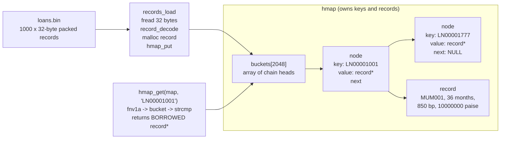

# Module 1.15: Mini-project: hash map and record parser in C

**Estimated hours:** 4

**What you will learn**

1. How to build a hash map in C from scratch: separate chaining, the FNV-1a hash, resizing at a load factor of 0.75, and an API with written ownership contracts.
2. How to parse a packed binary record file byte by byte into structs and load it into the map, so lookups by loan number take constant time.
3. How to test the result with assertions and Valgrind, introduce three realistic bugs on purpose, and recognise each one's signature in the tool output.

**Prerequisites:** [Module 1.14: Error handling and ownership contracts in C](module-14-error-handling-and-ownership-in-c.md). This project uses everything from Phase 1: pointers, structs, `malloc`/`free`, binary file I/O, UB-aware decoding, Make, status codes and ownership words.

---

## 1. One-line intuition

A hash map is a row of numbered pigeonholes where the pigeonhole number is computed from the key itself, so finding a loan by number costs one calculation and one short walk instead of a search through everything.

## 2. Real-life analogy

A branch keeps 10,000 loan files. Searching them one by one for loan `LN00001234` takes minutes. So the branch installs 2,048 **shelves** and a rule: take the loan number, run it through a fixed scrambling formula (the **hash function**), and the result modulo 2,048 is the shelf. Any file for that loan goes on that shelf and nowhere else. Finding a file is now: compute the shelf, walk along the few files on it, compare numbers.

Two files sometimes land on the same shelf (a **collision**). The shelf simply holds a short chain of files (**separate chaining**). When the shelves get crowded, on average three files for every four shelves (the **load factor** 0.75), the branch doubles the number of shelves and re-shelves everything by the same formula (**resize**). The average chain stays short, so lookups stay fast no matter how many loans there are.

The second half of the project is the **mail room**: loan files arrive as fixed-size 32-byte packets with no labels, just bytes at known offsets. The mail room reads each packet, builds a proper labelled file, and puts it on the right shelf.

## 3. Why it exists: the problem it solves

Every system on the resume has this structure inside it. The in-memory master-table cache (claim H4) is a hash map from business code to row. Berkeley DB's `DB_HASH` access method and PostgreSQL's hash join (module 6.10) are hash maps on disk and in memory. Redis is a hash map with a network port. The migration engine (claim H1) decodes packed records and needs to find the matching row for a composite key in constant time. Capstone C3 reuses the code from this module almost unchanged.

What breaks without it: a linear search over N records costs N comparisons; over a million loans, every lookup is a million string compares, roughly a few milliseconds, and a batch that does one lookup per record takes hours instead of seconds. A hash map makes the lookup cost independent of N, at the price of memory for the bucket array and the discipline to resize.

This module also exists because it is the first time you own a complete piece of code: a spec, a header with contracts, tests, a build, a leak check, and bugs you must find. That is the shape of every capstone.

## 4. Three layers of depth

### Layer 1 (beginner): the specification

**The map.** `hmap` maps a C string key to a `void *` value. Operations: create, destroy, put, get, remove, count, buckets. Keys are copied into the map. Values are owned by the map once put succeeds, and freed with a function the caller supplies at create time (for this project, `free`).

**Separate chaining.** The map holds an array of `nbuckets` pointers. Each pointer is the head of a singly linked list of nodes `{key, value, next}`. To find a key: hash it, take the hash modulo `nbuckets`, walk that list comparing with `strcmp`.

**FNV-1a.** A simple, fast, well-distributed hash for byte strings. Start with the 64-bit offset basis 14695981039346656037, then for each byte: XOR the byte into the hash, then multiply by the prime 1099511628211. All in `uint64_t`, so wraparound is defined behaviour (module 1.11).

**Resize at 0.75.** After an insert, if `count * 4 > nbuckets * 3`, allocate an array twice as big and move every node to its new bucket (its hash modulo the new size). No node is copied or reallocated; only the array is new.

**The record format.** Each record is exactly 32 bytes, the packed loan layout from module 1.07 (repeated here so this module stands alone):

| Offset | Size | Field | Encoding |
|---|---|---|---|
| 0 | 12 | `loan_no` | ASCII, space padded on the right, **not** NUL-terminated, e.g. `LN00001001  ` |
| 12 | 6 | `branch` | ASCII, fixed width, not NUL-terminated, e.g. `MUM001` |
| 18 | 1 | `status` | 0 applied, 1 sanctioned, 2 disbursed, 3 closed |
| 19 | 1 | `tenure_months` | 12 to 60 |
| 20 | 2 | `rate_bp` | unsigned 16-bit, little-endian; 850 means 8.50 percent |
| 22 | 2 | reserved | always zero |
| 24 | 8 | `principal_paise` | signed 64-bit, little-endian |

**The parser.** `record_decode` turns 32 raw bytes into a `record` struct with NUL-terminated, trimmed strings and native integers. `records_load` opens the file, reads records one at a time, mallocs a `record` for each, and puts it in the map under its trimmed loan number. The map owns the records from then on.

**Done means:** `make test` prints `ALL TESTS PASSED` and `make valgrind` prints `All heap blocks were freed -- no leaks are possible` and `ERROR SUMMARY: 0 errors`.

### Layer 2 (working engineer): the decisions inside the design

**Why copy keys.** If the map stored the caller's pointer, the caller would have to keep that string alive and unchanged for as long as the entry exists. Copying costs one `malloc` per entry and removes a whole class of use-after-free. The record parser passes `r->loan_no`, a field inside the record the map is about to own, which would work without a copy, but the header promises a copy so that any caller is safe.

**Why `void *` values with a free function.** C has no templates. The map does not know what a value is, so the caller tells it how to destroy one. Passing `NULL` makes the map a non-owning index over objects someone else owns, which is how the master-table cache in capstone C2 will use it.

**Why FNV-1a and not something cleverer.** It is four lines, has no lookup tables, distributes short ASCII keys well, and is fast enough that the `strcmp` in the chain walk dominates. It is *not* safe against an attacker who chooses keys to collide (a denial-of-service risk for maps fed by untrusted network input); for that you would seed the hash with a random value, which module 10.06 covers. Loan numbers from your own database are not adversarial.

**Why 0.75.** Below it, chains average under one node and memory is wasted; above it, chains grow and lookups slow down. Java's `HashMap` uses the same number. Doubling keeps the amortised cost of resizing at O(1) per insert: a resize that moves N nodes happens only after N/2 inserts since the last one.

**Why re-link nodes instead of re-inserting.** Re-inserting would `malloc` a new node and copy the key for every entry on every resize. Moving the existing nodes onto the new array is pointer surgery only: read `next`, compute the new bucket, push the node onto the front of that chain. Order within a chain changes; nothing else does.

**Why the parser reads byte by byte.** The `rd_u16le` and `rd_u64le` helpers assemble integers with shifts from `unsigned char`. No cast of the buffer to `uint16_t *`, so no alignment UB, no strict-aliasing UB, and the same result on a big-endian machine. This is rule 5 from your UB checklist.

**Why the map owns the records and the parser frees on failure.** `records_load` mallocs a record, then calls `hmap_put`. If decoding fails or `put` returns -1, the parser still owns the record and must free it. Once `put` returns 0, the map owns it. That is the ownership-on-failure question from module 1.14, answered in the header.

**Complexity.** With a good hash and load factor at most 0.75: average O(1) for put, get and remove; worst case O(N) if every key collides. Resize is O(N) but amortised O(1). Memory is one node (typically 24 bytes on x86-64: three pointers) plus the key copy per entry, plus 8 bytes per bucket.

### Layer 3 (internals): what the CPU does during a lookup

A `hmap_get` on a loaded map performs, in order:

1. **Hash.** About 10 bytes of key, so about 10 iterations of XOR and multiply. A 64-bit multiply takes typically 3 cycles of latency on a modern x86 core, and the loop is dependent (each multiply needs the previous result), so around 40 to 50 cycles, roughly 15 ns. All in registers; no memory traffic beyond the key bytes, which are in L1 if the caller just built them.
2. **Modulo.** `hash % nbuckets` compiles to a 64-bit division, typically 20 to 40 cycles. Production maps avoid this by keeping `nbuckets` a power of two and using `hash & (nbuckets - 1)`, a single cycle. This project doubles from 16 so the sizes *are* powers of two; switching to the mask is lab Part D.
3. **Bucket load.** `buckets[b]` is one memory read at a random address in an array of 2,048 pointers (16 KB). That array fits in L1 (typically 32 to 48 KB) if the map is hot, otherwise it is an L2 hit at about 4 ns, or a RAM access at about 100 ns for a cold map. This is usually the most expensive step.
4. **Chain walk.** Each node is a separate `malloc` block, so following `next` is another pointer chase, typically another cache miss on a large map. Then `strcmp` reads the key through yet another pointer. With load factor at most 0.75, the average chain has under one node, so most lookups touch one node and one key.

So a lookup in a hot map costs tens of nanoseconds; in a cold, large map, two or three cache misses, a few hundred nanoseconds. Module 2.13 will show you how to measure this and how storing the key's hash in the node (skipping `strcmp` on mismatch) and storing short keys inline (skipping one pointer chase) typically halve it. Those are the optimisations behind the "performance optimisation" line on the resume, and they are only possible because you built the simple version first.

**What `fread` does for the parser.** `fread(raw, 1, 32, f)` copies 32 bytes from the `FILE`'s user-space buffer (typically 4 KB, filled by one `read` system call) into `raw`. So 1,000 records cost about eight system calls, not a thousand. Reading a record at a time is fine here; capstone C3 will read whole pages and decode in place for speed.

## 5. Architecture diagram



The caller never holds a node; it holds a borrowed `record *` that is valid until the next put, remove or destroy.

## 6. Code

All files go in one folder, `m15`. The two headers and the test harness, generator and Makefile are complete. `hmap.c` and `records.c` are given as skeletons with `TODO` markers: you write those. The reference solution is at the end of this module behind a fold; attempt the project before opening it.

### 6.1 `hmap.h` (complete)

```c
/* hmap.h : a hash map from C string keys to pointer values.
 *
 * Separate chaining, FNV-1a hashing, doubles the bucket array when
 * count * 4 > buckets * 3 (load factor 0.75).
 *
 * OWNERSHIP CONTRACT
 *   - The map COPIES every key. The caller keeps ownership of the key it passed.
 *   - On a successful hmap_put, the map TAKES ownership of value. It will call
 *     free_value(value) on remove, on replace, and on destroy.
 *   - On a failed hmap_put (return -1) the caller STILL owns value.
 *   - hmap_get returns a BORROWED pointer: valid until the next put, remove
 *     or destroy on this map. Never free it.
 */
#ifndef HMAP_H
#define HMAP_H

#include <stddef.h>

typedef struct hmap hmap;                 /* opaque handle */
typedef void (*hmap_free_fn)(void *value);

/* OWNED: caller must call hmap_destroy. initial_buckets 0 means 16.
 * free_value may be NULL if the map does not own its values. */
hmap *hmap_create(size_t initial_buckets, hmap_free_fn free_value);

/* Frees every key, calls free_value on every value, frees the map.
 * Safe to call with NULL. */
void hmap_destroy(hmap *m);

/* Insert or replace. Returns 0 on success, -1 if out of memory.
 * Replacing frees the old value (if free_value is set) unless it is the
 * same pointer. */
int hmap_put(hmap *m, const char *key, void *value);

/* BORROWED pointer to the value, or NULL if the key is absent. */
void *hmap_get(const hmap *m, const char *key);

/* Removes key, frees its copy of the key and the value.
 * Returns 1 if the key was present, 0 if not. */
int hmap_remove(hmap *m, const char *key);

size_t hmap_count(const hmap *m);     /* number of keys stored */
size_t hmap_buckets(const hmap *m);   /* current size of the bucket array */

#endif /* HMAP_H */
```

### 6.2 `records.h` (complete)

```c
/* records.h : the packed 32-byte loan record and its parser.
 *
 * On-disk layout (little-endian, no padding, 32 bytes per record):
 *   offset  size  field
 *   0       12    loan_no          ASCII, space padded, NOT NUL-terminated
 *   12      6     branch           ASCII, fixed width, NOT NUL-terminated
 *   18      1     status           0 applied, 1 sanctioned, 2 disbursed, 3 closed
 *   19      1     tenure_months
 *   20      2     rate_bp          uint16, little-endian (850 = 8.50 %)
 *   22      2     reserved         always zero
 *   24      8     principal_paise  int64, little-endian
 */
#ifndef RECORDS_H
#define RECORDS_H

#include <stddef.h>
#include <stdint.h>
#include "hmap.h"

#define REC_SIZE 32

/* The decoded record. Strings are NUL-terminated and trimmed. */
typedef struct record {
    char     loan_no[13];
    char     branch[7];
    uint8_t  status;
    uint8_t  tenure_months;
    uint16_t rate_bp;
    int64_t  principal_paise;
} record;

typedef enum {
    REC_OK = 0,
    REC_ERR_IO,        /* fopen or read failed; errno says why */
    REC_ERR_FORMAT,    /* short record or bad magic */
    REC_ERR_NOMEM
} rec_status;

/* BORROWED: string literal; never free. */
const char *rec_status_str(rec_status st);

/* Decodes one raw record into *out. Pure: no allocation. */
rec_status record_decode(const unsigned char raw[REC_SIZE], record *out);

/* Reads every record in path, mallocs a record for each and puts it in map
 * under its loan_no. The MAP takes ownership of each record (create the map
 * with free_value = free). *loaded receives the number stored, even on error. */
rec_status records_load(const char *path, hmap *map, size_t *loaded);

#endif /* RECORDS_H */
```

### 6.3 `hmap.c` (skeleton: you complete it)

```c
/* hmap.c : YOUR implementation of hmap.h */
#include "hmap.h"
#include <stdint.h>
#include <stdlib.h>
#include <string.h>

typedef struct node {
    char        *key;      /* OWNED by the map: a NUL-terminated copy */
    void        *value;    /* OWNED by the map once put succeeds */
    struct node *next;     /* next node in the same bucket's chain */
} node;

struct hmap {
    node       **buckets;  /* array of chain heads, nbuckets long */
    size_t       nbuckets;
    size_t       count;
    hmap_free_fn free_value;
};

/* FNV-1a, 64-bit. Offset basis 14695981039346656037, prime 1099511628211. */
static uint64_t fnv1a(const char *s) {
    uint64_t h = 14695981039346656037ULL;
    /* TODO: for each byte: h ^= (unsigned char)byte; h *= 1099511628211ULL; */
    (void)s;
    return h;
}

/* Returns a malloc'd NUL-terminated copy of s, or NULL.
 * (strdup is POSIX, not C17, so we write our own.) */
static char *copy_string(const char *s) {
    /* TODO: strlen + 1, malloc, memcpy */
    (void)s;
    return NULL;
}

hmap *hmap_create(size_t initial_buckets, hmap_free_fn free_value) {
    if (initial_buckets == 0) initial_buckets = 16;
    /* TODO: malloc the struct, calloc the bucket array (so every head is
     * NULL), fill the fields. On any failure free what you took and
     * return NULL. */
    (void)free_value;
    return NULL;
}

/* Frees one node: its key, its value via free_value (if set), itself. */
static void free_node(hmap *m, node *n) {
    /* TODO */
    (void)m; (void)n;
}

void hmap_destroy(hmap *m) {
    if (m == NULL) return;
    /* TODO: for each bucket, walk the chain. Read n->next BEFORE freeing n.
     * Then free the bucket array and the struct. */
}

/* Finds the node for key. Also reports the bucket index if asked. */
static node *find_node(const hmap *m, const char *key, size_t *bucket_out) {
    /* TODO: b = fnv1a(key) % nbuckets; walk m->buckets[b] with strcmp */
    (void)m; (void)key; (void)bucket_out;
    return NULL;
}

/* Doubles the bucket array and re-links every node. Returns 0, or -1 if
 * the new array cannot be allocated (the map is then left unchanged). */
static int grow(hmap *m) {
    /* TODO: calloc new array of 2 * nbuckets. For every node in every old
     * bucket: save next, compute new bucket, push node onto the front of
     * the new chain. Free the old array, install the new one. */
    (void)m;
    return -1;
}

int hmap_put(hmap *m, const char *key, void *value) {
    /* TODO:
     * 1. find_node. If found: free the old value (if free_value set and it
     *    is a different pointer), store the new value, return 0.
     * 2. Else malloc a node, copy_string the key (free the node and return
     *    -1 if either fails: the caller still owns value).
     * 3. Link the node at the front of its bucket, count++.
     * 4. If count * 4 > nbuckets * 3, grow (ignore its failure).
     * 5. Return 0. */
    (void)m; (void)key; (void)value;
    return -1;
}

void *hmap_get(const hmap *m, const char *key) {
    /* TODO: find_node; return its value or NULL */
    (void)m; (void)key;
    return NULL;
}

int hmap_remove(hmap *m, const char *key) {
    /* TODO: walk the bucket with a node** so you can unlink without a
     * "previous" variable. On match: unlink, free_node, count--, return 1. */
    (void)m; (void)key;
    return 0;
}

size_t hmap_count(const hmap *m)   { return m->count; }
size_t hmap_buckets(const hmap *m) { return m->nbuckets; }
```

### 6.4 `records.c` (skeleton: you complete it)

```c
/* records.c : YOUR implementation of records.h */
#include "records.h"
#include <stdio.h>
#include <stdlib.h>
#include <string.h>

const char *rec_status_str(rec_status st) {
    switch (st) {
    case REC_OK:         return "ok";
    case REC_ERR_IO:     return "I/O error";
    case REC_ERR_FORMAT: return "bad record format";
    case REC_ERR_NOMEM:  return "out of memory";
    }
    return "unknown";
}

/* Little-endian readers. Byte by byte: no casts, no alignment or
 * aliasing UB, works on any CPU. */
static uint16_t rd_u16le(const unsigned char *p) {
    /* TODO: p[0] | (p[1] << 8) */
    (void)p;
    return 0;
}

static uint64_t rd_u64le(const unsigned char *p) {
    /* TODO: from p[7] down to p[0]: v = (v << 8) | p[i] */
    (void)p;
    return 0;
}

/* Copy n bytes into dst, add the NUL, strip trailing spaces. */
static void copy_trimmed(char *dst, const unsigned char *src, size_t n) {
    /* TODO */
    (void)dst; (void)src; (void)n;
}

rec_status record_decode(const unsigned char raw[REC_SIZE], record *out) {
    /* TODO: check raw[0]=='L' && raw[1]=='N' else REC_ERR_FORMAT;
     * fill every field using the offsets in records.h */
    (void)raw; (void)out;
    return REC_ERR_FORMAT;
}

rec_status records_load(const char *path, hmap *map, size_t *loaded) {
    /* TODO:
     * fopen "rb" (REC_ERR_IO if NULL, *loaded = 0).
     * Loop: fread 32 bytes.
     *   got == 0 : end (REC_ERR_IO if ferror), break.
     *   got != 32: REC_ERR_FORMAT, break.
     *   malloc a record (REC_ERR_NOMEM), decode (free + break on error),
     *   hmap_put under r->loan_no (free + REC_ERR_NOMEM on -1), n++.
     * fclose. *loaded = n. return status. */
    (void)path; (void)map; (void)loaded;
    return REC_ERR_IO;
}
```

### 6.5 `gen_records.c` (complete)

```c
/* gen_records.c : writes N packed loan records to a file.
 * Usage: ./gen_records loans.bin 1000 */
#include <stdio.h>
#include <stdlib.h>
#include <string.h>
#include <stdint.h>

static void wr_u16le(unsigned char *p, uint16_t v) {
    p[0] = (unsigned char)(v & 0xFF);
    p[1] = (unsigned char)(v >> 8);
}

static void wr_u64le(unsigned char *p, uint64_t v) {
    for (int i = 0; i < 8; ++i) {
        p[i] = (unsigned char)(v & 0xFF);
        v >>= 8;
    }
}

int main(int argc, char **argv) {
    if (argc != 3) {
        fprintf(stderr, "usage: %s <file> <count>\n", argv[0]);
        return 2;
    }
    const char *path = argv[1];
    unsigned count = (unsigned)strtoul(argv[2], NULL, 10);
    static const char *branches[] = { "MUM001", "DEL002", "BLR003",
                                      "CHN004", "HYD005", "PUN006" };

    FILE *f = fopen(path, "wb");
    if (f == NULL) {
        perror(path);
        return 1;
    }
    for (unsigned i = 0; i < count; ++i) {
        unsigned char raw[32];
        memset(raw, ' ', 12);                     /* loan_no space padded */
        char tmp[16];
        snprintf(tmp, sizeof tmp, "LN%08u", 1001u + i);
        memcpy(raw, tmp, strlen(tmp));            /* 10 chars, 2 spaces */
        memcpy(raw + 12, branches[i % 6], 6);
        raw[18] = (unsigned char)(i % 4);         /* status */
        raw[19] = (unsigned char)(12 * (1 + i % 5)); /* tenure 12..60 */
        wr_u16le(raw + 20, (uint16_t)(850 + 25 * (i % 7)));
        raw[22] = 0;
        raw[23] = 0;
        wr_u64le(raw + 24, (uint64_t)(100000 + 2500 * (uint64_t)i) * 100);
        if (fwrite(raw, 1, sizeof raw, f) != sizeof raw) {
            perror("fwrite");
            fclose(f);
            return 1;
        }
    }
    fclose(f);
    printf("wrote %u records (%u bytes) to %s\n", count, count * 32, path);
    return 0;
}
```

### 6.6 `test_hmap.c` (complete)

```c
/* test_hmap.c : tests for hmap and the record parser.
 * Usage: ./test_hmap loans.bin */
#include <stdio.h>
#include <stdlib.h>
#include <string.h>
#include "hmap.h"
#include "records.h"

static int failures = 0;

#define CHECK(cond) do {                                                 \
    if (cond) { printf("PASS  %s\n", #cond); }                           \
    else      { printf("FAIL  %s  (line %d)\n", #cond, __LINE__);        \
                failures++; }                                            \
} while (0)

/* A value type for the first tests: a heap-allocated int. */
static int *boxed(int v) {
    int *p = malloc(sizeof *p);
    if (p == NULL) abort();
    *p = v;
    return p;
}

static void test_basic(void) {
    printf("--- basic put/get/replace/remove ---\n");
    hmap *m = hmap_create(4, free);
    CHECK(m != NULL);
    CHECK(hmap_count(m) == 0 && hmap_buckets(m) == 4);

    CHECK(hmap_put(m, "LN1", boxed(1)) == 0);
    CHECK(hmap_put(m, "LN2", boxed(2)) == 0);
    CHECK(hmap_put(m, "LN3", boxed(3)) == 0);
    CHECK(hmap_count(m) == 3 && hmap_buckets(m) == 4);   /* 3/4 is not > 0.75 */

    CHECK(hmap_put(m, "LN4", boxed(4)) == 0);
    CHECK(hmap_count(m) == 4 && hmap_buckets(m) == 8);   /* 4/4 > 0.75: grew */

    int *v = hmap_get(m, "LN2");
    CHECK(v != NULL && *v == 2);
    CHECK(hmap_get(m, "LN9") == NULL);

    CHECK(hmap_put(m, "LN2", boxed(22)) == 0);           /* replace frees old */
    v = hmap_get(m, "LN2");
    CHECK(v != NULL && *v == 22);
    CHECK(hmap_count(m) == 4);

    CHECK(hmap_remove(m, "LN3") == 1);
    CHECK(hmap_remove(m, "LN3") == 0);
    CHECK(hmap_get(m, "LN3") == NULL);
    CHECK(hmap_count(m) == 3);

    hmap_destroy(m);
}

static void test_many(void) {
    printf("--- 1000 keys and resizing ---\n");
    hmap *m = hmap_create(4, free);
    char key[32];
    for (int i = 0; i < 1000; ++i) {
        snprintf(key, sizeof key, "KEY%04d", i);
        if (hmap_put(m, key, boxed(i)) != 0) abort();
    }
    CHECK(hmap_count(m) == 1000);
    CHECK(hmap_buckets(m) == 2048);          /* 4 doubled until 1000*4 <= b*3 */
    int all_ok = 1;
    for (int i = 0; i < 1000; ++i) {
        snprintf(key, sizeof key, "KEY%04d", i);
        int *v = hmap_get(m, key);
        if (v == NULL || *v != i) all_ok = 0;
    }
    CHECK(all_ok);
    for (int i = 0; i < 1000; i += 2) {
        snprintf(key, sizeof key, "KEY%04d", i);
        hmap_remove(m, key);
    }
    CHECK(hmap_count(m) == 500);
    CHECK(hmap_get(m, "KEY0000") == NULL && hmap_get(m, "KEY0001") != NULL);
    hmap_destroy(m);
}

static void test_records(const char *path) {
    printf("--- packed records from %s ---\n", path);
    unsigned char raw[REC_SIZE] = {
        'L','N','0','0','0','0','1','0','0','1',' ',' ',
        'M','U','M','0','0','1',
        2, 36,
        0x52, 0x03,                   /* 850 = 0x0352, little-endian */
        0, 0,
        0x80, 0x96, 0x98, 0x00, 0, 0, 0, 0   /* 10000000 = 0x00989680 */
    };
    record r;
    CHECK(record_decode(raw, &r) == REC_OK);
    CHECK(strcmp(r.loan_no, "LN00001001") == 0);
    CHECK(strcmp(r.branch, "MUM001") == 0);
    CHECK(r.status == 2 && r.tenure_months == 36);
    CHECK(r.rate_bp == 850);
    CHECK(r.principal_paise == 10000000);

    hmap *m = hmap_create(0, free);
    size_t loaded = 0;
    rec_status st = records_load(path, m, &loaded);
    CHECK(st == REC_OK);
    CHECK(loaded == 1000 && hmap_count(m) == 1000);

    const record *first = hmap_get(m, "LN00001001");
    CHECK(first != NULL && strcmp(first->branch, "MUM001") == 0);
    CHECK(first != NULL && first->principal_paise == 10000000);
    const record *last = hmap_get(m, "LN00002000");
    CHECK(last != NULL && strcmp(last->branch, "CHN004") == 0);
    CHECK(last != NULL && last->tenure_months == 60);
    CHECK(last != NULL && last->rate_bp == 975);
    CHECK(hmap_get(m, "LN00002001") == NULL);
    CHECK(hmap_get(m, "LN00001001  ") == NULL);    /* untrimmed key must miss */

    hmap_destroy(m);
}

int main(int argc, char **argv) {
    const char *path = (argc > 1) ? argv[1] : "loans.bin";
    test_basic();
    test_many();
    test_records(path);
    if (failures == 0) {
        printf("ALL TESTS PASSED\n");
        return 0;
    }
    printf("%d FAILURE(S)\n", failures);
    return 1;
}
```

### 6.7 `Makefile` (complete; recipe lines start with a TAB)

```make
CC      := gcc
CFLAGS  := -std=c17 -Wall -Wextra -Werror -g -MMD -MP
LDLIBS  :=

.PHONY: all test valgrind clean

all: test_hmap gen_records

test_hmap: test_hmap.o hmap.o records.o
	$(CC) -o $@ $^ $(LDLIBS)

gen_records: gen_records.o
	$(CC) -o $@ $^ $(LDLIBS)

%.o: %.c
	$(CC) $(CFLAGS) -c -o $@ $<

loans.bin: gen_records
	./gen_records loans.bin 1000

test: test_hmap loans.bin
	./test_hmap loans.bin

valgrind: test_hmap loans.bin
	valgrind --leak-check=full --error-exitcode=1 ./test_hmap loans.bin

clean:
	rm -f test_hmap gen_records *.o *.d loans.bin
```

### 6.8 Expected output when you are done

```bash
make test
```

```text
gcc -std=c17 -Wall -Wextra -Werror -g -MMD -MP -c -o test_hmap.o test_hmap.c
gcc -std=c17 -Wall -Wextra -Werror -g -MMD -MP -c -o hmap.o hmap.c
gcc -std=c17 -Wall -Wextra -Werror -g -MMD -MP -c -o records.o records.c
gcc -o test_hmap test_hmap.o hmap.o records.o
gcc -std=c17 -Wall -Wextra -Werror -g -MMD -MP -c -o gen_records.o gen_records.c
gcc -o gen_records gen_records.o
./gen_records loans.bin 1000
wrote 1000 records (32000 bytes) to loans.bin
./test_hmap loans.bin
--- basic put/get/replace/remove ---
PASS  m != NULL
PASS  hmap_count(m) == 0 && hmap_buckets(m) == 4
PASS  hmap_put(m, "LN1", boxed(1)) == 0
PASS  hmap_put(m, "LN2", boxed(2)) == 0
PASS  hmap_put(m, "LN3", boxed(3)) == 0
PASS  hmap_count(m) == 3 && hmap_buckets(m) == 4
PASS  hmap_put(m, "LN4", boxed(4)) == 0
PASS  hmap_count(m) == 4 && hmap_buckets(m) == 8
PASS  v != NULL && *v == 2
PASS  hmap_get(m, "LN9") == NULL
PASS  hmap_put(m, "LN2", boxed(22)) == 0
PASS  v != NULL && *v == 22
PASS  hmap_count(m) == 4
PASS  hmap_remove(m, "LN3") == 1
PASS  hmap_remove(m, "LN3") == 0
PASS  hmap_get(m, "LN3") == NULL
PASS  hmap_count(m) == 3
--- 1000 keys and resizing ---
PASS  hmap_count(m) == 1000
PASS  hmap_buckets(m) == 2048
PASS  all_ok
PASS  hmap_count(m) == 500
PASS  hmap_get(m, "KEY0000") == NULL && hmap_get(m, "KEY0001") != NULL
--- packed records from loans.bin ---
PASS  record_decode(raw, &r) == REC_OK
PASS  strcmp(r.loan_no, "LN00001001") == 0
PASS  strcmp(r.branch, "MUM001") == 0
PASS  r.status == 2 && r.tenure_months == 36
PASS  r.rate_bp == 850
PASS  r.principal_paise == 10000000
PASS  st == REC_OK
PASS  loaded == 1000 && hmap_count(m) == 1000
PASS  first != NULL && strcmp(first->branch, "MUM001") == 0
PASS  first != NULL && first->principal_paise == 10000000
PASS  last != NULL && strcmp(last->branch, "CHN004") == 0
PASS  last != NULL && last->tenure_months == 60
PASS  last != NULL && last->rate_bp == 975
PASS  hmap_get(m, "LN00002001") == NULL
PASS  hmap_get(m, "LN00001001  ") == NULL
ALL TESTS PASSED
```

```bash
make valgrind
```

The last lines must read (the process ID after `==` differs):

```text
==175== HEAP SUMMARY:
==175==     in use at exit: 0 bytes in 0 blocks
==175==   total heap usage: 6,039 allocs, 6,039 frees, 177,364 bytes allocated
==175==
==175== All heap blocks were freed -- no leaks are possible
==175==
==175== ERROR SUMMARY: 0 errors from 0 contexts (suppressed: 0 from 0)
```

Where do 6,039 allocations come from? Roughly: 2,000 nodes plus 2,000 key copies plus 1,000 boxed ints for the first two tests, 1,000 records plus 1,000 nodes plus 1,000 key copies for the file, a handful of bucket arrays, three map structs, the `FILE` and its buffer. Every one of them has a matching free. The exact number varies with glibc; the two lines that must not vary are "All heap blocks were freed" and "0 errors".

Look at the file too:

```bash
xxd -l 64 loans.bin
```

```text
00000000: 4c4e 3030 3030 3130 3031 2020 4d55 4d30  LN00001001  MUM0
00000010: 3031 000c 5203 0000 8096 9800 0000 0000  01..R...........
00000020: 4c4e 3030 3030 3130 3032 2020 4445 4c30  LN00001002  DEL0
00000030: 3032 0118 6b03 0000 1067 9c00 0000 0000  02..k....g......
```

Read record one against the table: bytes 0 to 11 are `LN00001001` and two spaces; 12 to 17 are `MUM001`; 18 is `00` (applied); 19 is `0c` (12 months); 20 to 21 are `52 03`, which little-endian is `0x0352` = 850; 22 to 23 zero; 24 to 31 are `80 96 98 00 00 00 00 00`, which is `0x00989680` = 10,000,000 paise. This is the "packed key/record layout" from resume claim H2, decoded by eye.

## 7. Use case: core-banking loan-origination platform

The record-to-relational mapping layer in resume claim H2 (capstone C3) had to join two Berkeley DB files: the loan master (keyed by loan number) and the repayment schedule (keyed by loan number plus instalment number). The first version walked the schedule file with a cursor and, for each of several million schedule rows, did a `DB->get` on the loan master to fetch the branch and product code. Each `get` was a B-tree descent through the page cache, typically tens of microseconds, so the join alone took most of an hour.

**The decision it drove:** load the loan master once into an in-process hash map exactly like this module's (string key, pointer to a decoded record, map owns the records), then walk the schedule file and do one `hmap_get` per row at tens of nanoseconds. The join dropped from most of an hour to under a minute on the same hardware, and the memory cost (a few hundred megabytes for the whole master) was acceptable on the migration host. The ownership contract was the same as in `hmap.h`: records borrowed from the map were valid for the whole batch because nothing removed from the map during a batch, and `hmap_destroy` at the end of the run was the single point of release that Valgrind verified. This is the same decision, at a smaller scale, as the master-table cache in claim H4: compute once, hold in RAM, look up by key.

## 8. Lab

### Part A: build it (90 minutes)

1. Create `m15` with the seven files from section 6. Run `make`. Expected: everything compiles with zero warnings even though the skeletons do nothing (that is what the `(void)` lines are for). Run `make test`. Expected: many `FAIL` lines. That is your to-do list.
2. Implement `hmap.c` in this order, running `make test` after each: `fnv1a` and `copy_string`; `hmap_create` and `hmap_destroy`; `find_node` and `hmap_get`; `hmap_put` without `grow`; `grow`; `hmap_remove`. The `test_basic` block should pass before you touch `records.c`.
3. Implement `records.c` in this order: `rd_u16le`, `rd_u64le`, `copy_trimmed`, `record_decode` (the first six record checks pass), then `records_load` (the rest pass).
4. Run `make valgrind`. If it reports anything other than "All heap blocks were freed" and "0 errors", read the first stack trace, fix the cause, rerun. Do not move on until it is clean.

Expected: `ALL TESTS PASSED` and the Valgrind summary from section 6.8. Realistic time for a first attempt is 60 to 120 minutes; if it takes longer, that is normal for the first data structure you have ever built with ownership rules.

### Part B: three deliberate bugs (45 minutes)

For each bug: introduce it, run `make test` and `make valgrind`, write down the first line that reveals it, then revert. The point is to learn each bug's signature so you recognise it in capstone C3 and in Phase 8.

**Bug 1: off-by-one in resize.** In `grow`, change the loop bound from `i < m->nbuckets` to `i < m->nbuckets - 1`, so the last old bucket is never moved.

Expected: six `FAIL` lines, starting with `FAIL  v != NULL && *v == 2` (keys in the last bucket vanish after the first resize), and Valgrind reports the orphaned chains:

```text
==67== 32 (24 direct, 8 indirect) bytes in 1 blocks are definitely lost in loss record 6 of 10
==67==    definitely lost: 192 bytes in 8 blocks
==67==    indirectly lost: 252 bytes in 19 blocks
==67== ERROR SUMMARY: 3 errors from 3 contexts
```

"Indirectly lost" are the keys and values reachable only from the lost nodes. A lookup that fails only after the map has grown is the classic signature of a resize bug.

**Bug 2: missing free on remove.** In `hmap_remove`, replace `free_node(m, n);` with `free(n);`, so the node is freed but its key and value are not.

Expected: `ALL TESTS PASSED`. The tests cannot see this bug. Only Valgrind can:

```text
==85== 2,000 bytes in 500 blocks are definitely lost in loss record 3 of 4
==85== 4,000 bytes in 500 blocks are definitely lost in loss record 4 of 4
==85==    definitely lost: 6,008 bytes in 1,002 blocks
==85== ERROR SUMMARY: 4 errors from 4 contexts
```

The 2,000 bytes are the 500 boxed ints (4 bytes each) and the 4,000 bytes are the 500 key copies (`KEY0000` is 8 bytes with the NUL) left behind by `test_many`, plus the one key and one value from the remove in `test_basic`: 1,002 blocks. A server with this bug passes every functional test and dies of memory exhaustion in production. This is why the leak check is a gate, not an option.

**Bug 3: a key that is not NUL-terminated.** In `copy_trimmed`, delete the line `dst[n] = '\0';`. The loan number is copied into a `malloc`'d record, so byte 12 holds whatever was in that heap block before; `strlen` and `strcmp` run off the end of the field.

Expected: one `FAIL` (`strcmp(r.branch, "MUM001") == 0`, because the stack record in the test happened to have a non-zero byte after the branch field) and Valgrind's uninitialised-value report:

```text
==103== Conditional jump or move depends on uninitialised value(s)
==103==    at 0x4850387: strcmp (in /usr/libexec/valgrind/vgpreload_memcheck-amd64-linux.so)
==103==    by 0x109FF7: test_records (test_hmap.c:95)
==111== ERROR SUMMARY: 9 errors from 9 contexts
```

Whether this bug shows up as a failed lookup, a wrong branch code, or nothing at all depends on the garbage after the field, which is the definition of UB from module 1.11. Note that if you had used `calloc` for the record, the byte would be zero, the tests would pass, and Valgrind would be silent, which is a bug hidden rather than a bug fixed: the fixed-width fields in the file still need the explicit terminator.

### Part C: measure it (20 minutes)

1. Change `test_many` to use 100,000 keys (and the bucket expectation to 262144). Time it with `time ./test_hmap loans.bin`. Then change `hmap_create(4, free)` to `hmap_create(1 << 18, free)` so no resize happens and time it again. Record both numbers. On one laptop the difference was small, which tells you resizing is amortised cheap. Restore the test.
2. Temporarily make `fnv1a` return a constant (`return 1;`). Run the 1,000-key test with `time`. Every key is now in one chain: this is the O(N) worst case. Record the time and restore the hash.

### Part D: one improvement (20 minutes)

Replace `% m->nbuckets` with `& (m->nbuckets - 1)` in `find_node`, `grow` and `hmap_remove`. This is only correct because every bucket count is a power of two; add a comment saying so and make `hmap_create` round `initial_buckets` up to a power of two. Run `make test` and `make valgrind`: both must still be clean. This is the first entry in your performance-optimisation story for module 2.13.

### Journal

Copy [journal/TEMPLATE.md](../journal/TEMPLATE.md) to `journal/YYYY-MM-DD-hash-map-and-parser.md`. Record: how long Part A took and which function you got wrong first; the first revealing line for each of the three bugs and which tool caught it; the timings from Part C; and the one design decision you would change (for example storing the hash in the node). Also copy `hmap.h` into the entry: it is the first API with ownership contracts that you wrote yourself, and capstone C3 starts from it.

## 9. Common mistakes and misconceptions

| Mistake | Why it is wrong | Bug it causes later |
|---|---|---|
| Reading `n->next` after freeing `n` | Use-after-free; the bytes may already be reused | Valgrind `Invalid read`, crash in `hmap_destroy` under load |
| Storing the caller's key pointer instead of a copy | The caller's buffer changes or dies | Lookups that fail for keys that were "definitely inserted" |
| Signed arithmetic in the hash | Signed overflow is UB (module 1.11) | Different buckets at `-O0` and `-O2`; lost entries |
| Casting the raw buffer to `uint64_t *` | Alignment and strict-aliasing UB | Wrong principal values after `-O2`; `SIGBUS` on ARM |
| Forgetting the NUL after a fixed-width field | `strlen` and `strcmp` run into the next field or into garbage | Bug 3: wrong keys, uninitialised reads |
| Checking load factor before insert with the wrong comparison | Off by one resize either way | Tests on `hmap_buckets` fail; chains longer than planned |
| Freeing the value on a failed `put` inside the map | The header says the caller still owns it | Double free when the caller cleans up |
| Using `strdup` under `-std=c17` | It is POSIX, not C17; not declared | `implicit declaration` error under `-Werror` |
| Testing only the success path | Leaks and ownership bugs live on error paths and in `remove` | Bug 2 ships |
| `calloc` to hide a missing terminator | The on-disk field still has no terminator; zeroing masks the symptom | Silent corruption when the same code reads a non-zeroed buffer |

## 10. Resume link

- **Claim H2, "decoding packed key/record layouts into a normalised, indexed schema".** You have now decoded the layout by hand from `xxd` and in code with byte-wise little-endian readers. Say: "Fixed-width ASCII fields without terminators, little-endian integers at fixed offsets; the decoder copies each field and adds the terminator explicitly, and a Valgrind run over the sample file proves there are no uninitialised reads."
- **Claim H1, "arena allocator with explicit ownership contracts, restartable leak-free batches".** `hmap.h` is your first header that states who owns what, including on failure. In capstone C3 the per-record `malloc` becomes an arena allocation, and the contract becomes "borrowed until batch commit". You can describe both versions and why the second is faster and simpler to make leak-free.
- **Claim H4, "in-memory master-table cache that removes joins from the hot path".** Section 7 is the same decision: a hash map loaded once, lookups by key at tens of nanoseconds instead of a database round trip. The numbers you measure in Part C are the start of that story.
- **Claim F, "Valgrind, memory corruption and leak investigation".** You have seen three bug signatures: definitely lost with indirectly lost (orphaned structure), definitely lost in exact multiples (missing free in one function), and conditional jump on uninitialised value (missing terminator). Being able to name the likely cause from the report is the skill.

Likely follow-ups: "How does your hash map handle collisions?" (separate chaining, average chain under one at 0.75). "What is the worst case?" (O(N) when all keys collide, shown in Part C step 2). "How would you make it faster?" (power-of-two masking, storing the hash in the node, inline short keys, open addressing for cache locality, which module 2.13 and the STL `unordered_map` internals in module 2.09 cover).

## 11. Interview questions

**Q1 (easy). How does a hash map find a value by key, and why is it fast?**

<details>
<summary>Model answer</summary>

It runs the key through a hash function to get a number, takes that number modulo the bucket count to pick a bucket, and then compares the key against the few entries in that bucket. Because the hash spreads keys evenly and the map resizes to keep the average bucket nearly empty, a lookup costs a hash computation plus about one comparison regardless of how many entries there are: average O(1), compared with O(N) for a linear search or O(log N) for a balanced tree.

</details>

**Q2 (easy). What is a load factor and why resize at 0.75?**

<details>
<summary>Model answer</summary>

Load factor is entries divided by buckets. With separate chaining it is the average chain length. Resizing when it exceeds 0.75 keeps chains short so lookups stay fast, while not wasting memory on a mostly empty array. Doubling the bucket count makes the cost amortised: a resize that moves N entries happens only after about N/2 inserts since the last resize, so the average cost per insert stays constant. Java's `HashMap` uses the same threshold.

</details>

**Q3 (medium). Walk through what `hmap_put` must do, including ownership on each path.**

<details>
<summary>Model answer</summary>

Hash the key and find its bucket, then walk the chain comparing with `strcmp`. If the key exists, free the old value through the map's free function unless it is the same pointer, store the new value and return success; the map now owns the new value. If it does not exist, allocate a node and a copy of the key; if either allocation fails, free whatever was allocated and return -1, and the header states the caller still owns the value. Otherwise link the node at the head of the chain, increment the count, and if count times four exceeds buckets times three, grow by allocating a double-size array and re-linking every node by its new bucket. The key is copied so the caller may free or reuse its buffer immediately; the value is owned by the map from the moment put returns 0.

</details>

**Q4 (medium). Your tests pass but a service using your map leaks memory over time. Which operation would you suspect first and how would you confirm?**

<details>
<summary>Model answer</summary>

Remove and replace, because they are the operations where ownership transfers out of the map and tests often check only the count and the lookup, not the memory. I would run the test suite under `valgrind --leak-check=full` and look for "definitely lost" blocks whose allocation stack is the key copy or the value allocation, and whose count matches the number of removes, for example 500 blocks of 8 bytes after removing 500 keys. That points to `hmap_remove` freeing the node but not its key and value, or `hmap_put` on an existing key overwriting the value pointer without freeing the old one. The fix is one `free_node` helper used by remove, replace and destroy, and a leak check in CI so the gap cannot reopen.

</details>

**Q5 (hard). You must decode millions of fixed-width binary records and join them to another file by key, in C, correctly on both x86 and ARM, with zero leaks. Describe the design and how you would prove each property.**

<details>
<summary>Model answer</summary>

Define the layout in one header with offsets, widths and endianness, and decode each field with byte-wise helpers that assemble integers from `unsigned char` with shifts, never by casting the buffer, so there is no alignment or aliasing UB and the result is the same on any CPU; fixed-width text fields are copied with an explicit terminator and trimmed. Load the smaller file into a hash map keyed by the join key, with the map owning the decoded records and a free function supplied at creation, and walk the larger file sequentially doing one O(1) lookup per record; this turns an O(N times tree descent) join into O(N). For memory, allocate per-batch records from an arena so a batch commits or aborts with a single reset, and state ownership on every API, including who owns a record when an insert fails. Prove correctness with unit tests on hand-built byte arrays for each field, including boundary values and a non-terminated key; prove portability by building and running the tests under UBSan on x86 and, if available, on an ARM machine or an emulator; prove leak-freedom by running the tests and a sample file under Valgrind with full leak checking as a CI gate requiring "All heap blocks were freed" and zero errors. Measure the join with the hash map versus per-record B-tree lookups and record both numbers.

</details>

## 12. Revision

- A chaining hash map is an array of linked-list heads; FNV-1a over the key bytes modulo the bucket count picks the chain; resize by doubling when entries exceed three quarters of the buckets, re-linking nodes rather than copying them.
- The header states the contract: keys are copied, values are owned by the map after a successful put (and still the caller's after a failed one), `get` returns a borrowed pointer valid until the next modification, `destroy` releases everything.
- Packed records are decoded byte by byte with explicit terminators; the project is finished when `make test` prints `ALL TESTS PASSED` and Valgrind prints `All heap blocks were freed` with `0 errors`; the three bug signatures to remember are orphaned chains (resize), exact-multiple leaks (remove) and uninitialised reads in `strcmp` (missing NUL).

---

<details>
<summary>Reference solution (attempt it first)</summary>

### `hmap.c`

```c
/* hmap.c : reference implementation of hmap.h */
#include "hmap.h"
#include <stdint.h>
#include <stdlib.h>
#include <string.h>

typedef struct node {
    char        *key;      /* OWNED by the map: a NUL-terminated copy */
    void        *value;    /* OWNED by the map once put succeeds */
    struct node *next;     /* next node in the same bucket's chain */
} node;

struct hmap {
    node       **buckets;  /* array of chain heads, nbuckets long */
    size_t       nbuckets;
    size_t       count;
    hmap_free_fn free_value;
};

/* FNV-1a, 64-bit. Offset basis and prime are the published constants. */
static uint64_t fnv1a(const char *s) {
    uint64_t h = 14695981039346656037ULL;
    for (; *s != '\0'; ++s) {
        h ^= (unsigned char)*s;
        h *= 1099511628211ULL;      /* unsigned: wraparound is defined */
    }
    return h;
}

static char *copy_string(const char *s) {
    size_t len = strlen(s) + 1;     /* +1 for the NUL */
    char *copy = malloc(len);
    if (copy != NULL) {
        memcpy(copy, s, len);
    }
    return copy;
}

hmap *hmap_create(size_t initial_buckets, hmap_free_fn free_value) {
    if (initial_buckets == 0) initial_buckets = 16;
    hmap *m = malloc(sizeof *m);
    if (m == NULL) return NULL;
    m->buckets = calloc(initial_buckets, sizeof *m->buckets);  /* all NULL */
    if (m->buckets == NULL) {
        free(m);
        return NULL;
    }
    m->nbuckets   = initial_buckets;
    m->count      = 0;
    m->free_value = free_value;
    return m;
}

static void free_node(hmap *m, node *n) {
    free(n->key);
    if (m->free_value != NULL && n->value != NULL) {
        m->free_value(n->value);
    }
    free(n);
}

void hmap_destroy(hmap *m) {
    if (m == NULL) return;
    for (size_t i = 0; i < m->nbuckets; ++i) {
        node *n = m->buckets[i];
        while (n != NULL) {
            node *next = n->next;   /* read next BEFORE freeing n */
            free_node(m, n);
            n = next;
        }
    }
    free(m->buckets);
    free(m);
}

static node *find_node(const hmap *m, const char *key, size_t *bucket_out) {
    size_t b = (size_t)(fnv1a(key) % m->nbuckets);
    if (bucket_out != NULL) *bucket_out = b;
    for (node *n = m->buckets[b]; n != NULL; n = n->next) {
        if (strcmp(n->key, key) == 0) {
            return n;
        }
    }
    return NULL;
}

/* Double the bucket array and move every node to its new bucket.
 * Nodes are reused, not copied, so no new allocations except the array. */
static int grow(hmap *m) {
    size_t new_n = m->nbuckets * 2;
    node **nb = calloc(new_n, sizeof *nb);
    if (nb == NULL) return -1;
    for (size_t i = 0; i < m->nbuckets; ++i) {
        node *n = m->buckets[i];
        while (n != NULL) {
            node *next = n->next;
            size_t b = (size_t)(fnv1a(n->key) % new_n);
            n->next = nb[b];        /* push onto the front of the new chain */
            nb[b] = n;
            n = next;
        }
    }
    free(m->buckets);
    m->buckets  = nb;
    m->nbuckets = new_n;
    return 0;
}

int hmap_put(hmap *m, const char *key, void *value) {
    size_t b;
    node *existing = find_node(m, key, &b);
    if (existing != NULL) {
        if (m->free_value != NULL && existing->value != NULL &&
            existing->value != value) {
            m->free_value(existing->value);
        }
        existing->value = value;
        return 0;
    }
    node *n = malloc(sizeof *n);
    if (n == NULL) return -1;
    n->key = copy_string(key);
    if (n->key == NULL) {
        free(n);
        return -1;                  /* caller still owns value */
    }
    n->value = value;
    n->next  = m->buckets[b];
    m->buckets[b] = n;
    m->count++;
    if (m->count * 4 > m->nbuckets * 3) {
        (void)grow(m);              /* if grow fails we just stay slower */
    }
    return 0;
}

void *hmap_get(const hmap *m, const char *key) {
    node *n = find_node(m, key, NULL);
    return n != NULL ? n->value : NULL;
}

int hmap_remove(hmap *m, const char *key) {
    size_t b = (size_t)(fnv1a(key) % m->nbuckets);
    node **link = &m->buckets[b];   /* pointer to the pointer that reaches n */
    while (*link != NULL) {
        node *n = *link;
        if (strcmp(n->key, key) == 0) {
            *link = n->next;        /* unlink */
            free_node(m, n);
            m->count--;
            return 1;
        }
        link = &n->next;
    }
    return 0;
}

size_t hmap_count(const hmap *m)   { return m->count; }
size_t hmap_buckets(const hmap *m) { return m->nbuckets; }
```

### `records.c`

```c
/* records.c : reference implementation of records.h */
#include "records.h"
#include <stdio.h>
#include <stdlib.h>
#include <string.h>

const char *rec_status_str(rec_status st) {
    switch (st) {
    case REC_OK:         return "ok";
    case REC_ERR_IO:     return "I/O error";
    case REC_ERR_FORMAT: return "bad record format";
    case REC_ERR_NOMEM:  return "out of memory";
    }
    return "unknown";
}

/* Little-endian readers. Byte by byte: no casts, no alignment or
 * aliasing UB, works on any CPU. */
static uint16_t rd_u16le(const unsigned char *p) {
    return (uint16_t)(p[0] | (p[1] << 8));
}

static uint64_t rd_u64le(const unsigned char *p) {
    uint64_t v = 0;
    for (int i = 7; i >= 0; --i) {
        v = (v << 8) | p[i];
    }
    return v;
}

/* Copy n bytes, add the NUL, strip trailing spaces. */
static void copy_trimmed(char *dst, const unsigned char *src, size_t n) {
    memcpy(dst, src, n);
    dst[n] = '\0';
    while (n > 0 && dst[n - 1] == ' ') {
        dst[--n] = '\0';
    }
}

rec_status record_decode(const unsigned char raw[REC_SIZE], record *out) {
    if (raw[0] != 'L' || raw[1] != 'N') {
        return REC_ERR_FORMAT;
    }
    copy_trimmed(out->loan_no, raw, 12);
    copy_trimmed(out->branch, raw + 12, 6);
    out->status          = raw[18];
    out->tenure_months   = raw[19];
    out->rate_bp         = rd_u16le(raw + 20);
    out->principal_paise = (int64_t)rd_u64le(raw + 24);
    return REC_OK;
}

rec_status records_load(const char *path, hmap *map, size_t *loaded) {
    rec_status    st = REC_OK;
    size_t        n  = 0;
    unsigned char raw[REC_SIZE];

    FILE *f = fopen(path, "rb");
    if (f == NULL) {
        if (loaded != NULL) *loaded = 0;
        return REC_ERR_IO;
    }
    for (;;) {
        size_t got = fread(raw, 1, REC_SIZE, f);
        if (got == 0) {                       /* clean end of file, or error */
            if (ferror(f)) st = REC_ERR_IO;
            break;
        }
        if (got != REC_SIZE) {                /* a torn record at the end */
            st = REC_ERR_FORMAT;
            break;
        }
        record *r = malloc(sizeof *r);
        if (r == NULL) {
            st = REC_ERR_NOMEM;
            break;
        }
        st = record_decode(raw, r);
        if (st != REC_OK) {
            free(r);                          /* we still own it: free it */
            break;
        }
        if (hmap_put(map, r->loan_no, r) != 0) {
            free(r);                          /* put failed: still ours */
            st = REC_ERR_NOMEM;
            break;
        }
        ++n;                                  /* map owns r from here */
    }
    fclose(f);
    if (loaded != NULL) *loaded = n;
    return st;
}
```

Notes on the reference: the conversion `(int64_t)rd_u64le(...)` for values above `INT64_MAX` is implementation-defined (GCC documents wraparound), not undefined; `hmap_remove` uses a pointer-to-pointer walk so unlinking the head and unlinking a middle node are the same code; `grow` ignoring allocation failure is a deliberate trade-off documented in the comment, because a map that is slower is better than a put that fails for a reason the caller cannot fix.

</details>

---

Previous: [Module 1.14: Error handling and ownership contracts in C](module-14-error-handling-and-ownership-in-c.md) | Next: [Module 2.01: From C to C++](../phase-02-cpp17-from-zero-to-modern/module-01-from-c-to-cpp.md)
