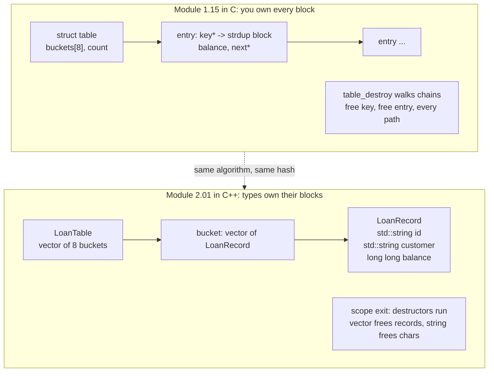

# Module 2.01: From C to C++

**Estimated hours:** 3

**What you will learn**

1. What C++ adds on top of the C you already know: references, namespaces, `std::string`, `std::vector`, `auto`, overloading, `nullptr` and `constexpr`.
2. How `std::string` and `std::vector` make most of the `malloc`/`free` bookkeeping from your Phase 1 hash map disappear.
3. What the compiler really does with a reference, an overloaded function and a `constexpr`, shown with the assembly and `nm`.

**Prerequisites:** [Module 1.15: Mini-project: hash map and record parser in C](../phase-01-c-from-zero-to-systems/module-15-c-mini-project-hash-map-and-parser.md). You need the Ubuntu lab from module 0.04 with `g++` 13.

---

## 1. One-line intuition

C++ is C plus one big idea: a variable can be an object that cleans up after itself, so the programmer stops being the only thing standing between a bug and a leak.

## 2. Real-life analogy

In Phase 1 you ran a small warehouse by hand. Every time you took a box off the shelf (`malloc`) you wrote it in a ledger, and every time you were done you had to remember to put it back (`free`) and cross it out. Forget once and the shelf fills up (a leak). Cross it out twice and someone else's box vanishes (double free). Hand a box to a colleague and you both had to agree, in writing, who returns it (the ownership contracts from module 1.13).

C++ gives you boxes that walk back to the shelf on their own. A `std::string` is a box of characters that returns its shelf space the moment the variable goes out of scope. A `std::vector` is a box of boxes that does the same. You still decide who holds the box (ownership is still your design), but the returning is automatic.

Two smaller gifts come with it. A **reference** is a nickname for an existing box: you can use it like the box itself, and it can never be a nickname for "no box". A **namespace** is a label on the shelf so that your `find` and the library's `find` do not collide.

## 3. Why it exists: the problem it solves

Your module 1.15 hash map worked, but look at what it cost. Every key was a `char*` from `strdup`. Every bucket entry was a `malloc`. `table_destroy` had to walk every chain and free two blocks per entry in the right order. Valgrind was the only thing telling you whether you got it right. Every function that took a `struct table *` had to check for `NULL`, or document that it would not.

That is the state of the art in C, and it is why the C migration engine on your resume (claim H1) needed "explicit ownership contracts": in C the contract lives in comments and discipline.

C++ was created (Bjarne Stroustrup, 1979 onwards) so that the cleanup could live in the type instead of in the programmer's memory. The mechanism is the **destructor**, a function that runs automatically when an object's lifetime ends. `std::string` and `std::vector` are ordinary classes with destructors that call the equivalent of `free`. Modules 2.02 and 2.03 show you how to write such classes yourself. This module shows you what it feels like to use them.

What breaks without it: every long-running server written in plain C carries a slow leak somewhere, and every outage review ends with "someone forgot a free on an error path". tcpkv (claim I) must run for days under a load generator and stay Valgrind-clean. In C that is heroic. In C++ it is the default if you use the language properly.

## 4. Three layers of depth

### Layer 1 (beginner): the new words

**`g++` and `-std=c++17`.** `gcc` compiles C. `g++` compiles C++ and links the C++ standard library (`libstdc++`) for you. If you run `gcc` on a `.cpp` file it compiles but fails to link because `std::cout` is missing. `-std=c++17` picks the 2017 version of the language. `g++` 13 defaults to `gnu++17`, which is C++17 plus GNU extensions; we always write `-std=c++17` so the code is portable and the intent is visible.

**`#include <iostream>` and `std::cout`.** C++ streams. `std::cout << x << "\n"` prints `x` whatever its type. No `%d` to get wrong. `std::cout` lives in **namespace** `std`, which is why the `std::` prefix appears everywhere.

**Namespace.** A named scope for names. `namespace bank { struct LoanRecord {...}; }` means the full name is `bank::LoanRecord`. Two libraries can both have a `find` without clashing. Never write `using namespace std;` in a header; it drags every standard name into every file that includes it.

**`std::string`.** A class that owns a growable array of characters. `s.size()`, `s == t` (compares content, unlike `char*`), `s + t` (concatenates), `s.c_str()` (gives a `const char*` for C functions). Its destructor frees the characters.

**`std::vector<T>`.** A class that owns a growable array of any type `T`. `v.push_back(x)` appends and grows if needed, `v.size()`, `v[i]`, `v.resize(n)`. Its destructor destroys every element and frees the array. `std::vector<std::vector<LoanRecord>>` is a vector of vectors: your hash table's buckets with no linked list.

**Reference.** `int& r = x;` makes `r` another name for `x`. Rules: it must be initialised, it cannot be made to refer to something else later, and it cannot be null. `void insert(LoanTable& t, ...)` lets the function modify the caller's table without `&t` at the call site and without `->` inside. `const LoanRecord&` is "read-only access without copying", the normal way to pass anything bigger than a pointer.

**Range-based for.** `for (const LoanRecord& rec : bucket)` visits every element. No index, no off-by-one.

**`auto`.** Let the compiler fill in the type from the initialiser. `auto hit = find(...)` is `const LoanRecord*`. Use it when the type is obvious or ugly; write the type when it documents something.

**Function overloading.** Several functions may share a name if their parameter types differ. `describe(long long)`, `describe(double)`, `describe(const LoanRecord&)`. The compiler picks the best match at compile time.

**`nullptr`.** The typed null pointer. `NULL` in C is a macro for `0` (or a compiler built-in). `nullptr` has its own type, `std::nullptr_t`, so it never gets confused with an integer.

**`constexpr`.** "Can be computed at compile time." A `constexpr` variable is a true constant with a type (unlike `#define`). A `constexpr` function can run at compile time if its arguments are known, and as a normal function otherwise.

**Brace initialisation.** `LoanRecord{"LN-1001", "Asha", 2500000}` builds a struct field by field, in declaration order, and refuses narrowing conversions such as `double` to `int`.

### Layer 2 (working engineer): what each feature costs and when to use it

**References versus pointers.** The same machine code (Layer 3 proves it). The difference is the contract:

| | Pointer `T*` | Reference `T&` |
|---|---|---|
| Can be null | yes | no |
| Can be reseated to another object | yes | no |
| Must be initialised | no | yes |
| Arithmetic (`p + 1`) | yes | no |
| Says to the reader | "may be absent; may be an array; may be owned" | "there is exactly one object here, borrowed" |
| Use for | optional things, arrays, ownership handed over, C APIs | function parameters, aliases, return of existing objects |

Rule of thumb for this course: parameters are `const T&` for reading, `T&` for modifying, `T` by value for small things (`int`, `double`, a pointer) or when you will keep a copy, and `T*` only when "absent" is a valid value. The `find` function below returns a pointer precisely because "not found" is a real answer.

**`std::cout` versus `printf`.** `std::cout` is type-safe: you cannot print a `long long` with `%d` by mistake. But servers often keep `printf`-style logging, and here is why: a format string is one short line that is easy to read and grep; iostream formatting is verbose (`std::setw`, `std::setprecision`) and its state is sticky (`std::hex` stays on until you turn it off); `std::cout` is synchronised with C `stdio` by default, which costs a little speed; and on Linux `-Wformat` (part of `-Wall`) checks `printf` arguments against the format string anyway. The modern answer is the `fmt` library, standardised as `std::format` in C++20: `printf`-style braces with type safety. We use `std::cout` in teaching code because it needs no extra library; tcpkv's logging will use a small `printf`-style helper.

**`std::string` costs.** With libstdc++ on x86-64 a `std::string` object is 32 bytes and holds up to 15 characters inside itself (the **small string optimisation**, SSO). Longer strings allocate on the heap. So `"LN-1001"` costs no heap allocation, but a 40-character customer name does. Copying a `std::string` copies the characters (one allocation if long). Passing `const std::string&` copies nothing.

**`std::vector` costs.** The object is 24 bytes: three pointers (start, end of used part, end of allocated part). `push_back` is amortised O(1): when full it allocates a bigger block (libstdc++ doubles), copies or moves the elements across, frees the old block. Pointers and references into a vector become invalid after any growth. Module 2.07 goes inside.

**`auto` traps.** `auto` drops `const` and references: `auto rec = *hit;` makes a copy of the record. Write `const auto& rec = *hit;` to alias it. `auto` with brace initialisation (`auto x{1};`) is a known oddity; avoid it.

**Overloading rules.** Exact match beats promotion (`char` to `int`) beats conversion (`int` to `double`) beats user-defined conversion. If two candidates are equally good the call is **ambiguous** and the compile fails, which is good: silence would be worse. `describe(5)` with overloads for `long long` and `double` is ambiguous (both are conversions). Lab Part D makes you hit this.

**`constexpr` in practice.** `constexpr std::size_t kBucketCount = 8;` replaces `#define BUCKETS 8`. It has a type, obeys scope, and shows up in the debugger. A `constexpr` function such as the FNV-1a hash below can be used in a `static_assert`, which is a compile-time test.

### Layer 3 (internals): what the compiler emits

**A reference is a pointer in disguise.** Compile these two functions:

```cpp
int by_pointer(int* p)   { return *p + 1; }
int by_reference(int& r) { return r + 1; }
```

With `g++ -std=c++17 -O2 -S -masm=intel` both become the same three instructions:

```asm
_Z10by_pointerPi:
        mov     eax, DWORD PTR [rdi]
        add     eax, 1
        ret
_Z12by_referenceRi:
        mov     eax, DWORD PTR [rdi]
        add     eax, 1
        ret
```

The argument arrives in `rdi` as an address either way. The compiler simply refuses to let you write `r = nullptr` or `r++`. The safety is at compile time; the run-time cost is zero. (The `endbr64` line that g++ 13 adds before `mov` on Ubuntu is a hardware control-flow-protection marker, not part of the logic.)

**Name mangling.** Look at the two labels above: `_Z10by_pointerPi` and `_Z12by_referenceRi`. The C++ compiler encodes the parameter types into the symbol name: `Pi` is "pointer to int", `Ri` is "reference to int". This is how two overloads called `area` can both exist in one binary: `area(int)` becomes `_Z4areai` and `area(double)` becomes `_Z4aread`. The linker from module 1.12 never knew about overloads; mangling makes them invisible to it. `nm -C` demangles the names back. This is also why C code cannot call a C++ function unless it is declared `extern "C"`, which switches mangling off for that function. You will use `extern "C"` the first time tcpkv's C++ talks to a C library.

**`constexpr` at compile time.** A `static_assert(fnv1a("LN", 2) == ...)` forces the compiler to run `fnv1a` while compiling. No instruction for it appears in the binary. If the same function is called with a run-time string, ordinary code is emitted. One function, two uses.

**What `std::string` is.** In libstdc++ a `std::string` is a pointer to the characters, a length, and a 16-byte union that holds either the capacity (long strings) or the characters themselves (short strings). The pointer points into the object itself when SSO is active. This is why moving or `memcpy`-ing a `std::string` is not safe by hand (the pointer would point into the old object); the class's own copy and move operations handle it. That is a taste of the "rule of 3/5" in module 2.03.

**What `std::vector<std::vector<LoanRecord>>` is.** One 24-byte outer object pointing at a heap block of eight 24-byte inner vectors, each pointing at its own heap block of records. Three levels of indirection, all freed in the right order by destructors you never wrote. In the C version this was the `buckets` array of `next` pointers that you walked by hand in `table_destroy`.

## 5. Architecture diagram



The left side needs `table_destroy` to be called on every exit path. The right side needs nothing: leaving the scope is the cleanup.

## 6. Code

The hash-map lookup from module 1.15, rewritten. Read the comments: each marks a C++ feature replacing a piece of C bookkeeping.

```cpp
// loan_table.cpp
// The hash-map lookup from module 1.15, rewritten in C++17.
// Shows: namespace, std::string, std::vector, references, auto,
// function overloading, nullptr, constexpr, std::cout.
#include <cstdint>
#include <iostream>
#include <string>
#include <vector>

namespace bank {               // everything below lives in bank::

struct LoanRecord {
    std::string id;            // "LN-1001" ; owns its characters
    std::string customer;
    long long   balance_paise; // money in paise, never in double
};

// One bucket is a vector of records. The table is a vector of buckets.
// No malloc, no free, no next pointers: the vectors own everything.
struct LoanTable {
    std::vector<std::vector<LoanRecord>> buckets;
    std::size_t count = 0;
};

constexpr std::size_t kBucketCount = 8;   // compile-time constant, typed

// FNV-1a hash, same algorithm as the C version. constexpr: usable at
// compile time if the argument is known, ordinary function otherwise.
constexpr std::uint64_t fnv1a(const char* text, std::size_t len) {
    std::uint64_t h = 1469598103934665603ULL;
    for (std::size_t i = 0; i < len; ++i) {
        h ^= static_cast<unsigned char>(text[i]);
        h *= 1099511628211ULL;
    }
    return h;
}

LoanTable make_table() {
    LoanTable t;
    t.buckets.resize(kBucketCount);   // 8 empty buckets
    return t;
}

// 'LoanTable&' is a reference: an alias for the caller's table.
// No '->' and no NULL check; a reference always refers to something.
void insert(LoanTable& table, LoanRecord rec) {
    std::size_t slot = fnv1a(rec.id.data(), rec.id.size()) % kBucketCount;
    table.buckets[slot].push_back(rec);   // vector grows by itself
    ++table.count;
}

// Returns a pointer because "not found" is a real answer, and a
// reference cannot be null. nullptr is the typed null, not 0 or NULL.
const LoanRecord* find(const LoanTable& table, const std::string& id) {
    std::size_t slot = fnv1a(id.data(), id.size()) % kBucketCount;
    for (const LoanRecord& rec : table.buckets[slot]) {  // range-for
        if (rec.id == id) {       // std::string compares by content
            return &rec;
        }
    }
    return nullptr;
}

// Three functions with one name: overloading. The compiler picks by
// argument type. Each gets a different mangled name in the binary.
std::string describe(long long paise) {
    return std::to_string(paise / 100) + " rupees";
}
std::string describe(double rate) {
    return std::to_string(rate) + " percent";
}
std::string describe(const LoanRecord& rec) {
    return rec.id + " owned by " + rec.customer + ", " + describe(rec.balance_paise);
}

}  // namespace bank

int main() {
    bank::LoanTable table = bank::make_table();

    bank::insert(table, {"LN-1001", "Asha Verma",   2500000});
    bank::insert(table, {"LN-1002", "Rohan Mehta", 12000000});
    bank::insert(table, {"LN-1003", "Priya Nair",    750000});

    std::cout << "records stored : " << table.count << "\n";
    std::cout << "buckets        : " << table.buckets.size() << "\n";

    // 'auto' asks the compiler to write the type for us.
    // Here it deduces 'const bank::LoanRecord*'.
    auto hit = bank::find(table, "LN-1002");
    if (hit != nullptr) {
        std::cout << "found          : " << bank::describe(*hit) << "\n";
    }

    auto miss = bank::find(table, "LN-9999");
    std::cout << "LN-9999        : " << (miss == nullptr ? "not found" : "found") << "\n";

    std::cout << "overload long  : " << bank::describe(2500000LL) << "\n";
    std::cout << "overload double: " << bank::describe(8.5) << "\n";

    // References: 'alias' IS table.count. Changing one changes the other.
    std::size_t& alias = table.count;
    alias = 42;
    std::cout << "count via ref  : " << table.count << "\n";

    static_assert(bank::fnv1a("LN", 2) == bank::fnv1a("LN", 2),
                  "constexpr hash evaluated at compile time");
    return 0;
    // table goes out of scope here. Every vector and every string frees
    // its own memory. There is no table_destroy() to forget.
}
```

Compile and run:

```bash
g++ -std=c++17 -Wall -Wextra -Werror -g -o loan_table loan_table.cpp
./loan_table
```

Expected output:

```text
records stored : 3
buckets        : 8
found          : LN-1002 owned by Rohan Mehta, 120000 rupees
LN-9999        : not found
overload long  : 25000 rupees
overload double: 8.500000 percent
count via ref  : 42
```

Now prove it leaks nothing, the way you did in Phase 1:

```bash
valgrind -q --leak-check=full ./loan_table
```

Expected: the same output and no Valgrind lines at all. Compare that with the `table_destroy` you wrote in 1.15 and the number of `free` calls it needed.

For the mangling demonstration, a second tiny file:

```cpp
// mangle.cpp : two overloads, to inspect with nm
double area(int side)    { return static_cast<double>(side) * side; }
double area(double side) { return side * side; }
int main() { return static_cast<int>(area(2) + area(1.5)); }
```

```bash
g++ -std=c++17 -Wall -Wextra -Werror -g -o mangle mangle.cpp
nm mangle | grep area
nm -C mangle | grep area
```

Expected (addresses vary):

```text
000000000000114c T _Z4aread
0000000000001129 T _Z4areai
000000000000114c T area(double)
0000000000001129 T area(int)
```

`_Z` marks a mangled C++ name, `4area` is the name with its length, `i` and `d` are the parameter types.

## 7. Use case: core-banking loan-origination platform

The application server from claim H4 parses every incoming RPC request into fields: customer id, product code, requested amount, branch. An early version of such a parser in C holds each field in a `char buffer[64]` and copies with `strncpy`. Two bugs follow it around: a customer name longer than 63 characters is silently cut (a data-integrity bug the bank finds months later during reconciliation), and the error path that frees a half-built request misses one `strdup` (a leak of a few bytes per failed request, which over a week of traffic becomes a restart).

The decision this module's material drove in that codebase: **all owned text in the request path is `std::string`, all lists are `std::vector`, and raw `char*` appears only at the boundary where a C library (the Berkeley DB API, the socket API) demands it.** Field lengths became a validation rule (`if (name.size() > 120) reject`) instead of an accident of buffer size. The leak class disappeared because there was nothing left to free by hand.

The second decision was the opposite one: **logging stayed `printf`-style.** The team had thousands of log lines written as format strings, `-Wformat` checked them, and operators grepped them. Switching to `std::cout` would have made each line longer and no safer. That is a decision you should be able to defend both ways in an interview.

## 8. Lab

### Part A: run, then break, the C++ table (30 minutes)

1. Save and build `loan_table.cpp` as in section 6. Confirm the output matches.
2. Add a fourth record for `"LN-1004"` and a `find` for it. Expected: found.
3. Change `kBucketCount` to `1`. Everything still works, only slower: all records are in one bucket. Change it to `0` and build. Expected: the build fails with `error: division by zero [-Werror=div-by-zero]`. Because the constant is `constexpr`, the compiler can see the `% 0` and refuses; with a run-time bucket count it would have been undefined behaviour (module 1.11) and a crash. Put it back to `8`.
4. Delete the line `table.buckets.resize(kBucketCount);` and build with `-fsanitize=address,undefined`. Run it. Expected: `AddressSanitizer: SEGV on unknown address 0x000000000038`, a read through a null-ish pointer, because `buckets[slot]` indexes an empty vector whose data pointer is null. `std::vector::operator[]` does not check bounds; replace it with `.at(slot)` and rerun. Expected: `terminate called after throwing an instance of 'std::out_of_range'`. Put the `resize` back.

### Part B: references are pointers (15 minutes)

1. Open <https://godbolt.org/>, language C++, compiler x86-64 gcc 13, options `-O2`.
2. Paste the two functions `by_pointer` and `by_reference` from Layer 3. Confirm the instruction sequences are identical.
3. Change `by_reference` to take `const int& r`. Does the code change? (It does not.)
4. Add `int by_value(int v) { return v + 1; }`. Expected: `lea eax, [rdi+1]` and `ret`; the value arrives in the register itself, no memory load. This is why small things are passed by value.

### Part C: see mangling with your own binary (15 minutes)

1. Build `mangle.cpp` and run the two `nm` commands from section 6.
2. Add a third overload `double area(int w, int h)` and rebuild. Run `nm | grep area` again and work out which symbol is the new one before you run `nm -C`. Expected: `_Z4areaii`.
3. Wrap `area(int)` in `extern "C" { ... }`. Expected: `nm` now shows a plain `area` symbol for it. Then try to also keep `area(double)`. Expected: a compile error, because C linkage allows only one function per name. That is the exact reason C has no overloading.

### Part D: two traps you will meet in real code (30 minutes)

1. In `loan_table.cpp`, add `std::cout << bank::describe(5) << "\n";`. Build. Expected: `error: call of overloaded 'describe(int)' is ambiguous`, naming both the `long long` and `double` candidates. Fix it by writing `5LL`.
2. Add this function and call it with `NULL` and with `nullptr`:

```cpp
void take(int)        { std::cout << "int\n"; }
void take(const char*) { std::cout << "pointer\n"; }
```

Expected: `take(nullptr)` prints `pointer` and `take(0)` prints `int`. `take(NULL)` does not compile at all on g++ 13: `error: call of overloaded 'take(NULL)' is ambiguous`, because GCC's `NULL` converts equally well to `int` and to a pointer. On other compilers where `NULL` is plain `0` it silently calls the `int` version. Either outcome is the problem `nullptr` was invented to fix.

3. Replace `auto hit = bank::find(...)` with `auto rec = *hit;` after the null check, then change `rec.customer` and print `hit->customer`. Expected: the original is unchanged, because `auto` made a copy. Change to `const auto& rec = *hit;` and the assignment no longer compiles, which is correct: `find` on a `const` table hands out read-only access.

### Journal

Copy [journal/TEMPLATE.md](../journal/TEMPLATE.md) to `journal/YYYY-MM-DD-from-c-to-cpp.md`. Record: the number of `malloc`/`free` calls your 1.15 table needed versus this one (zero written by you); the sanitizer message from Part A step 4; the three mangled names from Part C; and the exact text of the ambiguity error from Part D.

## 9. Common mistakes and misconceptions

| Mistake | Why it is wrong | Bug it causes later |
|---|---|---|
| "A reference is a safer pointer, so it must cost more" | Same machine code; the safety is enforced at compile time | Passing large structs by value "to avoid pointers", copying kilobytes per call |
| Returning a reference to a local variable | The local dies at scope exit; the reference dangles | Garbage or a crash that only appears at `-O2` |
| Keeping a reference or pointer into a `std::vector` across a `push_back` | Growth moves the elements to a new block | Use-after-free that ASan catches and release builds do not |
| `using namespace std;` in a header | Pollutes every file that includes it; `find`, `count`, `size` collide | Mysterious ambiguity errors in unrelated files |
| `auto x = *ptr;` to alias an object | `auto` drops the reference; this copies | Edits that silently go to a temporary |
| `NULL` or `0` for a null pointer | They are integers; overloads pick the `int` version | `take(NULL)` calls the wrong function |
| `#define SIZE 8` instead of `constexpr` | No type, no scope, invisible in the debugger | Macro collisions across headers |
| Thinking `std::string` never allocates | Only strings up to 15 characters (libstdc++) fit inside the object | Unexpected heap traffic on a hot path with long keys |
| `gcc file.cpp` | Compiles as C++ but does not link `libstdc++` | `undefined reference to std::cout` |

## 10. Resume link

- **Claim A, "C, C++17".** The honest sentence is: "I moved from C to C++ by rewriting a C hash table and watching the destroy function disappear; the hash and layout stayed the same, the ownership bookkeeping moved into `std::string` and `std::vector`." You have done exactly that in Part A.
- **Claim B, "memory and ownership design".** Interviewers ask "when do you use a pointer versus a reference?" Answer with the table in Layer 2 and the godbolt result from Part B: "Same code; a reference documents that the object exists and is borrowed. I return a pointer from `find` because not-found is a legal result."
- **Claim H1, "explicit ownership contracts" in the C migration engine.** You can now explain the contrast: "In C the contract was a comment and a naming rule; in C++ the same contract is a type whose destructor enforces it. I kept the C engine in C because it linked against Berkeley DB's C API and the team's tooling was C, but the discipline was the same."

Likely follow-up: "Why do many C++ servers still use `printf`-style logging?" Say: format strings are compact, greppable, checked by `-Wformat`, and iostream state is sticky; the modern replacement is `fmt`/`std::format`, not `std::cout`.

## 11. Interview questions

**Q1 (easy). What is the difference between a reference and a pointer in C++?**

<details>
<summary>Model answer</summary>

A pointer is a variable holding an address; it can be null, can be reassigned to point elsewhere, and supports arithmetic. A reference is an alias for an existing object: it must be initialised, cannot be null, cannot be reseated, and is used exactly like the object. The compiler usually implements a reference as a pointer, so there is no run-time cost difference; the difference is the guarantee. I use references for parameters and aliases, and pointers when "no object" is a valid state or when working with arrays or C APIs.

</details>

**Q2 (easy). Why does rewriting a C hash table with `std::string` and `std::vector` remove most `free` calls?**

<details>
<summary>Model answer</summary>

Because both are classes with destructors. A `std::string` owns a character buffer and frees it when the string is destroyed; a `std::vector` owns an array of elements, destroys each element and frees the array when the vector is destroyed. Destructors run automatically when the variable goes out of scope, on every exit path including early returns. So the `table_destroy` function that walked every chain and freed key and entry is replaced by nothing: the table's lifetime ending is the cleanup. The programmer still decides ownership, but no longer has to execute it by hand.

</details>

**Q3 (medium). What is name mangling, why does C++ need it, and what does `extern "C"` do?**

<details>
<summary>Model answer</summary>

The linker matches functions by symbol name only. C++ allows several functions with the same name but different parameter types (overloading) and puts functions inside namespaces and classes, so the compiler encodes the namespace, name and parameter types into the symbol: `bank::describe(double)` becomes something like `_ZN4bank8describeEd`. `nm -C` or `c++filt` demangle it. `extern "C"` tells the compiler to emit a plain, unmangled C symbol for a function, which lets C code call it and lets C++ call C libraries. Because a C symbol is just the name, a function declared `extern "C"` cannot be overloaded.

</details>

**Q4 (medium). What does `auto` deduce in `auto r = *p;` where `p` is `const LoanRecord*`, and what goes wrong if you meant to alias the record?**

<details>
<summary>Model answer</summary>

`auto` deduces the type the way a by-value template parameter would: it strips top-level `const` and references. So `r` is a `LoanRecord`, a copy of the pointee, not a `const LoanRecord&`. Changes to `r` do not affect the original, and the copy costs two string copies. To alias write `const auto& r = *p;`. The same rule means `for (auto x : vec)` copies every element; `for (const auto& x : vec)` does not. A related danger is taking a reference into a vector and then calling `push_back`, which may reallocate and leave the reference dangling.

</details>

**Q5 (hard). In `insert(LoanTable& table, LoanRecord rec)`, trace every copy and heap allocation when `main` calls `insert(table, {"LN-1001", "Asha Verma", 2500000})`. How would you reduce them?**

<details>
<summary>Model answer</summary>

The braces construct the parameter `rec` directly: two `std::string` constructions. `"LN-1001"` is 7 characters and fits in libstdc++'s small-string buffer, so no heap allocation; `"Asha Verma"` is 10 characters, also no allocation. Inside, `push_back(rec)` copies `rec` into the bucket: two more string constructions, again without heap allocations at these lengths, but with a 40-character name the copy would allocate. The bucket vector may also reallocate its own array if full, which copies or moves every record already there. Then `rec` is destroyed at the end of `insert`. To reduce the work: `push_back(std::move(rec))` turns the copy into a move, which steals the string buffers instead of duplicating them (module 2.04); reserving bucket capacity avoids regrowth; and taking `const LoanRecord&` would avoid the parameter copy at the cost of forcing a copy at `push_back`, so by-value-then-move is the idiom when the function keeps the object.

</details>

## 12. Revision

- C++ adds objects that clean up after themselves: `std::string` and `std::vector` have destructors that free their memory, so the hand-written `table_destroy` from Phase 1 is gone.
- A reference is a compile-time-checked alias (never null, never reseated) with the same machine code as a pointer; use `const T&` for reading, `T&` for modifying, `T*` only when absence is legal.
- Overloads coexist because the compiler mangles parameter types into symbol names (`_Z4areai`, `_Z4aread`); `nullptr` is a typed null; `constexpr` is a typed, scoped compile-time constant.

---

Previous: [Module 1.15: Mini-project: hash map and record parser in C](../phase-01-c-from-zero-to-systems/module-15-c-mini-project-hash-map-and-parser.md) | Next: [Module 2.02: Classes, constructors and destructors](module-02-classes-constructors-destructors.md)
