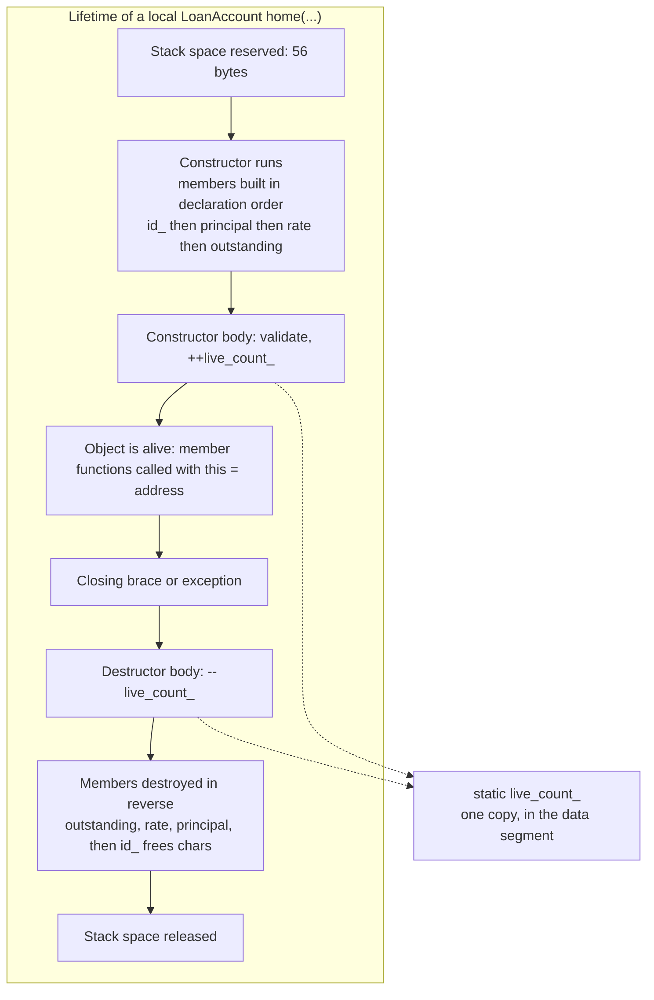

# Module 2.02: Classes, constructors and destructors

**Estimated hours:** 4

**What you will learn**

1. What a class is: a struct whose data is private and whose functions are the only way in, with a constructor that runs when the object is born and a destructor that runs when it dies.
2. The exact moment each one runs, the order members and locals are built and torn down, and why the member initialiser list follows declaration order.
3. How `this`, `const` member functions, `static` members and the header/implementation split work, shown on a `LoanAccount` class you will carry into later modules.

**Prerequisites:** [Module 2.01: From C to C++](module-01-from-c-to-cpp.md).

---

## 1. One-line intuition

A class is a struct that controls its own birth, its own death, and who may touch its insides.

## 2. Real-life analogy

A bank account is not a sheet of paper with a number on it. It is a sheet of paper plus rules: it is opened by a specific procedure (identity check, initial deposit), only the bank's own tellers may write on it, anyone may read the balance through the window, and when it is closed a specific procedure runs (final statement, archive).

- The sheet of paper is the **data members** (`id_`, `outstanding_paise_`).
- The opening procedure is the **constructor**. You cannot have an account that was never opened.
- The tellers are the **member functions**. `repay()` and `disburse()` are the only hands that write on the sheet.
- The window is a **`const` member function**. `outstanding_paise()` lets anyone read without the power to change.
- The closing procedure is the **destructor**. It runs exactly once, when the account's life ends, whether the customer asked for it or the branch burned down (an exception).
- The counter on the branch wall showing "accounts open today" is a **`static` member**: one number for the whole class, not one per account.

In C, a `struct` was the sheet of paper alone. Anyone with a pointer could scribble on it, and the opening and closing procedures were separate functions somebody had to remember to call.

## 3. Why it exists: the problem it solves

In Phase 1 every struct came with a pair of functions, `thing_init` and `thing_destroy`, and a rule in a comment: "call init before use, destroy after". Nothing enforced it. A struct could be used uninitialised (garbage), destroyed twice (double free), or never destroyed (leak). Fields could be modified by any code with a pointer, so an invariant such as "outstanding balance is never negative" was a hope, not a fact.

C++ classes fix all three:

1. **Construction is mandatory.** If a class has a constructor, there is no way to create an object without running it. An object either exists fully built or does not exist.
2. **Destruction is automatic.** The destructor runs when the object's lifetime ends: at the closing brace for locals, at `delete` for heap objects, at program exit for globals, during stack unwinding when an exception passes through. You cannot forget it.
3. **Access is controlled.** `private` members can be touched only by the class's own member functions, so an invariant checked in those functions holds everywhere.

What breaks without it: everything that broke in your C labs. Point 2 is the one that matters most for systems code; it is the engine behind RAII (module 2.03), which is the engine behind every socket and lock wrapper in tcpkv. `std::string` and `std::vector` from module 2.01 are nothing more than classes whose destructors free memory. After this module you can write one yourself.

## 4. Three layers of depth

### Layer 1 (beginner): the parts of a class

**`class` versus `struct`.** In C++ both define a type with data and functions. The only difference is the default: members of a `struct` are `public` unless you say otherwise, members of a `class` are `private` unless you say otherwise (the same rule applies to inheritance, which module 2.10 covers). Convention in this course: `struct` for plain bundles of data with no invariant (`LoanRecord` in 2.01), `class` when there is something to protect.

**Access specifiers.** `public:` members are usable by anyone. `private:` members are usable only inside the class's member functions. (`protected:` is for inheritance, module 2.10.) Private data plus public functions is called **encapsulation**.

**Member function.** A function declared inside the class. It is called on an object: `home.repay(5000000)`. Inside it, the object's members are in scope by their plain names.

**Constructor.** A member function with the class's name and no return type. It runs when an object is created. A class may have several constructors with different parameters (overloading, from 2.01).

**Default constructor.** The one with no parameters. The compiler writes one for you only if you declare no constructors at all. The moment you write any constructor, the default one disappears unless you ask for it back with `LoanAccount() = default;`.

**Member initialiser list.** The part between the constructor's `)` and `{`: `: id_(std::move(id)), principal_paise_(p)`. This is where members are constructed. Assignments inside the braces happen after the member already exists, which for a `std::string` means "build an empty string, then overwrite it": two steps instead of one. `const` members and reference members can only be set in the initialiser list.

**`explicit`.** Put it in front of a constructor that takes one argument. Without it, the compiler may use that constructor to convert silently: a function taking `LoanAccount` could be called with a `std::string`, and an account would be created out of thin air. `explicit` says "only when the programmer writes it". Use it on every single-argument constructor unless you specifically want the conversion.

**Destructor.** `~LoanAccount()`. No parameters, no return type, exactly one per class. Runs when the lifetime ends. You write one when the class holds something that must be released; otherwise the compiler's empty one is fine.

**`this`.** Inside a member function, `this` is a pointer to the object the function was called on. `this->id_` and `id_` are the same thing. You need it when a parameter has the same name as a member, when you return the object itself (`return *this;`), or when you pass the object to another function.

**`const` member function.** `long long outstanding_paise() const;` The `const` after the parameter list promises not to modify the object. Only `const` member functions may be called on a `const` object or through a `const` reference. This is **const correctness**: mark every function that only reads, so that read-only access can be handed out safely.

**`static` member.** A data member shared by all objects of the class (one copy in the program), or a function that belongs to the class but needs no object. `LoanAccount::live_count()` is called with the class name, not an object name. A static data member is declared in the class and defined once in a `.cpp` file; since C++17 you can instead write `inline static int live_count_ = 0;` in the header.

**Header and implementation.** The class definition (the "what") goes in `loan_account.h` with an include guard. The member function bodies (the "how") go in `loan_account.cpp`, written as `LoanAccount::repay(...)`. Any file that needs the class includes the header; the linker joins the bodies in. This is the C `.h`/`.c` split from module 1.12 applied to classes.

### Layer 2 (working engineer): the rules that bite

**Members are built in declaration order, always.** Not in initialiser-list order. If the header declares `id_` then `principal_paise_` then `outstanding_paise_`, that is the construction order whatever the list says. The destructor tears them down in reverse. This matters when one member's initialiser uses another: `outstanding_paise_(principal_paise_)` works only if `principal_paise_` is declared earlier. `g++ -Wall` warns (`-Wreorder`) when your list order disagrees with the declaration order, and with `-Werror` that warning stops the build. Keep the list in declaration order and the warning never appears.

**Locals die in reverse order of construction.** In a block, the last object created is the first destroyed. Section 6 prints it.

**The exact moments a destructor runs.**

| Object | Constructed | Destroyed |
|---|---|---|
| Local variable | When its declaration executes | At the closing `}` of its block, or when an exception leaves the block |
| Temporary (`describe(LoanAccount("x"))`) | When the expression evaluates it | At the end of the full expression (the `;`) |
| Function parameter by value | When the call is made | When the function returns |
| `new` object | At `new` | At `delete`, and never if you forget (module 2.05 fixes this) |
| Global or `static` | Before `main`, or at first use for function statics | After `main` returns, in reverse order |
| Member of another object | During the owner's construction, in declaration order | During the owner's destruction, in reverse |
| Element of a `std::vector` | At `push_back` or `resize` | When erased, or when the vector is destroyed |

**A constructor that fails should throw.** If the arguments are invalid (negative principal), the object must not exist. A constructor has no return value to signal failure, so it throws. The members already constructed are destroyed, the object never comes to life, and no destructor runs for it. Module 2.09 covers the alternative (a factory function returning `std::optional`).

**Const correctness pays for itself.** Mark a function `const` the moment you write it if it only reads. If you do not, every caller holding a `const LoanAccount&` (which is the right way to pass one) cannot call it, and the fix spreads through the codebase. Inside a `const` member function, `this` has type `const LoanAccount*`, so the compiler stops you from writing to members. A member you must change even in a `const` function (a cache, a mutex) is marked `mutable`.

**What the compiler writes for you.** If you declare nothing, you get a default constructor, a copy constructor, a copy assignment operator, a move constructor, a move assignment operator and a destructor, all doing the member-by-member thing. For `LoanAccount` that would be fine. For a class holding a raw file descriptor it is a bug, which is the whole subject of modules 2.03 and 2.04.

**Header hygiene.** One class per header, include guard or `#pragma once`, include only what the header itself needs, never `using namespace` in a header. A member function defined inside the class body is implicitly `inline`, which is fine for one-line getters and bad for anything big (it recompiles in every file that includes the header).

### Layer 3 (internals): what an object is in memory and what a member function compiles to

**An object is just its data members, laid out in declaration order.** `LoanAccount` is a `std::string` (32 bytes in libstdc++), a `long long` (8), a `double` (8) and a `long long` (8): 56 bytes, no hidden fields. Member functions take no space in the object. There is no "class pointer" inside it unless the class has virtual functions (module 2.10). `static` members live outside the object, in the program's data segment, once. You can see this: `nm -C loan_account.o` lists `bank::LoanAccount::live_count_` with a `B` (uninitialised data) next to it, exactly like a C global.

**A member function is a normal function with a hidden first parameter.** `acct.outstanding_paise()` compiles to a call of the function `_ZNK4bank11LoanAccount17outstanding_paiseEv` (`N...E` wraps the namespace and class, `K` means `const`, `v` means no parameters) with the address of `acct` in `rdi`, the same register the first argument of a C function uses. Its body at `-O1` is one instruction:

```asm
_ZNK4bank11LoanAccount17outstanding_paiseEv:
        mov     rax, QWORD PTR 48[rdi]
        ret
```

`rdi` is `this`; `48` is the byte offset of `outstanding_paise_` inside the object (after the 32-byte string, the 8-byte principal and the 8-byte rate). That is all `this` ever is: a pointer in a register.

**A constructor is a function called on raw memory.** For a local, the compiler reserves 56 bytes on the stack, then calls the constructor with that address in `rdi`. The constructor builds the members in order: it calls `std::string`'s constructor on the first 32 bytes, then stores the three numbers. The mangled name ends in `C1` (`_ZN4bank11LoanAccountC1E...`), the "complete object constructor". The destructor is `D1`. Both appear in `nm`.

**A destructor call is inserted by the compiler.** When a block ends, the compiler emits calls to `~T()` for each local that has one, in reverse order, before the stack frame is released. When an exception unwinds through the block, the same calls run from the landing-pad tables in the `.eh_frame` section. Nothing about this is magic; it is code the compiler writes at every scope exit so that you cannot forget it.

**Why initialiser-list order cannot follow the list.** The destructor must destroy members in exactly the reverse of construction order, and the destructor knows nothing about which constructor ran. So the order must be a property of the class, not of the constructor. Declaration order is the only order every constructor and the destructor can agree on.

## 5. Architecture diagram



The static counter sits outside every object. Each constructor and destructor touches the same one.

## 6. Code

Three files. The header is the contract, the `.cpp` is the implementation, `main.cpp` is a user that only sees the header.

```cpp
// loan_account.h : the interface. Other files include this.
#ifndef LOAN_ACCOUNT_H
#define LOAN_ACCOUNT_H

#include <string>

namespace bank {

class LoanAccount {
public:
    // Constructors. 'explicit' stops the compiler from silently turning
    // a std::string into a LoanAccount where one was not expected.
    explicit LoanAccount(std::string id);
    LoanAccount(std::string id, long long principal_paise, double annual_rate);

    // Destructor: runs exactly once, when the object's lifetime ends.
    ~LoanAccount();

    // 'const' after the parameter list: this function promises not to
    // change the object, so it can be called on a const LoanAccount.
    const std::string& id() const;
    long long outstanding_paise() const;
    long long monthly_interest_paise() const;

    // Not const: these change the object.
    void disburse(long long paise);
    void repay(long long paise);

    // static: one copy for the whole class, not one per object.
    static int live_count();

private:
    // Members are constructed in THIS order, whatever the initialiser
    // list says. Keep dependencies top to bottom.
    std::string id_;
    long long   principal_paise_;
    double      annual_rate_;
    long long   outstanding_paise_;

    static int live_count_;     // declared here, defined in the .cpp
};

}  // namespace bank

#endif
```

```cpp
// loan_account.cpp : the implementation.
#include "loan_account.h"

#include <iostream>
#include <stdexcept>

namespace bank {

int LoanAccount::live_count_ = 0;   // the one definition of the static

// Member initialiser list: the part after the colon. Members are
// constructed here, before the body runs. Inside the body they would
// be assigned, which is a second step and wasteful for std::string.
LoanAccount::LoanAccount(std::string id)
    : id_(std::move(id)),
      principal_paise_(0),
      annual_rate_(0.0),
      outstanding_paise_(0) {
    ++live_count_;
    std::cout << "  ctor  " << id_ << " (empty account)\n";
}

LoanAccount::LoanAccount(std::string id, long long principal_paise, double annual_rate)
    : id_(std::move(id)),
      principal_paise_(principal_paise),
      annual_rate_(annual_rate),
      outstanding_paise_(principal_paise) {
    if (principal_paise < 0) {
        throw std::invalid_argument("principal cannot be negative");
    }
    ++live_count_;
    std::cout << "  ctor  " << id_ << " principal " << principal_paise_ << "\n";
}

LoanAccount::~LoanAccount() {
    --live_count_;
    std::cout << "  dtor  " << id_ << " outstanding " << outstanding_paise_ << "\n";
}

const std::string& LoanAccount::id() const { return id_; }

long long LoanAccount::outstanding_paise() const { return outstanding_paise_; }

long long LoanAccount::monthly_interest_paise() const {
    // 'this' is a pointer to the object the function was called on.
    // this->outstanding_paise_ and plain outstanding_paise_ mean the same.
    return static_cast<long long>(this->outstanding_paise_ * annual_rate_ / 100.0 / 12.0);
}

void LoanAccount::disburse(long long paise) {
    outstanding_paise_ += paise;
}

void LoanAccount::repay(long long paise) {
    if (paise > outstanding_paise_) {
        paise = outstanding_paise_;
    }
    outstanding_paise_ -= paise;
}

int LoanAccount::live_count() { return live_count_; }

}  // namespace bank
```

```cpp
// main.cpp : uses LoanAccount and shows when destructors run.
#include "loan_account.h"

#include <iostream>

void print_summary(const bank::LoanAccount& acct) {
    // acct is const here: only const member functions may be called.
    std::cout << "  " << acct.id() << ": outstanding " << acct.outstanding_paise()
              << " paise, monthly interest " << acct.monthly_interest_paise() << " paise\n";
}

int main() {
    std::cout << "live accounts at start: " << bank::LoanAccount::live_count() << "\n";

    std::cout << "enter block\n";
    {
        bank::LoanAccount home("LN-1001", 250000000, 8.5);   // 25 lakh rupees
        bank::LoanAccount car("LN-1002", 60000000, 9.25);    // 6 lakh rupees
        std::cout << "live accounts in block: " << bank::LoanAccount::live_count() << "\n";

        home.repay(5000000);         // repay 50,000 rupees
        print_summary(home);
        print_summary(car);
        std::cout << "leaving block\n";
    }   // car destroyed first, then home: reverse order of construction
    std::cout << "after block, live accounts: " << bank::LoanAccount::live_count() << "\n";

    bank::LoanAccount empty("LN-2000");   // the explicit one-argument ctor
    // bank::LoanAccount bad = std::string("LN-3000");  // error: explicit
    print_summary(empty);
    std::cout << "end of main\n";
    return 0;
}   // empty destroyed here
```

Compile each `.cpp` separately, then link, exactly as you did with C in module 1.12:

```bash
g++ -std=c++17 -Wall -Wextra -Werror -g -c loan_account.cpp -o loan_account.o
g++ -std=c++17 -Wall -Wextra -Werror -g -c main.cpp -o main.o
g++ -o loan_demo loan_account.o main.o
./loan_demo
```

Expected output:

```text
live accounts at start: 0
enter block
  ctor  LN-1001 principal 250000000
  ctor  LN-1002 principal 60000000
live accounts in block: 2
  LN-1001: outstanding 245000000 paise, monthly interest 1735416 paise
  LN-1002: outstanding 60000000 paise, monthly interest 462500 paise
leaving block
  dtor  LN-1002 outstanding 60000000
  dtor  LN-1001 outstanding 245000000
after block, live accounts: 0
  ctor  LN-2000 (empty account)
  LN-2000: outstanding 0 paise, monthly interest 0 paise
end of main
  dtor  LN-2000 outstanding 0
```

Read the `dtor` lines: `LN-1002` dies before `LN-1001` (reverse order), both die at the block's closing brace (before "after block"), and `LN-2000` dies after "end of main", when `main`'s own scope ends.

The second program isolates the ordering rules for members and locals:

```cpp
// order.cpp : construction and destruction order, members and locals.
#include <iostream>
#include <string>

struct Part {
    std::string name;
    explicit Part(std::string n) : name(std::move(n)) { std::cout << "  construct " << name << "\n"; }
    ~Part() { std::cout << "  destroy   " << name << "\n"; }
};

struct Machine {
    Part a;   // declared first  -> constructed first, destroyed last
    Part b;
    Part c;   // declared last   -> constructed last, destroyed first
    Machine() : a("member a"), b("member b"), c("member c") {
        std::cout << "  Machine body runs after all members exist\n";
    }
    ~Machine() { std::cout << "  Machine body runs before members die\n"; }
};

int main() {
    std::cout << "locals:\n";
    Part first("local first");
    Part second("local second");
    std::cout << "object with members:\n";
    {
        Machine m;
        std::cout << "  (using m)\n";
    }
    std::cout << "end of main\n";
    return 0;
}
```

```bash
g++ -std=c++17 -Wall -Wextra -Werror -g -o order order.cpp
./order
```

Expected output:

```text
locals:
  construct local first
  construct local second
object with members:
  construct member a
  construct member b
  construct member c
  Machine body runs after all members exist
  (using m)
  Machine body runs before members die
  destroy   member c
  destroy   member b
  destroy   member a
end of main
  destroy   local second
  destroy   local first
```

Two rules in one screen: members are built before the constructor body and torn down after the destructor body; everything is destroyed in reverse order of construction.

## 7. Use case: core-banking loan-origination platform

The application server (claim H4) keeps a `LoanRequest` object alive for the duration of one RPC call: it is created when the request is parsed, passed by `const&` to validation and pricing, modified by the workflow step, and destroyed when the response has been sent. Early in that codebase the request was a C-style struct with public fields, and two bugs recurred: a validation routine "fixed" a field it was only supposed to read, and a request object was reused across calls without being reset, so a second customer's application inherited the first customer's branch code.

The decision this module's rules drove: **request and account objects became classes with private data, a constructor that validates and fills every field, read-only access through `const` member functions, and no default constructor.** A validation function receives `const LoanRequest&` and the compiler refuses to let it write. Reuse across calls became impossible because there was no way to create an empty request; each call constructs a new one and the destructor at the end of the handler releases it. The `static` live-object counter, trivial as it looks in section 6, became a metric exported to monitoring: a steadily rising count of live requests was the first visible symptom of a handler that was leaking them.

In PostgreSQL's source (Phase 6) you will see the same shape in C, done by discipline: `PGconn` is opaque, created only by `PQconnectdb`, read through accessor functions, and freed only by `PQfinish`. C++ turns that discipline into compile errors.

## 8. Lab

### Part A: build, run, and watch the moments (30 minutes)

1. Create the three files and build with the three commands from section 6. Confirm the output.
2. Uncomment `bank::LoanAccount bad = std::string("LN-3000");`. Build. Expected: `error: conversion from 'std::string' to non-scalar type 'bank::LoanAccount' requested`. Now remove `explicit` from the one-argument constructor in the header, rebuild both files, and the line compiles. Put `explicit` back. You have seen what `explicit` forbids.
3. Add `home.disburse(-1);` inside `print_summary`. Expected: a compile error saying you are discarding qualifiers or calling a non-const member on a const object. That is const correctness refusing to let a reader write.
4. Construct an account with principal `-5`. Expected: the program terminates with `terminate called after throwing an instance of 'std::invalid_argument'`, and no `ctor` line for it is printed, and `live_count` was never incremented. Wrap it in `try { ... } catch (const std::invalid_argument& e) { std::cout << e.what() << "\n"; }` and confirm the program continues.

### Part B: declaration order versus list order (20 minutes)

1. In `order.cpp`, change the initialiser list to `c("member c"), b("member b"), a("member a")`. Build with the course flags. Expected: the build fails with `-Werror=reorder`, and the message names which member "will be initialized after" which. Read it carefully; it is telling you the real order.
2. Build the same file with `-Wall -Wextra` but without `-Werror`. Run it. Expected: the construction order is still a, b, c. The list order was ignored.
3. In `loan_account.h`, move `outstanding_paise_` above `principal_paise_` and change the second constructor to initialise `outstanding_paise_(principal_paise_)` (the member, not the parameter). Build with the course flags. Expected: `error: member 'principal_paise_' is used uninitialized [-Werror=uninitialized]`. Now build without `-Werror` and run. Expected: the outstanding balance is garbage at `-O0` (a different number each run) and typically `0` at `-O2`, because `outstanding_paise_` was built first from an uninitialised `principal_paise_`. Reading an uninitialised member is undefined behaviour; ASan does not catch it, and UBSan does not either. Undo the change. This is the bug the ordering rule exists to prevent, and it is why the course builds with `-Werror`.

### Part C: look inside the object (20 minutes)

1. Add to `main.cpp`: `std::cout << sizeof(bank::LoanAccount) << " bytes\n";`. Expected: 56 on x86-64 with libstdc++. Work out where it comes from (32 + 8 + 8 + 8).
2. Run `nm -C loan_account.o`. Find `bank::LoanAccount::live_count_` with a `B` flag (a global in the uninitialised data segment) and the constructors and destructor. Run `nm loan_account.o | grep LoanAccount` and find the `C1` and `D1` suffixes.
3. Run `g++ -std=c++17 -O1 -S -masm=intel -o - loan_account.cpp | grep -A4 outstanding_paiseEv:`. Expected: a single `mov rax, QWORD PTR 48[rdi]` then `ret`. `rdi` is `this`; `48` is the member's offset.
4. Open `gdb ./loan_demo`, `break bank::LoanAccount::repay`, `run`, then `print *this` and `print this`. Expected: the full object with its four members, and an address on the stack (`0x7ffd...`). Type `finish` and `print bank::LoanAccount::live_count_`. Expected: 2.

### Part D: the bridge to RAII (20 minutes)

1. Write a class `Buffer` with a `char* data_` member allocated with `new char[n]` in the constructor and released with `delete[] data_` in the destructor, printing in both. Create one in a block and watch the prints. This is `std::string` with the magic removed.
2. Now write `Buffer b2 = b1;` inside the block, build with `-fsanitize=address,undefined`, and run. Expected: ASan reports `attempting double-free`. The compiler-written copy copied the pointer, and both destructors freed it. Do not fix it yet; module 2.03 is the fix. Record the ASan message.

### Journal

Copy [journal/TEMPLATE.md](../journal/TEMPLATE.md) to `journal/YYYY-MM-DD-classes-ctors-dtors.md`. Record: the exact `explicit` error text from Part A, the `-Wreorder` message from Part B, the `sizeof` and the member offset from Part C, and the ASan double-free report from Part D. The Part D report is the opening line of your RAII story in the next module.

## 9. Common mistakes and misconceptions

| Mistake | Why it is wrong | Bug it causes later |
|---|---|---|
| Assigning members in the constructor body instead of the initialiser list | Members are already constructed by then; you pay for a default construction plus an assignment, and `const` or reference members cannot be assigned at all | Slow constructors; compile errors on `const` members |
| Writing the initialiser list in a different order from the declarations | Construction follows declaration order regardless | Reading an uninitialised member; `-Werror=reorder` build failures |
| Forgetting `explicit` on single-argument constructors | The compiler will convert silently | An account created from a bare string in a function call nobody intended |
| Leaving read-only functions non-`const` | They cannot be called through `const&` | Const correctness fails to spread; callers drop `const` everywhere |
| Believing `this` is the object | It is a pointer to the object, in a register | Returning `this` where `*this` was meant; comparing pointers instead of values |
| Returning an error code from a constructor | Constructors have no return value | Half-built objects that pass through the program |
| Defining a `static` member only in the header (pre-C++17 style) | Each including file gets a copy, or the linker complains | Multiple-definition or undefined-reference link errors |
| Thinking member functions take space in each object | Only data members do; functions are shared code | Wrong `sizeof` reasoning, wrong cache-line estimates |
| `using namespace` or big function bodies in a header | Pollution and recompilation in every includer | Slow builds, ambiguous-name errors far from the cause |

## 10. Resume link

- **Claim B, "OOP and design patterns, memory and ownership design".** The interviewer's first probe is usually "what is the difference between a class and a struct?" (only the default access) and then "when does a destructor run?" Answer with the table in Layer 2 and the `dtor` lines from your own run: "at the closing brace, in reverse order; I have the output in my journal where `LN-1002` is destroyed before `LN-1001`."
- **Claim B, "undefined-behaviour-aware coding".** Part B step 3 is a classic: a member initialised from a later-declared member. Say: "I keep initialiser lists in declaration order and build with `-Werror=reorder` so the compiler enforces it."
- **Claim H4, "multithreaded application server".** Request objects with validated construction and `const` read access are what stopped validation code from mutating requests. The static live-object counter is a cheap leak detector you can describe.
- **Claim I, tcpkv.** Every wrapper in tcpkv (`FileDescriptor`, `Socket`, `Connection`) is a class of exactly this shape: private handle, `explicit` constructor, destructor that releases. Next module.

Likely follow-up: "What does `this` compile to?" Say: a pointer passed as a hidden first argument in `rdi`; you saw the member load at offset 48 in Part C.

## 11. Interview questions

**Q1 (easy). What is the difference between a `class` and a `struct` in C++?**

<details>
<summary>Model answer</summary>

Only the default access: members and base classes of a `struct` are `public` by default, those of a `class` are `private` by default. Everything else is identical: both can have constructors, destructors, member functions, static members and private sections. By convention `struct` is used for plain data with no invariant and `class` when the data must be protected behind member functions.

</details>

**Q2 (easy). When exactly does a destructor run for a local variable, and in what order for several locals?**

<details>
<summary>Model answer</summary>

When the variable's scope ends: at the closing brace of the block, at a `return`, or when an exception propagates out of the block. The compiler inserts the destructor calls at every exit path. Several locals in one block are destroyed in the reverse order of their construction, so the last one declared is destroyed first. Members of an object are destroyed, also in reverse declaration order, after the destructor body runs.

</details>

**Q3 (medium). Why are class members initialised in declaration order rather than in the order written in the initialiser list?**

<details>
<summary>Model answer</summary>

Because the destructor must destroy members in exactly the reverse of the order they were constructed, and the destructor cannot know which of several constructors built the object. The only order that every constructor and the destructor can agree on is the one fixed by the class itself: declaration order. The practical consequence is that a member initialised from another member must be declared after it, and the initialiser list should be written in declaration order; GCC's `-Wreorder` warns when it is not.

</details>

**Q4 (medium). What does `const` on a member function mean, what does it change about `this`, and why does it matter for a server codebase?**

<details>
<summary>Model answer</summary>

It promises the function does not modify the object's observable state. Inside it, `this` has type `const T*`, so writing to a non-`mutable` member is a compile error, and only other `const` member functions may be called. It matters because the right way to pass objects to readers is `const T&`, and through such a reference only `const` member functions are callable. If getters are not marked `const`, callers are forced to drop `const`, and the guarantee that validation code cannot mutate a request disappears. `mutable` is the escape hatch for members that are not part of observable state, such as a cache or a mutex.

</details>

**Q5 (hard). Describe what the compiler emits for `{ LoanAccount a("x", 100, 8.5); a.repay(10); }` from stack reservation to destruction, including what happens if the constructor throws.**

<details>
<summary>Model answer</summary>

The compiler reserves 56 bytes in the stack frame for `a`. It constructs the `std::string` argument, then calls the constructor `LoanAccount::LoanAccount(std::string, long long, double)` with the address of the 56 bytes in `rdi` and the arguments in the following registers. Inside, members are constructed in declaration order: the `std::string` member is move-constructed into the first 32 bytes, then the three numbers are stored at offsets 32, 40 and 48. Then the body runs. `a.repay(10)` is a plain call of the mangled `repay` function with `rdi` pointing at `a`. At the closing brace the compiler emits a call to the destructor, whose body runs first and whose epilogue then destroys the members in reverse order, ending with the string's destructor, which frees heap memory only if the string was long. If the constructor throws after the string member was built, the compiler's exception tables run the string member's destructor, the object is never considered constructed, its destructor is not called, and the exception continues to unwind out of the block; the 56 bytes are released with the frame.

</details>

## 12. Revision

- A class is data plus the only functions allowed to touch it; the constructor runs at birth (members built in declaration order, from the initialiser list, before the body), the destructor at death (body first, then members in reverse), locals in reverse order of construction.
- `explicit` blocks silent conversions, `const` member functions make `this` a `const T*` and let readers hold `const T&`, `static` members are one per class and live outside every object.
- A member function is a normal function with `this` as a hidden pointer argument; an object is just its data members, and `std::string` and `std::vector` are classes whose destructors free memory, which is the bridge to RAII.

---

Previous: [Module 2.01: From C to C++](module-01-from-c-to-cpp.md) | Next: [Module 2.03: RAII and the rule of 0/3/5](module-03-raii-and-rule-of-0-3-5.md)
