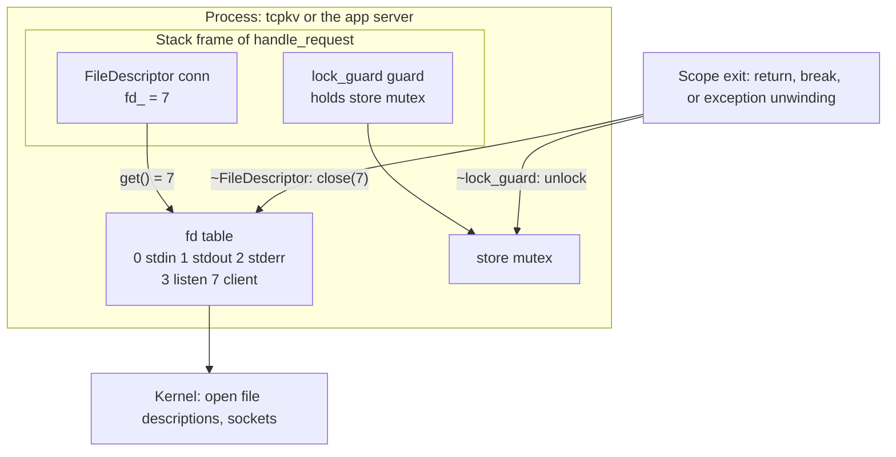

# Module 2.03: RAII and the rule of 0/3/5

**Estimated hours:** 4

**What you will learn**

1. RAII: tie a resource (file descriptor, socket, lock, heap block, database handle) to an object's lifetime so that releasing it is automatic and impossible to forget, even when an exception flies through.
2. The rule of 0, the rule of 3 and the rule of 5: which special member functions a class needs, what the compiler writes for you, and how `= delete` makes a type non-copyable.
3. How a copyable file-descriptor wrapper causes a double close that silently corrupts another file, shown with `strace`, and the `FileDescriptor` class that goes into tcpkv.

**Prerequisites:** [Module 2.02: Classes, constructors and destructors](module-02-classes-constructors-destructors.md).

---

## 1. One-line intuition

If a resource is owned by an object, the object's destructor gives it back, so the question "did we close it on every path?" has only one answer: yes.

## 2. Real-life analogy

A hotel key card. When you check in, the front desk hands you a card (acquire). While you hold it your room is yours. When you check out, the card is taken back and the room is released for the next guest.

Now imagine the hotel let guests photocopy key cards. Two people hold cards for room 301. One checks out; the desk marks 301 free and gives it to a new guest. The other still has a working card and walks into a stranger's room. That is exactly what happens when a C++ object that owns a file descriptor is copied: two owners, two closes, and the second close hits a descriptor number the kernel has already handed to someone else.

RAII is the hotel rule: one card per room, the card cannot be photocopied, and checkout happens automatically when the guest leaves the building, whether they walk out, are carried out, or run out during a fire alarm (an exception).

## 3. Why it exists: the problem it solves

Every resource in a program follows the same three-beat pattern: acquire, use, release. In C you write all three by hand:

```c
int fd = open(path, O_RDONLY);
if (fd < 0) return -1;
if (read_header(fd) < 0) { close(fd); return -1; }    /* release on error path 1 */
if (read_body(fd) < 0)   { close(fd); return -1; }    /* release on error path 2 */
close(fd);                                             /* release on success */
return 0;
```

Three `close` calls for one `open`. Add a fourth error path next month and someone forgets the `close`. In a short tool nobody notices; the kernel closes everything at exit (module 0.02). In a server that runs for months, every forgotten close is a descriptor that is never returned, and after about a thousand of them `accept` fails with `EMFILE` ("Too many open files") and the server stops taking logins. That is a real incident class on the application server from claim H4.

Exceptions make the hand-written version impossible, not just error-prone. If `read_body` throws, control leaves the function without passing any of your `close` lines. The only code that runs during stack unwinding is destructors. So in a language with exceptions, resource release **must** live in destructors. That is RAII: **Resource Acquisition Is Initialisation**, an awkward name for a simple rule: acquire in the constructor, release in the destructor, and let scope do the rest.

The second half of this module is the price of RAII. Once an object owns something, copying that object is a question with a wrong default answer. The compiler's default copy copies the handle, not the resource. The rules of 0, 3 and 5 are the checklist for getting that answer right.

## 4. Three layers of depth

### Layer 1 (beginner): the pattern and the three rules

**The RAII shape.** A class with a private handle, a constructor that takes (or acquires) the handle, a destructor that releases it, and an accessor so the rest of the program can use it:

```cpp
class FileDescriptor {
public:
    explicit FileDescriptor(int fd = -1) noexcept : fd_(fd) {}
    ~FileDescriptor() { if (fd_ >= 0) ::close(fd_); }
    int get() const noexcept { return fd_; }
private:
    int fd_;
};
```

`::close` with the leading `::` means "the global C function `close`, not any member called `close`". `-1` is the conventional "owns nothing" value, because real descriptors are never negative.

**Resources this applies to.** Heap memory (`new`/`delete`), file descriptors and sockets (`open`/`close`), mutex locks (`lock`/`unlock`), database connections (`PQconnectdb`/`PQfinish`), Berkeley DB cursors (`cursor`/`close`), threads (`std::thread` must be joined), temporary files, transactions (begin/commit-or-rollback). Any acquire/release pair.

**The special member functions.** Six functions the compiler may write for you:

| Function | Signature for class `T` | Compiler writes it by default? |
|---|---|---|
| Default constructor | `T()` | Only if you declare no constructors |
| Destructor | `~T()` | Yes |
| Copy constructor | `T(const T& other)` | Yes (unless you declare a move operation) |
| Copy assignment | `T& operator=(const T& other)` | Yes (unless you declare a move operation) |
| Move constructor | `T(T&& other) noexcept` | Only if you declare none of destructor, copy or move operations |
| Move assignment | `T& operator=(T&& other) noexcept` | Same as above |

The compiler's versions do the member-by-member thing: copy each member, move each member, destroy each member. For a class made of `std::string`, `std::vector` and numbers that is exactly right. For a class holding a raw `int fd` it copies the number, which is wrong.

**Rule of 0.** If every member manages itself (`std::string`, `std::vector`, `std::unique_ptr`, a `FileDescriptor`), declare none of the six. The compiler's versions are correct. This is the rule to aim for in business code: `LoanAccount` from module 2.02 follows it, apart from its printing destructor.

**Rule of 3.** If you write a destructor (because the class releases something), you almost certainly need to write, or delete, the copy constructor and the copy assignment too. The three go together: a class that needs custom release needs custom (or forbidden) copying.

**Rule of 5.** Since C++11, add the move constructor and move assignment: if you declare any of the five, think about all five. Module 2.04 writes the two move operations; this module declares their signatures and leaves them for next time.

**`= delete`.** `FileDescriptor(const FileDescriptor&) = delete;` tells the compiler: this function does not exist, and any attempt to use it is a compile error. This is how you make a type non-copyable, and it is the single most useful line in this module.

**`= default`.** The opposite: "write the usual one for me, I am saying so explicitly". Used to get the default constructor back after declaring another constructor, or to state clearly that copying is intended.

### Layer 2 (working engineer): what goes wrong and what the tools show

**The double-close bug.** Write the wrapper with a destructor but forget the copy rules. The compiler happily writes a copy constructor that duplicates the `int`. Section 6 runs it and `strace` shows the sequence:

```text
openat(AT_FDCWD, "audit.log", ...) = 3
close(3) = 0                              <- the copy's destructor
openat(AT_FDCWD, "ledger.log", ...) = 3   <- the kernel reuses 3
write(3, "this line was meant for audit.lo"..., 34) = 34   <- goes into ledger.log
close(3) = 0
close(3) = -1 EBADF (Bad file descriptor)
```

The dangerous part is not the `EBADF` at the end, which is just an error return. It is the middle: the stale handle wrote audit data into the ledger file. In a multithreaded server the reused number might be another customer's TCP connection, and the stale `close` hangs up on them mid-request. This bug class has a name in incident reports: "fd reuse after double close". It does not crash, so sanitizers do not see it. The tools that do:

- `strace -e trace=openat,close,write -o trace.txt ./program` shows every open and close with its result. Look for `close` returning `EBADF`, and for a descriptor number being reused while something still holds the old one.
- `valgrind --track-fds=yes ./program` reports descriptors still open at exit with the stack trace of the `open` that created them: the leak side of the problem. Valgrind 3.22 on Ubuntu 24.04 does not flag the double close itself, so `strace` is the tool for that half.
- The compiler, if you let it: `= delete` turns the bug into `error: use of deleted function 'FileDescriptor::FileDescriptor(const FileDescriptor&)'` before the program exists.

ASan, for the record, does not track file descriptors at all. It catches the heap version of the same bug (double `delete`, which you saw in the module 2.02 lab) because it instruments memory, not system calls.

**Which rule for which class.**

| Class holds | Rule | What to write |
|---|---|---|
| Only self-managing members | 0 | Nothing |
| A raw handle that must be released and cannot be duplicated (fd, socket, lock) | 3 then 5 | Destructor; `= delete` both copies; move operations in 2.04 |
| A raw handle that can be duplicated meaningfully (a `char*` buffer you want deep-copied) | 3 or 5 | Destructor; real copy ctor and copy assign that duplicate the resource; moves |
| Nothing, but you want to forbid copying anyway (a singleton, a lock guard) | 3 | `= delete` both copies; default destructor |

**Writing a real copy assignment.** When copying is meaningful, `operator=` must handle three things: self-assignment (`a = a`), releasing what `*this` already holds, and the exception that may happen while acquiring the new resource. The clean way is **copy-and-swap**: take the parameter by value (which copies), swap its guts with `*this`, and let the parameter's destructor release the old resource. Module 2.04 gives you `std::swap` and you can write it then; for handles like fds, the answer is `= delete` and the question never arises.

**Destructors must not throw.** Since C++11 destructors are `noexcept` by default. If a destructor throws while the stack is already unwinding from another exception, the program calls `std::terminate`. So a destructor that `close`s a file must swallow or log the error, never throw it. If a failure during release matters (flushing a database transaction), provide an explicit `commit()` that can throw, and let the destructor do a silent rollback.

**`std::lock_guard`: RAII for a mutex.** A mutex is a lock that only one thread may hold at a time (Phase 4). `std::lock_guard<std::mutex> guard(m);` locks `m` in its constructor and unlocks it in its destructor. Early `return`, `break`, exception: all of them unlock. The three-line class in section 6 removes the single most common deadlock cause, a forgotten `unlock` on an error path. tcpkv's `shared_mutex`-guarded store uses the shared-lock cousins `std::shared_lock` and `std::unique_lock`, same idea.

**`release()`.** Sometimes ownership must leave the wrapper, for example to hand an fd to a C API that will close it. `release()` returns the raw handle and sets the member to `-1` so the destructor does nothing. It is the one deliberate hole in RAII; use it rarely and comment why.

### Layer 3 (internals): what `close` does and how unwinding reaches your destructor

**What the kernel does on `close(fd)`.** From module 0.02: the process has a file descriptor table, an array indexed by small integers, each slot pointing at an open file description (position, flags) which points at the inode. `close(3)` clears slot 3 and drops the open file description's reference count; when it reaches zero the kernel releases buffers and, for a socket, begins the TCP close handshake. The slot is now free, and the next `open`, `socket`, `accept` or `pipe` in this process gets **the lowest free number**, which is 3 again. That reuse rule is why a stale handle is so dangerous: it is not a dead number, it is a live number that means something else now. A second `close(3)` after the reuse closes the new owner's file; a `close(3)` with no reuse returns `EBADF`.

**What the kernel does on exit.** Every slot still set is closed. This is why fd leaks are invisible in short programs and fatal in long ones. The per-process limit (`ulimit -n`, typically 1024 soft on Ubuntu) is the number of slots; `EMFILE` is the error when none is free.

**How an exception reaches your destructor.** C++ exceptions on Linux use the "zero-cost" model: no instructions run on the normal path. The compiler emits tables (`.eh_frame` and `.gcc_except_table` sections) describing, for every range of instructions, which objects are alive and need destroying. When `throw` happens, the runtime (`__cxa_throw` in `libstdc++`, built on `libgcc`'s unwinder) walks up the stack frame by frame using those tables, and for each frame jumps to a **landing pad**: compiler-generated code that calls the destructors of the live locals, then resumes unwinding. Your `FileDescriptor` destructor runs from a landing pad, with the exception still in flight, before the `catch` block is reached. That is why `close` appears in the `strace` output before "caught" is printed.

**Why the destructor is `noexcept`.** If a landing pad's destructor throws, the unwinder has two exceptions in flight and no way to continue; the runtime calls `std::terminate`. Marking destructors `noexcept` (the default) means a throw inside one terminates immediately with a clear message instead of corrupting the unwind.

**Why `= delete` costs nothing.** A deleted function is a declaration only. No code, no symbol, no run-time check. The check is entirely in the compiler's overload resolution: the deleted copy constructor is still *selected* for `FileDescriptor b = a;`, and selecting a deleted function is an error. That is also why you cannot "work around" it with a cast.

## 5. Architecture diagram



Both resources are released by destructors in reverse order of construction: the lock first (declared last), then the descriptor. No code in `handle_request` mentions `unlock` or `close`.

## 6. Code

The wrapper, used on a normal path and on an exception path. The prints are for teaching; the tcpkv version has none.

```cpp
// fd_raii.cpp : an RAII wrapper for a POSIX file descriptor.
// This exact class, minus the prints, goes into tcpkv.
#include <cerrno>
#include <cstring>
#include <iostream>
#include <stdexcept>
#include <string>

#include <fcntl.h>     // open, O_* flags
#include <unistd.h>    // close, write

class FileDescriptor {
public:
    // Take ownership of an already-open fd. -1 means "owns nothing".
    explicit FileDescriptor(int fd = -1) noexcept : fd_(fd) {
        std::cout << "  acquire fd " << fd_ << "\n";
    }

    // Rule of 3, part 1: the destructor releases the resource.
    ~FileDescriptor() {
        if (fd_ >= 0) {
            std::cout << "  release fd " << fd_ << "\n";
            ::close(fd_);
        }
    }

    // Rule of 3, parts 2 and 3: copying an fd owner means two owners and
    // two closes, so forbid it at compile time.
    FileDescriptor(const FileDescriptor&) = delete;
    FileDescriptor& operator=(const FileDescriptor&) = delete;

    // Rule of 5 adds these two. Module 2.04 writes their bodies.
    // FileDescriptor(FileDescriptor&& other) noexcept;
    // FileDescriptor& operator=(FileDescriptor&& other) noexcept;

    int  get() const noexcept { return fd_; }
    bool valid() const noexcept { return fd_ >= 0; }

    // Give the raw fd back to the caller and stop owning it.
    int release() noexcept { int fd = fd_; fd_ = -1; return fd; }

private:
    int fd_;
};

// Open a file or throw. The FileDescriptor is built from the raw int.
FileDescriptor open_for_write(const std::string& path) {
    int fd = ::open(path.c_str(), O_WRONLY | O_CREAT | O_TRUNC, 0644);
    if (fd < 0) {
        throw std::runtime_error("open " + path + ": " + std::strerror(errno));
    }
    return FileDescriptor(fd);   // C++17: no copy, no move (module 2.04)
}

void write_line(const FileDescriptor& fd, const std::string& line) {
    if (::write(fd.get(), line.data(), line.size()) < 0) {
        throw std::runtime_error(std::string("write: ") + std::strerror(errno));
    }
}

void normal_path() {
    std::cout << "normal_path: begin\n";
    FileDescriptor log = open_for_write("loan_audit.log");
    write_line(log, "LN-1001 disbursed 250000000\n");
    std::cout << "normal_path: end of scope next\n";
}   // log.~FileDescriptor() runs here and closes the fd

void exception_path() {
    std::cout << "exception_path: begin\n";
    FileDescriptor tmp = open_for_write("loan_audit.tmp");
    write_line(tmp, "partial record\n");
    throw std::runtime_error("validation failed after write");
    // never reached, but tmp is still closed: destructors run during unwinding
}

int main() {
    normal_path();
    try {
        exception_path();
    } catch (const std::exception& e) {
        std::cout << "caught: " << e.what() << "\n";
    }
    std::cout << "main: done\n";
    return 0;
}
```

```bash
g++ -std=c++17 -Wall -Wextra -Werror -g -o fd_raii fd_raii.cpp
./fd_raii
```

Expected output:

```text
normal_path: begin
  acquire fd 3
normal_path: end of scope next
  release fd 3
exception_path: begin
  acquire fd 3
  release fd 3
caught: validation failed after write
main: done
```

Note the order in `exception_path`: `release fd 3` is printed before `caught`. The destructor ran during unwinding, before the handler. Confirm with the kernel's view:

```bash
strace -e trace=openat,close,write -o trace.txt ./fd_raii > /dev/null
grep -A2 loan_audit trace.txt
```

Expected (the lines for library loading above these are not shown):

```text
openat(AT_FDCWD, "loan_audit.log", O_WRONLY|O_CREAT|O_TRUNC, 0644) = 3
write(3, "LN-1001 disbursed 250000000\n", 28) = 28
close(3)                                = 0
openat(AT_FDCWD, "loan_audit.tmp", O_WRONLY|O_CREAT|O_TRUNC, 0644) = 3
write(3, "partial record\n", 15)        = 15
close(3)                                = 0
```

Every `openat` has its `close`. Now the bug this module exists to prevent:

```cpp
// double_close.cpp : what happens when an fd owner is copyable.
#include <cerrno>
#include <cstring>
#include <iostream>

#include <fcntl.h>
#include <unistd.h>

struct NaiveFd {                 // looks fine, is not: the copy is allowed
    int fd;
    explicit NaiveFd(int f) : fd(f) {}
    ~NaiveFd() {
        if (::close(fd) < 0) {
            std::cout << "  close(" << fd << ") failed: " << std::strerror(errno) << "\n";
        } else {
            std::cout << "  close(" << fd << ") ok\n";
        }
    }
};

int main() {
    NaiveFd audit(::open("audit.log", O_WRONLY | O_CREAT | O_TRUNC, 0644));
    std::cout << "audit.log is fd " << audit.fd << "\n";
    {
        NaiveFd copy = audit;    // compiler-written copy: two owners of one fd
        std::cout << "copy made, same fd " << copy.fd << "\n";
    }                            // copy's destructor closes the fd. audit does not know.

    // The kernel reuses the lowest free number. A new file gets the same fd.
    NaiveFd ledger(::open("ledger.log", O_WRONLY | O_CREAT | O_TRUNC, 0644));
    std::cout << "ledger.log is fd " << ledger.fd << " (reused!)\n";

    // Later, writing through the stale audit handle writes into ledger.log.
    const char msg[] = "this line was meant for audit.log\n";
    ssize_t n = ::write(audit.fd, msg, sizeof msg - 1);
    std::cout << "write via audit.fd returned " << n << "\n";
    return 0;
}   // ledger closes fd, then audit closes the same fd again: EBADF
```

```bash
g++ -std=c++17 -Wall -Wextra -Werror -g -o double_close double_close.cpp
./double_close
cat ledger.log
```

Expected output:

```text
audit.log is fd 3
copy made, same fd 3
  close(3) ok
ledger.log is fd 3 (reused!)
write via audit.fd returned 34
  close(3) ok
  close(3) failed: Bad file descriptor
this line was meant for audit.log
```

The write "succeeded" (returned 34) and landed in the wrong file. `audit.log` is empty. Nothing crashed. Now add the two `= delete` lines to `NaiveFd` and rebuild:

```text
double_close.cpp: In function 'int main()':
double_close.cpp:24:24: error: use of deleted function 'NaiveFd::NaiveFd(const NaiveFd&)'
```

The bug is gone before the program exists. Finally, RAII for a lock, which you will meet properly in Phase 4:

```cpp
// lock_preview.cpp : RAII for a mutex. Full treatment in Phase 4.
#include <iostream>
#include <mutex>
#include <thread>
#include <vector>

std::mutex balance_mutex;
long long balance_paise = 0;

void deposit(int times) {
    for (int i = 0; i < times; ++i) {
        std::lock_guard<std::mutex> guard(balance_mutex);  // lock here
        balance_paise += 100;
    }                                                      // unlock here
}

int main() {
    std::vector<std::thread> workers;
    for (int i = 0; i < 4; ++i) workers.emplace_back(deposit, 100000);
    for (auto& t : workers) t.join();
    std::cout << "balance_paise = " << balance_paise << " (expected 40000000)\n";
    return 0;
}
```

```bash
g++ -std=c++17 -Wall -Wextra -Werror -g -pthread -o lock_preview lock_preview.cpp
./lock_preview
```

Expected: `balance_paise = 40000000 (expected 40000000)`. Remove the `lock_guard` line and the total is typically short by thousands (a data race; Phase 4 explains and TSan catches it).

## 7. Use case: core-banking loan-origination platform

The application server from claim H4 holds three kinds of resources per request: the client's TCP connection, a pooled database connection borrowed from a pool, and a lock on the in-memory master-table cache while it reads. An early incident in that kind of system: a request handler took the cache lock, hit an unexpected `NULL` from a lookup, returned an error code, and never released the lock. Every subsequent request blocked. The server was alive, answered health checks, and processed nothing. The root cause was one missing `unlock` on one error path among forty.

The decision this drove: **no raw `close`, `unlock`, `free` or `PQfinish` is allowed in request-handling code; every resource is held by an RAII type, and the review checklist has a line for it.** The pooled database connection became a `PooledConnection` object whose destructor returns the connection to the pool; the cache lock became a `std::shared_lock`; the client socket became the `FileDescriptor` above. Error paths went from "forty places to get right" to "zero places to get wrong". The same rule, in `grep` form, became a CI check: `grep -n 'close(' src/handlers/` must return nothing.

In tcpkv (claim I) the resume line "RAII socket/fd wrappers" is precisely this `FileDescriptor` class plus a `Socket` built on it. The thing an interviewer wants to hear is the bug you prevented, so remember the `ledger.log` output above: data written to the wrong file with no error.

## 8. Lab

### Part A: the wrapper under the microscope (30 minutes)

1. Build and run `fd_raii.cpp`. Confirm the output. Run the `strace` command and confirm each `openat` has one `close`.
2. In `exception_path`, open a second file before the `throw`. Expected: two `acquire` lines and two `release` lines in reverse order, both before `caught`.
3. Try `FileDescriptor copy = log;` inside `normal_path`. Expected: `error: use of deleted function`. Try `FileDescriptor other; other = log;`. Expected: the same for `operator=`.
4. Replace `return FileDescriptor(fd);` in `open_for_write` with `FileDescriptor result(fd); return result;`. Expected: `error: use of deleted function 'FileDescriptor::FileDescriptor(const FileDescriptor&)'`. Returning a named local needs a move or copy; returning a temporary does not (C++17 guaranteed elision, module 2.04). Put it back.

### Part B: watch the double close corrupt a file (30 minutes)

1. Build and run `double_close.cpp`. Confirm `ledger.log` contains the audit line and `audit.log` is empty.
2. Run `strace -e trace=openat,close,write -o dc.txt ./double_close > /dev/null; grep -v 'O_RDONLY' dc.txt | tail -7`. Expected: the six-line sequence from Layer 2 ending in `close(3) = -1 EBADF`.
3. Run `valgrind -q --track-fds=yes ./double_close`. Expected: no fd report, because at exit nothing is open; Valgrind does not see the double close. Now comment out the `close` in the destructor entirely and run Valgrind again. Expected: `FILE DESCRIPTORS: 5 open (3 std) at exit.` with `Open file descriptor 3: audit.log` and the stack trace of the `open` call. This is the leak detector you will run on tcpkv.
4. Add `NaiveFd(const NaiveFd&) = delete;` and `NaiveFd& operator=(const NaiveFd&) = delete;`. Build. Record the error line.

### Part C: write an RAII type of your own (40 minutes)

Write `TempFile`: constructor takes a path, creates the file with `::open(..., O_WRONLY | O_CREAT | O_EXCL, 0600)` and throws `std::runtime_error` if that fails; destructor closes the fd and calls `::unlink(path)` to delete the file; copying is deleted; `write(const std::string&)` appends. Then:

1. Create one in a block, write to it, and check with `ls` from inside the block (use `std::system("ls -l tmp_*")` before the block ends) that the file exists, and after the block that it is gone.
2. Throw an exception from the middle of the block. Expected: the file is still gone afterwards.
3. Construct two `TempFile`s with the same path. Expected: the second constructor throws `EEXIST` ("File exists") and the first file still exists and is cleaned up at scope exit. A constructor that throws leaves no object behind, so no destructor runs for the failed one, so the first file is not unlinked by mistake. Think about why `O_EXCL` matters here.

### Part D: lock_guard versus a forgotten unlock (20 minutes)

1. Build and run `lock_preview.cpp`. Confirm 40000000.
2. Replace the `lock_guard` with manual `balance_mutex.lock();` and `balance_mutex.unlock();` around the `+=`. Same result.
3. Add `if (i == 500) continue;` between the manual `lock()` and `unlock()`. Run. Expected: the program hangs (one thread holds the mutex forever; the others wait). Press `Ctrl+C`. Put the `lock_guard` back and add the same `continue`. Expected: 40000000 minus 400 (four threads each skip one deposit) and no hang, because the guard unlocks on `continue` too.
4. Build with `-fsanitize=thread` after removing the lock entirely. Expected: `WARNING: ThreadSanitizer: data race` with both stacks pointing at the `+=`. Keep the message for Phase 4.

### Journal

Copy [journal/TEMPLATE.md](../journal/TEMPLATE.md) to `journal/YYYY-MM-DD-raii-rule-of-five.md`. Record: the `strace` sequence from Part B step 2 with the reused descriptor number circled, the Valgrind leak report from step 3, the deleted-function error from step 4, what `ls` showed in Part C steps 1 and 2, and the hang-versus-no-hang observation from Part D. The Part B story is your answer to "tell me about a bug RAII prevents".

## 9. Common mistakes and misconceptions

| Mistake | Why it is wrong | Bug it causes later |
|---|---|---|
| Writing a destructor and nothing else | The compiler still generates copy operations that duplicate the handle | Double close, double free, fd reuse corruption |
| "ASan will catch my fd bugs" | ASan instruments memory, not system calls | Confidence in a clean ASan run while descriptors leak or get reused |
| Calling `close` in business code "just to be safe" | The wrapper will close again | `EBADF` at best, closing a stranger's fd at worst |
| Throwing from a destructor | Destructors are `noexcept`; a throw during unwinding calls `std::terminate` | Server aborts on the error path instead of reporting the error |
| Using `release()` to "fix" a compile error about copying | It silently drops ownership | The resource is never released |
| Storing a raw fd in a struct with a `std::vector` member and relying on the rule of 0 | The vector manages itself; the `int` does not | Leak on every copy and destruction |
| Manual `lock()`/`unlock()` with early returns between them | One missed path holds the lock forever | Server alive but processing nothing |
| Thinking RAII is about memory only | Any acquire/release pair: fds, sockets, locks, DB handles, transactions, threads | Hand-written release code for everything except `new` |
| `std::thread` member without a join in the destructor | A joinable `std::thread` being destroyed calls `std::terminate` | Abort on scope exit; C++20 `std::jthread` joins automatically |

## 10. Resume link

- **Claim B, "RAII".** This is the line. Say it in one sentence: "RAII ties a resource to an object's lifetime so release is a destructor call the compiler inserts on every exit path, including exception unwinding." Then give the lab: "I demonstrated the failure mode by copying a naive fd wrapper: the stale copy closed the descriptor, the kernel reused the number for a different file, and the next write went into the wrong file with no error. `strace` showed the reuse. Deleting the copy constructor turned it into a compile error."
- **Claim I, "RAII socket/fd wrappers".** The `FileDescriptor` class in section 6 is the tcpkv one. Be ready for "why not just use `std::unique_ptr` with a custom deleter?" Answer: you can (module 2.05 shows it), but an `int` is not a pointer, `-1` is the empty value, and a two-line class is clearer than a deleter type; both are RAII.
- **Claim H4, "thread synchronisation layer".** `lock_guard` and the forgotten-unlock hang from Part D is a story about the synchronisation layer: "every lock in the layer was a scoped guard; the one hang we had was in a C-style region that predated the rule, and the fix was the rule."
- **Claim F, "memory corruption and leak investigation".** `valgrind --track-fds=yes` for descriptor leaks, `strace` for reuse, ASan for the heap twin of the same bug. Name the tool for each.

Likely follow-up: "What is the rule of five and when do you need it?" Give the table in Layer 2, and add: "I aim for the rule of zero; the only rule-of-five classes in tcpkv are the handle wrappers."

## 11. Interview questions

**Q1 (easy). What does RAII stand for and what does it actually mean?**

<details>
<summary>Model answer</summary>

Resource Acquisition Is Initialisation. The name is historical; the meaning is: a resource is acquired in an object's constructor and released in its destructor, so the resource's lifetime equals the object's lifetime. Because destructors run automatically at scope exit, on early return and during exception unwinding, the release cannot be forgotten and does not need to be repeated on every error path. It applies to any acquire/release pair: heap memory, file descriptors, sockets, mutex locks, database connections, transactions.

</details>

**Q2 (easy). What are the rule of 0, rule of 3 and rule of 5?**

<details>
<summary>Model answer</summary>

They are guidelines about the special member functions. Rule of 0: if all members manage their own resources, declare none of destructor, copy constructor, copy assignment, move constructor or move assignment; the compiler's defaults are correct. Rule of 3: if a class needs a user-written destructor because it releases a resource, it almost always also needs a user-written or deleted copy constructor and copy assignment, because the default member-wise copy would duplicate the handle. Rule of 5: since C++11, consider the move constructor and move assignment as well, so that the type can be moved efficiently and so that declaring a destructor does not silently leave you with copy operations only. Prefer rule of 0 in application code; use rule of 5 in handle wrappers.

</details>

**Q3 (medium). A class wraps a file descriptor with a destructor that calls `close`. The author did not declare copy operations. Walk through what goes wrong and how you would detect it.**

<details>
<summary>Model answer</summary>

The compiler generates a copy constructor that copies the `int`. After `Wrapper b = a;` both objects hold the same descriptor. When the first is destroyed it closes the descriptor; the kernel marks that number free and will hand it to the next `open`, `socket` or `accept`. The second object now holds a number that refers to a different file or connection. Any read or write through it touches the wrong resource, and its destructor closes the new owner's descriptor, which then fails with `EBADF` or hangs up on a client. No crash, so sanitizers do not see it. Detection: `strace -e trace=openat,close` shows a `close` on a number that was reused while another object still held it and a later `close` returning `EBADF`; `valgrind --track-fds=yes` shows the leak side. Prevention: delete the copy operations (`= delete`), which turns every misuse into a compile error, and add move operations if the handle needs to change hands.

</details>

**Q4 (medium). Why must a destructor not throw, and what do you do when releasing a resource can fail?**

<details>
<summary>Model answer</summary>

Destructors are implicitly `noexcept`. During stack unwinding the runtime calls destructors of live objects from landing pads; if one of them throws, there are two exceptions in flight and the runtime calls `std::terminate`, so the whole process aborts instead of handling the original error. Even outside unwinding, a throwing destructor leaves callers unable to reason about cleanup. When release can fail in a way that matters, give the class an explicit operation that can throw, such as `commit()` or `close()` returning an error, and make the destructor's implicit release best-effort and silent (log, or roll back). For a file descriptor, `close` failing with `EBADF` is a programming error to log, and `EIO` on close is reported by an explicit `flush`/`close` method rather than from the destructor.

</details>

**Q5 (hard). Explain what the kernel and the C++ runtime each do, step by step, when a function holding a `FileDescriptor` and a `std::lock_guard` throws an exception that is caught two frames up.**

<details>
<summary>Model answer</summary>

`throw` constructs the exception object on the heap via `__cxa_allocate_exception` and calls `__cxa_throw`, which starts the unwinder in `libgcc`. Phase one of the unwinder walks up the stack using the `.eh_frame` tables to find a frame with a matching handler; it finds the `catch` two frames up. Phase two walks again and, for each frame in between, transfers control to that frame's landing pad, generated by the compiler from `.gcc_except_table`. In the throwing frame the landing pad calls destructors of live locals in reverse construction order: first `~lock_guard`, which calls `pthread_mutex_unlock` so other threads can proceed, then `~FileDescriptor`, which calls the `close` system call. In the kernel, `close` clears the slot in the process's descriptor table and drops a reference on the open file description; if that was the last reference, the kernel releases the file's buffers or, for a TCP socket, starts the FIN handshake. The slot number becomes free for the next open. Control then resumes unwinding through the intermediate frame, whose landing pad destroys its own locals, and finally reaches the `catch`, which runs with both resources already released. Nothing on the normal path paid for any of this; the tables are consulted only when a throw happens.

</details>

## 12. Revision

- RAII: acquire in the constructor, release in the destructor; the compiler calls the destructor on every exit path including exception unwinding, so `close`, `unlock`, `free` and `PQfinish` disappear from business code.
- A destructor alone is not enough: the compiler still writes copy operations that duplicate the handle; rule of 3 says write or delete them, rule of 5 adds the two move operations, rule of 0 says prefer members that manage themselves.
- The double-close bug does not crash: the stale copy closes a descriptor, the kernel reuses the number, and the next write goes to the wrong file; `strace` shows it, `valgrind --track-fds=yes` shows leaks, `= delete` prevents it at compile time.

---

Previous: [Module 2.02: Classes, constructors and destructors](module-02-classes-constructors-destructors.md) | Next: [Module 2.04: Move semantics](module-04-move-semantics.md)
