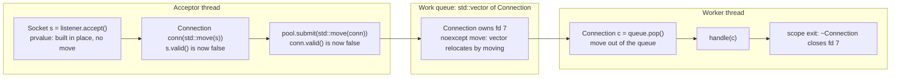

# Module 2.04: Move semantics

**Estimated hours:** 5

**What you will learn**

1. What lvalues and rvalues are, what `T&&` binds to, and why `std::move` is a cast that moves nothing by itself.
2. How to write the move constructor and move assignment for the `FileDescriptor` from module 2.03 so that ownership can change hands while copying stays a compile error: the "move-only connection handles" of tcpkv.
3. Why `noexcept` on a move constructor decides whether `std::vector` moves or copies when it grows, what C++17 guarantees about returning objects from functions, and what a moved-from object is allowed to be.

**Prerequisites:** [Module 2.03: RAII and the rule of 0/3/5](module-03-raii-and-rule-of-0-3-5.md).

---

## 1. One-line intuition

A move is a copy that steals instead of duplicating: the new object takes the old object's resource, and the old object is left holding nothing.

## 2. Real-life analogy

You are moving house. A **copy** is hiring a builder to construct an identical house across town, brick by brick, and keeping both. A **move** is handing over the keys: the new owner has the same house, you have no house, and the handover took one minute. Nothing was duplicated.

For the hotel key card from module 2.03: the card cannot be photocopied (copy is deleted), but you can hand it to a colleague. After the handover you are holding nothing and they are responsible for checkout. That is a move. The rule the hotel adds: a card may be handed over only when the giver is clearly finished with it. In C++, "clearly finished" is spelled `std::move(card)`, and it is a promise you make to the compiler, not an action the compiler performs.

The three things to keep straight: a **move** is the handover; **`std::move`** is you saying "I am done with this, take it"; and a **moved-from object** is you standing with empty hands, still a person, just without a card.

## 3. Why it exists: the problem it solves

Before C++11, every transfer of a resource between objects was a copy followed by a destruction. Returning a `std::vector` of a million records from a function meant allocating a second million-element array, copying, then freeing the first. Putting a `std::string` into a container meant copying its characters. Programmers worked around it with output parameters (`void fill(std::vector<T>& out)`) and raw pointers, which is exactly the C style C++ was trying to leave behind.

Worse, for resources that **cannot** be copied, there was no clean answer at all. A file descriptor cannot be meaningfully duplicated by a copy constructor (module 2.03 showed the double-close corruption). So a `FileDescriptor` could not be returned from a function, could not be stored in a `std::vector`, could not be handed to a worker thread, without a raw-pointer escape hatch. The 2.03 wrapper could only live and die in the scope that created it.

Move semantics (C++11) fixed both. A type can declare a cheap "steal the guts" operation, and the language calls it automatically in the places where the source is about to die anyway: returning a local, passing a temporary, growing a vector. For the places where the source is not about to die but you are done with it, `std::move` lets you say so. The result is that `FileDescriptor` can be returned, stored, queued and handed between threads, with exactly one owner at every instant, and copying still a compile error. That is the design of every connection handle in tcpkv.

What breaks without it: either you copy (slow, or impossible for handles), or you pass raw pointers around and reintroduce every ownership bug of Phase 1.

## 4. Three layers of depth

### Layer 1 (beginner): the vocabulary and the two new functions

**Value categories.** Every expression in C++ is one of three kinds. The names are historical; the meaning is about identity and about whether the thing is about to die.

| Category | Meaning | Examples | Has a name or address | Compiler may steal from it |
|---|---|---|---|---|
| lvalue | An object with identity that lives on | `x`, `*p`, `v[i]`, `obj.member`, `"text"`, a function returning `T&` | yes | no |
| prvalue | A pure temporary, no identity | `42`, `x + y`, `FileDescriptor(fd)`, a function returning `T` by value | no | yes |
| xvalue ("expiring") | An object with identity that you have declared finished | `std::move(x)`, a function returning `T&&` | yes | yes |

Two groupings: **glvalue** = lvalue or xvalue (has identity). **rvalue** = prvalue or xvalue (may be stolen from). "Can it be moved from" is the question that matters, and the answer is "yes if it is an rvalue".

**Rvalue reference `T&&`.** A reference that binds only to rvalues. `FileDescriptor&& other` in a parameter list says "I accept only things that may be stolen from". The older `T&` binds only to lvalues; `const T&` binds to anything but promises not to change it.

**One trap that catches everyone.** A named variable of type `T&&` is itself an lvalue. Inside `FileDescriptor(FileDescriptor&& other)`, the name `other` has identity, so `other` is an lvalue expression. To pass it on as something stealable you must write `std::move(other)` again. "If it has a name, it is an lvalue."

**`std::move`.** Defined in `<utility>`. It is `static_cast<T&&>(x)`: a cast from lvalue to xvalue. It does not move anything, copy anything or free anything. It changes how the expression is categorised so that overload resolution picks the move constructor or move assignment instead of the copy ones. If the type has no move operations, `std::move(x)` silently selects the copy. Read it as "I am done with x".

**Move constructor.** `T(T&& other) noexcept`. Builds a new object by taking `other`'s resources and leaving `other` in a state where its destructor does nothing harmful. For `FileDescriptor`: copy the `int`, set `other.fd_ = -1`.

**Move assignment.** `T& operator=(T&& other) noexcept`. Release what `*this` holds, take `other`'s resources, reset `other`. Guard against `a = std::move(a)` (self-move) so you do not release and then steal from yourself.

**Move-only type.** Copy constructor and copy assignment `= delete`, move constructor and move assignment written. `FileDescriptor` after this module. Also `std::unique_ptr`, `std::thread`, `std::ofstream`, `std::mutex` (which is neither copyable nor movable).

**`noexcept`.** A promise that the function does not throw. On move operations it is almost always true (you are copying an `int` or three pointers) and it is not optional: Layer 2 shows why.

**Copy elision and RVO.** Returning a temporary from a function does not copy or move in C++17: the object is built directly in the caller's variable. Returning a named local usually does not either (**NRVO**, named return value optimisation), though that one is permitted rather than guaranteed.

### Layer 2 (working engineer): the rules that decide what happens

**When the compiler moves automatically.** You do not write `std::move` for: a temporary passed as an argument; a local variable or by-value parameter named in a `return` statement; elements relocated when a `std::vector` grows (if the move is `noexcept`); `std::swap`. You write `std::move` when you want to transfer from a named object that is not about to die by itself: `pool.push_back(std::move(conn))`, `worker_queue.push(std::move(request))`, `member_ = std::move(parameter)` in a constructor.

**The `noexcept` rule for `std::vector`.** When a vector must grow it allocates a new block and relocates every element. If relocation throws halfway, the vector would be half in the old block and half in the new: the **strong exception guarantee** (either the operation completes or nothing changed) would be broken. So `std::vector` relocates with `std::move_if_noexcept`: it moves if the move constructor is `noexcept` **or** the type is not copyable at all; otherwise it copies, because copies leave the old block intact if something throws. Section 6 prints this choice. Forget `noexcept` on a copyable type's move constructor and every `push_back` that grows silently copies, which for a vector of a million strings is a million allocations you did not expect.

**What the compiler generates, exactly.** Move constructor and move assignment are implicitly declared only if the class has **no** user-declared copy constructor, copy assignment, move constructor, move assignment, or destructor. So the `NaiveFd` from module 2.03, which declared only a destructor, has no move operations; `std::move(naive)` silently copies. GCC can warn about that silent copy with `-Wdeprecated-copy-dtor` (not in `-Wall`). Declaring a move operation suppresses the implicit copy operations (they become deleted), which is a second way a type ends up move-only. `= default` works for moves too, when every member knows how to move itself (rule of 0 again).

**`std::swap`.** The generic `std::swap(a, b)` is three moves: `T tmp(std::move(a)); a = std::move(b); b = std::move(tmp);`. For a move-only type it just works. It is also why move operations must handle a source that already owns nothing: `tmp` leaves `a` empty, then `a = std::move(b)` must not try to close `-1`.

**Copy elision in C++17.** Returning a prvalue (`return FileDescriptor(fd);`) is **guaranteed** not to copy or move. The language now says the temporary *is* the caller's object; there is no second object at all, and this works even if the move constructor is deleted. Returning a named local (`FileDescriptor result(fd); ... return result;`) is NRVO: compilers almost always do it, but if they cannot (two different locals returned on different paths, or the local is a parameter), the local is implicitly moved. Writing `return std::move(result);` **prevents** NRVO and forces the move; g++ 13 reports it as `-Wpessimizing-move`, which under `-Werror` stops the build. Never write it.

**Moved-from state.** The standard says a moved-from standard-library object is in a "valid but unspecified state": you may destroy it, assign to it, call functions with no preconditions (`size()`, `clear()`, `empty()`), but you may not assume what it contains. In libstdc++ a moved-from `std::string` or `std::vector` is in practice empty, but do not write code that needs that. For your own types, document the state: `FileDescriptor` promises "moved-from means `valid()` is false", which is a stronger and more useful promise. **Use after move** is the bug of reading a moved-from object expecting its old contents. `clang-tidy`'s `bugprone-use-after-move` check finds it.

**Passing ownership into a function.** `void archive(FileDescriptor fd)` takes by value. The caller writes `archive(std::move(d))`, which move-constructs the parameter; the function owns it and the destructor runs at the end of `archive`. This "sink" signature is how tcpkv's thread pool accepts a connection: `submit(Connection conn)`, called with `submit(std::move(conn))`. The signature says "I take ownership" and the call site says "I give it up".

**Forwarding references, a preview.** In a template, `T&&` with `T` deduced is **not** an rvalue reference; it is a forwarding reference that binds to anything and remembers whether it was an lvalue or an rvalue. `std::forward<T>(x)` passes it on with the same category. You will meet this properly in module 2.06; for now, when you see

```cpp
template <class T>
void submit(T&& item) { queue.push_back(std::forward<T>(item)); }
```

read it as "pass through, moving if the caller gave me an rvalue, copying if an lvalue".

### Layer 3 (internals): what a move compiles to and why it is sometimes not free

**A move of `FileDescriptor` is two stores.** `fd_ = other.fd_; other.fd_ = -1;` compiles to a load, a store, and a store of `-1`. Three instructions. The destructor's `if (fd_ >= 0)` is one compare and one branch. That is the whole cost of ownership transfer.

**A move of `std::string` (libstdc++).** If the source string is long (heap buffer), the move copies the pointer, length and capacity (three words) and resets the source to an empty short string pointing at its own internal buffer. If the source is short (15 characters or fewer, stored inside the object), the characters are copied, because the internal buffer cannot be stolen; the "move" is a small `memcpy`. Either way no heap allocation. A move of `std::vector` is three pointer copies and three zero stores.

**Move is not always free.** For an `int`, `std::move` is a copy. For a struct of ten `int`s it is a ten-`int` copy. For a `std::array<char, 4096>` it is a 4 KB copy. Move helps when the object owns something behind a pointer; for everything else it is the same as copy, and `std::move` only adds noise.

**How RVO works in the machine.** A function returning a non-trivial type does not return it in a register. The caller reserves space for the result and passes its address as a hidden first argument (the Itanium ABI used on Linux calls this the `sret` pointer, passed in `rdi`). The callee constructs the result directly at that address. `return FileDescriptor(fd);` therefore constructs the object in the caller's slot: one constructor call, nothing to elide at run time. For NRVO the compiler places the named local at that address from the start, which it cannot do if two different locals might be returned or if the "local" is a parameter (the caller already placed the parameter elsewhere). `return std::move(local)` turns the expression into an xvalue, so the compiler must move-construct from `local` into the slot and then destroy `local`: one extra move and one extra destructor, which is what the `-fno-elide-constructors` run in section 6 shows.

**The ABI cost of move-only types.** The Itanium ABI passes a type by value in registers only if it is trivially copyable and trivially destructible. `FileDescriptor` has a user-written destructor and move constructor, so even though it is one `int`, it is passed and returned by hidden reference: the caller puts it on the stack and passes its address. Compared with a raw `int fd` in `edi`, that is one extra store and one extra load per call, and the callee cannot keep it in a register. This is a known, measured cost of `std::unique_ptr` versus a raw pointer, and it is why a hot inner loop may take `int fd` while the owning object lives one frame up. It is small; module 2.13 shows you how to measure whether it matters.

## 5. Architecture diagram



At every arrow exactly one object owns fd 7. The objects left behind hold `-1`. No copy constructor exists, so a second owner cannot be created by accident.

## 6. Code

The `FileDescriptor` from module 2.03 with the two move operations added, exercised in every way tcpkv will use it. The prints are for teaching.

```cpp
// move_fd.cpp : the FileDescriptor from 2.03 becomes move-only.
#include <cerrno>
#include <cstring>
#include <iostream>
#include <stdexcept>
#include <string>
#include <utility>    // std::move, std::swap
#include <vector>

#include <fcntl.h>
#include <unistd.h>

class FileDescriptor {
public:
    explicit FileDescriptor(int fd = -1) noexcept : fd_(fd) {}

    ~FileDescriptor() {
        if (fd_ >= 0) {
            std::cout << "  close(" << fd_ << ")\n";
            ::close(fd_);
        }
    }

    // Still non-copyable.
    FileDescriptor(const FileDescriptor&) = delete;
    FileDescriptor& operator=(const FileDescriptor&) = delete;

    // Move constructor: steal the fd, leave the source owning nothing.
    FileDescriptor(FileDescriptor&& other) noexcept
        : fd_(other.fd_) {
        other.fd_ = -1;
        std::cout << "  move-construct, took fd " << fd_ << "\n";
    }

    // Move assignment: release what we hold, then steal.
    FileDescriptor& operator=(FileDescriptor&& other) noexcept {
        if (this != &other) {
            if (fd_ >= 0) {
                std::cout << "  close(" << fd_ << ") in move-assign\n";
                ::close(fd_);
            }
            fd_ = other.fd_;
            other.fd_ = -1;
        }
        return *this;
    }

    int  get() const noexcept { return fd_; }
    bool valid() const noexcept { return fd_ >= 0; }

private:
    int fd_;
};

FileDescriptor open_or_throw(const char* path) {
    int fd = ::open(path, O_WRONLY | O_CREAT | O_TRUNC, 0644);
    if (fd < 0) throw std::runtime_error(std::string(path) + ": " + std::strerror(errno));
    return FileDescriptor(fd);        // prvalue: guaranteed no copy, no move
}

// Takes ownership. The caller must std::move into it.
void archive(FileDescriptor fd) {
    std::cout << "  archive() owns fd " << fd.get() << "\n";
}   // fd closed here

int main() {
    std::cout << "1. return from function (no move printed):\n";
    FileDescriptor a = open_or_throw("a.log");
    std::cout << "  a owns " << a.get() << "\n";

    std::cout << "2. std::move into another variable:\n";
    FileDescriptor b = std::move(a);
    std::cout << "  a valid? " << a.valid() << "   b owns " << b.get() << "\n";

    std::cout << "3. move-assign over an existing owner:\n";
    FileDescriptor c = open_or_throw("c.log");
    c = std::move(b);
    std::cout << "  b valid? " << b.valid() << "   c owns " << c.get() << "\n";

    std::cout << "4. std::swap (three moves underneath):\n";
    FileDescriptor d = open_or_throw("d.log");
    std::swap(c, d);
    std::cout << "  c owns " << c.get() << "   d owns " << d.get() << "\n";

    std::cout << "5. hand ownership to a function:\n";
    archive(std::move(d));
    std::cout << "  d valid after archive? " << d.valid() << "\n";

    std::cout << "6. a vector of move-only handles:\n";
    std::vector<FileDescriptor> pool;
    pool.reserve(3);                  // avoid regrowth so the prints stay simple
    pool.push_back(open_or_throw("p1.log"));
    pool.push_back(open_or_throw("p2.log"));
    // pool.push_back(c);   // error: copy constructor is deleted
    pool.push_back(std::move(c));
    std::cout << "  pool holds " << pool.size() << " handles\n";

    std::cout << "7. end of main, destructors run in reverse:\n";
    return 0;
}
```

```bash
g++ -std=c++17 -Wall -Wextra -Werror -g -o move_fd move_fd.cpp
./move_fd
```

Expected output (descriptor numbers are what the kernel hands out; on a fresh shell they are 3, 4, 5 as shown):

```text
1. return from function (no move printed):
  a owns 3
2. std::move into another variable:
  move-construct, took fd 3
  a valid? 0   b owns 3
3. move-assign over an existing owner:
  close(4) in move-assign
  b valid? 0   c owns 3
4. std::swap (three moves underneath):
  move-construct, took fd 3
  c owns 4   d owns 3
5. hand ownership to a function:
  move-construct, took fd 3
  archive() owns fd 3
  close(3)
  d valid after archive? 0
6. a vector of move-only handles:
  move-construct, took fd 3
  move-construct, took fd 5
  move-construct, took fd 4
  pool holds 3 handles
7. end of main, destructors run in reverse:
  close(3)
  close(5)
  close(4)
```

Read it against the rules. Step 1 printed no move: guaranteed elision. Step 3 closed `c`'s old descriptor 4 before taking 3. Step 4 printed only one move-construct because the two move-assignments inside `swap` do not print, and neither had anything to close. Step 7 closed only the three descriptors the vector owns; `a`, `b`, `c`, `d` all hold `-1` and their destructors did nothing. Every descriptor opened was closed exactly once. Confirm with `strace -e trace=close ./move_fd 2>&1 | grep -c 'close(' ` if you like.

The second program shows `std::vector` choosing between move and copy:

```cpp
// vector_noexcept.cpp : does std::vector move or copy when it grows?
#include <iostream>
#include <string>
#include <vector>

struct SafeMove {                        // move constructor is noexcept
    std::string tag;
    explicit SafeMove(std::string t) : tag(std::move(t)) {}
    SafeMove(const SafeMove& o) : tag(o.tag) { std::cout << "  COPY " << tag << "\n"; }
    SafeMove(SafeMove&& o) noexcept : tag(std::move(o.tag)) { std::cout << "  move " << tag << "\n"; }
};

struct RiskyMove {                       // move constructor may throw
    std::string tag;
    explicit RiskyMove(std::string t) : tag(std::move(t)) {}
    RiskyMove(const RiskyMove& o) : tag(o.tag) { std::cout << "  COPY " << tag << "\n"; }
    RiskyMove(RiskyMove&& o) : tag(std::move(o.tag)) { std::cout << "  move " << tag << "\n"; }
};

template <class T>
void grow(const char* title) {
    std::cout << title << "\n";
    std::vector<T> v;
    v.reserve(2);                        // capacity 2: the third push reallocates
    v.emplace_back("x");
    v.emplace_back("y");
    std::cout << "  -- third emplace_back forces reallocation --\n";
    v.emplace_back("z");
}

int main() {
    grow<SafeMove>("SafeMove (noexcept move):");
    grow<RiskyMove>("RiskyMove (move may throw):");
    return 0;
}
```

```bash
g++ -std=c++17 -Wall -Wextra -Werror -g -o vector_noexcept vector_noexcept.cpp
./vector_noexcept
```

Expected output:

```text
SafeMove (noexcept move):
  -- third emplace_back forces reallocation --
  move x
  move y
RiskyMove (move may throw):
  -- third emplace_back forces reallocation --
  COPY x
  COPY y
```

Same code, one keyword different, and the vector copies every element on every growth. For a vector of connection handles that would not even compile (copy is deleted), which is why move-only types are moved regardless; for a vector of records it is a silent performance bug.

The third program shows copy elision. With the course flags it does not build, on purpose:

```cpp
// rvo.cpp : copy elision. Compile twice, with and without -fno-elide-constructors.
#include <iostream>
#include <string>

struct Loud {
    std::string name;
    explicit Loud(std::string n) : name(std::move(n)) { std::cout << "  ctor  " << name << "\n"; }
    Loud(const Loud& o) : name(o.name) { std::cout << "  COPY  " << name << "\n"; }
    Loud(Loud&& o) noexcept : name(std::move(o.name)) { std::cout << "  MOVE  " << name << "\n"; }
    ~Loud() { std::cout << "  dtor  " << name << "\n"; }
};

Loud make_prvalue() {
    return Loud("prvalue");          // C++17: guaranteed elision, always
}

Loud make_named() {
    Loud result("named");            // NRVO: allowed, not guaranteed
    result.name += "+";
    return result;
}

Loud make_moved() {
    Loud result("moved");
    return std::move(result);        // pessimisation: blocks NRVO, forces a move
}

int main() {
    std::cout << "A. return Loud(...):\n";        { Loud a = make_prvalue(); }
    std::cout << "B. return local:\n";            { Loud b = make_named(); }
    std::cout << "C. return std::move(local):\n"; { Loud c = make_moved(); }
    return 0;
}
```

```bash
g++ -std=c++17 -Wall -Wextra -Werror -g -o rvo rvo.cpp
```

Expected: the build fails.

```text
rvo.cpp:25:21: error: moving a local object in a return statement prevents copy elision [-Werror=pessimizing-move]
   25 |     return std::move(result);        // pessimisation: blocks NRVO, forces a move
```

That is the compiler refusing a real mistake. To see what the mistake costs, allow it, then build again with elision disabled:

```bash
g++ -std=c++17 -Wall -Wextra -Werror -Wno-pessimizing-move -g -o rvo rvo.cpp
./rvo
g++ -std=c++17 -Wall -Wextra -Werror -Wno-pessimizing-move -g -fno-elide-constructors -o rvo_noelide rvo.cpp
./rvo_noelide
```

Expected output, first run (normal):

```text
A. return Loud(...):
  ctor  prvalue
  dtor  prvalue
B. return local:
  ctor  named
  dtor  named+
C. return std::move(local):
  ctor  moved
  MOVE  moved
  dtor  
  dtor  moved
```

Expected output, second run (`-fno-elide-constructors`):

```text
A. return Loud(...):
  ctor  prvalue
  dtor  prvalue
B. return local:
  ctor  named
  MOVE  named+
  dtor  
  dtor  named+
C. return std::move(local):
  ctor  moved
  MOVE  moved
  dtor  
  dtor  moved
```

Case A never moves, even with elision switched off: C++17 made it a language rule, not an optimisation. Case B moves only when the optimisation is disabled. Case C always pays for a move and an extra destructor (the `dtor` with an empty name is the moved-from local, whose string was stolen). The `std::move` cost something and gained nothing.

## 7. Use case: core-banking loan-origination platform

The resume line for tcpkv (claim I) says "move-only connection handles". Here is the design behind those three words. The acceptor thread calls `accept`, which returns a raw descriptor. It is wrapped in a `Socket` (a `FileDescriptor` with network helpers) at once, so there is never a window where a raw `int` could be forgotten. The acceptor then does `queue.push(Connection(std::move(socket)))`. The worker thread does `Connection c = queue.pop();` and handles the request. The connection is closed by `c`'s destructor at the end of the handler, whether the handler returned normally, hit a protocol error, or threw.

The decision this drove: **connection objects are moved along the pipeline, never shared and never copied; the type is move-only so that an accidental copy is a compile error and an accidental double close is impossible.** The alternative the team considered was `std::shared_ptr<Connection>`, which would have let any stage keep a reference and would have hidden the question "who closes this?" behind a reference count. With move-only handles the answer is structural: whoever holds the object. When a load test later showed a descriptor leak, the search space was tiny: find the one place where a `Connection` was constructed and never moved on. It was a `continue` in the acceptor loop before the `push`.

The same design appears in the application server from claim H4, where a parsed `LoanRequest` is moved into the pooled worker's queue. A `LoanRequest` holds several `std::string`s and a `std::vector` of document references; moving it costs a dozen pointer stores, copying it would cost a dozen allocations per request, which at a few thousand requests per second is measurable. The `noexcept` rule in Layer 2 was a real bug there once: a move constructor without `noexcept` on the request type made the queue's vector copy every pending request each time it grew.

## 8. Lab

### Part A: the move-only handle (30 minutes)

1. Build and run `move_fd.cpp`. Before running, write down what you expect the descriptor numbers to be at each step, then compare.
2. Remove the `pool.reserve(3);` line and run again. Expected: three extra `move-construct` lines during step 6, because the vector grows from capacity 1 to 2 to 4 and relocates existing elements each time. Count them. Put the line back.
3. Remove `noexcept` from the move constructor. Build and run. Expected: identical output. `std::vector` moves a non-copyable type regardless, because copying is not an option. Add the two `= delete` lines back if you removed them, and the `noexcept` too.
4. Replace `return FileDescriptor(fd);` in `open_or_throw` with `FileDescriptor result(fd); return result;`. Build and run. Expected: still no `move-construct` line in step 1, because NRVO applies. Now build with `-fno-elide-constructors` and run. Expected: a `move-construct` line in step 1, and the program still closes every descriptor exactly once.
5. Add `c = std::move(c);` after step 3. Expected: nothing printed, `c` still valid. Remove the `if (this != &other)` guard and run again. Expected: `c` closes its own descriptor and ends up holding `-1`. Self-move is rare but `std::swap`-like algorithms can produce it; the guard is cheap.

### Part B: noexcept and the vector (20 minutes)

1. Build and run `vector_noexcept.cpp`. Confirm `move` for `SafeMove` and `COPY` for `RiskyMove`.
2. Add `noexcept` to `RiskyMove`'s move constructor. Expected: both now print `move`.
3. Add `static_assert(std::is_nothrow_move_constructible<SafeMove>::value, "");` and the same with `RiskyMove` (include `<type_traits>`). Expected: the second assert fails to compile, with a message you can use in code review to prove a type is safe to store in a vector.
4. Change `v.reserve(2)` to nothing and push eight elements of each type. Count the `COPY` lines for `RiskyMove`. Expected: 1 + 2 + 4 = 7 copies for 8 pushes (relocations at capacities 1, 2 and 4), and the same number of moves for `SafeMove`.

### Part C: elision (20 minutes)

1. Build `rvo.cpp` with the course flags and record the `-Werror=pessimizing-move` message. Then build with `-Wno-pessimizing-move` and with `-fno-elide-constructors` as in section 6. Count `ctor`, `MOVE`, `COPY` and `dtor` lines for each case.
2. Add `Loud pass(Loud x) { return x; }` and call `Loud r = pass(Loud("param"));`. Expected: `ctor param`, then `MOVE param`, then two `dtor` lines. A parameter cannot be elided (the caller already placed it), so the return implicitly moves it. No `std::move` needed and none written.
3. Delete `Loud`'s move constructor (`Loud(Loud&&) = delete;`) and build the normal way. Expected: `make_prvalue` still compiles and runs (guaranteed elision needs no move constructor); `make_named` fails to compile, because NRVO is only an optimisation and the fallback move is deleted. Undo.

### Part D: valid but unspecified (20 minutes)

Type this program and run it:

```cpp
// after_move.cpp : a moved-from object is valid but unspecified.
#include <iostream>
#include <string>
#include <utility>
#include <vector>

int main() {
    std::string s = "a string long enough to defeat small-string storage";
    std::string t = std::move(s);
    std::cout << "t.size() = " << t.size() << "\n";
    std::cout << "s.size() = " << s.size() << " (valid to call; value unspecified)\n";
    s = "reassigned";                       // always safe: assignment gives a known state
    std::cout << "s = " << s << "\n";

    std::vector<int> v = {1, 2, 3};
    std::vector<int> w = std::move(v);
    std::cout << "w.size() = " << w.size() << ", v.size() = " << v.size() << "\n";
    v.clear();                              // safe: puts v in a known state
    v.push_back(9);
    std::cout << "v after clear+push = " << v.size() << "\n";

    int x = 5;
    int y = std::move(x);                   // for int this is just a copy
    std::cout << "x = " << x << ", y = " << y << "\n";
    return 0;
}
```

```bash
g++ -std=c++17 -Wall -Wextra -Werror -g -o after_move after_move.cpp
./after_move
```

Expected output with libstdc++ (the two `0` sizes are what this library does, not what the standard promises):

```text
t.size() = 51
s.size() = 0 (valid to call; value unspecified)
s = reassigned
w.size() = 3, v.size() = 0
v after clear+push = 1
x = 5, y = 5
```

1. Change the first string to `"short"` (5 characters) and run again. Expected: `s.size()` is still 0 with libstdc++, but think about Layer 3: the characters were copied, not stolen, and the library chose to clear the source anyway. Another library could legally leave `"short"` there.
2. Run `clang-tidy -checks='bugprone-use-after-move' after_move.cpp -- -std=c++17`. Expected: warnings at the two lines that read `s` and `v` after the move, each with a note pointing at the `std::move`. This check runs in tcpkv's CI (Phase 9).
3. Note that `x` is unchanged after `std::move(x)`: for an `int` there is nothing to steal. `std::move` on a plain number or pointer is harmless noise.

### Journal

Copy [journal/TEMPLATE.md](../journal/TEMPLATE.md) to `journal/YYYY-MM-DD-move-semantics.md`. Record: the full `move_fd` output with every descriptor number annotated with its owner at that moment; the relocation counts from Part A step 2 and Part B step 4; the four line counts per case from Part C; and the `clang-tidy` output from Part D. The "exactly one owner at every instant" annotation is the heart of your tcpkv resume answer.

## 9. Common mistakes and misconceptions

| Mistake | Why it is wrong | Bug it causes later |
|---|---|---|
| "`std::move` moves the object" | It is a cast to an rvalue; the move happens, if at all, in the constructor or assignment that receives it | `std::move` on a type with no move operations silently copies; `std::move` on an `int` does nothing |
| Using an object after `std::move` as if it still held its value | Moved-from is valid but unspecified | Empty strings, zero-length vectors, `-1` descriptors read as data |
| Forgetting `noexcept` on a copyable type's move constructor | `std::vector` falls back to copying on growth | A million allocations where you expected pointer swaps |
| `return std::move(local);` | Blocks NRVO and forces a move; g++ flags it with `-Wpessimizing-move` | Extra move and destructor per call; build failure under `-Werror` |
| Treating a named `T&&` parameter as an rvalue | A name is an lvalue; forwarding it without `std::move` copies | Move constructor that secretly copies its members |
| Move constructor that does not reset the source | Source destructor releases the resource the target now owns | Double close, double free, the 2.03 bug through a new door |
| Move assignment without releasing the old resource | The target's old handle is overwritten and never closed | Leak per assignment |
| Move assignment without a self-move check | `a = std::move(a)` releases then steals from a dead handle | Object silently loses its resource |
| Declaring only a destructor and expecting moves | Any user-declared destructor suppresses implicit move operations | Silent copies; `-Wdeprecated-copy-dtor` warns |
| Writing `std::move` everywhere "for speed" | Moves of ints, pointers and small PODs are copies; moves of SSO strings copy characters | Noise, and blocked NRVO where it matters |

## 10. Resume link

- **Claim B, "move semantics".** The sentence: "A move transfers a resource and leaves the source empty; `std::move` is a cast that makes an lvalue eligible for that; the compiler moves automatically on return, on temporaries and inside `std::vector` growth if the move is `noexcept`." Then your evidence: the `move_fd` output in your journal with one owner at every line.
- **Claim I, "move-only connection handles".** Say: "The connection type deletes copy and implements move, so it can be returned from `accept`, pushed into the work queue and popped by a worker, with the compiler guaranteeing a single owner. When we had a descriptor leak, that guarantee reduced the search to the one place a handle was constructed and not moved on." Expect the follow-up "why not `shared_ptr`?" and answer: it would hide the ownership question behind a count; move-only makes it structural.
- **Claim B, "performance optimisation".** The `noexcept` and vector story: a type without `noexcept` on its move made a queue copy every element on growth. Name the tool that proved it: the printing constructors in `vector_noexcept.cpp`, or in a real codebase `perf` showing `malloc` under `push_back`.
- **Claim B, "STL internals".** `std::move_if_noexcept`, the strong exception guarantee, and the growth factor are the start of module 2.07.

Likely follow-up: "What does C++17 guarantee about `return T(...)`?" Answer: mandatory elision for prvalues; the temporary is the caller's object; works even if the type is not movable. NRVO for named locals remains an optimisation, with implicit move as the fallback.

## 11. Interview questions

**Q1 (easy). What is the difference between an lvalue and an rvalue, and what does `std::move` do?**

<details>
<summary>Model answer</summary>

An lvalue is an expression that refers to an object with identity that continues to exist, such as a named variable; an rvalue is either a temporary with no identity (a prvalue, like the result of `T(...)` or `x + y`) or an object whose owner has declared it finished (an xvalue). Move operations are allowed to steal from rvalues. `std::move` is `static_cast<T&&>`: it turns an lvalue expression into an xvalue so that overload resolution picks the move constructor or move assignment. It performs no move itself; if the type has no move operations the copy is selected silently.

</details>

**Q2 (easy). Write the move constructor for a class that owns a file descriptor. What state must the source be left in and why?**

<details>
<summary>Model answer</summary>

```cpp
FileDescriptor(FileDescriptor&& other) noexcept : fd_(other.fd_) { other.fd_ = -1; }
```

The source must be left owning nothing, here `-1`, because its destructor will still run and must not close the descriptor the new object now owns. If the source kept its old value you would have two owners and the double-close bug from module 2.03. The function is `noexcept` because it only copies an integer, and marking it so lets containers move it safely. The copy operations stay deleted so the type is move-only.

</details>

**Q3 (medium). Why does `std::vector` care whether a type's move constructor is `noexcept`?**

<details>
<summary>Model answer</summary>

When a vector grows it allocates a new block and relocates each element. `push_back` offers the strong exception guarantee: if anything throws, the vector is unchanged. Moving elements breaks that promise if a move throws halfway, because the already-moved elements in the old block are now empty and cannot be restored. So the library uses `std::move_if_noexcept`: it moves if the move constructor is declared `noexcept` or if the type is not copyable at all, and otherwise copies, since copies leave the old block intact. A copyable type whose move constructor is not `noexcept` is therefore copied on every reallocation, which is a silent performance bug; `static_assert(std::is_nothrow_move_constructible<T>::value)` documents the requirement.

</details>

**Q4 (medium). Explain copy elision, RVO and NRVO. Why is `return std::move(local);` wrong?**

<details>
<summary>Model answer</summary>

A function returning a non-trivial type by value receives a hidden pointer to the caller's result slot and constructs the result there. For `return T(...)`, C++17 guarantees that the prvalue is constructed directly in the slot: no copy, no move, and the type need not even be movable. For `return local;` the compiler is permitted to place the local in the slot from the start (NRVO), which GCC does even at `-O0`; when it cannot, for example when a parameter is returned or two different locals are returned on different paths, the local is implicitly treated as an rvalue and moved. Writing `return std::move(local);` changes the expression to an xvalue, which disables NRVO and forces a move constructor call plus an extra destructor; it never helps and GCC warns with `-Wpessimizing-move`. The only time an explicit move in a return helps is for a member or a reference parameter, where neither elision nor implicit move applies.

</details>

**Q5 (hard). Under what conditions does the compiler generate move operations, what happens to `std::move(x)` when it does not, and what are the costs of passing a move-only handle type by value compared with a raw `int`?**

<details>
<summary>Model answer</summary>

The move constructor and move assignment are implicitly declared only when the class has no user-declared copy constructor, copy assignment, move constructor, move assignment or destructor. A class that declares just a destructor, the common shape of a naive resource wrapper, gets no move operations; `std::move(x)` then resolves to the implicitly generated copy constructor, which duplicates the handle, so the "move" is a silent copy with a double-release bug behind it. GCC's `-Wdeprecated-copy-dtor` warns about that implicit copy. Conversely, declaring any move operation makes the implicit copy operations deleted, which is a second way to obtain a move-only type. For correctness a user-written move must reset the source, release the target's old resource in move assignment, and guard against self-move. On cost: on the Linux Itanium ABI a type with a non-trivial destructor or move constructor is not passed in registers; the caller materialises it on the stack and passes its address, so a one-`int` `FileDescriptor` costs a store and a load per call and cannot live in a register inside the callee, whereas a raw `int` travels in `edi`. The move itself is two stores. In a hot loop this can be measured; the usual design is to keep the owning object one frame up and pass `int fd` into the innermost function, which is borrowing, not ownership transfer.

</details>

## 12. Revision

- Rvalues (temporaries and `std::move`d objects) may be stolen from; `std::move` is a cast that grants permission and moves nothing itself; a named `T&&` is an lvalue.
- A move constructor steals and resets the source (`fd_ = other.fd_; other.fd_ = -1;`), is `noexcept` so `std::vector` moves instead of copies on growth, and with deleted copies gives a move-only type with exactly one owner at every instant.
- C++17 guarantees no copy or move for `return T(...)`; NRVO usually elides named locals and `return std::move(local)` only hurts; a moved-from object is valid but unspecified, so assign to it or leave it alone.

---

Previous: [Module 2.03: RAII and the rule of 0/3/5](module-03-raii-and-rule-of-0-3-5.md) | Next: [Module 2.05: Smart pointers and the shared_ptr control block](module-05-smart-pointers-and-control-block.md)
