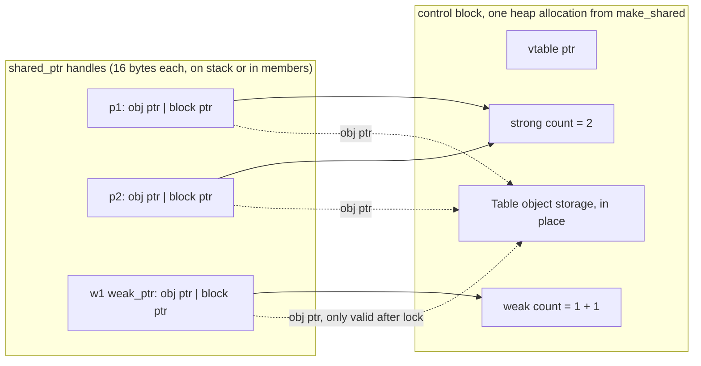

# Module 2.05: Smart pointers and the shared_ptr control block

**Estimated hours:** 5

**What you will learn**

1. What `unique_ptr`, `shared_ptr` and `weak_ptr` are, which one to reach for, and why `unique_ptr` costs exactly nothing compared with a raw pointer.
2. What the `shared_ptr` control block is, what lives inside it, why `make_shared` makes one allocation instead of two, and what that costs you when `weak_ptr`s are around.
3. How reference cycles leak memory, how to see the leak under Valgrind, and how `weak_ptr` and `enable_shared_from_this` fix real server code.

**Prerequisites:** [Module 2.04: Move semantics](module-04-move-semantics.md). You must be comfortable with RAII (2.03), the rule of 0/3/5, and `std::move`.

---

## 1. One-line intuition

A smart pointer is a tiny object that owns a heap allocation and runs `delete` for you in its destructor, so ownership becomes something the compiler enforces instead of something you remember.

## 2. Real-life analogy

Think of a key to a storage locker at a branch office.

- A **raw pointer** (`Loan* p`) is a photocopy of the key. Anyone can hold one. Nobody knows who should return the locker. If the last person forgets, the locker stays rented forever (a **leak**). If someone returns it while others still hold copies, those copies open a locker that now belongs to someone else (a **dangling pointer**, use-after-free).
- A **`unique_ptr`** is the one physical key. Exactly one person holds it. You can hand it over (move), but you cannot photocopy it (copy is deleted). When the holder leaves (goes out of scope), the locker is returned automatically.
- A **`shared_ptr`** is a key attached to a sign-in sheet on the locker door. Every person who takes a key signs the sheet; every person who leaves crosses their name out. Whoever crosses out the last name returns the locker. That sheet is the **control block**, and the count of names is the **strong count**.
- A **`weak_ptr`** is a note saying "locker 42 may exist". It does not keep the locker rented. Before you use it, you ask the desk "is 42 still rented?" (`lock()`). If yes, you are given a real signed-in key for as long as you need it. If no, you get nothing (`nullptr`).

## 3. Why it exists: the problem it solves

In Phase 1 you wrote `malloc` and `free` by hand, and in module 2.03 you saw `new` and `delete`. Every path through a function had to reach the `delete`: normal return, early return on error, and (from module 2.09) an exception flying through. Real code has dozens of paths. People miss one. The result is either a leak that slowly eats a server's memory over weeks, or a double delete that corrupts the heap and crashes much later in unrelated code.

RAII (module 2.03) fixed this for one specific resource at a time: you wrote a class whose destructor frees the resource. Smart pointers are RAII done once, generically, for "a thing on the heap". `unique_ptr<T>` is "a `T` on the heap with one owner". `shared_ptr<T>` is "a `T` on the heap with many owners and a count".

What breaks without them: the Phase 1 bug classes come back. Leaks that Valgrind reports as "definitely lost". Use-after-free that ASan catches only when you are lucky enough to test that path. In a 24x7 lending server the leak is the worse one: it does not crash, it just slowly grows until the OS kills the process at 3 a.m.

## 4. Three layers of depth

### Layer 1 (beginner): the three pointers and when to use each

| Type | Owners | Copyable? | Size | Use it for |
|---|---|---|---|---|
| `std::unique_ptr<T>` | exactly one | no (move only) | 8 bytes | the default; almost everything |
| `std::shared_ptr<T>` | many, counted | yes | 16 bytes | objects whose last user is genuinely unknown at compile time |
| `std::weak_ptr<T>` | none | yes | 16 bytes | observing a shared object without keeping it alive; breaking cycles |
| raw `T*` | none (non-owning) | yes | 8 bytes | "I can see it, I do not own it", lifetime guaranteed by someone else |

**Creating them.** Never write `new` yourself. Use the factory functions:

```cpp
auto app = std::make_unique<LoanApp>(1001);     // unique_ptr<LoanApp>
auto tbl = std::make_shared<Table>("branches"); // shared_ptr<Table>
```

**Using them.** `*p` and `p->field` work exactly like a raw pointer. `p.get()` gives the raw pointer when a C-style API needs one. `if (p)` tests for null. `p.reset()` deletes the object now and makes `p` null.

**Moving ownership.** `unique_ptr` cannot be copied, so this does not compile: `auto b = a;`. This does: `auto b = std::move(a);`. After it, `a` is null and `b` owns the object. Passing a `unique_ptr` into a function by value means "the function takes ownership". Returning one from a function means "the caller now owns this".

**Sharing ownership.** Copying a `shared_ptr` bumps the strong count. Destroying one decrements it. When it hits zero the object is deleted. `p.use_count()` tells you the current count (useful in experiments, not in production logic).

**The rule of thumb that interviewers want to hear.** Start with `unique_ptr`. Promote to `shared_ptr` only when two or more parts of the program genuinely need the object to stay alive and neither can promise to outlive the other. Use a raw pointer or a reference for every non-owning access.

### Layer 2 (working engineer): deleters, make_shared, weak_ptr, thread safety

**Custom deleters.** A `unique_ptr` can own anything that needs cleanup, not just `new`-ed objects. The deleter type is the second template argument.

```cpp
struct FileCloser {                       // stateless: no data members
    void operator()(std::FILE* f) const noexcept { if (f) std::fclose(f); }
};
std::unique_ptr<std::FILE, FileCloser> f(std::fopen("loans.txt", "r"));
```

A stateless functor like `FileCloser` is stored using the empty-base trick, so `sizeof` stays 8. A function-pointer deleter, `std::unique_ptr<std::FILE, int (*)(std::FILE*)> f(fopen(...), &fclose)`, must store the pointer, so `sizeof` becomes 16. Prefer the functor.

A GCC gotcha you will hit with `-Werror`: writing the deleter type as `decltype(&std::fclose)` fails with `error: ignoring attributes on template argument` because glibc declares `fclose` with a `nonnull` attribute. Spell the function-pointer type out instead, `int (*)(std::FILE*)`, or use the functor.

`shared_ptr` also accepts a deleter, but as a constructor argument, not a template argument: `std::shared_ptr<std::FILE> f(fopen(...), &fclose);`. The deleter is stored in the control block, which is why the `shared_ptr` type itself does not change.

**`make_shared` versus `shared_ptr(new T)`.** `std::shared_ptr<T> p(new T)` performs two heap allocations: one for `T`, one for the control block. `std::make_shared<T>()` performs one: the control block and the `T` live in the same memory block. One allocation is faster, and the object and its counts sit next to each other in cache. There is a cost: that single block can only be freed when both the strong count and the weak count reach zero. If a `weak_ptr` outlives the object, the object's destructor runs on time, but its bytes stay allocated until the last `weak_ptr` goes away. For a 10 MB table observed by a long-lived `weak_ptr`, that matters.

**`weak_ptr`.** Created from a `shared_ptr`. It does not increment the strong count. `w.expired()` tells you whether the object is gone. `w.lock()` atomically checks and, if the object is alive, returns a `shared_ptr` that keeps it alive while you work. Always use `lock()` rather than `expired()` followed by a separate access, because another thread can destroy the object between the two calls.

**`enable_shared_from_this`.** Inside a member function you have `this`, a raw pointer. If the object is owned by `shared_ptr`s and you need another `shared_ptr` to it, for example to keep a connection alive until a queued task runs, you must not write `std::shared_ptr<Connection>(this)`. That creates a second, independent control block and the object is deleted twice. Instead, inherit from `std::enable_shared_from_this<Connection>` and call `shared_from_this()`, which finds the existing control block through a hidden `weak_ptr` member. It only works on objects already owned by a `shared_ptr`; calling it in the constructor or on a stack object throws `std::bad_weak_ptr` in C++17.

**Thread safety, stated precisely.** The control block is thread safe: two threads may each copy or destroy their own `shared_ptr` to the same object at the same time, and the counts stay correct, because increments and decrements are atomic. Two things are not protected: the object itself (two threads calling `p->update()` need a mutex exactly as before), and a single `shared_ptr` variable touched by two threads (one writing `p = other` while another reads `p` is a data race). Module 4.13 builds on this to swap cache tables safely.

**When raw pointers are correct.** A function that looks at an object and returns should take `const T&` or `T*`, never `shared_ptr<T>`. Passing `shared_ptr` by value to such a function costs an atomic increment and decrement for nothing and, worse, tells the reader "this function may keep the object alive" when it does not. Pass `shared_ptr` only to code that stores it.

### Layer 3 (internals): the control block and what the CPU does on copy

**`unique_ptr<T>` layout.** One member: the raw pointer, wrapped in a tuple with the deleter so that an empty deleter takes no space. `sizeof(std::unique_ptr<T>) == sizeof(T*) == 8`. The destructor is `if (ptr) deleter(ptr);`. At `-O2` the compiler inlines it, and the machine code for a function using `unique_ptr` is identical to the hand-written `new`/`delete` version. You will verify this on Compiler Explorer in the lab. This is what "zero-overhead abstraction" means: you pay nothing at run time for the safety.

**`shared_ptr<T>` layout in libstdc++ (GCC 13).** Two pointers, 16 bytes:

1. `T* _M_ptr`: the object. Kept in the handle so `*p` does not need to go through the control block.
2. A pointer to the control block (`_Sp_counted_base*`).

**The control block.** A heap object that begins with:

| Field | Type | Purpose |
|---|---|---|
| vtable pointer | 8 bytes | the block is polymorphic: there are different kinds (see below) |
| `_M_use_count` | `int` (updated atomically) | strong count: number of `shared_ptr`s |
| `_M_weak_count` | `int` (updated atomically) | number of `weak_ptr`s, plus one while any strong owner exists |

The block comes in several concrete kinds, which is why it has a vtable:

- `shared_ptr<T>(new T)` creates a block holding one extra field: the raw pointer, so it can `delete` it.
- `shared_ptr<T>(ptr, deleter, alloc)` creates a block that also stores the deleter and the allocator (using the empty-base trick so stateless ones cost nothing).
- `make_shared<T>()` creates a block whose tail is raw storage for the `T` itself, aligned correctly. The object is constructed in place. `_M_ptr` in the handle points into the middle of this block.

Two virtual functions do the work. `_M_dispose()` destroys the object (runs the deleter, or calls `~T()` on the in-place storage). `_M_destroy()` frees the block itself. The last strong release calls `_M_dispose()`; the last weak release calls `_M_destroy()`. Now you can see the `make_shared` consequence exactly: the object's bytes are inside the block, so they cannot be returned to the allocator until `_M_destroy()` runs, which waits for the weak count.

**What a copy costs.** Copying a `shared_ptr` copies two pointers and performs an atomic increment on `_M_use_count`. On x86-64 that is a `lock add` or `lock xadd` instruction. Uncontended it typically costs on the order of 20 cycles, far more than a plain increment, because the `lock` prefix forces the cache line to be owned exclusively by this core. If several cores copy and drop `shared_ptr`s to the same object in a tight loop, the cache line for the control block bounces between cores (module 4.08, false sharing and coherence traffic), and the cost climbs to hundreds of cycles per copy. This is the real reason for "pass `shared_ptr` by reference unless you store it".

**What `weak_ptr::lock()` does.** It cannot simply increment the strong count, because the count might already be zero and the object destroyed. It runs a compare-and-swap loop: read the count; if zero, return null; otherwise try to atomically replace it with count+1; if another thread changed it meanwhile, retry.

**Why `unique_ptr` can be `noexcept` and tiny but `shared_ptr` cannot be tiny.** A `unique_ptr` has nothing to share, so nothing to count. The entire design of `shared_ptr` is the control block, and the block has to be separate from the handles because handles are copied and the count must be one place.

## 5. Architecture diagram



With `shared_ptr<T>(new T)` the `Table object` box would be a separate heap allocation, and the block would hold a raw pointer to it instead of the storage.

## 6. Code

The program prints the sizes, walks through ownership transfer, shows `use_count` rising and falling, shows a `weak_ptr` expiring, and closes a `FILE*` through a custom deleter.

```cpp
// smart_pointers.cpp
// Shows: unique_ptr is the size of a raw pointer, shared_ptr is two pointers,
// weak_ptr observes without owning, and a custom deleter closes a FILE*.
#include <cstdio>
#include <memory>
#include <string>

// A loan application record. Prints when it is created and destroyed so we
// can watch ownership end.
struct LoanApp {
    int id;
    explicit LoanApp(int i) : id(i) { std::printf("  LoanApp %d created\n", id); }
    ~LoanApp()                       { std::printf("  LoanApp %d destroyed\n", id); }
};

// Stateless functor deleter: no data members, so unique_ptr stays 8 bytes.
struct FileCloser {
    void operator()(std::FILE* f) const noexcept {
        if (f) { std::fclose(f); std::printf("  file closed by FileCloser\n"); }
    }
};

int main() {
    std::printf("--- sizes (bytes) ---\n");
    std::printf("sizeof(LoanApp*)                           = %zu\n", sizeof(LoanApp*));
    std::printf("sizeof(std::unique_ptr<LoanApp>)           = %zu\n", sizeof(std::unique_ptr<LoanApp>));
    std::printf("sizeof(unique_ptr<FILE, FileCloser>)       = %zu\n", sizeof(std::unique_ptr<std::FILE, FileCloser>));
    std::printf("sizeof(unique_ptr<FILE, int(*)(FILE*)>)    = %zu\n", sizeof(std::unique_ptr<std::FILE, int (*)(std::FILE*)>));
    std::printf("sizeof(std::shared_ptr<LoanApp>)           = %zu\n", sizeof(std::shared_ptr<LoanApp>));
    std::printf("sizeof(std::weak_ptr<LoanApp>)             = %zu\n", sizeof(std::weak_ptr<LoanApp>));

    std::printf("\n--- unique_ptr: one owner, moves only ---\n");
    {
        std::unique_ptr<LoanApp> a = std::make_unique<LoanApp>(1);
        std::unique_ptr<LoanApp> b = std::move(a);      // ownership moves to b
        std::printf("  a is %s, b holds id %d\n", a ? "non-null" : "null", b->id);
    }                                                    // b dies here -> LoanApp 1 destroyed

    std::printf("\n--- shared_ptr: shared owners, use_count ---\n");
    std::weak_ptr<LoanApp> watcher;
    {
        std::shared_ptr<LoanApp> p = std::make_shared<LoanApp>(2);
        std::printf("  use_count after make_shared = %ld\n", p.use_count());
        {
            std::shared_ptr<LoanApp> q = p;              // copy: strong count 2
            std::printf("  use_count after copy        = %ld\n", p.use_count());
        }
        std::printf("  use_count after copy died   = %ld\n", p.use_count());
        watcher = p;                                     // weak: strong count unchanged
        std::printf("  use_count after weak_ptr    = %ld\n", p.use_count());
        if (auto locked = watcher.lock()) {              // lock() gives a shared_ptr or null
            std::printf("  lock() succeeded, id %d\n", locked->id);
        }
    }                                                    // last strong owner dies -> destroyed
    std::printf("  after scope: watcher.expired() = %s\n", watcher.expired() ? "true" : "false");
    std::printf("  lock() now gives %s\n", watcher.lock() ? "an object" : "null");

    std::printf("\n--- custom deleter: FILE* closed automatically ---\n");
    {
        std::unique_ptr<std::FILE, FileCloser> f(std::fopen("note.txt", "w"));
        if (f) { std::fputs("loan 1001 approved\n", f.get()); }
    }                                                    // fclose runs here, on every exit path

    std::printf("done\n");
    return 0;
}
```

Compile and run:

```bash
g++ -std=c++17 -Wall -Wextra -Werror -g -o smart_pointers smart_pointers.cpp
./smart_pointers
cat note.txt
```

Expected output:

```text
--- sizes (bytes) ---
sizeof(LoanApp*)                           = 8
sizeof(std::unique_ptr<LoanApp>)           = 8
sizeof(unique_ptr<FILE, FileCloser>)       = 8
sizeof(unique_ptr<FILE, int(*)(FILE*)>)    = 16
sizeof(std::shared_ptr<LoanApp>)           = 16
sizeof(std::weak_ptr<LoanApp>)             = 16

--- unique_ptr: one owner, moves only ---
  LoanApp 1 created
  a is null, b holds id 1
  LoanApp 1 destroyed

--- shared_ptr: shared owners, use_count ---
  LoanApp 2 created
  use_count after make_shared = 1
  use_count after copy        = 2
  use_count after copy died   = 1
  use_count after weak_ptr    = 1
  lock() succeeded, id 2
  LoanApp 2 destroyed
  after scope: watcher.expired() = true
  lock() now gives null

--- custom deleter: FILE* closed automatically ---
  file closed by FileCloser
done
loan 1001 approved
```

Read the sizes line by line. `unique_ptr` with a stateless deleter is 8 bytes, the same as a raw pointer. The function-pointer deleter doubles it to 16. `shared_ptr` and `weak_ptr` are 16 because each holds the object pointer and the control-block pointer.

## 7. Use case: core-banking loan-origination platform

The application server (claim H4, capstone C2) keeps master tables in memory: branches, products, interest schemes. Hundreds of request threads read them on every loan request. Once an hour, or when an operator changes a product, the table must be refreshed from the database.

The naive design holds one `Table` object and locks it for every read and every refresh. Readers then wait while a refresh rebuilds a 50,000-row table. The decision taken instead: **publish each table as `std::shared_ptr<const Table>` and swap the pointer on refresh.**

- The cache holds `std::shared_ptr<const Table> current_`.
- A request thread does `auto snap = cache.get();` which copies the `shared_ptr` under a brief lock (or, in module 4.13, an atomic load). The thread now owns a snapshot. It reads `snap->lookup("BR042")` for the rest of the request with no lock at all.
- The refresh thread builds a brand new `Table` from the database, then replaces `current_` with the new `shared_ptr`. Old snapshots stay alive in the threads still using them. When the last of those threads finishes its request, the strong count of the old table hits zero and it is freed, on whichever thread happened to be last.

Why `shared_ptr` and not `unique_ptr`: the cache cannot know when the last reader finishes; that is exactly the "last user unknown at compile time" case. Why `const Table`: readers must never mutate a shared snapshot; the type system enforces it. Why `make_shared`: the table is built once per refresh and the single allocation keeps the counts next to the object. The trade-off the interviewer will ask about: every request pays one atomic increment and one atomic decrement to take and release its snapshot. For a server doing thousands of requests per second that is negligible next to a database round trip, and it is far cheaper than making every reader wait for a refresh. You will measure this in capstone C2.

## 8. Lab

### Part A: prove unique_ptr is free (20 minutes)

1. Open <https://godbolt.org/>, language C++, a recent x86-64 gcc, options `-std=c++17 -O2`.
2. Paste:

```cpp
#include <memory>
struct Loan { int id; };
int raw(int id)   { Loan* p = new Loan{id}; int r = p->id; delete p; return r; }
int smart(int id) { auto p = std::make_unique<Loan>(Loan{id}); return p->id; }
```

3. Compare the assembly for `raw` and `smart`.

Expected: both functions compile to the same two or three instructions (`mov eax, edi` and `ret`, after `endbr64`). The compiler even removed the allocation entirely because the result does not depend on it. Now change `Loan` to hold a `char buf[64]` and add `__attribute__((noinline))` to both: the two functions still produce the same calls to `operator new` and `operator delete`. `unique_ptr` added nothing.

### Part B: count allocations (20 minutes)

Save this as `alloc_count.cpp`. It replaces global `operator new` to count calls.

```cpp
// alloc_count.cpp : make_shared = 1 allocation, shared_ptr(new T) = 2.
#include <cstdio>
#include <cstdlib>
#include <memory>
#include <new>

static int g_allocs = 0;
void* operator new(std::size_t n) {
    ++g_allocs;
    if (void* p = std::malloc(n)) return p;
    throw std::bad_alloc();
}
void operator delete(void* p) noexcept { std::free(p); }
void operator delete(void* p, std::size_t) noexcept { std::free(p); }

struct Table { char data[64]; };

int main() {
    g_allocs = 0;
    { std::shared_ptr<Table> a(new Table); }
    std::printf("shared_ptr<Table>(new Table): %d allocations\n", g_allocs);
    g_allocs = 0;
    { auto b = std::make_shared<Table>(); }
    std::printf("make_shared<Table>():         %d allocation\n", g_allocs);
    g_allocs = 0;
    { auto c = std::make_unique<Table>(); }
    std::printf("make_unique<Table>():         %d allocation\n", g_allocs);
    return 0;
}
```

```bash
g++ -std=c++17 -Wall -Wextra -Werror -g -o alloc_count alloc_count.cpp
./alloc_count
```

Expected:

```text
shared_ptr<Table>(new Table): 2 allocations
make_shared<Table>():         1 allocation
make_unique<Table>():         1 allocation
```

### Part C: a reference cycle under Valgrind, then the fix (30 minutes)

A branch has a manager; the manager belongs to a branch. If both links are `shared_ptr`, each object keeps the other alive forever.

```cpp
// cycle_leak.cpp
// Two objects own each other with shared_ptr. Neither count ever reaches 0.
// Build with -DFIX to replace one edge with weak_ptr and remove the leak.
#include <memory>
#include <cstdio>

struct Officer;

struct Branch {
    std::shared_ptr<Officer> manager;
    ~Branch() { std::printf("Branch destroyed\n"); }
};

struct Officer {
#ifdef FIX
    std::weak_ptr<Branch> branch;      // observer: does not keep Branch alive
#else
    std::shared_ptr<Branch> branch;    // owner: keeps Branch alive -> cycle
#endif
    ~Officer() { std::printf("Officer destroyed\n"); }
};

int main() {
    {
        auto b = std::make_shared<Branch>();
        auto o = std::make_shared<Officer>();
        b->manager = o;
        o->branch  = b;
        std::printf("inside scope: Branch use_count=%ld Officer use_count=%ld\n",
                    b.use_count(), o.use_count());
    }
    std::printf("after scope\n");
    return 0;
}
```

```bash
g++ -std=c++17 -Wall -Wextra -Werror -g -o cycle_leak cycle_leak.cpp
./cycle_leak
valgrind --leak-check=full ./cycle_leak 2>&1 | grep -E "definitely|indirectly|ERROR SUMMARY"
g++ -std=c++17 -Wall -Wextra -Werror -g -DFIX -o cycle_fixed cycle_leak.cpp
./cycle_fixed
valgrind --leak-check=full ./cycle_fixed 2>&1 | grep -E "definitely|indirectly|ERROR SUMMARY"
```

Expected, leaking version:

```text
inside scope: Branch use_count=2 Officer use_count=2
after scope
==NNNN==    definitely lost: 32 bytes in 1 blocks
==NNNN==    indirectly lost: 32 bytes in 1 blocks
==NNNN== ERROR SUMMARY: 1 errors from 1 contexts (suppressed: 0 from 0)
```

No "destroyed" lines at all. Each object's count was 2 inside the scope (the local variable plus the other object's member), and only drops to 1 at scope exit. One block is "definitely lost" (nothing points to it) and the other "indirectly lost" (only reachable from the lost one).

Expected, fixed version:

```text
inside scope: Branch use_count=1 Officer use_count=2
Branch destroyed
Officer destroyed
after scope
==NNNN== ERROR SUMMARY: 0 errors from 0 contexts (suppressed: 0 from 0)
```

Work out the order on paper: locals die in reverse order, so `o` goes first (Officer 2 to 1), then `b` (Branch 1 to 0, destroyed), and Branch's destructor releases `manager` (Officer 1 to 0, destroyed). The rule: in any parent/child or owner/back-reference pair, the back-reference is a `weak_ptr`.

### Part D: enable_shared_from_this in a queued task (20 minutes)

```cpp
// shared_from_this.cpp : a connection hands out shared_ptr to itself safely.
#include <memory>
#include <cstdio>
#include <vector>
#include <functional>

struct Connection : std::enable_shared_from_this<Connection> {
    int fd;
    explicit Connection(int f) : fd(f) {}
    ~Connection() { std::printf("Connection %d closed\n", fd); }

    // Queue work that must keep this connection alive until it runs.
    void schedule(std::vector<std::function<void()>>& queue) {
        std::shared_ptr<Connection> self = shared_from_this();  // same control block
        queue.push_back([self] { std::printf("task runs on fd %d, use_count=%ld\n",
                                             self->fd, self.use_count()); });
    }
};

int main() {
    std::vector<std::function<void()>> queue;
    {
        auto c = std::make_shared<Connection>(7);
        c->schedule(queue);
        std::printf("use_count with task queued = %ld\n", c.use_count());
    }   // c dies, but the queued task still owns the connection
    std::printf("connection scope ended, running queue\n");
    for (auto& task : queue) task();
    queue.clear();      // last owner released here
    std::printf("queue cleared\n");
    return 0;
}
```

```bash
g++ -std=c++17 -Wall -Wextra -Werror -g -o shared_from_this shared_from_this.cpp
./shared_from_this
```

Expected:

```text
use_count with task queued = 2
connection scope ended, running queue
task runs on fd 7, use_count=1
Connection 7 closed
queue cleared
```

Now break it on purpose: replace `shared_from_this()` with `std::shared_ptr<Connection>(this)` and run under `-fsanitize=address,undefined`. ASan reports a double free, because two control blocks each believe they own the object. This is the exact bug `enable_shared_from_this` exists to prevent, and it is the pattern tcpkv's connection handling will use with its thread pool.

### Journal

Copy [journal/TEMPLATE.md](../journal/TEMPLATE.md) to `journal/YYYY-MM-DD-smart-pointers.md`. Record: the six `sizeof` values; the instruction count for `raw` and `smart` on godbolt; the allocation counts from Part B; the Valgrind "definitely lost" and "indirectly lost" bytes before and after the fix; and the ASan error text from the double-ownership experiment in Part D.

## 9. Common mistakes and misconceptions

| Mistake | Why it is wrong | Bug it causes later |
|---|---|---|
| Using `shared_ptr` everywhere "to be safe" | Each copy is an atomic op and hides who really owns the object | Slow hot paths; cycles that leak; nobody can say when an object dies |
| `std::shared_ptr<T> p(this)` inside a member function | Creates a second control block for the same object | Double delete, heap corruption, ASan "attempting double-free" |
| Two `shared_ptr`s from the same raw pointer: `shared_ptr<T> a(raw); shared_ptr<T> b(raw);` | Same as above; two independent counts | Double delete |
| Passing `shared_ptr` by value to a function that only reads | Atomic increment and decrement for nothing, and a misleading signature | Measurable overhead under contention; unclear ownership |
| Calling `p.get()` and storing the raw pointer past the `shared_ptr`'s life | The raw pointer does not keep anything alive | Use-after-free when the last owner goes |
| `expired()` then a separate `lock()` | Another thread may release the object in between | Rare null dereference under load |
| Believing `shared_ptr` makes the object thread safe | Only the counts are atomic; the pointee is ordinary memory | Data races on the object, caught by TSan in Phase 4 |
| `make_shared` for a large object observed by long-lived `weak_ptr`s | The object's bytes stay allocated until the weak count hits zero | Memory that "should" have been freed stays resident |
| `unique_ptr<T[]>` versus `unique_ptr<T>` for an array | The non-array form calls `delete`, not `delete[]` | Undefined behaviour; prefer `std::vector` anyway |

## 10. Resume link

- **Claim B, "smart pointers ... memory and ownership design".** The sentence to say: "I default to `unique_ptr` because it is literally the size of a raw pointer and compiles to the same code, which I checked on Compiler Explorer. I promote to `shared_ptr` only when the last user is unknown at compile time, and I know the cost: two pointers in the handle, a separate control block with atomic strong and weak counts, one allocation with `make_shared` and two without."
- **Claim H4, "in-memory master-table cache".** Section 7 is your story: snapshots handed out as `shared_ptr<const Table>`, refresh by pointer swap, old tables freed by whichever reader finishes last. You will have the measured numbers from capstone C2.
- **Claim I, tcpkv "move-only connection handles".** A connection owned by one `unique_ptr` (or the thread pool task that holds it) is the "move-only handle" the resume mentions. Part D is the pattern for keeping a connection alive across queued work.
- **Claim F, "memory corruption and leak investigation".** Part C is a real leak you found with Valgrind and fixed. Say "definitely lost versus indirectly lost" and explain what each means.

Likely follow-ups: "What is in the control block?" (Layer 3), "Why is `make_shared` faster and what is its downside?" (Layer 2), "Is `shared_ptr` thread safe?" (Layer 2, answer in two halves).

## 11. Interview questions

**Q1 (easy). When would you use `unique_ptr` and when `shared_ptr`?**

<details>
<summary>Model answer</summary>

`unique_ptr` by default: it expresses single ownership, cannot be copied, is moved to transfer ownership, and costs nothing over a raw pointer (8 bytes, same generated code). `shared_ptr` only when two or more parts of the program must keep an object alive and none can guarantee to outlive the others, for example a cache snapshot used by several request threads. For non-owning access I pass a reference or a raw pointer, never a smart pointer.

</details>

**Q2 (easy). What is the difference between `shared_ptr<T>(new T)` and `make_shared<T>()`?**

<details>
<summary>Model answer</summary>

`shared_ptr<T>(new T)` does two heap allocations: the object, then the control block. `make_shared<T>()` does one allocation that holds the control block and the object side by side, which is faster and more cache friendly, and it is also exception safe when used as a function argument. The downside: because the object lives inside the block, its memory can only be released when the weak count also reaches zero. The destructor still runs when the strong count hits zero, but the bytes stay allocated while any `weak_ptr` exists.

</details>

**Q3 (medium). Describe the layout of a `shared_ptr` and its control block in libstdc++.**

<details>
<summary>Model answer</summary>

The handle is 16 bytes: a raw pointer to the object and a pointer to the control block. The control block is a polymorphic heap object starting with a vtable pointer, an `int` strong count and an `int` weak count, both updated with atomic instructions. Concrete block types differ by how the object is owned: one stores the raw pointer and calls `delete`; one also stores a custom deleter and allocator; the `make_shared` variant stores the object itself in place at the end of the block. Two virtual operations do the work: dispose (destroy the object, when the strong count hits zero) and destroy (free the block, when the weak count hits zero). `weak_ptr` has the same two-pointer layout and only touches the weak count; `lock()` uses a compare-and-swap loop to increment the strong count only if it is non-zero.

</details>

**Q4 (medium). Is `shared_ptr` thread safe?**

<details>
<summary>Model answer</summary>

In two halves. The control block is: different threads may copy, move and destroy their own `shared_ptr` instances that point to the same object concurrently, because the counts are modified with atomic read-modify-write instructions. The object it points to is not: concurrent reads and writes to the pointee need a mutex or must be designed as immutable, for example `shared_ptr<const Table>`. Also, a single `shared_ptr` variable is not safe to write from one thread while another reads it; that is a data race on the handle itself and needs synchronisation or the atomic free functions. The atomic counting has a cost: each copy is a locked instruction, on the order of tens of cycles uncontended and much more when several cores hammer the same control block's cache line, which is why I pass by reference when the callee does not store the pointer.

</details>

**Q5 (hard). A long-running server's memory grows slowly. The code uses `shared_ptr` throughout. Walk through how you would find and fix the cause.**

<details>
<summary>Model answer</summary>

First confirm it is a leak and not a growing cache: watch RSS over time and correlate with request counts. Then run a representative workload under Valgrind memcheck with `--leak-check=full`, or under ASan's LeakSanitizer, and look for "definitely lost" and "indirectly lost" blocks. With `shared_ptr` everywhere the classic cause is a reference cycle: object A holds a `shared_ptr` to B and B holds one back to A, so each keeps the other's strong count at one or more forever; Valgrind shows one block definitely lost and the rest indirectly lost from it, with allocation stacks that name the pair. The fix is to decide the ownership direction and make the back-reference a `weak_ptr`, calling `lock()` when it needs to be used. Other causes I would check: tasks or callbacks captured a `shared_ptr` and sit in a queue that is never drained; `enable_shared_from_this` self-references stored in the object's own members; and `make_shared` objects held by long-lived `weak_ptr`s, where the destructor ran but the memory stays until the weak count hits zero, which is not a leak but looks like one. To prevent the regression I would add the Valgrind run to CI under the load generator, as the tcpkv project does.

</details>

## 12. Revision

- `unique_ptr` is one owner, move only, 8 bytes, and compiles to the same code as a raw `new`/`delete`; it is the default. Use a reference or raw pointer for non-owning access.
- `shared_ptr` is two pointers (object, control block); the block holds a vtable pointer, atomic strong and weak counts, and the deleter or the in-place object; `make_shared` makes one allocation but keeps the object's bytes until the weak count is zero.
- Cycles of `shared_ptr` leak (Valgrind: definitely plus indirectly lost); break them with `weak_ptr` and `lock()`; use `enable_shared_from_this` instead of `shared_ptr(this)`; the counts are thread safe, the pointee is not.

---

Previous: [Module 2.04: Move semantics](module-04-move-semantics.md) | Next: [Module 2.06: Templates and generic programming](module-06-templates.md)
