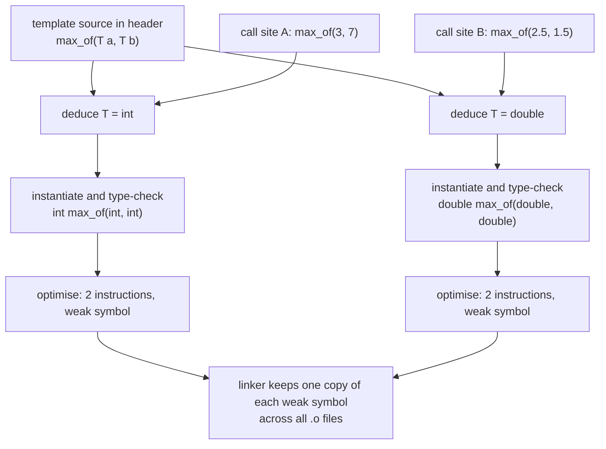

# Module 2.06: Templates and generic programming

**Estimated hours:** 5

**What you will learn**

1. What a template is, how the compiler deduces types and stamps out one real function or class per type used (instantiation), and why that forces templates to live in headers.
2. How to constrain and specialise templates: explicit and partial specialisation, non-type parameters, `static_assert`, `<type_traits>`, `if constexpr`, SFINAE with `enable_if_t`, and the C++20 `requires` version.
3. Where template "code bloat" comes from, how to measure it with `nm` and `size`, and how to read a long template error message from the bottom up.

**Prerequisites:** [Module 2.05: Smart pointers and the shared_ptr control block](module-05-smart-pointers-and-control-block.md). You have used `std::vector<int>` and `std::unique_ptr<T>`; now you learn how such things are written.

---

## 1. One-line intuition

A template is a recipe with blanks in it; the compiler fills the blanks with real types when you use it, and writes a separate, fully optimised copy of the code for each distinct filling.

## 2. Real-life analogy

A bank prints its loan agreement from a form with blanks: `[CUSTOMER NAME]`, `[AMOUNT]`, `[CURRENCY]`. The form itself is never signed. When a customer arrives, a clerk fills the blanks and prints a real document for that customer. Two customers get two separate documents, even if they borrow the same amount.

- The form is the **template**.
- Filling the blanks and printing is **instantiation**.
- The printed document is the **instantiated function or class**, for example `max_of<int>` or `FixedPool<double, 2>`.
- The clerk guessing the currency from the amount you wrote ("you wrote 5,000, that is INR") is **template argument deduction**.
- A special pre-printed form for one frequent case ("gold loans use this form instead") is a **specialisation**.
- The filing cabinet growing by one document per customer is **code bloat**: every distinct filling costs space in the binary.

One rule follows from the analogy: the clerk can only print a document if the blank form is in the office. The compiler can only instantiate a template if it can see the whole template source in the file it is compiling. That is why templates live in headers.

## 3. Why it exists: the problem it solves

In C you wrote a function for one type. To add two ints you wrote `add_int`; for doubles, `add_double`. A stack of ints and a stack of structs were two separate copy-pasted files, and a bug fixed in one was forgotten in the other. The alternative was `void*` with casts everywhere: fast to write, impossible for the compiler to check, and slow at run time because every element access went through a pointer the compiler knew nothing about.

Templates give you one source for all types, fully type checked, with no run-time cost. `std::vector<T>` is written once. `std::vector<int>` and `std::vector<LoanApp>` are two separate classes generated from it, each as fast as if you had written it by hand for that type. `std::sort` is one algorithm that becomes a specialised, inlined sort for whatever element type and comparison you hand it, which is why it beats C's `qsort` (which must call your comparison through a function pointer).

What breaks without them: either copy-paste (duplicated bugs) or `void*` (no type safety, indirect calls). Every container, smart pointer and algorithm you used since module 2.01 is a template. From this module on you will read their source when something goes wrong, and write your own for the fixed pool, the thread pool task queue and the cache.

## 4. Three layers of depth

### Layer 1 (beginner): function and class templates

**A function template.**

```cpp
template <typename T>
T max_of(T a, T b) {
    return (a < b) ? b : a;
}
```

`template <typename T>` says "T is a blank". (`typename` and `class` mean the same thing here; the course uses `typename`.) Calling `max_of(3, 7)` makes the compiler deduce `T = int` from the arguments and generate `int max_of<int>(int, int)`. Calling `max_of(2.5, 1.5)` generates a second, separate function for `double`. Calling `max_of(3, 7.5)` is an error: `T` would have to be both `int` and `double`. You then write `max_of<double>(3, 7.5)` to choose explicitly.

**A class template.**

```cpp
template <typename T, std::size_t N>
class FixedPool { std::array<T, N> slots_; std::size_t used_ = 0; /* ... */ };
```

`T` is a type parameter. `N` is a **non-type template parameter**: a compile-time integer. `FixedPool<int, 4>` and `FixedPool<int, 8>` are two unrelated classes. The capacity is baked in at compile time, which is why `std::array<int, 4>` can live on the stack with no heap allocation and no size field: the size is part of the type.

**What `std::vector<int>` really is.** It is the class template `std::vector` instantiated with `T = int` (and a default second parameter, the allocator). The compiler generated its `push_back`, its destructor, everything, specifically for `int`, the first time your program used them.

**The things you must remember at this level:**

- Templates are checked twice: the template body is parsed when defined, and fully checked again at each instantiation. Errors about a specific type appear only when you use that type.
- Template code must be visible wherever it is used. Put the definition in the header, not in a `.cpp` file. If you put it in a `.cpp`, every other file gets `undefined reference to max_of<int>` from the linker.
- Only the member functions you actually call get instantiated. `FixedPool<int, 4>` will compile even if one of its member functions would be invalid for `int`, as long as you never call that member.

### Layer 2 (working engineer): specialisation, constraints, variadics

**Explicit (full) specialisation.** Sometimes the generic recipe is wrong for one type. You provide a replacement for exactly that type:

```cpp
template <typename T> std::string describe(T v) { return "number " + std::to_string(v); }
template <> std::string describe<const char*>(const char* v) { return std::string("text '") + v + "'"; }
```

**Partial specialisation** exists only for class templates: `template <typename T> struct Traits<T*> { ... };` applies to every pointer type. Function templates cannot be partially specialised; you overload them instead.

**Type traits.** `<type_traits>` is a library of compile-time questions about types: `std::is_integral_v<T>`, `std::is_pointer_v<T>`, `std::is_same_v<A, B>`, `std::is_trivially_copyable_v<T>`. Each is a `constexpr bool`. They are the vocabulary for everything below.

**`static_assert`.** A compile-time check with a message. `static_assert(N > 0, "FixedPool needs at least one slot");` turns a bad instantiation into a clear error on the line that matters, instead of a 40-line trace. Use it generously inside templates.

**`if constexpr`.** An `if` whose condition is a compile-time constant. The branch not taken is discarded entirely for that instantiation, so it may contain code that would not even compile for that `T`. This replaced most everyday uses of SFINAE in C++17:

```cpp
template <typename T>
std::string show(T v) {
    if constexpr (std::is_integral_v<T>)       return "integral:" + std::to_string(v);
    else if constexpr (std::is_floating_point_v<T>) return "floating:" + std::to_string(v);
    else                                       return "other";       // std::to_string never seen for const char*
}
```

**SFINAE.** "Substitution Failure Is Not An Error." When the compiler tries a function template for a call and substituting the deduced types produces an invalid type in the *signature*, that candidate is silently dropped rather than reported as an error. `std::enable_if_t<cond, T>` is a type that exists only when `cond` is true. Placing it in the signature makes the overload vanish for types that fail the condition:

```cpp
template <typename T, typename = std::enable_if_t<std::is_integral_v<T>>>
T half(T v) { return v / 2; }
// half(9)   -> fine, T = int
// half(2.5) -> "no matching function": the only candidate was removed by SFINAE
```

You will see this idiom all over libstdc++ and older codebases. In C++20 the same constraint is written as a **concept**: `template <std::integral T> T half(T v)`, or `template <typename T> requires std::integral<T>`. It reads like English and gives a one-line error. Module 2.15 covers concepts properly; for C++17 code you need to recognise `enable_if`.

**Variadic templates and fold expressions.** `typename... Args` is a pack of zero or more types. A **fold expression** applies an operator across the whole pack:

```cpp
template <typename... Args>
void log_line(const Args&... args) {
    (std::cout << ... << args) << '\n';     // expands to ((cout << a1) << a2) << a3 ...
}
log_line("loan ", 1001, " approved at ", 8.5, "%");
```

Each distinct combination of argument types instantiates a new `log_line`. That is fine for a logger called from a few places; it is the kind of thing that bloats a binary if called from a thousand sites with different type mixes.

**Two-phase lookup and the `typename` and `template` keywords.** Inside a template, a name that depends on `T` (a *dependent name*) cannot be looked up until instantiation. The compiler does not know whether `T::value_type` is a type or a static member, so you must tell it: `typename T::value_type x;`. Similarly a dependent member template call needs `obj.template get<int>()`. Forgetting `typename` gives the error `need 'typename' before 'T::value_type' because 'T' is a dependent scope`. Now you know what it means.

**`auto` return and deduction guides** are the remaining C++17 pieces you will meet: `auto` as a return type lets the compiler deduce it from the `return` statements, and class template argument deduction lets you write `std::pair p{1, 2.5}` without `<int, double>`.

### Layer 3 (internals): instantiation, linkage, and bloat

**What the compiler does.** Parsing a template produces an internal tree with placeholders. At each use with new arguments, the compiler copies that tree, substitutes the real types, performs the full semantic check, and emits a real function with a **mangled name** encoding the arguments, such as `_Z6max_ofIiET_S0_S0_`, which `nm -C` shows as `int max_of<int>(int, int)`. Each instantiation is then optimised independently: `max_of<int>` becomes two instructions, `max_of<std::string>` becomes a call sequence with string comparisons.

**Why the same instantiation in ten files does not break the linker.** Every `.cpp` that calls `max_of<int>` emits its own copy. They would collide at link time, except that the compiler marks template instantiations as **weak symbols** (shown by `W` in `nm`), and the linker keeps one and discards the rest. On Linux these live in COMDAT sections. This also tells you where compile time goes in large C++ projects: the same instantiations are repeated in every translation unit and thrown away at the end.

**Where code bloat comes from.** Three sources, in order of how often they bite:

1. One instantiation per distinct type set. `Ledger<int>`, `Ledger<long>`, `Ledger<double>` are three complete copies of every member you call. With `nm` you can count them.
2. Inlining. A template body is visible everywhere and usually small, so the optimiser inlines it at each call site. Good for speed; each site is a copy.
3. Variadic helpers with many argument combinations, as in the logger above.

Bloat is measurable. `size prog` prints the `text` (code) segment in bytes; `nm -C prog | grep 'Ledger<'` counts the instantiated members. In the lab you will see one extra instantiation add roughly a kilobyte of text at `-O2` and several kilobytes at `-O0 -g`. The standard mitigation is to move type-independent work into a non-template base or helper (the "thin template" idiom) and keep only the type-dependent shell generic. `std::vector<T*>` in libstdc++ does not do this, but many codebases specialise pointer containers on a `void*` core for exactly this reason.

**Why templates must be in headers, precisely.** The compiler needs the full template definition to instantiate it, and instantiation happens in the translation unit that uses it. A definition in `pool.cpp` is only visible when compiling `pool.cpp`, so nothing gets instantiated for the types other files need. The escape hatch is **explicit instantiation**: `template class FixedPool<int, 4>;` in `pool.cpp` forces that one instantiation to exist there, and `extern template class FixedPool<int, 4>;` in the header tells other files not to re-instantiate it. Big projects use this to cut compile time for a handful of hot instantiations.

**Reading a template error.** GCC prints the chain of instantiation from the outermost call down to the line that failed, then every candidate it rejected and why. The method, which you will practise in the lab:

1. Jump to the first line containing `required from here` and note your file and line number. That is the call you wrote.
2. Go to the first `error:` line. That is what actually failed, usually deep inside a standard header.
3. Read the `[with T = ...]` bracket on the `In instantiation of` line: it tells you which types were substituted.
4. Ignore the `note: candidate:` list unless the error is "no matching function"; then scan the notes for the one that nearly matched.

GCC's `-ftemplate-backtrace-limit=0` shows the whole chain if the default cut it off.

## 5. Architecture diagram



Every distinct `T` goes down its own path and lands in the binary as its own code.

## 6. Code

One program exercising every feature above: deduction, a class template with a non-type parameter, full specialisation, `if constexpr` with traits, SFINAE, and a fold-expression logger.

```cpp
// templates.cpp
// Shows: function templates and deduction, a class template with a non-type
// parameter, explicit specialisation, static_assert with type traits,
// if constexpr, SFINAE with enable_if_t, and a variadic fold-expression logger.
#include <cstdio>
#include <string>
#include <type_traits>
#include <iostream>
#include <array>

// 1. Function template. T is deduced from the arguments at each call site.
template <typename T>
T max_of(T a, T b) {
    return (a < b) ? b : a;
}

// 2. Class template with a non-type parameter N. A tiny fixed-capacity pool.
template <typename T, std::size_t N>
class FixedPool {
    static_assert(N > 0, "FixedPool needs at least one slot");
    std::array<T, N> slots_{};
    std::size_t used_ = 0;
public:
    bool push(const T& v) {
        if (used_ == N) return false;      // full: refuse, never overflow
        slots_[used_++] = v;
        return true;
    }
    std::size_t size() const { return used_; }
    static constexpr std::size_t capacity() { return N; }
    const T& operator[](std::size_t i) const { return slots_[i]; }
};

// 3. A primary template and an explicit (full) specialisation for const char*.
template <typename T>
std::string describe(T v) { return "number " + std::to_string(v); }

template <>
std::string describe<const char*>(const char* v) { return std::string("text '") + v + "'"; }

// 4. if constexpr: one template, several bodies, the dead branches are discarded.
template <typename T>
std::string show(T v) {
    if constexpr (std::is_integral_v<T>) {
        return "integral:" + std::to_string(v);
    } else if constexpr (std::is_floating_point_v<T>) {
        return "floating:" + std::to_string(v);
    } else {
        return "other";
    }
}

// 5. SFINAE: this overload only exists for integral T. For anything else,
//    enable_if_t has no type, substitution fails, and the overload vanishes.
template <typename T, typename = std::enable_if_t<std::is_integral_v<T>>>
T half(T v) { return v / 2; }

// 6. Variadic template + fold expression: a logger taking any number of args.
template <typename... Args>
void log_line(const Args&... args) {
    (std::cout << ... << args) << '\n';    // unary left fold over operator<<
}

int main() {
    std::printf("--- deduction ---\n");
    std::printf("max_of(3, 7)        = %d\n",  max_of(3, 7));          // T = int
    std::printf("max_of(2.5, 1.5)    = %.1f\n", max_of(2.5, 1.5));     // T = double
    std::printf("max_of<long>(3, 7L) = %ld\n", max_of<long>(3, 7L));   // explicit T

    std::printf("\n--- class template with N ---\n");
    FixedPool<int, 4> ints;
    for (int i = 1; i <= 5; ++i) {
        std::printf("push %d -> %s\n", i * 10, ints.push(i * 10) ? "ok" : "full");
    }
    std::printf("ints: size %zu of capacity %zu, sizeof = %zu bytes\n",
                ints.size(), FixedPool<int, 4>::capacity(), sizeof(ints));
    FixedPool<double, 2> doubles;                 // a second, separate class
    doubles.push(1.5);
    std::printf("doubles: size %zu, sizeof = %zu bytes\n", doubles.size(), sizeof(doubles));

    std::printf("\n--- specialisation ---\n");
    std::printf("%s\n", describe(42).c_str());
    std::printf("%s\n", describe("loan").c_str());

    std::printf("\n--- if constexpr and type traits ---\n");
    std::printf("%s\n", show(10).c_str());
    std::printf("%s\n", show(2.5).c_str());
    std::printf("%s\n", show("x").c_str());
    std::printf("half(9) = %d\n", half(9));
    // half(2.5);   // uncomment: error, no matching function (SFINAE removed it)

    std::printf("\n--- fold expression logger ---\n");
    log_line("loan ", 1001, " approved at ", 8.5, "%");
    return 0;
}
```

Compile, run, and list the instantiations:

```bash
g++ -std=c++17 -Wall -Wextra -Werror -g -o templates templates.cpp
./templates
nm -C templates | grep -E "max_of|FixedPool<.*>::push"
```

Expected output:

```text
--- deduction ---
max_of(3, 7)        = 7
max_of(2.5, 1.5)    = 2.5
max_of<long>(3, 7L) = 7

--- class template with N ---
push 10 -> ok
push 20 -> ok
push 30 -> ok
push 40 -> ok
push 50 -> full
ints: size 4 of capacity 4, sizeof = 24 bytes
doubles: size 1, sizeof = 24 bytes

--- specialisation ---
number 42
text 'loan'

--- if constexpr and type traits ---
integral:10
floating:2.500000
other
half(9) = 4

--- fold expression logger ---
loan 1001 approved at 8.5%
```

And from `nm` (addresses differ):

```text
00000000000033df W double max_of<double>(double, double)
00000000000033bf W int max_of<int>(int, int)
000000000000340b W long max_of<long>(long, long)
00000000000034a8 W FixedPool<double, 2ul>::push(double const&)
0000000000003432 W FixedPool<int, 4ul>::push(int const&)
```

Three `max_of` functions and two `push` functions exist in the binary, one per distinct set of template arguments, all marked `W` (weak). `sizeof(FixedPool<int,4>)` is 24: 16 bytes of `int` slots plus an 8-byte `used_`. `FixedPool<double,2>` is also 24: 16 bytes of doubles plus 8. The capacity costs no storage at all.

## 7. Use case: core-banking loan-origination platform

The application server (capstone C2) pools request objects so the hot path never calls `malloc` (module 3.06 builds the allocator). Three different things need pooling: `LoanRequest` objects, `DbConnection` handles and outgoing `ResponseBuffer`s. Each has a different size and a different sensible capacity.

The decision: **write one `FixedPool<T, N>` template, not three pool classes.** `FixedPool<LoanRequest, 256>`, `FixedPool<DbConnection, 32>` and `FixedPool<ResponseBuffer, 256>` are stamped out from one tested source. A bug fixed in the template is fixed in all three. The capacity is a compile-time constant, so each pool's storage is a fixed array inside the pool object with no heap allocation and no size check that the optimiser cannot remove.

The trade-off the team accepted, and the one an interviewer will probe: three instantiations mean three copies of every member function in the binary, roughly a few hundred bytes each at `-O2`. For a server binary that is nothing. The same decision would be wrong for a logger instantiated with hundreds of argument combinations across a million-line codebase, where measured bloat of several megabytes has pushed teams to a non-template core. The rule is "generic shell, measure the text size, move type-independent work out if it grows".

A second decision in the same server: validation helpers were written as `if constexpr` branches on the field type (integral IDs, decimal amounts, string codes) in one template rather than three overloads, so adding a field type touched one function.

## 8. Lab

### Part A: watch instantiations appear (20 minutes)

1. Build `templates.cpp` from section 6 and run the `nm` command. Count the `max_of` lines.
2. Add a call `max_of(std::string("a"), std::string("b"))` in `main` (include `<string>`, already done) and print the result with `.c_str()`. Rebuild, rerun `nm`. A fourth `max_of` appears.
3. Delete the `FixedPool<double, 2>` lines. Rebuild. The `FixedPool<double, 2ul>::push` symbol disappears: instantiations exist only when used.

Expected: the number of `max_of` symbols equals the number of distinct `T`s you called it with, no more, no fewer.

### Part B: measure code bloat (25 minutes)

```cpp
// bloat.cpp : instantiates the same template for several types.
// Build with -DMANY to add four more instantiations and compare binary size.
#include <cstdio>
#include <vector>

template <typename T>
struct Ledger {
    std::vector<T> rows;
    void add(T v)  { rows.push_back(v); }
    T total() const { T t{}; for (const auto& r : rows) t += r; return t; }
};

int main() {
    Ledger<int> a;    a.add(1);    std::printf("%d\n",  a.total());
#ifdef MANY
    Ledger<long> b;   b.add(2);    std::printf("%ld\n", b.total());
    Ledger<double> c; c.add(3.0);  std::printf("%f\n",  c.total());
    Ledger<float> d;  d.add(4.0f); std::printf("%f\n",  d.total());
    Ledger<short> e;  e.add(5);    std::printf("%d\n",  e.total());
#endif
    return 0;
}
```

```bash
g++ -std=c++17 -g -o bloat1 bloat.cpp
g++ -std=c++17 -g -DMANY -o bloat5 bloat.cpp
size bloat1 bloat5
nm -C bloat1 | grep -c "Ledger<"
nm -C bloat5 | grep -c "Ledger<"
nm -C bloat5 | grep "Ledger<.*>::total"
g++ -std=c++17 -O2 -o bloat1o bloat.cpp
g++ -std=c++17 -O2 -DMANY -o bloat5o bloat.cpp
size bloat1o bloat5o
```

Expected: at `-O0 -g`, on one laptop with GCC 13.3, `text` grew from about 7.9 KB to about 28 KB going from one to five instantiations, and the `Ledger<` symbol count went from 6 to 30 (five instantiations times six members, including the `std::vector` pieces each one drags in). At `-O2` the symbols vanish because everything is inlined into `main`, and `text` grew by roughly 1.1 KB. Record your own numbers; the ratio matters more than the bytes.

### Part C: read a template error from the bottom up (20 minutes)

```cpp
// bad_error.cpp : std::sort needs random-access iterators; std::list has none.
#include <algorithm>
#include <list>
int main() {
    std::list<int> l{3, 1, 2};
    std::sort(l.begin(), l.end());
    return 0;
}
```

```bash
g++ -std=c++17 -c bad_error.cpp 2>&1 | wc -l
g++ -std=c++17 -c bad_error.cpp 2>&1 | grep -n -E "required from here|error:"
```

Expected: about 24 lines of output. The `grep` shows two lines that matter: `bad_error.cpp:5:14:   required from here` (your call) and `stl_algo.h:1948:50: error: no match for 'operator-' (operand types are 'std::_List_iterator<int>' and 'std::_List_iterator<int>')`. Translate: `sort` tried to subtract two iterators to compute a distance, and list iterators cannot be subtracted because they are bidirectional, not random access (module 2.08 explains the categories). The fix is `l.sort()`. Everything else in the output is the compiler listing the `operator-` candidates it rejected.

Now uncomment `half(2.5)` in `templates.cpp` and compile. Find the line `template argument deduction/substitution failed`. That is SFINAE being reported: the candidate existed but was removed.

### Part D: C++20 concepts, the same constraint readably (15 minutes)

```cpp
// concepts.cpp (C++20): the same constraint as enable_if, readable.
#include <cstdio>
#include <concepts>
template <std::integral T>
T half(T v) { return v / 2; }
int main() { std::printf("half(9) = %d\n", half(9)); return 0; }
```

```bash
g++ -std=c++20 -Wall -Wextra -Werror -o concepts concepts.cpp && ./concepts
```

Expected: `half(9) = 4`. Add `half(2.5);` and compile again. The error now says `constraints not satisfied` and names `std::integral<double>` in one short block, instead of a substitution failure buried in notes. Same machinery, better message. Module 2.15 goes further.

### Journal

Copy [journal/TEMPLATE.md](../journal/TEMPLATE.md) to `journal/YYYY-MM-DD-templates.md`. Record: the `nm` symbol counts from Part A before and after adding the string call; the `size` text bytes and symbol counts for `bloat1` and `bloat5` at both optimisation levels; the two lines you extracted from the `std::sort` error and your one-sentence translation; and the C++20 error text for `half(2.5)`.

## 9. Common mistakes and misconceptions

| Mistake | Why it is wrong | Bug it causes later |
|---|---|---|
| Putting a template definition in a `.cpp` file | The compiler cannot instantiate what it cannot see in the using translation unit | `undefined reference to max_of<int>` at link time |
| Believing a template is "one function" | Each distinct argument set is a separate function with its own code | Surprise binary growth; one instantiation fast, another slow |
| Mixing types in a deduced call, `max_of(3, 7.5)` | `T` cannot be two things | "no matching function"; fix with `max_of<double>` |
| Forgetting `typename` before a dependent type | The compiler cannot know `T::value_type` is a type until instantiation | `need 'typename' before ...` error |
| Trying to partially specialise a function template | Only class templates can be partially specialised | Syntax error; use overloading instead |
| Reading a template error from the top | The top is the deepest standard-library frame, not your mistake | Hours lost in `stl_algo.h` |
| Using SFINAE where `if constexpr` or a `static_assert` would do | SFINAE is harder to read and gives worse errors | Unreadable code, unreadable errors |
| Assuming a template member is checked even if unused | Only called members are instantiated | A broken member compiles fine until someone calls it |
| Calling `std::sort` on `std::list` | Needs random-access iterators | The 24-line error from Part C |

## 10. Resume link

- **Claim B, "templates, STL internals".** The sentence to say: "A template instantiates once per distinct argument set, each copy is a weak symbol the linker de-duplicates, and I have measured the text-size cost with `size` and `nm`. In the app server I kept one `FixedPool<T, N>` for three pooled types because three instantiations are cheap, and I know when that stops being true."
- **Claim B, "performance optimisation".** Templates are why `std::sort` with a lambda beats `qsort`: the comparison is inlined into the instantiation. Module 2.08 makes that concrete.
- **Claim H4, "pooled request model".** The pool is a template with a non-type capacity parameter, so storage is a fixed in-object array with no heap allocation on the hot path.
- **Claim F, "debugging".** Being able to take a 24-line template error and say "line 5 of my file, `operator-` on list iterators, because `sort` needs random access" is a skill interviewers test by handing you an error on paper.

Likely follow-ups: "Why do templates have to be in headers?" (Layer 3), "What is SFINAE?" (Layer 2 with the `half` example), "How would you reduce template bloat?" (thin template idiom, explicit instantiation, `extern template`).

## 11. Interview questions

**Q1 (easy). What happens when you call a function template with two different argument types in two places?**

<details>
<summary>Model answer</summary>

The compiler deduces the template parameter separately at each call, say `T = int` at one and `T = double` at the other, and instantiates two separate functions, `max_of<int>` and `max_of<double>`, each type checked and optimised on its own. Both appear in the binary as weak symbols with mangled names; `nm -C` lists them. If the same instantiation is produced in several translation units, the linker keeps one copy.

</details>

**Q2 (easy). Why must a template's definition be in a header?**

<details>
<summary>Model answer</summary>

Instantiation happens in the translation unit that uses the template, and the compiler needs the complete definition at that point to generate code for the specific types. A definition hidden in one `.cpp` is only visible while compiling that file, so other files produce no instantiation and the linker reports an undefined reference. The exception is explicit instantiation: define the template in a `.cpp`, write `template class Pool<int, 4>;` there, and declare `extern template class Pool<int, 4>;` in the header so other files use that single copy. Projects do this to cut compile time for hot instantiations.

</details>

**Q3 (medium). Explain SFINAE and show how `enable_if` uses it. What replaced it in C++17 and C++20?**

<details>
<summary>Model answer</summary>

When the compiler substitutes deduced types into a candidate function template's signature and the result is ill-formed, that candidate is removed from overload resolution instead of causing an error: substitution failure is not an error. `std::enable_if_t<cond, T>` is an alias that names a type only when `cond` is true; placing it in a template parameter or return type makes the candidate disappear for types that fail the condition, for example `template <typename T, typename = std::enable_if_t<std::is_integral_v<T>>> T half(T)` exists only for integral `T`. In C++17, `if constexpr` handles most "different code per type" cases inside one function body, discarding the untaken branch. In C++20, concepts and `requires` clauses express the constraint directly, `template <std::integral T>`, with far clearer error messages. SFINAE still appears in library code and older codebases, so I need to read it even if I rarely write it.

</details>

**Q4 (medium). Where does template code bloat come from and how do you measure and reduce it?**

<details>
<summary>Model answer</summary>

One copy of every used member per distinct set of template arguments, multiplied by inlining at call sites, plus variadic helpers instantiated for many argument combinations. I measure with `size` for the text segment and `nm -C | grep` to count instantiated symbols, comparing builds with and without the extra types. In my lab, going from one to five `Ledger<T>` instantiations added about 20 KB of text at `-O0` and about 1 KB at `-O2` on one machine. To reduce it: move type-independent logic into a non-template base or helper so only a thin shell is generic, use explicit instantiation with `extern template` for the common types, avoid per-call-site variadic expansions on hot or widespread paths, and check that `-O2` inlining is not duplicating a large body thousands of times.

</details>

**Q5 (hard). A colleague hands you a 200-line GCC error from a template-heavy call. Describe your method, and explain what two-phase lookup has to do with the words `typename` and `template` in the error.**

<details>
<summary>Model answer</summary>

I search for the first `required from here` line to find the call in our own code, then the first `error:` line to find what actually failed, usually deep in a library header, and the `[with T = ...]` bracket to see which types were substituted. For a "no matching function" error I scan the `note: candidate` entries for the one whose rejection reason mentions our types; the rest are noise. If the trace was truncated I rebuild with `-ftemplate-backtrace-limit=0`. On two-phase lookup: a template is parsed once at definition, when names that do not depend on `T` are resolved, and again at each instantiation, when dependent names are resolved. At the first phase the compiler cannot know whether `T::value_type` names a type or a value, or whether `obj.get<int>` is a member template call or two comparisons, so the language requires `typename T::value_type` and `obj.template get<int>()` to disambiguate. Errors saying "need typename before" or "expected primary-expression" at a `<` in a template body are that rule, and the fix is the keyword, not a change of logic. Finally I prevent the next such error by adding `static_assert`s with plain messages at the top of our own templates, so misuse fails on our line, not 40 frames deep.

</details>

## 12. Revision

- A template is instantiated once per distinct argument set; each instantiation is separately type checked and optimised, emitted as a weak symbol, and must be visible in the header where it is used.
- Constrain and branch with `static_assert`, `<type_traits>`, `if constexpr` and, where needed, SFINAE via `enable_if_t` (C++20: concepts); specialise fully for one type, partially only for class templates; non-type parameters bake constants like capacity into the type.
- Bloat is one copy per instantiation plus inlining: measure with `size` and `nm -C`, reduce with thin templates and explicit instantiation; read template errors from `required from here` and the first `error:` line, not from the top.

---

Previous: [Module 2.05: Smart pointers and the shared_ptr control block](module-05-smart-pointers-and-control-block.md) | Next: [Module 2.07: STL containers and their internals](module-07-stl-containers-internals.md)
