# Module 2.07: STL containers and their internals

**Estimated hours:** 6

**What you will learn**

1. How each standard container is laid out in memory in libstdc++: `vector`, `deque`, `list`, `map`/`set`, `unordered_map`, `array` and `string`, including growth, rebalancing and rehash behaviour.
2. The complexity table and the iterator-invalidation rule for every container, and why those rules follow directly from the layouts.
3. How layout decides cache behaviour, measured with your own benchmark of `vector` vs `list` and `map` vs `unordered_map`.

**Prerequisites:** [Module 2.06: Templates and generic programming](module-06-templates.md). You should also remember the latency table from module 0.01: L1 about 1 ns, RAM about 100 ns.

---

## 1. One-line intuition

Every container is a different way of arranging bytes in memory, and that arrangement, not the API, decides how fast each operation is and which pointers break when you insert or erase.

## 2. Real-life analogy

A branch keeps customer files in different ways depending on the job.

- **`vector`**: one long shelf with files in order, no gaps. Finding file number 4,000 is instant (walk to position 4,000). Adding at the end is easy. When the shelf is full the clerk buys a shelf twice as long and moves everything, so once in a while an append is slow, and every note that said "file X is on shelf position P" becomes wrong.
- **`deque`**: several short shelves joined by an index card listing where each shelf is. Adding at either end just adds a shelf. Position lookup needs one look at the index card, then one look at the shelf.
- **`list`**: each file is in its own folder anywhere in the building, with a note inside saying where the next and previous folders are. Inserting between two files is cheap (change two notes) but reading all files in order means walking all over the building.
- **`map`/`set`**: files hung on a balanced tree of branches, sorted by customer number. Finding one takes about as many steps as the tree is tall (about 17 for 100,000 files). Walking the tree in order gives sorted output for free.
- **`unordered_map`**: a row of numbered pigeonholes; a formula on the customer number (the hash) says which pigeonhole. Finding is usually one look. When the pigeonholes get too full, the clerk builds a bigger row and re-sorts every file (rehash), and the order files come out in means nothing.
- **`array`**: a fixed tray of exactly N slots, glued to the desk. Nothing can be added or removed.
- **`string`**: a `vector` of characters with one trick: short names are written directly on the index card rather than on a separate shelf.

## 3. Why it exists: the problem it solves

In C you had arrays and whatever you built by hand. Every project wrote its own linked list, its own hash table, with its own bugs. The Standard Template Library gives tested, generic containers with guaranteed complexities, so an engineer can pick by the operations the problem needs and know what each one costs.

The guarantees are the point. "`vector::push_back` is amortised constant time, `map::find` is logarithmic, `unordered_map::find` is average constant" are promises in the standard that every implementation keeps. What the standard does not fully pin down, and what this module is about, is the layout: how big a node is, how `vector` grows, how many buckets `unordered_map` has. Those details decide real speed on real hardware, because they decide whether consecutive accesses hit cache or miss it.

What breaks without this knowledge: engineers choose `list` for "fast insertion" and get a program five to ten times slower than `vector` on a sequential scan; they keep a pointer into a `vector` across a `push_back` and crash days later; they use `map` for a hot lookup where `unordered_map` was three times faster; they iterate an `unordered_map` and assume the order means something.

## 4. Three layers of depth

### Layer 1 (beginner): what each container is for and what it costs

| Container | Keeps order? | Lookup by key | Insert/erase at end | Insert/erase in middle | Index `[i]` | Use when |
|---|---|---|---|---|---|---|
| `vector<T>` | insertion order | no (linear scan) | amortised O(1) at back | O(n) | O(1) | the default for any sequence |
| `deque<T>` | insertion order | no | O(1) at both ends | O(n) | O(1), slower than vector | queue with pushes at both ends |
| `list<T>` | insertion order | no | O(1) | O(1) given an iterator | no | you need stable iterators or splicing; rare |
| `map<K,V>` / `set<K>` | sorted by key | O(log n) | n/a | O(log n) | no | sorted iteration, range queries, `lower_bound` |
| `unordered_map<K,V>` / `unordered_set<K>` | no order | O(1) average, O(n) worst | n/a | O(1) average | no | fastest key lookup, order irrelevant |
| `array<T,N>` | fixed | no | no | no | O(1) | fixed-size on the stack, no heap |
| `string` | characters | no | amortised O(1) | O(n) | O(1) | text |

**Big-O** means "how the cost grows with n". O(1) is the same whatever n is; O(log n) grows very slowly (log2 of a million is 20); O(n) grows in step with n. **Amortised** means "averaged over many operations": most `push_back`s are instant, occasionally one is slow because the vector grows, and the average is constant.

**Choosing.** Start with `vector`. Need lookup by key? `unordered_map` unless you need sorted order or range queries, then `map`. Need a queue? `deque`. Almost never `list`. `array` when the size is a compile-time constant.

**Iterator invalidation in one sentence each.** An iterator, pointer or reference into a container becomes invalid when the container moves the element it points to. `vector`: anything that reallocates (growth past capacity) invalidates everything; insert or erase invalidates from that point to the end. `deque`: insert at either end invalidates iterators but not references; insert in the middle invalidates everything. `list`, `map`, `set`: only the erased element's iterator dies; everything else survives. `unordered_map`: rehash invalidates all iterators but references and pointers to elements survive; erase kills only the erased element's.

### Layer 2 (working engineer): layouts and growth, one container at a time

All sizes below are for libstdc++ (GCC 13) on x86-64. Other implementations differ in details; the shapes are the same.

**`vector<T>`: three pointers, 24 bytes.** `begin`, `end` (one past the last element), and `end_of_storage` (one past the capacity). Elements sit in one contiguous heap block. `size()` is `end - begin`; `capacity()` is `end_of_storage - begin`. When `push_back` finds `end == end_of_storage`, libstdc++ allocates a new block of `max(1, 2 * size)` elements, moves (or copies, if the move constructor is not `noexcept`) every element across, destroys the old ones and frees the old block. The capacity sequence you will print is 1, 2, 4, 8, 16, 32. `reserve(n)` does the growth once, up front; `shrink_to_fit()` asks (it is a request, not a command) to reallocate down to `size()`. `clear()` destroys elements but keeps capacity.

Cache behaviour: perfect. Scanning touches consecutive bytes, the hardware prefetcher streams them, and a 64-byte cache line holds 16 `int`s.

**`deque<T>`: a map of blocks, 80 bytes.** The handle holds a pointer to a "map" (an array of pointers to blocks), its size, and start and finish iterators, each of which knows its current element, its block's bounds and its slot in the map. Each block is fixed at 512 bytes in libstdc++ (`512 / sizeof(T)` elements, so 128 `int`s; one element per block if `sizeof(T)` exceeds 512). Pushing at either end fills the current block or allocates a new one and records it in the map; the map itself grows occasionally. `operator[]` divides by the block size to find the block, then indexes inside it: two memory reads instead of one.

Cache behaviour: good within a block, one extra pointer hop per block boundary.

**`list<T>`: two pointers plus a size, 24 bytes.** Every element is a separate heap node: `prev`, `next`, then the value. A `list<int>` node is 24 bytes to hold 4 bytes of data; the rest is pointers and padding, and each node is a separate `malloc` with its own hidden allocator header (module 3.05). Insert and erase relink two pointers and never move anything else, which is the whole reason iterators stay valid.

Cache behaviour: bad. Nodes land wherever the allocator put them; walking the list is a chain of dependent loads, each potentially a cache miss, and the prefetcher cannot guess the next address.

**`map<K,V>` and `set<K>`: a red-black tree, 48 bytes for the handle.** A red-black tree is a binary search tree that keeps itself balanced by colouring each node red or black and enforcing rules that keep the longest path at most twice the shortest, so height is about 2 log2(n). Each node holds a colour, three pointers (parent, left, right) and the key-value pair: 32 bytes of overhead, so a `map<int,int>` node is 40 bytes for 8 bytes of payload. `find` walks from the root comparing keys: about 17 comparisons and 17 dependent pointer loads for 100,000 keys. Insert walks down, links the node, then rotates and recolours on the way back up to restore balance (at most two rotations). Iteration is an in-order walk, which is why it comes out sorted. `lower_bound(k)` returns the first element not less than `k`: the primitive for range queries, "find the first rate band at or above 640".

Cache behaviour: like a list, pointer chasing, one potential miss per level.

**`unordered_map<K,V>`: bucket array plus one singly linked list, 56 bytes for the handle.** libstdc++ stores all nodes in a single forward-linked list grouped by bucket; the bucket array holds, for each bucket, a pointer to the node *before* that bucket's first node (so a node can be unlinked without a doubly linked list). Each node holds `next`, the pair and, for keys whose hash is expensive like `std::string`, a cached copy of the hash so rehash does not recompute it. `find(k)` computes `hash(k) % bucket_count`, follows the bucket pointer and walks that bucket's nodes comparing keys. The **load factor** is `size / bucket_count`; when it would exceed `max_load_factor()` (1.0 by default) on insert, the table **rehashes**: it picks the next prime bucket count from a built-in table (you will see 13, 29, 59, 127, ...), allocates a new bucket array and relinks every node. `reserve(n)` sizes the buckets for `n` elements up front so a bulk load rehashes zero times. Iteration follows the single list, so order is whatever the inserts and rehashes produced: never sorted, never stable across implementations, and new keys often appear first.

Cache behaviour: one hash computation, one bucket-array read, then usually one node read. Two to three cache misses for a cold lookup, versus about 17 for a `map` of 100,000 keys.

**`array<T,N>`: just the elements.** `sizeof(std::array<int,4>)` is 16. No heap, no size field, lives wherever you declare it.

**`string`: 32 bytes with the small-string optimisation (SSO).** The handle holds a pointer, a size, and a 16-byte union that is either the capacity (for heap strings) or an inline buffer of 15 characters plus a terminating `'\0'`. A string of up to 15 characters lives entirely inside the 32-byte object with no allocation at all; `capacity()` reports 15. The 16th character forces a heap allocation; libstdc++ then grows capacity to twice the old size (you will see 15 then 30). A branch code like `"BR00042"` or a loan ID never touches the heap. This is why `std::string` keys in a hot `unordered_map` are tolerable, and why moving a short string copies 32 bytes rather than stealing a pointer.

### Layer 3 (internals): why the rules are what they are

**Why `vector` doubles.** Growing by a fixed amount, say +16, makes n pushes cost O(n²) total because every growth copies everything. Doubling makes the total copy work at most 2n, which is where "amortised O(1)" comes from. libstdc++ uses factor 2; MSVC uses 1.5 to make freed blocks reusable sooner. The move during growth uses the element's move constructor only if it is `noexcept`; otherwise it copies, to keep the strong exception guarantee (module 2.09). This is the practical reason to mark your move constructors `noexcept` (module 2.04).

**Why `vector` iterators die on reallocation.** An iterator into a `vector` is, in libstdc++, a thin wrapper around `T*`. After reallocation the old block is freed, so the pointer dangles. The sanitizer report in the lab shows this exactly: "heap-use-after-free ... freed by operator delete ... in `std::vector::_M_realloc_insert`".

**Why `list` and `map` iterators survive.** Nodes never move; only links change. An iterator is a node pointer, and the node is still there.

**Why `unordered_map` references survive a rehash but iterators do not.** A rehash moves no node; it relinks them into a new bucket order. A pointer or reference to a value therefore still points at live memory. An iterator, though, encodes a position in the traversal order, and that order changed, so the standard declares iterators invalid. This asymmetry is what lets the tcpkv store hand out stable references under a lock (section 7).

**Why `map` nodes are 32 bytes of overhead.** Colour is an `int`-sized enum padded to 8 for pointer alignment, then parent, left and right at 8 bytes each. The payload follows, aligned to its own requirement. Every node is a separate allocation, so add the allocator's own header (16 bytes in glibc, module 3.05): a `map<int,int>` costs roughly 56 bytes per entry for 8 bytes of data.

**Why `unordered_map` iteration order looks reversed.** When a node is inserted into an empty bucket, libstdc++ links it at the head of the global list (right after `_M_before_begin`), because that is the one position that needs no search. So the most recently inserted keys appear first. Rehash walks the old list and re-links, scrambling it further. Any code that depends on the order is wrong, and it usually breaks on the first rehash.

**Hashing cost.** `std::hash<int>` is the identity; `std::hash<std::string>` runs over every byte (MurmurHash-derived in libstdc++). For string keys the hash costs about as much as one `map` comparison, and the cached hash in each node means a rehash does not recompute it.

**Cache lines are the real complexity constant.** A `map::find` at O(log n) with 17 dependent cache misses at about 100 ns each is roughly 1.7 µs cold. An `unordered_map::find` at O(1) with 3 misses is roughly 0.3 µs cold. A `vector` scan at O(n) streaming at memory bandwidth costs under 1 ns per element. Big-O tells you the shape; the layout and the latency table from module 0.01 tell you the number.

## 5. Architecture diagram

```mermaid
flowchart TB
    subgraph VEC["vector: 3 pointers to one contiguous block"]
        VH["begin | end | end_of_storage"] --> VB["[e0 e1 e2 e3 e4 . . .]  capacity 8, size 5"]
    end
    subgraph DEQ["deque: map of fixed 512-byte blocks"]
        DH["map ptr | start | finish"] --> DM["block ptrs: b0 b1 b2"]
        DM --> B0["b0: 128 ints"]
        DM --> B1["b1: 128 ints"]
        DM --> B2["b2: 128 ints"]
    end
    subgraph LST["list: one heap node per element"]
        LH["head sentinel | size"] --> N1["prev next val"] --> N2["prev next val"] --> N3["prev next val"]
    end
    subgraph MAP["map: red-black tree nodes"]
        MH["header | size"] --> R["colour parent left right  k,v"]
        R --> L1["colour parent left right  k,v"]
        R --> R1["colour parent left right  k,v"]
    end
    subgraph UM["unordered_map: buckets over one singly linked list"]
        UH["bucket array ptr | bucket_count | before_begin | size"] --> BK["buckets: 13 slots"]
        BK --> H1["next hash k,v"] --> H2["next hash k,v"] --> H3["next hash k,v"]
    end
```



The further a container is from the top of this diagram, the more pointer hops a lookup or a scan needs, and the more cache misses it costs.

## 6. Code

The program prints the `vector` capacity sequence, the handle sizes, the SSO boundary, the `unordered_map` bucket sequence, the unsorted iteration order, and a `map::lower_bound`.

```cpp
// containers.cpp
// Shows: vector capacity growth, string SSO, sizes of container handles,
// unordered_map bucket growth and rehash, map ordering and lower_bound.
#include <cstdio>
#include <vector>
#include <string>
#include <list>
#include <deque>
#include <map>
#include <unordered_map>
#include <array>

// True if the bytes at s.data() lie inside the object s itself (not on the heap).
static bool inside_object(const std::string& s) {
    const char* p   = s.data();
    const char* lo  = reinterpret_cast<const char*>(&s);
    const char* hi  = lo + sizeof(s);
    return p >= lo && p < hi;
}

int main() {
    std::printf("--- vector: capacity sequence while pushing 17 ints ---\n");
    std::vector<int> v;
    std::size_t last_cap = 0;
    std::printf("capacity changes: ");
    for (int i = 0; i < 17; ++i) {
        v.push_back(i);
        if (v.capacity() != last_cap) {        // print only when it changes
            last_cap = v.capacity();
            std::printf("%zu ", last_cap);
        }
    }
    std::printf("\nsize %zu, capacity %zu\n", v.size(), v.capacity());
    v.shrink_to_fit();
    std::printf("after shrink_to_fit: capacity %zu\n", v.capacity());
    std::vector<int> r;
    r.reserve(1000);
    for (int i = 0; i < 1000; ++i) r.push_back(i);
    std::printf("with reserve(1000): capacity %zu, zero reallocations during pushes\n", r.capacity());

    std::printf("\n--- sizes of the handles (bytes, libstdc++ on x86-64) ---\n");
    std::printf("sizeof(std::vector<int>)            = %zu\n", sizeof(std::vector<int>));
    std::printf("sizeof(std::string)                 = %zu\n", sizeof(std::string));
    std::printf("sizeof(std::list<int>)              = %zu\n", sizeof(std::list<int>));
    std::printf("sizeof(std::deque<int>)             = %zu\n", sizeof(std::deque<int>));
    std::printf("sizeof(std::map<int,int>)           = %zu\n", sizeof(std::map<int, int>));
    std::printf("sizeof(std::unordered_map<int,int>) = %zu\n", sizeof(std::unordered_map<int, int>));
    std::printf("sizeof(std::array<int,4>)           = %zu\n", sizeof(std::array<int, 4>));

    std::printf("\n--- string: small-string optimisation ---\n");
    std::string s;
    std::printf("empty string: capacity %zu, data inside object? %s\n",
                s.capacity(), inside_object(s) ? "yes" : "no");
    s = "123456789012345";          // 15 chars
    std::printf("15 chars    : capacity %zu, data inside object? %s\n",
                s.capacity(), inside_object(s) ? "yes" : "no");
    s = "1234567890123456";         // 16 chars
    std::printf("16 chars    : capacity %zu, data inside object? %s\n",
                s.capacity(), inside_object(s) ? "yes" : "no");

    std::printf("\n--- unordered_map: bucket count as it grows to 100 keys ---\n");
    std::unordered_map<int, int> um;
    std::printf("max_load_factor = %.1f\n", um.max_load_factor());
    std::size_t last_b = 0;
    std::printf("bucket_count changes: ");
    for (int i = 0; i < 100; ++i) {
        um[i] = i;
        if (um.bucket_count() != last_b) {
            last_b = um.bucket_count();
            std::printf("%zu ", last_b);
        }
    }
    std::printf("\nsize %zu, buckets %zu, load_factor %.2f\n",
                um.size(), um.bucket_count(), um.load_factor());
    std::printf("first five keys in iteration order: ");
    int shown = 0;
    for (const auto& kv : um) { if (shown++ == 5) break; std::printf("%d ", kv.first); }
    std::printf("(not sorted)\n");

    std::printf("\n--- map: ordered, lower_bound ---\n");
    std::map<int, std::string> grades{{700, "A"}, {650, "B"}, {600, "C"}};
    std::printf("iteration order: ");
    for (const auto& kv : grades) std::printf("%d ", kv.first);
    std::printf("(sorted)\n");
    auto it = grades.lower_bound(640);          // first key >= 640
    std::printf("lower_bound(640) -> key %d grade %s\n", it->first, it->second.c_str());
    return 0;
}
```

Compile and run:

```bash
g++ -std=c++17 -Wall -Wextra -Werror -g -o containers containers.cpp
./containers
```

Expected output:

```text
--- vector: capacity sequence while pushing 17 ints ---
capacity changes: 1 2 4 8 16 32
size 17, capacity 32
after shrink_to_fit: capacity 17
with reserve(1000): capacity 1000, zero reallocations during pushes

--- sizes of the handles (bytes, libstdc++ on x86-64) ---
sizeof(std::vector<int>)            = 24
sizeof(std::string)                 = 32
sizeof(std::list<int>)              = 24
sizeof(std::deque<int>)             = 80
sizeof(std::map<int,int>)           = 48
sizeof(std::unordered_map<int,int>) = 56
sizeof(std::array<int,4>)           = 16

--- string: small-string optimisation ---
empty string: capacity 15, data inside object? yes
15 chars    : capacity 15, data inside object? yes
16 chars    : capacity 30, data inside object? no

--- unordered_map: bucket count as it grows to 100 keys ---
max_load_factor = 1.0
bucket_count changes: 13 29 59 127
size 100, buckets 127, load_factor 0.79
first five keys in iteration order: 99 98 97 96 95 (not sorted)
```

```text
--- map: ordered, lower_bound ---
iteration order: 600 650 700 (sorted)
lower_bound(640) -> key 650 grade B
```

Every number above is a layout fact from Layer 2 made visible: doubling capacities, the 15-character SSO limit, the prime bucket sequence, and the newest-first iteration order of the hash table. The bucket sequence starts at 13 rather than 1 because the first insert jumps straight to the first prime that keeps the load factor under 1.0 for the planned growth.

## 7. Use case: core-banking loan-origination platform

Two decisions, one per capstone.

**tcpkv (C1): the store is `std::unordered_map<std::string, std::string>` guarded by a `std::shared_mutex`.** The protocol is `GET key`, `SET key value`, `DEL key`. Every operation is a lookup by exact key; nothing ever asks for "all keys between A and B". That removes `map`'s only advantage (sorted order, range queries) and leaves its cost: about 17 pointer-chasing comparisons per lookup at 100,000 keys versus two or three for the hash table. `std::string` keys of typical length stay inside the SSO buffer, so a `GET` on a short key allocates nothing. The invalidation rules decide how the lock is used: a reader takes a `shared_lock`, calls `find`, **copies the value out**, and releases the lock, because a writer's `erase` would destroy the node the reference points at, and a writer's insert could rehash. A writer takes a `unique_lock` for `SET` and `DEL`. Before the load test, `reserve(expected_keys)` is called once at start-up so the warm-up phase does not rehash every time the table doubles. Module 4.05 measures the `shared_mutex` choice; module 8.07 profiles the hash.

**App server (C2): master tables are `vector`s of rows with an `unordered_map` index, not a `map`.** A product table of 5,000 rows is loaded once per refresh into a `std::vector<ProductRow>` (contiguous, scanned in bulk by report code) plus an `unordered_map<std::string, std::size_t>` from product code to row index. Lookup by code is one hash plus one vector index, and the rows themselves sit in one block that stays hot in L2. The index stores indices, not pointers, so the table can be built in any order and moved as a whole. The decision was driven by the cache behaviour in Layer 3: the hot path reads two or three cache lines per lookup rather than seventeen.

## 8. Lab

### Part A: node sizes with your own eyes (15 minutes)

This program names libstdc++ internal types. It is not portable and you would never ship it; it exists to see the overhead.

```cpp
// node_sizes.cpp : peeks at libstdc++ internal node types (NOT portable).
#include <cstdio>
#include <map>
#include <list>
#include <unordered_map>
#include <string>

int main() {
    std::printf("map<int,int> node                 = %zu bytes (payload %zu)\n",
        sizeof(std::_Rb_tree_node<std::pair<const int, int>>), sizeof(std::pair<const int, int>));
    std::printf("list<int> node                    = %zu bytes (payload %zu)\n",
        sizeof(std::_List_node<int>), sizeof(int));
    std::printf("unordered_map<string,string> node = %zu bytes (payload %zu)\n",
        sizeof(std::__detail::_Hash_node<std::pair<const std::string, std::string>, true>),
        sizeof(std::pair<const std::string, std::string>));
    return 0;
}
```

```bash
g++ -std=c++17 -Wall -Wextra -Werror -g -o node_sizes node_sizes.cpp && ./node_sizes
```

Expected:

```text
map<int,int> node                 = 40 bytes (payload 8)
list<int> node                    = 24 bytes (payload 4)
unordered_map<string,string> node = 80 bytes (payload 64)
```

Work out each: map = 8 (colour, padded) + 24 (three pointers) + 8; list = 16 (two pointers) + 4 + 4 padding; hash node = 8 (`next`) + 64 (two 32-byte strings) + 8 (cached hash). Add about 16 bytes of `malloc` header to each for the true cost per element.

### Part B: the benchmark (30 minutes)

```cpp
// bench.cpp
// Compares: sequential sum over vector vs list; lookups in map vs unordered_map.
// Build with -O2. Record YOUR numbers; they differ per machine.
#include <chrono>
#include <cstdio>
#include <list>
#include <map>
#include <random>
#include <string>
#include <unordered_map>
#include <vector>

using Clock = std::chrono::steady_clock;

template <typename F>
double ms(F&& f) {                       // run f once, return milliseconds
    auto t0 = Clock::now();
    f();
    auto t1 = Clock::now();
    return std::chrono::duration<double, std::milli>(t1 - t0).count();
}

int main() {
    const int N = 1'000'000;
    std::mt19937 rng(42);

    // --- sequential scan: vector vs list, same 1 million ints ---
    std::vector<int> vec(N);
    for (int i = 0; i < N; ++i) vec[i] = i;
    std::list<int> lst(vec.begin(), vec.end());

    long long sum_v = 0, sum_l = 0;
    double t_vec = ms([&] { for (int reps = 0; reps < 10; ++reps) for (int x : vec) sum_v += x; });
    double t_lst = ms([&] { for (int reps = 0; reps < 10; ++reps) for (int x : lst) sum_l += x; });
    std::printf("scan 10 x %d ints : vector %.1f ms, list %.1f ms (sums %lld %lld)\n",
                N, t_vec, t_lst, sum_v, sum_l);

    // --- lookups: map vs unordered_map, 100k string keys like "BR42" ---
    std::vector<std::string> keys;
    keys.reserve(N / 10);
    for (int i = 0; i < N / 10; ++i) keys.push_back("BR" + std::to_string(i));
    std::map<std::string, int> ordered;
    std::unordered_map<std::string, int> hashed;
    hashed.reserve(keys.size());
    for (int i = 0; i < static_cast<int>(keys.size()); ++i) { ordered[keys[i]] = i; hashed[keys[i]] = i; }

    std::vector<int> probe(N);
    std::uniform_int_distribution<int> pick(0, static_cast<int>(keys.size()) - 1);
    for (auto& p : probe) p = pick(rng);

    long long hits_m = 0, hits_u = 0;
    double t_map = ms([&] { for (int p : probe) hits_m += ordered.find(keys[p])->second; });
    double t_um  = ms([&] { for (int p : probe) hits_u += hashed.find(keys[p])->second; });
    std::printf("%d lookups in %zu keys: map %.1f ms, unordered_map %.1f ms (checks %lld %lld)\n",
                N, keys.size(), t_map, t_um, hits_m, hits_u);
    return 0;
}
```

```bash
g++ -std=c++17 -Wall -Wextra -Werror -O2 -o bench bench.cpp
./bench
./bench
./bench
```

Run it three times and keep the median. Expected ordering: `vector` scan several times faster than `list` (on one laptop under WSL2 with GCC 13 at `-O2`, about 6 ms versus about 55 ms); `unordered_map` lookups clearly faster than `map` (on the same laptop about 470 ms versus about 1,400 ms). Your numbers will differ; the ordering should not. The two "sums" and the two "checks" must be equal, which proves both containers did the same work. Then try: remove `hashed.reserve(...)` and time the build loop separately; change `N` to 10 million for the scan; replace the `"BR"` keys with 40-character keys and watch the `map` gap shrink as comparisons get cheaper relative to hashing.

### Part C: iterator invalidation caught by ASan (15 minutes)

```cpp
// invalidation_bug.cpp : push_back during iteration reallocates under our feet.
#include <cstdio>
#include <vector>

int main() {
    std::vector<int> v{1, 2, 3};
    std::printf("capacity before loop: %zu\n", v.capacity());
    for (auto it = v.begin(); it != v.end(); ++it) {
        if (*it == 2) v.push_back(99);   // may reallocate: it and end() now dangle
        std::printf("%d ", *it);
    }
    std::printf("\n");
    return 0;
}
```

```bash
g++ -std=c++17 -Wall -Wextra -Werror -g -fsanitize=address,undefined -o invalidation_bug invalidation_bug.cpp
./invalidation_bug 2>&1 | head -12
```

Expected: `capacity before loop: 3`, then an ASan report beginning `ERROR: AddressSanitizer: heap-use-after-free` with `READ of size 4` at `invalidation_bug.cpp:10` and, a few lines down, `freed by thread T0 here` inside `std::vector::_M_realloc_insert`. The `push_back` on a full vector allocated a block of 6, moved the elements, freed the block of 3, and the loop's `it` still pointed into the freed block. Fix it two ways and confirm ASan is quiet: (1) add `v.reserve(10);` before the loop (no reallocation, but still fragile; `end()` changes); (2) collect the values to add in a second vector and append after the loop (correct).

### Part D: deque blocks and the SSO boundary (15 minutes)

1. In `containers.cpp`, add a `std::deque<int> d;` push 1,000 ints, and print `&d[0]`, `&d[127]`, `&d[128]`. The first two addresses differ by exactly `127 * 4` bytes (same 512-byte block); the third is somewhere else entirely (next block).
2. Change the SSO test to use `std::basic_string<char32_t>` or print `sizeof(std::wstring)` and its empty `capacity()`. The inline buffer is 16 bytes, so the character count that fits is `16 / sizeof(char_type) - 1`.
3. Create `std::vector<std::string> names;` and push 100 short strings. Print `sizeof(names[0])`. Each element is 32 bytes inline in the vector's block, with no further allocation for short names. This is why a `vector<string>` of codes is cache friendly.

### Journal

Copy [journal/TEMPLATE.md](../journal/TEMPLATE.md) to `journal/YYYY-MM-DD-stl-containers.md`. Record: the capacity and bucket sequences; the three node sizes from Part A with your per-element arithmetic; your median benchmark numbers for all four cases, the machine they came from, and the effect of removing `reserve`; and the ASan "freed by" frame from Part C with the two fixes you tried.

## 9. Common mistakes and misconceptions

| Mistake | Why it is wrong | Bug it causes later |
|---|---|---|
| Choosing `list` for "fast insert" | Each node is a separate allocation and a cache miss; `vector` with O(n) shifting usually wins below tens of thousands of elements | Five to ten times slower scans, measured in Part B |
| Holding an iterator or pointer into a `vector` across `push_back` | Reallocation frees the old block | heap-use-after-free, often far from the push |
| Erasing from a `vector` inside a range-for | `erase` shifts elements and invalidates the hidden iterator | Skipped elements or a crash |
| Relying on `unordered_map` iteration order | It is the list order after inserts and rehashes; new keys come first | Output that changes between runs or compilers |
| Using `map` for a hot exact-key lookup | O(log n) pointer chasing when O(1) hashing was available | Measured 3x slower in Part B |
| Forgetting `reserve` before a bulk load | Repeated doubling or rehashing | Warm-up phases dominated by reallocation |
| Assuming `shrink_to_fit` always frees | It is a non-binding request | Memory stays allocated; verify with `capacity()` |
| `std::string` always allocates | Up to 15 characters live inside the object | Over-engineering with `char[]` keys |
| Keeping a reference from `unordered_map::find` after releasing the lock | A concurrent `erase` destroys that node | Use-after-free under load; copy the value out under the lock |
| `operator[]` on a `map` to check presence | It inserts a default value if absent | Phantom entries; use `find` or `count` |

## 10. Resume link

- **Claim B, "STL internals".** The sentence to say: "A `vector` is three pointers over one block that doubles; `map` is a red-black tree with 32 bytes of overhead per node and about 2 log n pointer hops; `unordered_map` in libstdc++ is one singly linked list with a prime-sized bucket array of before-pointers, rehashing at load factor 1; `string` keeps 15 characters inline. I have measured `vector` beating `list` on a scan and `unordered_map` beating `map` on lookups, and I can tell you which pointers survive which operations."
- **Claim I, tcpkv "in-memory store guarded by shared_mutex".** Section 7 is the justification: exact-key workload, hash table, copy-out under a shared lock because of the invalidation rules. Say "I chose `unordered_map` over `map` because the protocol has no range queries, and I copy the value out under the shared lock because an `erase` would destroy the node."
- **Claim H4, "in-memory master-table cache".** Rows in a `vector`, index in an `unordered_map` of indices: two or three cache lines per lookup. The numbers from capstone C2 will back this.
- **Claim B, "performance optimisation".** Your benchmark table from Part B is a measured answer to "why does data layout matter".

Likely follow-ups: "What happens on `push_back` when capacity is full?", "What does rehash do and what does it invalidate?", "Why is a map node 40 bytes?", "Why not `std::map` for the KV store?"

## 11. Interview questions

**Q1 (easy). What does `std::vector` do when you `push_back` past its capacity?**

<details>
<summary>Model answer</summary>

It allocates a new block, in libstdc++ twice the current size (1, 2, 4, 8, ...), moves the existing elements into it (using the move constructor only if it is `noexcept`, otherwise copying, to keep the strong exception guarantee), destroys the old elements, frees the old block, and then constructs the new element. Every iterator, pointer and reference into the old block is now dangling. Doubling is what makes `push_back` amortised O(1): total copy work over n pushes is bounded by about 2n. `reserve(n)` does the growth once up front.

</details>

**Q2 (easy). When would you use `std::map` instead of `std::unordered_map`?**

<details>
<summary>Model answer</summary>

When I need the keys in sorted order or need range operations: iterate in order, `lower_bound` and `upper_bound` for "first key at or above X", or find the nearest neighbour. `map` is a red-black tree, so those are O(log n) and natural. For exact-key lookups with no ordering requirement `unordered_map` is faster: O(1) average with two or three cache misses instead of about 2 log n dependent pointer loads. I would also pick `map` if the key type had no good hash or if worst-case latency mattered and I feared a bad hash or a rehash pause on the hot path.

</details>

**Q3 (medium). Describe the memory layout of `std::unordered_map` in libstdc++ and what a rehash does to iterators and references.**

<details>
<summary>Model answer</summary>

All nodes live on one singly linked list, grouped so each bucket's nodes are contiguous in the list. The bucket array stores, per bucket, a pointer to the node before the bucket's first node, which lets a node be unlinked without a back pointer. Each node holds the next pointer, the key-value pair and, for types like `std::string`, a cached hash. `find` hashes the key, takes it modulo the bucket count, which is a prime from a built-in table (13, 29, 59, 127, ...), and walks that bucket comparing keys. When an insert would push the load factor above the maximum (1.0 by default) the table picks the next prime, allocates a new bucket array and relinks every node; nodes themselves do not move. Consequently a rehash invalidates all iterators (the traversal order changed) but not pointers or references to elements, and `erase` invalidates only the erased element. `reserve(n)` avoids rehashing during a bulk load. Iteration order is the list order, which is unspecified; in libstdc++ new keys in empty buckets are linked at the front, so recent inserts come out first.

</details>

**Q4 (medium). Why is `std::list` usually slower than `std::vector` even for workloads with many insertions?**

<details>
<summary>Model answer</summary>

Each list element is a separate heap allocation of about 24 bytes for an `int` plus a 16-byte allocator header, scattered wherever `malloc` put it, and traversal is a chain of dependent loads the prefetcher cannot predict, so every step can be a cache miss at around 100 ns. A `vector` stores elements contiguously; a scan streams through cache lines at close to memory bandwidth, and inserting in the middle shifts elements with a `memmove`-like copy that is cheap for small types. Unless the elements are large and expensive to move, the container has hundreds of thousands of elements with inserts in the middle, or I need iterators that survive insertions elsewhere, `vector` wins. My lab measured a sequential scan of a million ints several times faster with `vector` than with `list` on the same data. The list's real advantages are iterator stability and `splice`, not speed.

</details>

**Q5 (hard). You are designing the in-memory store for a multithreaded TCP key-value server. Justify the container choice, the locking, and how invalidation rules shape the read path.**

<details>
<summary>Model answer</summary>

The protocol is `GET`, `SET`, `DEL` by exact string key with no ordered or range operations, so a hash table is the right structure: `std::unordered_map<std::string, std::string>`. Lookups cost one hash over a short key plus two or three cache misses, versus about seventeen for a red-black tree at 100,000 keys, and short keys stay in the string's 15-character inline buffer so a `GET` allocates nothing. For concurrency I guard the map with a `std::shared_mutex`: `GET` takes a `shared_lock` so many readers proceed together; `SET` and `DEL` take a `unique_lock`. The invalidation rules decide what a reader may do: under the shared lock it calls `find` and copies the value into a local string before releasing the lock, because a later `erase` destroys that node and a later insert may rehash, and a reference held past the lock would be a use-after-free. Writers never hold iterators across a rehash either. At start-up I `reserve` the expected key count so the load phase does not rehash repeatedly, and I set the maximum load factor deliberately rather than relying on the default. I would then measure: p50 and p99 `GET` latency under the load generator with `shared_mutex` versus a plain `mutex` (module 4.05), and whether the hash of long keys or lock contention dominates in `perf` (module 8.07). If writes dominated, I would consider sharding the map into N maps each with its own lock to cut contention.

</details>

## 12. Revision

- `vector` is three pointers over one contiguous block that doubles (1, 2, 4, ...); reallocation invalidates everything; `reserve` up front; `string` keeps 15 characters inline; `array` is just the elements; `deque` is 512-byte blocks under a map of pointers.
- `list` and `map` are one heap node per element (24 and 40 bytes for ints) with pointer chasing on every step; their iterators survive inserts and erases elsewhere; `map` is a red-black tree with sorted iteration and `lower_bound`.
- `unordered_map` in libstdc++ is one singly linked list under a prime-sized bucket array, rehashing at load factor 1; rehash invalidates iterators but not references; order is meaningless; measure with your own benchmark: contiguous beats pointer chasing, and hashing beats tree walking for exact keys.

---

Previous: [Module 2.06: Templates and generic programming](module-06-templates.md) | Next: [Module 2.08: Iterators, algorithms and lambdas](module-08-iterators-algorithms-lambdas.md)
