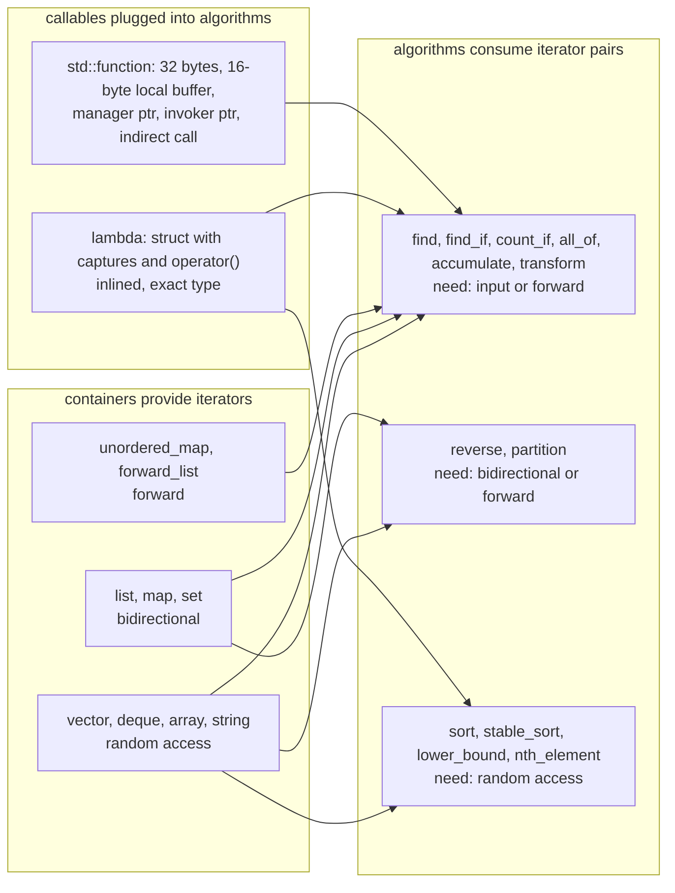

# Module 2.08: Iterators, algorithms and lambdas

**Estimated hours:** 4

**What you will learn**

1. What an iterator is, the four categories (input, forward, bidirectional, random access), which container gives which, and why `std::sort` refuses a `std::list`.
2. The dozen `<algorithm>` functions you will use every week, including the `remove_if` + `erase` idiom, and how to use them with lambdas.
3. What a lambda compiles to, how captures work and go wrong, and what `std::function` costs compared with a template or `auto` parameter.

**Prerequisites:** [Module 2.07: STL containers and their internals](module-07-stl-containers-internals.md). You need the container layouts from that module to understand why iterator categories exist.

---

## 1. One-line intuition

An iterator is a generalised pointer, an algorithm is a loop written once for every container, and a lambda is a small struct with an `operator()` that the compiler writes for you.

## 2. Real-life analogy

A branch auditor is given a stack of files and a task: "find the first loan over 25,000", "sort these by amount", "remove every closed account".

- The **iterator** is the auditor's bookmark. It says "I am at this file; show me it, move me to the next". Some bookmarks can only go forward one file at a time (a bookmark in a tape reel). Some can go back too. Some can jump straight to file 4,000 (a bookmark in a numbered shelf).
- The **algorithm** is the task written as instructions that only use the bookmark: "look at the file, if it matches stop, else move forward". The instructions do not care whether the files are on a shelf or in a tape reel, only that the bookmark can do the moves they need. "Sort" needs jumping; "find" needs only forward.
- The **lambda** is the rule the auditor is handed on a sticky note: "over 25,000?" The note is written on the spot, may mention the threshold from the manager's desk (**capture**), and is passed into the task. The compiler turns that note into a tiny object with the rule as its one method.
- **`std::function`** is an envelope that can hold any sticky note of the right shape. Convenient when you need to file the note in a drawer for later (a task queue), but opening the envelope costs a step every time, and a big note does not fit and must be stapled on the outside (a heap allocation).

## 3. Why it exists: the problem it solves

In C, sorting an array meant `qsort` with a function pointer and `void*` casts, and searching meant a hand-written loop. For every new container you wrote every loop again. The STL's design, due to Alexander Stepanov, separates three things that C mixed together: the container (where the elements live), the algorithm (what to do with them), and the iterator (how to move between them). N algorithms times M containers no longer needs N times M implementations; it needs N algorithms written in terms of iterators, and M containers that each provide iterators.

Lambdas (C++11) closed the last gap. Before them, passing "amount > 25000" to `find_if` meant writing a named struct with an `operator()` twenty lines away from its one use. A lambda is that struct written inline. Because it is a struct with a known type, the algorithm template is instantiated for it and the call is inlined: `std::sort` with a lambda typically beats `qsort` with a function pointer by a wide margin on the same data.

What breaks without them: hand-written loops with off-by-one errors, container-specific code that cannot change container, comparisons through function pointers that the optimiser cannot see through, and ad hoc callback mechanisms (`void*` context pointers) for every event system.

## 4. Three layers of depth

### Layer 1 (beginner): ranges, iterators, the algorithms you need

**The half-open range.** Every standard algorithm takes a pair `[first, last)`: `first` points at the first element, `last` points one past the last element. `c.begin()` and `c.end()` give exactly this pair. `end()` is never dereferenced. An empty range has `first == last`. This convention makes "not found" simple: `find` returns `last` when nothing matched, so you always write `if (it != c.end())`.

**Moving and reading.** `++it` moves forward, `*it` reads (or writes) the element, `it->field` reaches a member. `const_iterator` (from `cbegin()`/`cend()`, or `begin()` on a `const` container) refuses writes. `rbegin()`/`rend()` give reverse iterators that walk backwards while still using `++`.

**The range-for loop.** `for (const auto& x : c)` is exactly `for (auto it = c.begin(); it != c.end(); ++it) { const auto& x = *it; ... }`. The iterator is hidden, which is why modifying the container inside a range-for is a classic bug: the hidden iterator is invalidated (module 2.07).

**Iterator categories.** Each category is a set of operations an iterator supports. Each adds to the previous one.

| Category | Can do | Who provides it |
|---|---|---|
| Input | read once, `++`, compare | `istream_iterator`; a network stream |
| Forward | read many times, `++`, multi-pass | `forward_list`, `unordered_map`, `unordered_set` |
| Bidirectional | also `--` | `list`, `map`, `set` |
| Random access | also `+ n`, `- n`, `it[n]`, `<`, `it2 - it1` | `vector`, `deque`, `array`, `string`, raw pointers |

Algorithms state the category they need. `std::find` needs input. `std::reverse` needs bidirectional. `std::sort` needs random access, which is why module 2.06's `std::sort(list.begin(), list.end())` failed on `operator-`: it tried `last - first` to get the length. `list` has its own `sort()` member for this reason.

**The algorithms you will actually use.** Include `<algorithm>`; `accumulate` is in `<numeric>`.

| Algorithm | Does | Returns |
|---|---|---|
| `find(f, l, value)` / `find_if(f, l, pred)` | first element equal to value / satisfying `pred` | iterator, or `l` |
| `count_if(f, l, pred)` | how many satisfy `pred` | count |
| `all_of` / `any_of` / `none_of(f, l, pred)` | test every element | `bool` |
| `sort(f, l, cmp)` | sort; equal elements in any order | nothing |
| `stable_sort(f, l, cmp)` | sort; equal elements keep original order | nothing |
| `lower_bound(f, l, key, cmp)` | on a sorted range, first element not less than key | iterator |
| `accumulate(f, l, init, op)` | fold: `init = op(init, x)` for each `x` | the total |
| `transform(f, l, out, fn)` | write `fn(x)` for each `x` into `out` | end of output |
| `remove_if(f, l, pred)` | move kept elements to the front, return the new end | iterator |
| `partition(f, l, pred)` | elements satisfying `pred` first, the rest after | split point |
| `copy`, `fill`, `reverse`, `min_element`, `max_element`, `equal` | what the names say | |

**The `remove_if` + `erase` idiom.** `remove_if` cannot change the container's size; it only has iterators. It shifts the elements to keep towards the front and returns an iterator to the new logical end. The leftover tail is garbage. You then call `c.erase(new_end, c.end())` to actually shrink. Forgetting the `erase` leaves the garbage in place. (C++20 adds `std::erase_if(c, pred)` that does both.)

**Lambdas at this level.** `[](const Loan& l) { return l.amount > 25000; }` is a function with no name. `[]` is the capture list (empty here), then parameters, then the body. The return type is deduced. You pass it straight to an algorithm or store it in a variable with `auto`.

### Layer 2 (working engineer): captures, mutable, generic lambdas, std::function

**Captures.** A lambda body may use variables from the enclosing function only if it captures them.

| Capture | Meaning | When |
|---|---|---|
| `[x]` | copy `x` into the lambda now | the lambda may outlive the scope, or must see a snapshot |
| `[&x]` | hold a reference to `x` | the lambda runs before `x` dies and must see or change the real `x` |
| `[=]` | copy everything used | quick, but copies whatever the body happens to touch |
| `[&]` | reference everything used | safe only for lambdas that run immediately, like in `std::sort` |
| `[this]` | capture the `this` pointer | a lambda inside a member function; it sees members by reference, through the pointer |
| `[n = expr]` | init-capture: make a new member `n` from any expression | moving a `unique_ptr` in; renaming; computing once |
| `[p = std::move(p)]` | move-capture | giving the lambda ownership of a resource |

**`mutable`.** A lambda's `operator()` is `const` by default: captured copies cannot be modified. Add `mutable` after the parameter list to allow it. The classic use is a counter or ticket generator: `[n = 1000]() mutable { return n++; }`.

**Generic lambdas.** A parameter declared `auto` makes the `operator()` a template: `[](auto x) { return x + x; }` works for `int`, `double`, `std::string`. Each call with a new type instantiates a new `operator()`, exactly as in module 2.06.

**Dangling captures: the one lambda bug that ships.** A lambda that captures a local by reference and is then stored and called after the local's scope has ended reads a dead stack slot. The compiler does not warn. The usual carriers are a returned `std::function`, a task queue, or a callback registered with a long-lived object. Rule: if the lambda may run after the current function returns, capture by value or by `shared_ptr`, never `[&]`. Capturing `this` is the same bug in disguise: the lambda sees members through a pointer to an object that may be gone when the task runs. The fix for member-function lambdas in a server is `[self = shared_from_this()]` (module 2.05, Part D).

**Storing a lambda.** `auto f = [...]{...};` stores it with its exact type: zero cost, but the type cannot be named, so it cannot be a member variable's declared type or a function parameter's type except through a template. `std::function<R(Args...)>` is a type-erased wrapper that can hold any callable with that signature: a lambda, a function pointer, a functor, a member via `std::bind`. It is what you use when the type must be fixed at a boundary: a task queue's element type, a callback field in a struct, a plugin registry.

**What `std::function` costs, concretely (libstdc++).** `sizeof(std::function<R(Args...)>)` is 32 bytes: a 16-byte local buffer, a pointer to a "manager" function (copy, destroy, type info) and a pointer to an "invoker" function. If the callable is trivially copyable and fits in 16 bytes with suitable alignment (a function pointer, a lambda capturing up to two pointers or four `int`s), it is stored inside the buffer with no allocation. Otherwise the callable is heap allocated and the buffer holds a pointer to it. A lambda capturing a `std::string` or a `shared_ptr` is not trivially copyable, so it always goes to the heap even if it would fit. Calling a `std::function` is an indirect call through the invoker pointer, which the optimiser usually cannot inline, so a tight loop calling it does a real `call` instruction per element where the template version inlined the body. Copying a `std::function` copies the callable (another allocation if it was on the heap). Moving is cheap.

**Templates and `auto` parameters: the alternative.** `template <typename F> void for_each_loan(F f)` or, in C++20, `void for_each_loan(auto f)`, takes the lambda by its exact type. No erasure, no allocation, the call inlines. The price is that the function must be a template (lives in a header, one instantiation per lambda type). Use this for hot paths and algorithms; use `std::function` at storage boundaries.

### Layer 3 (internals): what the compiler generates

**A lambda is a closure type.** For `auto over = [limit](int x) { return x > limit; };` the compiler emits, in effect:

```cpp
struct __lambda_17 {               // unique, unnameable type
    int limit;                     // one member per capture, in capture order
    bool operator()(int x) const { return x > limit; }
};
__lambda_17 over{limit};
```

`sizeof(over)` is `sizeof(int)`, 4. A lambda with no captures is an empty class, `sizeof` 1, and it is convertible to a plain function pointer because there is no state to carry. A `[&x]` capture becomes a reference member (stored as a pointer, 8 bytes). `[this]` becomes a pointer member. `[=]` and `[&]` capture only the variables the body actually names. `mutable` simply drops the `const` on `operator()`.

**Why the call is free.** When you pass `over` to `std::find_if`, the algorithm is instantiated with `_Predicate = __lambda_17`. Inside, `pred(*it)` is a call to a known, tiny, non-virtual member function, and the optimiser inlines it. The generated loop is the same as if you had written `if (*it > limit)` by hand. This is the whole performance argument for lambdas over function pointers.

**What `std::function` does underneath.** Construction from a callable `F` picks a static manager and invoker for that exact `F` (`_M_manager` and `_M_invoke` in libstdc++'s `std_function.h`), decides whether `F` can live in the 16-byte `_Any_data` buffer, and either copy-constructs it there or `new`s it and stores the pointer. `operator()` calls `_M_invoker(_M_functor, args...)`. The invoker casts the stored bytes or pointer back to `F` and calls it. So each call is: load invoker pointer, indirect call, inside it load the callable, direct call to `F::operator()` (often inlined into the invoker). The ASan stack trace in the lab shows exactly this chain: `std::function::operator()` to `_M_invoke` to `__invoke_impl` to your lambda's `operator()`.

**Why `[&]` dangles silently.** The reference member is a pointer to a stack address. After the enclosing function returns, that stack memory is reused by the next call. Reading through the pointer is undefined behaviour; in practice you read whatever the next function left there. The lab prints a garbage number in the plain build and a clean `stack-use-after-return` report under ASan, which detects it by keeping returned frames poisoned for a while.

**Iterators are not pointers, except when they are.** A `vector<int>::iterator` in libstdc++ is `__gnu_cxx::__normal_iterator<int*, vector<int>>`, a struct wrapping one pointer, which optimises to the pointer. A `list<int>::iterator` wraps a node pointer and `++` loads `node->next`. A `map` iterator's `++` is the in-order successor walk: go right then far left, or climb up while coming from a right child. That walk is what makes `map` iteration O(n) total but with pointer chasing on every step.

## 5. Architecture diagram



Every edge from a container to an algorithm exists only if the container's category satisfies the algorithm's requirement. The bottom-right box is the one cost you choose: a lambda's exact type inlines; `std::function` adds erasure.

## 6. Code

The algorithms program runs the full toolkit on six loans. The lambdas program shows captures, the struct equivalence, and `std::function`'s allocation behaviour by counting calls to `operator new`.

```cpp
// algorithms.cpp
// The most-used <algorithm> and <numeric> functions, on a list of loans.
#include <algorithm>
#include <cstdio>
#include <numeric>
#include <string>
#include <vector>

struct Loan {
    int id;
    int amount;          // rupees
    std::string branch;
};

static void print(const char* label, const std::vector<Loan>& loans) {
    std::printf("%-20s", label);
    for (const auto& l : loans) std::printf("[%d %d %s] ", l.id, l.amount, l.branch.c_str());
    std::printf("\n");
}

int main() {
    std::vector<Loan> loans{
        {1, 50000, "PUNE"}, {2, 12000, "MUM"}, {3, 50000, "DEL"},
        {4, 8000, "PUNE"},  {5, 30000, "MUM"}, {6, 12000, "PUNE"}};
    print("start:", loans);

    // find_if: first loan over 25000. Returns end() when nothing matches.
    auto big = std::find_if(loans.begin(), loans.end(),
                            [](const Loan& l) { return l.amount > 25000; });
    if (big != loans.end()) std::printf("first > 25000: id %d\n", big->id);

    // all_of / any_of / count_if
    bool all_pos = std::all_of(loans.begin(), loans.end(), [](const Loan& l) { return l.amount > 0; });
    bool any_del = std::any_of(loans.begin(), loans.end(), [](const Loan& l) { return l.branch == "DEL"; });
    long n_pune  = std::count_if(loans.begin(), loans.end(), [](const Loan& l) { return l.branch == "PUNE"; });
    std::printf("all positive: %s, any DEL: %s, PUNE count: %ld\n",
                all_pos ? "yes" : "no", any_del ? "yes" : "no", n_pune);

    // accumulate: total amount. The start value 0LL fixes the result type.
    long long total = std::accumulate(loans.begin(), loans.end(), 0LL,
                                      [](long long acc, const Loan& l) { return acc + l.amount; });
    std::printf("total amount: %lld\n", total);

    // transform: build a vector of ids from the vector of loans
    std::vector<int> ids(loans.size());
    std::transform(loans.begin(), loans.end(), ids.begin(), [](const Loan& l) { return l.id; });
    std::printf("ids: ");
    for (int i : ids) std::printf("%d ", i);
    std::printf("\n");

    // stable_sort by amount: equal amounts keep their original relative order
    std::stable_sort(loans.begin(), loans.end(),
                     [](const Loan& a, const Loan& b) { return a.amount < b.amount; });
    print("stable_sort amount:", loans);

    // lower_bound on the sorted range: first loan with amount >= 12000
    auto lb = std::lower_bound(loans.begin(), loans.end(), 12000,
                               [](const Loan& l, int key) { return l.amount < key; });
    std::printf("lower_bound(12000) -> id %d at index %ld\n", lb->id, static_cast<long>(lb - loans.begin()));

    // partition: PUNE loans first, the rest after. Order inside each group is not kept.
    auto mid = std::partition(loans.begin(), loans.end(), [](const Loan& l) { return l.branch == "PUNE"; });
    std::printf("partition: %ld PUNE loans at the front\n", static_cast<long>(mid - loans.begin()));

    // remove_if + erase idiom: drop loans under 10000
    loans.erase(std::remove_if(loans.begin(), loans.end(),
                               [](const Loan& l) { return l.amount < 10000; }),
                loans.end());
    print("after erase <10000:", loans);

    // sort by id to restore the original order
    std::sort(loans.begin(), loans.end(), [](const Loan& a, const Loan& b) { return a.id < b.id; });
    print("sorted by id:", loans);
    return 0;
}
```

```bash
g++ -std=c++17 -Wall -Wextra -Werror -g -o algorithms algorithms.cpp
./algorithms
```

Expected output:

```text
start:              [1 50000 PUNE] [2 12000 MUM] [3 50000 DEL] [4 8000 PUNE] [5 30000 MUM] [6 12000 PUNE]
first > 25000: id 1
all positive: yes, any DEL: yes, PUNE count: 3
total amount: 162000
ids: 1 2 3 4 5 6
stable_sort amount: [4 8000 PUNE] [2 12000 MUM] [6 12000 PUNE] [5 30000 MUM] [1 50000 PUNE] [3 50000 DEL]
lower_bound(12000) -> id 2 at index 1
partition: 3 PUNE loans at the front
after erase <10000: [1 50000 PUNE] [6 12000 PUNE] [5 30000 MUM] [2 12000 MUM] [3 50000 DEL]
sorted by id:       [1 50000 PUNE] [2 12000 MUM] [3 50000 DEL] [5 30000 MUM] [6 12000 PUNE]
```

Check two details. After `stable_sort`, the two 12,000 loans appear as id 2 then id 6, their original order; `sort` would have been allowed to swap them. After `partition`, the order inside each group is scrambled (`partition` swaps from both ends), which is why the "after erase" line is not in id order.

The second program:

```cpp
// lambdas.cpp
// Shows: a lambda is a struct with operator(), captures by value and by
// reference, init-capture, mutable, generic lambdas, and what std::function
// costs in size and heap allocations.
#include <cstdio>
#include <cstdlib>
#include <functional>
#include <memory>
#include <new>
#include <string>

static int g_allocs = 0;                      // counts heap allocations
void* operator new(std::size_t n) {
    ++g_allocs;
    if (void* p = std::malloc(n)) return p;
    throw std::bad_alloc();
}
void operator delete(void* p) noexcept { std::free(p); }
void operator delete(void* p, std::size_t) noexcept { std::free(p); }

// What the compiler generates for   [limit](int x) { return x > limit; }
struct OverLimit {
    int limit;
    bool operator()(int x) const { return x > limit; }
};

int main() {
    int limit = 100;

    std::printf("--- a lambda is a struct with operator() ---\n");
    auto over = [limit](int x) { return x > limit; };
    OverLimit over2{limit};
    std::printf("lambda says %s, hand-written struct says %s\n",
                over(150) ? "true" : "false", over2(150) ? "true" : "false");
    std::printf("sizeof(lambda capturing one int) = %zu, sizeof(OverLimit) = %zu\n",
                sizeof(over), sizeof(over2));
    auto no_capture = [](int x) { return x * 2; };
    std::printf("sizeof(lambda with no capture)   = %zu (an empty class)\n", sizeof(no_capture));

    std::printf("\n--- by value vs by reference ---\n");
    int counter = 0;
    auto by_val = [counter]() { return counter; };      // copy taken now
    auto by_ref = [&counter]() { return counter; };     // sees later changes
    counter = 5;
    std::printf("by_val sees %d, by_ref sees %d\n", by_val(), by_ref());

    std::printf("\n--- mutable: the copy inside the lambda may change ---\n");
    auto ticket = [n = 1000]() mutable { return n++; };  // init-capture + mutable
    int t1 = ticket(), t2 = ticket(), t3 = ticket();
    std::printf("tickets: %d %d %d\n", t1, t2, t3);

    std::printf("\n--- init-capture moves a unique_ptr into the lambda ---\n");
    auto owner = std::make_unique<std::string>("loan-1001");
    auto task = [doc = std::move(owner)]() { return doc->size(); };
    std::printf("owner is %s, task sees %zu chars\n", owner ? "non-null" : "null", task());

    std::printf("\n--- generic lambda (auto parameter) ---\n");
    auto twice = [](auto x) { return x + x; };
    std::printf("twice(21) = %d, twice(1.5) = %.1f, twice(\"ab\") = %s\n",
                twice(21), twice(1.5), twice(std::string("ab")).c_str());

    std::printf("\n--- std::function: size and heap allocations ---\n");
    std::printf("sizeof(std::function<int()>) = %zu\n", sizeof(std::function<int()>));
    int a = 1, b = 2, c = 3;
    g_allocs = 0;
    std::function<int()> small = [a, b]() { return a + b; };                  // 8 bytes of captures
    std::printf("lambda capturing 2 ints  -> std::function: %d heap allocations\n", g_allocs);
    g_allocs = 0;
    std::function<int()> big = [a, b, c, &limit, counter]() { return a + b + c + limit + counter; }; // 24 bytes
    std::printf("lambda capturing 24 bytes -> std::function: %d heap allocation\n", g_allocs);
    g_allocs = 0;
    auto direct = [a, b, c, &limit, counter]() { return a + b + c + limit + counter; };
    std::printf("same lambda kept in auto                   : %d heap allocations\n", g_allocs);
    std::printf("results: small %d, big %d, direct %d\n", small(), big(), direct());
    return 0;
}
```

```bash
g++ -std=c++17 -Wall -Wextra -Werror -g -o lambdas lambdas.cpp
./lambdas
```

Expected output:

```text
--- a lambda is a struct with operator() ---
lambda says true, hand-written struct says true
sizeof(lambda capturing one int) = 4, sizeof(OverLimit) = 4
sizeof(lambda with no capture)   = 1 (an empty class)

--- by value vs by reference ---
by_val sees 0, by_ref sees 5

--- mutable: the copy inside the lambda may change ---
tickets: 1000 1001 1002

--- init-capture moves a unique_ptr into the lambda ---
owner is null, task sees 9 chars

--- generic lambda (auto parameter) ---
twice(21) = 42, twice(1.5) = 3.0, twice("ab") = abab

--- std::function: size and heap allocations ---
sizeof(std::function<int()>) = 32
lambda capturing 2 ints  -> std::function: 0 heap allocations
lambda capturing 24 bytes -> std::function: 1 heap allocation
same lambda kept in auto                   : 0 heap allocations
results: small 3, big 111, direct 111
```

The 24-byte lambda (three `int`s, one reference stored as a pointer, one more `int`, padded) does not fit the 16-byte buffer, so `std::function` allocated. The same lambda held by `auto` cost nothing. (The `ticket` calls are assigned to named variables first because the order of evaluation of arguments to one `printf` call is unspecified in C++17.)

## 7. Use case: core-banking loan-origination platform

tcpkv (capstone C1) and the app server (C2) both have a thread pool (module 4.10). Worker threads pull tasks from a queue and run them. The question is the type of a task.

The decision: **the queue is `std::deque<std::function<void()>>`.** A task is "handle this connection" or "process this request", created where the connection is accepted and run on whichever worker is free. The acceptor thread writes `pool.submit([conn = std::move(conn), &store] { handle(conn, store); });`. That lambda's exact type is known only at that line; the queue must store tasks from many places with different captures, so a single fixed element type is required, and `std::function<void()>` is that type.

The cost accepted, and the interview follow-up: each submit pays one indirect call when the task runs and, because a connection handle or a `shared_ptr<Connection>` is not trivially copyable, one heap allocation per task to store the lambda outside the 16-byte buffer. At a few thousand tasks per second on a server whose work per task is a socket read, a hash lookup and a socket write, that allocation is well under one percent of the per-task cost; it was measured, not assumed (module 8.07, `perf`). The alternative, a pool templated on the task type, would have fixed the capture set at compile time and made the pool a header-only template for one task shape; it buys speed that this workload does not need and loses the ability to submit different kinds of work to one pool.

The second rule from this module that the server enforces: every task captures its connection by value (moved in) or by `shared_ptr`, never by reference, and never captures `this` of an object that may be destroyed before the task runs. The `stack-use-after-return` in the lab is the exact crash that rule prevents.

## 8. Lab

### Part A: iterator categories, the compiler as referee (15 minutes)

1. Create a file with `std::vector<int> v{3,1,2}; std::list<int> l{3,1,2}; std::unordered_set<int> u{3,1,2};`.
2. Try each of these lines one at a time and record which compile: `std::sort(v.begin(), v.end());`, `std::sort(l.begin(), l.end());`, `std::reverse(l.begin(), l.end());`, `std::reverse(u.begin(), u.end());`, `auto it = v.begin() + 2;`, `auto it2 = l.begin() + 2;`, `auto it3 = std::next(l.begin(), 2);`.

Expected: `sort` on the list fails (`operator-` missing, needs random access), `reverse` on the unordered_set fails (`operator--` missing, needs bidirectional), `l.begin() + 2` fails but `std::next` works for any forward iterator by stepping. Everything on the vector compiles. Write the category of each container next to each result.

### Part B: the dangling capture, plain and under ASan (20 minutes)

```cpp
// dangling_capture.cpp : a lambda captures a local by reference and outlives it.
#include <cstdio>
#include <functional>

std::function<int()> make_reader() {
    int balance = 2500;                       // lives in make_reader's stack frame
    return [&balance]() { return balance; };  // captures a reference to it
}                                             // balance is gone here

int main() {
    auto reader = make_reader();
    std::printf("balance = %d\n", reader());  // reads a dead stack slot
    return 0;
}
```

```bash
g++ -std=c++17 -Wall -Wextra -Werror -g -o dangling_plain dangling_capture.cpp
./dangling_plain
g++ -std=c++17 -Wall -Wextra -Werror -g -fsanitize=address,undefined -o dangling_capture dangling_capture.cpp
./dangling_capture 2>&1 | head -10
```

Expected: the plain build compiles with no warning and prints some number (on one run it printed 24965; it may print 2500 by luck, or anything). The ASan build prints `ERROR: AddressSanitizer: stack-use-after-return` with a stack trace showing `operator()` at `dangling_capture.cpp:7`, called from `std::function<int()>::operator()`, called from `main` at line 12. Read the chain: that is the invoker path from Layer 3. Fix: change `[&balance]` to `[balance]`, rebuild both, and confirm the output is `2500` and ASan is silent.

### Part C: std::function versus template in a hot loop (20 minutes)

```cpp
// function_vs_template.cpp : the same work through std::function and a template.
// Build with -O2 and record your numbers; only the ordering is predictable.
#include <chrono>
#include <cstdio>
#include <functional>
#include <vector>

template <typename F>
long long apply_template(const std::vector<int>& v, F f) {
    long long s = 0;
    for (int x : v) s += f(x);          // f is a known type: the call can inline
    return s;
}

long long apply_function(const std::vector<int>& v, const std::function<int(int)>& f) {
    long long s = 0;
    for (int x : v) s += f(x);          // f is type-erased: indirect call each time
    return s;
}

int main() {
    std::vector<int> v(50'000'000);
    for (int i = 0; i < static_cast<int>(v.size()); ++i) v[i] = i & 1023;
    int k = 3;
    auto f = [k](int x) { return x * k; };
    using Clock = std::chrono::steady_clock;

    auto t0 = Clock::now();
    long long a = apply_template(v, f);
    auto t1 = Clock::now();
    long long b = apply_function(v, f);
    auto t2 = Clock::now();
    std::printf("template      : %.1f ms (sum %lld)\n",
                std::chrono::duration<double, std::milli>(t1 - t0).count(), a);
    std::printf("std::function : %.1f ms (sum %lld)\n",
                std::chrono::duration<double, std::milli>(t2 - t1).count(), b);
    return 0;
}
```

```bash
g++ -std=c++17 -Wall -Wextra -Werror -O2 -o fvt function_vs_template.cpp
./fvt
./fvt
```

Expected ordering: the template version is faster; on one laptop (WSL2, GCC 13, `-O2`) the template took about 55 ms and `std::function` about 136 ms over 50 million calls, which is a few nanoseconds of indirect-call overhead per element. The sums must match. Then open both functions on <https://godbolt.org/> at `-O2`: `apply_template` has a loop with an `imul` and no `call`; `apply_function` has a `call` through a register inside its loop. Record the per-call overhead you measured: `(t_function - t_template) / 50,000,000`.

### Part D: rewrite a loop with algorithms (20 minutes)

Take this hand-written loop and rewrite it using `remove_if` + `erase`, `stable_sort`, `accumulate` and `any_of`, checking that output is identical:

```cpp
std::vector<Loan> keep;
for (const auto& l : loans) if (l.amount >= 10000) keep.push_back(l);
// bubble sort by amount, ascending, keeping equal amounts in order
for (size_t i = 0; i < keep.size(); ++i)
    for (size_t j = 0; j + 1 < keep.size() - i; ++j)
        if (keep[j + 1].amount < keep[j].amount) std::swap(keep[j], keep[j + 1]);
long long sum = 0; for (const auto& l : keep) sum += l.amount;
bool has_del = false; for (const auto& l : keep) if (l.branch == "DEL") has_del = true;
```

Expected: four algorithm calls replace about ten lines, there is no index arithmetic left to get wrong, and the `stable_sort` preserves the order of equal amounts exactly as the bubble sort did.

### Journal

Copy [journal/TEMPLATE.md](../journal/TEMPLATE.md) to `journal/YYYY-MM-DD-iterators-algorithms-lambdas.md`. Record: the compile/fail table from Part A with categories; the garbage value from the plain dangling build and the ASan error line; your two timings from Part C and the per-call overhead you computed; and the before/after line counts from Part D.

## 9. Common mistakes and misconceptions

| Mistake | Why it is wrong | Bug it causes later |
|---|---|---|
| Dereferencing `end()` or the result of `find` without checking | `end()` is one past the last element; `find` returns it on no match | Read past the buffer, ASan heap-buffer-overflow |
| `remove_if` without `erase` | `remove_if` cannot resize; it leaves garbage at the tail | Phantom elements processed later |
| `std::sort` on a `list` or `map` | They are bidirectional, `sort` needs random access | The 24-line template error from module 2.06 |
| `[&]` in a lambda stored for later | Captured references point into a stack frame that will be reused | `stack-use-after-return`, garbage values, crashes |
| `[this]` in a task that may outlive the object | Same bug through a pointer | Use-after-free on a destroyed connection; use `shared_from_this` |
| Expecting a by-value capture to see later changes | The copy was taken when the lambda was created | Stale thresholds, "my counter never increments" |
| Modifying a by-value capture without `mutable` | `operator()` is `const` by default | Compile error, then a wrong fix with `[&]` |
| `std::function` in a hot inner loop | Indirect call per invocation, possible heap allocation to store | Measurable slowdown, see Part C |
| `std::function` and expecting no allocation for a small lambda that captures a `shared_ptr` or `string` | Only trivially copyable callables up to 16 bytes are stored inline | A hidden `malloc` per task |
| Erasing inside a range-for | The hidden iterator is invalidated | Skipped elements or crash; use the erase-remove idiom |
| Using `sort` when order of equal elements matters | `sort` is not stable | Non-deterministic report ordering; use `stable_sort` |

## 10. Resume link

- **Claim B, "STL internals".** The sentence to say: "An iterator category is a contract: `sort` needs random access so it can compute distances and jump, which is why `list` has its own `sort`. A lambda is a struct with one member per capture and an inlined `operator()`, so `std::sort` with a lambda beats `qsort`; `std::function` is 32 bytes with a 16-byte inline buffer, a manager and an invoker pointer, and an indirect call, and I have measured that overhead per call."
- **Claim I, tcpkv "fixed thread pool".** Section 7: tasks are `std::function<void()>` because the queue needs one element type for lambdas created in many places; each task captures its connection by value or `shared_ptr`, never by reference. Be ready to give the per-task cost you measured.
- **Claim F, "ASan ... memory corruption".** Part B's `stack-use-after-return` is a real sanitizer finding with a one-line root cause: reference capture outliving its scope.
- **Claim B, "performance optimisation".** Part C is your evidence for "templates inline, type erasure does not", with godbolt output to back it.

Likely follow-ups: "What does a lambda compile to?" (Layer 3), "When would you use `std::function` versus a template parameter?" (Layer 2), "What is the erase-remove idiom?", "What goes wrong with `[&]`?"

## 11. Interview questions

**Q1 (easy). What is the difference between `std::sort` and `std::stable_sort`, and when does it matter?**

<details>
<summary>Model answer</summary>

Both sort a random-access range by a comparison. `sort` (introsort in libstdc++) may reorder elements that compare equal; `stable_sort` (merge sort, using a temporary buffer) keeps equal elements in their original relative order. It matters whenever the elements carry information beyond the sort key: sorting loans by amount for a report where ties should keep their application order, or sorting by one column after another to get a multi-key order. `stable_sort` costs an extra allocation and is somewhat slower, so I use `sort` unless stability is required.

</details>

**Q2 (easy). Explain the erase-remove idiom.**

<details>
<summary>Model answer</summary>

`std::remove_if(first, last, pred)` only has iterators, so it cannot change the container's size. It moves the elements to keep towards the front, preserving their order, and returns an iterator to the new logical end; the elements after it are unspecified leftovers. `container.erase(new_end, container.end())` then actually destroys and removes that tail. Written together: `v.erase(std::remove_if(v.begin(), v.end(), pred), v.end());`. Forgetting the `erase` is the common bug. C++20 adds `std::erase_if(v, pred)` which does both.

</details>

**Q3 (medium). What does a lambda expression compile to, and why can it be faster than a function pointer?**

<details>
<summary>Model answer</summary>

The compiler generates a unique class, the closure type, with one data member per capture (a copy for by-value captures, a reference or pointer for by-reference captures and `this`) and a `const` `operator()` whose body is the lambda body; `mutable` removes the `const`, and an `auto` parameter makes `operator()` a template. The lambda expression constructs an instance of that class. Its size is the sum of its captures: 4 bytes for one `int`, 1 byte for no captures, in which case it also converts to a plain function pointer. When passed to an algorithm, the algorithm template is instantiated for that exact closure type, so the call to `operator()` is a direct call to a small known function that the optimiser inlines into the loop. A function pointer, as with `qsort`, is an indirect call whose target the compiler cannot see, so no inlining and a real `call` per comparison.

</details>

**Q4 (medium). What does `std::function` cost, and when is it the right choice anyway?**

<details>
<summary>Model answer</summary>

In libstdc++ a `std::function` is 32 bytes: a 16-byte buffer, a manager pointer for copy, destroy and type queries, and an invoker pointer. A trivially copyable callable of at most 16 bytes with compatible alignment is stored in the buffer; anything larger, or anything not trivially copyable such as a lambda capturing a `std::string` or a `shared_ptr`, is heap allocated and the buffer holds a pointer. Each call is an indirect call through the invoker, which usually prevents inlining; in my benchmark that was a few nanoseconds per call over a template version that inlined. Copying may allocate again; moving is cheap. It is still the right tool at a type boundary where the callable's exact type cannot be known: a thread pool queue, a callback stored in a struct, a registry of handlers. I use a template or `auto` parameter when the callable is used immediately in a hot loop, and `std::function` when it must be stored.

</details>

**Q5 (hard). A server crashes intermittently in a worker thread with ASan reporting `stack-use-after-return` or `heap-use-after-free` inside `std::function::operator()`. Describe the likely cause, how you confirm it, and the design rule that prevents it.**

<details>
<summary>Model answer</summary>

A task lambda was created with a capture that does not own what it refers to, and the task ran after that thing died. The two shapes: `[&]` or `[&local]` capturing a local of the submitting function, giving `stack-use-after-return` when the worker runs the task after the function returned; or `[this]` inside a member function of a connection or session object that was destroyed before the task ran, giving `heap-use-after-free`. The ASan trace shows the chain: the worker's `std::function::operator()`, the invoker, then the lambda's `operator()` at the line that read the dead variable, plus for the heap case the frame that freed the object. I confirm by finding the `submit` call that built that lambda and checking the lifetime of each captured name against the point where the task runs; TSan or a log timestamp can show the destruction preceding the execution. The design rule: a task that may run after the current scope ends captures by value, moves resources in with init-capture (`[conn = std::move(conn)]`), or captures `[self = shared_from_this()]` for member functions so the object lives as long as the task; `[&]` and bare `[this]` are only allowed for lambdas that run before the enclosing function returns, such as the comparator passed to `std::sort`. I would add a code-review check for `[&]` and `[this]` in any `submit` or callback-registration call, and keep the ASan run under the load generator in CI, which is what tcpkv does.

</details>

## 12. Revision

- Algorithms take half-open iterator pairs `[first, last)`; iterator categories (input, forward, bidirectional, random access) are contracts: `vector`/`deque`/`array`/`string` are random access, `list`/`map`/`set` bidirectional, `unordered_*` forward; `sort` needs random access, `find` needs only input; `remove_if` then `erase`.
- A lambda is a compiler-generated struct with one member per capture and an inlined `operator()`; capture by value for anything stored for later, by reference only for immediate use; `mutable` for changing copies; init-capture to move resources in; `[&]` and `[this]` in stored tasks are the dangling-capture bug ASan reports as `stack-use-after-return` or `heap-use-after-free`.
- `std::function` is 32 bytes with a 16-byte inline buffer for trivially copyable callables, otherwise a heap allocation, plus an indirect call per invocation; use it at storage boundaries like a thread pool queue, and a template or `auto` parameter in hot loops.

---

Previous: [Module 2.07: STL containers and their internals](module-07-stl-containers-internals.md) | Next: [Module 2.09: Exceptions vs error codes](module-09-exceptions-vs-error-codes.md)
