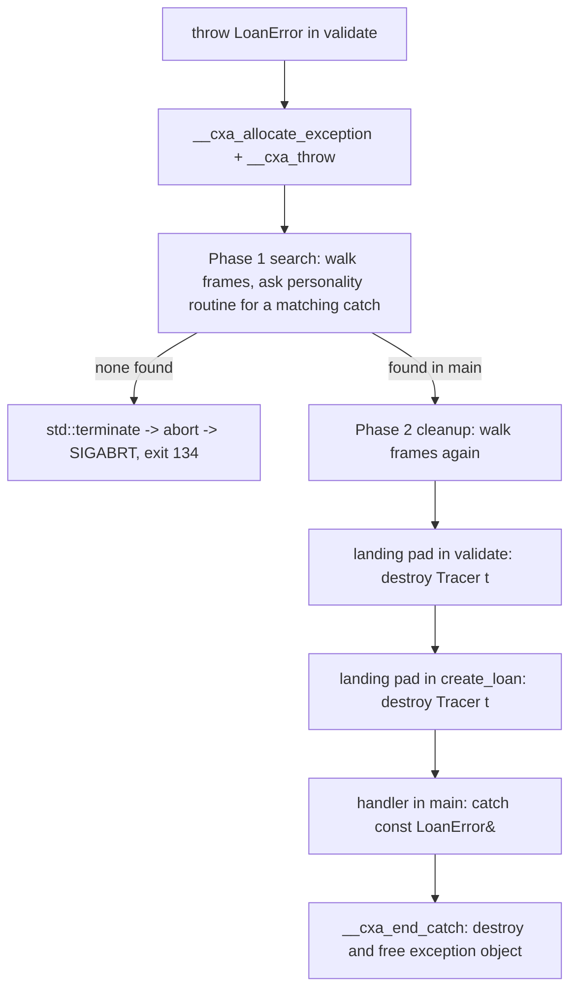

# Module 2.09: Exceptions vs error codes

**Estimated hours:** 4

**What you will learn**

1. How `throw`, `try` and `catch` work, why you catch by reference, and how stack unwinding runs destructors so RAII and exceptions fit together.
2. The three exception-safety guarantees, what `noexcept` promises, and what a throw really costs compared with a return code.
3. The alternatives (`std::optional`, error codes, `std::error_code`, a small `Result<T, E>`) and the rule a server uses to pick between them.

**Prerequisites:** [Module 2.08: Iterators, algorithms and lambdas](module-08-iterators-algorithms-lambdas.md). You need RAII (2.03), move semantics (2.04) and `std::variant`/`std::optional` from the STL modules.

---

## 1. One-line intuition

An exception is an emergency exit: the function leaves at once, every object on the way out is cleaned up automatically, and the first `catch` that matches takes over. An error code is a note handed back to the caller, who must read it and pass it on.

## 2. Real-life analogy

Picture a loan file moving through a bank branch: clerk, officer, branch manager.

- **Error code.** The clerk finds a missing signature. He writes "rejected: reason 1001" on the cover sheet and hands the file back. The officer must look at the sheet, see the rejection, and hand it further back. If one person forgets to look, the file continues as if it were approved. This happens a hundred times a day, so it must be cheap and routine.
- **Exception.** The clerk finds a forged identity document. He pulls the fire alarm. Everyone stops what they are doing, locks their drawers on the way out (that is the **destructor** running) and leaves the building. The one person trained for this, the security officer, handles it (that is the **catch**). Nobody can "forget to notice" an alarm.

The fire alarm is right for rare emergencies. It is wrong for "customer forgot a signature". A branch that pulls the alarm a hundred times a day gets nothing done. That is the whole module in one picture: exceptions for the rare and serious, codes for the expected and frequent.

## 3. Why it exists: the problem it solves

In Phase 1 you wrote C. Every failure came back as a number: `fopen` returns `NULL`, `write` returns `-1`, `errno` says why. Three things went wrong constantly:

1. **Ignored errors.** `write(fd, buf, n);` with the return value thrown away compiles fine. The bytes may never have been written. Silent data loss in a bank is the worst bug there is.
2. **No way to fail in a constructor.** A constructor returns nothing. If opening the socket inside `Connection::Connection()` fails, how does the caller find out? In C you add an `is_valid` flag that everyone forgets to check.
3. **Plumbing.** An error in a function ten calls deep must be passed up through ten `if (rc != 0) return rc;` lines. Each one is a chance to forget.

Exceptions fix all three: a failure cannot be ignored (an uncaught exception ends the program), a constructor can throw, and the error travels up through any number of calls with no code in between. The price, as you will measure, is that a throw is thousands of times slower than a return, and that code in between must be written so that leaving suddenly is safe. Modern C++ uses both tools. Knowing which to use where is the skill.

## 4. Three layers of depth

### Layer 1 (beginner): throw, try, catch, and the standard hierarchy

**Throwing.** `throw expr;` creates a copy of `expr` (the **exception object**) and starts looking for a handler. Any type can be thrown, but you should throw objects derived from `std::exception`, so that every handler can call `what()` to get a message.

**Catching.**

```cpp
try {
    create_loan(-5);                    // may throw
} catch (const LoanError& e) {          // most specific first
    log(e.code(), e.what());
} catch (const std::exception& e) {     // anything standard
    log(e.what());
} catch (...) {                         // anything at all; use rarely
    log("unknown exception");
}
```

Handlers are tried in order. The first one whose type matches wins. A handler for a base class matches any derived class, so the order is always most specific first. **Catch by reference** (`const T&`): catching by value copies the object and **slices** a derived exception down to its base (module 2.10 explains slicing). Catching by pointer is never done.

**Rethrowing.** Inside a handler, `throw;` (no operand) rethrows the current exception unchanged to an outer handler. Use it when you want to log and let someone above decide.

**The standard hierarchy.** All in `<stdexcept>` and `<exception>`:

| Class | Derived from | Thrown by | Meaning |
|---|---|---|---|
| `std::exception` | - | - | Root. Has `virtual const char* what() const noexcept` |
| `std::logic_error` | `exception` | - | A bug: the program asked for something impossible |
| `std::invalid_argument` | `logic_error` | `std::stoi("abc")` | Bad argument |
| `std::out_of_range` | `logic_error` | `vector::at`, `map::at` | Index or key does not exist |
| `std::length_error` | `logic_error` | `vector::reserve` with absurd size | Too big |
| `std::runtime_error` | `exception` | - | Something outside the program went wrong |
| `std::system_error` | `runtime_error` | `std::thread`, `std::mutex` | OS call failed; carries an `std::error_code` |
| `std::bad_alloc` | `exception` | `new`, containers | Out of memory |
| `std::bad_cast` | `exception` | `dynamic_cast` on references | Wrong type |

**Your own exception type.** Derive from `std::runtime_error` (for environment failures) or `std::logic_error` (for bugs). Add the fields you need:

```cpp
class LoanError : public std::runtime_error {
public:
    LoanError(const std::string& msg, int code) : std::runtime_error(msg), code_(code) {}
    int code() const noexcept { return code_; }
private:
    int code_;
};
```

Now `catch (const LoanError&)` gets the code, and `catch (const std::exception&)` still gets the message.

### Layer 2 (working engineer): unwinding, guarantees, noexcept, cost, alternatives

**Stack unwinding.** When `throw` runs, the program walks back up the call stack, frame by frame, looking for a matching `catch`. In every frame it leaves, it runs the destructors of all local objects that were fully constructed, in reverse order of construction. This is **stack unwinding**. It is why RAII and exceptions are one design, not two: a `std::unique_ptr`, a `std::lock_guard`, an fd wrapper, all release their resource on the way out without any code from you. Section 6 prints this happening.

The corollary: code that frees resources by hand (`delete p;` at the end of a function) is wrong in the presence of exceptions, because the end of the function may never be reached. Every "it leaked only when an error happened" bug is this.

**The three exception-safety guarantees.** Every function you write makes one of these promises, whether you say so or not:

| Guarantee | Promise if an exception escapes | Example |
|---|---|---|
| **Basic** | No leaks, every object is still in a valid (but maybe changed) state | `vector::push_back` on a type with a throwing copy: the vector is valid but may or may not contain the element |
| **Strong** | The operation either fully happened or nothing changed (commit or rollback) | `std::map::insert`; any function written with copy-and-swap |
| **Nothrow** | It cannot throw at all | Destructors, `swap`, move constructors, `unique_ptr::reset` |

The strong guarantee is what a bank wants for "post this transaction". The standard recipe is **copy-and-swap**: do all the work that can fail on a *copy*, then swap the copy in with an operation that cannot fail.

```cpp
class Portfolio {
public:
    Portfolio& operator=(Portfolio other) noexcept {   // 'other' is a full copy, made by the caller
        swap(*this, other);                            // swapping two vectors/strings cannot throw
        return *this;                                  // the old state is destroyed with 'other'
    }
    friend void swap(Portfolio& a, Portfolio& b) noexcept {
        using std::swap;
        swap(a.owner_, b.owner_);
        swap(a.loans_, b.loans_);
    }
private:
    std::string owner_;
    std::vector<long> loans_;
};
```

If the copy throws (out of memory), `*this` was never touched. If it succeeds, the swap cannot throw. Strong guarantee, four lines.

**`noexcept`.** Writing `void f() noexcept` promises that `f` never lets an exception escape. If one does, the program calls `std::terminate()` immediately: no unwinding, no catch, the process dies. Two reasons to use it:

1. **Correctness and speed.** `std::vector` grows by moving elements into a new buffer only if the element's move constructor is `noexcept`; otherwise it falls back to copying, to keep the strong guarantee. Mark move constructors, swap and destructors `noexcept` (destructors are implicitly `noexcept` already).
2. **Documentation.** A `noexcept` function on the hot path tells the reader "no surprise exits here".

Do not sprinkle `noexcept` on functions that might throw just to look fast. A wrong `noexcept` turns a recoverable error into a crash.

**The cost model.** Modern compilers use the **zero-cost** (table-based) model: when no exception is thrown, a `try` block costs nothing, not even a branch. The compiler emits side tables (Layer 3) describing how to unwind each function, and they are only read when a throw happens. The throw itself is very expensive: the runtime allocates the exception object, walks the stack twice, parses the tables for every frame it crosses and runs destructors. In section 6 you measure it. On one WSL2 laptop a throw across two frames cost about 3 to 5 microseconds, against 0 to 2 nanoseconds for a return code: three orders of magnitude. With deep stacks, many destructors, or in old runtimes it can reach tens of microseconds. A server handling 50,000 requests per second cannot afford one throw per request.

**The alternatives.**

| Tool | Shape | Use when |
|---|---|---|
| Error code | `int f(...)`, 0 = ok | C interfaces, OS calls; easy to ignore |
| `std::optional<T>` | value or nothing | Only one way to fail and the caller knows what it is ("not found", "not a number") |
| `std::error_code` | `<system_error>`: an integer plus a category | Wrapping OS/library errors with a message and a domain; used by `std::system_error` |
| `Result<T, E>` | `std::variant<T, E>` with `ok()`, `value()`, `error()` | Several failure reasons and the caller must handle them; you write this in Lab Part D |
| `std::expected<T, E>` | C++23 standard version of `Result` | Not in C++17; know the name, it is what the committee picked |
| Exception | `throw` | Rare, serious, far from the handler, or inside a constructor |

**The server rule** (used by tcpkv and the application server in this course):

1. **Exceptions for programmer errors and startup failures.** Config file missing, cannot bind the port, cannot reach the database, an invariant that "cannot" be false. These happen once, are fatal or nearly so, and should be loud.
2. **Codes or `optional` on the per-request hot path.** Bad input, key not found, amount too large: these are expected, frequent, and the handler is one call away. The RPC reply carries a status code; nothing is thrown.
3. **Never let an exception escape a thread function.** An exception that leaves the function a `std::thread` was started with calls `std::terminate` and kills the whole process, every connection with it. Every worker's top-level function has a `catch (const std::exception&)` that logs and continues.
4. **Never throw from a destructor.** During unwinding a second exception means `std::terminate`. Destructors log failures and swallow them.

### Layer 3 (internals): what the compiler and runtime actually do on `throw`

**The tables.** For every function, GCC emits unwind information into the `.eh_frame` section (how to restore registers and find the previous frame) and, for functions with handlers or destructors, a **language-specific data area** in `.gcc_except_table` (which ranges of instructions have which cleanups and which catch clauses). You can see them with `readelf -S ./program | grep -E "eh_frame|gcc_except"`. On the happy path the CPU never reads these sections; that is what "zero cost" means. The cost is binary size (a few percent) and some lost optimisation freedom where the compiler must keep objects destructible at every call.

**`throw` step by step** (Itanium C++ ABI, used by GCC and Clang on Linux):

1. `__cxa_allocate_exception(size)` gets memory for the exception object (heap, with a small emergency pool for out-of-memory cases). The object is copy- or move-constructed into it.
2. `__cxa_throw(obj, typeinfo, destructor)` calls `_Unwind_RaiseException` in libgcc.
3. **Phase 1, search.** The unwinder walks up the stack frame by frame using `.eh_frame`. For each frame it calls the C++ **personality routine** (`__gxx_personality_v0`), which reads that function's `.gcc_except_table` and asks "is there a catch here that matches this type?" It uses the `std::type_info` of the thrown object and walks the base-class list, which is how `catch (const std::exception&)` matches a `LoanError`. Nothing is destroyed yet. If no frame matches, `std::terminate` is called with the stack intact, which is why a core dump from an uncaught exception shows the throw site.
4. **Phase 2, cleanup.** The unwinder walks the stack again. In each frame it jumps to a compiler-generated **landing pad** that runs the destructors of that frame's live locals, then resumes unwinding. At the matching frame it jumps to the handler with a pointer to the exception object.
5. When the handler finishes, `__cxa_end_catch` destroys the exception object and frees it.

Why this is slow: two full stack walks, a table parse per frame, type comparisons, a heap allocation, and in older libgcc versions a global lock around looking up unwind tables (`dl_iterate_phdr`), which serialised throws across all threads. Measured in microseconds, not nanoseconds.

**`noexcept` and `std::terminate`.** A `noexcept` function has no landing pads for propagation. If the search phase reaches it, the personality routine calls `std::terminate`, which by default calls `abort()`, which raises `SIGABRT`: exit status 134 and, if enabled, a core dump. The same happens when an exception escapes `main`, a thread's start function, or a destructor during unwinding. You will see the exact message in Lab Part B.

## 5. Architecture diagram



The tables that drive the two walks are built at compile time and read only when a throw happens.

## 6. Code

The program below throws through two functions that each hold a local object with a printing destructor, catches by reference through both the exact and the base type, parses input with `std::optional` instead of throwing, and measures the cost of 100,000 failures each way.

```cpp
// exceptions_demo.cpp
// Shows: throwing and catching by reference, a custom exception type,
// stack unwinding running destructors, std::optional as the no-throw
// alternative, and the time cost of one throw versus one error return.
#include <charconv>
#include <chrono>
#include <iostream>
#include <optional>
#include <stdexcept>
#include <string>
#include <string_view>

// Prints when it is created and destroyed, so unwinding becomes visible.
struct Tracer {
    const char* name;
    explicit Tracer(const char* n) : name(n) { std::cout << "  construct " << name << '\n'; }
    ~Tracer() { std::cout << "  destroy   " << name << '\n'; }
};

// Our own exception type. Deriving from std::runtime_error gives us what()
// for free and lets callers catch std::exception& when they do not care which.
class LoanError : public std::runtime_error {
public:
    LoanError(const std::string& msg, int code)
        : std::runtime_error(msg), code_(code) {}
    int code() const noexcept { return code_; }
private:
    int code_;
};

void validate(long amount) {
    Tracer t("validate local");
    if (amount <= 0)          throw LoanError("amount must be positive", 1001);
    if (amount > 50'000'000L) throw LoanError("amount above product limit", 1002);
    std::cout << "  amount " << amount << " ok\n";
}

void create_loan(long amount) {
    Tracer t("create_loan local");
    validate(amount);                 // may throw; if it does, t is still destroyed
    std::cout << "  loan created\n";
}

// The no-throw alternative for input that is often wrong: return an optional.
std::optional<long> parse_amount(std::string_view text) noexcept {
    long value = 0;
    const char* end = text.data() + text.size();
    auto [ptr, ec] = std::from_chars(text.data(), end, value);
    if (ec != std::errc{} || ptr != end) return std::nullopt;
    return value;
}

// Two ways to report "bad amount", for timing.
int  by_code(long amount) noexcept { return amount <= 0 ? -1 : 0; }
void by_throw(long amount) { if (amount <= 0) throw LoanError("bad amount", 1001); }

int main() {
    std::cout << "--- 1. happy path: no exception ---\n";
    create_loan(250'000);

    std::cout << "\n--- 2. a throw: watch destructors run in reverse order ---\n";
    try {
        create_loan(-5);
        std::cout << "  (never printed)\n";
    } catch (const LoanError& e) {          // catch by const reference
        std::cout << "  caught LoanError code=" << e.code() << " what=" << e.what() << '\n';
    }

    std::cout << "\n--- 3. catching through the base class ---\n";
    try {
        create_loan(90'000'000);
    } catch (const std::exception& e) {     // a LoanError is-a std::exception
        std::cout << "  caught std::exception: " << e.what() << '\n';
    }

    std::cout << "\n--- 4. optional instead of throw for expected bad input ---\n";
    for (std::string_view s : {"2500", "25x0", ""}) {
        if (auto v = parse_amount(s)) std::cout << "  '" << s << "' -> " << *v << '\n';
        else                          std::cout << "  '" << s << "' -> not a number\n";
    }

    std::cout << "\n--- 5. cost: 100000 failures by return code vs by throw ---\n";
    using clock = std::chrono::steady_clock;
    const int N = 100'000;
    long sink = 0;
    auto t0 = clock::now();
    for (int i = 0; i < N; ++i) sink += by_code(-1);
    auto t1 = clock::now();
    for (int i = 0; i < N; ++i) {
        try { by_throw(-1); } catch (const LoanError&) { ++sink; }
    }
    auto t2 = clock::now();
    auto ns = [](auto a, auto b) {
        return std::chrono::duration_cast<std::chrono::nanoseconds>(b - a).count();
    };
    std::cout << "  error code : " << ns(t0, t1) / N << " ns per failure\n";
    std::cout << "  throw/catch: " << ns(t1, t2) / N << " ns per failure\n";
    std::cout << "  (sink=" << sink << " keeps the compiler from deleting the loops)\n";
    return 0;
}
```

Compile and run:

```bash
g++ -std=c++17 -Wall -Wextra -Werror -g -o exceptions_demo exceptions_demo.cpp
./exceptions_demo
```

Expected output (the two timing lines vary by machine; the order of magnitude does not):

```text
--- 1. happy path: no exception ---
  construct create_loan local
  construct validate local
  amount 250000 ok
  destroy   validate local
  loan created
  destroy   create_loan local

--- 2. a throw: watch destructors run in reverse order ---
  construct create_loan local
  construct validate local
  destroy   validate local
  destroy   create_loan local
  caught LoanError code=1001 what=amount must be positive

--- 3. catching through the base class ---
  construct create_loan local
  construct validate local
  destroy   validate local
  destroy   create_loan local
  caught std::exception: amount above product limit

--- 4. optional instead of throw for expected bad input ---
  '2500' -> 2500
  '25x0' -> not a number
  '' -> not a number

--- 5. cost: 100000 failures by return code vs by throw ---
  error code : 2 ns per failure
  throw/catch: 4735 ns per failure
  (sink=0 keeps the compiler from deleting the loops)
```

Read part 2 carefully. `loan created` is never printed, yet both `destroy` lines are: unwinding ran both destructors, innermost first, before the handler ran. Part 5 is the number to remember: on this laptop a throw cost about 4.7 µs, roughly 2,000 times a return. Yours will differ, but it will be microseconds against nanoseconds.

## 7. Use case: core-banking loan-origination platform

The application server (claim H4, capstone C2) receives "create loan" requests over RPC. A request can fail for dozens of expected reasons: unknown product code, amount above the scheme limit, customer blocked, missing document. Early in the design there were two options:

| Option | Per-request cost on failure | Risk |
|---|---|---|
| Validation throws `LoanError`; a `catch` in the worker converts it to a reply | Microseconds per rejected request, plus a heap allocation, plus lock contention in the unwinder under old runtimes | A thrown exception that escapes a worker thread kills the process and every live session |
| Validation returns a status code; the handler writes it into the reply | Nanoseconds | None, but every call site must check the code |

**The decision it drove:** the hot path is exception-free. Validation functions return a status (`std::optional` for single-cause lookups, a small `Result<Loan, Status>` for multi-cause steps), the handler copies the status into the RPC reply, and nothing is thrown per request. Exceptions are reserved for three places: startup (config missing, cannot bind the port, cannot connect to the database: the process should not come up at all), invariant violations that mean a bug (a `logic_error` that the top-level handler logs with a stack and converts into an "internal error" reply), and third-party calls that only report failure by throwing. Each worker thread's loop is wrapped in a `catch (const std::exception&)` so that no exception can ever reach the thread boundary.

tcpkv (claim I, capstone C1) follows the same rule: the line parser returns `std::optional<Command>`, `GET` on a missing key returns a status, and the only `throw` in the program is in `main` during setup. An interviewer who asks "why not exceptions?" gets the number from section 6 and the thread-boundary rule.

## 8. Lab

### Part A: run it, then run it optimised (20 minutes)

1. Compile and run section 6 exactly as shown. Confirm the destructor order in parts 2 and 3.
2. Recompile with `-O2` added and run again. Record both timing lines. The error-code line may drop to 0 ns (the compiler proved the loop does nothing observable); the throw line will stay in the microseconds.
3. Add a third `Tracer` inside `by_throw` and run again. Does the throw get cheaper or more expensive? Write down the two numbers.

Expected: throw cost in the low microseconds at both optimisation levels; adding a local with a destructor makes it slightly more expensive (one more landing pad to run).

### Part B: watch an exception escape (25 minutes)

Save this as `escape_demo.cpp`:

```cpp
// escape_demo.cpp
// Shows what happens when an exception escapes a thread or a noexcept function.
#include <cstring>
#include <iostream>
#include <stdexcept>
#include <thread>

void risky() { throw std::runtime_error("database connection refused"); }

void safe_worker() {
    try { risky(); }
    catch (const std::exception& e) { std::cout << "worker caught: " << e.what() << '\n'; }
}

void noexcept_wrapper() noexcept { risky(); }   // the throw crosses a noexcept boundary

int main(int argc, char** argv) {
    const char* mode = argc > 1 ? argv[1] : "safe";
    if (std::strcmp(mode, "safe") == 0) {
        std::thread t(safe_worker);
        t.join();
        std::cout << "main continues\n";
    } else if (std::strcmp(mode, "thread") == 0) {
        std::thread t(risky);                       // nobody catches inside the thread
        t.join();
        std::cout << "never printed\n";
    } else if (std::strcmp(mode, "noexcept") == 0) {
        try { noexcept_wrapper(); }
        catch (...) { std::cout << "never printed\n"; }
    }
    return 0;
}
```

```bash
g++ -std=c++17 -Wall -Wextra -Werror -g -pthread -o escape_demo escape_demo.cpp
./escape_demo safe;     echo "exit=$?"
./escape_demo thread;   echo "exit=$?"
./escape_demo noexcept; echo "exit=$?"
```

Expected:

```text
worker caught: database connection refused
main continues
exit=0
terminate called after throwing an instance of 'std::runtime_error'
  what():  database connection refused
Aborted (core dumped)
exit=134
terminate called after throwing an instance of 'std::runtime_error'
  what():  database connection refused
Aborted (core dumped)
exit=134
```

Note three things. In `thread` mode there is a `catch (...)`-free thread: `main` has no chance to catch anything, the whole process dies. In `noexcept` mode the `try` in `main` is right there and still cannot help: the `noexcept` boundary terminates first. And exit code 134 is 128 + 6, where 6 is `SIGABRT`; you will meet this number again in capstone C6 when you open the core dump. Run `gdb ./escape_demo` then `run thread` and `bt` to see the throw site in the backtrace.

### Part C: the strong guarantee with copy-and-swap (30 minutes)

1. Write a class `Portfolio` with a `std::string owner_` and `std::vector<long> loans_`, a constructor, a defaulted copy constructor, a `noexcept` defaulted move constructor, and the copy-and-swap `operator=` from Layer 2 with a friend `swap`. Add `std::size_t count() const noexcept`.
2. In `main`, create two portfolios, assign one to the other, print `count()`.
3. Compile with the standard command. Then answer in your journal: if the copy made for the by-value parameter `other` throws `std::bad_alloc`, which lines of `operator=` have run, and what is the state of `*this`?

Expected: it compiles, prints the count of the source portfolio, and your answer is "none of the body has run; `*this` is untouched; strong guarantee".

### Part D: a Result type with std::variant (40 minutes)

1. Write `template <typename T, typename E> class Result` holding a `std::variant<T, E>`, with constructors from `T` and from `E`, `bool ok() const noexcept`, `const T& value() const`, `E error() const`.
2. Define `enum class ErrorCode { None, NotFound, Invalid, Timeout };` and a function `Result<long, ErrorCode> balance_of(long loan_id)` that returns `250000L` for id 1001 and `ErrorCode::NotFound` otherwise.
3. Call it for 1001 and 7 and print either the balance or the error number.
4. Then rewrite `parse_amount` from section 6 to return `Result<long, ErrorCode>` with `Invalid` instead of `nullopt`.

Expected output for step 3:

```text
balance 250000
error 1
```

Note what you have built: C++23 standardised exactly this shape as `std::expected<T, E>`. On GCC 13 you can preview it with `-std=c++23` and `#include <expected>`, but the course stays on C++17 and your own `Result`.

### Journal

Copy [journal/TEMPLATE.md](../journal/TEMPLATE.md) to `journal/YYYY-MM-DD-exceptions-vs-error-codes.md`. Record: the throw-versus-code timings at `-O0` and `-O2` from Part A; the exact terminate message and exit code from Part B; your answer to the Part C question; and one sentence stating the server rule in your own words.

## 9. Common mistakes and misconceptions

| Mistake | Why it is wrong | Bug it causes later |
|---|---|---|
| `catch (std::exception e)` by value | Copies and slices the object; a `LoanError` becomes a plain `exception`, losing `code()` and often the message | Handlers that log "std::exception" with no detail |
| Catching `...` and continuing silently | Hides bugs and out-of-memory; the state may be corrupt | Impossible-to-diagnose incidents weeks later |
| Freeing resources by hand at the end of a function | The end may never be reached when a throw happens earlier | Leaks that appear "only under error conditions" |
| Marking a function `noexcept` because it "should not throw" | If it does, `std::terminate` runs: no unwinding, no catch | A recoverable error becomes a process crash |
| Throwing on the per-request hot path | A throw costs microseconds and allocates; a return costs nanoseconds | Throughput collapse under a flood of bad requests |
| Letting an exception leave a thread function or a destructor | Both call `std::terminate` | One bad request kills every connection on the server |
| "Exceptions are free" or "exceptions make everything slow" | Zero-cost on the happy path, very expensive when thrown | Either throwing everywhere or banning them where they belong (startup, constructors) |
| Using `std::optional` when there are several failure causes | The caller cannot tell "not found" from "invalid" | Wrong error messages to users |

## 10. Resume link

- **Claim B, "undefined-behaviour-aware coding, RAII".** Say: "Every resource in my code is held by an RAII type, so stack unwinding releases it. I write assignment with copy-and-swap when the strong guarantee matters, and I mark moves and swaps `noexcept` so `std::vector` can move instead of copy on growth."
- **Claim I, tcpkv.** Say: "The request path in tcpkv is exception-free. The parser returns `std::optional`, missing keys return a status, and the worker loop has a top-level catch so no exception can reach the thread boundary and terminate the process. I measured a throw at about 4 to 5 µs against about 2 ns for a return on my machine, which decided it."
- **Claim H4, application server.** Same rule, stated for validation: status codes in the RPC reply on the hot path; exceptions for startup failures and invariant violations.

Likely follow-up: "How does `std::vector` decide between moving and copying when it grows?" Answer: it uses `std::move_if_noexcept`; if the element's move constructor is `noexcept` it moves, otherwise it copies, to keep the strong guarantee.

## 11. Interview questions

**Q1 (easy). Why do you catch exceptions by reference rather than by value?**

<details>
<summary>Model answer</summary>

Catching by value copies the exception object into a new object of the handler's declared type. If a derived exception such as `LoanError` is caught as `std::exception` by value, the copy is a plain `std::exception` and the derived data is sliced away; `what()` may even return a generic message. Catching by `const T&` binds to the real object with no copy and no slicing, and lets `throw;` rethrow the original unchanged. By-value catching also costs a copy, which can itself throw.

</details>

**Q2 (easy). What is stack unwinding and why is RAII essential to it?**

<details>
<summary>Model answer</summary>

When an exception is thrown, the runtime leaves each function on the call stack between the throw and the matching handler. For every frame it leaves, it runs the destructors of the fully constructed local objects in reverse order of construction. RAII types release their resource in the destructor, so files, sockets, locks and heap memory are freed automatically on the way out. Manual cleanup at the end of a function is skipped by unwinding, which is why mixing exceptions with manual `delete` or `close` leaks exactly when an error happens.

</details>

**Q3 (medium). Explain the three exception-safety guarantees and show how to get the strong guarantee for assignment.**

<details>
<summary>Model answer</summary>

Basic: if an exception escapes, nothing leaks and all objects are in a valid state, though possibly changed. Strong: the operation either completes or leaves the state exactly as before, like a transaction. Nothrow: the operation cannot throw, which destructors, swaps and move constructors should promise. For assignment, copy-and-swap gives the strong guarantee: take the parameter by value so the copy, the only step that can fail, happens before the body runs; then swap the copy with `*this` using a `noexcept` swap of the members; the old state is destroyed with the parameter. If the copy throws, `*this` is untouched; once the swap starts nothing can throw.

</details>

**Q4 (medium). What does `noexcept` do, and what is the practical effect on `std::vector`?**

<details>
<summary>Model answer</summary>

`noexcept` promises that no exception escapes the function; if one does, `std::terminate` is called without unwinding. It lets the compiler omit unwind landing pads for that function and tells callers they can rely on it. `std::vector` uses this when reallocating: it calls `std::move_if_noexcept` on each element, which moves if the element type's move constructor is `noexcept` and copies otherwise, because a throwing move halfway through would leave both buffers partially valid and break the strong guarantee. So a type with a non-`noexcept` move constructor is silently copied on every growth, which can be a large hidden cost; marking the move constructor `noexcept` fixes it.

</details>

**Q5 (hard). Describe what happens, in the runtime, between `throw` and the start of the handler, and use that to justify where a high-throughput server should and should not use exceptions.**

<details>
<summary>Model answer</summary>

Under the Itanium ABI used by GCC and Clang, `throw` calls `__cxa_allocate_exception` to heap-allocate the exception object and copy it in, then `__cxa_throw`, which hands control to `_Unwind_RaiseException` in libgcc. The unwinder performs two passes. In the search pass it walks the stack using the `.eh_frame` tables, calling the C++ personality routine for each frame, which reads that function's entry in `.gcc_except_table` and compares the thrown type's `type_info` against each catch clause, including base classes. If no handler is found, `std::terminate` is called with the stack intact. In the cleanup pass it walks the same frames again, jumping into each frame's landing pad to run the destructors of live locals, until it reaches the handler frame and transfers control with a pointer to the exception object; `__cxa_end_catch` later destroys and frees it. None of this runs when nothing is thrown, so `try` is free on the happy path; a throw costs two stack walks, table parsing, a heap allocation and in older runtimes a global lock, which is microseconds. Therefore a server reserves exceptions for rare events far from their handler: startup failures, invariant violations, constructor failures. Expected per-request outcomes such as validation failure or key-not-found are returned as status values (`optional`, `Result`, codes) in nanoseconds. Every worker thread's entry function has a top-level `catch`, because an exception escaping a thread or a `noexcept` boundary terminates the process, and destructors never throw because a second exception during unwinding also terminates.

</details>

## 12. Revision

- `throw` leaves immediately, unwinding runs every destructor on the way out, and the first matching `catch (const T&)` takes over; derive your exceptions from `std::runtime_error` or `std::logic_error`.
- Guarantees: basic (valid, no leaks), strong (all or nothing, use copy-and-swap), nothrow (`noexcept`; destructors, swap, moves); a wrong `noexcept` or an exception escaping a thread or destructor means `std::terminate`, exit 134.
- Happy path is free, a throw costs microseconds (about 2,000 times a return on one laptop); so exceptions for startup and bugs, `optional`/`Result`/codes on the per-request hot path, top-level catch in every worker.

---

Previous: [Module 2.08: Iterators, algorithms and lambdas](module-08-iterators-algorithms-lambdas.md) | Next: [Module 2.10: Inheritance and virtual dispatch](module-10-inheritance-and-virtual-dispatch.md)
