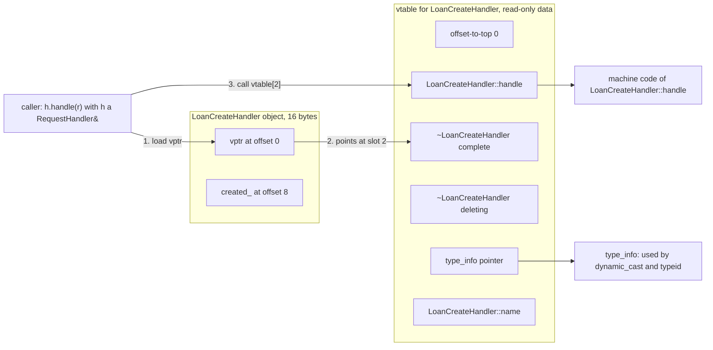

# Module 2.10: Inheritance and virtual dispatch

**Estimated hours:** 4

**What you will learn**

1. What public inheritance means ("is-a"), how `virtual`, `override`, `final` and pure virtual functions define an interface, and why a base class needs a virtual destructor.
2. What a virtual call costs in bytes and nanoseconds, how the vptr and vtable are laid out, and how to see them with `sizeof` and `g++ -fdump-lang-class`.
3. The bugs inheritance invites (slicing, missing virtual destructor, deep hierarchies) and when to prefer composition, templates or a plain concrete class instead.

**Prerequisites:** [Module 2.09: Exceptions vs error codes](module-09-exceptions-vs-error-codes.md). You need classes and constructors (2.01), RAII (2.03), smart pointers (2.05) and templates (2.06).

---

## 1. One-line intuition

A virtual function is a slot in a table that each derived class fills with its own code, so a caller holding a pointer to the base type runs the right function without knowing the real type.

## 2. Real-life analogy

A bank branch has a job description called "Teller": accept a request, verify it, respond. Every person who works a counter follows that description, but each in their own way: one handles loans, another handles deposits.

- The **job description** is the **base class** (`RequestHandler`): it names the duties but does not do them.
- A duty that the description leaves blank and every real teller must fill in is a **pure virtual function**.
- **Each real teller** is a **derived class** (`LoanCreateHandler`, `LoanQueryHandler`).
- The **branch manager** says "counter 3, handle this" without knowing who sits at counter 3. That is the **virtual call** through a base pointer.
- On the wall behind each counter is a laminated card listing which procedure this particular teller follows for each duty. That card is the **vtable** (virtual table). The small badge on the counter that says which card applies is the **vptr** (virtual pointer).

The manager's instruction is one sentence. The lookup, "which procedure does this counter use?", happens at the moment of the request, not when the branch was designed. That is **dynamic dispatch**.

## 3. Why it exists: the problem it solves

Without virtual functions, code that handles several kinds of thing needs a type tag and a `switch`:

```cpp
switch (req.kind) {
    case LOAN_CREATE: handle_create(req); break;
    case LOAN_QUERY:  handle_query(req);  break;
    // ... every new request type edits every switch in the program
}
```

Three problems. Every place that dispatches must be found and edited when a new kind is added. The data for each kind is either a union (unsafe) or a struct with every field for every kind (wasteful). And there is no way for a library to call code that did not exist when the library was compiled.

Virtual dispatch turns the switch inside out: each kind carries its own table of functions, and the caller just says "handle". New kinds are added without touching callers. This is how a request router calls handlers it has never heard of, how a test replaces a real database with a fake one (module 2.11), and how an operating system's driver model works in C (a struct of function pointers is a hand-made vtable).

What breaks without it: either a monolithic switch that grows with every feature, or hand-written function-pointer tables with no compiler checking. Virtual functions are the compiler writing and checking that table for you.

## 4. Three layers of depth

### Layer 1 (beginner): the words and the rules

**Public inheritance means is-a.** `class LoanCreateHandler : public RequestHandler` says "a LoanCreateHandler *is a* RequestHandler". Anywhere a `RequestHandler&` or `RequestHandler*` is expected, a `LoanCreateHandler` may be passed. If you cannot say "is a" honestly, do not inherit (see Layer 2, composition).

**`virtual`.** A member function marked `virtual` in the base can be replaced in a derived class. A call through a base pointer or reference runs the derived version. Without `virtual`, the base version runs no matter what the object really is.

**`override`.** Write it on every function in a derived class that is meant to replace a base virtual. The compiler then checks that a matching virtual exists. Without it, a typo in the name or a `const` mismatch silently creates a new, unrelated function and the base version keeps running. Always use it.

**`final`.** On a function: no further derived class may override it. On a class: nothing may derive from it. It documents intent and lets the compiler turn some virtual calls into direct calls (devirtualisation).

**Pure virtual and abstract classes.** `virtual Response handle(const Request&) = 0;` declares a function with no body that every concrete derived class must provide. A class with at least one pure virtual function is **abstract**: you cannot create an object of it, only of a derived class that fills every slot. An abstract class with only pure virtual functions and a virtual destructor is what C++ calls an **interface**.

**The virtual destructor rule.** If a class has any virtual function, give it a virtual destructor:

```cpp
class RequestHandler {
public:
    virtual ~RequestHandler() = default;
    virtual Response handle(const Request& req) = 0;
};
```

Reason: `delete base_ptr;` on a base without a virtual destructor runs only the base destructor. The derived part is never destroyed: its members leak, and the memory block is freed with the wrong size. The standard says this is undefined behaviour. GCC 13 warns about the direct case under `-Wall` and AddressSanitizer catches it at run time; you will see both in Lab Part B.

**Calling the base version.** Inside an override you may call `RequestHandler::handle(req)` explicitly to reuse the base behaviour.

**`protected`.** Members visible to derived classes but not to outside callers. Use sparingly: it is a wider door than `private`.

### Layer 2 (working engineer): costs, bugs and when not to inherit

**What a virtual call costs.** A non-virtual call is a direct `call` instruction to a known address, which the compiler can inline. A virtual call is: load the vptr from the object, load the function address from the vtable slot, call through the register. Two dependent loads and an **indirect call**. On a modern CPU with the target in cache and a predictable pattern (the same handler every time), the extra cost is typically one to a few nanoseconds. The hidden cost is bigger: the compiler cannot inline a function it cannot name, so no constant folding, no loop fusion, no vectorisation across the call. For a request handler called once per network request (tens of microseconds of real work) this is nothing. For a comparison function called a hundred million times inside a sort, it can double the run time. That is why `std::sort` takes a template parameter for the comparator and not a virtual interface.

**When it matters: the rule.** Virtual dispatch belongs where the set of implementations is open and the call is coarse (one call does a lot of work). Templates belong where the set is known at compile time and the call is fine-grained. Module 2.11 applies this to each pattern.

**Object slicing.** Passing or storing a derived object *by value* as its base copies only the base part:

```cpp
void by_value(Handler h);         // h is a Handler, whatever you pass in
std::vector<Handler> handlers;    // every element is exactly a Handler
```

The derived data is cut off and the vptr of the copy points at the base vtable, so virtual calls on it run the base code. There is no warning. The fix is always the same: polymorphic objects are passed by reference or pointer and stored as `std::unique_ptr<Base>` (owning) or `Base*` (non-owning). Lab Part C shows it.

**`dynamic_cast` and RTTI.** `dynamic_cast<Derived*>(base_ptr)` returns the derived pointer if the object really is that type, else `nullptr`; on references it throws `std::bad_cast`. It uses **run-time type information** (RTTI): the `type_info` object each vtable points at. `typeid(*ptr)` returns that `type_info`. The cost is a walk of the class hierarchy comparing type names, typically tens of nanoseconds, far more than a virtual call. Code that needs `dynamic_cast` often needs a virtual function instead: ask the object to do the thing, do not ask what it is. Some projects compile with `-fno-rtti`, which removes `dynamic_cast` and `typeid` but leaves virtual functions working.

**Composition over inheritance.** "Has-a" is usually more honest than "is-a". A `Connection` has a `Socket` and a `Buffer`; it is not a kind of socket. Inheriting to reuse code (a `LoggingConnection` deriving from `Connection` just to add logging) couples the two classes tightly: every change in the base can break the derived, and the derived can only exist in one hierarchy. Hold the other object as a member, or take it as a constructor parameter (dependency injection, module 2.11), and inherit only from an abstract interface.

**The NVI idiom (non-virtual interface).** Make the public function non-virtual and have it call a private virtual one. The base controls the steps that must always happen (timing, logging, locking, validation); the derived class provides only the varying step:

```cpp
class RequestHandler {
public:
    std::string handle(const std::string& body) {   // public, not virtual
        auto t0 = std::chrono::steady_clock::now();
        std::string out = do_handle(body);          // the one customisable step
        record_latency(t0);
        return out;
    }
private:
    virtual std::string do_handle(const std::string& body) = 0;   // private virtual
};
```

A private virtual function can still be overridden. Callers cannot bypass the fixed steps.

**Virtual calls in constructors and destructors.** While a base constructor runs, the object *is* a base: the vptr points at the base vtable, so a virtual call from the constructor runs the base version (or `__cxa_pure_virtual`, which aborts, if it is pure). Never call virtual functions from constructors or destructors expecting the derived version.

**When not to use inheritance.**

| Situation | Better tool |
|---|---|
| One implementation, ever (the tcpkv store) | A concrete class, no virtual functions |
| Varying behaviour known at compile time (comparator, allocator, hash) | Template parameter |
| Small closed set of alternatives | `std::variant` and `std::visit` |
| Pluggable single function | `std::function` |
| Reusing code from another class | Composition: hold it as a member |
| Deep hierarchies (A derives B derives C derives D) | Flatten: one interface, many leaves |

### Layer 3 (internals): vptr, vtable, and the two instructions of a virtual call

**Layout (Itanium C++ ABI, used by GCC and Clang on Linux).** Every class with at least one virtual function gets one hidden member at offset 0: the **vptr**, 8 bytes on x86-64, pointing into that class's **vtable**. The vtable is a constant array in the read-only data section, one per class, built at compile time. That is why section 6 prints:

```text
sizeof(OnlyVirtual)    = 8   (no data, just the vptr)
sizeof(WithVirtual)    = 16  (vptr + int + 4 bytes padding)
sizeof(DerivedVirtual) = 16  (same single vptr, y fits in the padding)
```

A derived class does not get a second vptr for a single base; it reuses the base's slot at offset 0 and gets its own vtable, which starts with the same slots in the same order (so a base-typed caller finds `handle` at the same index) followed by any new virtuals.

**What is in a vtable.** `g++ -fdump-lang-class` prints it. For the code in section 6 (Lab Part A shows the full command and file):

```text
Vtable for RequestHandler
RequestHandler::_ZTV14RequestHandler: 6 entries
0     (int (*)(...))0                           offset-to-top (for multiple inheritance)
8     (int (*)(...))(& _ZTI14RequestHandler)    pointer to type_info (used by dynamic_cast/typeid)
16    0                                         complete-object destructor (pure: none)
24    0                                         deleting destructor (pure: none)
32    (int (*)(...))__cxa_pure_virtual          handle: pure, aborts if ever called
40    (int (*)(...))__cxa_pure_virtual          name

Vtable for LoanCreateHandler
LoanCreateHandler::_ZTV17LoanCreateHandler: 6 entries
0     (int (*)(...))0
8     (int (*)(...))(& _ZTI17LoanCreateHandler)
16    (int (*)(...))LoanCreateHandler::~LoanCreateHandler
24    (int (*)(...))LoanCreateHandler::~LoanCreateHandler
32    (int (*)(...))LoanCreateHandler::handle
40    (int (*)(...))LoanCreateHandler::name
```

The object's vptr points at entry 16, not entry 0 (`vptr=((& _ZTV...) + 16)` in the dump): the two entries above it, offset-to-top and the `type_info` pointer, are found by negative indexing. The destructor has two slots: the **complete-object** destructor (destroy but do not free; used for stack objects and members) and the **deleting** destructor (destroy and then call `operator delete`; used by `delete ptr`). That second slot is exactly what `delete base_ptr` uses when the destructor is virtual, which is why making it virtual fixes the wrong-size free.

**The call.** `h.handle(r)` where `h` is a `RequestHandler&` compiles to, in effect:

```asm
mov   rax, QWORD PTR [rdi]       ; rax = vptr (first 8 bytes of the object)
call  QWORD PTR [rax+16]         ; call the function in slot 2 (offset 16 = third entry)
```

Two loads and an indirect call. The compiler cannot see the target, so it cannot inline. If the compiler *can* prove the dynamic type (the class is `final`, or the object was just constructed in the same function, or link-time optimisation sees every derived class) it replaces this with a direct call. That is **devirtualisation**; `final` is the cheapest way to enable it.

**Construction order.** For `LoanCreateHandler lc;`: the base constructor runs first and sets the vptr to the base vtable, then the base members are initialised, then the derived constructor sets the vptr to the derived vtable, then the derived members. Destruction is the exact reverse, which is why a virtual call in a base destructor sees a base object.

## 5. Architecture diagram



A `LoanQueryHandler` object has the same vptr offset and a different table with the same slot order, so the same two instructions reach different code.

## 6. Code

The program below defines the application server's `RequestHandler` interface, two concrete handlers, dispatches requests through the base type, prints the size cost of the vptr, and uses `dynamic_cast` once to show what RTTI can tell you.

```cpp
// request_handlers.cpp
// Shows: an abstract interface, two implementations, dispatch through a
// base reference, override/final, the size cost of the vptr, and dynamic_cast.
#include <iostream>
#include <memory>
#include <string>
#include <vector>

struct Request  { std::string op; std::string body; };
struct Response { int status; std::string body; };

// The interface. Pure virtual functions (= 0) make it abstract: you cannot
// create a RequestHandler object, only objects of classes derived from it.
class RequestHandler {
public:
    virtual ~RequestHandler() = default;               // rule: virtual destructor
    virtual Response handle(const Request& req) = 0;   // pure virtual
    virtual const char* name() const noexcept = 0;
};

class LoanCreateHandler final : public RequestHandler {
public:
    Response handle(const Request& req) override {
        ++created_;
        return {201, "created loan for " + req.body +
                     " (total " + std::to_string(created_) + ")"};
    }
    const char* name() const noexcept override { return "LoanCreateHandler"; }
private:
    int created_ = 0;
};

class LoanQueryHandler final : public RequestHandler {
public:
    Response handle(const Request& req) override {
        return {200, "loan " + req.body + ": balance 250000, rate 8.5"};
    }
    const char* name() const noexcept override { return "LoanQueryHandler"; }
};

// Types for the sizeof experiment.
struct Plain          { int x; };
struct OnlyVirtual    { virtual ~OnlyVirtual() = default; virtual void f() {} };
struct WithVirtual    { virtual ~WithVirtual() = default; virtual void f() {} int x; };
struct DerivedVirtual : WithVirtual { void f() override {} int y; };

int main() {
    std::vector<std::unique_ptr<RequestHandler>> handlers;
    handlers.push_back(std::make_unique<LoanCreateHandler>());
    handlers.push_back(std::make_unique<LoanQueryHandler>());

    std::vector<Request> requests = {
        {"LOAN_CREATE", "customer 42"},
        {"LOAN_QUERY",  "1001"},
        {"LOAN_CREATE", "customer 43"},
    };

    std::cout << "--- 1. dispatch through the base type ---\n";
    for (const Request& r : requests) {
        RequestHandler& h = (r.op == "LOAN_CREATE") ? *handlers[0] : *handlers[1];
        Response resp = h.handle(r);   // virtual call: which handle() runs is decided now, at run time
        std::cout << "  " << h.name() << " -> " << resp.status << " " << resp.body << '\n';
    }

    std::cout << "\n--- 2. what the vptr costs in bytes ---\n";
    std::cout << "  sizeof(Plain)          = " << sizeof(Plain)          << "  (one int, no vptr)\n";
    std::cout << "  sizeof(OnlyVirtual)    = " << sizeof(OnlyVirtual)    << "  (no data, just the vptr)\n";
    std::cout << "  sizeof(WithVirtual)    = " << sizeof(WithVirtual)    << "  (vptr + int + 4 bytes padding)\n";
    std::cout << "  sizeof(DerivedVirtual) = " << sizeof(DerivedVirtual) << "  (same single vptr, y fits in the padding)\n";
    std::cout << "  sizeof(void*)          = " << sizeof(void*)          << '\n';

    std::cout << "\n--- 3. dynamic_cast: asking an object what it really is ---\n";
    for (const auto& h : handlers) {
        if (dynamic_cast<LoanCreateHandler*>(h.get()) != nullptr)
            std::cout << "  " << h->name() << " is a LoanCreateHandler\n";
        else
            std::cout << "  " << h->name() << " is not a LoanCreateHandler\n";
    }
    return 0;
}
```

Compile and run:

```bash
g++ -std=c++17 -Wall -Wextra -Werror -g -o request_handlers request_handlers.cpp
./request_handlers
```

Expected output (identical on any x86-64 Linux with GCC):

```text
--- 1. dispatch through the base type ---
  LoanCreateHandler -> 201 created loan for customer 42 (total 1)
  LoanQueryHandler -> 200 loan 1001: balance 250000, rate 8.5
  LoanCreateHandler -> 201 created loan for customer 43 (total 2)

--- 2. what the vptr costs in bytes ---
  sizeof(Plain)          = 4  (one int, no vptr)
  sizeof(OnlyVirtual)    = 8  (no data, just the vptr)
  sizeof(WithVirtual)    = 16  (vptr + int + 4 bytes padding)
  sizeof(DerivedVirtual) = 16  (same single vptr, y fits in the padding)
  sizeof(void*)          = 8

--- 3. dynamic_cast: asking an object what it really is ---
  LoanCreateHandler is a LoanCreateHandler
  LoanQueryHandler is not a LoanCreateHandler
```

Notice in part 1 that the loop body never names a concrete handler. Add a third handler class and the loop does not change. In part 2, an empty class with one virtual function is 8 bytes: that is the vptr and nothing else. `DerivedVirtual` is still 16 because the Itanium ABI lets a derived class's members use the base's tail padding.

## 7. Use case: core-banking loan-origination platform

The application server (claim H4, capstone C2) routes each RPC to a handler. There are dozens of request types (`LoanCreate`, `LoanQuery`, `DocumentAttach`, `Disburse`, `Login`) and new ones arrive with every release. The team needed to add a request type without editing the dispatcher, and to replace a handler with a fake in tests.

**The decision it drove:** one abstract interface, `RequestHandler`, with a virtual `handle` and a virtual destructor; one concrete `final` class per request type; a registry mapping opcode to handler (module 2.11 builds it). The virtual call costs a few nanoseconds per request against a database round trip of a millisecond, so dispatch cost was never measurable. `final` on every leaf class documents that the hierarchy is one level deep and lets the compiler devirtualise where it can see the concrete type.

The same team made the opposite decision in tcpkv (claim I, capstone C1): the key-value **store is not an interface**. There is exactly one implementation, `Store`, a concrete class holding a `std::unordered_map` behind a `std::shared_mutex`. It sits on the hot path: every `GET` and `SET` touches it, and the methods are small enough that inlining matters. A virtual `IStore` would have cost an indirect call and blocked inlining in exchange for a flexibility nobody needed. When the test suite needed to vary behaviour, it used the real store with test data, not a fake. The interview phrasing: "I use an interface when there is more than one implementation or I need a fake; a single hot-path implementation stays concrete."

## 8. Lab

### Part A: run it and read the vtable (25 minutes)

1. Compile and run section 6. Confirm the four `sizeof` values.
2. Dump the class layouts:

```bash
g++ -std=c++17 -fdump-lang-class -c request_handlers.cpp
ls *.class
grep -n -A 12 "^Vtable for RequestHandler" request_handlers.cpp.001l.class
grep -n -A 12 "^Vtable for LoanCreateHandler" request_handlers.cpp.001l.class
grep -n -A 6 "^Class LoanCreateHandler" request_handlers.cpp.001l.class
```

3. In the output find: the two `__cxa_pure_virtual` entries in the base table, the two destructor entries in the derived table, the line `size=16 align=8` for `LoanCreateHandler`, and `vptr=((& LoanCreateHandler::_ZTV17LoanCreateHandler) + 16)`.
4. Add a new virtual function `virtual int priority() const noexcept { return 0; }` to `RequestHandler` after `name()`, recompile the dump, and confirm the tables grew to 7 entries with the new slot at offset 48 in both.

Expected: `.class` file is large (the standard library is in it too), but the three `grep` commands show exactly the tables printed in Layer 3.

### Part B: the missing virtual destructor, caught twice (25 minutes)

Save this as `no_virtual_dtor.cpp`:

```cpp
// no_virtual_dtor.cpp
// A base class with virtual functions but no virtual destructor.
#include <iostream>
#include <string>

struct Connection {
    virtual void send(const std::string& msg) { std::cout << "plain send: " << msg << '\n'; }
    // no virtual destructor here: this is the bug
};

struct LoggedConnection : Connection {
    char* scratch = new char[1024];                        // 1 KB owned by this object
    ~LoggedConnection() { delete[] scratch; std::cout << "LoggedConnection destroyed\n"; }
    void send(const std::string& msg) override { std::cout << "logged send: " << msg << '\n'; }
};

int main() {
    Connection* c = new LoggedConnection;
    c->send("hello");
    delete c;      // undefined behaviour: only ~Connection runs, scratch is never freed
    std::cout << "end of main\n";
    return 0;
}
```

1. Compile with the standard command. GCC 13 refuses:

```text
no_virtual_dtor.cpp:20:5: error: deleting object of polymorphic class type 'Connection' which has non-virtual destructor might cause undefined behavior [-Werror=delete-non-virtual-dtor]
```

   This is why the course insists on `-Wall -Wextra -Werror`: the compiler already knows this rule.

2. Now see what the program does at run time by letting it through with sanitizers:

```bash
g++ -std=c++17 -Wall -Wextra -g -fsanitize=address,undefined -o no_virtual_dtor no_virtual_dtor.cpp
./no_virtual_dtor
```

Expected (addresses vary):

```text
logged send: hello
==213==ERROR: AddressSanitizer: new-delete-type-mismatch on 0x502000000010 in thread T0:
  object passed to delete has wrong type:
  size of the allocated type:   16 bytes;
  size of the deallocated type: 8 bytes.
```

   ASan noticed that a 16-byte `LoggedConnection` was freed as an 8-byte `Connection`. `LoggedConnection destroyed` never printed and the 1 KB `scratch` leaked.

3. Add `virtual ~Connection() = default;` to the base. Recompile with `-Werror` (it now passes) and with ASan. Confirm `LoggedConnection destroyed` prints and ASan is silent.

### Part C: slicing (20 minutes)

Save this as `slicing.cpp`:

```cpp
// slicing.cpp
#include <iostream>
#include <string>
#include <vector>

struct Handler {
    virtual ~Handler() = default;
    virtual std::string name() const { return "Handler"; }
};
struct LoanCreateHandler : Handler {
    std::string extra = "has extra state";
    std::string name() const override { return "LoanCreateHandler"; }
};

void by_value(Handler h)        { std::cout << "  by value    : " << h.name() << '\n'; }
void by_ref(const Handler& h)   { std::cout << "  by reference: " << h.name() << '\n'; }

int main() {
    LoanCreateHandler lc;
    by_value(lc);      // copies only the Handler part: sliced
    by_ref(lc);        // refers to the whole object: correct

    std::vector<Handler> wrong;         // stores Handler objects, not pointers
    wrong.push_back(lc);                // sliced again
    std::cout << "  in vector   : " << wrong[0].name() << '\n';
    return 0;
}
```

```bash
g++ -std=c++17 -Wall -Wextra -Werror -g -o slicing slicing.cpp
./slicing
```

Expected:

```text
  by value    : Handler
  by reference: LoanCreateHandler
  in vector   : Handler
```

No warning, wrong answer twice. Fix it: change the vector to `std::vector<std::unique_ptr<Handler>>` and push `std::make_unique<LoanCreateHandler>()`, and delete `by_value`. Rerun and confirm all three lines say `LoanCreateHandler`. Then make `Handler`'s copy constructor `= delete` and see the compiler now reject the slicing call: that is the standard defence for polymorphic bases.

### Part D: NVI and devirtualisation (30 minutes)

1. Write the NVI `RequestHandler` from Layer 2 with a public non-virtual `handle` that times a private pure virtual `do_handle`, and a `PingHandler final` that returns `"PONG"`. Compile and run; it prints the timing line and `PONG`.
2. Open <https://godbolt.org/>, x86-64 gcc 13, flags `-std=c++17 -O2`. Paste a small version:

```cpp
struct Base { virtual int f() const = 0; virtual ~Base() = default; };
struct Leaf final : Base { int f() const override { return 42; } };
int via_base(const Base& b) { return b.f(); }
int via_leaf(const Leaf& l) { return l.f(); }
```

3. Read the assembly. `via_leaf` is `mov eax, 42; ret`: because `Leaf` is `final`, the compiler knows the only possible `f` and inlined it. `via_base` starts with `mov rax, [rdi]` (load the vptr) and `mov rax, [rax]` (load slot 0, which is `f`); because `Leaf` is the only derived class in this file, GCC 13 then *guesses* the target (it compares the slot with the address of `Leaf::f`, a trick called speculative devirtualisation) and keeps an indirect `call`/`jmp` as the fallback. Add a second derived class `struct Other final : Base { int f() const override { return 7; } };` and the guess disappears, leaving the plain two loads and an indirect call. Remove `final` from `Leaf` and watch `via_leaf` turn into the same thing.

Expected: you can point at the two instructions of a virtual call in real compiler output, and at the moment `final` removes them.

### Journal

Copy [journal/TEMPLATE.md](../journal/TEMPLATE.md) to `journal/YYYY-MM-DD-virtual-dispatch.md`. Record: the four `sizeof` values; the vtable slot offsets for `handle` and `name` from Part A; the exact GCC error and the ASan error name from Part B; the three lines from Part C before and after the fix; and the assembly for `via_leaf` with and without `final` from Part D.

## 9. Common mistakes and misconceptions

| Mistake | Why it is wrong | Bug it causes later |
|---|---|---|
| Base class with virtual functions and no virtual destructor | `delete base_ptr` runs only the base destructor and frees the wrong size | Leaked members, heap corruption; ASan `new-delete-type-mismatch` |
| Forgetting `override` | A name or signature typo creates a new function instead of overriding | The base version silently runs; "my override is never called" |
| Passing or storing polymorphic objects by value | Slicing copies only the base part and resets the vptr | Base behaviour where derived was expected, no warning |
| Calling a virtual function from a constructor | During construction the object is still the base type | Base version runs or `__cxa_pure_virtual` aborts |
| Using `dynamic_cast` chains instead of a virtual function | It is a type switch in disguise and costs tens of nanoseconds per cast | Every new type edits every chain; the problem virtual dispatch was meant to solve |
| Inheriting to reuse code ("a Logger is a File") | Couples unrelated classes; the derived class can be in only one hierarchy | Fragile base class: a change in the base breaks derived classes |
| Making everything virtual "for flexibility" | Blocks inlining and adds 8 bytes per object | Measurable slowdown in hot loops; the tcpkv store would pay this for nothing |
| Deep hierarchies | Each level adds hidden coupling; nobody knows which override runs | Debugging by reading five classes to find one function |

## 10. Resume link

- **Claim B, "OOP and design patterns".** Say: "My handler layer is one abstract interface with `final` leaf classes. I know the cost: a vptr per object, two dependent loads and an indirect call per dispatch, no inlining. I keep it off fine-grained hot loops and use templates there." Then quote the `sizeof` values and the two instructions from Part D.
- **Claim H4, application server.** The `RequestHandler` interface and the registry are the dispatch design; the reason is open extension and testability, and the measured dispatch cost is irrelevant next to the database round trip.
- **Claim I, tcpkv.** The store is a concrete class, not an interface, because there is one implementation on the hot path. Being able to defend a *non*-use of virtual functions is what separates understanding from habit.
- **Claim F, debugging.** When a crash dump shows a call through a garbage vtable pointer (the instruction pointer somewhere absurd right after a `call [rax+16]`), the usual causes are a use-after-free of a polymorphic object or a sliced copy. You can now read that pattern.

Likely follow-up: "What happens if you `delete` through a base pointer with no virtual destructor?" Answer with Part B: only the base destructor runs, the derived members leak, the size passed to `operator delete` is wrong, the standard calls it undefined behaviour, GCC warns and ASan reports a type mismatch.

## 11. Interview questions

**Q1 (easy). What does `virtual` do, and what does `override` add?**

<details>
<summary>Model answer</summary>

`virtual` on a base member function makes calls through a base pointer or reference dispatch at run time to the version in the object's actual class, by looking up the function in the object's vtable. `override` on the derived function asks the compiler to verify that it really overrides a base virtual with the same name, parameters and const-ness. Without `override`, a typo creates an unrelated function and the base version keeps running silently; with it, the typo is a compile error.

</details>

**Q2 (easy). Why must a base class with virtual functions have a virtual destructor?**

<details>
<summary>Model answer</summary>

Polymorphic objects are usually deleted through a base pointer. If the destructor is not virtual, `delete base_ptr` calls only the base destructor and passes the base size to `operator delete`, so the derived members are never destroyed and the block is freed with the wrong size. The standard makes it undefined behaviour. With a virtual destructor the call goes through the vtable's deleting-destructor slot, which runs the derived destructor, then the base destructor, then frees the full object. GCC's `-Wdelete-non-virtual-dtor` and AddressSanitizer's `new-delete-type-mismatch` both catch the direct case.

</details>

**Q3 (medium). What is object slicing, how does it happen, and how do you prevent it?**

<details>
<summary>Model answer</summary>

Slicing is copying a derived object into a base-typed object: passing by value to a `Base` parameter, assigning to a `Base` variable, or storing in `std::vector<Base>`. Only the base subobject is copied and the copy's vptr points to the base vtable, so the derived data is lost and virtual calls run the base code, with no diagnostic. Prevent it by never handling polymorphic objects by value: pass by reference or pointer, store `std::unique_ptr<Base>` or `std::shared_ptr<Base>`, and in the base delete the copy constructor and copy assignment so that an accidental by-value use fails to compile.

</details>

**Q4 (medium). Describe the memory layout of an object with virtual functions and what a virtual call compiles to. When does the cost matter?**

<details>
<summary>Model answer</summary>

Under the Itanium ABI the object gets a hidden 8-byte vptr at offset 0 pointing into a per-class vtable in read-only data. The vtable holds, at negative offsets, the offset-to-top and a `type_info` pointer, then one slot per virtual function in declaration order, with two slots for the destructor (complete and deleting). A derived class reuses the base's vptr and has its own table with the same leading slots. The call `b.f()` compiles to a load of the vptr, a load of slot k, and an indirect call: two dependent loads and a branch the predictor must guess, typically a few nanoseconds, and the compiler cannot inline across it. It matters when the call is fine-grained and hot, such as a comparator in a sort or a per-element visitor, and is irrelevant when each call does microseconds of work, such as handling a network request. `final` or link-time whole-program knowledge lets the compiler devirtualise and inline.

</details>

**Q5 (hard). You are designing a key-value store used by every request in a server. A colleague proposes an `IStore` interface with `get`/`set` virtual, "so we can swap implementations later". Argue the decision.**

<details>
<summary>Model answer</summary>

I would ask what the second implementation is. If there is none planned and tests can use the real store with test data, the interface buys flexibility nobody uses and costs something real on the hottest path in the process: every `get` and `set` becomes an indirect call that cannot be inlined, the small lock-and-lookup body loses optimisation across the boundary, and each store object carries a vptr. For a method that does a hash lookup under a `shared_mutex` in tens of nanoseconds, the dispatch overhead and lost inlining are a measurable fraction. So I would keep `Store` concrete and `final`. If a second implementation genuinely appears, a persistent store or a sharded one, I would prefer a template parameter on the server (`Server<Store>`), which keeps the call direct and inlinable, over a virtual interface; the virtual interface is the right tool only if implementations must be chosen at run time or loaded from a plugin. I would also point out that the handler layer above the store is where an interface pays off, because handlers are many, open-ended and each does microseconds of work, so the same project uses both tools, deliberately.

</details>

## 12. Revision

- Public inheritance is "is-a"; `virtual` functions are slots in a per-class vtable reached through a hidden 8-byte vptr; `override` checks, `final` closes and enables devirtualisation, pure virtual (`= 0`) makes the class abstract.
- Always give a polymorphic base a virtual destructor, never pass or store polymorphic objects by value (slicing), never call virtuals from constructors; a virtual call is two loads plus an indirect call and blocks inlining, which matters only in fine-grained hot loops.
- Use an interface where implementations are many or need faking (the app server's `RequestHandler`); keep a single hot-path implementation concrete (tcpkv's store); prefer composition, templates or `std::variant` over deep hierarchies.

---

Previous: [Module 2.09: Exceptions vs error codes](module-09-exceptions-vs-error-codes.md) | Next: [Module 2.11: Design patterns used in real systems](module-11-design-patterns-in-systems-code.md)
