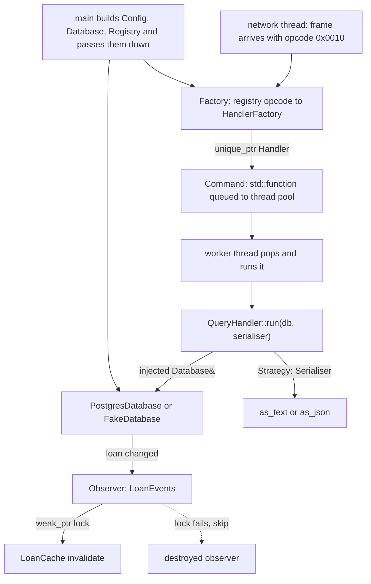

# Module 2.11: Design patterns used in real systems

**Estimated hours:** 4

**What you will learn**

1. Seven patterns that appear in every server you will build (Strategy, Factory, Observer, Command, pImpl, Singleton, dependency injection): the problem each solves and its C++17 shape.
2. When a template, `std::function` or `std::variant` beats a class hierarchy, and what each pattern costs in allocations, indirect calls and compile time.
3. How to make a server testable without a framework by injecting its dependencies through constructors, and exactly where each pattern lives in capstone C2.

**Prerequisites:** [Module 2.10: Inheritance and virtual dispatch](module-10-inheritance-and-virtual-dispatch.md). You need `std::function` and lambdas (2.08), smart pointers including `weak_ptr` (2.05) and templates (2.06).

---

## 1. One-line intuition

A design pattern is a named, reusable answer to a problem that keeps coming back: "how do I plug in behaviour", "how do I create the right object", "how do I tell others something changed", so that two engineers can say one word instead of drawing the same diagram again.

## 2. Real-life analogy

A bank branch does not reinvent its procedures per customer. It has a handful of standard arrangements:

- **A menu of ways to deliver a statement** (post, email, SMS): the customer picks one, the clerk follows it. That is **Strategy**.
- **A front desk that hands you the right form for your request number**: that is a **Factory**.
- **A notice board that departments subscribe to**, so that when a loan's status changes, risk, collections and the customer's relationship manager all hear about it without the loan officer phoning each one. That is **Observer**.
- **A tray of request slips** that any free clerk picks from and processes later, in order: that is **Command** feeding a work queue.
- **The branch's public counter** hides the back office entirely: you deal with the counter, the back office can be rearranged any day. That is **pImpl**.
- **"There is only one vault"**: true, useful, and the cause of endless trouble when every clerk reaches into it directly. That is **Singleton**.
- **A new clerk is given their stamp, their till and their terminal on day one** rather than hunting for them in a cupboard. That is **dependency injection**.

None of these is clever. They are the arrangements that survive because they keep working when the branch grows.

## 3. Why it exists: the problem it solves

The patterns in the famous 1994 "Gang of Four" book were written for languages without templates, lambdas or `std::variant`. In those languages every pluggable behaviour needed a class hierarchy. Modern C++ has three cheaper tools, and the first job of this module is to say which tool fits which pattern:

| Tool | Decided when | Cost | Best for |
|---|---|---|---|
| Template parameter | Compile time | Zero at run time; one copy of the code per type | Hot-path behaviour fixed per build (comparator, allocator, store type) |
| `std::function` | Run time | One indirect call; may heap-allocate if the callable is large | Pluggable single callable (serialiser, factory, callback) |
| `std::variant` + `std::visit` | Run time, closed set | A switch on an index; no heap, no vptr | Small fixed set of alternatives (message kinds, states) |
| Virtual interface | Run time, open set | vptr per object, indirect call, usually a heap allocation | Many implementations, plugin-like, needs a fake in tests |

What breaks without patterns is not the program; it is the team. Every engineer invents a slightly different way to plug in a serialiser or register a handler, nobody can find where things are created, a change in one place breaks three others, and testing needs a live database. Patterns are shared vocabulary plus a known cost sheet.

## 4. Three layers of depth

### Layer 1 (beginner): the seven patterns in one page each

For each pattern: the problem, the C++17 shape, the trade-off, and where it is in capstone C2.

**Strategy: pluggable behaviour.** Problem: the server must send a response as text, JSON or a binary frame depending on the client. Shape: a `std::function<std::string(const Loan&)>` (or a template parameter when the choice is per build). The handler calls `out(loan)` and never knows which. Trade-off: `std::function` costs one indirect call and, if the callable has more than about two pointers of captured state, a heap allocation at construction (not per call). Capstone C2: the wire serialiser; one function pointer chosen at connection setup.

**Factory: creating the right object from a key.** Problem: an RPC arrives with a 16-bit opcode; something must build the handler for it, and new opcodes must be addable without editing a `switch`. Shape:

```cpp
using HandlerFactory = std::function<std::unique_ptr<Handler>(long arg)>;
std::unordered_map<std::uint16_t, HandlerFactory> registry;
registry[0x0010] = [](long id) { return std::make_unique<QueryHandler>(id); };
```

Lookup is one hash probe; unknown opcode is a plain "not found" reply, not a crash. Trade-off: one heap allocation per handler object; if handlers are stateless, build them once and store `std::unique_ptr<Handler>` directly instead of a factory. Capstone C2: `HandlerRegistry` keyed by opcode.

**Observer: telling others something changed.** Problem: when a loan is updated, the in-memory cache must drop its copy; the cache must not be hard-wired into the update code. Shape: the subject keeps a list of observers and calls each on change. The classic bug: an observer is destroyed and the subject still holds its raw pointer, so the next notification is a use-after-free. The fix in C++: observers are held as `std::weak_ptr`; before notifying, `lock()` it, and skip or remove it if the lock fails. Trade-off: `weak_ptr::lock()` is an atomic increment per notification; fine for events, wrong for a per-byte hot path. Capstone C2: cache invalidation when master tables change.

**Command: a request as an object.** Problem: requests arrive on the network thread but must be executed by a pool of workers, possibly later, possibly in priority order. Shape: wrap "what to do" plus its arguments in a callable, `std::function<void()>` or a small struct with a `run()` method, and push it on a queue. Workers pop and call. Trade-off: each command may allocate (captures), and you must decide what happens to queued commands on shutdown. Capstone C2 and C1: the thread pool's job queue; the pooled request model from claim H4.

**pImpl: pointer to implementation.** Problem: a header that includes `<unordered_map>` and twelve internal headers forces every file that includes it to recompile when any of those change, and leaks the layout into the ABI. Shape: the public class holds one `std::unique_ptr<Impl>`; `Impl` is defined only in the `.cpp`. Trade-off: one heap allocation per object, one pointer indirection per call, and the destructor and move operations must be defined in the `.cpp` (where `Impl` is complete). Capstone C2: the database connection wrapper, so that the libpq headers never reach the handlers.

**Singleton: exactly one instance, globally reachable.** Problem: "there is only one configuration / logger / connection pool". Shape (the only safe one):

```cpp
static Config& instance() { static Config cfg; return cfg; }   // thread-safe since C++11
```

Why it is a trap: it is a global variable with a function in front of it. Everything that calls `instance()` is now secretly coupled to it, cannot be tested with a different config, and cannot be run twice in one process. Globals in different `.cpp` files are initialised in an unspecified order (the **static initialisation order fiasco**): if one global's constructor uses another global from a different file, it may read it before it exists. The function-local static above dodges that by constructing on first use, but destruction order at exit is still the reverse of construction and can still bite. Capstone C2: no singletons; the one `Config` object is built in `main` and passed down.

**Dependency injection without a framework.** Problem: the handler needs a database; the test must not. Shape: the handler takes `Database&` (an abstract interface) in its constructor or in `run()`. `main` builds a `PostgresDatabase`; the test builds a `FakeDatabase` with two rows. No registry, no reflection, no framework: a constructor parameter. Trade-off: one virtual call per database operation (a millisecond round trip makes it invisible), and you must choose the interface boundary with care so fakes stay small. Capstone C2: every handler test runs against `FakeDatabase`; the CI job does not need PostgreSQL to test handler logic.

### Layer 2 (working engineer): choosing the shape and paying the cost

**Strategy: `std::function` vs template.** A template strategy (`template <class Ser> class Connection`) is resolved at compile time and inlines completely, but the whole class becomes a template, and every combination is a new type. `std::function` keeps one class and one compiled copy, chosen at run time, for one indirect call. Rule: per-build choice on a hot path, template; per-connection or per-request choice, `std::function`. Both are better than a `Serialiser` class hierarchy when the strategy is a single function.

**Factory: ownership of what it makes.** Return `std::unique_ptr<Handler>`: the caller owns it, and conversion to `std::shared_ptr` is free if sharing is ever needed. Never return raw owning pointers. If the registry is filled at startup and only read afterwards, it needs no lock; document that.

**Observer: the three bugs and their fixes.**

| Bug | Symptom | Fix |
|---|---|---|
| Observer destroyed, subject still has its pointer | Use-after-free on next notify; ASan `heap-use-after-free` | `std::weak_ptr`, lock before use |
| Observer unsubscribes *during* notification | Iterator invalidated in the subject's loop | Copy the list before iterating, or mark-and-sweep after |
| Notification from a locked region calls back into the subject | Deadlock on a non-recursive mutex | Collect observers under the lock, release it, then call |

**Command: what goes in the object.** Capture by value what the worker needs (ids, copied request body) and by reference only things guaranteed to outlive the queue (the database, the store). A command that captures `this` of a connection that may close before it runs is a dangling-pointer bug; capture a `std::shared_ptr` to the connection or an id looked up at run time.

**pImpl: when it pays.** Compile-time firewall: a change to `Impl` recompiles one `.cpp`. ABI stability: a shared library can change `Impl` without clients relinking, because `sizeof(RateTable)` is always one pointer. The price is an allocation per object and an indirection per call. Do not pImpl small value types that live in hot containers; do pImpl the handful of "facade" classes at module boundaries.

**Singleton: replacing it.** Ask what the single thing really is. A logger: pass a `Logger&` or, if truly everywhere, a function-local static behind a narrow free function `log(level, msg)` is tolerable. A database pool: construct in `main`, pass by reference. A config: a `const Config&` parameter. In each case tests can now substitute, and start-up order is explicit in `main` instead of implicit in link order.

**Dependency injection: the boundary.** Inject at the level where a fake is cheap to write and a real one is expensive to run: the database, the clock, the network, the file system. Do not inject a `Hasher` interface into a hash map; that is a template parameter. Interfaces should have few methods; a `Database` with four methods is fakeable, one with forty is not.

### Layer 3 (internals): what these shapes compile to

**`std::function`.** It is a small object (32 bytes in libstdc++) holding a pointer to the callable's storage, a pointer to an "invoker" trampoline and a pointer to a "manager" (copy/destroy). Small callables (a function pointer, a lambda capturing up to about two pointers) are stored inside the 16-byte local buffer; larger ones are heap-allocated at construction. A call is: load invoker pointer, indirect call to the trampoline, which calls the real callable. Two jumps, no inlining of the callable into the caller. Compare `std::visit` on a `std::variant`: libstdc++ builds a table of function pointers indexed by `variant::index()`, so a visit is one indexed indirect call with no allocation ever.

**Function-local static initialisation.** `static Config cfg;` inside a function compiles to a guard variable check: load a byte; if it says "initialised", continue; otherwise call `__cxa_guard_acquire`, which takes a lock, double-checks, runs the constructor, sets the byte, and `__cxa_guard_release`. After the first call the cost is one byte load and a predicted branch. The thread safety of this guard is what C++11 added; before that two threads could both construct.

**Static initialisation order.** Namespace-scope objects in one translation unit are constructed top to bottom, but across translation units the order is whatever the linker produced. GCC runs the constructors from `.init_array` in link order; change the order of `.o` files on the link line and the order changes. This is why a global that depends on another global from a different file is a time bomb, and why the course bans mutable globals outside `main`.

**pImpl and `unique_ptr<Impl>` with an incomplete type.** `std::unique_ptr<T>`'s destructor contains `static_assert(sizeof(T) > 0)` to refuse deleting an incomplete type. If `~RateTable()` is left implicit, it is generated in every file that includes the header, where `Impl` is incomplete, and the build fails with "invalid application of sizeof to incomplete type". Declaring `~RateTable();` in the header and writing `RateTable::~RateTable() = default;` in the `.cpp` moves the destructor to where `Impl` is complete. Same for the move operations.

**`weak_ptr::lock()`.** It reads the control block's strong count and, if non-zero, increments it with a compare-and-swap loop (module 4.06 covers atomics). That is why the lock is cheap but not free, and why it is safe across threads: either you get a `shared_ptr` that keeps the object alive for the duration of the notification, or you get nothing.

## 5. Architecture diagram



Everything on this diagram is constructed in `main` and handed down. There is no `instance()` anywhere.

## 6. Code

One file, five patterns, in the shape they take in the application server. pImpl needs two files and is in Lab Part B.

```cpp
// patterns_demo.cpp
// Five patterns as they appear in the application server: Strategy (serialiser),
// Factory (handler registry keyed by opcode), Observer (cache invalidation with
// weak_ptr), Command (queued request objects) and constructor injection (a fake
// database so the handlers can be tested without PostgreSQL).
#include <cstdint>
#include <functional>
#include <iostream>
#include <memory>
#include <optional>
#include <queue>
#include <string>
#include <unordered_map>
#include <utility>
#include <vector>

struct Loan { long id; long amount; };

// ---------- Strategy: how a response is turned into bytes ----------
using Serialiser = std::function<std::string(const Loan&)>;

std::string as_text(const Loan& l) {
    return "loan " + std::to_string(l.id) + " amount " + std::to_string(l.amount);
}
std::string as_json(const Loan& l) {
    return "{\"id\":" + std::to_string(l.id) + ",\"amount\":" + std::to_string(l.amount) + "}";
}

// ---------- Dependency injection: the database behind an interface ----------
class Database {
public:
    virtual ~Database() = default;
    virtual std::optional<Loan> find_loan(long id) = 0;
};

class FakeDatabase final : public Database {
public:
    std::optional<Loan> find_loan(long id) override {
        auto it = rows_.find(id);
        if (it == rows_.end()) return std::nullopt;
        return it->second;
    }
private:
    std::unordered_map<long, Loan> rows_{{1001, {1001, 250000}}, {1002, {1002, 90000}}};
};

// ---------- Observer: who wants to know when a loan changes ----------
class LoanCache {
public:
    void put(const Loan& l) { entries_[l.id] = l; }
    void invalidate(long id) { entries_.erase(id); std::cout << "    cache: dropped loan " << id << '\n'; }
    std::size_t size() const { return entries_.size(); }
private:
    std::unordered_map<long, Loan> entries_;
};

class LoanEvents {
public:
    void subscribe(std::weak_ptr<LoanCache> c) { observers_.push_back(std::move(c)); }
    void loan_changed(long id) {
        std::size_t dead = 0;
        for (auto& w : observers_) {
            if (auto c = w.lock()) c->invalidate(id);   // observer still alive: notify it
            else ++dead;                                // observer gone: skip it, no crash
        }
        std::cout << "    events: notified " << observers_.size() - dead
                  << ", skipped " << dead << " dead\n";
    }
private:
    std::vector<std::weak_ptr<LoanCache>> observers_;   // non-owning
};

// ---------- Factory: opcode -> a fresh handler object ----------
class Handler {
public:
    virtual ~Handler() = default;
    virtual std::string run(Database& db, const Serialiser& out) = 0;
};

class PingHandler final : public Handler {
public:
    std::string run(Database&, const Serialiser&) override { return "PONG"; }
};

class QueryHandler final : public Handler {
public:
    explicit QueryHandler(long id) : id_(id) {}
    std::string run(Database& db, const Serialiser& out) override {
        auto loan = db.find_loan(id_);
        return loan ? out(*loan) : std::string("ERR no such loan");
    }
private:
    long id_;
};

using HandlerFactory = std::function<std::unique_ptr<Handler>(long)>;
using Registry       = std::unordered_map<std::uint16_t, HandlerFactory>;

// ---------- Command: a request becomes an object that can be queued ----------
using Command = std::function<void()>;

int main() {
    Loan l{1001, 250000};

    std::cout << "--- Strategy: same loan, two serialisers ---\n";
    for (const Serialiser& s : {Serialiser(as_text), Serialiser(as_json)})
        std::cout << "  " << s(l) << '\n';

    std::cout << "\n--- Factory: registry keyed by opcode, database injected ---\n";
    Registry registry;
    registry[0x0001] = [](long)    { return std::make_unique<PingHandler>(); };
    registry[0x0010] = [](long id) { return std::make_unique<QueryHandler>(id); };
    FakeDatabase db;                                 // handlers never learn it is fake
    std::vector<std::pair<std::uint16_t, long>> wire = {{0x0001, 0}, {0x0010, 1002}, {0x0010, 7}, {0x0099, 0}};
    for (auto [opcode, arg] : wire) {
        auto it = registry.find(opcode);
        if (it == registry.end()) { std::cout << "  opcode " << opcode << ": ERR unknown opcode\n"; continue; }
        std::unique_ptr<Handler> h = it->second(arg);
        std::cout << "  opcode " << opcode << ": " << h->run(db, as_text) << '\n';
    }

    std::cout << "\n--- Observer: cache invalidation, one observer already dead ---\n";
    LoanEvents events;
    auto cache = std::make_shared<LoanCache>();
    cache->put(l);
    events.subscribe(cache);
    {
        auto temp_cache = std::make_shared<LoanCache>();
        events.subscribe(temp_cache);
    }   // temp_cache is destroyed here; a raw pointer in 'events' would now dangle
    events.loan_changed(1001);
    std::cout << "  live cache size now " << cache->size() << '\n';

    std::cout << "\n--- Command: requests queued as objects, run later ---\n";
    std::queue<Command> work;
    for (long id : {1001L, 1002L}) {
        work.push([&db, id] {
            QueryHandler q(id);
            std::cout << "  worker ran: " << q.run(db, as_json) << '\n';
        });
    }
    std::cout << "  queued " << work.size() << " commands\n";
    while (!work.empty()) { work.front()(); work.pop(); }
    return 0;
}
```

Compile and run:

```bash
g++ -std=c++17 -Wall -Wextra -Werror -g -o patterns_demo patterns_demo.cpp
./patterns_demo
```

Expected output (fully deterministic):

```text
--- Strategy: same loan, two serialisers ---
  loan 1001 amount 250000
  {"id":1001,"amount":250000}

--- Factory: registry keyed by opcode, database injected ---
  opcode 1: PONG
  opcode 16: loan 1002 amount 90000
  opcode 16: ERR no such loan
  opcode 153: ERR unknown opcode

--- Observer: cache invalidation, one observer already dead ---
    cache: dropped loan 1001
    events: notified 1, skipped 1 dead
  live cache size now 0

--- Command: requests queued as objects, run later ---
  queued 2 commands
  worker ran: {"id":1001,"amount":250000}
  worker ran: {"id":1002,"amount":90000}
```

Three things to notice. The factory loop has no `switch` and does not know the handler classes exist. The observer block survived a destroyed subscriber because `weak_ptr::lock()` returned empty; Lab Part D shows the raw-pointer version crashing. And the "worker" is `main` itself; in capstone C2 the same `std::queue<Command>` is drained by a thread pool.

## 7. Use case: core-banking loan-origination platform

The application server (claim H4, capstone C2) had to be tested in CI on every commit. The first version of its handlers created their own database connection from a global `ConnectionPool::instance()`. Testing a handler meant a running database, test data loaded in the right order, and cleanup; the CI job took eleven minutes and failed whenever two builds ran at once against the same database.

**The decision it drove:** remove the singleton pool and inject `Database&` into every handler through the constructor. `main` builds one `PostgresDatabase` (later `YugabyteDatabase`, same interface) and passes it to the registry, which passes it to each handler it creates. The test binary builds a `FakeDatabase` holding a few `Loan` rows in a map. Handler logic (validation, limits, status codes) is tested in milliseconds with no database; only a small integration suite still touches PostgreSQL. The same change made the YugabyteDB migration (capstone C3/C4) a one-line swap in `main`.

The other patterns followed from the same requirement: the registry keyed by opcode so a new request type is one `registry[opcode] = ...` line plus one class; the master-table cache subscribing to change events through `weak_ptr` so a cache that is torn down during shutdown cannot be called after death; requests wrapped as commands so the network thread never executes handler code and the pool size bounds concurrency. tcpkv (capstone C1) uses only the Command pattern: its store is concrete, its protocol has one serialiser, and adding a factory or an observer there would be pattern for its own sake.

## 8. Lab

### Part A: run it, then extend the registry (20 minutes)

1. Compile and run section 6. Confirm the output matches exactly.
2. Add an opcode `0x0020` that creates a `BalanceHandler` returning `"balance " + amount` for a loan id, or `"ERR no such loan"`. Add `{0x0020, 1001}` to `wire`. Count how many existing lines you changed (it should be zero; you only added).
3. Replace `as_text` in the factory loop with `as_json` and rerun. The handlers did not change; the strategy did.

Expected: one new class, one registry line, one wire entry; output gains `opcode 32: balance 250000`.

### Part B: pImpl and the compile-time firewall (30 minutes)

Create three files.

```cpp
// rate_table.h : the public face. Nothing about how rates are stored leaks out.
#pragma once
#include <memory>
#include <string>

class RateTable {
public:
    RateTable();
    ~RateTable();                                   // must be defined where Impl is complete
    RateTable(RateTable&&) noexcept;
    RateTable& operator=(RateTable&&) noexcept;
    double rate_for(const std::string& product) const;
private:
    struct Impl;                                    // declared, not defined
    std::unique_ptr<Impl> impl_;                    // one pointer: sizeof(RateTable) == 8
};
```

```cpp
// rate_table.cpp : the hidden part. Change anything here; main.cpp does not recompile.
#include "rate_table.h"
#include <unordered_map>

struct RateTable::Impl {
    std::unordered_map<std::string, double> rates{{"HOME", 8.5}, {"AUTO", 9.75}, {"GOLD", 7.2}};
};

RateTable::RateTable() : impl_(std::make_unique<Impl>()) {}
RateTable::~RateTable() = default;                  // here Impl is complete, so delete works
RateTable::RateTable(RateTable&&) noexcept = default;
RateTable& RateTable::operator=(RateTable&&) noexcept = default;

double RateTable::rate_for(const std::string& product) const {
    auto it = impl_->rates.find(product);
    return it == impl_->rates.end() ? 0.0 : it->second;
}
```

```cpp
// pimpl_main.cpp
#include "rate_table.h"
#include <iostream>
int main() {
    RateTable t;
    std::cout << "sizeof(RateTable) = " << sizeof(RateTable) << '\n';
    std::cout << "HOME rate = " << t.rate_for("HOME") << '\n';
    std::cout << "NONE rate = " << t.rate_for("NONE") << '\n';
}
```

```bash
g++ -std=c++17 -Wall -Wextra -Werror -g -c rate_table.cpp
g++ -std=c++17 -Wall -Wextra -Werror -g -c pimpl_main.cpp
g++ -o pimpl rate_table.o pimpl_main.o
./pimpl
```

Expected:

```text
sizeof(RateTable) = 8
HOME rate = 8.5
NONE rate = 0
```

Now the experiment: change the `GOLD` rate in `rate_table.cpp` to `7.0`, and rebuild **only** `rate_table.o` and the link. `pimpl_main.o` is untouched and still correct. Then remove the line `~RateTable();` from the header and the `= default` line from the `.cpp`, rebuild, and read the error: `invalid application of 'sizeof' to incomplete type 'RateTable::Impl'`. Put them back. That error is Layer 3's `static_assert` inside `unique_ptr`, and it is the single most common pImpl mistake.

### Part C: the singleton's lazy construction (15 minutes)

```cpp
// singleton.cpp
#include <iostream>
#include <string>
class Config {
public:
    static Config& instance() {
        static Config cfg;          // C++11: initialised once, thread-safe, on first call
        return cfg;
    }
    std::string db_host = "localhost";
private:
    Config() { std::cout << "Config constructed\n"; }
};
int main() {
    std::cout << "main started\n";
    std::cout << Config::instance().db_host << '\n';
    std::cout << Config::instance().db_host << '\n';
}
```

```bash
g++ -std=c++17 -Wall -Wextra -Werror -g -o singleton singleton.cpp
./singleton
```

Expected:

```text
main started
Config constructed
localhost
localhost
```

`Config constructed` appears *after* `main started`: construction happened on first use, not at program start, and only once. Now answer in your journal: how would you test code that reads `Config::instance().db_host` against a different host? (Honest answer: you cannot without editing the singleton. Then rewrite the user to take `const Config&` and see that the test is a one-liner.) Optional: disassemble with `objdump -d singleton | grep -A 20 "<_ZN6Config8instanceEv>:"` and find the guard-byte test and the call to `__cxa_guard_acquire`.

### Part D: the dangling observer, with and without weak_ptr (30 minutes)

1. Copy section 6 to `raw_observer.cpp`. Change `LoanEvents` to hold `std::vector<LoanCache*>` and `subscribe(LoanCache*)`, call `w->invalidate(id)` directly, and subscribe with `cache.get()` and `temp_cache.get()`.
2. Build with sanitizers and run:

```bash
g++ -std=c++17 -Wall -Wextra -g -fsanitize=address,undefined -o raw_observer raw_observer.cpp
./raw_observer
```

Expected: the first observer is notified, then:

```text
==51==ERROR: AddressSanitizer: heap-use-after-free on address 0x502000000050 ...
READ of size 4 at 0x502000000050 thread T0
    #0 ... in LoanCache::invalidate(long) raw_observer.cpp:...
    #1 ... in LoanEvents::loan_changed(long) raw_observer.cpp:...
```

3. Restore `weak_ptr`, rebuild with ASan, confirm it is silent and prints `skipped 1 dead`.
4. Add a third fix that does not use `weak_ptr`: an `unsubscribe(LoanCache*)` method, called from `LoanCache`'s destructor. Note what it needs that `weak_ptr` did not: the cache must know about the events object (a back-pointer), and in a multithreaded server the unsubscribe and the notify must take the same lock.

### Journal

Copy [journal/TEMPLATE.md](../journal/TEMPLATE.md) to `journal/YYYY-MM-DD-design-patterns.md`. Record: the number of existing lines changed in Part A (should be zero); the exact `sizeof` error text from Part B and the sentence explaining it; the order of the first two output lines from Part C and your answer about testability; the ASan error name and the two stack frames from Part D.

## 9. Common mistakes and misconceptions

| Mistake | Why it is wrong | Bug it causes later |
|---|---|---|
| A class hierarchy for every pattern | Templates, `std::function` and `std::variant` are cheaper for single functions and closed sets | vptrs, allocations and indirection on hot paths for no benefit |
| Observers held as raw pointers | A destroyed observer leaves a dangling pointer in the subject | Use-after-free on the next notification, often only at shutdown |
| Notifying observers while holding the subject's lock | An observer that calls back into the subject deadlocks | Server hangs under a rare ordering |
| Command captures `this` of a short-lived object by reference | The command may run after the object is gone | Dangling pointer in the worker thread |
| Singleton "because there is only one" | It is a global; it couples every user and blocks testing | Tests need the real database; init-order crashes at startup |
| Mutable globals across translation units | Construction order across files is unspecified | Works in one build, crashes when the link order changes |
| pImpl with the destructor left implicit in the header | `unique_ptr<Impl>` must delete a complete type | `invalid application of sizeof to incomplete type` |
| Injecting everything, including hot-path helpers, through virtual interfaces | Virtual calls on fine-grained operations block inlining | Slower code and forty-method interfaces nobody can fake |

## 10. Resume link

- **Claim B, "OOP and design patterns".** Do not list pattern names. Say: "In the app server the handler registry is a map from opcode to a factory returning `unique_ptr<Handler>`; handlers take `Database&` by constructor so tests use a fake; the cache subscribes to change events through `weak_ptr` so a torn-down cache cannot be called; and requests are queued as `std::function` commands to the pool. I removed a singleton connection pool to make that possible." Each sentence names a pattern, a shape and a reason.
- **Claim H4, application server, "pooled request model".** The Command pattern feeding a thread pool is exactly that phrase.
- **Claim G, "GoogleTest".** Dependency injection is what makes unit tests possible; the fake database from Part D is a test double you wrote yourself in twelve lines, with no mocking framework.

Likely follow-up: "Why not a mocking framework?" Answer: a hand-written fake behind a four-method interface is shorter than the mock setup, is readable by anyone, and does not depend on the interface's call order. Mocks earn their place when you must assert *how* a dependency was called, which is rare for a database.

## 11. Interview questions

**Q1 (easy). What is the Strategy pattern and how would you write it in modern C++?**

<details>
<summary>Model answer</summary>

Strategy makes one step of an algorithm pluggable: the serialisation format of a response, the comparison in a sort, the retry policy of a client. Classically it is an abstract `Strategy` base class with one virtual method and a concrete subclass per choice. In C++17 a single-function strategy is better expressed as a `std::function` member when the choice is made at run time, or as a template parameter when it is fixed per build and on a hot path; a class hierarchy is only needed when the strategy carries several related methods and state.

</details>

**Q2 (easy). Why is a singleton considered a problem, and what is the safe way to write one if you must?**

<details>
<summary>Model answer</summary>

A singleton is a global variable behind a function: every caller is coupled to one hidden instance, so it cannot be substituted in tests or run twice in one process, and if it is a namespace-scope global its construction order relative to globals in other files is unspecified, the static initialisation order fiasco. If one is unavoidable, use a function-local static: `static T& instance() { static T t; return t; }`. Since C++11 that initialisation is guaranteed to happen once and to be thread-safe, and it happens on first use rather than at an unknown time before `main`. The better answer is to construct the object in `main` and pass it by reference to whoever needs it.

</details>

**Q3 (medium). Describe the dangling-observer bug and two ways to fix it, with their trade-offs.**

<details>
<summary>Model answer</summary>

The subject holds pointers to its observers. When an observer is destroyed without unsubscribing, the pointer dangles and the next notification is a use-after-free, which AddressSanitizer reports as `heap-use-after-free`. Fix one: hold `std::weak_ptr` to observers that are owned by `shared_ptr`; on notify, `lock()` each one and skip those that return empty, pruning them occasionally. Cost: an atomic increment per notification and the requirement that observers be `shared_ptr`-managed. Fix two: an explicit `unsubscribe` called from the observer's destructor. Cost: the observer needs a back-pointer to the subject, both must take the same mutex in a multithreaded program, and a forgotten unsubscribe reintroduces the bug. `weak_ptr` is safer by default; explicit unsubscribe is used when the observer cannot be heap-allocated or the notification path is too hot for atomics.

</details>

**Q4 (medium). Explain pImpl: what it buys, what it costs, and the mistake everyone makes the first time.**

<details>
<summary>Model answer</summary>

pImpl hides a class's implementation behind a single `std::unique_ptr<Impl>` member, with `Impl` defined only in the `.cpp`. It buys a compile-time firewall, since changes to `Impl` recompile one file instead of every includer, and ABI stability, since the public class's size and layout never change, which matters for shared libraries. It costs one heap allocation per object, one pointer indirection per member call, and a little boilerplate. The classic mistake is leaving the destructor (and move operations) implicitly defined in the header: `unique_ptr`'s deleter contains a `static_assert` that the type is complete, and in the header `Impl` is incomplete, so the build fails with "invalid application of sizeof to incomplete type". The fix is to declare the destructor in the header and define it, `= default`, in the `.cpp` where `Impl` is complete.

</details>

**Q5 (hard). Design the request path of a multithreaded RPC server, naming which pattern you use at each step, which C++ shape you pick for it and why, and where you deliberately avoid a pattern.**

<details>
<summary>Model answer</summary>

A network thread reads a frame and extracts the opcode. Factory: an `unordered_map<uint16_t, std::function<unique_ptr<Handler>(Args)>>` filled at startup and read-only afterwards, so lookup is one hash probe without a lock; `unique_ptr` so ownership of the handler is explicit. Command: the handler plus its arguments is wrapped in a `std::function<void()>` that captures ids by value and long-lived services by reference, and pushed on the thread pool's queue; this is the pooled request model, and it keeps handler code off the network thread. Dependency injection: `main` constructs the database, the cache and the config once and passes references into the registry so each handler receives `Database&`; tests pass a `FakeDatabase`, which is why the handler suite runs without PostgreSQL. Strategy: the response serialiser is a `std::function` chosen per connection at handshake, since the choice is per client and one indirect call per response is nothing next to the socket write. Observer: the in-memory master-table cache subscribes to change events via `weak_ptr`, notified outside the subject's lock to avoid deadlock, so a cache torn down during shutdown is skipped rather than called. Deliberately avoided: no singleton for the pool or config, because they would make the fake database impossible; no virtual interface on the key-value store or on the hash function, because those are single-implementation hot paths where a template or a concrete class keeps the call inlined; no pImpl on small value types like `Loan`, because an allocation per value would dominate. Each choice is defended by its cost: a virtual call or `std::function` where the work per call is microseconds, templates or concrete classes where it is nanoseconds.

</details>

## 12. Revision

- Strategy is a pluggable function (`std::function` at run time, template at compile time); Factory is a map from key to creator returning `unique_ptr`; Command is a queued `std::function<void()>`; Observer holds `weak_ptr` and locks before notifying.
- pImpl hides layout behind one `unique_ptr<Impl>` for a compile firewall and ABI stability at the cost of an allocation and an indirection, with the destructor defined in the `.cpp`; a Singleton is a global in disguise, use a function-local static if forced and prefer passing dependencies from `main`.
- Dependency injection is a constructor parameter of interface type: `Database&` real in `main`, fake in tests; that single decision made the app server testable in CI without a database.

---

Previous: [Module 2.10: Inheritance and virtual dispatch](module-10-inheritance-and-virtual-dispatch.md) | Next: [Module 2.12: Memory and ownership design](module-12-memory-and-ownership-design.md)
