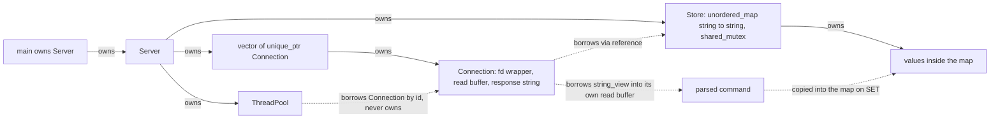

# Module 2.12: Memory and ownership design

**Estimated hours:** 4

**What you will learn**

1. How to draw who owns and who borrows every object in a design, and the decision table that turns that drawing into `T`, `unique_ptr`, `shared_ptr`, `weak_ptr`, a reference or a raw pointer.
2. What `std::string_view` and `span` are (non-owning views), why they are fast, and how they dangle, shown with AddressSanitizer.
3. How to keep heap allocations off a server's hot path with `reserve`, buffer reuse, an object pool with a free list and `std::pmr`, and how to count allocations to prove it.

**Prerequisites:** [Module 2.11: Design patterns used in real systems](module-11-design-patterns-in-systems-code.md). You need RAII (2.03), move semantics (2.04), smart pointers and the control block (2.05), and vector internals (2.07).

---

## 1. One-line intuition

For every object, exactly one place must be responsible for destroying it; everyone else only borrows it, and a borrow must never outlive the owner. Ownership design is writing that rule down before the code, and allocation design is making sure the hot path never asks the heap for anything.

## 2. Real-life analogy

A bank branch has one key register. Every physical key (the vault, the cash drawer, the server room) has exactly one **keeper** written in the register. A keeper may lend a key for an hour; the borrower signs the register and must return it before the keeper goes home. Two rules make the branch safe:

- **One keeper per key.** If two people both think they must lock the key away at night, one of them will lock away a key the other is still using (that is a **double free**), or each will assume the other did it and the key is left on a desk (a **leak**).
- **Borrow shorter than the keeper's shift.** A borrower who keeps a key after the keeper has gone home and the vault has been re-keyed holds a key that opens nothing, or worse, opens the wrong thing. That is a **dangling pointer**.

Now the allocation half. The counter clerk serving a queue of 200 customers does not walk to the stationery cupboard for a fresh form each time. She keeps a stack of forms on the desk, refilled when the queue is empty. The cupboard is the **heap**; the stack on the desk is a **reused buffer** or a **pool**. Walking to the cupboard per customer is the per-request `new` that this module removes.

## 3. Why it exists: the problem it solves

In C (Phase 1) every `malloc` had to be matched by exactly one `free`, by hand, and the compiler did not help. Modules 2.03 to 2.05 gave you RAII, `unique_ptr` and `shared_ptr`, which make the *mechanics* automatic. They do not make the *design* automatic. Three problems remain:

1. **Unclear ownership.** A function receives a `Connection*`. May it delete it? Store it? Nobody knows without reading the whole program. `shared_ptr` everywhere "solves" this by making everyone an owner, which hides the lifetime, adds atomic reference counting to every copy, and creates cycles that never free.
2. **Dangling views.** `std::string_view` and `span` avoid copies by pointing into someone else's memory. If that someone goes away first, the view reads garbage. The compiler cannot see it.
3. **Allocation on the hot path.** `malloc` is typically tens of nanoseconds when the heap is quiet, hundreds under contention from many threads, and it fragments over days of uptime. A server that allocates five times per request spends more time in the allocator than in its own logic, and its 99th-percentile latency is set by the allocator's lock.

What breaks without ownership design: the crashes in capstone C6 (use-after-free, double free, leaks under load) and the latency cliffs in capstone C1 and C2. The resume phrase "memory and ownership design" means you decided these things on purpose and can show the drawing.

## 4. Three layers of depth

### Layer 1 (beginner): the ownership drawing and the decision table

**Draw it first.** For each object in a design, write who owns it (solid arrow) and who borrows it (dotted arrow). Then check: every object has exactly one solid arrow in, and every dotted arrow starts from something that lives shorter than the owner. Section 5 draws tcpkv.

**The decision table.** Read the rows top to bottom; stop at the first that fits.

| Question | Answer | Write |
|---|---|---|
| Can the object simply live inside its owner as a member or a local? | Yes | `T value;` (a plain value). This is the default and the fastest |
| Does exactly one place own it and must its lifetime be dynamic (created later, moved around, polymorphic)? | Yes | `std::unique_ptr<T>`. Zero overhead over a raw pointer; move-only |
| Do several owners genuinely share it and is the last one to leave unknowable in advance? | Yes | `std::shared_ptr<T>`. Pay for the control block and atomic counts; use `make_shared` |
| Do you need to observe a `shared_ptr`-owned object without keeping it alive? | Yes | `std::weak_ptr<T>`; `lock()` before use |
| Do you just need to use an object that someone else owns and will outlive this use? | Yes | `T&` (must exist) or `T*` (may be null). Never delete through it |
| Do you need to look at a range of characters or elements without copying and without owning? | Yes | `std::string_view`, `span` (Layer 2) |

The two mistakes beginners make are at the ends of the table: not using plain values enough (everything on the heap "to be safe") and using `shared_ptr` when a `unique_ptr` plus borrowed references would do.

**Functions: how to take parameters.**

| Parameter means | Signature |
|---|---|
| "I will look at it" | `const T&` (or `std::string_view`, `span<const T>` for ranges; by value for `int`-sized types) |
| "I will change it" | `T&` |
| "I take ownership" | `std::unique_ptr<T>` by value (caller writes `std::move`) |
| "I will share ownership" | `std::shared_ptr<T>` by value |
| "I might store a non-owning pointer, it may be null" | `T*` |

A function that takes `const std::shared_ptr<T>&` "to avoid the copy" is a smell: it almost always only looks at the object, so it should take `const T&`.

**Returning.** Return values, `unique_ptr`, or `shared_ptr`. Never return a reference or `string_view` to a local or a temporary; Lab Part B shows the crash.

### Layer 2 (working engineer): views, hot paths, pools and pmr

**`std::string_view`.** Two words: a `const char*` and a length. It points into a `std::string`, a string literal, or a character array, and copies nothing. Functions that only read text should take `std::string_view` by value: a `const std::string&` parameter forces a caller with a `const char*` or a substring to build a temporary `std::string` (a heap allocation if over 15 characters). The danger: the view does not keep the characters alive. A view into a temporary string is dead at the end of the full expression. Rules: never store a `string_view` in a member unless the owner is documented to outlive the object; never return one that refers to a parameter taken by value or a local; and a `string_view` is not null-terminated, so never pass `.data()` to a C function expecting a C string.

**`span` and a C++17 stand-in.** `std::span<T>` (C++20) is the same idea for arrays: a pointer and a count, viewing a C array, `std::array`, `std::vector` or a raw buffer. One `sum(Span<const long>)` replaces three overloads. Write a minimal one in C++17 (Lab Part C); it is 20 lines and the course uses it until Phase 2's C++20 module.

**Allocation on the hot path: the toolkit.**

| Technique | What it does | Where tcpkv and the app server use it |
|---|---|---|
| `reserve(n)` | One allocation instead of log2(n) regrowths | Response vectors, the per-connection token list |
| Small-string optimisation (SSO) | libstdc++ keeps strings up to 15 characters inside the object; no heap | Keys and short values never allocate |
| Reuse a buffer | `clear()` keeps capacity; the second fill allocates nothing | Per-connection read buffer and response string, reused across every request |
| Object pool with a free list | Pre-allocate N objects; acquire and release are pointer swaps | Connection/session objects, bounded by the pool size |
| Arena / `std::pmr::monotonic_buffer_resource` | Bump-allocate from one block, free everything at once | Per-request scratch memory; the C arena allocator in capstone C3 |
| Avoid `shared_ptr` copies | Each copy is an atomic increment | Pass `const T&` into handlers |

**Measuring it.** Two tools. A replaced global `operator new` that counts calls (section 6) gives exact, deterministic numbers in a unit test: "this request path performs 0 allocations" becomes an assertion. `valgrind --tool=massif` records the heap over time and `ms_print` draws it, which finds the slow leak and the startup spike (Lab Part D). Timing allocations is a Phase 8 job; counting them is a Phase 2 habit.

**The pool's trade-offs.** A fixed pool is a decision about capacity: when it is empty, `acquire` returns `nullptr` and the server must shed load (close the connection with "busy") rather than fall back to `new` silently, or the bound was never real. Objects from a pool are not zeroed; the constructor runs via placement `new`, so initialise every member. And a pool is per-thread or locked; module 4.10 adds the lock.

**`std::pmr` preview.** C++17 added polymorphic allocators in `<memory_resource>`. `std::pmr::vector<int> v(&arena)` is a normal vector whose memory comes from a `memory_resource` object chosen at run time. `monotonic_buffer_resource` hands out memory from a buffer you give it (a stack array, say) and never frees individual blocks; everything is released when the resource is destroyed. That is the per-request arena in one line. Lab Part C runs it and counts zero heap allocations.

### Layer 3 (internals): what the objects and the allocator actually look like

**Sizes on x86-64 with libstdc++ (GCC 13).** `unique_ptr<T>` with the default deleter is 8 bytes: exactly one pointer, no overhead. `shared_ptr<T>` is 16 bytes: the object pointer and a pointer to the control block, which holds the strong count, the weak count and the deleter; `make_shared` puts the object and the control block in one allocation. `weak_ptr` is also 16 bytes. `string_view` is 16 bytes (pointer and length). `std::string` is 32 bytes: a pointer, a length, and a 16-byte union that is either the capacity or the 15-character local buffer plus terminator (the SSO). `std::vector` is 24 bytes: begin, end, and end-of-capacity pointers. Knowing these lets you reason about what a copy costs and why a `vector<string>` of short strings never touches the heap for the strings themselves.

**What `new` does.** `operator new(n)` calls `malloc(n)`. glibc's malloc keeps per-thread arenas with free lists binned by size; a small allocation on a warm arena is typically tens of nanoseconds (a lock, a bin lookup, a pointer update). Under contention threads fall back to other arenas or take the main arena's lock, and latency becomes unpredictable. Each block carries a 16-byte header, so 10,000 `Session` objects of 16 bytes consume about 320 KB, not 160 KB. Freed blocks are kept for reuse, so a process's resident memory rarely shrinks; a server that allocates in a sawtooth pattern fragments its arenas over days. The pool in section 6 avoids all of this: its memory is one contiguous block, its free list is threaded through the unused slots, and `acquire` is two pointer loads and a placement `new`.

**Placement `new` and the free list.** `new (addr) T(args...)` constructs a `T` at an address you supply and allocates nothing. To destroy it you call `obj->~T()` yourself. The pool stores a `FreeNode { FreeNode* next; }` *inside* each unused slot (the slot is at least pointer-sized), so the pool needs no separate bookkeeping array: the free list lives in the free memory. This is the same trick glibc's bins and the Linux kernel's slab allocator use (module 3.05).

**Why views are fast and why they dangle.** A `string_view` parameter is passed in two registers; no constructor, no destructor, nothing touches memory. The compiler sees two scalars. It does not know they point into a `std::string` whose buffer is released when that string's destructor runs, which for a temporary is at the end of the full expression. There is no run-time check and GCC 13 gives no warning for the case in Lab Part B. The only defences are the rules in Layer 2 and AddressSanitizer, which poisons freed memory so the read is caught.

**How the allocation counter works.** The program replaces the global `operator new` and `operator delete`. The replacement must be visible to the whole program, which it is, because the linker prefers a definition in your object file over the one in libstdc++. `std::vector`, `std::string` and `make_unique` all end in `operator new`, so the counter sees everything except `malloc` called directly by C libraries.

## 5. Architecture diagram



Solid arrows are the single owner; dotted arrows are borrows. Every dotted arrow starts at something destroyed before the thing it points to: the parsed command dies with the request, the connection dies before the server, the pool is joined before the connections are destroyed.

## 6. Code

The program counts every heap allocation the standard library makes, then shows three hot-path techniques: `reserve`, a reused response buffer, and a 50-line object pool with an intrusive free list.

```cpp
// allocations_demo.cpp
// Shows: counting heap allocations by replacing operator new, how reserve and
// a reused buffer remove allocations, and a fixed-capacity object pool with a
// free list so a hot path never calls the heap.
#include <cstddef>
#include <cstdlib>
#include <iostream>
#include <new>
#include <string>
#include <utility>
#include <vector>

// ---- 1. Count every heap allocation made by this program ----
static std::size_t g_allocs = 0;
static std::size_t g_bytes  = 0;

void* operator new(std::size_t n) {
    ++g_allocs;
    g_bytes += n;
    if (void* p = std::malloc(n)) return p;
    throw std::bad_alloc();
}
void operator delete(void* p) noexcept { std::free(p); }
void operator delete(void* p, std::size_t) noexcept { std::free(p); }

struct Counter {                       // snapshot, then report the difference
    std::size_t a0 = g_allocs, b0 = g_bytes;
    void report(const char* label) const {
        std::cout << "  " << label << ": " << (g_allocs - a0) << " allocations, "
                  << (g_bytes - b0) << " bytes\n";
    }
};

// ---- 2. Building a protocol response: fresh string vs reused buffer ----
std::string build_fresh(long id, long balance) {
    std::string out = "OK loan ";
    out += std::to_string(id);
    out += " balance ";
    out += std::to_string(balance);
    out += " status ACTIVE branch MUMBAI-FORT\r\n";
    return out;                                   // moved out, no copy
}
void build_reused(std::string& out, long id, long balance) {
    out.clear();                                  // length 0, capacity kept
    out += "OK loan ";
    out += std::to_string(id);
    out += " balance ";
    out += std::to_string(balance);
    out += " status ACTIVE branch MUMBAI-FORT\r\n";
}

// ---- 3. A fixed-capacity object pool with an intrusive free list ----
template <typename T, std::size_t N>
class Pool {
    struct FreeNode { FreeNode* next; };
    static constexpr std::size_t SlotSize  = sizeof(T) > sizeof(FreeNode) ? sizeof(T) : sizeof(FreeNode);
    static constexpr std::size_t SlotAlign = alignof(T) > alignof(FreeNode) ? alignof(T) : alignof(FreeNode);
public:
    Pool() {
        // Thread the free list through every empty slot: slot i -> slot i+1.
        FreeNode* next = nullptr;
        for (std::size_t i = N; i-- > 0;)
            next = new (slot(i)) FreeNode{next};  // placement new builds the node in place
        free_ = next;
    }
    Pool(const Pool&) = delete;
    Pool& operator=(const Pool&) = delete;

    template <typename... Args>
    T* acquire(Args&&... args) {
        if (free_ == nullptr) return nullptr;     // exhausted: the caller decides what to do
        FreeNode* node = free_;
        free_ = node->next;
        ++in_use_;
        return new (node) T(std::forward<Args>(args)...);   // construct T in the slot: no heap call
    }
    void release(T* obj) {
        obj->~T();                                // run the destructor by hand
        free_ = new (obj) FreeNode{free_};        // the slot becomes a free-list node again
        --in_use_;
    }
    std::size_t in_use() const noexcept { return in_use_; }
    std::size_t capacity() const noexcept { return N; }
private:
    unsigned char* slot(std::size_t i) { return storage_ + i * SlotSize; }
    alignas(SlotAlign) unsigned char storage_[N * SlotSize];
    FreeNode* free_ = nullptr;
    std::size_t in_use_ = 0;
};

struct Session {                                  // what the pool hands out
    int fd;
    long customer;
    Session(int f, long c) : fd(f), customer(c) {}
};

int main() {
    std::cout << "--- 1. vector growth: push_back without and with reserve ---\n";
    {
        Counter c;
        std::vector<int> v;
        for (int i = 0; i < 1000; ++i) v.push_back(i);
        c.report("1000 push_back, no reserve   ");
    }
    {
        Counter c;
        std::vector<int> v;
        v.reserve(1000);
        for (int i = 0; i < 1000; ++i) v.push_back(i);
        c.report("1000 push_back, reserve(1000)");
    }

    std::cout << "\n--- 2. 1000 responses: fresh string each time vs one reused buffer ---\n";
    std::size_t total_len = 0;
    {
        Counter c;
        for (long i = 0; i < 1000; ++i) total_len += build_fresh(1000 + i, 250000 + i).size();
        c.report("fresh std::string per response");
    }
    {
        Counter c;
        std::string buf;
        for (long i = 0; i < 1000; ++i) { build_reused(buf, 1000 + i, 250000 + i); total_len += buf.size(); }
        c.report("one reused std::string        ");
    }
    std::cout << "  (total bytes produced both ways: " << total_len << ")\n";

    std::cout << "\n--- 3. object pool vs heap: 10000 sessions ---\n";
    {
        Counter c;
        Pool<Session, 64> pool;
        Session* live[64] = {};
        for (int round = 0; round < 10000 / 64; ++round) {
            for (int i = 0; i < 64; ++i) live[i] = pool.acquire(100 + i, 42L + i);
            for (int i = 0; i < 64; ++i) pool.release(live[i]);
        }
        for (int i = 0; i < 64; ++i) live[i] = pool.acquire(i, 0L);
        Session* extra = pool.acquire(999, 0L);
        std::cout << "  65th acquire on a 64-slot pool returns "
                  << (extra == nullptr ? "nullptr" : "an object") << '\n';
        for (int i = 0; i < 64; ++i) pool.release(live[i]);
        std::cout << "  in use after test: " << pool.in_use() << " of " << pool.capacity() << '\n';
        c.report("pool, 10000 sessions          ");
    }
    {
        Counter c;
        for (int i = 0; i < 10000; ++i) { auto* s = new Session(i, 0L); delete s; }
        c.report("heap, 10000 sessions          ");
    }
    return 0;
}
```

Compile and run:

```bash
g++ -std=c++17 -Wall -Wextra -Werror -g -o allocations_demo allocations_demo.cpp
./allocations_demo
```

Expected output (exact on GCC 13 with libstdc++; another standard library may grow vectors differently):

```text
--- 1. vector growth: push_back without and with reserve ---
  1000 push_back, no reserve   : 11 allocations, 8188 bytes
  1000 push_back, reserve(1000): 1 allocations, 4000 bytes

--- 2. 1000 responses: fresh string each time vs one reused buffer ---
  fresh std::string per response: 2000 allocations, 94000 bytes
  one reused std::string        : 2 allocations, 94 bytes
  (total bytes produced both ways: 124000)

--- 3. object pool vs heap: 10000 sessions ---
  65th acquire on a 64-slot pool returns nullptr
  in use after test: 0 of 64
  pool, 10000 sessions          : 0 allocations, 0 bytes
  heap, 10000 sessions          : 10000 allocations, 160000 bytes
```

Read the numbers. Eleven allocations for 1000 pushes is doubling: 1, 2, 4, ... 1024 elements, 8188 bytes moved in total for 4000 bytes of data. Each fresh response allocates twice (the string grows past 15 characters, then past its first capacity); the reused buffer allocates twice in total, on the first response only. The pool handed out 10,000 sessions with zero heap calls and refused the 65th at once; the heap version made 10,000 calls. Those zeros are what a unit test asserts.

## 7. Use case: core-banking loan-origination platform

tcpkv (claim I, capstone C1) and the application server (claim H4, capstone C2) made the same three ownership and allocation decisions, and an interviewer will ask you to defend each.

**Decision 1: the per-connection read buffer is owned by the connection and reused across requests.** Each `Connection` holds one `std::string` (or `std::vector<char>`) that bytes from the socket are appended to. Parsing produces `std::string_view`s into that buffer; the parsed command never owns anything. After a request is answered, the consumed prefix is erased and the capacity is kept. Measured with the counter from section 6: zero allocations per request after warm-up. The alternative, a fresh `std::string` per line, was two allocations per request.

**Decision 2: store values are owned by the map, and nothing else.** `std::unordered_map<std::string, std::string>` owns both keys and values. `SET` copies the view's bytes into the map (the only copy on the write path, and the one that makes ownership clear). `GET` copies the value out under a shared lock into the connection's response buffer, because handing out a reference or `string_view` into the map would dangle the moment another thread's `SET` replaced the value. That copy is the price of a correct lifetime, and it is a `memcpy` of a few dozen bytes.

**Decision 3: responses are built into a reused `std::string` per connection.** The same buffer is cleared and refilled for every response, then written to the socket. No `shared_ptr`, no per-response allocation.

In the application server the same design shows up as: request frames decoded into views over the connection buffer, master-table cache entries owned by the cache and handed out by value (small structs) rather than by pointer, and session objects drawn from a pool sized to the thread count so a flood of connections cannot exhaust memory. **The decision it drove:** every object on the request path has a named owner in a diagram like section 5, and the request path's allocation count is a test, not a hope.

## 8. Lab

### Part A: count allocations on your own code (25 minutes)

1. Compile and run section 6. Confirm the counts.
2. Change the response text so the final line is under 15 characters in total (for example `"OK "` plus the id). Rerun. The fresh-string count drops to zero: the SSO absorbed it. This is why short protocol tokens never allocate.
3. Change `Pool<Session, 64>` to `Pool<Session, 16>` and the loop to 10000 / 16. Confirm still zero allocations and that `extra` is still `nullptr` at the 17th acquire.
4. Add a `std::string note` member to `Session` initialised to a 40-character literal. Rerun. The pool now reports allocations: the pool owns the `Session` slots but each `Session` owns a heap string. Write one sentence in your journal explaining why a pool does not remove allocations made by the pooled object's own members.

### Part B: the dangling string_view, caught by ASan (20 minutes)

```cpp
// dangling_view.cpp : a string_view that outlives the string it looks into.
#include <iostream>
#include <string>
#include <string_view>

std::string make_request_line() {
    return "GET loan:1001 customer:42 branch:MUMBAI-FORT";   // longer than 15 chars: heap buffer
}

std::string_view first_word(const std::string& line) {
    std::string_view v(line);
    return v.substr(0, v.find(' '));                    // a view into 'line', owns nothing
}

int main() {
    std::string_view verb = first_word(make_request_line());   // temporary string dies at the ';'
    std::cout << "verb = " << verb << '\n';                     // reads freed memory
    return 0;
}
```

```bash
g++ -std=c++17 -Wall -Wextra -Werror -g -o dangling_view dangling_view.cpp
./dangling_view
g++ -std=c++17 -Wall -Wextra -g -fsanitize=address,undefined -o dangling_view_asan dangling_view.cpp
./dangling_view_asan
```

Expected: the first build compiles with no warning and prints garbage or an empty-looking `verb = ` (whatever happens to be in the freed block). The second build reports:

```text
==294==ERROR: AddressSanitizer: heap-use-after-free on address 0x504000000010 ...
READ of size 3 at 0x504000000010 thread T0
    #0 ... in fwrite
    ...
    #3 ... in main dangling_view.cpp:17
0x504000000010 is located 0 bytes inside of 45-byte region
freed by thread T0 here:
    #0 ... in operator delete(void*)
    #1 ... in main dangling_view.cpp:16
```

Read it as a story: a 45-byte string buffer was allocated by `make_request_line`, freed at the end of line 16 (the temporary's destructor), and read on line 17. Fix it two ways: (a) `std::string line = make_request_line();` first, then `first_word(line)`; (b) make `first_word` return `std::string`. Rebuild with ASan and confirm silence. Then shorten the literal to under 15 characters, rebuild with ASan and run: the SSO keeps the bytes inside the temporary object on the stack, ASan may or may not catch it (`stack-use-after-scope` depends on the exact code), and the output may even look correct. That is why "it printed the right thing" is not evidence of correctness.

### Part C: a minimal span and a pmr arena (30 minutes)

1. Write `template <typename T> class Span` with a pointer and a size, constructors from `(T*, size_t)` and from a C array reference `T (&arr)[N]`, `begin()`, `end()`, `operator[]`, `size()` and `subspan(offset, count)`. Write `long sum(Span<const long>)` and call it with a `const long[3]`, a `std::array<long, 2>` via `(data(), size())`, a `std::vector<long>` the same way, and a `subspan(1, 2)` of the vector.

Expected for `{100,200,300}`, `{1000,2000}`, `{7,8,9,10}` and its subspan:

```text
600
3000
34
17
```

2. Save and run the pmr preview:

```cpp
// pmr_demo.cpp : a vector that takes its memory from a stack buffer.
#include <cstddef>
#include <cstdlib>
#include <iostream>
#include <memory_resource>
#include <new>
#include <vector>

static std::size_t g_allocs = 0;
void* operator new(std::size_t n) { ++g_allocs; if (void* p = std::malloc(n)) return p; throw std::bad_alloc(); }
void operator delete(void* p) noexcept { std::free(p); }
void operator delete(void* p, std::size_t) noexcept { std::free(p); }

int main() {
    {
        std::vector<int> v;
        for (int i = 0; i < 100; ++i) v.push_back(i);
        std::cout << "std::vector<int>, 100 push_back      : " << g_allocs << " heap allocations\n";
    }
    g_allocs = 0;
    {
        unsigned char buffer[4096];                                 // lives on the stack
        std::pmr::monotonic_buffer_resource arena(buffer, sizeof buffer);
        std::pmr::vector<int> v(&arena);                            // every growth comes from 'buffer'
        for (int i = 0; i < 100; ++i) v.push_back(i);
        std::cout << "std::pmr::vector<int> on a 4 KB arena: " << g_allocs << " heap allocations\n";
    }
    return 0;
}
```

```bash
g++ -std=c++17 -Wall -Wextra -Werror -g -o pmr_demo pmr_demo.cpp
./pmr_demo
```

Expected:

```text
std::vector<int>, 100 push_back      : 8 heap allocations
std::pmr::vector<int> on a 4 KB arena: 0 heap allocations
```

Then push 2000 ints instead of 100 and rerun: the arena overflows its 4 KB and falls back to its upstream resource (the heap), and the count becomes non-zero. A monotonic arena is sized for the request, and the overflow path must be known.

### Part D: watch the heap with massif (25 minutes)

```bash
valgrind --tool=massif --massif-out-file=massif.out ./allocations_demo > /dev/null
ms_print massif.out | head -60
```

Expected: a text graph of heap size over time, then a table of snapshots with `useful-heap(B)` and `extra-heap(B)` columns. The peak comes from part 3's heap loop or part 1's vector; the `extra-heap` column is glibc's per-block headers, the overhead Layer 3 describes. Further down, the detailed snapshot lists which function allocated what, by percentage. Find `build_fresh` or `std::vector<int>::_M_realloc_insert` in that tree. Run massif on `pmr_demo` as well and confirm the pmr section leaves no trace on the heap graph.

### Journal

Copy [journal/TEMPLATE.md](../journal/TEMPLATE.md) to `journal/YYYY-MM-DD-memory-ownership.md`. Record: the allocation counts from section 6 and after each change in Part A, with the sentence about pooled members; the ASan error name, the two line numbers and the SSO observation from Part B; the overflow count from Part C step 2; and the peak heap and the top allocating function from massif. Draw the ownership diagram for tcpkv in your own words (who owns the buffer, the store values, the connections) and keep it: you will present it in the capstone C1 resume defence.

## 9. Common mistakes and misconceptions

| Mistake | Why it is wrong | Bug it causes later |
|---|---|---|
| `shared_ptr` everywhere "to be safe" | Hides who the owner is; atomic increments on every copy; cycles never free | Leaks through cycles, slow copies, lifetime nobody can explain |
| Storing a `string_view` or `span` in a member or returning one to a temporary | The view does not own; the owner may be gone | Heap-use-after-free, often only under ASan or in production |
| Passing `.data()` of a `string_view` to a C API | Not null-terminated | Reads past the end; intermittent garbage |
| Returning a reference or view into a container that another thread may modify | The element can be replaced or moved | Dangling reference on the next `SET` or rehash |
| A fresh `std::string` or `vector` per request | One or more `malloc` calls per request, allocator lock under load | 99th-percentile latency set by the allocator; fragmentation over days |
| Pool that falls back to `new` when empty | The capacity bound was never a bound | Memory exhaustion under a connection flood |
| Forgetting that pooled objects' members still allocate | The pool owns the slot, the object owns its strings | "I added a pool and allocations did not drop" |
| Replacing `operator new` without `operator delete` | Mismatched allocator and deallocator | Crashes if the counting `new` ever uses a different heap |
| Judging correctness by output | Reading freed memory often "works" | A bug that appears only after a glibc or compiler update |

## 10. Resume link

- **Claim B, "memory and ownership design".** This is the module behind that phrase. Say: "I draw ownership before coding: one owner per object, borrows shorter than the owner. On the request path I use views into a per-connection buffer, values owned by the map, and a reused response string. I count allocations with a replaced `operator new` in a test: zero per request after warm-up." Then give your numbers from Part A.
- **Claim I, tcpkv, "in-memory store ... RAII socket/fd wrappers, move-only connection handles".** Move-only is ownership made explicit: a `Connection` can be moved into the server's vector but never copied, so the fd has exactly one owner.
- **Claim H1, "arena allocator with explicit ownership contracts"** (capstone C3). The pool and the pmr arena here are the C++ forms of the C arena you will build; the "ownership contract" is the diagram in section 5 written as comments on each function.
- **Claim F, "memory corruption and leak investigation".** The ASan report in Part B and the massif graph in Part D are the two reports you will read in capstone C6; you can now say what a `heap-use-after-free` with a `string_view` on the stack looks like.

Likely follow-up: "Why not just use `shared_ptr` for the store values and hand them out?" Answer: a `shared_ptr` copy per `GET` is an atomic increment and decrement under contention from the pool threads, the value's lifetime becomes invisible, and the copy of a short value is cheaper than the control-block traffic. Ownership stays with the map; readers copy under a shared lock.

## 11. Interview questions

**Q1 (easy). When do you use `unique_ptr`, `shared_ptr` and a raw pointer or reference?**

<details>
<summary>Model answer</summary>

`unique_ptr` when exactly one place owns the object and the lifetime is dynamic: it is move-only, 8 bytes, and the destructor runs exactly once. `shared_ptr` only when several owners genuinely share it and none can know it is the last; it costs a control block and atomic reference counting on every copy, and cycles leak unless broken with `weak_ptr`. A raw pointer or reference is for borrowing: using an object someone else owns and guarantees will outlive the use; a reference when it cannot be null, a pointer when it can. A raw pointer is never deleted by the borrower. The default, before any of these, is a plain value member or local.

</details>

**Q2 (easy). What is `std::string_view` and what is the one rule for using it safely?**

<details>
<summary>Model answer</summary>

A `string_view` is a pointer and a length referring to characters owned by something else: a `std::string`, a literal, a buffer. It copies nothing, is passed in two registers, and lets one function accept any of those sources without building a temporary `std::string`. The rule: the owner must outlive every use of the view. So a view into a temporary dies at the end of the full expression, a view must not be stored in a member unless the owner's lifetime is documented, and a function must not return a view into a local or a by-value parameter. It is also not null-terminated, so its `data()` cannot be passed to C string functions.

</details>

**Q3 (medium). A server allocates a fresh `std::string` for every request and response. How would you remove those allocations and how would you prove you did?**

<details>
<summary>Model answer</summary>

Give each connection one read buffer and one response buffer that live as long as the connection. Append socket bytes to the read buffer, parse with `string_view`s into it, erase the consumed prefix and keep the capacity. Build the response into the response buffer after `clear()`, which keeps capacity, and write it to the socket. Values stored in the map are copied in on write and copied out under a shared lock on read, so no view into the map escapes. Short tokens stay inside the string's SSO buffer anyway. To prove it, replace the global `operator new` in the test binary with a counting version, run a warm-up request, snapshot the count, run a thousand requests and assert the count did not change. For the heap over time, run under `valgrind --tool=massif` and confirm a flat graph after startup.

</details>

**Q4 (medium). Explain how an object pool with an intrusive free list works and what its trade-offs are.**

<details>
<summary>Model answer</summary>

The pool owns one contiguous block of N slots, each at least `sizeof(T)` and pointer-sized, aligned for `T`. Free slots are linked through themselves: each free slot holds a `FreeNode` whose `next` points to the next free slot, so no separate bookkeeping is needed and the free list lives in the free memory. `acquire` pops the head, constructs a `T` there with placement `new` and returns the pointer; `release` runs `~T()` by hand and pushes the slot back by constructing a `FreeNode` in it. Both are a couple of pointer operations and never call `malloc`. Trade-offs: capacity is fixed, so the server must handle `nullptr` from `acquire` by shedding load rather than falling back to the heap; the pool is not thread-safe without a lock or per-thread pools; members of the pooled type that own heap memory still allocate; and objects are not zeroed between uses, so constructors must initialise everything. Memory is contiguous, which is also better for the cache than scattered heap blocks.

</details>

**Q5 (hard). Design the ownership of a multithreaded key-value server: connections, the store, parsed commands, and responses. State the ownership of each object, what each other object may borrow, and justify each choice against the alternatives.**

<details>
<summary>Model answer</summary>

`main` owns the `Server`. The `Server` owns the thread pool, the `Store` and a container of `unique_ptr<Connection>`; the pool is joined before connections are destroyed and connections before the store, so every borrow below points to something destroyed later. Each `Connection` owns its fd through a move-only RAII wrapper (exactly one close), a read buffer and a response buffer that persist across requests. A parsed command is a small struct of `string_view`s into that connection's read buffer: it owns nothing and dies with the request, which is safe because the buffer is only mutated by the same connection between requests. The `Store` owns its keys and values in an `unordered_map` behind a `shared_mutex`; `SET` copies the command's view into the map, and `GET` copies the value out into the connection's response buffer under a shared lock. Handing out a reference or view into the map would dangle as soon as another thread's `SET` or a rehash moved it, and handing out `shared_ptr<string>` would add an atomic increment and decrement per read under contention plus a control block per value, which costs more than copying a short value. Workers borrow a connection by a non-owning handle or id while running its request; they never own it, and the server never destroys a connection that a worker is still running, which the pool's shutdown sequence guarantees. Sessions beyond a fixed count are refused rather than allocated, so memory is bounded by configuration. The design is verified by asserting zero allocations per request in a test with a counting `operator new`, and by running the concurrent load generator under AddressSanitizer and ThreadSanitizer, which is what "memory and ownership design" means on the resume.

</details>

## 12. Revision

- One owner per object (value first, then `unique_ptr`, `shared_ptr` only for true sharing, `weak_ptr` to observe), borrows (`T&`, `T*`, `string_view`, `span`) must die before the owner, and the diagram is drawn before the code.
- Views are two registers and no copy, which is why they are fast and why a view into a temporary is a `heap-use-after-free` that only ASan sees; never store or return a view to something you do not own.
- Hot paths do not allocate: `reserve`, SSO, buffers reused per connection, a free-list pool that returns `nullptr` when full, `pmr` arenas for per-request scratch; prove it by counting with a replaced `operator new` (0 per request) and watching the heap with massif.

---

Previous: [Module 2.11: Design patterns used in real systems](module-11-design-patterns-in-systems-code.md) | Next: [Module 2.13: Performance optimisation](module-13-performance-optimisation.md)
