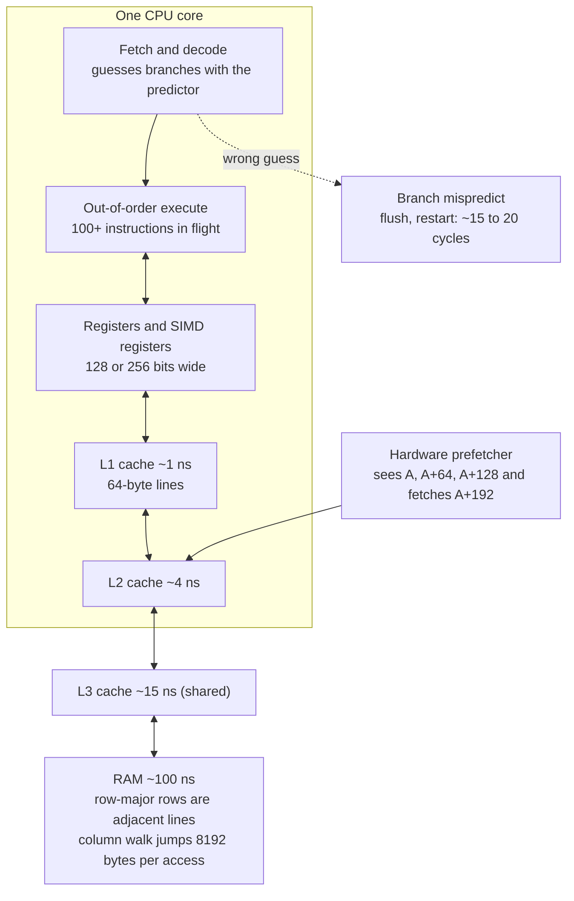

# Module 2.13: Performance optimisation

**Estimated hours:** 5

**What you will learn**

1. How to measure a piece of C++ correctly before touching it: a `steady_clock` harness with warm-up, repetitions and a trick that stops the compiler from deleting your work.
2. The four hardware facts that decide most C++ performance: cache lines, branch prediction, data layout and inlining, each proven with an experiment you run.
3. How to find the hot path with `perf`, confirm what the compiler did with Compiler Explorer, and use Amdahl's law to decide whether an optimisation is even worth doing.

**Prerequisites:** [Module 2.12: Memory and ownership design](module-12-memory-and-ownership-design.md). You also need the latency table from module 0.01 and the `-O0` versus `-O2` experiment from its Part E.

---

## 1. One-line intuition

Fast code is code that keeps the CPU fed: the data it needs is already in cache, the branch it takes is the one the CPU guessed, and the work it does is work that was actually necessary.

## 2. Real-life analogy

Go back to the clerk from module 0.01. The clerk (CPU) works at a desk. Behind the clerk is a small shelf (cache). Across the warehouse is the wall of pigeonholes (RAM).

- When the clerk needs pigeonhole 1000, a runner does not bring just that one. The runner brings the whole **tray** of 64 neighbouring pigeonholes (1000 to 1063) and puts it on the shelf. That tray is a **cache line**. If the next thing the clerk needs is pigeonhole 1001, it is already on the shelf: no walk. If the next thing is pigeonhole 50,000, the runner walks again and the clerk waits.
- The clerk reads recipes faster than runners can fetch, so the clerk **guesses** which line of the recipe comes after a "if X then go to line 90" instruction and starts working on that guess. If the guess is right, nothing is lost. If wrong, the clerk throws away the half-done work and starts over. That is **branch prediction** and a **misprediction**.
- Calling a helper (a function call) means the clerk writes down where they were, walks to another page of the recipe, does the work, and walks back. For a two-line helper, the walking costs more than the work. **Inlining** copies the two lines into the main recipe so there is no walk.
- You cannot see which of these is slowing the clerk by watching from the door. You must stand next to the clerk with a stopwatch. That is **profiling**, and it comes before any change.

## 3. Why it exists: the problem it solves

In module 0.01 you saw that an L1 cache hit is about 1 ns and a RAM access is about 100 ns. A modern core can execute hundreds of instructions in the time one RAM access takes. This means the number of instructions a program runs is often **not** what decides its speed. Two programs that do the same arithmetic can differ by ten times or more depending only on the order in which they touch memory.

Compilers are very good at removing instructions. They are much weaker at fixing your data layout or your memory access order, because those are design decisions you made. So the engineer must know four things the compiler cannot fix for them: which bytes sit next to each other, which branches are predictable, which calls are worth inlining, and where the time actually goes.

What breaks without this knowledge: engineers "optimise" code that was never slow, make the code harder to read, and leave the real bottleneck untouched. The classic failure is a week spent hand-tuning a loop that the profiler would have shown takes 2% of the time. The rule of this module is: **measure, change the thing the measurement points at, measure again.**

## 4. Three layers of depth

### Layer 1 (beginner): the words and the rules

**Benchmark.** A program that times one operation many times and reports a number. A **micro-benchmark** times one small function. Writing a correct one is harder than it looks (Layer 2).

**Hot path.** The small part of the code where most of the time is spent. In almost every program a few percent of the lines account for most of the time. The rest is the **cold path**. Optimising the cold path changes nothing measurable.

**Profiler.** A tool that watches a running program and reports where the time goes, function by function. On Linux the standard one is `perf`. The profiler finds the hot path; you do not guess it.

**Optimisation level.** A compiler flag. `-O0` means no optimisation: every variable lives in memory, every line becomes several instructions, and it is what you debug with. `-O2` is the standard release level: inlining, register allocation, dead-code removal and some vectorisation. `-O3` adds more aggressive loop transformations. You never measure speed at `-O0`.

**Cache line.** The unit in which memory moves between RAM and the CPU caches: 64 bytes on every x86-64 and most ARM chips today. Touching one byte brings in all 64. Code that uses all 64 is fast; code that uses 4 and throws the rest away wastes 94% of the memory traffic.

**Branch.** Any `if`, loop condition, `switch` or virtual call: a point where the next instruction depends on data. The CPU guesses the outcome. A **misprediction** costs a pipeline flush, typically 15 to 20 cycles on current cores.

**Inlining.** The compiler copies a function's body into the caller instead of emitting a call. Removes call overhead and, more importantly, lets the compiler optimise the body together with the caller's code.

**The rules.**

1. Measure first. Never optimise from a feeling.
2. Optimise the hot path the profiler shows, not the code you suspect.
3. Measure at `-O2` (or the flags you will ship with), never at `-O0`.
4. Change one thing, measure again, keep it only if the number moved.
5. Big wins come from data layout and algorithms; small wins come from micro-tuning. Do the big ones first.

### Layer 2 (working engineer): measuring correctly and reading the four effects

**A correct micro-benchmark harness has four parts.**

| Part | Why | What goes wrong without it |
|---|---|---|
| `std::chrono::steady_clock` | Monotonic; never jumps when the system clock is adjusted | `system_clock` can go backwards when NTP corrects the time; you get negative durations |
| Warm-up run | Pages the memory in, fills the caches, trains the branch predictor | The first run is slow for reasons unrelated to your code and poisons the average |
| Many repetitions, report the median | One run is noise: another process, a frequency change, an interrupt | A single number that is 3x off from the next run |
| A **sink** that uses the result | Stops the optimiser from deleting work whose result is never read | A loop that "runs" in 0 ns because the compiler removed it |

The sink is the part beginners miss. If you compute a sum and never use it, `-O2` is allowed to delete the whole loop; the standard says a program's observable behaviour is all that matters. Two reliable ways to force the value to be "used":

```cpp
// Way 1: write into a volatile. The compiler must perform every volatile write.
volatile long long sink;
sink = sum;

// Way 2 (GCC and Clang): an empty asm statement that claims to read the value
// and to touch memory. The compiler must keep 'value' alive and must not
// reorder memory operations across it. Costs zero instructions.
inline void keep(long long value) {
    asm volatile("" : : "r"(value) : "memory");
}
```

Way 2 is what Google Benchmark's `DoNotOptimize` does. Use Way 1 on MSVC, which has no inline asm on x64.

**Cache lines and traversal order.** A 2048 x 2048 matrix of `int` is 16 MiB, far bigger than L2 and usually bigger than L3. Stored row by row (**row-major**, which is how C and C++ lay out `m[i][j]` and `v[i * N + j]`), the elements of one row are adjacent in memory. Walking a row touches 64 bytes, then the next 64 bytes: every cache line is fully used, and the hardware **prefetcher** notices the regular stride and fetches ahead. Walking a column touches one `int`, then jumps 8192 bytes to the next row: every access is a new cache line of which only 4 of 64 bytes are used, and 16 MiB of lines flow through the cache to read 16 MiB of data in the worst possible order. Same instruction count, same arithmetic, several times slower. You will measure this in section 6.

**Array of structs versus struct of arrays.** Suppose each loan record is a 64-byte struct and you want to sum one 8-byte field across a million loans.

| Layout | Bytes fetched per useful 8 bytes | Cache lines for 1 M records |
|---|---|---|
| `std::vector<Loan>` (array of structs, AoS) | 64 (whole struct arrives, 56 bytes wasted) | 1,000,000 |
| `std::vector<long long> balances` (struct of arrays, SoA) | 8 (8 balances per line) | 125,000 |

Eight times less memory traffic for the same answer. SoA is how columnar databases and the master-table cache in capstone C2 lay out hot fields. AoS is still right when you always use the whole record together.

**Branch prediction.** Modern predictors learn patterns from history. A branch that is always taken, or alternates regularly, is predicted almost perfectly. A branch that depends on random data is wrong about half the time, and every miss costs a flush. The classic experiment: sum the elements above 128 in an array of random bytes. Unsorted, the `if` is a coin flip. Sorted, the `if` is false for the first half and true for the second: two mispredictions total. Same data, same sum, same instructions; the sorted version is typically several times faster. Compilers sometimes rescue you by replacing a small `if` with a **conditional move** (`cmov`), which has no branch; in section 6 the branch body is a function call so the branch stays a branch and you can see the effect.

**Inlining.** `-O2` inlines small functions automatically when it can see the body (same translation unit, or a header). A call across a `.cpp` boundary cannot be inlined without link-time optimisation (`-flto`). A virtual call cannot be inlined unless the compiler proves the dynamic type. To see what inlining buys, mark a tiny function `__attribute__((noinline))` and time the loop again: the call itself costs a few cycles, but the bigger loss is that the loop can no longer be vectorised or kept in registers.

**Amdahl's law.** If a fraction `p` of the time is spent in the part you speed up by a factor `s`, the overall speedup is:

```text
speedup = 1 / ((1 - p) + p / s)
```

Examples you should be able to do in your head:

| Fraction `p` in the hot path | You make it `s` times faster | Overall speedup |
|---|---|---|
| 0.90 | 10x | 1 / (0.10 + 0.09) = 5.3x |
| 0.50 | 10x | 1 / (0.50 + 0.05) = 1.8x |
| 0.10 | infinitely fast | 1 / 0.90 = 1.1x |

The last row is the whole argument for profiling first: making something that takes 10% of the time infinitely fast buys you 11%. Find the 90% first.

**Reading `perf` output.** `perf stat` counts events for a whole run: cycles, instructions, cache misses, branch misses. `perf record` samples the instruction pointer thousands of times a second and `perf report` shows which functions were sampled most. The function at the top of the report is the hot path. Module 8.07 goes deep (call graphs, flamegraphs); this module gives you enough to find the top function.

**Reading Compiler Explorer.** Paste a loop, set `-O2` or `-O3`, and look for: `call` instructions (something was not inlined), `cmov` (the compiler made a branch branchless), and packed instructions such as `paddd` or `vpaddd` (the loop was **vectorised**: several elements per instruction using 128-bit SSE or 256-bit AVX registers). GCC 12 and later vectorise some loops at `-O2`; `-O3` vectorises more, and `-march=native` lets it use the wider registers your CPU has.

### Layer 3 (internals): what the hardware is doing

**The cache hierarchy, with lines.** When a load misses L1, the core asks L2 for the 64-byte line containing the address, then L3, then memory. The line is copied into every level on the way back. A line is tagged by its address with the low 6 bits dropped (2^6 = 64), so addresses 0x1000 through 0x103F share one line and 0x1040 starts the next. This is why `alignas(64)` appears in concurrent code (module 4.08): two variables in one line are fetched and invalidated together.

**The prefetcher.** Hardware watches the stream of misses. If it sees addresses A, A+64, A+128, it starts fetching A+192 before you ask. Row-major traversal is the best case. Column-major with a stride of 8192 bytes defeats most prefetchers and additionally thrashes the **TLB**, the small cache of virtual-to-physical page translations (module 3.04), because every access lands on a different 4 KiB page.

**Out-of-order execution and the branch predictor.** The core fetches and decodes instructions far ahead of the one currently executing, typically a hundred or more in flight. At a conditional branch it does not wait for the condition; it consults the predictor, which keeps tables indexed by branch address and recent branch history, and continues down the predicted path **speculatively**. When the condition finally resolves and the guess was wrong, every instruction fetched after the branch is discarded and fetch restarts from the correct target. That restart is the 15 to 20 cycle penalty. A perfectly predicted branch costs almost nothing, which is why a sorted array wins.

**What inlining unlocks.** Once the body is in the caller, the compiler can: keep the argument in the register it is already in instead of moving it to the calling-convention register, delete the `call`/`ret` pair and the stack bookkeeping, fold constants that the caller knows, and, crucially, see the whole loop body at once so it can **vectorise** it. A `call` inside a loop is an optimisation barrier: the compiler must assume the callee may do anything to memory.

**Vectorisation.** A SIMD (single instruction, multiple data) instruction such as `vpaddd ymm0, ymm0, [rdi]` adds eight 32-bit integers in one go using a 256-bit register. For a simple sum over a `std::vector<int>`, the vectorised loop does the work of eight scalar iterations per instruction, limited only by how fast memory can supply the data, which brings us back to cache lines. GCC will only vectorise when it can prove the loop is safe, for example that two pointers do not overlap, so simple loops over one container vectorise best.

**Why `-O0` is so slow.** At `-O0` every local variable has a stack slot and every use is a load and a store, so the simple `sum += v` becomes four memory operations. Measuring at `-O0` measures the compiler's debug conveniences, not your code.

## 5. Architecture diagram



Every arrow downward is slower by 4 to 100 times. Performance work is mostly about keeping traffic in the top three boxes.

## 6. Code

One file, two experiments, a correct harness. It fills a 16 MiB matrix and sums it row-wise and column-wise, then sums the values above 128 in a random array, unsorted and sorted. Read the comments on `keep` and `time_ms` carefully: they are the harness you will reuse in capstones C1 and C2.

```cpp
// bench.cpp
// A correct micro-benchmark harness and two experiments:
//   1. cache lines: row-major vs column-major matrix traversal
//   2. branch prediction: branchy sum over unsorted vs sorted data
#include <algorithm>
#include <chrono>
#include <cstdio>
#include <random>
#include <vector>

// Sink: force the compiler to treat 'value' as used so it cannot delete
// the loop that produced it. GCC/Clang extension; costs no instructions.
inline void keep(long long value) {
    asm volatile("" : : "r"(value) : "memory");
}

// Time f() with one warm-up run, then 'reps' timed runs. Return the median
// in milliseconds. steady_clock is monotonic, so it never goes backwards.
template <typename F>
double time_ms(F&& f, int reps) {
    f();                                      // warm-up: caches, pages, predictor
    std::vector<double> samples;
    samples.reserve(static_cast<std::size_t>(reps));
    for (int r = 0; r < reps; ++r) {
        auto t0 = std::chrono::steady_clock::now();
        f();
        auto t1 = std::chrono::steady_clock::now();
        samples.push_back(std::chrono::duration<double, std::milli>(t1 - t0).count());
    }
    std::sort(samples.begin(), samples.end());
    return samples[samples.size() / 2];       // median: robust to one slow run
}

// ---- experiment 1: cache lines --------------------------------------------
constexpr std::size_t N = 2048;              // 2048 * 2048 * 4 bytes = 16 MiB

long long sum_row_major(const std::vector<int>& m) {
    long long sum = 0;
    for (std::size_t i = 0; i < N; ++i)
        for (std::size_t j = 0; j < N; ++j)
            sum += m[i * N + j];              // adjacent addresses: same cache line
    return sum;
}

long long sum_column_major(const std::vector<int>& m) {
    long long sum = 0;
    for (std::size_t j = 0; j < N; ++j)
        for (std::size_t i = 0; i < N; ++i)
            sum += m[i * N + j];              // jumps 8192 bytes: new line every time
    return sum;
}

// ---- experiment 2: branch prediction --------------------------------------
// noinline keeps the 'if' a real branch. Without it, the compiler may turn
// 'if (v >= 128) sum += v' into a branchless conditional move and hide
// the effect, which is itself a lesson: the compiler often does this for you.
__attribute__((noinline)) long long bump(long long sum, int v) {
    return sum + v;
}

long long branchy_sum(const std::vector<int>& data) {
    long long sum = 0;
    for (int v : data) {
        if (v >= 128) sum = bump(sum, v);     // coin flip on random data
    }
    return sum;
}

int main() {
    const int reps = 7;

    // Experiment 1
    std::vector<int> matrix(N * N, 1);        // every element is 1, so sum = N*N
    long long row_sum = 0, col_sum = 0;
    double row_ms = time_ms([&] { row_sum = sum_row_major(matrix);    keep(row_sum); }, reps);
    double col_ms = time_ms([&] { col_sum = sum_column_major(matrix); keep(col_sum); }, reps);

    std::printf("== cache lines: %zu x %zu ints, 16 MiB ==\n", N, N);
    std::printf("row-major     sum=%lld  median %.2f ms\n", row_sum, row_ms);
    std::printf("column-major  sum=%lld  median %.2f ms\n", col_sum, col_ms);
    std::printf("ratio column/row = %.1f\n\n", col_ms / row_ms);

    // Experiment 2
    const std::size_t count = 1u << 20;       // 1,048,576 values
    std::mt19937 rng(42);                     // fixed seed: same data every run
    std::uniform_int_distribution<int> dist(0, 255);
    std::vector<int> unsorted(count);
    for (int& v : unsorted) v = dist(rng);
    std::vector<int> sorted = unsorted;
    std::sort(sorted.begin(), sorted.end());

    long long s1 = 0, s2 = 0;
    double unsorted_ms = time_ms([&] { s1 = branchy_sum(unsorted); keep(s1); }, reps);
    double sorted_ms   = time_ms([&] { s2 = branchy_sum(sorted);   keep(s2); }, reps);

    std::printf("== branch prediction: %zu values in [0,255], branch on v >= 128 ==\n", count);
    std::printf("unsorted      sum=%lld  median %.2f ms\n", s1, unsorted_ms);
    std::printf("sorted        sum=%lld  median %.2f ms\n", s2, sorted_ms);
    std::printf("sums equal: %s\n", s1 == s2 ? "yes" : "NO (bug)");
    std::printf("ratio unsorted/sorted = %.1f\n", unsorted_ms / sorted_ms);
    return 0;
}
```

Compile at the release level and run:

```bash
g++ -std=c++17 -Wall -Wextra -Werror -O2 -g -o bench bench.cpp
./bench
```

Expected output shape. The times are different on every machine and every run; what must hold is the **ordering** and the checksums.

```text
== cache lines: 2048 x 2048 ints, 16 MiB ==
row-major     sum=4194304  median <a> ms
column-major  sum=4194304  median <b> ms
ratio column/row = <b/a>

== branch prediction: 1048576 values in [0,255], branch on v >= 128 ==
unsorted      sum=<s>  median <c> ms
sorted        sum=<s>  median <d> ms
sums equal: yes
ratio unsorted/sorted = <c/d>
```

What to check:

- Both matrix sums are exactly 4194304 (2048 x 2048). Both branchy sums are equal to each other. If a sum is wrong, the harness is broken, not the hardware.
- `b` is larger than `a`: column-major is slower. On typical laptops the ratio is several times; on machines with large L3 caches it is smaller, never below 1.
- `c` is larger than `d`: the unsorted branch is slower. The ratio is typically between 2 and 6 on current x86 cores. If the ratio is close to 1.0, open the binary in Compiler Explorer and check whether `bump` was inlined after all (it must not be).
- Record `a`, `b`, `c`, `d` for your journal. They are your numbers, not the course's.

## 7. Use case: core-banking loan-origination platform

Two decisions in the resume were driven by exactly the measurements above.

**tcpkv (capstone C1): where does the time go?** A naive guess is "network I/O". When you profile tcpkv in module 8.07 under the load generator from 5.11, with small messages like `GET loan:1001`, the profile for the worker threads is typically dominated by three things: parsing the line into a command, the `std::unordered_map` lookup (hashing the key, following the bucket), and `std::string` allocations made while doing both. The `recv` and `send` system calls are a smaller share once the connection is established, because each one moves a few dozen bytes and the kernel work per call is roughly fixed. The decision this drove: parse with `std::string_view` instead of copying into temporary `std::string`s, and avoid allocating in the request path (module 2.12). Amdahl says why: if parsing plus lookup is 70% of the per-request time and you halve it, you gain 1.5x overall; if you had instead "optimised the I/O" at 20%, the ceiling would have been 1.25x even with infinitely fast I/O.

**The master-table cache (capstone C2).** The lending platform's request handler looked up branch, product and scheme codes dozens of times per request. The first design was a map from business code to a full record struct of a few hundred bytes. The hot path only read two or three fields per lookup. The decision: store the hot fields in a separate, contiguous struct-of-arrays sorted by code, so one lookup touched one or two cache lines instead of pulling a few hundred bytes of mostly unused record into cache. The full record stayed available on a cold path. An interviewer will ask "how did you know that mattered?" and the answer is the AoS-versus-SoA measurement you will take in Part B below, plus `perf stat` showing cache-miss counts before and after.

The rule in both cases: the profiler chose the target. Nobody guessed.

## 8. Lab

Work in `~/course/perf/`. Keep every number you measure; the journal entry at the end is built from them.

### Part A: optimisation levels and the compiler's view (30 minutes)

1. Build `bench.cpp` from section 6 three times and run each:

```bash
g++ -std=c++17 -Wall -Wextra -Werror -g -O0 -o bench_O0 bench.cpp && ./bench_O0
g++ -std=c++17 -Wall -Wextra -Werror -g -O2 -o bench_O2 bench.cpp && ./bench_O2
g++ -std=c++17 -Wall -Wextra -Werror -g -O3 -march=native -o bench_O3 bench.cpp && ./bench_O3
```

2. Fill in a table of the four medians at each level. Expected: `-O0` is several times slower than `-O2` on every line; `-O3 -march=native` is equal to or a little faster than `-O2` on the row-major sum (it can use wider vector registers) and about the same on the branchy sum (a `call` in the loop blocks vectorisation). The column/row ratio often *shrinks* at `-O0` because the instruction overhead hides part of the memory stall. That is why you never measure at `-O0`.

3. Open <https://godbolt.org/>, choose x86-64 gcc 13, paste only `sum_row_major` with the `N` constant, and try `-O2`, then `-O3`, then `-O3 -march=native`. Look for `paddd` (128-bit) or `vpaddd` (256-bit) inside the inner loop. Expected: at `-O2` you may see a scalar `add` loop; at `-O3` a `paddd` loop that handles four `int`s per instruction; with `-march=native` on an AVX2 machine, `vpaddd` with eight per instruction.

4. Delete the `keep(row_sum)` call and the `std::printf` that prints `row_sum`, rebuild at `-O2` and run. Expected: the row-major time collapses towards 0.00 ms because the compiler deleted a loop whose result nobody used. Put them back. This is the dead-code-elimination trap in action.

### Part B: data layout, array of structs versus struct of arrays (45 minutes)

Create `aos_soa.cpp`:

```cpp
// aos_soa.cpp: sum one field across one million loan records, two layouts.
#include <algorithm>
#include <chrono>
#include <cstdio>
#include <cstdint>
#include <vector>

inline void keep(long long value) { asm volatile("" : : "r"(value) : "memory"); }

template <typename F>
double time_ms(F&& f, int reps) {
    f();
    std::vector<double> s;
    for (int r = 0; r < reps; ++r) {
        auto t0 = std::chrono::steady_clock::now();
        f();
        auto t1 = std::chrono::steady_clock::now();
        s.push_back(std::chrono::duration<double, std::milli>(t1 - t0).count());
    }
    std::sort(s.begin(), s.end());
    return s[s.size() / 2];
}

// Array of structs: one 64-byte record per loan.
struct Loan {
    std::int64_t id;
    std::int64_t balance_paise;      // the only field the hot loop reads
    std::int32_t branch_code;
    std::int32_t product_code;
    std::int32_t scheme_code;
    std::int32_t tenure_months;
    char         status[8];
    std::int64_t opened_epoch;
    std::int64_t last_paid_epoch;
    std::int32_t rate_bp;
    std::int32_t pad;
};
static_assert(sizeof(Loan) == 64, "Loan should be exactly one cache line");

// Struct of arrays: each field in its own contiguous vector.
struct LoanColumns {
    std::vector<std::int64_t> id;
    std::vector<std::int64_t> balance_paise;
    // ... other columns omitted; only balance is needed here
};

int main() {
    const std::size_t count = 1u << 20;
    std::vector<Loan> aos(count);
    LoanColumns soa;
    soa.id.resize(count);
    soa.balance_paise.resize(count);
    for (std::size_t i = 0; i < count; ++i) {
        aos[i].id = static_cast<std::int64_t>(i);
        aos[i].balance_paise = 100;
        soa.id[i] = static_cast<std::int64_t>(i);
        soa.balance_paise[i] = 100;
    }

    long long a = 0, b = 0;
    double aos_ms = time_ms([&] {
        long long sum = 0;
        for (const Loan& l : aos) sum += l.balance_paise;
        a = sum; keep(a);
    }, 9);
    double soa_ms = time_ms([&] {
        long long sum = 0;
        for (std::int64_t v : soa.balance_paise) sum += v;
        b = sum; keep(b);
    }, 9);

    std::printf("AoS (64-byte struct) sum=%lld  median %.2f ms\n", a, aos_ms);
    std::printf("SoA (8-byte column)  sum=%lld  median %.2f ms\n", b, soa_ms);
    std::printf("ratio AoS/SoA = %.1f\n", aos_ms / soa_ms);
    return 0;
}
```

```bash
g++ -std=c++17 -Wall -Wextra -Werror -O2 -g -o aos_soa aos_soa.cpp
./aos_soa
```

Expected: both sums are 104857600 (1,048,576 x 100). SoA is faster; the ratio is typically several times because the AoS loop pulls 64 MiB through the cache to read 8 MiB of balances, while the SoA loop pulls 8 MiB and vectorises. Write down your ratio. Then change the `static_assert` and the struct so `Loan` is 128 bytes (add another `std::int64_t pad2[8]`), rebuild, rerun. Expected: the AoS time roughly doubles again; the SoA time does not change.

### Part C: inlining (30 minutes)

Create `inline_demo.cpp`:

```cpp
// inline_demo.cpp: the same two-line function, inlined and not.
#include <algorithm>
#include <chrono>
#include <cstdio>
#include <vector>

inline void keep(long long value) { asm volatile("" : : "r"(value) : "memory"); }

template <typename F>
double time_ms(F&& f, int reps) {
    f();
    std::vector<double> s;
    for (int r = 0; r < reps; ++r) {
        auto t0 = std::chrono::steady_clock::now();
        f();
        auto t1 = std::chrono::steady_clock::now();
        s.push_back(std::chrono::duration<double, std::milli>(t1 - t0).count());
    }
    std::sort(s.begin(), s.end());
    return s[s.size() / 2];
}

static long long add_inlinable(long long sum, int v) { return sum + v; }
__attribute__((noinline)) static long long add_noinline(long long sum, int v) { return sum + v; }

int main() {
    std::vector<int> data(1u << 24, 3);                       // 16 M ints, all 3
    long long a = 0, b = 0;
    double in_ms = time_ms([&] {
        long long sum = 0;
        for (int v : data) sum = add_inlinable(sum, v);
        a = sum; keep(a);
    }, 9);
    double out_ms = time_ms([&] {
        long long sum = 0;
        for (int v : data) sum = add_noinline(sum, v);
        b = sum; keep(b);
    }, 9);
    std::printf("inlined   sum=%lld  median %.2f ms\n", a, in_ms);
    std::printf("noinline  sum=%lld  median %.2f ms\n", b, out_ms);
    std::printf("ratio noinline/inlined = %.1f\n", out_ms / in_ms);
    return 0;
}
```

```bash
g++ -std=c++17 -Wall -Wextra -Werror -O2 -g -o inline_demo inline_demo.cpp
./inline_demo
```

Expected: both sums are 50331648. The `noinline` loop is slower, typically several times, because every iteration pays a `call` and `ret`, passes arguments through the calling convention, and the loop cannot be vectorised. Paste the file into Compiler Explorer at `-O2` and confirm: the first loop has no `call`; the second has `call add_noinline` inside the loop.

### Part D: perf basics (45 minutes)

1. Install `perf`. On Ubuntu it ships with the kernel tools package:

```bash
sudo apt install linux-tools-generic
perf --version
```

In WSL2 the `/usr/bin/perf` wrapper may say `WARNING: perf not found for kernel ...` because the WSL kernel version does not match the Ubuntu package. If so, run the binary directly: `ls /usr/lib/linux-tools/` to see the version folder, then use `/usr/lib/linux-tools/<version>/perf` in place of `perf` below (an alias helps). Also, WSL2 often does not expose hardware counters, so `cache-misses` and `branch-misses` may print `<not supported>`; the software-clock sampling used by `perf record` still works. On a native Linux machine all counters work. Run `perf record` from a folder in your Linux home such as `~/course`, not under `/mnt/c` or `/mnt/d`: on a Windows drive it fails with `failed to write perf data, error: Bad address`. If `perf` complains about permissions, run it with `sudo` or lower the restriction with `sudo sysctl kernel.perf_event_paranoid=1`.

2. Count events for the whole benchmark:

```bash
perf stat -e cycles,instructions,cache-misses,branch-misses ./bench_O2
```

Expected shape (your counts will differ; some lines may be `<not supported>` in WSL2):

```text
 Performance counter stats for './bench_O2':

     <n>      cycles
     <n>      instructions              #    <x> insn per cycle
     <n>      cache-misses
     <n>      branch-misses

       <t> seconds time elapsed
```

The useful numbers are "insn per cycle" (IPC): below about 1.0 means the core is waiting on memory or mispredictions; 2 to 4 means it is well fed.

3. Find the hot function:

```bash
perf record -g ./bench_O2
perf report --stdio | head -40
```

Expected: `sum_column_major` and `branchy_sum` near the top of the report with the largest percentages, `bump` listed as a child of `branchy_sum`, and `main`, `std::sort` and the random number generator with small shares. That top line is the hot path. Press `q` to leave the interactive view if you ran `perf report` without `--stdio`.

4. Apply Amdahl: using the percentages from the report, compute how much the whole program would speed up if you made `sum_column_major` infinitely fast. Write the number down.

### Journal

Copy [journal/TEMPLATE.md](../journal/TEMPLATE.md) to `journal/YYYY-MM-DD-performance-optimisation.md`. Record: the four medians at `-O0`, `-O2` and `-O3` from Part A; the AoS/SoA ratio for 64-byte and 128-byte records from Part B; the inlined/noinline ratio from Part C; the IPC and the top three functions from `perf report` in Part D; and the Amdahl calculation. In "Interview story", write three sentences on how you would find the hot path in a server you had never seen.

## 9. Common mistakes and misconceptions

| Mistake | Why it is wrong | Bug it causes later |
|---|---|---|
| Benchmarking at `-O0` | Measures debug-build overhead, not your code | Choosing the "faster" design that is slower in release |
| Timing a loop whose result is unused | The optimiser deletes the loop | A 0 ns "benchmark" and a false conclusion |
| Using `system_clock` or one run | Clock can jump; one run is noise | Negative or wildly varying timings |
| Fewer instructions means faster | Memory stalls and mispredictions dominate; IPC varies 10x | Micro-tuning arithmetic while the data layout wastes 90% of cache traffic |
| `std::list` or `std::map` for a hot scan | Nodes are scattered; every step is a cache miss | A "clever" container that is 10x slower than `std::vector` |
| Optimising code you suspect | Suspicion is wrong more often than not | A week spent on a 2% function |
| Marking everything `inline` or `noinline` by hand | The compiler's heuristics are usually right; `inline` is mostly a linkage keyword | No speedup, bigger binary, or a hot loop that cannot vectorise |
| Reporting one machine's timing as a fact | Results depend on cache sizes, frequency, other load | Wrong decisions when the server hardware differs |
| Optimising before the design is right | Big wins are algorithmic and layout; micro-tuning is the last 10% | Unreadable code that is still slow |

## 10. Resume link

- **Claim B, "performance optimisation".** Say: "I measure first. For tcpkv I profiled with `perf` under the load generator and found the hot path was parsing and the hash lookup, not I/O, so I parsed with `string_view` and removed allocations from the request path. I benchmarked with a `steady_clock` harness using medians over repeated runs." Your Part A to D numbers are the evidence.
- **Claim H4, "in-memory master-table cache that removes joins from the hot path".** The data-layout part of the story is Part B: "The hot fields were kept contiguous, struct-of-arrays style, so a lookup touched one or two cache lines instead of a few hundred bytes of record."
- **Claim B, "memory and ownership design".** Avoiding allocation on the hot path (module 2.12) is a performance decision justified by a profile that showed `malloc` in the top functions.

Likely follow-ups: "What is a cache line?" (64 bytes; the unit of transfer between memory levels.) "What does a branch misprediction cost?" (A pipeline flush, typically 15 to 20 cycles.) "How would you decide whether an optimisation is worth it?" (Amdahl: measure the fraction first.) "Why is `std::vector` faster than `std::list` for iteration?" (Contiguous memory: full cache lines and a prefetcher-friendly stride.)

## 11. Interview questions

**Q1 (easy). What is a cache line and why does it matter for a loop over an array?**

<details>
<summary>Model answer</summary>

A cache line is the unit of data moved between RAM and the CPU caches, 64 bytes on current x86-64 and most ARM parts. When a program touches one byte, the whole 64-byte line is fetched. A loop that walks an array in address order uses every byte of each line it fetches and lets the hardware prefetcher run ahead, so most accesses hit L1. A loop that jumps by a large stride uses 4 or 8 bytes per line fetched and misses constantly. Same instructions, several times slower.

</details>

**Q2 (easy). Why must you never benchmark a debug build?**

<details>
<summary>Model answer</summary>

At `-O0` the compiler keeps every variable in a stack slot and emits a load and a store around every use so the debugger can see them, performs no inlining, and never vectorises. The result can be ten times slower than `-O2` and, worse, the *ratios* between designs change, so a comparison made at `-O0` can point to the wrong winner. Measure with the flags you ship.

</details>

**Q3 (medium). You wrote a benchmark and the optimised build reports 0 ns. What happened and how do you fix it?**

<details>
<summary>Model answer</summary>

The compiler performed dead-code elimination: the result of the loop was never used in any observable way, so the whole computation was removed as permitted by the standard. The fix is a sink that forces the value to be "used": write it to a `volatile` variable, or pass it to an empty `asm volatile("" : : "r"(value) : "memory")` statement, which costs no instructions but tells the compiler the value is read and memory may be touched. Also check the harness has a warm-up run, repeats the measurement and reports the median using `steady_clock`.

</details>

**Q4 (medium). Explain the sorted-versus-unsorted branch experiment and what it tells you about writing hot loops.**

<details>
<summary>Model answer</summary>

Summing elements above 128 in an array of random bytes is slower when the array is unsorted than when it is sorted, even though the instruction count and the result are identical. The reason is branch prediction: the CPU guesses the outcome of `if (v >= 128)` and executes speculatively. With random data the guess is wrong about half the time and each miss flushes the pipeline, typically 15 to 20 cycles. Sorted data makes the branch false then true in two long runs, so it is predicted almost perfectly. The lesson for hot loops is to prefer predictable control flow, let the compiler use conditional moves for small unpredictable choices, and sort or partition data when a data-dependent branch sits inside a hot loop. I measured a ratio of several times in my lab.

</details>

**Q5 (hard). A request handler spends 60% of its time in a hash lookup, 30% in parsing and 10% in socket I/O. You can make any one part twice as fast. Which do you pick, what is the overall gain, and how did you get those percentages in the first place?**

<details>
<summary>Model answer</summary>

Pick the 60% part. Amdahl's law: speedup = 1 / ((1 - p) + p / s). Halving the lookup gives 1 / (0.40 + 0.30) = 1.43x. Halving parsing gives 1 / (0.70 + 0.15) = 1.18x. Halving I/O gives 1 / (0.90 + 0.05) = 1.05x. Even making I/O infinitely fast caps at 1.11x, so "optimise the network" would be the wrong call here. The percentages come from a sampling profiler such as `perf record` run under a realistic load generator, read with `perf report`; `perf stat` adds cache-miss and branch-miss counts to explain *why* the lookup is slow, for example because the key hashing allocates or the buckets are cold. Then I change one thing, re-measure with the same harness and keep the change only if the median moved.

</details>

## 12. Revision

- Measure first with `steady_clock`, warm-up, repetitions, median and a sink; measure at `-O2`; let `perf` choose the hot path and Amdahl decide if it is worth it.
- Cache lines are 64 bytes: walk memory in order, keep hot fields together (SoA), prefer `vector` over node containers on hot paths.
- Branches that depend on random data cost a pipeline flush of about 15 to 20 cycles each; small functions in hot loops must be inlinable or the loop cannot be vectorised.

---

Previous: [Module 2.12: Memory and ownership design](module-12-memory-and-ownership-design.md) | Next: [Module 2.14: Undefined-behaviour-aware C++](module-14-ub-aware-cpp.md)
