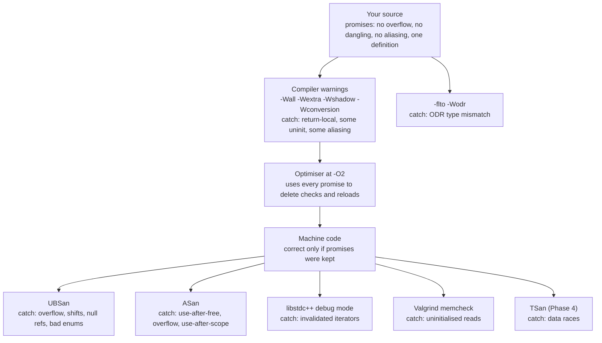

# Module 2.14: Undefined-behaviour-aware C++

**Estimated hours:** 3

**What you will learn**

1. The C++-specific kinds of undefined behaviour (UB) that Phase 1 did not cover: object lifetime, iterator invalidation, strict aliasing, uninitialised members, data races and ODR violations, each with a program that triggers it.
2. How to run code under `-fsanitize=undefined,address`, read the report, and know which UB each tool can and cannot catch.
3. A checklist for writing code that cannot be UB, which you will apply to every file in capstones C1 and C2.

**Prerequisites:** [Module 2.13: Performance optimisation](module-13-performance-optimisation.md). You need the Phase 1 list of C undefined behaviour (null dereference, out-of-bounds, use-after-free, double free) from module 1.11, and iterator invalidation rules from module 2.07.

---

## 1. One-line intuition

Undefined behaviour is not "the program crashes"; it is "the compiler was allowed to assume this never happens, so anything it generated is correct", and the only safe amount of it is zero.

## 2. Real-life analogy

A bank's loan contract says the customer must be at least 18. The clerk processing applications is told: "assume every applicant is 18 or older; skip the age check to save time." That is fine as long as the promise is kept. The day a 16-year-old's form arrives, the clerk does not refuse it: the clerk has no step for refusing. The loan is granted, the interest table is looked up for a negative age, the printed letter is addressed to nobody. Nothing "crashes"; the output is simply wrong in ways nobody designed.

The C++ compiler is that clerk. The standard promises it that signed integers never overflow, that an object is never used after its lifetime ends, that two pointers of different types never point at the same bytes. In exchange the compiler skips checks and rearranges code. When your program breaks the promise, you do not get an error; you get whatever falls out. At `-O0` it might look fine. At `-O2` the same source does something else. Under a sanitizer, finally, someone checks the form.

## 3. Why it exists: the problem it solves

C++ inherits C's design: no runtime checks that the programmer did not write. That is why a `std::vector` index is as fast as a C array and why tcpkv can parse a line without allocating. The price is that the rules are enforced by nothing but you.

Phase 1 showed the C-level UB: bad pointers and bad memory. C++ adds more ways to break the rules because it has more machinery: objects with lifetimes and destructors, iterators that silently point into reallocated buffers, `std::string_view` that does not own what it views, templates and inline functions that must be identical in every translation unit, and threads sharing memory.

What breaks without this knowledge: the bug that only appears in the release build; the server that works for three weeks and then returns a stranger's loan balance; the crash dump whose faulting address is a value that was destroyed a thousand instructions earlier. Capstone C6 is built from exactly these incidents. This module teaches you to not write them and to catch the ones you do.

## 4. Three layers of depth

### Layer 1 (beginner): the C++ UB you must recognise on sight

Each row is a rule, the way you break it, and a one-line example.

| Rule | Breaking it | Example |
|---|---|---|
| An object may only be used during its lifetime | Returning a reference or pointer to a local | `const std::string& f() { std::string s = "x"; return s; }` |
| | Keeping a `std::string_view` to a temporary | `std::string_view v = make_string();` (the string is gone at the `;`) |
| | Using a raw pointer after the owner released it | `T* raw = p.get(); p.reset(); raw->x;` |
| Iterators are invalidated by certain operations | `push_back` while iterating a `vector` | `for (auto& x : v) v.push_back(x);` |
| | Inserting into `unordered_map` while iterating | A rehash moves every element to new buckets |
| | Erasing with a stale iterator | `m.erase(it); ++it;` (must be `it = m.erase(it);`) |
| Signed integer arithmetic never overflows | Adding to `INT_MAX` | `int x = INT_MAX; x + 1;` |
| Every scalar is initialised before it is read | A class member the constructor forgot | `struct L { int limit; L() {} };` then reading `limit` |
| Bytes may only be read through a compatible type | `reinterpret_cast<int*>(&some_float)` and dereferencing | **Strict aliasing** rule; `char`, `unsigned char` and `std::byte` are the only exceptions |
| Two threads may not touch the same non-atomic object when one writes | Unsynchronised counter | `++count` from two threads (**data race**, Phase 4) |
| Every entity has one definition across the whole program | Two `.cpp` files define `struct Config` with different fields | **ODR** (one-definition rule) violation; the linker picks one silently |

**The two tools.**

- **UBSan** (`-fsanitize=undefined`): the compiler inserts checks for arithmetic UB (signed overflow, shifts, division by zero), null dereference through references, misaligned access, bad `enum` values and more. It prints a message and, by default, continues.
- **ASan** (`-fsanitize=address`): instruments every memory access. Catches use-after-free, heap and stack overflow, use-after-scope and use-after-return (partly). It prints a report and aborts.

They combine: `-fsanitize=undefined,address`. (TSan, for data races, cannot be combined with ASan; Phase 4.) Neither one catches strict-aliasing violations, uninitialised reads, or ODR violations. The table in Layer 2 says which tool catches what.

### Layer 2 (working engineer): what each tool catches, and what each UB looks like in production

**Coverage table.** Memorise the empty cells; they are where bugs hide.

| UB | Compiler warning (`-Wall -Wextra`) | UBSan | ASan | Valgrind | Other |
|---|---|---|---|---|---|
| Return reference to local | yes, `-Wreturn-local-addr` | - | sometimes (stack-use-after-return, off by default) | - | |
| Dangling `string_view` to temporary | GCC: no; Clang: `-Wdangling-gsl` | - | yes if the string was on the heap (over 15 chars in libstdc++) | yes | |
| Raw pointer after `unique_ptr::reset` | no | - | **yes**, heap-use-after-free | yes | |
| `vector::push_back` while iterating | no | - | **yes** when it reallocates | yes | `-D_GLIBCXX_DEBUG` |
| `unordered_map` insert while iterating | no | - | usually **no** (nodes are not freed, only relinked) | no | `-D_GLIBCXX_DEBUG` |
| Signed overflow | only for constants | **yes** | - | - | `-ftrapv`, `__builtin_add_overflow` |
| Uninitialised member read | sometimes, `-Wuninitialized` at `-O1`+ | - | - | **yes** | MemorySanitizer (Clang only) |
| Strict aliasing violation | sometimes, `-Wstrict-aliasing` on a direct cast | - | - | - | `-fno-strict-aliasing` to disable the assumption |
| Data race | no | - | - | Helgrind | **TSan** (`-fsanitize=thread`) |
| ODR violation | no | - | - | - | `-flto` with `-Wodr` (on by default under LTO) |

**What each one looks like when it escapes to production.**

- *Lifetime UB* produces a dangling pointer. If the memory was reused, you read someone else's data: the classic "wrong customer's balance" incident. If the page was unmapped, you get a segfault whose faulting address looks valid, which is what makes these dumps hard (module 8.06).
- *Iterator invalidation* on `vector` reads from the old buffer, which `malloc` may have handed to another thread already. Symptoms range from a wrong value to a crash in unrelated code.
- *Signed overflow* at `-O2` is not "wraps around". GCC uses the no-overflow promise to simplify: `x + 1 > x` becomes `true`, a loop `for (int i = 0; i <= n; ++i)` is assumed to terminate, and a bounds check written as `if (offset + len < offset)` is deleted. The wraparound you see at `-O0` is an accident of x86, not a guarantee.
- *Strict aliasing* at `-O2` lets the compiler keep a value in a register because "no `float*` can change my `int`". The result is a read that returns a stale value, and only at `-O2`.
- *Uninitialised members* read whatever the previous occupant of that memory left. In a long-running server that is often a plausible-looking number from the last request. Tests pass; production corrupts.
- *ODR violations* mean two parts of the program disagree on a struct's size. One writes 16 bytes, the other reads 24. The linker emits no error because inline functions and class definitions are allowed to appear in many translation units, on the promise they are identical.

**The strict aliasing rule, stated precisely enough to use.** An object of type `T` may be accessed only through: a `T` (ignoring `const`/`volatile` and signedness), a base class of `T`, an aggregate containing `T`, or `char`, `unsigned char`, `std::byte`. So `reinterpret_cast<unsigned char*>(&f)` to look at a float's bytes is fine; `*reinterpret_cast<int*>(&f)` is not. The correct way to reinterpret bytes:

```cpp
// C++17: memcpy. GCC and Clang compile this to a single register move at -O2.
std::uint32_t bits;
static_assert(sizeof bits == sizeof f);
std::memcpy(&bits, &f, sizeof bits);

// C++20: std::bit_cast<std::uint32_t>(f) does the same with the check built in (module 2.15).
```

A `union { float f; int i; }` written through `f` and read through `i` is legal C but UB in C++. GCC documents that it supports it as an extension; the portable spelling is `memcpy`.

**`reinterpret_cast` rules in one paragraph.** It converts between pointer types and between pointers and integers without changing bits. Converting `T*` to `char*`/`unsigned char*`/`std::byte*` and reading bytes is allowed. Converting `T*` to `U*` for an unrelated `U` and then *dereferencing* is UB unless `U` is one of the types in the rule above. Converting a pointer to `std::uintptr_t` and back is allowed and gives the same pointer. Casting a function pointer to `void*` is not standard but works on every POSIX platform (`dlsym` depends on it). When you reach for `reinterpret_cast`, first ask whether `memcpy` or `std::bit_cast` says what you mean.

**Iterator invalidation rules you need for tcpkv and the cache.** `vector`: any insertion may invalidate everything (reallocation); `erase` invalidates from the erased point onward. `deque`: insertion at either end invalidates iterators but not references. `list`, `map`, `set`: only the erased element's iterator is invalidated. `unordered_map`: insertion invalidates all iterators if it rehashes, but references and pointers to elements stay valid. The last point is why the master-table cache (module 4.13) can hand out pointers into an `unordered_map` but never iterators. The correct erase-while-iterating loop for every standard container since C++11 is `it = c.erase(it)` (or `std::erase_if` in C++20).

### Layer 3 (internals): why the compiler can do this, and how the tools check

**UB is an optimisation licence, not a runtime event.** The compiler's optimiser works on the assumption "this program has no UB". Each assumption removes a possibility and enables a transformation. Signed overflow: with the promise that `i + 1` never overflows, `i` can be widened to a 64-bit register for addressing (`a[i]` becomes one instruction instead of a sign-extend plus an add). Strict aliasing: with the promise that a `float*` store cannot change an `int`, a loop that writes floats can keep an `int` loop bound in a register instead of reloading it every iteration. Lifetime: with the promise that no one reads a destroyed object, the compiler can reuse its stack slot immediately. These are the optimisations you measured in module 2.13. UB is the price of them.

**Why the same source behaves differently at `-O0` and `-O2`.** At `-O0` the compiler does exactly what you wrote, one statement at a time, through memory. Most UB "works" there because the machine happens to do something sensible: x86 `add` wraps, a freed heap block still holds its bytes for a while, memory written as a float reads back as whatever bits were stored. At `-O2` the compiler has used the promise, and the generated code never looks at the bytes you expected it to. This is why "it works in debug" means nothing.

**How UBSan checks.** For `-fsanitize=signed-integer-overflow`, the compiler emits the addition with an overflow-checking instruction sequence (`add` followed by `jo`, jump-if-overflow) and a call to a runtime function that prints the message with the source location. The cost is a couple of instructions per arithmetic operation, typically a 10 to 30% slowdown. Each sub-check (`null`, `shift`, `bounds`, `vptr`, `alignment`, ...) is a separate instrumentation; `-fsanitize=undefined` turns on the whole group.

**How ASan checks.** Every 8 bytes of application memory has one byte of **shadow memory** that records whether those bytes are addressable. `malloc` and `free` are replaced: a freed block is poisoned in shadow and kept in a **quarantine** so it is not reused immediately, which is what turns a use-after-free into a detected error instead of a silent read of recycled memory. Each load and store is preceded by a shadow lookup, roughly doubling run time and tripling memory. Stack variables get **redzones** so overflows between locals are caught, and locals whose scope has ended are poisoned (use-after-scope). Module 8.05 covers the layout; for now the practical consequence is: ASan sees memory errors, not logic errors, so an iterator that lands on a still-live node (the `unordered_map` case) is invisible to it.

**How `-D_GLIBCXX_DEBUG` checks.** libstdc++ replaces each container with a version that keeps a list of live iterators and marks them invalid when the container does something invalidating. It is a different, incompatible binary layout, so the whole program must be built with it, and it is slow; but it catches the `unordered_map` rehash and the `vector` case even when ASan would not. The lighter `-D_GLIBCXX_ASSERTIONS` keeps the normal layout and only adds cheap checks such as bounds-checking `operator[]`, which makes it safe to leave on in a debug build of tcpkv.

**Why ODR violations are silent.** Class definitions, templates and `inline` functions are emitted into every object file that uses them, marked as "weak" or COMDAT symbols. The linker's job is to keep one copy and discard the rest; it assumes they are identical and does not compare them. Link-time optimisation sees the types from all translation units at once, which is why `-flto` can report `-Wodr`.

## 5. Architecture diagram



No single box covers everything. A CI pipeline (module 9.04) runs the tests through several of them.

## 6. Code

One program, six numbered cases chosen by a command-line argument. Cases 1 to 4 are caught by UBSan or ASan. Case 5 (strict aliasing) is caught by no sanitizer; you prove it by comparing `-O0` with `-O2`. Case 6 is the correct way to do what case 5 tried. The program compiles cleanly under `-Wall -Wextra -Werror`, which is the point: warnings alone do not protect you.

```cpp
// ub_zoo.cpp
// Six cases of C++ undefined behaviour, selectable by argv[1].
// Compile normally, then under sanitizers, and compare.
#include <cstdio>
#include <cstdint>
#include <cstring>
#include <limits>
#include <memory>
#include <string>
#include <string_view>
#include <vector>

// Case 1: signed integer overflow. 'step' comes from argc so the compiler
// cannot fold the addition at compile time (that would be a warning instead).
static void case_signed_overflow(int step) {
    int x = std::numeric_limits<int>::max();
    int y = x + step;                               // UB when step >= 1
    std::printf("INT_MAX + %d = %d\n", step, y);
}

// Case 2: iterator invalidation. The range-for holds begin/end iterators
// into the vector's buffer. push_back reallocates and frees that buffer.
static void case_vector_invalidation() {
    std::vector<int> ids{101, 102, 103};            // capacity 3: next push reallocates
    for (int id : ids) {
        if (id == 101) ids.push_back(104);          // old buffer freed here
        std::printf("id %d\n", id);                 // next ++it reads freed memory
    }
}

// Case 3: dangling string_view. The temporary std::string returned by
// make_label() is destroyed at the end of the full expression, but the
// string_view still points at its (heap) buffer. 28 chars defeats the
// 15-char small-string buffer so the bytes really are on the heap.
static std::string make_label() {
    return std::string("loan-application-2026-000123");
}
static void case_dangling_string_view() {
    std::string_view label = make_label();          // dangling after this line
    std::printf("label: %.*s\n", static_cast<int>(label.size()), label.data());
}

// Case 4: raw pointer outliving its owner.
struct Account { int balance_paise; };
static void case_use_after_reset() {
    auto acct = std::make_unique<Account>(Account{50000});
    Account* raw = acct.get();                      // non-owning view
    acct.reset();                                   // object destroyed
    std::printf("balance: %d\n", raw->balance_paise);   // heap-use-after-free
}

// Case 5: strict aliasing. Inside alias(), the compiler may assume an int*
// and a float* never point at the same bytes, so at -O2 it returns the 1 it
// just stored without re-reading memory. We then pass the SAME address twice.
__attribute__((noinline)) static int alias(int* i, float* f) {
    *i = 1;
    *f = 0.0f;                                      // overwrites the same 4 bytes
    return *i;                                      // -O0: 0   -O2: 1
}
static void case_strict_aliasing() {
    int n = 7;
    int r = alias(&n, reinterpret_cast<float*>(&n));
    std::printf("alias() returned %d (memory holds %d)\n", r, n);
}

// Case 6: the correct way to look at a float's bits: memcpy. No UB.
static void case_memcpy_bits() {
    float f = 1.0f;
    std::uint32_t bits;
    static_assert(sizeof bits == sizeof f, "sizes must match");
    std::memcpy(&bits, &f, sizeof bits);
    std::printf("1.0f bits = 0x%08X\n", bits);     // IEEE-754: 0x3F800000
}

int main(int argc, char** argv) {
    if (argc != 2) {
        std::fprintf(stderr, "usage: %s <case 1-6>\n", argv[0]);
        return 2;
    }
    switch (argv[1][0]) {
        case '1': case_signed_overflow(argc - 1); break;   // argc - 1 == 1
        case '2': case_vector_invalidation();      break;
        case '3': case_dangling_string_view();     break;
        case '4': case_use_after_reset();          break;
        case '5': case_strict_aliasing();          break;
        case '6': case_memcpy_bits();              break;
        default:  std::fprintf(stderr, "unknown case\n"); return 2;
    }
    return 0;
}
```

First, the normal build. It compiles with no warnings, which is the lesson.

```bash
g++ -std=c++17 -Wall -Wextra -Werror -g -o ub_zoo ub_zoo.cpp
./ub_zoo 1; ./ub_zoo 2; ./ub_zoo 3; ./ub_zoo 4; ./ub_zoo 5; ./ub_zoo 6
```

Typical output at `-O0` on x86-64 (cases 1 to 5 are UB; what they print is an accident and may differ on your machine):

```text
INT_MAX + 1 = -2147483648
id 101
id 102
id 103
label: loan-application-2026-000123
balance: 50000
alias() returned 0 (memory holds 0)
1.0f bits = 0x3F800000
```

Everything "works". Now the sanitizer build:

```bash
g++ -std=c++17 -Wall -Wextra -Werror -g -fsanitize=undefined,address -fno-omit-frame-pointer -o ub_zoo_san ub_zoo.cpp
./ub_zoo_san 1
```

Expected report shape for case 1 (UBSan prints the location and continues):

```text
ub_zoo.cpp:16:15: runtime error: signed integer overflow: 2147483647 + 1 cannot be represented in type 'int'
INT_MAX + 1 = -2147483648
```

Case 2 (ASan aborts; addresses and frame numbers vary):

```text
id 101
=================================================================
==12345==ERROR: AddressSanitizer: heap-use-after-free on address 0x602000000014 at pc ... bp ... sp ...
READ of size 4 at 0x602000000014 thread T0
    #0 0x... in case_vector_invalidation() ub_zoo.cpp:25
    #1 0x... in main ub_zoo.cpp:...
0x602000000014 is located 4 bytes inside of 12-byte region [0x602000000010,0x60200000001c)
freed by thread T0 here:
    #0 0x... in operator delete(void*, unsigned long)
    #1 0x... in std::vector<int>::push_back ...
previously allocated by thread T0 here:
    #0 0x... in operator new(unsigned long)
    ...
SUMMARY: AddressSanitizer: heap-use-after-free ub_zoo.cpp:25 in case_vector_invalidation()
```

Read a report in this order: the error kind (`heap-use-after-free`), the access (`READ of size 4`), the top frame in your code (`ub_zoo.cpp:25`), then **freed by** (who destroyed it) and **previously allocated by** (who created it). Those three stacks are the whole story of a lifetime bug.

Cases 3 and 4 give the same shape with `freed by` pointing at the `std::string` destructor and `unique_ptr::reset` respectively. Case 5 prints no report at all: no sanitizer checks aliasing. Prove it with optimisation instead:

```bash
g++ -std=c++17 -Wall -Wextra -Werror -O2 -o ub_zoo_O2 ub_zoo.cpp
./ub_zoo_O2 5
```

Expected:

```text
alias() returned 1 (memory holds 0)
```

The function stored 0.0f (all bits zero) over the `int` and then "returned `*i`", but at `-O2` the compiler never re-read memory. Add `-fno-strict-aliasing` to the same command and it prints 0 again. Case 6 prints `0x3F800000` at every level, under every tool.

## 7. Use case: core-banking loan-origination platform

The in-memory master-table cache in the application server (claim H4) was refreshed periodically from the database. The first version iterated the cache's `unordered_map` to update rates while another code path, on a timer, inserted new product codes into the same map. Insertion sometimes triggered a rehash while the iteration was half way through. Nothing crashed in testing. In production, under load, the refresh loop occasionally skipped products or applied a rate to the wrong entry, which surfaced as a handful of loan quotes with an interest rate from a different scheme. ASan on the unit tests had shown nothing, because rehash does not free nodes.

The incident drove two decisions that you will reproduce in capstones C2 and C6:

1. **Snapshot and swap.** The refresh builds a complete new table off to the side, then swaps it in under a lock (`shared_mutex`, module 4.05 and 4.13). Readers hold a `shared_ptr` to the snapshot they started with, so no iterator or pointer into a live table ever crosses a modification. The invalidation question disappears by design instead of by discipline.
2. **Sanitizers and debug-mode containers in CI.** The test suite runs three times: plain, under `-fsanitize=undefined,address`, and under `-D_GLIBCXX_DEBUG`. The third run would have failed on day one. Module 9.04 wires this into the pipeline; the RCA for the incident is one of the templates in capstone C6.

A third, smaller decision from the same platform: money is stored as `std::int64_t` paise, and every addition on a total goes through `__builtin_add_overflow` (GCC and Clang) or an explicit range check. A bank-wide sum in paise crosses `INT_MAX` in a few hundred thousand loans; signed overflow in the total was a theoretical risk that became a checklist rule.

## 8. Lab

Work in `~/course/ub/`.

### Part A: run the zoo under every tool (30 minutes)

1. Build `ub_zoo.cpp` three ways: plain `-g`, `-O2`, and `-fsanitize=undefined,address -g`. Run cases 1 to 6 under each and fill in a table: case, what `-O0` printed, what `-O2` printed, what the sanitizer said.
2. Expected: UBSan reports case 1; ASan reports cases 2, 3 and 4 with `heap-use-after-free`; case 5 is silent everywhere but prints a different number at `-O2`; case 6 is identical everywhere.
3. Run case 3 under Valgrind as well (`valgrind ./ub_zoo 3`). Expected: `Invalid read of size ...` with a stack mentioning `case_dangling_string_view`, and the block shown as freed by `std::string::~basic_string`.
4. Change the label in `make_label` to `"loan"` (4 characters) and rebuild the sanitizer binary. Run case 3. Expected: the heap report disappears because the short string lives inside the `std::string` object on the stack, and ASan may report `stack-use-after-scope` or nothing. Note the lesson: whether a lifetime bug is *detected* depends on where the bytes happen to live. The bug is the same.

### Part B: invalidation the sanitizer misses, and the compiler's own warnings (30 minutes)

Create `rehash.cpp`:

```cpp
// rehash.cpp: insert into an unordered_map while iterating it.
#include <cstdio>
#include <string>
#include <unordered_map>

int main() {
    std::unordered_map<std::string, int> rates;
    for (int i = 0; i < 8; ++i) rates["scheme-" + std::to_string(i)] = i;

    int visited = 0;
    for (auto& [code, rate] : rates) {              // iterator into bucket chain
        if (rate == 0) {
            for (int j = 0; j < 200; ++j)           // force a rehash mid-loop
                rates["new-" + std::to_string(j)] = 99;
        }
        ++visited;
        (void)code;
    }
    std::printf("visited %d of %zu\n", visited, rates.size());
    return 0;
}
```

1. Build and run plain, then with `-fsanitize=address`. Expected: the plain run prints some number of visited elements that may not equal the size, or the loop runs through some elements twice; ASan typically reports nothing because the nodes were relinked, not freed.
2. Build with libstdc++ debug mode and run:

```bash
g++ -std=c++17 -Wall -Wextra -Werror -g -D_GLIBCXX_DEBUG -o rehash_dbg rehash.cpp
./rehash_dbg
```

Expected: an abort with a message similar to `Error: attempt to increment a singular iterator` or `attempt to access an element in an invalidated container`, naming `rehash.cpp` and the range-for line. Write down the exact first line.

3. Fix it: collect the keys to add into a `std::vector<std::string>` during the loop and insert them after the loop ends. Rebuild under debug mode. Expected: clean run, `visited 8 of 208`.

4. Create `retlocal.cpp` with the first row of the Layer 1 table (a function returning `const std::string&` to a local) and compile with the usual flags. Expected: the build **fails** under `-Werror` with `warning: reference to local variable 's' returned [-Wreturn-local-addr]`. This is the one lifetime bug the compiler catches by itself; keep `-Werror` on so it stays caught.

### Part C: an ODR violation across two translation units (30 minutes)

Create three files:

```cpp
// config.hpp (deliberately missing: the real project would define Config here once)
#pragma once
struct Config;
int config_size_a();
int config_size_b();
```

```cpp
// a.cpp
#include "config.hpp"
struct Config { int timeout_ms; };                  // definition 1
int config_size_a() { return static_cast<int>(sizeof(Config)); }
```

```cpp
// b.cpp
#include "config.hpp"
struct Config { int timeout_ms; double rate; };     // definition 2: ODR violation
int config_size_b() { return static_cast<int>(sizeof(Config)); }
```

```cpp
// main.cpp
#include <cstdio>
#include "config.hpp"
int main() {
    std::printf("sizeof(Config) in a.cpp = %d, in b.cpp = %d\n", config_size_a(), config_size_b());
    return 0;
}
```

1. Build normally: `g++ -std=c++17 -Wall -Wextra -Werror -g -o odr a.cpp b.cpp main.cpp && ./odr`. Expected: it links and prints `4` and `16`. No error, no warning: two parts of one program disagree about the same type. If either file passed a `Config` to the other, one side would read past the end of the object.
2. Build with link-time optimisation: `g++ -std=c++17 -Wall -Wextra -g -flto -o odr_lto a.cpp b.cpp main.cpp`. Expected: GCC typically reports `warning: type 'struct Config' violates the C++ One Definition Rule [-Wodr]` with both locations. (Leave `-Werror` off for this step so you can see the warning text; in a real project it would stop the build, which is the point.)
3. Fix it the only correct way: define `Config` once in `config.hpp` and delete the two local definitions. Rebuild both ways. Expected: both print `16` and `16`, LTO is silent.

### Part D: make the zoo UB-free with the checklist (45 minutes)

Rewrite `ub_zoo.cpp` as `ub_zoo_fixed.cpp` so that every case keeps its purpose but has no UB, using this checklist. Then build it with the stricter flags and all three tools.

**The "code that cannot be UB" checklist**

| Rule | How it removes UB |
|---|---|
| Prefer value semantics: return `std::string`, `std::vector`, `std::optional` by value | Nothing to dangle; RVO makes it free (module 2.04) |
| `std::string_view` and `std::span` are parameters, never members or long-lived locals | A view is valid only while its owner is; keep that visible at the call site |
| Raw pointers are non-owning and never outlive the owner; if you cannot see the owner, take a `std::shared_ptr` | Case 4 becomes impossible |
| Never modify a container inside a loop over it; collect, then apply, or use `it = c.erase(it)` | Cases 2 and the rehash become impossible |
| Use `.at()` on cold paths; use `operator[]` only on hot paths with a proven index | Out-of-bounds becomes an exception instead of memory corruption |
| Initialise every member at its declaration (`int limit = 0;`) | Uninitialised reads become impossible; the compiler cannot forget |
| Checked arithmetic for money and sizes: `__builtin_add_overflow`, or widen to `std::int64_t` and range-check | Signed overflow is detected instead of assumed away |
| `std::memcpy` (C++17) or `std::bit_cast` (C++20) to reinterpret bytes; `reinterpret_cast` only to `char`/`std::byte` or for pointer-to-integer | Strict aliasing cannot be violated |
| A `not_null<T*>` wrapper on pointers that must not be null (write a 10-line one: constructor asserts, `operator->` forwards) | Null dereference is caught at the boundary, once |
| One definition per type, in one header, with `#pragma once`; `inline` functions identical everywhere | ODR cannot be violated |
| Shared mutable state only behind a mutex or `std::atomic` (Phase 4) | Data races become impossible by construction |
| Flags: `-Wall -Wextra -Werror -Wshadow -Wconversion -Wpedantic`; debug builds with `-D_GLIBCXX_ASSERTIONS` | The compiler and the library catch what they can, every build |
| CI runs tests under `-fsanitize=undefined,address`, under `-fsanitize=thread`, and under `-D_GLIBCXX_DEBUG` (module 9.04) | What slips past the rules is caught before merge |

```bash
g++ -std=c++17 -Wall -Wextra -Werror -Wshadow -Wconversion -Wpedantic -D_GLIBCXX_ASSERTIONS -g \
    -fsanitize=undefined,address -fno-omit-frame-pointer -o ub_zoo_fixed ub_zoo_fixed.cpp
for c in 1 2 3 4 5 6; do ./ub_zoo_fixed $c; done
```

Expected: no sanitizer output at all, and the printed values are now *defined*: case 1 reports "overflow detected" instead of a number, case 2 prints four ids, case 3 prints the label from a `std::string` it owns, case 4 reads the balance before the reset, case 5 uses `memcpy` and prints `0x00000000`, case 6 is unchanged. `-Wconversion` will probably flag one or two implicit narrowings you did not notice; fix them with explicit `static_cast`, which is also what it will do to your tcpkv code.

### Journal

Copy [journal/TEMPLATE.md](../journal/TEMPLATE.md) to `journal/YYYY-MM-DD-ub-aware-cpp.md`. Record: the Part A table (six cases by three builds); the exact first line of the `_GLIBCXX_DEBUG` abort and of the `-Wodr` warning; which cases ASan missed and why; and the `-Wconversion` warnings you had to fix in Part D. In "Interview story", describe the strict-aliasing case as "a bug that only appears at -O2" in three sentences.

## 9. Common mistakes and misconceptions

| Mistake | Why it is wrong | Bug it causes later |
|---|---|---|
| "It works at -O0, so the -O2 build is miscompiled" | The optimiser used a promise you broke; the compiler is right | Weeks blaming GCC; shipping a debug build to production |
| "Signed overflow wraps around" | That is what x86 `add` does; the compiler is allowed to assume it never happens and delete your check | Deleted bounds checks, infinite loops, `x + 1 > x` always true |
| "ASan is clean, so there is no memory UB" | ASan sees freed and out-of-bounds memory, not live-but-wrong memory | `unordered_map` rehash, uninitialised reads, aliasing all pass |
| Storing a `std::string_view` as a class member | The member outlives the string it views | Dangling view read later, often a different request's data |
| `reinterpret_cast<T*>` to read a different type | Strict aliasing lets the compiler cache the old value | Stale value at `-O2` only; endless "heisenbug" |
| `union` type punning "because it works in C" | UB in C++; GCC tolerates it but Clang and MSVC behaviour differs | Portability bug on the Windows build |
| `m.erase(it); ++it;` | `it` is invalid after `erase` | Crash or skipped element; use `it = m.erase(it)` |
| Defining a struct in two `.cpp` files "temporarily" | ODR violation; the linker keeps one and warns about nothing | Size mismatch, reads past the object, only when both files are linked |
| Running sanitizers "once at the end" | UB is introduced one line at a time | A pile of reports nobody can attribute |
| Using `-fwrapv` or `-fno-strict-aliasing` to "fix" UB | They change the dialect, not the bug; MSVC has no equivalent for aliasing | Code that is only correct with one compiler's flags |

## 10. Resume link

- **Claim B, "undefined-behaviour-aware coding".** Say: "I treat UB as an optimisation licence I gave the compiler. I write code that cannot have it: value semantics, no long-lived views, no container mutation while iterating, `memcpy` instead of pointer punning, checked arithmetic on money; and I run every test suite under UBSan, ASan and `_GLIBCXX_DEBUG` in CI." Your Part A table is the proof you have seen each kind.
- **Claim F, "memory corruption and leak investigation, ASan/TSan".** The ASan report order you learned in section 6 (error kind, access, your frame, freed-by, allocated-by) is the method. Say it in that order.
- **Claim H5, "production crash-dump debugging with formal RCA".** The cache-refresh incident in section 7 is the shape of a real RCA: a silent UB, a symptom far from the cause, a tool that would have caught it, and a design change that removes the class of bug. Capstone C6 has you write that document.
- **Claim I, "clean under -Wall -Wextra -Werror ... Valgrind/ASan/TSan clean".** This module is where those flags stop being a checkbox and become a reason.

Likely follow-ups: "Give me an example of UB that is not a crash." (Case 5, or the deleted overflow check.) "What does ASan not catch?" (Uninitialised reads, aliasing, logic errors on live memory, races.) "What is the strict aliasing rule?" (Layer 2, one paragraph.) "How do you reinterpret a float as its bits?" (`memcpy`, or `std::bit_cast` in C++20.)

## 11. Interview questions

**Q1 (easy). What is undefined behaviour, and why does the same program behave differently at `-O0` and `-O2`?**

<details>
<summary>Model answer</summary>

Undefined behaviour is any situation the C++ standard places no requirements on: signed overflow, using an object after its lifetime, reading through an incompatible pointer type, a data race, and so on. The compiler is allowed to assume it never happens and optimises accordingly. At `-O0` the generated code mirrors the source statement by statement, so the hardware's natural behaviour (for example wraparound on overflow) shows through. At `-O2` the compiler has used the assumption to delete checks, keep values in registers and reorder code, so the broken promise produces results that match no line of the source. Neither build is "wrong"; the source is.

</details>

**Q2 (easy). Why is `std::string_view sv = get_name();` dangerous when `get_name` returns a `std::string` by value?**

<details>
<summary>Model answer</summary>

`get_name()` returns a temporary `std::string`. The `string_view` is constructed to point at that temporary's characters, and then the temporary is destroyed at the end of the full expression. From the next statement on, `sv` refers to freed memory: use-after-free, which ASan reports if the string was on the heap. The fix is to take the value by `std::string` (or `const auto&`, which extends the temporary's lifetime) and create views only from objects whose owner outlives the view. In general `string_view` should appear as a function parameter, not as a member or a long-lived local.

</details>

**Q3 (medium). What is the strict aliasing rule and what is the correct way to look at the bytes of a `float`?**

<details>
<summary>Model answer</summary>

Strict aliasing says an object may only be accessed through an lvalue of its own type (modulo cv-qualifiers and signedness), a base or containing aggregate type, or a character type: `char`, `unsigned char`, `std::byte`. So `*reinterpret_cast<int*>(&f)` is UB, and at `-O2` the compiler may keep the `float` in a register and never see the "int" write, giving stale results. The correct way is `std::memcpy(&bits, &f, sizeof bits)` into a `std::uint32_t`, which compilers turn into a single register move, or `std::bit_cast<std::uint32_t>(f)` in C++20. Reading the bytes through an `unsigned char*` is also allowed. `union` punning is legal C but UB in C++ even though GCC supports it as an extension.

</details>

**Q4 (medium). ASan ran clean on a test that inserts into an `unordered_map` while iterating it, yet the code is wrong. Why did ASan miss it, and what would catch it?**

<details>
<summary>Model answer</summary>

Inserting may trigger a rehash, which invalidates every iterator; but libstdc++ implements rehash by relinking the existing nodes into a new bucket array, so no node memory is freed. ASan only detects accesses to freed or out-of-bounds memory, and the iterator still points at a live node, so the read is "valid" to ASan even though the traversal order is now corrupt and elements may be skipped or visited twice. libstdc++ debug mode, `-D_GLIBCXX_DEBUG`, tracks iterators per container and aborts with "singular iterator" on the next increment. The fix is not to mutate during iteration: collect keys and insert afterwards, or build a new map and swap it in, which is how I designed the master-table cache refresh.

</details>

**Q5 (hard). A release build of a server occasionally returns data belonging to a different request. Debug builds and ASan runs are clean. Describe how you would hunt it, listing the UB classes that match these symptoms.**

<details>
<summary>Model answer</summary>

"Wrong data, no crash, release only, ASan clean" narrows the field. First, memory that is live but wrong: an uninitialised member that holds the previous request's value, which Valgrind memcheck or Clang's MemorySanitizer catches and ASan does not; and iterator or reference invalidation in a node container, which `-D_GLIBCXX_DEBUG` catches. Second, aliasing: a `reinterpret_cast` between unrelated types that the optimiser exploits only at `-O2`, found by diffing behaviour with `-fno-strict-aliasing` and by grepping for casts. Third, a data race on a shared buffer or cache entry, which is UB and only shows under load; TSan on the concurrent test or load generator finds it. Fourth, a dangling `string_view` or raw pointer into a buffer that was *reused* rather than freed, for example a pooled connection buffer, which ASan misses because the memory is still allocated; a pool with poisoning in debug builds or a `quarantine`-style delay exposes it. Fifth, an ODR violation after a header change where one translation unit was not rebuilt, found with `-flto -Wodr` or a clean rebuild. I would reproduce under the load generator, run the suite under each tool in turn, and once a candidate is found, write the RCA with the symptom, the UB class, the tool that catches it, and the design change that removes it.

</details>

## 12. Revision

- UB is a promise the compiler may rely on; breaking it gives "whatever the optimiser did", visible mostly at `-O2`, and no amount is safe.
- C++ adds lifetime UB (dangling references, views and raw pointers), iterator invalidation, strict aliasing, uninitialised members, data races and ODR violations to the C list; UBSan catches arithmetic, ASan catches freed memory, `_GLIBCXX_DEBUG` catches iterators, Valgrind catches uninitialised reads, TSan catches races, `-flto -Wodr` catches ODR.
- Write code that cannot be UB: values not views, no mutation while iterating, `memcpy` not punning, checked money arithmetic, members initialised at declaration, strict warnings as errors, and sanitizers in CI.

---

Previous: [Module 2.13: Performance optimisation](module-13-performance-optimisation.md) | Next: [Module 2.15: C++20 essentials](module-15-cpp20-essentials.md)
