# Module 2.15: C++20 essentials

**Estimated hours:** 4

**What you will learn**

1. The C++20 features that a working engineer uses every week: concepts, ranges and views, `std::span`, `std::jthread`, designated initialisers, `<format>`, the three-way comparison operator and `std::bit_cast`.
2. How each one replaces something clumsier from C++17 that you already know, including the SFINAE trick from module 2.06.
3. Which C++20 features are not yet safe to rely on in production with GCC 13, and how to say that honestly in an interview.

**Prerequisites:** [Module 2.14: Undefined-behaviour-aware C++](module-14-ub-aware-cpp.md). You need templates and `enable_if` from module 2.06, iterators and lambdas from 2.08, and `std::string_view` from 2.12.

---

## 1. One-line intuition

C++20 does not change what C++ is; it gives names to the things you were already doing by hand, so the compiler can check them and the reader can see them.

## 2. Real-life analogy

Think of the loan-origination office before and after it got proper forms.

- Before, a clerk checking "is this applicant eligible?" read a page of hand-written conditions on a sticky note that nobody else could follow. That is **SFINAE** with `enable_if`. After, the form has a printed box: "Applicant must be: salaried OR self-employed with 2 years of returns." That is a **concept**: the rule has a name and the error message, when it fails, quotes the rule.
- Before, to list all approved loans above 10 lakh sorted by branch, the clerk copied every record onto scratch paper, crossed some out, copied the rest again. That is a chain of `std::copy_if` into temporary vectors. After, the clerk reads straight down the register with a ruler, skipping rows that do not match. That is a **range view**: no copies, evaluated lazily as you walk.
- Before, handing a stack of files to a colleague meant also saying "there are 37 of them, start at the red folder". That is a pointer plus a length. After, you hand over a tray with the files in it. That is `std::span`.
- Before, when the office closed, someone had to walk round and tell each clerk to stop and wait for them to finish, and if they forgot one, that clerk kept working all night. That is `std::thread` with an explicit `join`. After, closing the door automatically tells every clerk to wrap up and waits. That is `std::jthread`.

## 3. Why it exists: the problem it solves

C++17 code works, but three things about it are unpleasant and error-prone:

1. **Template errors are unreadable.** A wrong type passed to a template fails deep inside the library with hundreds of lines of "no matching function". `enable_if` hides the constraint in a type expression nobody can read. Concepts put the constraint on the signature and make the error say "constraint `Serialisable<Loan>` not satisfied".
2. **Algorithms need iterator pairs and temporaries.** `std::sort(v.begin(), v.end())` is noise; filtering then transforming means an intermediate `std::vector`. Ranges take the container directly and views compose without copying.
3. **Resource handling still has sharp edges.** A `std::thread` that is not joined before destruction calls `std::terminate`. Cancelling a thread is a hand-written flag. `jthread` and `stop_token` make both automatic.

Plus some smaller holes: no standard way to format a string without `printf` or stream manipulators (`<format>`), no safe type pun (`std::bit_cast`), six comparison operators to write by hand (`<=>`), and no way to initialise a struct by field name (designated initialisers).

What breaks without C++20: nothing, which is why tcpkv targets C++17 and why the lending platform you will reproduce ran on an older compiler. But an engineer who does not know C++20 cannot read code written in 2024, and an interviewer will ask. This module gives you the working subset and the honest boundaries.

## 4. Three layers of depth

### Layer 1 (beginner): each feature, what it replaces, one line each

Compile everything in this module with `-std=c++20`. GCC 13 supports every feature below.

| Feature | Header | C++17 way | C++20 way |
|---|---|---|---|
| Concepts | `<concepts>` | `template <class T, class = std::enable_if_t<std::is_integral_v<T>>>` | `template <std::integral T>` |
| `requires` clause | (language) | SFINAE on a return type | `template <class T> requires Serialisable<T>` |
| Ranges algorithms | `<algorithm>` | `std::sort(v.begin(), v.end())` | `std::ranges::sort(v)` |
| Views | `<ranges>` | `copy_if` into a temp, then `transform` | `v \| std::views::filter(p) \| std::views::transform(f)` |
| `std::span<T>` | `<span>` | `(T* data, size_t n)` | `std::span<T> items` |
| `std::string_view` | `<string_view>` | (already C++17) | unchanged; recapped below |
| `std::jthread` | `<thread>`, `<stop_token>` | `std::thread t(f); ... t.join();` plus a manual stop flag | `std::jthread t(f);` joins in its destructor, passes a `stop_token` |
| Designated initialisers | (language) | `Loan l; l.id = 1; l.branch = "MUM01";` | `Loan{.id = 1, .branch = "MUM01"}` |
| `std::format` | `<format>` | `snprintf` or `ostringstream` | `std::format("{:>8} {:.2f}", id, amount)` |
| `<=>` | `<compare>` | Six operators by hand | `auto operator<=>(const T&) const = default;` |
| `consteval` / `constinit` | (language) | `constexpr` that might run at runtime | `consteval`: must run at compile time; `constinit`: global must be constant-initialised |
| `std::bit_cast` | `<bit>` | `std::memcpy` into a same-size object | `std::bit_cast<std::uint32_t>(f)` |

**`std::string_view` recap (C++17).** A pointer and a length over characters someone else owns. Pass it by value as a parameter when the function only reads the string. Never store it in a member or return it from a function that created the string (module 2.14, case 3). tcpkv's `parse_line` takes a `string_view` because the caller owns the line buffer.

**`std::span` is the same idea for arrays.** `std::span<const int>` views any contiguous sequence: a C array, `std::array`, `std::vector`, or a pointer plus length. It carries the size, so the callee can bounds-check and loop with range-for. Same rule as `string_view`: parameter, not member.

### Layer 2 (working engineer): behaviour, trade-offs, and the rewrite of 2.06

**Concepts, properly.** A concept is a named predicate on types, checked at compile time. In module 2.06 the eligibility rule for a `to_wire` function template was written as SFINAE:

```cpp
// C++17: the constraint hides inside a defaulted template parameter.
template <typename T, typename = std::enable_if_t<std::is_integral_v<T>>>
std::string to_wire(T value) { return std::to_string(value); }
```

C++20 gives three spellings, from shortest to most explicit:

```cpp
template <std::integral T>                    // 1. constrained parameter
std::string to_wire(T value);

template <typename T> requires std::integral<T>   // 2. requires clause
std::string to_wire(T value);

std::string to_wire(std::integral auto value);    // 3. abbreviated function template
```

And you can define your own with a **requires expression**, which lists what must compile:

```cpp
template <typename T>
concept WireSerialisable = requires(const T& t) {
    { t.to_wire() } -> std::convertible_to<std::string>;   // must have .to_wire() returning something string-like
};
```

Overloads constrained by different concepts are chosen by which constraint is satisfied, and when both are, by which is more specific (**subsumption**). When nothing matches, GCC prints the concept name and the failed requirement, which is the whole reason to use them. Cost at runtime: none. Cost at compile time: usually less than the SFINAE it replaces.

**Ranges and views.** A **range** is anything with `begin()` and `end()`. `std::ranges::sort(loans)` is `std::sort` that takes the container; it also accepts a **projection**: `std::ranges::sort(loans, {}, &Loan::amount)` sorts by one member without writing a lambda. A **view** is a range that does not own its elements and is cheap to copy. `std::views::filter(pred)` and `std::views::transform(f)` are composed with `|` and are **lazy**: nothing runs until you iterate, and each element passes through the whole pipeline before the next one starts. Trade-offs: a view refers to the underlying container, so the same lifetime rules as `string_view` apply; `filter` caches its `begin()` so it must not be used after the container changes; views are not containers, so to keep the result you copy it into a `std::vector` (C++23 adds `std::ranges::to`, which GCC 13 does not have).

**`std::jthread` and cooperative cancellation.** `std::jthread` has two differences from `std::thread`: its destructor calls `request_stop()` and then `join()`, so forgetting to join is impossible; and if the function you pass takes a `std::stop_token` as its first parameter, the thread receives one. The worker checks `token.stop_requested()` in its loop and exits cleanly. This is **cooperative** cancellation: nothing is killed, the thread chooses when to stop. A `std::condition_variable_any` can wait with a stop token so a sleeping worker wakes when stop is requested.

tcpkv targets C++17 and so uses `std::thread` with an explicit `join()` in the pool's destructor and an `std::atomic<bool> stopping_` flag that the workers check. That is exactly what `jthread` does for you. In an interview, say: "the pool used `std::thread` with an explicit join and an atomic stop flag; with C++20 I would use `jthread` and `stop_token` and delete about twenty lines." Module 4.10 builds the pool.

**Designated initialisers.** `Loan{.id = 1001, .branch = "MUM01"}` initialises an aggregate by field name. Rules: fields must appear in declaration order, you cannot mix designated and positional, and omitted fields get their default member initialiser or value-initialisation. The win is readability at call sites with many same-typed fields, which is every configuration struct in a server.

**`<format>`.** `std::format` returns a `std::string` from a Python-style format string: `{}` for the next argument, `{:>10}` right-aligned in 10 columns, `{:.2f}` two decimals, `{:#010x}` hex with `0x` and zero padding, `{:08}` zero padded. The format string is checked at **compile time** in C++20, so a wrong argument count or type is a build error, not a runtime crash. It is type-safe (no `%d` with a `long`), faster than streams, and GCC 13 is the first GCC with it. `std::print` (to stdout directly) is C++23 and needs GCC 14.

**Three-way comparison.** `auto operator<=>(const Money&) const = default;` generates `<`, `<=`, `>`, `>=` and, because it is defaulted, `==` and `!=` too. The result type is `std::strong_ordering` for integers, `std::partial_ordering` for floating point (because of NaN). Member-wise, in declaration order, like a tuple. One line replaces six functions and removes the classic bug of `<` and `==` disagreeing.

**`consteval` and `constinit`.** `consteval` functions must be evaluated at compile time; calling one with a runtime argument is an error, which is what you want for things like size limits and lookup-table generation. `constinit` on a global or static guarantees it was initialised at compile time, which removes the **static initialisation order fiasco** for that variable: it cannot depend on another global's constructor having run.

**`std::bit_cast`.** `std::bit_cast<To>(from)` copies the bytes of `from` into a `To` of the same size. It is the `memcpy` idiom from module 2.14 with the size check built in and `constexpr` allowed. No UB, no pointer casts.

### Layer 3 (internals): what the compiler does with each

**Concepts are not runtime; they are overload resolution.** When the compiler sees a call to a constrained template it instantiates the constraint (a boolean expression over the deduced types) *before* instantiating the body. A failed constraint removes the overload from the candidate set, the same mechanism SFINAE used, but with the result recorded under the concept's name so the diagnostic can print it. Subsumption works by normalising each constraint to a conjunction/disjunction of atomic constraints and checking whether one set implies the other; this is why a concept defined as `A && B` beats one defined as `A` for a type satisfying both.

**Views compile to the loop you would have written.** A `filter | transform` pipeline is a chain of small iterator types, each wrapping the previous. Their `operator++` and `operator*` are tiny inline functions, so after `-O2` the whole pipeline usually becomes one loop with an `if` in it: no allocation, no temporary vector, no function calls. Check this in Compiler Explorer in the lab: the generated code for the ranges pipeline and the hand-written loop are typically near-identical. The cost is compile time and error-message length when you get the types wrong.

**`std::span` is two words.** A pointer and a size, 16 bytes on x86-64, passed in two registers. The compiler knows the size at the call site, so bounds checks in the callee can often be hoisted or removed. A `std::span<T, N>` with a static extent is one word: just the pointer.

**`jthread` is `thread` plus a `stop_source`.** The `stop_source` owns a small heap-allocated shared state with an atomic flag and a list of registered callbacks (`std::stop_callback`). `request_stop()` sets the flag with an atomic store and runs the callbacks. `stop_requested()` is an atomic load, cheap enough to call once per loop iteration. The destructor's sequence is: if joinable, `request_stop()`, then `join()`. No thread is ever killed; if your worker ignores the token, the destructor blocks forever, which is the same hang a forgotten join would have given you, just in a different place.

**`std::format` is a parser plus a visitor.** The format string is parsed, at compile time where possible, into a list of literal pieces and replacement fields. Arguments are stored in a type-erased `std::format_args` array; each replacement field dispatches to the `std::formatter<T>` specialisation for the argument's real type, which writes into a growing buffer. Because the types are known, there is no `printf`-style guessing from a `%` code and no way to read the wrong number of bytes from the stack.

**`<=>` and the compiler.** A defaulted `operator<=>` is expanded member-wise: compare the first members; if not equal, that is the answer; otherwise the next. The rewritten expression `a < b` becomes `(a <=> b) < 0`, which the optimiser reduces to the same `cmp`/`jl` sequence a hand-written `<` would give. There is no runtime cost for the abstraction.

**`std::bit_cast` at `-O2`** is a single `movd`/`movq` between a floating-point and an integer register, or nothing at all if the value is already where it needs to be. Exactly what `memcpy` of a constant size compiles to; the difference is that the compiler can also evaluate it in a `constexpr` context.

## 5. Architecture diagram

```mermaid
flowchart LR
    subgraph CPP17["C++17 you already write"]
        E["enable_if SFINAE"]
        IT["begin/end iterator pairs\ntemporary vectors"]
        PL["pointer + length"]
        TH["std::thread + manual join\nmanual stop flag"]
        PF["snprintf / ostringstream"]
        SIX["six comparison operators"]
        MC["memcpy type pun"]
    end
    subgraph CPP20["C++20 replacement"]
        C["concepts and requires"]
        R["ranges and lazy views"]
        SP["std::span"]
        JT["std::jthread + stop_token"]
        FM["std::format, compile-time checked"]
        TW["operator<=> = default"]
        BC["std::bit_cast"]
    end
    E --> C
    IT --> R
    PL --> SP
    TH --> JT
    PF --> FM
    SIX --> TW
    MC --> BC
    C --> OUT["Same machine code at -O2\nbetter errors, fewer lines, fewer bugs"]
    R --> OUT
    SP --> OUT
    JT --> OUT
    FM --> OUT
    TW --> OUT
    BC --> OUT
```



Every arrow is "same behaviour, checked by the compiler, less to write". None of them changes the generated code materially at `-O2`.

## 6. Code

One tour program covering every feature, built around the loan records you will see again in capstone C2. It compiles cleanly with GCC 13 under the strict flags.

```cpp
// cpp20_tour.cpp
// Every C++20 feature from this module in one file. Needs -std=c++20 and -pthread.
#include <algorithm>
#include <array>
#include <bit>
#include <chrono>
#include <compare>
#include <concepts>
#include <cstdint>
#include <format>
#include <iostream>
#include <ranges>
#include <span>
#include <stop_token>
#include <string>
#include <string_view>
#include <thread>
#include <vector>

// ---- concepts: the module 2.06 enable_if example, rewritten -------------
template <typename T>
concept WireSerialisable = requires(const T& t) {
    { t.to_wire() } -> std::convertible_to<std::string>;
};

template <std::integral T>                         // integers: print the digits
std::string to_wire(T value) { return std::to_string(value); }

template <WireSerialisable T>                      // anything with .to_wire()
std::string to_wire(const T& value) { return value.to_wire(); }

// ---- three-way comparison ------------------------------------------------
struct Money {
    std::int64_t paise = 0;
    auto operator<=>(const Money&) const = default;   // also gives == and !=
};

// ---- an aggregate for designated initialisers ----------------------------
struct Loan {
    int         id = 0;
    std::string branch;
    Money       amount;
    int         tenure_months = 0;

    std::string to_wire() const {                  // satisfies WireSerialisable
        return std::format("LOAN {} {} {} {}", id, branch, amount.paise, tenure_months);
    }
};

// ---- span: one function for array, std::array and vector -----------------
std::int64_t total_paise(std::span<const Money> amounts) {
    std::int64_t sum = 0;
    for (const Money& m : amounts) sum += m.paise;
    return sum;
}

// ---- string_view recap: read-only parameter, never stored -----------------
std::size_t count_fields(std::string_view line) {
    return static_cast<std::size_t>(std::ranges::count(line, ' ')) + 1;
}

// ---- consteval / constinit -------------------------------------------------
consteval std::size_t kib(std::size_t n) { return n * 1024; }
constinit std::size_t g_max_line_bytes = kib(4);  // must be constant-initialised

int main() {
    std::cout << "== concepts ==\n";
    Loan sample{.id = 1001, .branch = "MUM01", .amount = {.paise = 250'000'000}, .tenure_months = 60};
    std::cout << "to_wire(42)   -> " << to_wire(42) << "\n";
    std::cout << "to_wire(loan) -> " << to_wire(sample) << "\n";

    std::cout << "\n== three-way comparison ==\n";
    Money a{100}, b{200};
    std::cout << std::format("Money{{100}} < Money{{200}}  : {}\n", a < b);
    std::cout << std::format("Money{{100}} == Money{{100}} : {}\n", a == Money{100});
    std::cout << std::format("(a <=> b) is less      : {}\n", (a <=> b) == std::strong_ordering::less);

    std::cout << "\n== ranges and lazy views ==\n";
    std::vector<Loan> loans{
        {.id = 1001, .branch = "MUM01", .amount = {.paise = 250'000'000}, .tenure_months = 60},
        {.id = 1002, .branch = "DEL02", .amount = {.paise =  40'000'000}, .tenure_months = 24},
        {.id = 1003, .branch = "BLR03", .amount = {.paise = 120'000'000}, .tenure_months = 36},
        {.id = 1004, .branch = "MUM01", .amount = {.paise =  90'000'000}, .tenure_months = 12},
    };
    std::ranges::sort(loans, {}, &Loan::amount);   // projection: sort by one member

    int predicate_calls = 0;
    auto big_ids = loans
        | std::views::filter([&predicate_calls](const Loan& l) {
              ++predicate_calls;
              return l.amount.paise >= 100'000'000;     // 10 lakh rupees or more
          })
        | std::views::transform([](const Loan& l) { return l.id; });

    std::cout << "predicate calls before iterating: " << predicate_calls << "\n";
    for (int id : big_ids) std::cout << "big loan id " << id << "\n";
    std::cout << "predicate calls after iterating : " << predicate_calls << "\n";

    std::cout << "\n== span ==\n";
    Money c_array[2] = {{1}, {2}};
    std::array<Money, 3> std_array{{{10}, {20}, {30}}};
    std::vector<Money> vec{{100}, {200}, {300}, {400}};
    std::cout << "C array total   : " << total_paise(c_array) << "\n";
    std::cout << "std::array total: " << total_paise(std_array) << "\n";
    std::cout << "vector total    : " << total_paise(vec) << "\n";
    std::cout << "fields in 'SET k some value': " << count_fields("SET k some value") << "\n";

    std::cout << "\n== format ==\n";
    std::cout << std::format("{:>6} {:<6} {:>14} {:>4}\n", "id", "branch", "amount (INR)", "mo");
    for (const Loan& l : loans)
        std::cout << std::format("{:>6} {:<6} {:>14.2f} {:>4}\n",
                                 l.id, l.branch, static_cast<double>(l.amount.paise) / 100.0, l.tenure_months);

    std::cout << "\n== bit_cast, consteval, constinit ==\n";
    std::cout << std::format("bits of 1.0f        : {:#010x}\n", std::bit_cast<std::uint32_t>(1.0f));
    std::cout << std::format("g_max_line_bytes    : {}\n", g_max_line_bytes);

    std::cout << "\n== jthread with stop_token ==\n";
    int ticks = 0;
    {
        std::jthread worker([&ticks](std::stop_token token) {
            while (!token.stop_requested()) {          // cooperative cancellation
                ++ticks;
                std::this_thread::sleep_for(std::chrono::milliseconds(5));
            }
        });
        std::this_thread::sleep_for(std::chrono::milliseconds(50));
    }   // jthread destructor: request_stop(), then join(). No explicit join needed.
    std::cout << "worker stopped cleanly; ticks = " << ticks << " (varies)\n";
    return 0;
}
```

Compile and run (note `-std=c++20` and `-pthread`):

```bash
g++ -std=c++20 -Wall -Wextra -Werror -g -pthread -o cpp20_tour cpp20_tour.cpp
./cpp20_tour
```

Expected output (only the final `ticks` value varies):

```text
== concepts ==
to_wire(42)   -> 42
to_wire(loan) -> LOAN 1001 MUM01 250000000 60

== three-way comparison ==
Money{100} < Money{200}  : true
Money{100} == Money{100} : true
(a <=> b) is less      : true

== ranges and lazy views ==
predicate calls before iterating: 0
big loan id 1003
big loan id 1001
predicate calls after iterating : 4

== span ==
C array total   : 3
std::array total: 60
vector total    : 1000
fields in 'SET k some value': 4

== format ==
    id branch   amount (INR)   mo
  1002 DEL02       400000.00   24
  1004 MUM01       900000.00   12
  1003 BLR03      1200000.00   36
  1001 MUM01      2500000.00   60

== bit_cast, consteval, constinit ==
bits of 1.0f        : 0x3f800000
g_max_line_bytes    : 4096

== jthread with stop_token ==
worker stopped cleanly; ticks = 10 (varies)
```

Three things to notice. The predicate ran zero times before the loop: views are lazy. The `for` over `big_ids` visited the loans in sorted order because the view refers to `loans`, not a copy. And the `jthread` block has no `join()` anywhere; try replacing `std::jthread` with `std::thread` and the program calls `std::terminate` at the closing brace, which is the C++17 trap this feature closes.

## 7. Use case: core-banking loan-origination platform

The application server from claim H4 and tcpkv from claim I are both C++17. That was a decision, not an accident, and an interviewer who sees "C++17" on a resume in 2026 will ask why.

The platform's build fleet ran a long-term-support Linux with the distribution's GCC, which supported C++17 fully but C++20 only partially; `<format>` and complete ranges arrived in GCC 13, which the fleet did not have. The team's rule was: **target the oldest compiler that must build the code, and write the newest code that compiler fully supports.** A feature that works on the developer's laptop but not on the build agent is worse than no feature. That rule drove three concrete choices you will meet in the capstones:

- The thread pool (module 4.10) uses `std::thread` plus an explicit `join()` loop and an `std::atomic<bool>` stop flag. That is `jthread` and `stop_token` written by hand, and it is about twenty lines longer.
- Request structs are initialised through named-parameter helper functions rather than designated initialisers, which were available as a GCC extension but not standard.
- The wire serialiser used `enable_if` to pick between integer, string and record overloads (module 2.06). With concepts it would be three one-line constraints, and when someone passed the wrong type the error would have been one line instead of two screens.

The decision to stay on C++17 is defensible and you should defend it that way: "the code targets the compiler the production fleet has; I know what C++20 would simplify and by how much." Then name the three items above. That answer shows judgement; "we just used 17" does not.

For tcpkv the same reasoning applies on a smaller scale: it is a portfolio project that must build on any Ubuntu LTS the interviewer tries, and on MSVC for the Windows variant of the sync layer, so C++17 is the safe floor. Capstone C1 keeps it there.

## 8. Lab

Work in `~/course/cpp20/`. Every command uses `-std=c++20`.

### Part A: run the tour and break a constraint (30 minutes)

1. Build and run `cpp20_tour.cpp` from section 6. Confirm the output matches except for `ticks`.
2. Add `struct Branch { std::string code; };` and call `to_wire(Branch{"MUM01"})` in `main`. Rebuild. Expected: the build fails with a message that names the concept, similar to:

```text
error: no matching function for call to 'to_wire(Branch)'
note: candidate: 'template<class T>  requires  WireSerialisable<T> std::string to_wire(const T&)'
note:   constraints not satisfied
note:   the required expression 't.to_wire()' is invalid
```

Compare that with the module 2.06 `enable_if` error for the same mistake (several screens of substitution failures). Write both first lines in your journal.

3. Give `Branch` a `std::string to_wire() const` member and rebuild. Expected: it compiles and prints the branch code.

### Part B: ranges are the loop you would have written (30 minutes)

1. Create `pipeline.cpp` containing only the `Loan` struct, a vector of loans, and two functions: `sum_big_hand` with a plain `for` loop and `if`, and `sum_big_ranges` using `filter | transform` and `std::ranges::fold_left`... no: `fold_left` is C++23 and GCC 13 does not have it. Use a range-for over the view that adds into a `std::int64_t`. Both return the total of amounts of at least 10 lakh.
2. Paste it into <https://godbolt.org/> with x86-64 gcc 13 and `-std=c++20 -O2`. Compare the two functions' assembly. Expected: both become one loop with a compare-and-branch, a conditional add, and no calls; the ranges version may have slightly different instruction order. Note the line count of each.
3. Now modify the view version so the vector is pushed to **after** the view is created but before iteration: `auto v = loans | filter(...); loans.push_back(...); for (auto& l : v)`. Build locally with `-fsanitize=address` and run. Expected: ASan reports `heap-use-after-free` because the view held iterators into the old buffer. Views obey the same lifetime rules as `string_view`.

### Part C: `jthread` versus `thread` (30 minutes)

1. Create `pool_stop.cpp`: start three `std::jthread` workers, each looping on `token.stop_requested()` and counting iterations into its own `std::atomic<int>`. Sleep 100 ms in `main`, then let the workers go out of scope. Print the three counts. Expected: the program exits cleanly with three non-zero counts that vary.
2. Replace `std::jthread` with `std::thread` and make no other change. Build and run. Expected: `terminate called without an active exception` and an abort, because a joinable `std::thread` was destroyed. This is the exact crash that the C++17 pool in module 4.10 must avoid with an explicit `join` loop.
3. Fix the `std::thread` version the C++17 way: an `std::atomic<bool> stopping{false}` the workers check, set it to `true`, then `join()` each thread. Count the lines you added. That is the number `jthread` saves.

### Part D: format, `<=>` and `bit_cast` in the parser (30 minutes)

1. Write `reply.cpp` with `std::string make_reply(std::string_view status, std::int64_t paise)` that returns `std::format("{} {:.2f}\n", status, paise / 100.0)`, and call it with `("VALUE", 250000000)`. Expected: `VALUE 2500000.00`. Then change the call to pass a `std::string` where the number should be. Expected: a compile-time error from the format-string check, not a runtime one.
2. Add `struct Version { int major; int minor; int patch; auto operator<=>(const Version&) const = default; };` and print whether `Version{1, 2, 0} < Version{1, 10, 0}`. Expected: `true`, because comparison is member-wise in order, not textual.
3. Print `std::bit_cast<std::uint64_t>(1.0)` in hex. Expected: `0x3ff0000000000000`. Confirm it matches `memcpy` from module 2.14 case 6 extended to `double`.

### Journal

Copy [journal/TEMPLATE.md](../journal/TEMPLATE.md) to `journal/YYYY-MM-DD-cpp20-essentials.md`. Record: the first line of the concept error versus the `enable_if` error from Part A; the assembly line counts from Part B and whether ASan fired in step 3; the lines you added to fix the `std::thread` version in Part C; and the hex of `1.0` from Part D. In "Interview story", write the two-sentence answer to "why is your project C++17 and not C++20?".

## 9. Common mistakes and misconceptions

| Mistake | Why it is wrong | Bug it causes later |
|---|---|---|
| Storing a view (`filter`, `span`, `string_view`) in a member | It refers to the container; modifying or destroying the container dangles it | Use-after-free that ASan catches only sometimes |
| Expecting a view to be a container | Views have no `size()` in general, cannot be indexed, and `filter` cannot be iterated after the source changes | "No member named size" errors, or stale cached `begin()` |
| Iterating a `filter` view twice expecting re-evaluation | `begin()` is cached; the predicate is not rerun on the first element | Wrong results after the source container changed |
| `std::thread` destroyed while joinable | `std::terminate` is called | Server aborts on shutdown instead of draining |
| Treating `request_stop()` as a kill | It only sets a flag; a worker that never checks the token never stops | Destructor hangs forever |
| Designated initialisers out of declaration order | Not allowed in C++ (unlike C) | Compile error that looks like a parser bug |
| Mixing `<=>` default with a hand-written `==` | Defaulting `<=>` only generates `==` if no `==` is declared | `a == b` and `(a <=> b) == 0` disagree |
| Using `std::format` with a runtime format string | C++20 requires a compile-time constant; use `std::vformat` for runtime strings | Compile error on `std::format(user_string, ...)` |
| Assuming C++20 means modules and coroutines are ready | GCC 13 modules are experimental; coroutines have no standard generator or task type | Build that works on one machine only |
| "C++20 is always faster" | Same machine code at `-O2`; the gains are correctness and readability | Rewriting working code for no measurable gain |

## 10. Resume link

- **Claim A, "C++17".** The resume says 17, not 20. Say why in one sentence (section 7) and then show you know 20: "With C++20 the pool would be `jthread` with a `stop_token`, the serialiser overloads would be concepts instead of `enable_if`, and `std::format` would replace the `snprintf` reply builder."
- **Claim B, "templates ... modern C++".** Concepts are the modern form of the template constraints you wrote in 2.06. Being able to rewrite an `enable_if` as a `requires` clause on a whiteboard is a common senior-C++ screening question.
- **Claim I, tcpkv.** `std::string_view` in `parse_line` (module 2.16) and the `std::thread`-based pool (4.10) are the two places where the C++17-versus-20 choice is visible in the code. Know both.

**How to say what is not production-ready, honestly.** An interviewer may ask "do you use modules or coroutines?" The honest, strong answer: "Not in production. With GCC 13, modules are experimental and build-system support is still settling; coroutines are in the language but the standard library gives no generator or task type until C++23, so you need a library like Asio or cppcoro. I use concepts, ranges, `span`, `jthread`, `format` and `<=>`, which are complete in GCC 13 and Clang 17, and I keep the project's floor at C++17 because that is what the build fleet has." That answer is worth more than claiming to use everything.

## 11. Interview questions

**Q1 (easy). What is a concept, and what does it replace?**

<details>
<summary>Model answer</summary>

A concept is a named, compile-time predicate on one or more types, for example `std::integral<T>` or a user-defined `WireSerialisable<T>` that requires `t.to_wire()` to return something convertible to `std::string`. It constrains a template so that only matching types are considered during overload resolution. It replaces SFINAE tricks such as `std::enable_if_t` in a defaulted template parameter or return type: same effect, but the constraint is visible on the signature, the error message names the failed requirement, and overloads can be ranked by which concept is more specific.

</details>

**Q2 (easy). What is the difference between `std::thread` and `std::jthread`?**

<details>
<summary>Model answer</summary>

`std::jthread` joins automatically in its destructor, so destroying a joinable one does not call `std::terminate` the way `std::thread` does. It also owns a `std::stop_source`: the destructor calls `request_stop()` before joining, and if the thread function takes a `std::stop_token` as its first parameter it receives one and can poll `stop_requested()` to exit cooperatively. Nothing is forcibly killed. In C++17 code the same behaviour is written by hand with an atomic stop flag and an explicit `join()` loop, which is how my tcpkv pool does it.

</details>

**Q3 (medium). Explain lazy evaluation in ranges views and one lifetime trap that comes with it.**

<details>
<summary>Model answer</summary>

A view such as `v | std::views::filter(p) | std::views::transform(f)` does no work when created; it stores references to the source range and copies of the callables. Elements are pulled one at a time when you iterate, each passing through the whole chain, so there is no intermediate container and the predicate runs exactly as many times as there are source elements visited. The trap is that the view refers to the source container: if the container is modified (reallocated) or destroyed between creating the view and iterating it, the view dangles, exactly like a `std::string_view`. `filter_view` also caches its first matching `begin()`, so it must not be reused after the source changes. Views are parameters and locals, not members.

</details>

**Q4 (medium). Rewrite `template <class T, class = std::enable_if_t<std::is_integral_v<T>>> T twice(T v)` using C++20, in three ways, and explain how overload resolution changes.**

<details>
<summary>Model answer</summary>

`template <std::integral T> T twice(T v)`; or `template <class T> requires std::integral<T> T twice(T v)`; or `std::integral auto twice(std::integral auto v)`. Overload resolution now evaluates the constraint before trying to instantiate the body; a non-satisfied constraint removes the candidate cleanly and the diagnostic says "constraints not satisfied: `std::integral<Foo>`". If two constrained overloads both match, the one whose constraint subsumes the other's (is strictly more specific, such as `std::signed_integral` versus `std::integral`) wins; with `enable_if` that case was an ambiguity error or required careful mutually exclusive conditions.

</details>

**Q5 (hard). Your production code is C++17. An interviewer asks what C++20 would change in your thread pool, your serialiser and your reply formatting, and whether you would move to it. Answer with specifics and with the honest limits.**

<details>
<summary>Model answer</summary>

Thread pool: `std::jthread` with `std::stop_token` replaces the `std::thread` vector, the `std::atomic<bool> stopping_` flag and the explicit join loop in the destructor; `std::condition_variable_any::wait(lock, token, pred)` lets idle workers wake on stop instead of needing a `notify_all` after setting the flag. Serialiser: the `enable_if` overloads for integers, strings and records become three concept-constrained templates, and a wrong argument type produces a one-line "constraints not satisfied" error instead of substitution-failure spam. Reply formatting: `std::format("VALUE {}\n", v)` replaces an `snprintf` into a fixed buffer, with compile-time checking of the format string and no truncation risk. Would I move? Only if every build target has GCC 13 or later or Clang 17 or later, since `<format>` is new in GCC 13; and I would not adopt modules, which are still experimental in GCC 13 with immature CMake support, or coroutines, which have no standard generator or task type until C++23 and so need Asio or similar. The generated code is the same at `-O2`; the gains are fewer lines, better diagnostics and two fewer places to forget a join.

</details>

## 12. Revision

- Concepts put template constraints on the signature and in the error message; ranges and views compose algorithms lazily without temporaries; both compile to the loop you would have written.
- `std::span` and `std::string_view` are non-owning parameters; `std::jthread` joins and requests stop in its destructor; `std::format`, `<=>`, designated initialisers, `consteval`/`constinit` and `std::bit_cast` remove boilerplate and whole classes of bugs.
- GCC 13 supports all of these; modules and coroutine library types are not yet production-ready, and tcpkv stays at C++17 because the floor is the oldest compiler that must build it.

---

Previous: [Module 2.14: Undefined-behaviour-aware C++](module-14-ub-aware-cpp.md) | Next: [Module 2.16: Mini-project: tcpkv protocol parser](module-16-cpp-mini-project-protocol-parser.md)
