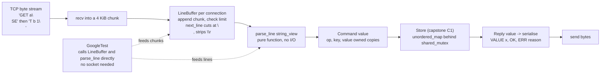

# Module 2.16: Mini-project: tcpkv protocol parser

**Estimated hours:** 4

**What you will learn**

1. The exact tcpkv wire protocol: five commands, six replies, line framing, the size limit, and every error case, written down so that a test can check it.
2. How to split "bytes from a socket" into "complete lines" with a `LineBuffer` that survives partial reads and multiple commands per read, which is the classic TCP framing bug.
3. How to build a small C++17 library with CMake and GoogleTest, make the tests fail first, then pass, then catch three deliberate bugs. These files become the first real files of capstone C1.

**Prerequisites:** [Module 2.15: C++20 essentials](module-15-cpp20-essentials.md). You need `std::optional` and `std::string_view` (modules 2.09 and 2.12), classes and RAII (2.02, 2.03), and GoogleTest installed from module 0.05 (`sudo apt install libgtest-dev cmake` if not).

---

## 1. One-line intuition

A TCP connection delivers a stream of bytes with no message boundaries, so the first job of any server is to cut that stream into messages correctly; the second job is to turn one message into a command; and both jobs must be testable without a socket.

## 2. Real-life analogy

A branch sends loan instructions to head office by fax, one instruction per line. The fax machine at head office is unreliable in a specific way: it prints whatever has arrived so far and rings the bell. Sometimes one ring brings half a line. Sometimes one ring brings three lines and the start of a fourth.

The clerk at the fax has two jobs that must be kept separate:

1. **Framing.** Collect the printed strips, glue them together, and cut at every line ending. Hand over only complete lines. Keep the leftover half-line until the next ring. If a single line goes on for more than a page with no ending, something is wrong: reject it and stop taking faxes from that branch.
2. **Parsing.** Take one complete line and read it: which instruction, which account, which value. If the line is gibberish, write "ERR" and the reason on a reply slip.

A clerk who assumes "one ring equals one line" will glue the wrong halves together on a busy day. That assumption is the TCP framing bug, and it is in production code at companies you have heard of.

## 3. Why it exists: the problem it solves

Module 5.02 will prove it with `tcpdump`; for now take it as a rule: **TCP is a byte stream, not a message stream.** When a client calls `send()` with `"GET a\nSET b 1\n"`, the server's `recv()` may return `"GET a\nSE"`, then `"T b 1\n"`. Or it may return both lines at once. Or one byte at a time under load. The kernel promises the bytes arrive in order and without loss; it promises nothing about where the chunks are cut.

So every protocol needs **framing**: a rule for finding message boundaries in the stream. tcpkv uses the simplest one, a newline. The cost is a buffer per connection that accumulates bytes until a newline shows up. Without it, the server works on a quiet network where every `send` happens to arrive whole, and corrupts commands on a busy one.

The second problem is testability. If parsing lives inside the socket-reading loop, the only way to test "what does `SET` with no value do?" is to start a server and connect to it. By making `parse_line` a pure function of a `string_view`, and `LineBuffer` a class that takes bytes from anywhere, both are tested in microseconds with no network. Capstone C1 keeps this separation for the whole server.

## 4. Three layers of depth

### Layer 1 (beginner): the protocol, exactly

**Requests.** One command per line. Lines end with `\n`; a `\r` immediately before the `\n` is accepted and ignored (so `telnet` and `nc` from Windows work). Fields are separated by exactly one space. Command names are upper case and case-sensitive.

| Line | Meaning | Rules |
|---|---|---|
| `GET <key>` | Read the value for `key` | Exactly one argument; keys contain no spaces |
| `SET <key> <value>` | Store `value` under `key` | `value` is everything after the single space following the key; it may contain spaces; it must be at least one byte |
| `DEL <key>` | Remove `key` | Exactly one argument |
| `PING` | Liveness check | No arguments |
| `QUIT` | Close the connection | No arguments |

**Replies.** One line each, ending in `\n`.

| Reply | When |
|---|---|
| `VALUE <value>` | `GET` found the key |
| `NOT_FOUND` | `GET` or `DEL` did not find the key |
| `OK` | `SET` succeeded |
| `DELETED` | `DEL` removed the key |
| `PONG` | Reply to `PING` |
| `ERR <reason>` | The line could not be parsed, or the server refused it |

**Limits.** A line, including its `\n`, may be at most 4096 bytes (`kMaxLineLength`). If 4096 bytes arrive with no `\n`, or a complete line is longer than that, the connection is in an unrecoverable state (the server cannot know where the next command starts), so the server replies `ERR line too long` and closes the connection.

**Error reasons** (the text after `ERR`), fixed so tests can check them:

| Input | Reason |
|---|---|
| empty line | `empty command` |
| `FETCH k` or `get k` | `unknown command FETCH` (echoes the verb) |
| `GET`, `GET `, `DEL` | `missing key` |
| `GET a b` | `too many arguments` |
| `SET k`, `SET k ` | `missing value` |
| `SET  v` (two spaces, empty key) | `missing key` |
| `PING x` | `PING takes no arguments` (same pattern for `QUIT`) |
| any line of 4096 bytes or more without `\n` | `line too long` |

**The C++ shape.** The header below is the contract; everything in C1 is built on it.

```cpp
enum class Op { Get, Set, Del, Ping, Quit };
struct Command { Op op; std::string key; std::string value; };
std::optional<Command> parse_line(std::string_view line, std::string& err);
class LineBuffer;    // append(bytes) then next_line() until it returns nullopt
```

### Layer 2 (working engineer): design decisions and their reasons

**Why `std::optional<Command>` plus an `err` string, not exceptions.** A malformed line is the *normal* case for a server exposed to the network, not an exceptional one; it happens on every typo in `nc`. Module 2.09 made the rule: expected failures are return values. The error text is returned so the caller can build the `ERR <reason>` reply without a second lookup. Capstone C1 keeps this; a future binary protocol might return an error enum instead.

**Why `Command` owns `std::string` copies.** `parse_line` receives a `string_view` into the connection's `LineBuffer`. The next `append()` can move that memory. If `Command` held views, every command would dangle the moment the next `recv` arrived (module 2.14, case 3). Copying a key and a value costs one or two small allocations per command; module 2.12 showed when that matters and 8.07 will measure it. Correct first, fast second.

**Why `LineBuffer` strips `\r` and `parse_line` tolerates it too.** Belt and braces: the buffer is the one place that sees the raw stream, so it normalises line endings. `parse_line` strips a trailing `\r` or `\n` as well so it can be called directly from tests and from tools that already have whole lines.

**Why over-long lines close the connection.** Alternative designs skip bytes until the next `\n` and continue. That is friendlier but risky: if the "line" was a binary blob from a confused client, the next `\n` is a random byte and the server will execute a random command. Closing is the safe default; the client reconnects.

**Why `append` can fail but `next_line` cannot.** `append` is where new bytes arrive, so that is where the only invariant (no line may exceed the limit) is checked. Once bytes are inside the buffer they are known-good, so `next_line` is a simple cut. Keeping the failure on one side makes the connection loop in C1 trivial: `if (!buf.append(chunk, err)) { send ERR; close; }`.

**Ownership.** One `LineBuffer` per connection, owned by the connection object (a move-only handle in C1). `parse_line` owns nothing. `Command` is a value: copy or move it freely, hand it to a worker thread by value. `Reply` is a value too; `serialise` builds the bytes to send.

**Complexity.** `append` scans only new bytes in the solution shown here, except that it re-scans unconsumed complete lines when checking the limit; `next_line` is O(line length) for the copy plus O(remaining) for the `erase` at the front. For a 4 KiB maximum that is fine; a ring buffer (module 5.03) removes the `erase`.

### Layer 3 (internals): what happens in the kernel and in `std::string`

**Where the chunks come from.** The client's `send(fd, "GET a\nSET b 1\n", 14, 0)` copies 14 bytes into the kernel's socket send buffer. The TCP stack decides how to segment them: with Nagle's algorithm on and an ACK outstanding, it may hold them; with large writes it splits at the maximum segment size (typically 1460 bytes on Ethernet). On the server side, segments land in the receive buffer in order; `recv(fd, buf, 4096, 0)` returns **whatever is there right now**, up to 4096 bytes. On localhost under light load that is usually the whole 14 bytes, which is why the framing bug hides in development. Under load, or across a real network, `recv` returns partial lines and multi-line chunks routinely (module 5.04 shows how to force it with small socket buffers).

**What `LineBuffer::append` does to memory.** `buf_.append()` grows a `std::string` by the libstdc++ policy (roughly doubling), so after warm-up a connection's buffer stops allocating. `next_line` copies the line out (one allocation unless it fits the 15-byte small-string buffer) and `erase(0, n)` moves the remaining bytes to the front with `memmove`. For a 4 KiB cap the move is at most a few hundred nanoseconds.

**What `parse_line` does.** `string_view::find(' ')` is a `memchr` call; `substr` is pointer arithmetic; comparisons against `"GET"` are a length check plus `memcmp` of three bytes. The only allocations are the two `std::string` members of the returned `Command`, which return-value optimisation constructs directly in the caller's `optional`. This is why the parser rarely shows in the profile and the map lookup does (module 2.13, section 7).

**Why the limit is checked on the partial tail.** If the server only checked complete lines, a client could send 100 MB with no `\n` and the buffer would grow until the process died: a trivial denial of service. Checking the unterminated tail against `kMaxLineLength` on every `append` bounds memory per connection to about 4 KiB plus the `std::string` growth slack.

## 5. Architecture diagram



The dotted lines are the whole point of the design: the two hard parts are reachable from a test without the three boxes on the left.

## 6. Code

Before the project, a self-contained demonstration of the bug the project exists to prevent. It feeds the same two chunks to a naive "one `recv` equals one command" loop and to a `LineBuffer`, and prints what each one thinks the commands were. The `LineBuffer` here is the same code you will write in the lab.

```cpp
// framing_demo.cpp
// The TCP framing bug, and the fix, with no sockets involved.
#include <cstdio>
#include <optional>
#include <string>
#include <string_view>
#include <vector>

constexpr std::size_t kMaxLineLength = 4096;

class LineBuffer {
public:
    bool append(std::string_view bytes, std::string& err) {
        buf_.append(bytes.data(), bytes.size());
        std::size_t start = 0;
        while (true) {                                   // every complete line
            std::size_t nl = buf_.find('\n', start);
            if (nl == std::string::npos) break;
            if (nl - start + 1 > kMaxLineLength) { err = "line too long"; return false; }
            start = nl + 1;
        }
        if (buf_.size() - start >= kMaxLineLength) {     // the unterminated tail
            err = "line too long";
            return false;
        }
        return true;
    }
    std::optional<std::string> next_line() {
        std::size_t nl = buf_.find('\n');
        if (nl == std::string::npos) return std::nullopt;
        std::string line = buf_.substr(0, nl);
        buf_.erase(0, nl + 1);
        if (!line.empty() && line.back() == '\r') line.pop_back();
        return line;
    }
private:
    std::string buf_;
};

int main() {
    // What recv() might hand us for the client's "GET a\nSET b hello world\nPING\n"
    const std::vector<std::string> chunks = {"GET a\nSET b hel", "lo world\nPI", "NG\n"};

    std::printf("--- naive: one recv chunk == one command ---\n");
    for (const std::string& c : chunks)
        std::printf("command: [%s]\n", c.c_str());        // wrong on 3 of 3

    std::printf("--- LineBuffer: cut at newlines ---\n");
    LineBuffer lb;
    std::string err;
    for (const std::string& c : chunks) {
        if (!lb.append(c, err)) { std::printf("ERR %s\n", err.c_str()); return 1; }
        while (auto line = lb.next_line())
            std::printf("command: [%s]\n", line->c_str());
        std::printf("  (pending bytes after this chunk: %zu)\n", lb.next_line() ? 0 : 0 + lb_pending(lb));
    }
    return 0;
}
```

Wait: that last `printf` cheats by calling a helper that does not exist. Replace it with a `pending_bytes()` accessor, which the real header has. Here is the corrected tail of `main` and the one-line accessor to add inside the class:

```cpp
    // inside class LineBuffer, public:
    std::size_t pending_bytes() const { return buf_.size(); }

    // the loop in main:
    for (const std::string& c : chunks) {
        if (!lb.append(c, err)) { std::printf("ERR %s\n", err.c_str()); return 1; }
        while (auto line = lb.next_line())
            std::printf("command: [%s]\n", line->c_str());
        std::printf("  (pending bytes after this chunk: %zu)\n", lb.pending_bytes());
    }
```

Compile and run:

```bash
g++ -std=c++17 -Wall -Wextra -Werror -g -o framing_demo framing_demo.cpp
./framing_demo
```

Expected output:

```text
--- naive: one recv chunk == one command ---
command: [GET a
SET b hel]
command: [lo world
PI]
command: [NG
]
--- LineBuffer: cut at newlines ---
command: [GET a]
  (pending bytes after this chunk: 9)
command: [SET b hello world]
  (pending bytes after this chunk: 2)
command: [PING]
  (pending bytes after this chunk: 0)
```

The naive loop produced three garbage commands from three correct chunks. The buffer produced the three real commands and kept 9, then 2, then 0 bytes of leftover between reads. Every test in the lab is a variation of this picture.

## 7. Use case: core-banking loan-origination platform

The RPC-over-TCP application server (claim H4) had, in an early version, exactly the naive loop above: each `recv` was handed to the request decoder as if it were one message. On the development LAN every request fit in one segment and it worked for months. The first branch connected over a slower WAN link, with a larger request (a loan application with a dozen attached document references), and the decoder started reporting "unknown request type" on every third request: it was decoding the second half of one message as the start of the next.

The incident drove two decisions that shaped the rest of the platform and that you will reproduce across the capstones:

1. **Framing is a separate layer with its own tests.** The RPC layer (module 5.07) switched to length-prefixed frames, a 4-byte big-endian length followed by the body, with a `FrameBuffer` that has the same `append`/`next_frame` shape as today's `LineBuffer`. The test file had the same cases: partial frame, two frames in one read, frame split across three reads, over-long frame. The parser of the body never saw a socket again.
2. **Text for the debuggable tool, binary for the hot RPC path.** tcpkv keeps a line protocol on purpose: you can drive it with `nc localhost 7777` and read the traffic in `tcpdump`. The RPC server used binary framing because its messages were large and numerous. Module 5.06 compares the two; the decision rule is "text when humans will type it, binary when machines will flood it."

In an interview, this is the story to tell when asked "what is the hardest networking bug you have fixed?": the symptom (garbage on the WAN only), the cause (byte stream treated as message stream), the fix (a framing buffer with tests), and the number (zero decode errors after, across the next cutover). Capstone C1 gives you a version of it that is yours.

## 8. Lab

This lab creates the first real tcpkv files. Capstone C1 will copy `protocol.hpp`, `protocol.cpp` and `protocol_test.cpp` into `capstones/tcpkv/src/` **unchanged**, so build them in `~/course/tcpkv-parser/` and keep that folder.

### Part A: the project skeleton and the failing tests (45 minutes)

Create `~/course/tcpkv-parser/` with four files. The header is complete and is the contract. The `.cpp` is a skeleton with TODOs. The tests and the CMake file are complete.

`protocol.hpp`:

```cpp
// protocol.hpp -- tcpkv wire protocol: framing, parsing, replies.
// Ownership: parse_line borrows the line (string_view) and returns an owning Command.
// LineBuffer owns its bytes; one per connection. Reply is a value; serialise builds bytes.
#pragma once
#include <cstddef>
#include <optional>
#include <string>
#include <string_view>

namespace tcpkv {

// A line, including its '\n', may be at most this many bytes.
constexpr std::size_t kMaxLineLength = 4096;

enum class Op { Get, Set, Del, Ping, Quit };

const char* op_name(Op op);   // "GET", "SET", ... for logging

struct Command {
    Op          op = Op::Ping;
    std::string key;            // empty for PING and QUIT
    std::string value;          // only for SET
};

// Parses one line. A trailing '\n' and/or '\r' is tolerated and ignored.
// Returns the Command, or std::nullopt with 'err' set to the reason for an ERR reply.
std::optional<Command> parse_line(std::string_view line, std::string& err);

struct Reply {
    enum class Kind { Value, NotFound, Ok, Deleted, Pong, Err };
    Kind        kind = Kind::Ok;
    std::string text;           // the value for Value, the reason for Err, unused otherwise
};

// "VALUE <text>\n", "NOT_FOUND\n", "OK\n", "DELETED\n", "PONG\n", "ERR <text>\n"
std::string serialise(const Reply& reply);

// Accumulates bytes from recv() and yields complete lines.
class LineBuffer {
public:
    // Appends bytes. Returns false and sets 'err' if any complete line, or the
    // unterminated tail, reaches kMaxLineLength. After false, close the connection.
    bool append(std::string_view bytes, std::string& err);

    // Next complete line without its '\n' and without a trailing '\r', or nullopt.
    std::optional<std::string> next_line();

    std::size_t pending_bytes() const { return buf_.size(); }

private:
    std::string buf_;
};

}  // namespace tcpkv
```

`protocol.cpp` (the skeleton you will fill in):

```cpp
// protocol.cpp -- starter skeleton. Replace every TODO.
#include "protocol.hpp"

namespace tcpkv {

const char* op_name(Op op) {
    switch (op) {
        case Op::Get:  return "GET";
        case Op::Set:  return "SET";
        case Op::Del:  return "DEL";
        case Op::Ping: return "PING";
        case Op::Quit: return "QUIT";
    }
    return "?";
}

std::string serialise(const Reply& reply) {
    // TODO 1: one line per Kind, each ending in '\n'. Value and Err carry reply.text.
    (void)reply;
    return "ERR not implemented\n";
}

std::optional<Command> parse_line(std::string_view line, std::string& err) {
    // TODO 2: strip one trailing '\n', then one trailing '\r' (string_view::remove_suffix).
    // TODO 3: if line.size() >= kMaxLineLength -> err = "line too long".
    // TODO 4: if empty -> err = "empty command".
    // TODO 5: verb = text before the first ' '; rest = text after it (if any).
    // TODO 6: PING / QUIT: any rest -> err = "<VERB> takes no arguments".
    // TODO 7: GET / DEL: no rest or empty rest -> "missing key"; rest contains ' ' -> "too many arguments".
    // TODO 8: SET: no rest -> "missing key"; split rest at first ' ': no space -> "missing value";
    //         empty key -> "missing key"; empty value -> "missing value".
    // TODO 9: anything else -> err = "unknown command " + verb.
    (void)line;
    err = "not implemented";
    return std::nullopt;
}

bool LineBuffer::append(std::string_view bytes, std::string& err) {
    // TODO 10: append bytes; check every complete line (length incl. '\n' > kMaxLineLength)
    //          and the unterminated tail (length >= kMaxLineLength) -> err = "line too long".
    (void)bytes;
    err = "not implemented";
    return false;
}

std::optional<std::string> LineBuffer::next_line() {
    // TODO 11: find '\n'; none -> nullopt. Copy the line out, erase it plus the '\n',
    //          strip one trailing '\r'.
    return std::nullopt;
}

}  // namespace tcpkv
```

`protocol_test.cpp` (complete; do not weaken a test to make it pass):

```cpp
// protocol_test.cpp -- GoogleTest suite for the tcpkv protocol layer.
#include <gtest/gtest.h>
#include <string>
#include "protocol.hpp"

using tcpkv::Command;
using tcpkv::LineBuffer;
using tcpkv::Op;
using tcpkv::parse_line;
using tcpkv::Reply;
using tcpkv::serialise;
using tcpkv::kMaxLineLength;

// ---------- parse_line: good lines ----------

TEST(ParseLine, GetWithKey) {
    std::string err;
    auto cmd = parse_line("GET loan:1001", err);
    ASSERT_TRUE(cmd.has_value()) << err;
    EXPECT_EQ(cmd->op, Op::Get);
    EXPECT_EQ(cmd->key, "loan:1001");
    EXPECT_TRUE(cmd->value.empty());
}

TEST(ParseLine, SetValueKeepsSpaces) {
    std::string err;
    auto cmd = parse_line("SET loan:1001 status=APPROVED amount=250000", err);
    ASSERT_TRUE(cmd.has_value()) << err;
    EXPECT_EQ(cmd->op, Op::Set);
    EXPECT_EQ(cmd->key, "loan:1001");
    EXPECT_EQ(cmd->value, "status=APPROVED amount=250000");
}

TEST(ParseLine, Del) {
    std::string err;
    auto cmd = parse_line("DEL loan:1001", err);
    ASSERT_TRUE(cmd.has_value()) << err;
    EXPECT_EQ(cmd->op, Op::Del);
    EXPECT_EQ(cmd->key, "loan:1001");
}

TEST(ParseLine, PingAndQuit) {
    std::string err;
    auto ping = parse_line("PING", err);
    ASSERT_TRUE(ping.has_value()) << err;
    EXPECT_EQ(ping->op, Op::Ping);
    EXPECT_TRUE(ping->key.empty());
    auto quit = parse_line("QUIT", err);
    ASSERT_TRUE(quit.has_value()) << err;
    EXPECT_EQ(quit->op, Op::Quit);
}

TEST(ParseLine, AcceptsTrailingCRLF) {
    std::string err;
    auto a = parse_line("GET k\r\n", err);
    ASSERT_TRUE(a.has_value()) << err;
    EXPECT_EQ(a->key, "k");
    auto b = parse_line("GET k\r", err);
    ASSERT_TRUE(b.has_value()) << err;
    EXPECT_EQ(b->key, "k");
    auto c = parse_line("GET k\n", err);
    ASSERT_TRUE(c.has_value()) << err;
    EXPECT_EQ(c->key, "k");
}

// ---------- parse_line: error lines ----------

TEST(ParseLine, EmptyLineIsError) {
    std::string err;
    EXPECT_FALSE(parse_line("", err).has_value());
    EXPECT_EQ(err, "empty command");
    EXPECT_FALSE(parse_line("\r\n", err).has_value());
    EXPECT_EQ(err, "empty command");
}

TEST(ParseLine, UnknownCommandEchoesVerb) {
    std::string err;
    EXPECT_FALSE(parse_line("FETCH k", err).has_value());
    EXPECT_EQ(err, "unknown command FETCH");
    EXPECT_FALSE(parse_line("get k", err).has_value());   // case-sensitive
    EXPECT_EQ(err, "unknown command get");
}

TEST(ParseLine, GetWithEmptyKeyIsError) {
    std::string err;
    EXPECT_FALSE(parse_line("GET", err).has_value());
    EXPECT_EQ(err, "missing key");
    EXPECT_FALSE(parse_line("GET ", err).has_value());
    EXPECT_EQ(err, "missing key");
    EXPECT_FALSE(parse_line("DEL", err).has_value());
    EXPECT_EQ(err, "missing key");
}

TEST(ParseLine, GetWithTwoArgumentsIsError) {
    std::string err;
    EXPECT_FALSE(parse_line("GET a b", err).has_value());
    EXPECT_EQ(err, "too many arguments");
}

TEST(ParseLine, SetWithoutValueIsError) {
    std::string err;
    EXPECT_FALSE(parse_line("SET k", err).has_value());
    EXPECT_EQ(err, "missing value");
    EXPECT_FALSE(parse_line("SET k ", err).has_value());
    EXPECT_EQ(err, "missing value");
    EXPECT_FALSE(parse_line("SET", err).has_value());
    EXPECT_EQ(err, "missing key");
    EXPECT_FALSE(parse_line("SET  v", err).has_value());   // two spaces: empty key
    EXPECT_EQ(err, "missing key");
}

TEST(ParseLine, PingWithArgumentIsError) {
    std::string err;
    EXPECT_FALSE(parse_line("PING now", err).has_value());
    EXPECT_EQ(err, "PING takes no arguments");
    EXPECT_FALSE(parse_line("QUIT now", err).has_value());
    EXPECT_EQ(err, "QUIT takes no arguments");
}

TEST(ParseLine, RejectsOverLongLine) {
    std::string err;
    std::string line = "SET k " + std::string(5000, 'x');
    EXPECT_FALSE(parse_line(line, err).has_value());
    EXPECT_EQ(err, "line too long");
}

// ---------- LineBuffer: framing ----------

TEST(LineBufferTest, PartialLineYieldsNothing) {
    LineBuffer lb;
    std::string err;
    ASSERT_TRUE(lb.append("GET lo", err)) << err;
    EXPECT_FALSE(lb.next_line().has_value());
    EXPECT_EQ(lb.pending_bytes(), 6u);
}

TEST(LineBufferTest, LineCompletesAcrossTwoAppends) {
    LineBuffer lb;
    std::string err;
    ASSERT_TRUE(lb.append("GET lo", err));
    ASSERT_TRUE(lb.append("an:1\n", err));
    auto line = lb.next_line();
    ASSERT_TRUE(line.has_value());
    EXPECT_EQ(*line, "GET loan:1");
    EXPECT_FALSE(lb.next_line().has_value());
    EXPECT_EQ(lb.pending_bytes(), 0u);
}

TEST(LineBufferTest, TwoLinesInOneChunk) {
    LineBuffer lb;
    std::string err;
    ASSERT_TRUE(lb.append("GET a\nPING\n", err));
    auto first = lb.next_line();
    ASSERT_TRUE(first.has_value());
    EXPECT_EQ(*first, "GET a");
    auto second = lb.next_line();
    ASSERT_TRUE(second.has_value());
    EXPECT_EQ(*second, "PING");
    EXPECT_FALSE(lb.next_line().has_value());
}

TEST(LineBufferTest, TwoLinesAndAPartialThird) {
    LineBuffer lb;
    std::string err;
    ASSERT_TRUE(lb.append("GET a\nSET b hello world\nPI", err));
    EXPECT_EQ(*lb.next_line(), "GET a");
    EXPECT_EQ(*lb.next_line(), "SET b hello world");
    EXPECT_FALSE(lb.next_line().has_value());
    EXPECT_EQ(lb.pending_bytes(), 2u);
    ASSERT_TRUE(lb.append("NG\n", err));
    EXPECT_EQ(*lb.next_line(), "PING");
}

TEST(LineBufferTest, LineSplitAcrossThreeReads) {
    LineBuffer lb;
    std::string err;
    ASSERT_TRUE(lb.append("SE", err));
    ASSERT_TRUE(lb.append("T k va", err));
    EXPECT_FALSE(lb.next_line().has_value());
    ASSERT_TRUE(lb.append("lue\n", err));
    EXPECT_EQ(*lb.next_line(), "SET k value");
}

TEST(LineBufferTest, StripsCarriageReturn) {
    LineBuffer lb;
    std::string err;
    ASSERT_TRUE(lb.append("GET k\r\nPING\r\n", err));
    EXPECT_EQ(*lb.next_line(), "GET k");
    EXPECT_EQ(*lb.next_line(), "PING");
}

TEST(LineBufferTest, CarriageReturnSplitFromNewline) {
    LineBuffer lb;
    std::string err;
    ASSERT_TRUE(lb.append("GET k\r", err));
    EXPECT_FALSE(lb.next_line().has_value());
    ASSERT_TRUE(lb.append("\n", err));
    EXPECT_EQ(*lb.next_line(), "GET k");
}

TEST(LineBufferTest, RejectsOverLongPartialLine) {
    LineBuffer lb;
    std::string err;
    EXPECT_FALSE(lb.append(std::string(kMaxLineLength, 'a'), err));   // 4096 bytes, no '\n'
    EXPECT_EQ(err, "line too long");
}

TEST(LineBufferTest, RejectsOverLongCompleteLine) {
    LineBuffer lb;
    std::string err;
    EXPECT_FALSE(lb.append(std::string(5000, 'a') + "\n", err));
    EXPECT_EQ(err, "line too long");
}

TEST(LineBufferTest, AcceptsLineAtExactLimit) {
    LineBuffer lb;
    std::string err;
    std::string line(kMaxLineLength - 1, 'a');                 // 4095 + '\n' == 4096
    ASSERT_TRUE(lb.append(line + "\n", err)) << err;
    auto got = lb.next_line();
    ASSERT_TRUE(got.has_value());
    EXPECT_EQ(got->size(), kMaxLineLength - 1);
}

TEST(LineBufferTest, PartialJustUnderLimitIsStillPending) {
    LineBuffer lb;
    std::string err;
    ASSERT_TRUE(lb.append(std::string(kMaxLineLength - 1, 'a'), err)) << err;   // could still get '\n'
    EXPECT_FALSE(lb.next_line().has_value());
    EXPECT_FALSE(lb.append("b", err));                          // now 4096 with no '\n'
}

// ---------- Reply ----------

TEST(ReplyTest, SerialiseEveryKind) {
    EXPECT_EQ(serialise(Reply{Reply::Kind::Value, "hello world"}), "VALUE hello world\n");
    EXPECT_EQ(serialise(Reply{Reply::Kind::NotFound, ""}), "NOT_FOUND\n");
    EXPECT_EQ(serialise(Reply{Reply::Kind::Ok, ""}), "OK\n");
    EXPECT_EQ(serialise(Reply{Reply::Kind::Deleted, ""}), "DELETED\n");
    EXPECT_EQ(serialise(Reply{Reply::Kind::Pong, ""}), "PONG\n");
    EXPECT_EQ(serialise(Reply{Reply::Kind::Err, "missing key"}), "ERR missing key\n");
}

// ---------- end to end: chunks -> lines -> commands ----------

TEST(EndToEnd, ChunksBecomeCommands) {
    LineBuffer lb;
    std::string err;
    std::vector<Command> out;
    for (const char* chunk : {"GET a\nSET b hel", "lo world\nPI", "NG\n"}) {
        ASSERT_TRUE(lb.append(chunk, err)) << err;
        while (auto line = lb.next_line()) {
            auto cmd = parse_line(*line, err);
            ASSERT_TRUE(cmd.has_value()) << err;
            out.push_back(*cmd);
        }
    }
    ASSERT_EQ(out.size(), 3u);
    EXPECT_EQ(out[0].op, Op::Get);  EXPECT_EQ(out[0].key, "a");
    EXPECT_EQ(out[1].op, Op::Set);  EXPECT_EQ(out[1].key, "b");  EXPECT_EQ(out[1].value, "hello world");
    EXPECT_EQ(out[2].op, Op::Ping);
}
```

`CMakeLists.txt`:

```cmake
cmake_minimum_required(VERSION 3.22)
project(tcpkv_parser LANGUAGES CXX)

set(CMAKE_CXX_STANDARD 17)
set(CMAKE_CXX_STANDARD_REQUIRED ON)
set(CMAKE_CXX_EXTENSIONS OFF)
add_compile_options(-Wall -Wextra -Werror)

# The protocol layer as a library: capstone C1 links the server against it.
add_library(tcpkv_protocol protocol.cpp)
target_include_directories(tcpkv_protocol PUBLIC ${CMAKE_CURRENT_SOURCE_DIR})

# Tests. libgtest-dev on Ubuntu 24.04 ships CMake config files, so find_package works.
find_package(GTest REQUIRED)
enable_testing()
add_executable(protocol_test protocol_test.cpp)
target_link_libraries(protocol_test PRIVATE tcpkv_protocol GTest::gtest_main)
include(GoogleTest)
gtest_discover_tests(protocol_test)
```

Build and run the tests. The one-line form is what you will type for the rest of the course:

```bash
cd ~/course/tcpkv-parser
cmake -S . -B build && cmake --build build && ctest --test-dir build --output-on-failure
```

Expected now, with the skeleton: the build succeeds (the skeleton compiles cleanly) and **ctest reports failures**. The tail of the output looks like:

```text
...
      Start 25: EndToEnd.ChunksBecomeCommands
25/25 Test #25: EndToEnd.ChunksBecomeCommands ....***Failed    0.00 sec
...
 8% tests passed, 23 tests failed out of 25
```

Only `ReplyTest`... no: with the skeleton even that fails. Expected: `0% tests passed, 25 tests failed out of 25` or close to it (one or two may pass by accident, for example `PartialLineYieldsNothing` cannot pass because `append` returns false). Red first is the point: now you know the tests test something.

### Part B: make it green (60 to 90 minutes)

Fill in the TODOs in `protocol.cpp` in this order, re-running the one-line build after each step and watching the count of passing tests rise:

1. `serialise` (TODO 1). Expected: `ReplyTest.SerialiseEveryKind` passes.
2. `LineBuffer::next_line` and `append` (TODOs 10 and 11). Expected: all `LineBufferTest` cases pass. If `RejectsOverLongPartialLine` fails, check `>=` versus `>` against Layer 1: a 4096-byte tail with no `\n` is already too long because the `\n` would make it 4097.
3. `parse_line` (TODOs 2 to 9). Expected: all `ParseLine` cases pass, then `EndToEnd`.

Expected final output shape:

```text
Test project /home/shakir/course/tcpkv-parser/build
      Start  1: ParseLine.GetWithKey
 1/25 Test  #1: ParseLine.GetWithKey ...........................   Passed    0.00 sec
      Start  2: ParseLine.SetValueKeepsSpaces
 2/25 Test  #2: ParseLine.SetValueKeepsSpaces ..................   Passed    0.00 sec
...
      Start 25: EndToEnd.ChunksBecomeCommands
25/25 Test #25: EndToEnd.ChunksBecomeCommands ..................   Passed    0.00 sec

100% tests passed, 0 tests failed out of 25

Total Test time (real) =   0.08 sec
```

Do not open the reference solution at the end of this section until this says 100%. If you are stuck for more than 30 minutes on one TODO, read only the matching function in the solution, then close it.

### Part C: three deliberate bugs, each caught by a named test (30 minutes)

Introduce each bug on its own, rebuild, run `ctest`, and write down **which test** failed and **what the failure message said**. Then revert. This is how you learn what each test protects.

| Bug | Where | What to change | Expected failing test |
|---|---|---|---|
| 1. Off-by-one in framing | `next_line` | `buf_.erase(0, nl)` instead of `nl + 1` (the `\n` is left behind) | `TwoLinesInOneChunk`: second line is `""` not `"PING"`; `EndToEnd` fails too |
| 2. CRLF forgotten | `next_line` | Delete the `\r`-stripping lines | `StripsCarriageReturn`: expected `"GET k"`, got `"GET k\r"` |
| 3. Value includes the separator | `parse_line`, SET branch | `rest.substr(sp2)` instead of `sp2 + 1` | `SetValueKeepsSpaces`: value starts with a space; `EndToEnd` fails too |

Expected `ctest --output-on-failure` fragment for bug 2:

```text
protocol_test.cpp:NNN: Failure
Expected equality of these values:
  *lb.next_line()
    Which is: "GET k\r"
  "GET k"
```

A fourth, optional bug worth trying: in `append`, change the tail check to `>` instead of `>=`. Expected: `RejectsOverLongPartialLine` fails while `AcceptsLineAtExactLimit` still passes, which shows why both tests exist.

### Part D: harden it (30 minutes)

1. Run the suite under the sanitizers from module 2.14. The CMake flags are passed at configure time:

```bash
cmake -S . -B build-asan -DCMAKE_CXX_FLAGS="-fsanitize=undefined,address -fno-omit-frame-pointer -g" \
  && cmake --build build-asan && ctest --test-dir build-asan --output-on-failure
```

Expected: `100% tests passed`, no sanitizer output. Module 9.04 turns this into a CI job.

2. Run it under libstdc++ debug mode: `-DCMAKE_CXX_FLAGS="-D_GLIBCXX_DEBUG -g"` into `build-dbg`. Expected: green.

3. Write a 20-line `parser_cli.cpp` that reads `std::cin` line by line (`std::getline`), calls `parse_line`, and prints either `op key value` or `ERR reason`. Add it to `CMakeLists.txt` as a second executable linked against `tcpkv_protocol`. Try the whole error table from Layer 1 by hand. Expected: each input gives the reason listed. Keep this tool; in Phase 5 you will point it at a socket.

4. Think, and write down in the journal: which test would you add for `GET` with a 4095-byte key? For a value containing `\r` in the middle? For a line containing a NUL byte? Two of those are legal by the spec as written. Decide whether they should be.

### Reference solution (open only after Part B is green)

<details>
<summary>protocol.cpp, complete</summary>

```cpp
// protocol.cpp -- reference solution for the tcpkv protocol layer.
#include "protocol.hpp"

namespace tcpkv {

const char* op_name(Op op) {
    switch (op) {
        case Op::Get:  return "GET";
        case Op::Set:  return "SET";
        case Op::Del:  return "DEL";
        case Op::Ping: return "PING";
        case Op::Quit: return "QUIT";
    }
    return "?";
}

std::string serialise(const Reply& reply) {
    switch (reply.kind) {
        case Reply::Kind::Value:    return "VALUE " + reply.text + "\n";
        case Reply::Kind::NotFound: return "NOT_FOUND\n";
        case Reply::Kind::Ok:       return "OK\n";
        case Reply::Kind::Deleted:  return "DELETED\n";
        case Reply::Kind::Pong:     return "PONG\n";
        case Reply::Kind::Err:      return "ERR " + reply.text + "\n";
    }
    return "ERR internal\n";
}

std::optional<Command> parse_line(std::string_view line, std::string& err) {
    // Tolerate a trailing newline and carriage return so callers can pass raw lines.
    if (!line.empty() && line.back() == '\n') line.remove_suffix(1);
    if (!line.empty() && line.back() == '\r') line.remove_suffix(1);

    if (line.size() >= kMaxLineLength) { err = "line too long"; return std::nullopt; }
    if (line.empty())                  { err = "empty command"; return std::nullopt; }

    const std::size_t sp = line.find(' ');
    const std::string_view verb = line.substr(0, sp);
    const bool has_rest = (sp != std::string_view::npos);
    const std::string_view rest = has_rest ? line.substr(sp + 1) : std::string_view{};

    Command cmd;

    if (verb == "PING" || verb == "QUIT") {
        if (has_rest) { err = std::string(verb) + " takes no arguments"; return std::nullopt; }
        cmd.op = (verb == "PING") ? Op::Ping : Op::Quit;
        return cmd;
    }

    if (verb == "GET" || verb == "DEL") {
        if (!has_rest || rest.empty())          { err = "missing key";        return std::nullopt; }
        if (rest.find(' ') != std::string_view::npos) { err = "too many arguments"; return std::nullopt; }
        cmd.op = (verb == "GET") ? Op::Get : Op::Del;
        cmd.key = std::string(rest);
        return cmd;
    }

    if (verb == "SET") {
        if (!has_rest || rest.empty()) { err = "missing key"; return std::nullopt; }
        const std::size_t sp2 = rest.find(' ');
        if (sp2 == std::string_view::npos) { err = "missing value"; return std::nullopt; }
        const std::string_view key = rest.substr(0, sp2);
        const std::string_view value = rest.substr(sp2 + 1);
        if (key.empty())   { err = "missing key";   return std::nullopt; }
        if (value.empty()) { err = "missing value"; return std::nullopt; }
        cmd.op = Op::Set;
        cmd.key = std::string(key);
        cmd.value = std::string(value);
        return cmd;
    }

    err = "unknown command " + std::string(verb);
    return std::nullopt;
}

bool LineBuffer::append(std::string_view bytes, std::string& err) {
    buf_.append(bytes.data(), bytes.size());

    // Check every complete line still in the buffer, then the unterminated tail.
    std::size_t start = 0;
    while (true) {
        const std::size_t nl = buf_.find('\n', start);
        if (nl == std::string::npos) break;
        if (nl - start + 1 > kMaxLineLength) { err = "line too long"; return false; }
        start = nl + 1;
    }
    if (buf_.size() - start >= kMaxLineLength) {   // a '\n' would make it 4097+
        err = "line too long";
        return false;
    }
    return true;
}

std::optional<std::string> LineBuffer::next_line() {
    const std::size_t nl = buf_.find('\n');
    if (nl == std::string::npos) return std::nullopt;
    std::string line = buf_.substr(0, nl);
    buf_.erase(0, nl + 1);
    if (!line.empty() && line.back() == '\r') line.pop_back();
    return line;
}

}  // namespace tcpkv
```

</details>

<details>
<summary>parser_cli.cpp (Part D, step 3)</summary>

```cpp
// parser_cli.cpp -- type lines, see what the parser makes of them.
#include <iostream>
#include <string>
#include "protocol.hpp"

int main() {
    std::string line, err;
    while (std::getline(std::cin, line)) {
        auto cmd = tcpkv::parse_line(line, err);
        if (!cmd) { std::cout << "ERR " << err << "\n"; continue; }
        std::cout << tcpkv::op_name(cmd->op);
        if (!cmd->key.empty())   std::cout << " key=[" << cmd->key << "]";
        if (!cmd->value.empty()) std::cout << " value=[" << cmd->value << "]";
        std::cout << "\n";
    }
    return 0;
}
```

Add to `CMakeLists.txt`: `add_executable(parser_cli parser_cli.cpp)` and `target_link_libraries(parser_cli PRIVATE tcpkv_protocol)`. Run with `./build/parser_cli`.

</details>

### Journal

Copy [journal/TEMPLATE.md](../journal/TEMPLATE.md) to `journal/YYYY-MM-DD-tcpkv-protocol-parser.md`. Record: the pass count after each of the three steps in Part B; for each deliberate bug in Part C, the test name and the first line of its failure message; whether the sanitizer and debug-mode runs were clean; and your answers to the three design questions in Part D step 4. In "Interview story", tell the framing bug in four sentences as if it had happened in production. This entry is the first one capstone C1's resume-defense session will quote.

## 9. Common mistakes and misconceptions

| Mistake | Why it is wrong | Bug it causes later |
|---|---|---|
| "One `recv` returns one message" | TCP is a byte stream; the kernel cuts it wherever it likes | Garbage commands under load or across a WAN; works on localhost |
| Parsing inside the socket loop | Cannot be tested without a server | Error cases never tested; bugs found by customers |
| `Command` holding `string_view` into the buffer | The buffer moves on the next `append` | Use-after-free that appears only with pipelined clients |
| Skipping to the next `\n` after an over-long line | The next `\n` may be inside binary garbage | Executing a random command from a confused client |
| No limit on the unterminated tail | A client can send gigabytes with no newline | Trivial denial of service; the process is OOM-killed |
| Using `std::getline` on a socket | There is no `istream` on a raw fd, and a blocking read-to-newline cannot handle multiple connections | Rewrites when the thread pool arrives |
| Off-by-one on the `\n` in `erase` | The newline stays in the buffer | Every second command is empty |
| Forgetting `\r` | Windows `telnet` and some clients send CRLF | `GET k\r` is an unknown key; "works from Linux, not from Windows" |
| Weakening a test to make it pass | The spec is the test | The capstone's load generator finds the bug later |
| Treating replies as free-form strings | Clients parse them; a typo breaks every client | Make `serialise` the only place the bytes are built |

## 10. Resume link

- **Claim I, "line-based text protocol".** You now own the specification (Layer 1) and the implementation. Say: "A newline-framed text protocol with five commands and six replies, a 4 KiB line limit enforced on the unterminated tail to bound memory per connection, parsed by a pure function over `string_view` with twenty-five unit tests including partial reads, multi-line chunks and CRLF."
- **Claim I, "GoogleTest suite".** This is the first GoogleTest file in the project and the one C1 copies in unchanged. The three deliberate bugs give you a concrete answer to "give an example of a bug your tests caught".
- **Claim E, "POSIX sockets, TCP/IP".** The framing story in section 7 is the interview answer for "what is the difference between TCP and a message queue?" and "what is the hardest networking bug you fixed?". You will have the measured version after Phase 5.
- **Claim G, "CMake, GoogleTest".** `find_package(GTest)`, `gtest_discover_tests`, and the one-line `cmake -S . -B build && cmake --build build && ctest` are the daily commands from here to the end of the course.

Likely follow-ups: "Why newline framing and not length prefix?" (Debuggable with `nc`; module 5.06 gives the trade-off.) "What happens if a client sends 10 MB with no newline?" (Rejected at 4 KiB; connection closed.) "How do you test the partial-read case?" (Feed chunks to `LineBuffer` directly; no socket.)

## 11. Interview questions

**Q1 (easy). Why can a server not assume that one `recv` call returns one command?**

<details>
<summary>Model answer</summary>

Because TCP is a byte stream. The sender's `send` boundaries are not preserved: the kernel segments data by the path MTU, may coalesce small writes (Nagle), and `recv` returns whatever bytes are currently in the receive buffer up to the size requested. So a single command can arrive split across several `recv` calls, and several commands can arrive in one. The server must keep a per-connection buffer, append each `recv` result, and cut at the protocol's framing marker, in tcpkv's case a newline, handing out only complete lines and keeping the remainder for the next read.

</details>

**Q2 (easy). Why does `parse_line` take a `std::string_view` but `Command` store `std::string`?**

<details>
<summary>Model answer</summary>

`parse_line` only reads the line, and the caller already owns it in the `LineBuffer`, so a view avoids a copy and makes the function usable from tests, tools and the server alike. `Command` is handed to the store and possibly to another thread, and the buffer it was parsed from will be overwritten by the next `append`, so `Command` must own its key and value; a `string_view` member would dangle. Views are parameters; owners are members.

</details>

**Q3 (medium). How does the parser bound memory per connection, and what does it do when the bound is hit?**

<details>
<summary>Model answer</summary>

`LineBuffer::append` checks two things after appending: every complete line still in the buffer must be at most 4096 bytes including its newline, and the unterminated tail must be under 4096 bytes, because a newline would make it exceed the limit. Either failure returns `false` with `line too long`. The server replies `ERR line too long` and closes the connection rather than skipping to the next newline, because after an over-long line there is no trustworthy boundary: the next newline might be a byte inside binary data and the server would execute a random command. So memory per connection is bounded at about 4 KiB plus string growth slack, and a misbehaving client cannot grow it.

</details>

**Q4 (medium). Describe the test cases you would consider mandatory for a line-framing buffer, and why each exists.**

<details>
<summary>Model answer</summary>

Partial line yields nothing and stays pending (the buffer must wait). A line completed across two appends (the glue works). Two lines in one chunk (the loop must drain all of them, not just the first). Two lines plus a partial third (both behaviours at once, with the pending count checked). A line split across three reads (no assumption about chunk size). CRLF stripped, and CR split from LF across reads (line-ending normalisation must not depend on chunking). An over-long partial line rejected, an over-long complete line rejected, and a line at exactly the limit accepted (both sides of the boundary, so an off-by-one cannot hide). Finally an end-to-end test feeding realistic chunks through buffer and parser together. Each test corresponds to a way the naive "one recv equals one message" loop fails.

</details>

**Q5 (hard). A client reports that `SET` commands with long values occasionally come back `ERR unknown command` from your server, but only over the WAN and never on the LAN. Walk through the diagnosis and the fix, and how you would prove the fix.**

<details>
<summary>Model answer</summary>

The symptom pattern, correct on LAN and corrupt on WAN with large payloads, points at framing: on the LAN each `send` arrives in one segment and one `recv`, while on the WAN a long value crosses a segment boundary and arrives in two `recv` calls. If the server treats each `recv` as a command, the second half of the value is parsed as a new line whose first word is arbitrary text, hence `unknown command`. I would confirm with `tcpdump` or `ss` showing the segment sizes, or more simply by reproducing locally with a client that writes one byte at a time, which breaks the naive server identically. The fix is a per-connection `LineBuffer` that accumulates `recv` output and emits only newline-terminated lines, with the parser never seeing the socket. The proof is three-fold: unit tests that feed partial, multi-line and byte-at-a-time chunks to the buffer; the one-byte-at-a-time client against the real server returning correct replies; and a counter of `ERR` replies under the load generator going to zero. I would also add the 4 KiB limit on the unterminated tail at the same time, since a buffer without a bound is the next incident.

</details>

## 12. Revision

- TCP delivers bytes, not messages; a per-connection `LineBuffer` appends every `recv` and cuts at `\n` (stripping `\r`), rejecting any line or tail that reaches 4096 bytes and closing the connection.
- `parse_line(string_view, err)` is a pure function returning an owning `Command` or an `ERR` reason: `GET`/`DEL` take exactly one key, `SET` takes a key and a non-empty value that may contain spaces, `PING`/`QUIT` take nothing, verbs are upper-case.
- The protocol is the test file: 25 GoogleTest cases, red first, green after, and three deliberate bugs each caught by a named test; these files go into capstone C1 unchanged.

---

Previous: [Module 2.15: C++20 essentials](module-15-cpp20-essentials.md) | Next: [Module 3.01: Processes](../phase-03-os-internals/module-01-processes.md)
