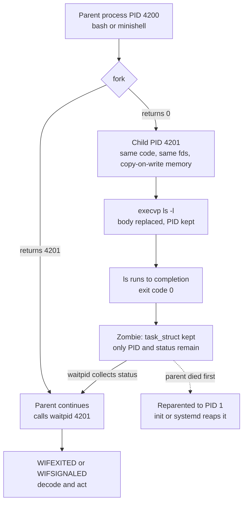

# Module 3.01: Processes

**Estimated hours:** 4

**What you will learn**

1. How a new process is born on Linux: `fork` makes a copy, `exec` replaces the copy with a new program, and `wait` collects the result.
2. How to read an exit status so you can tell "finished cleanly with code 1" from "killed by signal 11", and what zombies and orphans are.
3. How to inspect any running process from the outside with `/proc`, `ps` and `pstree`, and why Windows has no `fork` at all.

**Prerequisites:** [Module 2.16: Mini-project: tcpkv protocol parser](../phase-02-cpp17-from-zero-to-modern/module-16-cpp-mini-project-protocol-parser.md). You should be comfortable with C pointers, structs and `errno` from Phase 1, and with the idea of a process from [Module 0.02](../phase-00-how-a-computer-runs-a-program/module-02-operating-system-processes-files.md).

---

## 1. One-line intuition

On Linux a process is never created from nothing: an existing process clones itself with `fork`, and the clone usually swaps its own body for a new program with `exec`.

## 2. Real-life analogy

Think of a company that only grows by cloning an existing employee.

- **`fork`** is a photocopier for people. You walk in, press the button, and two of you walk out. Both have the same memories up to that moment, the same desk contents, the same open folders. The only difference is a slip of paper in your hand: the original's slip says the clone's employee number, and the clone's slip says 0. From that moment the two of you live separate lives. Changes to one person's desk do not appear on the other's.
- **`exec`** is a brain transplant. The clone walks into a room, and comes out as a completely different employee (the `ls` program, say), but with the same employee number, the same open folders, and the same manager.
- **`wait`** is the manager checking a report. When the clone finishes its task, it leaves a one-line note ("done, result 0" or "I was fired by signal 11") and the manager must pick up that note. Until the manager picks it up, the clone's name stays on the staff list as a **zombie**: nobody is at the desk, but the record is still there.
- **An orphan** is a clone whose manager left the company first. The company rule is that orphans are adopted by employee number 1, the founder (`init` or `systemd`), who always picks up their notes.
- **The environment** is a sticky-note board the clone inherits: `PATH`, `HOME`, `LANG`, and whatever the parent chose to pin there.

## 3. Why it exists: the problem it solves

Starting a program needs two different things: a new container (PID, address space, file descriptor table) and a new body (code and data from a file on disk). Unix split the two on purpose.

- `fork` makes the container by copying the current one. This is cheap to describe and gives the child everything the parent had: open files, working directory, environment, signal settings.
- `exec` fills the container with a new body from a file. The container is unchanged, so the open files and environment survive.

Between the two calls the child runs a few lines of the parent's code. That gap is the whole reason the design is powerful. A shell can, in the child, redirect file descriptor 1 to a file, change directory, drop privileges, close a socket, and only then call `exec`. The `ls` program never knows any of that happened. This is how `ls -l > listing.txt` works with no special code in `ls`.

What breaks without it: an operating system with a single "create process from file" call has to accept a huge parameter block describing everything the new process should inherit or change. That is exactly what Windows `CreateProcess` looks like, with ten parameters and a `STARTUPINFO` struct, and it is still less flexible than ten lines in a forked child. The cost is that `fork` must copy the parent, which module 3.04 shows is done lazily (copy-on-write), but it is still slower than creating a thread. That trade-off decides how servers are built; section 7 returns to it.

## 4. Three layers of depth

### Layer 1 (beginner): fork returns twice

`fork()` is one function call that returns two times, once in each process.

```text
            parent, PID 4200
                 |
        pid_t r = fork();
                 |
       +---------+----------+
       |                    |
  parent, PID 4200     child, PID 4201
  r == 4201            r == 0
  (r = child's PID)    (0 means "you are the copy")
```

Everything after the `fork` line runs in both processes. The only way to know which one you are is the return value. This tiny program shows it:

```c
/* fork_twice.c  -  fork returns twice: once in each process. */
#include <stdio.h>
#include <unistd.h>      /* fork, getpid, getppid */
#include <sys/wait.h>    /* wait */

int main(void) {
    printf("before fork: I am pid %d\n", (int)getpid());
    fflush(stdout);          /* see section 9 for why this matters */

    pid_t r = fork();
    if (r < 0) {
        perror("fork");
        return 1;
    }
    if (r == 0) {
        printf("child : fork returned %d, my pid %d, my parent %d\n",
               (int)r, (int)getpid(), (int)getppid());
        return 0;
    }
    printf("parent: fork returned %d, my pid %d\n", (int)r, (int)getpid());
    wait(NULL);              /* collect the child so it is not a zombie */
    return 0;
}
```

```bash
gcc -std=gnu17 -Wall -Wextra -Werror -g -o fork_twice fork_twice.c
./fork_twice
```

Expected (PIDs differ; the two lines after the fork may appear in either order):

```text
before fork: I am pid 4200
parent: fork returned 4201, my pid 4200
child : fork returned 0, my pid 4201, my parent 4200
```

We use `-std=gnu17` instead of `-std=c17` for the rest of this phase. Strict `c17` hides POSIX functions such as `fork`, `getpid` and `strsignal` from the headers; the `gnu` dialect keeps the C17 language and switches those declarations on.

**The words.**

- **PID**: process ID, a positive integer. **PPID**: the parent's PID. Linux reuses PIDs after wrap-around (default maximum is in `/proc/sys/kernel/pid_max`, typically 4194304 on 64-bit systems).
- **exec**: a family of functions (`execl`, `execv`, `execvp`, `execve`, ...) that replace the current process's program with a new one. The PID stays. On success exec never returns; if it returns at all, it failed.
- **`execvp`**: the one you will use most. `v` means arguments come as an array; `p` means search `PATH` for the program, like a shell does.
- **wait / waitpid**: block until a child ends, and receive its **exit status**.
- **exit status**: a small integer the child chose (0 to 255; 0 means success) **or** the number of the signal that killed it. The parent must decode which.
- **zombie**: a child that has exited but whose parent has not yet called `wait`. It holds no memory, only a PID and an exit status.
- **orphan**: a child whose parent has exited. It is reparented to PID 1.
- **environment**: an array of `NAME=value` strings a process receives at exec time.

### Layer 2 (working engineer): decoding status, signals, and the environment

**Decoding the status.** `waitpid` fills an `int`. Never read it directly; use the macros from `<sys/wait.h>`:

| Macro | Meaning |
|---|---|
| `WIFEXITED(st)` | True if the child returned from `main` or called `exit` |
| `WEXITSTATUS(st)` | The code it exited with (0 to 255), valid only if `WIFEXITED` |
| `WIFSIGNALED(st)` | True if a signal killed the child |
| `WTERMSIG(st)` | Which signal, valid only if `WIFSIGNALED` |
| `WCOREDUMP(st)` | True if a core dump was written (Linux extension) |
| `WIFSTOPPED(st)` | Child is stopped (only with `WUNTRACED`) |

A shell folds both cases into one number: a signal death becomes `128 + signal`. So `$?` of 139 means SIGSEGV (11), 137 means SIGKILL (9), 143 means SIGTERM (15), 134 means SIGABRT (6). Learn these four; they are the first thing you read in an incident ticket.

**`SIGTERM` versus `SIGKILL`.** `kill PID` sends SIGTERM (15), which the process may catch, so it can flush logs, close database connections and exit cleanly. `kill -9 PID` sends SIGKILL, which cannot be caught, blocked or ignored; the kernel just ends the process. Service managers send SIGTERM first and SIGKILL after a timeout (systemd default `TimeoutStopSec` is 90 s). Your tcpkv server's "graceful shutdown on signals" (claim I) is a SIGTERM handler. Module 3.09 covers signals fully.

**`waitpid` options you will use.**

- `waitpid(-1, &st, 0)`: wait for any child.
- `waitpid(pid, &st, WNOHANG)`: do not block; returns 0 if the child is still running. Servers poll this from a SIGCHLD handler.
- A parent that never waits leaks zombies. Zombies are tiny but PIDs are finite, so a server that spawns helpers and never reaps them eventually gets `EAGAIN` from `fork`.

**The environment.** `extern char **environ;` is a NULL-terminated array of `"NAME=value"` strings. `getenv("HOME")` searches it. `setenv`/`unsetenv` change it in this process only; the child gets a copy at `fork` and a fresh copy at `exec` (`execve` takes an explicit `envp`; `execvp` passes `environ`). Secrets and configuration reach servers this way (`PGPASSWORD`, `DB_HOST`), which is why `ps` and `/proc/<pid>/environ` are readable only by the owning user.

**Looking at a process from outside.** Every process is a directory under `/proc`:

| Path | What it shows |
|---|---|
| `/proc/<pid>/status` | Name, State (`R` running, `S` sleeping, `Z` zombie, `T` stopped), PPid, Uid, VmRSS, Threads, context switch counts |
| `/proc/<pid>/cmdline` | The argv, NUL-separated; use `tr '\0' ' '` to read it |
| `/proc/<pid>/exe` | A symlink to the executable file, even if it has been deleted since |
| `/proc/<pid>/cwd` | Symlink to the current directory |
| `/proc/<pid>/fd/` | One symlink per open descriptor |
| `/proc/<pid>/environ` | The environment, NUL-separated |
| `/proc/<pid>/maps` | The address space (module 3.04) |

`ps -o pid,ppid,stat,cmd` prints the same information as a table. `pstree -p` draws the parent-child tree (install with `sudo apt install psmisc` if missing).

**Windows has no fork.** The table below gives the nearest Windows call for each Linux call. Note the empty cell.

| Linux | Windows | Comment |
|---|---|---|
| `fork()` | none | Windows cannot clone a process cheaply; see Layer 3 |
| `fork()` + `execvp()` | `CreateProcessW(...)` | One call that creates the container and loads the body |
| `waitpid(pid, &st, 0)` | `WaitForSingleObject(h, INFINITE)` then `GetExitCodeProcess(h, &code)` | Exit code is a 32-bit DWORD; a crash shows as `0xC0000005` |
| `kill(pid, SIGTERM)` | no equivalent; `GenerateConsoleCtrlEvent` for console apps | Windows has no catchable "please stop" for arbitrary processes |
| `kill(pid, SIGKILL)` | `TerminateProcess(h, code)` | Immediate, uncatchable |
| `getpid()` / `getppid()` | `GetCurrentProcessId()` / no direct call (use `NtQueryInformationProcess` or Toolhelp) | |
| `environ`, `getenv` | `GetEnvironmentStrings`, `GetEnvironmentVariable` | |
| `/proc/<pid>/`, `ps` | Task Manager, `Get-Process`, Process Explorer (Sysinternals) | |
| `pstree` | Process Explorer tree view, or `Get-CimInstance Win32_Process` | |
| `$?` in Bash | `$LASTEXITCODE` in PowerShell | |

Because there is no fork, a Windows server cannot be "one process per request" in the Unix style. Windows process creation is comparatively expensive (typically a few milliseconds) and inherits almost nothing by default. That pushed Windows server design towards **one long-lived process with many threads** (IIS, SQL Server) and towards kernel objects you wait on with handles. Module 3.02 picks this up.

### Layer 3 (internals): what the kernel does on fork, exec and exit

**`fork` is `clone`.** glibc's `fork()` calls the `clone` system call (or `clone3` on recent glibc) with flags that say "copy everything". Inside the kernel, `kernel_clone()` does, in order:

1. Allocate a new `task_struct` (the kernel's per-thread record) and copy the parent's into it.
2. Allocate a new PID.
3. Copy the file descriptor table: the child gets the same numbers pointing at the **same** open file descriptions. This is why a file position advanced in the child is seen by the parent.
4. Copy the signal handlers, credentials, working directory, resource limits.
5. Copy the **page tables** but not the pages. Every writable page is marked read-only in both processes and flagged copy-on-write. The first write by either side takes a page fault and the kernel copies that one 4 KB page. A parent with 2 GB of touched memory therefore forks in milliseconds instead of seconds, but it still has to copy page tables, which is why fork cost grows with the parent's size. Module 3.04 demonstrates this.
6. Put the child on the scheduler's run queue. Which one runs first is up to the scheduler, which is why the two output lines above can swap.

**`exec` throws the body away.** `execve` opens the file, reads the first bytes to find a handler (ELF magic `7f 45 4c 46`, or `#!` for scripts), then, with no way back after this point, unmaps the old address space, maps the new executable and its interpreter (`/lib64/ld-linux-x86-64.so.2`, the dynamic loader), builds a fresh stack holding `argc`, `argv` and `envp`, resets signal handlers to default, closes descriptors marked `FD_CLOEXEC`, and sets the instruction pointer to the loader's entry. The PID, PPID, open descriptors without `CLOEXEC`, working directory and umask survive.

**`exit` leaves a note.** `exit_group` releases memory, closes descriptors, and sets the task state to `EXIT_ZOMBIE`. The `task_struct` stays allocated because it holds the exit code and resource usage the parent will ask for. The kernel sends `SIGCHLD` to the parent. When the parent calls `wait4`, the kernel copies the status out, frees the `task_struct`, and the PID becomes reusable. If the parent dies first, the kernel reparents the child to the nearest **subreaper** (a process that asked for the role with `prctl(PR_SET_CHILD_SUBREAPER)`, as systemd user instances do) or else to PID 1.

**In WSL2.** WSL2 runs a real Linux kernel in a lightweight VM, so all of the above is real: `fork`, `/proc`, `strace` and `ps` behave as on bare Ubuntu. Differences you will notice: PID 1 may be Microsoft's `init` rather than `systemd` (check with `ps -p 1 -o cmd`; Ubuntu 24.04 on current WSL enables systemd by default, so you will usually see `systemd`), and `pstree` will show the WSL plumbing (`init`, `SessionLeader`, `Relay`) above your shell.

## 5. Architecture diagram



Read it top to bottom: one process becomes two; the child changes its body; when it ends it waits as a zombie until somebody collects the note.

## 6. Code

A minimal shell. It reads a line, splits it into words, forks, the child executes the command with `execvp`, and the parent waits and decodes the status. This is the skeleton of every real shell and of every service manager.

```c
/* minishell.c
 * A tiny shell: fork, execvp in the child, waitpid in the parent,
 * then decode the exit status.  Type 'exit' to quit.
 */
#define _GNU_SOURCE          /* strsignal and friends */
#include <stdio.h>
#include <stdlib.h>
#include <string.h>
#include <unistd.h>          /* fork, execvp, getpid */
#include <sys/wait.h>        /* waitpid, WIFEXITED ... */

#define MAX_ARGS 64

/* Run one command and report how it ended. */
static void run_command(char *const argv[]) {
    pid_t pid = fork();
    if (pid < 0) {
        perror("fork");
        return;
    }
    if (pid == 0) {
        /* ---- child: this code runs in the copy ---- */
        execvp(argv[0], argv);      /* on success, never returns */
        perror("execvp");           /* only reached on failure   */
        _exit(127);                 /* 127 = command not found, like bash */
    }

    /* ---- parent: wait for the child and decode the status ---- */
    int status = 0;
    if (waitpid(pid, &status, 0) < 0) {
        perror("waitpid");
        return;
    }
    if (WIFEXITED(status)) {
        printf("[minishell] pid %d exited with code %d\n",
               (int)pid, WEXITSTATUS(status));
    } else if (WIFSIGNALED(status)) {
        printf("[minishell] pid %d killed by signal %d (%s)%s\n",
               (int)pid, WTERMSIG(status), strsignal(WTERMSIG(status)),
               WCOREDUMP(status) ? ", core dumped" : "");
    }
}

int main(void) {
    char line[1024];
    printf("minishell pid %d. Type a command, or 'exit'.\n", (int)getpid());

    for (;;) {
        printf("mini> ");
        fflush(stdout);
        if (fgets(line, sizeof line, stdin) == NULL) {
            break;                          /* Ctrl-D */
        }
        line[strcspn(line, "\n")] = '\0';   /* drop the newline */
        if (strcmp(line, "exit") == 0) {
            break;
        }

        /* Split the line into words. */
        char *argv[MAX_ARGS];
        int argc = 0;
        for (char *tok = strtok(line, " \t");
             tok != NULL && argc < MAX_ARGS - 1;
             tok = strtok(NULL, " \t")) {
            argv[argc++] = tok;
        }
        argv[argc] = NULL;                  /* execvp needs a NULL end */
        if (argc == 0) {
            continue;
        }
        run_command(argv);
    }
    printf("bye\n");
    return 0;
}
```

```bash
gcc -std=gnu17 -Wall -Wextra -Werror -g -o minishell minishell.c
./minishell
```

A typical session (PIDs and file listing differ). For the `sleep 30` line, open a second WSL terminal and run `pkill -TERM sleep` while it is waiting:

```text
minishell pid 4200. Type a command, or 'exit'.
mini> ls -l
total 44
-rwxr-xr-x 1 shakir shakir 21208 Oct 18 10:02 minishell
-rw-r--r-- 1 shakir shakir  2012 Oct 18 10:01 minishell.c
[minishell] pid 4201 exited with code 0
mini> false
[minishell] pid 4202 exited with code 1
mini> sleep 30
[minishell] pid 4203 killed by signal 15 (Terminated)
mini> nosuchcommand
execvp: No such file or directory
[minishell] pid 4204 exited with code 127
mini> exit
bye
```

Three details worth staring at. `ls` printed directly to your terminal because the child inherited file descriptor 1. `execvp` failing fell through to `perror` and `_exit(127)`; we use `_exit`, not `exit`, in a child so the parent's stdio buffers are not flushed a second time. And the signal case printed a name because `WTERMSIG` gave us a number that `strsignal` can look up.

## 7. Use case: core-banking loan-origination platform

The application server from claim H4 was one long-running process started by the service manager (systemd on the Linux hosts; the Service Control Manager on the Windows hosts). That manager is the server's **parent**. When the server crashed on a memory-corruption bug (claim H5), this exact chain ran:

1. The CPU faulted; the kernel delivered SIGSEGV; the process died with a core dump.
2. The process became a zombie with status "signaled, 11, core dumped".
3. systemd, the parent, called `waitpid`, decoded the status with `WIFSIGNALED`, logged `Main process exited, code=dumped, status=11/SEGV`, and because the unit had `Restart=on-failure`, forked and exec'd a fresh server a few seconds later.
4. The dump file became the input to the RCA in capstone C6.

**The decision it drove:** the team wrote the restart policy around the decoded status, not around "did it stop". A clean `exit(0)` after SIGTERM (a planned stop) must not restart; `exit(2)` for a bad config file must not restart either, because it would loop forever; a signal death must restart **and** page the on-call engineer. That is three branches on `WIFEXITED`/`WEXITSTATUS`/`WIFSIGNALED`, and it only works if the server itself uses distinct exit codes on purpose.

A second decision came from the Windows side. Because `CreateProcess` cannot fork, the design could not use the Unix "pre-fork a pool of worker processes" pattern that Apache and PostgreSQL use. The server was built as one process with a fixed thread pool on both platforms, which is the subject of modules 3.02 and 3.03.

## 8. Lab

Work in your WSL2 Ubuntu terminal. Keep a second terminal open for `ps`.

### Part A: zombies (20 minutes)

1. Save and build this program:

```c
/* zombie.c  -  make a zombie on purpose. */
#include <stdio.h>
#include <stdlib.h>
#include <unistd.h>
#include <sys/wait.h>

int main(void) {
    pid_t pid = fork();
    if (pid == 0) {
        printf("child %d exiting now\n", (int)getpid());
        _exit(3);
    }
    printf("parent %d: child is %d; I will NOT wait for 30 seconds\n",
           (int)getpid(), (int)pid);
    sleep(30);
    int st;
    waitpid(pid, &st, 0);
    printf("parent: finally reaped, exit code %d\n", WEXITSTATUS(st));
    return 0;
}
```

```bash
gcc -std=gnu17 -Wall -Wextra -Werror -g -o zombie zombie.c
./zombie
```

2. Within 30 seconds, in the second terminal:

```bash
ps -o pid,ppid,stat,cmd -C zombie
cat /proc/$(pgrep -o zombie)/status | head -5
```

Expected: two rows. The parent shows `S` (sleeping). The child shows `Z` and `[zombie] <defunct>`. In the `status` file of the child, `State: Z (zombie)`. After 30 seconds the parent prints `exit code 3` and the zombie disappears.

3. Try `kill -9` on the zombie's PID while it is a zombie. Nothing happens. A zombie is already dead; only the parent calling `wait` (or the parent dying) removes it.

### Part B: orphans (15 minutes)

1. Build and run this program:

```c
/* orphan.c  -  the parent leaves first; who adopts the child? */
#include <stdio.h>
#include <unistd.h>

int main(void) {
    pid_t pid = fork();
    if (pid == 0) {
        for (int i = 0; i < 4; ++i) {
            printf("child %d: my parent is now %d\n",
                   (int)getpid(), (int)getppid());
            fflush(stdout);
            sleep(2);
        }
        return 0;
    }
    printf("parent %d exiting immediately\n", (int)getpid());
    return 0;
}
```

```bash
gcc -std=gnu17 -Wall -Wextra -Werror -g -o orphan orphan.c
./orphan; sleep 9
```

Expected: the first child line shows the real parent's PID; the following lines show a different, small PID. Run `ps -p <that pid> -o pid,cmd`. On WSL2 with systemd it is 1 `systemd` (or `/init`); on a systemd desktop it may be a user-session subreaper such as `systemd --user` with a PID in the hundreds. Record what you got.

### Part C: /proc, pstree and the environment (20 minutes)

1. Start `./minishell` in terminal one and type `sleep 100`. In terminal two:

```bash
P=$(pgrep -n sleep)
cat /proc/$P/status | grep -E 'Name|State|PPid|Threads'
tr '\0' ' ' < /proc/$P/cmdline; echo
readlink /proc/$P/exe
readlink /proc/$P/cwd
ls -l /proc/$P/fd
tr '\0' '\n' < /proc/$P/environ | head -5
pstree -p $(pgrep -n minishell)
```

Expected: `State: S (sleeping)`, `PPid` equals the minishell PID, `Threads: 1`, `cmdline` is `sleep 100`, `exe` is `/usr/bin/sleep`, fds 0, 1, 2 point at `/dev/pts/N` (your terminal), the environment contains `HOME`, `PATH` and so on inherited from your shell through minishell, and `pstree` shows `minishell(PID)---sleep(PID)`.

2. Send `kill -TERM $P`, then `kill -KILL` to a new sleep. Minishell must print signal 15 then signal 9. Then run `sleep 5; echo $?` in Bash, press Ctrl-C during the sleep, and note the number: 130 = 128 + SIGINT (2).

3. Environment experiment: in minishell type `env | head -3`. Now exit, run `MYVAR=hello ./minishell`, type `env | grep MYVAR`. The child of a child still sees it. Then run `env -i ./minishell` and type `ls`. Expected: `execvp: No such file or directory`, because with an empty environment there is no `PATH` for `execvp` to search. Type `/bin/ls` and it works.

### Part D: strace the whole dance (15 minutes)

```bash
strace -f -e trace=clone,clone3,execve,wait4,exit_group -o trace.txt ./minishell
```

Type `ls` then `exit`, then `grep -v resumed trace.txt | head -20`.

Expected: one `clone3(...)` (or `clone(...)`) returning the child PID, then with a `[pid NNNN]` prefix an `execve("/usr/bin/ls", ["ls"], ...)`, the child's `exit_group(0)`, and the parent's `wait4(NNNN, ...)` returning that PID with `WEXITSTATUS(s) == 0`. The `-f` flag follows children; without it you only see the parent's half.

### Journal

Copy [journal/TEMPLATE.md](../journal/TEMPLATE.md) to `journal/YYYY-MM-DD-processes.md`. Record: the exact `ps` line showing `Z`; which PID adopted the orphan on your WSL2 and its command name; the `$?` values you saw for SIGINT, SIGTERM and SIGKILL; the `strace` lines for `clone`, `execve` and `wait4` with their PIDs; and one sentence on why `env -i` broke `ls`.

## 9. Common mistakes and misconceptions

| Mistake | Why it is wrong | Bug it causes later |
|---|---|---|
| "The output line before `fork` printed twice, so fork ran twice" | stdout is fully buffered when it is a pipe or file; the unflushed buffer is copied into the child and both flush it | Duplicated log lines in services; fix with `fflush` before `fork` or unbuffered logging |
| Calling `exit()` in the child after a failed `exec` | `exit` runs the parent's `atexit` handlers and flushes the parent's buffers again | Double output, double-closed descriptors; use `_exit` |
| Reading the raw `status` int as the exit code | It packs the signal, core flag and code into one word; code 1 looks like 256 | Scripts and supervisors that misreport crashes |
| Treating `kill -9` as the normal stop | SIGKILL cannot be handled, so no flush, no clean socket close | Corrupt log tails, half-written files, database sessions left open until timeout |
| Forgetting to `wait` on children | Each becomes a zombie that holds a PID forever | PID exhaustion; `fork` returns `EAGAIN` in a server that spawns helpers |
| Expecting the parent to run first after fork | The scheduler decides | Tests that pass on one machine and race on another |
| Assuming `exec` returns on success | It never does; the program after it is gone | Code after `execvp` that was meant to run "after the child finishes" |
| Changing the environment in the child and expecting the parent to see it | The child got a copy | Config set in a helper process that silently vanishes |
| Assuming Windows has an equivalent of `fork` | `CreateProcess` creates from a file; nothing is inherited unless requested | Portability layers that leak handles or lose redirections |

## 10. Resume link

- **Claim H5, "production crash-dump and live-incident debugging".** The first line of every incident is an exit status. Say: "I read the service log for `status=11/SEGV` or `6/ABRT` before opening the dump, because signal number tells me whether it was a wild pointer, an assertion, or an OOM kill at 9." You will have your own `$?` table from Part C.
- **Claim H4, "multithreaded application server".** The interviewer may ask why it was not a process pool. Answer: "The server had to run on Windows too, and Windows has no `fork`; a single process with a fixed thread pool was the only design that was identical on both platforms. On Linux it also avoided paying page-table copies per request."
- **Claim I, "graceful shutdown on signals".** Say: "systemd sends SIGTERM and waits; my handler stops accepting, drains in-flight requests, and exits 0, so the supervisor sees a clean exit and does not restart. SIGKILL after the timeout is the fallback I design never to need."
- **Claim A, "Bash scripting".** `$?`, `128 + signal`, `wait`, and `strace -f` are the tools behind every deployment script that checks whether a step really succeeded.

Likely follow-up: "What is a zombie and is it a problem?" Answer: a terminated child whose status has not been collected; it costs one PID and a `task_struct`, no memory; harmless in small numbers, a PID leak if a long-running parent never reaps.

## 11. Interview questions

**Q1 (easy). What does `fork` return, and how does a program know whether it is the parent or the child?**

<details>
<summary>Model answer</summary>

`fork` returns twice. In the parent it returns the child's PID, a positive number. In the child it returns 0. On failure it returns -1 in the parent only and no child is created. The code after `fork` is the same in both processes, so the only way to tell them apart is that return value, plus `getpid` and `getppid` if needed. Which process runs first afterwards is decided by the scheduler, not by the order in the source.

</details>

**Q2 (easy). What is the difference between `fork` and `exec`?**

<details>
<summary>Model answer</summary>

`fork` creates a new process that is a copy of the caller: same code, same data (copy-on-write), same open descriptors, same environment, new PID. `exec` does not create a process; it replaces the calling process's program with a new one loaded from a file, keeping the PID, open descriptors and working directory. A shell uses them together: fork a child, adjust descriptors in the child, then exec the command. Windows merges both into `CreateProcess`, which is why Unix-style redirection and privilege dropping are harder to express there.

</details>

**Q3 (medium). A service log says the process ended with status 139. What happened, and what do you do next?**

<details>
<summary>Model answer</summary>

139 is 128 + 11, so the process was killed by SIGSEGV: it touched an unmapped address or wrote to a read-only page. In the parent's `waitpid` status, `WIFSIGNALED` is true and `WTERMSIG` is 11. Next steps: check whether a core dump was written (`WCOREDUMP`, `coredumpctl`, or the `core_pattern`), open it in GDB to get the faulting address and backtrace, and check `/proc/<pid>/maps` from the dump or log to see whether the address was inside any mapping. 134 would mean SIGABRT, usually an assertion or a glibc heap check; 137 would mean SIGKILL, usually the OOM killer or an operator.

</details>

**Q4 (medium). What is a zombie process, what is an orphan, and how does each get cleaned up?**

<details>
<summary>Model answer</summary>

A zombie is a process that has exited but whose parent has not yet called `wait`. The kernel has freed its memory and descriptors but keeps the `task_struct` so the exit status and resource usage can be handed to the parent. It is removed when the parent calls `wait`/`waitpid`, or when the parent itself exits. An orphan is a live process whose parent has exited; the kernel reparents it to the nearest subreaper or PID 1, which always reaps its children, so an orphan that later exits does not stay a zombie. A long-running parent that spawns children and never waits is the real problem: it accumulates zombies and can exhaust PIDs. The fix is to handle `SIGCHLD` and call `waitpid(-1, &st, WNOHANG)` in a loop.

</details>

**Q5 (hard). Walk through what the kernel does from `fork` to the parent receiving an exit status, and explain why fork is cheap but not free.**

<details>
<summary>Model answer</summary>

`fork` calls `clone`. The kernel allocates a new `task_struct`, assigns a PID, duplicates the descriptor table so both processes point at the same open file descriptions, copies signal dispositions, credentials and limits, and copies the page tables while marking writable pages read-only and copy-on-write; no data pages are copied. The child is placed on a run queue. When either process writes a shared page, a page fault copies that single page, so the real cost is proportional to pages touched after the fork plus the page-table copy, which grows with the parent's size: a 2 GB parent forks in milliseconds, not seconds, but not in microseconds like a thread. If the child calls `exec`, the kernel discards its address space entirely, maps the new ELF file and dynamic loader, builds a fresh stack with argv and envp, closes `FD_CLOEXEC` descriptors, and resets handlers. On exit, memory and descriptors are released, the task becomes `EXIT_ZOMBIE`, and SIGCHLD goes to the parent. The parent's `wait4` copies the status out and frees the `task_struct`, and the PID becomes reusable. If the parent died first, the child was reparented to a subreaper or PID 1, which does the same `wait4`.

</details>

## 12. Revision

- `fork` clones the process and returns the child's PID to the parent and 0 to the child; `exec` replaces the body but keeps the PID and descriptors; `wait` collects the status.
- Decode status with `WIFEXITED`/`WEXITSTATUS` and `WIFSIGNALED`/`WTERMSIG`; a shell reports a signal death as `128 + signal` (139 = SIGSEGV, 137 = SIGKILL, 143 = SIGTERM).
- A zombie is an exited child nobody has waited for; an orphan is adopted by PID 1; Windows has no `fork`, which is why its servers are one process with many threads.

---

Previous: [Module 2.16: Mini-project: tcpkv protocol parser](../phase-02-cpp17-from-zero-to-modern/module-16-cpp-mini-project-protocol-parser.md) | Next: [Module 3.02: Threads vs processes](module-02-threads-vs-processes.md)
