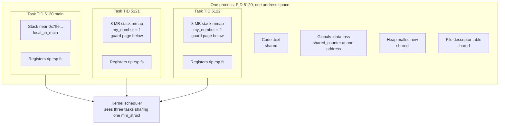

# Module 3.02: Threads vs processes

**Estimated hours:** 3

**What you will learn**

1. What a thread really is: a second line of execution inside the same address space, with its own stack and registers but the same heap, globals and file descriptors.
2. How to create and join threads with `pthread_create`, how big a thread stack is, and what the kernel sees when it schedules "tasks" rather than processes.
3. Why sharing memory is both the point of threads and the source of data races, and roughly how much cheaper a thread is than a process.

**Prerequisites:** [Module 3.01: Processes](module-01-processes.md). You should also remember `std::thread` from Phase 2; this module shows what it is made of.

---

## 1. One-line intuition

A process is a house with one person in it; threads are several people living in the same house, each with their own notebook (stack) but one shared fridge (heap) and one front door (file descriptors).

## 2. Real-life analogy

Return to the office building from module 0.02. A process was a tenant company with its own locked floor.

- A **thread** is one employee on that floor. A company with one employee is a single-threaded process. Hire more and they all work on the same floor, open the same filing cabinets (**heap and global variables**), and walk through the same doors (**file descriptors**).
- Each employee has a **personal notebook**: the **stack**. Local variables live there. Another employee can read your notebook only if you hand them a pointer to a page, which is allowed but dangerous if you leave before they finish reading.
- Each employee has their own **place in the work** (registers and instruction pointer). Two employees can be at different lines of different recipes at the same moment.
- The **building manager (kernel) schedules employees, not companies.** It does not care which company an employee belongs to when deciding who gets a desk next. Linux calls every employee a **task**.
- A **process** (new company) is expensive to set up: a new floor, new locks, new cabinets. A **thread** (new hire) is cheap: a notebook and a chair.
- The danger: two employees updating the same ledger line at the same instant. One of the updates is lost. That is a **data race**, and it is the whole reason Phase 4 exists.

## 3. Why it exists: the problem it solves

A server must do many things at once: handle 200 client connections, refresh a cache, write logs. Module 3.01 gave one tool for "at once": fork a process per job. It has two problems.

1. **Cost.** Each fork copies page tables and makes a new address space. Each process then wants its own copy of the master-table cache. Two hundred copies of a 500 MB cache is not possible.
2. **Sharing.** Processes cannot see each other's memory. To share a cache or a counter they need pipes, shared-memory segments or sockets, each with its own API and failure modes.

Threads solve both by putting many lines of execution into **one** address space. One cache, shared by every request handler, read at RAM speed. Creating a thread needs only a stack and a kernel task record, typically tens of microseconds.

What breaks when you have threads: isolation. In a process-per-job design a crash kills one job. In a threaded server a wild pointer in one thread corrupts memory every thread uses, and a segfault kills all 200 connections. Every mutex, atomic and sanitizer on your resume exists to manage this trade.

## 4. Three layers of depth

### Layer 1 (beginner): creating two threads

The POSIX thread library (**pthreads**) is the C interface. `std::thread` in C++ is a thin wrapper around it on Linux. The four calls you need:

| Call | What it does |
|---|---|
| `pthread_create(&tid, attr, fn, arg)` | Start a new thread running `fn(arg)` |
| `pthread_join(tid, &result)` | Wait for it to finish and collect its return value |
| `pthread_self()` | My pthread handle (an opaque number, not the kernel ID) |
| `gettid()` | My kernel thread ID, the number `ps -L` and `/proc` show (glibc 2.30+) |

This program starts two threads. Each prints its kernel thread ID, the address of a local variable, and the address of a global. Watch which addresses differ.

```c
/* two_threads.c  -  separate stacks, shared globals. */
#define _GNU_SOURCE           /* gettid() needs this */
#include <stdio.h>
#include <unistd.h>           /* getpid, gettid */
#include <pthread.h>

int shared_counter = 0;       /* one copy, visible to every thread */

static void *worker(void *arg) {
    int my_number = *(int *)arg;     /* a local: lives on THIS thread's stack */
    shared_counter += my_number;     /* a race if two threads do it at once */
    printf("thread %d: pid %d tid %d  &my_number=%p  &shared_counter=%p\n",
           my_number, (int)getpid(), (int)gettid(),
           (void *)&my_number, (void *)&shared_counter);
    return NULL;
}

int main(void) {
    int local_in_main = 0;
    printf("main    : pid %d tid %d  &local_in_main=%p &shared_counter=%p\n",
           (int)getpid(), (int)gettid(),
           (void *)&local_in_main, (void *)&shared_counter);

    pthread_t t1, t2;
    int n1 = 1, n2 = 2;
    if (pthread_create(&t1, NULL, worker, &n1) != 0) { perror("create"); return 1; }
    if (pthread_create(&t2, NULL, worker, &n2) != 0) { perror("create"); return 1; }
    pthread_join(t1, NULL);
    pthread_join(t2, NULL);
    printf("main    : shared_counter = %d\n", shared_counter);
    return 0;
}
```

```bash
gcc -std=gnu17 -Wall -Wextra -Werror -g -pthread -o two_threads two_threads.c
./two_threads
```

Expected (numbers differ; the two thread lines may swap):

```text
main    : pid 5120 tid 5120  &local_in_main=0x7ffe3c1a2b4c &shared_counter=0x5635a1d0a014
thread 1: pid 5120 tid 5121  &my_number=0x7f2a1f3fee9c  &shared_counter=0x5635a1d0a014
thread 2: pid 5120 tid 5122  &my_number=0x7f2a1ebfde9c  &shared_counter=0x5635a1d0a014
main    : shared_counter = 3
```

Read the addresses:

- All three lines have the **same PID**: one process.
- Each line has a **different TID**: three kernel tasks. The main thread's TID equals the PID.
- `&shared_counter` is **identical** everywhere: one global, one address, one copy.
- `&my_number` differs by about 8 MB between the two threads (`0x7f2a1f3fee9c` versus `0x7f2a1ebfde9c` is about 0x800000 = 8 MB apart). Each thread's stack is its own region. Main's local is far away, on the original process stack near `0x7ffe...`.

`-pthread` tells the compiler and linker to enable thread support. On glibc 2.34 and newer the pthread functions live inside `libc.so.6` itself, so `ldd` will not show a separate `libpthread.so`; the flag is still the portable, correct spelling.

### Layer 2 (working engineer): stacks, what the kernel sees, and the cost

**Every thread has its own stack.** The main thread's stack is the one the kernel set up at `exec`; it grows on demand up to the limit shown by `ulimit -s` (typically 8192 KB). For every thread created with `pthread_create`, glibc allocates a new stack with `mmap`, by default the same size as `ulimit -s`, so typically **8 MB of virtual address space** per thread, plus a guard page below it that is unmapped so that overflowing the stack faults immediately instead of silently corrupting the next thread's stack. Only the pages you touch become real memory (module 3.04), so 1000 threads reserve 8 GB of address space but use far less RAM.

Change the size with an attribute:

```c
pthread_attr_t attr;
pthread_attr_init(&attr);
pthread_attr_setstacksize(&attr, 256 * 1024);   /* 256 KB, min is PTHREAD_STACK_MIN (16 KB on x86-64) */
pthread_create(&t, &attr, worker, arg);
pthread_attr_destroy(&attr);
```

A thread pool with a known maximum stack depth often uses a smaller stack so that address space and page-table size stay small. Deep recursion or large local arrays in a 256 KB thread crash with SIGSEGV on the guard page; that is a classic "works in main, crashes in a worker" bug.

**What the kernel sees.** Linux does not have a kernel object called "thread". It has **tasks** (`task_struct`). A process is a group of tasks that share an address space; the group is identified by the **TGID** (thread group ID), which is what `getpid()` returns. Each task has its own TID, which `gettid()` returns. The scheduler (module 3.03) picks tasks, never processes. A process with 8 runnable threads gets roughly 8 times the CPU share of a process with 1.

```bash
ls /proc/<pid>/task/            # one directory per thread (TID)
ps -L -p <pid> -o pid,lwp,nlwp,stat,comm   # LWP = light-weight process = thread
cat /proc/<pid>/status | grep Threads
```

**What is shared and what is private.**

| Shared by all threads in a process | Private to each thread |
|---|---|
| Code, globals, static variables, heap (`malloc`) | Stack (locals, return addresses) |
| File descriptor table (a socket closed by one thread is closed for all) | Registers and instruction pointer |
| Signal handlers (dispositions) | Signal mask, `errno` (thread-local since it must be) |
| Working directory, user ID, environment | Thread-local storage (`_Thread_local` in C, `thread_local` in C++) |
| PID (TGID) | TID, scheduling priority and affinity |

**Cost, roughly.** Creating a thread is typically tens of microseconds on Linux (an `mmap` for the stack and a `clone` call). A `fork` is typically several times to tens of times more, and grows with the parent's memory because page tables are copied. You will measure the ordering yourself in Part D; do not quote numbers you have not measured.

**Process versus thread for a server.**

| | Process per job | Thread per job |
|---|---|---|
| Crash isolation | A crash kills one job | A crash kills every job |
| Sharing data | Needs shared memory or IPC | Just a pointer |
| Creation cost | Higher, grows with parent size | Lower, roughly constant |
| Memory | Separate copies of caches | One copy |
| Debugging | Simple: one thread, one stack | Data races, deadlocks |
| Example | PostgreSQL (one backend process per connection), Chrome tabs | tcpkv, your app server, SQL Server, nginx workers inside |

**Windows.** `CreateThread` (or `_beginthreadex` when you use the C runtime, so that per-thread CRT state is initialised) returns a `HANDLE`. A Windows thread is a **kernel object** like a process, a file or an event: you can `WaitForSingleObject` on the thread handle to join it, read its exit code with `GetExitCodeThread`, and you must `CloseHandle` it or you leak a kernel object even after the thread is gone. This handle-centric design is the basis of the "wait objects" on your resume (claim C) and of module 4.12.

| Linux pthreads | Windows | Note |
|---|---|---|
| `pthread_create` | `CreateThread` / `_beginthreadex` | Returns a HANDLE and a thread ID |
| `pthread_join` | `WaitForSingleObject(h, INFINITE)` + `GetExitCodeThread` | Then `CloseHandle(h)` |
| `gettid()` | `GetCurrentThreadId()` | |
| `pthread_attr_setstacksize` | `dwStackSize` parameter; default 1 MB from the PE header | Windows default is 1 MB, not 8 MB |
| `_Thread_local` | `__declspec(thread)` or `TlsAlloc` | |
| `ps -L` | Process Explorer, Threads tab; `Get-Process | select Threads` | |

### Layer 3 (internals): `clone`, the TLS register, and the race

**`pthread_create` is `clone` with sharing flags.** `fork` and `pthread_create` are the same system call with different flags:

```text
fork:            clone(SIGCHLD)                                   -> copy everything
pthread_create:  clone(CLONE_VM | CLONE_FS | CLONE_FILES | CLONE_SIGHAND
                       | CLONE_THREAD | CLONE_SYSVSEM | CLONE_SETTLS
                       | CLONE_PARENT_SETTID | CLONE_CHILD_CLEARTID, stack, ...)
```

`CLONE_VM` means share the address space (same `mm_struct`, so same page tables). `CLONE_FILES` shares the descriptor table. `CLONE_THREAD` puts the new task in the caller's thread group, so it reports the same `getpid()`. `CLONE_SETTLS` points the new thread's TLS register at its own block. Because nothing is copied, the kernel work is: allocate a `task_struct`, point it at the existing `mm_struct`, set the stack pointer to the `mmap`-ed stack glibc prepared, and enqueue it. You can see this with `strace -f -e clone,clone3 ./two_threads`.

**How a thread finds its own variables.** On x86-64 Linux every thread has the `fs` segment register pointing at its **thread control block**, which glibc set up before the thread's first instruction. `errno`, `_Thread_local` variables and the pthread handle are reached as offsets from `fs`. That is why `errno` can be a global-looking name yet be per-thread: it is a macro for `*__errno_location()`, and that function returns an address relative to `fs`.

**Where the stacks are.** `cat /proc/<pid>/maps` while the program runs shows the main stack near the top (`[stack]`) and, for each thread, an 8 MB anonymous region with a `---p` guard page of 4 KB directly below it. Module 3.04 teaches reading this file.

**The race, seen as instructions.** `shared_counter += n` compiles to three instructions at `-O0`:

```asm
mov    eax, DWORD PTR shared_counter[rip]   ; load
add    eax, edi                             ; add
mov    DWORD PTR shared_counter[rip], eax   ; store
```

If thread 1 is pre-empted between the load and the store, thread 2 loads the same old value, both add, both store, and one increment is lost. With two threads doing it once each (section 6's first program) the window is microseconds wide and you will almost never see it. With ten million iterations each (Part B) you will see it every run. The fix is a mutex or an atomic read-modify-write (`lock add`), which module 4.02 and 4.05 dissect.

**Why `std::thread` is "thin".** `std::thread`'s constructor packages your callable into a heap object, calls `pthread_create` with a trampoline function that unpacks and invokes it, and stores the `pthread_t`. `join()` calls `pthread_join`. `std::thread::native_handle()` returns the `pthread_t`. There is no scheduler of its own and no extra thread. Compile a `std::thread` program and run `nm -D a.out | grep pthread` to see the undefined `pthread_create@GLIBC_2.34` symbol the linker resolved into libc.

**WSL2.** Threads behave exactly as on bare Linux. The one difference you may notice is the core count: WSL2 exposes the number of logical processors Windows gives the VM (all of them by default; configurable with `processors=` in `.wslconfig`). `nproc` tells you.

## 5. Architecture diagram



The dashed-looking inner boxes are what a thread owns. Everything else in the outer box is one copy, reachable by every task.

## 6. Code

The program from Layer 1 is the first half. The second half, below, previews the data race: two threads each add 1 to a shared counter ten million times. The expected total is 20,000,000. You will not get it.

```c
/* race_preview.c  -  a lost-update data race, on purpose.
 * Full treatment with fixes is in module 4.02. */
#define _GNU_SOURCE
#include <stdio.h>
#include <pthread.h>

#define ITERATIONS 10000000L

long counter = 0;                       /* shared, unprotected */

static void *bump(void *arg) {
    (void)arg;                          /* unused; -Werror would complain */
    for (long i = 0; i < ITERATIONS; ++i) {
        counter += 1;                   /* load, add, store: NOT atomic */
    }
    return NULL;
}

int main(void) {
    pthread_t a, b;
    pthread_create(&a, NULL, bump, NULL);
    pthread_create(&b, NULL, bump, NULL);
    pthread_join(a, NULL);
    pthread_join(b, NULL);
    printf("expected %ld, got %ld, lost %ld updates\n",
           2 * ITERATIONS, counter, 2 * ITERATIONS - counter);
    return counter == 2 * ITERATIONS ? 0 : 1;
}
```

```bash
gcc -std=gnu17 -Wall -Wextra -Werror -g -pthread -o race_preview race_preview.c
./race_preview; echo "exit $?"
./race_preview; echo "exit $?"
```

Expected (the lost count changes every run; on one laptop it was between 2 and 12 million):

```text
expected 20000000, got 10893412, lost 9106588 updates
exit 1
expected 20000000, got 12407733, lost 7592267 updates
exit 1
```

This is compiled without `-O2` on purpose. At `-O2` the compiler keeps `counter` in a register inside the loop and stores it once at the end, so each thread stores "its own" 10,000,000 and the result is a different wrong answer. Both are legal: the program has undefined behaviour because of the race, so the compiler is allowed to do either. Module 4.02 fixes it with `std::atomic` and a mutex and shows ThreadSanitizer catching it.

Prove to yourself that it is the same mechanism as in Layer 1: run `ps -L -p $(pgrep race_preview) -o pid,lwp,stat,comm` while it runs (it takes a second or two). You will see one PID and three LWPs.

## 7. Use case: core-banking loan-origination platform

The application server (claim H4) kept an **in-memory master-table cache**: branches, products, interest schemes, document types. In the bank's deployment that cache was hundreds of megabytes once loaded from YugabyteDB.

**The decision it drove: one process, a fixed pool of worker threads, one cache.** The alternatives were weighed like this:

| Design | Cache | Cost per request | Crash blast radius | Portable to Windows? |
|---|---|---|---|---|
| Process per request (fork) | One copy per process, or shared memory with its own allocator | Fork plus page-table copy; too slow | One request | No fork |
| Pre-forked process pool | Shared memory segment; every pointer in the cache must be an offset, not an address | Low | One request | Awkward |
| One process, thread pool | One copy, plain pointers, read under a `shared_mutex` | A context switch | Whole server | Yes, same code with `CreateThread` |

The thread pool won because the cache could be plain C++ objects with pointers, read by every worker at RAM speed, and because the same architecture compiled on Windows. The price was accepted with eyes open: a memory-corruption bug in one request handler took down the whole server, which is precisely the production crash in claim H5 and the reason the RCA process in capstone C6 exists. The resume's "thread synchronisation layer" is the set of locks that make the shared cache safe to read while a refresher thread updates it.

A second, smaller decision came from the stack-size table: worker threads were given a reduced stack because the request handlers had a bounded call depth, and one early bug was a large local buffer in a validation routine overflowing that smaller stack. The fix was to move the buffer to the heap. Interviewers like that story because it is specific.

## 8. Lab

### Part A: see the tasks (15 minutes)

1. Build `two_threads.c` from Layer 1. Add `sleep(20);` after `shared_counter += my_number;` in `worker` (include `<unistd.h>` is already there), rebuild, run it in terminal one.
2. In terminal two, within 20 seconds:

```bash
P=$(pgrep two_threads)
ls /proc/$P/task
ps -L -p $P -o pid,lwp,nlwp,stat,comm
grep Threads /proc/$P/status
grep -c stack /proc/$P/maps
```

Expected: three directories under `task/` (the PID itself plus two more), three `ps` rows with the same PID and different LWP values, `Threads: 3`, and `/proc/$P/maps` containing one `[stack]` line (the two thread stacks are plain anonymous mappings; look for two `rw-p` regions of about 8 MB each, with a 4 KB `---p` guard directly below each one, using `cat /proc/$P/maps`).

3. Remove the `sleep` again.

### Part B: the race (15 minutes)

1. Build and run `race_preview.c` five times. Write down the five "lost" counts.
2. Change `ITERATIONS` to `1000` and run five times. Expected: usually 0 lost, sometimes not. The race is still there; the window is just too short to hit. This is why racy code passes tests and fails in production under load.
3. Run with `taskset -c 0 ./race_preview` (pin both threads to one core). Expected: far fewer lost updates, often zero, because the two threads are never running at the same instant and only lose an update when a context switch lands exactly between the load and the store. Still undefined behaviour.

### Part C: thread stack size (15 minutes)

1. Run `ulimit -s`. Expected: `8192` (KB).
2. Write `stack_probe.c`: create one thread with the default attributes and one with `pthread_attr_setstacksize` of 64 KB. In each, call a recursive function that declares a `char buf[1024]` and recurses, printing the depth every 100 calls, up to depth 100000. Build, run.

<details>
<summary>What you should see</summary>

The 64 KB thread segfaults somewhere around depth 50 to 60 (64 KB divided by roughly 1 KB of buffer plus frame overhead). The default thread gets to the thousands before hitting its 8 MB guard page. Both crashes are SIGSEGV on the guard page, which is exactly how the kernel turns a stack overflow into a clean crash instead of silent corruption. Confirm with `./stack_probe; echo $?` giving 139. For the C6 lab, the GDB backtrace of such a crash shows the same function repeated hundreds of times.

</details>

3. Run `ulimit -s 512` in a new shell and rerun with default attributes. The default thread now crashes much earlier. This is the mechanism by which a container or service unit with a small stack limit makes a program that "worked on my machine" crash in production.

### Part D: measure fork versus thread creation (30 minutes)

Write `spawn_cost.cpp` in C++17. In a loop of 2000 iterations, measure with `std::chrono::steady_clock`:

- (a) `fork()` a child that immediately `_exit(0)`s, then `waitpid` it.
- (b) `std::thread t([]{}); t.join();`

Print the average microseconds per iteration for each. Then allocate and touch a 512 MB `std::vector<char>` (write one byte per 4096) before the loops and rerun.

```bash
g++ -std=c++17 -Wall -Wextra -Werror -O2 -pthread -o spawn_cost spawn_cost.cpp
./spawn_cost
```

Expected ordering, not numbers: thread creation is cheaper than fork in both runs; fork gets noticeably more expensive after the 512 MB allocation because more page-table entries must be copied; thread creation barely changes. Write your actual numbers in the journal with the machine description. Run `nm -D spawn_cost | grep pthread` and note that the symbol is versioned `GLIBC_2.34`, proving `std::thread` resolves to pthreads inside libc.

### Journal

Copy [journal/TEMPLATE.md](../journal/TEMPLATE.md) to `journal/YYYY-MM-DD-threads-vs-processes.md`. Record: the three TIDs and the two thread-stack addresses from Part A; the five lost-update counts at 10 million and at 1000 iterations and the `taskset` result from Part B; the crash depths for 64 KB and 8 MB stacks from Part C; and your measured fork and thread costs before and after the 512 MB allocation from Part D, with your CPU model and `nproc`.

## 9. Common mistakes and misconceptions

| Mistake | Why it is wrong | Bug it causes later |
|---|---|---|
| "Threads are lighter processes" | A thread is not a process at all; it shares the address space and descriptors | Closing a socket in one thread and wondering why another thread's `read` fails |
| Returning a pointer to a local from a thread, or passing `&i` from a loop to many threads | The local dies with the stack frame; the loop variable changes under the thread | Reading garbage, or every thread seeing the last value of `i` |
| Assuming the race in `counter += 1` is rare enough to ignore | It is undefined behaviour; the compiler may hoist, the CPU may reorder, and load exposes it | Wrong account totals that never reproduce in tests |
| Expecting `pthread_create` to run the thread immediately | It only enqueues the task; the creator may continue first | Tests that depend on thread start order |
| Forgetting `-pthread` | Older toolchains fail to link; newer ones link but may miss thread-safe behaviour in some libraries | Mysterious link errors on another machine |
| Thinking each thread has its own `errno` by magic | It is thread-local via the `fs` register; `errno` is a macro | Only matters when you write your own TLS; still worth knowing |
| Giant local arrays in worker threads | Thread stacks are 8 MB by default and often set smaller in pools | SIGSEGV on the guard page only under a particular code path |
| On Windows, forgetting `CloseHandle` on a finished thread | The kernel object outlives the thread until the last handle closes | Handle leak visible in Task Manager after days of uptime |
| Thinking the kernel schedules "the process" | Linux schedules tasks; a process with more runnable threads gets more CPU | Misjudging fairness between a 1-thread and an 8-thread service on one box |

## 10. Resume link

- **Claim C, "threads, mutexes, shared_mutex ... thread pools".** Say: "A thread on Linux is a `clone` with `CLONE_VM` and `CLONE_THREAD`: a new task sharing the address space, with its own 8 MB stack by default. I know that because I looked at `/proc/<pid>/task` and the stacks in `maps` while my program ran."
- **Claim I, tcpkv's "fixed thread pool".** The pool exists because thread creation is cheap but not free and because unbounded threads are slow (module 3.03). Quote your Part D numbers: "Thread creation measured N µs versus fork at M µs on my laptop, and fork got worse as the process grew."
- **Claim H4, "in-memory master-table cache".** The cache is only possible because threads share the heap; the "synchronisation layer" is the price. Use the section 7 table in the interview.
- **Claim F, "TSan".** Your Part B result is the story: "A plain `counter += 1` lost 40 percent of updates at ten million iterations and zero at a thousand. That is why I run TSan in CI rather than trusting a passing test."

Likely follow-up: "What is shared between threads and what is not?" Give the Layer 2 table from memory: shared code, globals, heap, descriptors, signal handlers; private stack, registers, signal mask, `errno`, TLS.

## 11. Interview questions

**Q1 (easy). What is the difference between a process and a thread?**

<details>
<summary>Model answer</summary>

A process is an address space plus at least one thread plus a descriptor table, user identity and working directory. A thread is one line of execution inside a process: it has its own stack, registers and instruction pointer, but shares the code, globals, heap, open descriptors and signal handlers with the other threads of the same process. Two processes cannot touch each other's memory without the kernel's help; two threads can touch everything, which makes sharing trivial and data races possible. On Linux both are kernel tasks created by `clone`; the only difference is the sharing flags.

</details>

**Q2 (easy). What does each thread get its own copy of?**

<details>
<summary>Model answer</summary>

A stack (default 8 MB of virtual space on Linux, 1 MB on Windows), a set of registers including the instruction and stack pointers, a kernel thread ID, a signal mask, `errno`, and any `thread_local` variables. Everything else, including the heap, is shared.

</details>

**Q3 (medium). Why does `ps` show the same PID for all threads, and how do you see individual threads?**

<details>
<summary>Model answer</summary>

Linux implements threads as tasks grouped by a thread group ID; `getpid` returns the TGID, which is the TID of the first thread. `ps -L` or `ps -T` lists each task as an LWP with its own TID, and `/proc/<pid>/task/` has one directory per thread. `top -H` shows per-thread CPU use, which is how you find the one hot thread in a server. `gettid()` in code gives the number that matches those tools; `pthread_self()` does not, it is a library handle.

</details>

**Q4 (medium). A worker thread in a pool crashes with SIGSEGV while the same function works fine when called from `main`. What is your first hypothesis?**

<details>
<summary>Model answer</summary>

Stack overflow on the thread's smaller stack. Pool threads are often created with a reduced `pthread_attr_setstacksize`, or the deployment has a small `ulimit -s`, while `main` runs on the primary stack that grows up to the limit. A large local array or deep recursion fits in `main` and hits the thread's guard page. I would check the faulting address in the dump against the thread's stack mapping in `/proc/<pid>/maps`: an address just below the thread's stack region is the guard page. The fix is to move large buffers to the heap or raise the pool's stack size, and to add the stack size to the RCA as a configuration risk.

</details>

**Q5 (hard). Explain, down to the system call and the CPU, why `counter += 1` from two threads loses updates, and why pinning to one core reduces but does not eliminate the problem.**

<details>
<summary>Model answer</summary>

Both threads were created with `clone(CLONE_VM | ...)`, so they share one `mm_struct` and `counter` is a single physical location. `counter += 1` compiles to a load into a register, an add, and a store. The scheduler can pre-empt a thread between any two instructions, and with two cores the threads run truly simultaneously, so both can load the same value, both add, both store, and one increment vanishes; with ten million iterations the windows overlap constantly. Pinned to one core there is no simultaneity, so a lost update only occurs when the timer interrupt lands between the load and the store, which happens a few hundred times per second at most, so losses drop to a handful or zero. The program is still undefined behaviour under the C and C++ memory models: the compiler is allowed to keep `counter` in a register across the whole loop, and at `-O2` it does, giving a different wrong answer. The correct fixes are an atomic read-modify-write, which compiles to `lock add` and is executed as one indivisible cache-line operation, or a mutex, which serialises the three instructions; TSan detects the race because it sees two unsynchronised accesses to the same address with at least one write.

</details>

## 12. Revision

- A thread is a kernel task created by `clone` with `CLONE_VM`; it shares code, globals, heap, descriptors and PID with its siblings and owns only its stack (typically 8 MB virtual, guard page below), registers, TID, signal mask and TLS.
- The kernel schedules tasks, not processes; `gettid`, `/proc/<pid>/task/` and `ps -L` show them; `std::thread` is `pthread_create` inside libc since glibc 2.34.
- Threads are cheaper than fork and share memory for free, which is why the app server and tcpkv use one process with a fixed pool, and why unprotected `counter += 1` loses updates.

---

Previous: [Module 3.01: Processes](module-01-processes.md) | Next: [Module 3.03: Scheduling](module-03-scheduling.md)
