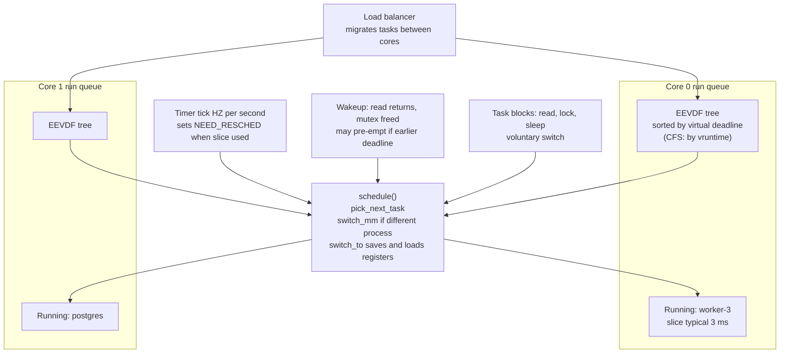

# Module 3.03: Scheduling

**Estimated hours:** 3

**What you will learn**

1. How the kernel shares a few CPU cores among thousands of tasks: time slices, context switches, and what a switch costs.
2. How Linux decides who runs next (CFS up to 6.5, EEVDF from 6.6), what `nice`, real-time classes and CPU affinity change, and how Windows does it differently.
3. Why adding threads beyond the number of cores stops helping and starts hurting, measured by you, which is the argument for a fixed-size thread pool.

**Prerequisites:** [Module 3.02: Threads vs processes](module-02-threads-vs-processes.md).

---

## 1. One-line intuition

The scheduler is a referee that lets each runnable task hold a core for a few milliseconds, then takes the core away and gives it to whoever has been waiting longest.

## 2. Real-life analogy

Imagine a bank branch with 8 counters (cores) and 300 customers (runnable tasks).

- Each customer gets a **turn** at a counter. A turn is a **time slice**. When the slice is up, the clerk says "next", the customer steps aside with their paperwork half done, and another customer steps up. Stepping aside and stepping up is a **context switch**.
- Some customers leave the counter early on their own because they are waiting for a phone call from head office (a disk read, a network reply, a lock). That is a **voluntary** switch. Others are pushed aside because their slice ended. That is an **involuntary** switch.
- The referee keeps a note of how much counter time each customer has had and always calls the one who has had the **least**. That is fairness, and it is the whole idea of CFS.
- Some customers have a **priority card** (`nice`, or a Windows priority). A VIP gets longer or more frequent turns, but on Linux never **all** the turns. A **real-time** customer (SCHED_FIFO) is different: as long as they are standing there, nobody else is served at that counter.
- Every switch costs time: the clerk clears the desk, files the old papers, pulls out the new ones (saves registers, switches page tables, loses cache contents). With 8 customers the counters are busy with real work. With 3000 customers, the clerks spend much of their day shuffling paper. That is why more threads than cores makes things slower, not faster.

## 3. Why it exists: the problem it solves

A laptop has 8 cores and, right now, about 1500 tasks (`ps -eLf | wc -l`). Most are asleep, waiting for something. A few dozen want to run. Without a scheduler the first few would hold the cores forever and the rest would starve. The scheduler solves three problems at once:

1. **Illusion of parallelism.** Many more tasks than cores all appear to progress, because each gets the core often enough that a human cannot tell.
2. **Fairness and priority.** A runaway loop in one program cannot freeze the mouse pointer. A video decoder can be told it matters more than a backup job.
3. **Responsiveness versus throughput.** Short slices make the system feel snappy but waste time switching; long slices are efficient but laggy. The scheduler tunes this trade-off and exposes a few knobs.

What breaks without it: MS-DOS and early Windows (cooperative multitasking) relied on each program politely giving up the CPU. One stuck program froze the whole machine. Pre-emptive scheduling, where the kernel forcibly takes the CPU back on a timer interrupt, is what makes a modern OS robust against its own tenants.

## 4. Three layers of depth

### Layer 1 (beginner): slices, switches and the words

**Runnable versus blocked.** A task is **runnable** (`R` in `ps`) if it could use a core right now. It is **blocked** or sleeping (`S`, or `D` for an uninterruptible disk wait) if it is waiting for something. Only runnable tasks compete for cores. A server with 200 connection threads that are all waiting in `read()` costs the scheduler almost nothing; 200 threads all computing is a different story.

**The run queue.** Each core has its own queue of runnable tasks. The scheduler picks from it, and a **load balancer** occasionally moves tasks between cores so no core sits idle while another has a backlog.

**Time slice.** How long a task may keep the core before the scheduler considers switching. On Linux this is not a fixed number; see Layer 2. Typical slices are a few milliseconds.

**Context switch.** Saving the running task's registers and stack pointer into its `task_struct`, choosing the next task, loading that task's registers, and if it belongs to a different process, switching the page tables (the `CR3` register on x86-64). The old task does not notice; when it next runs it continues from the instruction after the point where it stopped.

**Voluntary and involuntary.** `/proc/<pid>/status` counts both:

```bash
grep ctxt /proc/$(pgrep -n sleep)/status
```

```text
voluntary_ctxt_switches:        1
nonvoluntary_ctxt_switches:     0
```

A `sleep` has given up the CPU once, on purpose, and never been pushed off. A busy loop sharing a core with other busy loops shows the opposite pattern.

**`nice`.** A number from -20 (most important) to 19 (least). Default 0. Only root may lower it. `nice -n 10 ./backup` starts a program with less priority; `renice` changes a running one. Each step of nice is roughly a 10 percent change in CPU share (the kernel's weight table goes 1024 at nice 0, 820 at nice 1, 1277 at nice -1, and so on by a factor of about 1.25).

**`nproc`** prints how many logical CPUs the kernel sees. In WSL2 this is what Windows gave the VM, by default all of them.

**Affinity.** The set of cores a task is allowed to run on. `taskset -c 0,1 ./prog` restricts a program to cores 0 and 1; `taskset -p <pid>` shows the current mask. In code: `sched_setaffinity`. Affinity is how you keep a latency-sensitive thread on a core of its own, and how you build experiments like Part B of module 3.02.

### Layer 2 (working engineer): CFS, EEVDF, the knobs and the costs

**Two Linux schedulers, one idea.** From kernel 2.6.23 (2007) to 6.5, the default scheduler was **CFS**, the Completely Fair Scheduler. In **6.6 (late 2023)** it was replaced by **EEVDF**, Earliest Eligible Virtual Deadline First. Ubuntu 24.04's own kernel is 6.8, so EEVDF. WSL2 ships its own kernel: run `uname -r`; `5.15.x-microsoft-standard-WSL2` means CFS, `6.6.x` means EEVDF. Both keep the same user-visible model (nice values, `SCHED_OTHER`, fairness), so what follows applies to both unless marked.

**CFS in one paragraph.** Every task carries a **virtual runtime**, `vruntime`: how many nanoseconds of CPU it has consumed, scaled by its nice weight (a nice -5 task's clock ticks slower, so it is allowed more real time). Runnable tasks sit in a red-black tree sorted by `vruntime`. The scheduler always runs the leftmost task, the one with the least virtual runtime. There is no fixed slice; instead a **target latency** (`sched_latency`, typically 24 ms on 8 or more cores, visible as `/sys/kernel/debug/sched/latency_ns` when debugfs is mounted) is divided among the runnable tasks, with a floor of a **minimum granularity** (typically 3 ms). With 4 runnable tasks each gets about 6 ms; with 100, each gets the 3 ms floor and the latency target is simply missed.

**EEVDF in one paragraph.** CFS was fair over the long run but could make a task that wakes up briefly wait too long. EEVDF keeps the weighted fairness but adds a **deadline**. Each task has a **lag** (how far behind its fair share it is; positive means it is owed CPU); only tasks with non-negative lag are **eligible**. Each eligible task gets a virtual deadline = the time it became eligible plus a **base slice** (`base_slice_ns`, typically 3 ms on 8 or more cores, in `/sys/kernel/debug/sched/`) divided by its weight. The scheduler runs the eligible task with the earliest virtual deadline. The practical difference: latency-sensitive tasks that use little CPU get scheduled sooner and more predictably, and the old `latency_ns`/`min_granularity_ns` knobs are gone. A task can also request a shorter slice with `sched_setattr`, which is the knob tcpkv does not need but a game engine might.

**Scheduling classes**, from highest to lowest priority:

| Class | Policy names | Who uses it | Notes |
|---|---|---|---|
| Deadline | `SCHED_DEADLINE` | Hard real-time with runtime/period/deadline | Rare outside control systems |
| Real-time | `SCHED_FIFO`, `SCHED_RR` | Audio, trading, some database checkpointers | Static priority 1 to 99; FIFO runs until it blocks, RR round-robins with a slice (typically 100 ms); needs root or `CAP_SYS_NICE`; `chrt -f 50 ./prog`; throttled to 95 percent of each second by default so a bug cannot freeze the box |
| Fair | `SCHED_OTHER` (default), `SCHED_BATCH`, `SCHED_IDLE` | Everything else | Nice applies here only |

Real-time means "I win every time I am runnable", not "I am fast". A SCHED_FIFO thread with an infinite loop freezes everything of lower priority on that core, which is why the 95 percent throttle exists.

**The tick.** A timer interrupt fires `CONFIG_HZ` times per second on each busy core (typically 250 or 1000; check `grep CONFIG_HZ= /boot/config-$(uname -r)`, or `zcat /proc/config.gz | grep CONFIG_HZ=` if the file exists). On each tick the scheduler updates the running task's accounting and decides whether to pre-empt it. Between ticks, a task only loses the core if it blocks or a higher-priority task wakes. So "a 3 ms slice" is enforced with a resolution set by the tick plus high-resolution timers.

**What a context switch costs.** Two parts:

1. **Direct cost.** Saving and restoring registers, choosing the next task, switching the page tables. Typically **1 to 5 microseconds** on modern hardware and kernels. Switching between threads of the **same** process skips the page-table switch and is cheaper. In WSL2 expect the upper end or beyond, because the VM adds its own overhead.
2. **Indirect cost.** The new task finds the L1/L2 caches and the TLB (module 3.04) full of the old task's data. Its first thousands of memory accesses miss. For a task that was in the middle of walking a large structure, this can cost tens of microseconds of slowdown, more than the switch itself.

Count switches system-wide with `vmstat 1` (column `cs`) or per process with `/proc/<pid>/status`. `perf stat -e context-switches,cpu-migrations ./prog` gives both for one run; install with `sudo apt install linux-tools-generic`. On WSL2 the `perf` wrapper may say it cannot find a build for your kernel; the binary at `/usr/lib/linux-tools/*/perf` usually still works for software events like these, while hardware counters (`cycles`, `cache-misses`) are typically unavailable because the VM does not expose the performance monitoring unit.

**Why too many threads is slow.** Suppose 8 cores and a fixed amount of CPU work. With 8 busy threads, each core runs one thread without interruption: zero involuntary switches, warm caches. With 16, each core alternates between two: every few milliseconds a switch plus a cache refill, maybe 1 percent overhead. With 80, each core juggles ten, the per-thread slice drops toward the floor, switches multiply, and every switch lands on cold caches. Throughput plateaus at 8 and declines beyond; latency for any single request gets much worse because it is spread over ten slices instead of one. Add memory: 80 stacks, 80 sets of cache lines. The fix is not fewer requests, it is a **fixed pool of about as many worker threads as cores** (or a small multiple when the work blocks on I/O), with a queue in front. That is the pooled request model on your resume and the thread pool in tcpkv. You will measure the curve in section 8.

**Windows.** The Windows scheduler (the "dispatcher") is a strict **priority scheduler**, not a fair-share one:

| Aspect | Linux (CFS/EEVDF) | Windows 11 |
|---|---|---|
| Unit scheduled | Task (thread) | Thread |
| Priority levels | nice -20..19 within `SCHED_OTHER`; RT 1..99 | 0..31: 1-15 dynamic, 16-31 real-time, 0 for the zero-page thread |
| How priority is set | `nice`, `setpriority`, `sched_setscheduler` | Process priority class (`SetPriorityClass`: Idle, Below normal, Normal, Above normal, High, Realtime) combined with thread priority (`SetThreadPriority`) |
| Rule | Weighted fairness: a nice 19 task still gets some CPU | Highest-priority runnable thread always runs; equal priorities round-robin; lower priorities starve while higher ones are runnable |
| Slice | Dynamic, typically a few ms | A **quantum**, typically 2 clock intervals on client Windows (about 31 ms at the typical 15.6 ms clock), longer on Server; the foreground process gets a longer quantum |
| Boosts | Lag/eligibility in EEVDF | Temporary priority boosts after I/O completion, GUI wakeups, and for starving threads (the balance-set manager bumps a thread starved for about 4 s) |
| Affinity | `taskset`, `sched_setaffinity` | `SetThreadAffinityMask`, `SetProcessAffinityMask`, `SetThreadIdealProcessor` |
| Inspect | `/proc/<pid>/status`, `top -H`, `perf` | Task Manager Details (Base priority column), Process Explorer Threads tab (context switches, delta), `Get-Process | select PriorityClass` |
| Hybrid cores | Kernel scheduler knows P/E cores from 5.18 via Intel ITD support | Thread Director: the OS and CPU cooperate to place threads on performance or efficiency cores |

The practical consequence: a `REALTIME_PRIORITY_CLASS` process on Windows can starve the mouse, the disk flush thread and your debugger. Never use it in a server. `ABOVE_NORMAL` for the request pool and `BELOW_NORMAL` for batch jobs is the usual pattern.

### Layer 3 (internals): `schedule()`, `switch_to`, and what the CPU does

**The path to a switch.** A switch happens from `schedule()`, which is called when a task blocks (`mutex_lock`, `read` on an empty socket, `nanosleep`), when it exits, or when it returns to user mode with the `TIF_NEED_RESCHED` flag set. That flag is set by the tick handler when the running task has exhausted its slice, or by a wakeup that makes a task with an earlier deadline runnable (**pre-emption**). Inside `schedule()`:

1. Pick the next task: `pick_next_task()` walks the classes in priority order (deadline, RT, fair). In the fair class, EEVDF scans the per-core tree for the eligible task with the earliest virtual deadline (CFS: the leftmost `vruntime`).
2. If the new task belongs to a different `mm_struct`, call `switch_mm()`, which writes the new page-table root into `CR3`. On CPUs without PCID (process-context identifiers) this flushes the whole TLB; with PCID the kernel tags entries by process and most entries survive. Threads of one process skip this step entirely.
3. `switch_to()`: save callee-saved registers and the kernel stack pointer of the old task into its `task_struct`, load the new task's, and jump. The user-mode registers were already saved on the kernel stack when the task entered the kernel (via syscall or interrupt), so returning to user mode restores them.
4. Update accounting: `se.sum_exec_runtime`, `nr_switches`, and the voluntary/involuntary counters you read in `/proc`.

`/proc/<pid>/sched` shows the raw fields when `CONFIG_SCHED_DEBUG` is on (it is on Ubuntu): `se.sum_exec_runtime`, `nr_switches`, `nr_voluntary_switches`, `nr_involuntary_switches`, `se.nr_migrations`.

**Why the indirect cost is real.** After the switch, the core's L1 (typically 32 to 48 KB data) and L2 (typically 1 to 2 MB) hold the previous task's lines. Each miss to L3 costs about 15 ns and to RAM about 100 ns (module 0.01). A task touching 1 MB of working set after being switched out pays roughly 16,000 cache-line refills, which is a few hundred microseconds at RAM speed if nothing is in L3. The TLB is worse in one way: a flush means every page touched needs a page walk (module 3.04). This is why pinning a hot thread to a core and keeping other work off that core is a standard latency trick, and why "more threads for more speed" fails for CPU-bound work.

**Wakeups and migrations.** When thread A unblocks thread B (for example by pushing into a queue and signalling a condition variable), the kernel decides which core B should run on. It prefers B's previous core (warm cache), unless that core is busy and another in the same cache domain is idle. Each move is a **migration**, counted in `perf stat` as `cpu-migrations`. Excessive migrations are a sign the pool has more threads than the work needs.

**WSL2.** The Linux scheduler runs normally inside the VM, but the VM's virtual CPUs are themselves threads scheduled by the Windows hypervisor. A Linux thread can be "running" on a vCPU that Windows has paused. Timings in WSL2 are therefore noisier than on bare metal; run each experiment three times and keep the median.

## 5. Architecture diagram



Three events lead into `schedule()`: the tick (involuntary), a wakeup with higher urgency (involuntary pre-emption), and the task blocking (voluntary). The load balancer runs separately and moves tasks between queues.

## 6. Code

A fixed amount of CPU work is split evenly across N threads. The program reports wall time, throughput, and each worker's own voluntary and involuntary context switches read from `/proc/thread-self/status`. Run it with N equal to your core count, then 2x, then 10x.

```c
/* thread_scaling.c
 * Split a fixed amount of CPU work across N threads, time it, and report
 * how often the scheduler pushed each worker off its core.
 */
#define _GNU_SOURCE
#include <stdio.h>
#include <stdlib.h>
#include <stdint.h>
#include <string.h>
#include <time.h>
#include <unistd.h>
#include <pthread.h>

#define TOTAL_WORK 2000000000ULL   /* xorshift steps, shared out over N threads */

struct job {
    uint64_t iterations;
    uint64_t result;               /* keeps the compiler honest */
    long voluntary;
    long involuntary;
};

/* Read this thread's own context-switch counters from /proc. */
static void read_switches(long *vol, long *invol) {
    FILE *f = fopen("/proc/thread-self/status", "r");
    char line[256];
    *vol = *invol = -1;
    if (f == NULL) return;
    while (fgets(line, sizeof line, f) != NULL) {
        if (strncmp(line, "voluntary_ctxt_switches:", 24) == 0)
            *vol = strtol(line + 24, NULL, 10);
        else if (strncmp(line, "nonvoluntary_ctxt_switches:", 27) == 0)
            *invol = strtol(line + 27, NULL, 10);
    }
    fclose(f);
}

static void *work(void *arg) {
    struct job *j = arg;
    uint64_t x = 88172645463325252ULL;      /* xorshift64 state */
    for (uint64_t i = 0; i < j->iterations; ++i) {
        x ^= x << 13;
        x ^= x >> 7;
        x ^= x << 17;
    }
    j->result = x;
    read_switches(&j->voluntary, &j->involuntary);
    return NULL;
}

static double now_seconds(void) {
    struct timespec ts;
    clock_gettime(CLOCK_MONOTONIC, &ts);
    return (double)ts.tv_sec + (double)ts.tv_nsec / 1e9;
}

int main(int argc, char **argv) {
    int n = (argc > 1) ? atoi(argv[1]) : 1;
    if (n < 1 || n > 4096) {
        fprintf(stderr, "usage: %s N   (1..4096 threads)\n", argv[0]);
        return 2;
    }
    pthread_t  *threads = malloc(sizeof *threads * (size_t)n);
    struct job *jobs    = calloc((size_t)n, sizeof *jobs);
    if (threads == NULL || jobs == NULL) { perror("malloc"); return 1; }

    double t0 = now_seconds();
    for (int i = 0; i < n; ++i) {
        jobs[i].iterations = TOTAL_WORK / (uint64_t)n;
        if (pthread_create(&threads[i], NULL, work, &jobs[i]) != 0) {
            perror("pthread_create");
            return 1;
        }
    }
    long vol = 0, invol = 0;
    uint64_t sink = 0;
    for (int i = 0; i < n; ++i) {
        pthread_join(threads[i], NULL);
        vol   += jobs[i].voluntary;
        invol += jobs[i].involuntary;
        sink  ^= jobs[i].result;
    }
    double dt = now_seconds() - t0;

    printf("threads=%4d cores=%ld wall=%6.3f s throughput=%7.1f M steps/s "
           "switches: voluntary=%ld involuntary=%ld (sink %llx)\n",
           n, sysconf(_SC_NPROCESSORS_ONLN), dt,
           (double)TOTAL_WORK / dt / 1e6, vol, invol,
           (unsigned long long)(sink & 0xffff));
    free(threads);
    free(jobs);
    return 0;
}
```

This one is compiled with `-O2` as well as the usual flags, because we are measuring work and an unoptimised loop would measure the compiler instead of the scheduler.

```bash
gcc -std=gnu17 -Wall -Wextra -Werror -g -O2 -pthread -o thread_scaling thread_scaling.c
nproc
./thread_scaling 1
./thread_scaling $(nproc)
./thread_scaling $(( 2 * $(nproc) ))
./thread_scaling $(( 10 * $(nproc) ))
```

Expected shape on an 8-core machine (your numbers will differ; what matters is the pattern):

```text
8
threads=   1 cores=8 wall= 4.1xx s throughput=  48x.x M steps/s switches: voluntary=0 involuntary=1x (sink ...)
threads=   8 cores=8 wall= 0.5xx s throughput= 36xx.x M steps/s switches: voluntary=0 involuntary=2x (sink ...)
threads=  16 cores=8 wall= 0.5xx s throughput= 35xx.x M steps/s switches: voluntary=0 involuntary=1xx (sink ...)
threads=  80 cores=8 wall= 0.5xx s throughput= 34xx.x M steps/s switches: voluntary=0 involuntary=8xx (sink ...)
```

Read it: throughput rises about linearly up to the core count, then **plateaus**. Beyond that it stays flat or drops slightly, while involuntary switches climb by an order of magnitude. The drop is small here because this loop uses almost no memory; a loop walking a large array suffers far more from cold caches after each switch, which Part B asks you to try. Voluntary switches are zero because nothing blocks. On a laptop with hyper-threading, `nproc` counts logical CPUs, so the plateau may begin at about half of `nproc` for this kind of arithmetic.

## 7. Use case: core-banking loan-origination platform

The application server (claim H4) received loan requests over RPC. An early version created a thread per incoming request. On a busy morning, with branch users all logging in at 9 am, it had 1,500 threads on an 8-core box. CPU showed 100 percent, yet requests took seconds. `vmstat` showed tens of thousands of context switches per second and `top -H` showed every thread getting a sliver of a core.

**The decision it drove: a fixed-size worker pool with a bounded queue, sized from measurement.** The pool was set to a small multiple of the core count, with the multiple chosen because each request spent most of its time blocked on the database (a voluntary switch, cheap). Requests beyond the queue limit were rejected with a "busy, retry" RPC error instead of being accepted into an ever-growing thread list. This is the "pooled request model" on your resume, and it is why tcpkv (claim I) also has a **fixed** thread pool rather than a thread per connection.

Two refinements came from the scheduler facts in Layer 2. The cache-refresh thread that reloaded master tables from YugabyteDB was run at `nice 10` on Linux and `THREAD_PRIORITY_BELOW_NORMAL` on Windows, so a refresh never stole slices from request handlers. And the thread that wrote the audit log was pinned to its own core on the busiest hosts, so its buffers stayed cache-warm and log latency stopped spiking at the top of the hour. Both decisions are provable with the counters you learn here, which is what makes them a good interview story.

## 8. Lab

### Part A: switches you can see (15 minutes)

1. Run `sleep 100 &` and read its counters:

```bash
grep ctxt /proc/$!/status
```

Expected: `voluntary_ctxt_switches: 1` or 2, `nonvoluntary_ctxt_switches: 0`. A sleeping task gives up the core voluntarily and is never pushed.

2. Run `./thread_scaling 1 &` and immediately, in the same second, `grep ctxt /proc/$!/task/*/status`. The worker thread shows a growing `nonvoluntary` count only if something else wants its core. Now run two copies pinned to one core: `taskset -c 0 ./thread_scaling 1 & taskset -c 0 ./thread_scaling 1 &` and grep again after a second. Expected: both workers now show involuntary switches in the hundreds, because they are sharing one core and each tick-driven slice end pushes one off.

3. `vmstat 1 5` while the two are running. Column `cs` is context switches per second system-wide; column `r` is the number of runnable tasks. Kill them with `pkill thread_scaling`.

### Part B: the scaling curve (30 minutes)

1. Run `thread_scaling` for N = 1, 2, 4, `nproc`, 2x, 4x, 10x. Run each three times and keep the median wall time. Put the numbers in a table: N, wall, throughput, involuntary switches.
2. Modify the program so each worker also walks a private 8 MB array (allocate with `malloc`, touch every 64th byte in a loop inside the work loop, every 1,000,000 xorshift steps). Rebuild and repeat for `nproc`, 2x and 10x.

Expected: the first curve plateaus at about the core count and declines slightly past it. The second declines **more** past the core count, because each involuntary switch now lands on a cache full of someone else's array. This gap is the measured cost of oversubscription and the argument for the pool size in tcpkv.

3. Try `perf stat -e context-switches,cpu-migrations ./thread_scaling 80`. If the `perf` wrapper refuses on WSL2, use `ls /usr/lib/linux-tools/` to find the versioned directory and run that `perf` binary directly. If no perf works at all, `/proc` counts from the program are enough; note it in the journal.

### Part C: what one switch costs (20 minutes)

Two processes bounce one byte back and forth through two pipes. Each round trip is at least two context switches.

```c
/* pingpong.c  -  measure context-switch cost with a pipe round trip. */
#include <stdio.h>
#include <stdlib.h>
#include <unistd.h>
#include <time.h>
#include <sys/wait.h>

#define ROUNDS 100000

static void must(ssize_t r, const char *what) {
    if (r != 1) { perror(what); exit(1); }
}

int main(void) {
    int to_child[2], to_parent[2];
    if (pipe(to_child) != 0 || pipe(to_parent) != 0) { perror("pipe"); return 1; }
    char c = 'x';
    pid_t pid = fork();
    if (pid == 0) {
        for (int i = 0; i < ROUNDS; ++i) {
            must(read(to_child[0], &c, 1), "child read");
            must(write(to_parent[1], &c, 1), "child write");
        }
        _exit(0);
    }
    struct timespec t0, t1;
    clock_gettime(CLOCK_MONOTONIC, &t0);
    for (int i = 0; i < ROUNDS; ++i) {
        must(write(to_child[1], &c, 1), "parent write");
        must(read(to_parent[0], &c, 1), "parent read");
    }
    clock_gettime(CLOCK_MONOTONIC, &t1);
    double ns = (double)(t1.tv_sec - t0.tv_sec) * 1e9 + (double)(t1.tv_nsec - t0.tv_nsec);
    printf("%d round trips: %.2f us per round trip, about %.2f us per switch\n",
           ROUNDS, ns / ROUNDS / 1000.0, ns / ROUNDS / 2000.0);
    waitpid(pid, NULL, 0);
    return 0;
}
```

```bash
gcc -std=gnu17 -Wall -Wextra -Werror -g -O2 -o pingpong pingpong.c
taskset -c 0 ./pingpong
./pingpong
```

Expected: pinned to one core, a few microseconds per switch (typical; this includes two syscalls each way, so it is an upper bound on the pure switch). Unpinned, the two processes may land on different cores and the number changes: sometimes faster because each stays resident, sometimes slower because of cross-core wakeup latency. In WSL2 both are noisier and usually higher than on bare metal. Record all three runs of each.

### Part D: nice and affinity (15 minutes)

1. Start two CPU hogs on one core with different nice values:

```bash
taskset -c 0 nice -n 0  ./thread_scaling 1 &
taskset -c 0 nice -n 10 ./thread_scaling 1 &
wait
```

Expected: the nice 0 run finishes first by a wide margin; the nice 10 run gets roughly a tenth of the core while both are runnable (weight 1024 versus 110), then the whole core after the first finishes.

2. `taskset -p $$` shows your shell's affinity mask in hex; `taskset -cp $$` shows it as a list. Run `taskset -c 1 ./thread_scaling 8` and note that throughput collapses to the single-thread figure and involuntary switches explode: eight threads, one core.

3. Try `chrt -f 10 ./thread_scaling 1` without sudo. Expected: `chrt: failed to set pid 0's policy: Operation not permitted`. Real-time needs privilege precisely because it can starve the machine.

### Journal

Copy [journal/TEMPLATE.md](../journal/TEMPLATE.md) to `journal/YYYY-MM-DD-scheduling.md`. Record: your `uname -r` and whether that means CFS or EEVDF; the two scaling tables from Part B with your `nproc`; the per-switch cost from Part C pinned and unpinned; the finish order and rough timing from the nice experiment; and one sentence stating the pool size you would choose for tcpkv on this machine and why.

## 9. Common mistakes and misconceptions

| Mistake | Why it is wrong | Bug it causes later |
|---|---|---|
| "More threads means more speed" | Throughput caps at the core count for CPU work; beyond it, switches and cold caches cost | Thread-per-request servers that collapse under load |
| "100 percent CPU means the server is doing useful work" | It may be spending much of it switching and refilling caches | Scaling up hardware instead of fixing the thread count |
| Thinking `nice 19` stops a task entirely | Fair scheduling still gives it a small share | A background job that still disturbs latency; use cgroups or idle class if you need near-zero |
| Using `SCHED_FIFO` or Windows `REALTIME_PRIORITY_CLASS` for "important" server threads | Real-time starves everything below it, including the kernel's own helpers | Frozen machine, lost SSH, unflushed logs |
| Treating a context switch as free | 1 to 5 µs direct plus cache and TLB refill | Fine-grained hand-offs between threads (a queue item per switch) that run slower than one thread |
| Assuming thread start order or that `pthread_create` runs the thread immediately | Scheduler decides | Flaky tests |
| Measuring a debug build or a single run | `-O0` measures the compiler; single runs in WSL2 are noisy | Wrong conclusions about pool size |
| Pinning everything to specific cores | Removes the load balancer's freedom; one busy core while others idle | Worse throughput than no pinning at all; pin only the one or two threads that need it |
| Expecting Linux and Windows priorities to mean the same | Linux nice is a weight; Windows priority is strict ordering | A port that starves threads on one platform and not the other |

## 10. Resume link

- **Claim H4, "pooled request model".** Say: "The pool was fixed at a small multiple of core count. I measured it: on N cores, throughput for CPU-bound work plateaued at N threads and involuntary context switches rose roughly tenfold at 10N, so unbounded threads only bought overhead. Because requests mostly blocked on the database, the multiple was above one." Use your Part B table.
- **Claim I, tcpkv "fixed thread pool".** Same argument, and add: "Connections sit in `epoll` (module 3.11) rather than in threads, so idle clients cost the scheduler nothing."
- **Claim C, "Win32 synchronisation".** Mention the Windows table: strict priority levels, quantum, priority boosts; and that a pool thread blocked on a wait object is a voluntary switch, cheap, while a spinning thread is not.
- **Claim B, "performance optimisation".** The indirect cost of a switch (cache and TLB refill) is the reason for pinning the hot thread, and the Part C number is a real measurement you own.

Likely follow-up: "How would you size a thread pool?" Answer: start at core count for CPU-bound work; multiply by roughly (1 + wait time / compute time) for work that blocks; bound the queue; measure throughput and p99 latency and adjust.

## 11. Interview questions

**Q1 (easy). What is a context switch and when does one happen?**

<details>
<summary>Model answer</summary>

A context switch is the kernel saving the state of the running task (registers, stack pointer, and, for a different process, the page-table root) and loading another task's state so it can continue where it left off. It happens voluntarily when the task blocks on I/O, a lock or a sleep, and involuntarily when its time slice is used up at a timer tick or when a higher-urgency task wakes and pre-empts it. Linux counts both per task in `/proc/<pid>/status`.

</details>

**Q2 (easy). What does `nice` do, and what does it not do?**

<details>
<summary>Model answer</summary>

`nice` sets a weight for a normal (`SCHED_OTHER`) task between -20 and 19. Each step changes the CPU share by about 10 percent relative to its neighbours; nice 0 has weight 1024, nice 10 about 110. It changes proportions under contention and does nothing when the CPU is idle. It does not stop a task from running, does not affect I/O priority (`ionice` does), and does not apply to real-time classes. Only root can lower nice below the current value.

</details>

**Q3 (medium). Why does a server with 1000 busy threads on 8 cores get slower, not faster, than one with 8 or 16?**

<details>
<summary>Model answer</summary>

Only 8 threads can execute at once. The other 992 are runnable and waiting in run queues, so the scheduler slices time among them: each thread gets a few milliseconds, then is pre-empted. Each pre-emption costs a direct switch of 1 to 5 µs and an indirect cost of refilling L1, L2 and the TLB, which for a thread touching a large working set is tens of microseconds or more. Total throughput therefore drops below the 8-thread figure and the latency of any single request rises because it is spread across many slices. Memory use also grows with a stack per thread. A fixed pool sized near the core count, with a queue for excess work, avoids all of this; I measured the plateau and the involuntary-switch growth in my scheduling lab.

</details>

**Q4 (medium). Compare how Linux and Windows pick the next thread to run.**

<details>
<summary>Model answer</summary>

Linux's default class is fair-share: CFS tracked virtual runtime and ran the task that had received the least; since 6.6, EEVDF keeps weighted fairness but ranks eligible tasks by a virtual deadline computed from a base slice, improving wakeup latency. Nice values are weights, so even a low-priority task gets some share. Real-time classes `SCHED_FIFO`/`SCHED_RR` sit above fair and are strict. Windows is strict priority throughout: 32 levels built from a process priority class plus a thread priority; the highest-priority runnable thread always runs, equal priorities round-robin with a quantum of a couple of clock intervals, and lower priorities starve while higher ones are runnable, softened by temporary boosts after I/O and for starved threads. In practice: on Linux you size pools and use nice; on Windows you avoid the real-time class and use Above/Below normal, and both offer affinity masks.

</details>

**Q5 (hard). Walk through what happens inside the kernel from a timer tick to the next task running, and explain where the cost goes.**

<details>
<summary>Model answer</summary>

The tick interrupt enters the kernel on the current core, saving the user registers on the kernel stack. The scheduler's tick handler updates the running task's runtime and lag; if its slice is used and another eligible task has an earlier virtual deadline, it sets `TIF_NEED_RESCHED`. On the way back to user mode the kernel checks that flag and calls `schedule()`. `pick_next_task` walks the classes: deadline, then real-time, then fair; in fair it selects the eligible task with the earliest deadline from the per-core tree. If that task belongs to a different process, `switch_mm` loads its page-table root into CR3, which without PCID flushes the TLB. `switch_to` saves the old task's callee-saved registers and kernel stack pointer in its `task_struct`, loads the new one's, and continues on the new kernel stack; returning to user mode restores the new task's user registers. The direct cost is this register and CR3 work plus the tree operations, typically 1 to 5 µs. The larger cost is indirect: the new task's cache lines and TLB entries were evicted, so its first memory accesses miss to L3 or RAM, and after a TLB flush each new page needs a page-table walk. Threads of the same process avoid the CR3 switch and the TLB flush, which is one reason a thread pool beats a process pool for a shared cache.

</details>

## 12. Revision

- The scheduler gives each runnable task a slice of a few milliseconds and switches on block (voluntary), slice end or pre-emption (involuntary); a switch costs typically 1 to 5 µs directly plus cache and TLB refills.
- Linux fair scheduling was CFS (least `vruntime` first) until 6.5 and is EEVDF (earliest eligible virtual deadline) from 6.6; nice is a weight; real-time classes are strict and need privilege; Windows uses 32 strict priority levels and a quantum.
- Throughput plateaus at the core count and declines with oversubscription, which you measured; that is why the app server and tcpkv use a fixed pool sized from core count and blocking ratio.

---

Previous: [Module 3.02: Threads vs processes](module-02-threads-vs-processes.md) | Next: [Module 3.04: Virtual memory and paging](module-04-virtual-memory-and-paging.md)
