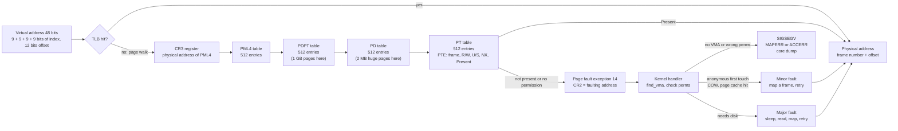

# Module 3.04: Virtual memory and paging

**Estimated hours:** 5

**What you will learn**

1. Why the addresses your program sees are not the addresses in the RAM chips, and how the CPU translates one to the other through page tables and the TLB.
2. What a page fault is, why `malloc` of a gigabyte is instant, how `fork` shares pages by copy-on-write, and what `mmap`, `mprotect`, huge pages and swap do.
3. How a segmentation fault actually happens, which makes `/proc/<pid>/maps` the first file you open in a crash investigation.

**Prerequisites:** [Module 3.03: Scheduling](module-03-scheduling.md). You should remember the process memory layout from Phase 1 (stack, heap, data, text) and `fork` from module 3.01.

---

## 1. One-line intuition

Every process is told it owns all the memory; the kernel and the CPU keep a lookup table per process that quietly maps each 4 KB chunk of that fantasy onto a real chunk of RAM, or onto nothing at all until it is touched.

## 2. Real-life analogy

Think of a hotel with 200 guests and 50 rooms.

- Each guest (process) is given a key card with room numbers 1 to 10,000 printed on it. That is their **virtual address space**. They believe the whole hotel is theirs.
- The front desk keeps a **translation book** per guest (the **page table**): "your room 7 is really physical room 312; your room 8 is not assigned yet".
- Rooms are allocated in fixed-size units of one room, never half a room. A unit is a **page**, 4 KB.
- When a guest walks to a room that is in their book, the door opens. When they walk to a room that is **not yet assigned**, an alarm rings quietly, a porter assigns a real room on the spot, updates the book, and the guest never notices the delay. That is a **minor page fault**: demand paging.
- When the guest's belongings were moved to the basement storage because the hotel was full, the porter has to fetch them before opening the door. That slow case is a **major page fault**: reading from swap or disk.
- When a guest walks to a room number that is not in their book at all, or tries to enter a room the book marks as "look but do not touch", the porter calls security and throws the guest out. That is a **segmentation fault**.
- The porter keeps the 64 most recent book entries on a card in their pocket so they do not open the book for every door. That card is the **TLB**.
- When identical twins check in (`fork`), the desk gives them one shared set of rooms marked "copy before writing". The moment one twin rearranges furniture, the porter duplicates that one room. That is **copy-on-write**.

## 3. Why it exists: the problem it solves

Without virtual memory, every program would have to be compiled for the exact physical addresses it would occupy, two programs could overwrite each other, and a program needing 2 GB on a 1 GB machine could not start. Virtual memory solves four problems with one mechanism:

1. **Isolation.** A process can only reach physical pages that its own page table lists. A wild pointer cannot touch another process or the kernel. This is the protection promised in module 0.02, implemented.
2. **Simplicity.** Every process sees the same layout: code low, heap above it, stack near the top. The linker and loader never need to know what else is running.
3. **Laziness.** Memory is only backed by RAM when touched. A 1 GB `malloc` costs nothing until pages are written. `fork` of a 2 GB process copies nothing until pages change.
4. **More than RAM.** Rarely used pages can be pushed to swap on disk and brought back on demand, and file contents can be mapped straight into memory so the page cache and the program share the same bytes.

What breaks without it: no protection (MS-DOS), no `fork`, no shared libraries (each process would need its own copy of libc at a fixed address), no core dumps that make sense, and no way for a database to map a 40 GB file into a 64-bit address space and let the hardware do the lookup.

## 4. Three layers of depth

### Layer 1 (beginner): the words and the two numbers to watch

**Virtual address.** The number in a pointer. On x86-64 Linux, user space is `0x0000_0000_0000_0000` to `0x0000_7fff_ffff_ffff` (47 bits, 128 TB); the kernel lives at `0xffff_8000_0000_0000` and above, in every process's space but inaccessible from user mode.

**Physical address.** The location in the RAM chips. A program never sees one. `/proc/<pid>/pagemap` can reveal them to root, and nothing else can.

**Page.** The unit of mapping: 4096 bytes on x86-64 (`getconf PAGESIZE`). Addresses are mapped per page, so the low 12 bits of a virtual address (the **offset** within the page) pass through unchanged.

**Page table.** The per-process map from virtual page number to physical page number plus permission bits (read, write, execute, user-accessible, present). The kernel builds it; the CPU reads it.

**Page fault.** A CPU exception raised when a load, store or fetch hits a virtual page that is not present, or violates its permissions. The kernel handles it and either fixes the mapping and retries the instruction (the program never knows), or kills the program with SIGSEGV.

- **Minor fault**: the page needs a mapping but no disk I/O: first touch of fresh memory, a copy-on-write copy, or a file page already in the page cache. Typically a few microseconds.
- **Major fault**: the data must come from disk (swap or a file not in cache). Typically tens of microseconds on NVMe to milliseconds on a hard disk.

**Two numbers in `/proc/<pid>/status`.**

| Field | Meaning | Why it matters |
|---|---|---|
| `VmSize` | Total virtual address space mapped | Cheap; a 1 GB `malloc` adds 1 GB here immediately |
| `VmRSS` | Resident set size: pages actually in RAM right now | What costs memory; grows only when pages are touched |

`ps -o pid,vsz,rss,cmd` shows the same pair. When someone says "the server uses 12 GB", ask which one. VSZ can be enormous and harmless; RSS is what competes with other processes.

**`/proc/<pid>/maps`.** One line per mapped region: start-end addresses, permissions (`r`, `w`, `x`, `p` private or `s` shared), file offset, device, inode, and the file name or `[heap]`, `[stack]`, `[vdso]`, or blank for anonymous memory.

```text
5635a1d09000-5635a1d0a000 r--p 00000000 08:20 1234   /home/shakir/two_threads
5635a1d0a000-5635a1d0b000 r-xp 00001000 08:20 1234   /home/shakir/two_threads
5635a3f2b000-5635a3f4c000 rw-p 00000000 00:00 0      [heap]
7f2a1e3ff000-7f2a1e400000 ---p 00000000 00:00 0                  <- thread stack guard page
7f2a1e400000-7f2a1ec00000 rw-p 00000000 00:00 0                  <- 8 MB thread stack
7f2a1ec00000-7f2a1ee28000 r--p 00000000 08:20 5678   /usr/lib/x86_64-linux-gnu/libc.so.6
7ffe3c183000-7ffe3c1a4000 rw-p 00000000 00:00 0      [stack]
```

Any address not inside one of these ranges is unmapped. Touching it is SIGSEGV. That single check is the first step of every crash analysis in capstone C6.

### Layer 2 (working engineer): demand paging, COW, mmap, huge pages, OOM

**Demand paging and `malloc`.** For large requests (above `M_MMAP_THRESHOLD`, 128 KB by default, adjusted dynamically up to 32 MB), glibc's `malloc` calls `mmap` to get a fresh anonymous region. The kernel records the region in the process's list of **VMAs** (virtual memory areas; that is what `maps` shows) and returns. No page table entries are filled in. The first write to each page faults, the kernel allocates a zeroed physical page, fills the entry, and retries. Reading an untouched page does not even allocate: the kernel maps a shared read-only **zero page**. So `malloc(1 GB)` returns in microseconds, `VmSize` grows by 1 GB, `VmRSS` does not move, and a loop writing one byte per page produces 262,144 minor faults and 1 GB of RSS. Section 6 shows this.

**Overcommit.** Because of demand paging, the kernel hands out more virtual memory than it has RAM plus swap. `vm.overcommit_memory` (in `/proc/sys/vm/`) is 0 by default: a heuristic refuses only obviously impossible single requests. Mode 1 never refuses; mode 2 never overcommits (every allocation counted against RAM plus swap, as Windows does with its commit limit). The consequence of mode 0 is that `malloc` can succeed and the process can still die later when it touches the memory, which is where the OOM killer comes in.

**Copy-on-write after `fork`.** `fork` copies the page tables and marks every writable private page read-only in both parent and child, with a flag saying "copy on write". The child's `VmRSS` immediately equals the parent's (the pages are mapped, just shared). When either process writes, it faults, the kernel copies that one page, gives the writer the copy, and restores write permission. `/proc/<pid>/smaps_rollup` shows the split as `Shared_Dirty` (still shared with the other process) versus `Private_Dirty` (copied). A child that writes to a 256 MB array takes 65,536 minor faults and the system's free memory drops by 256 MB. The same mechanism backs `MAP_PRIVATE` file mappings: read the file through the page cache for free, get your own copy of a page only when you write it.

**`mmap`.** The general system call behind `malloc`, shared libraries, thread stacks and file access.

| Call | Effect |
|---|---|
| `mmap(NULL, n, PROT_READ|PROT_WRITE, MAP_PRIVATE|MAP_ANONYMOUS, -1, 0)` | Fresh zeroed memory; what `malloc` uses for big blocks |
| `mmap(NULL, n, PROT_READ, MAP_PRIVATE, fd, 0)` | The file's bytes appear at the returned address; pages come from the page cache on first touch (minor fault if cached, major if not) |
| `mmap(..., MAP_SHARED, fd, 0)` | Writes go back to the file and are seen by other processes mapping it; how databases and `shm_open` share memory |
| `mprotect(addr, n, PROT_READ)` | Change permissions of existing pages; writing afterwards is SIGSEGV with `SEGV_ACCERR` |
| `munmap(addr, n)` | Remove the mapping; touching it afterwards is SIGSEGV with `SEGV_MAPERR` |
| `madvise(addr, n, MADV_DONTNEED / MADV_HUGEPAGE / ...)` | Hints: drop these pages, use huge pages here |

Every argument to `mmap` and `mprotect` must be page-aligned; `n` is rounded up to whole pages.

**Why `mprotect` matters beyond experiments.** Guard pages below thread stacks, read-only `.text` and `.rodata`, non-executable stacks and heaps (the NX bit), and debugger watchpoints on whole pages all use the same mechanism: mark a page so that a particular access faults, and let the kernel decide whether it is a bug (SIGSEGV) or expected (grow the stack, copy the page, notify the debugger). Garbage collectors and database buffer managers use `mprotect` plus a SIGSEGV handler to detect writes to pages lazily. The experiment in section 8 Part C does exactly that.

**Huge pages.** A 4 KB page means a 1 GB cache needs 262,144 page-table entries and a TLB with 1,500 entries covers only 6 MB. x86-64 also supports **2 MB** pages (and 1 GB on most server CPUs). One 2 MB entry covers 512 times more memory per TLB slot and needs one level less of page walk. Two ways to get them: **transparent huge pages** (THP), where the kernel silently uses 2 MB pages for large anonymous regions when `/sys/kernel/mm/transparent_hugepage/enabled` is `always`, or on request via `madvise(MADV_HUGEPAGE)` when it is `madvise` (Ubuntu's default); and **explicit hugetlbfs** pages reserved at boot or via `vm.nr_hugepages`, which PostgreSQL uses for shared buffers when `huge_pages = on` or `try`. Check `grep -i huge /proc/meminfo` and `AnonHugePages` in `smaps_rollup`. If THP is `always` on your machine, the fault counts in section 6 will be 512 times smaller than stated; that is the huge pages working.

**Swap.** When RAM is short, the kernel writes anonymous pages that have not been used recently to the swap area and reuses their frames; file-backed clean pages are simply dropped because they can be re-read. `vm.swappiness` (default 60) biases between the two. `free -h` and `swapon --show` show swap; `vmstat 1` columns `si`/`so` show swap-in and swap-out per second. A server that swaps is a server whose p99 latency just became disk latency. WSL2 creates a swap file by default (sized from the VM's memory; set `swap=` in `.wslconfig` to change it) and caps the VM's RAM at a fraction of the host's (`memory=` in the same file).

**The OOM killer.** When the kernel cannot find a free frame even after reclaiming cache and swapping, it picks a process and sends it SIGKILL. The choice is by `oom_score` (roughly: RSS plus swap, adjusted by `/proc/<pid>/oom_score_adj` from -1000 for never-kill to +1000 for kill-first). The event is logged by the kernel; read it with `sudo dmesg | grep -i -A5 'out of memory'` (on Ubuntu `dmesg` needs `sudo` because `kernel.dmesg_restrict` is 1) or `journalctl -k`. From the outside the victim looks like any SIGKILL: exit status 137, no core dump, no log line from the process itself. That is why "status 137 with nothing in the app log" means "check `dmesg` first". With cgroups (systemd units, Docker), the limit is per group and the message says `Memory cgroup out of memory`.

**Windows.** The same hardware mechanism, different vocabulary and one important policy difference:

| Linux | Windows | Note |
|---|---|---|
| `mmap(MAP_ANONYMOUS)` | `VirtualAlloc(NULL, n, MEM_RESERVE | MEM_COMMIT, PAGE_READWRITE)` | `MEM_RESERVE` alone takes address space without commit; `MEM_COMMIT` charges the commit limit |
| Overcommit (mode 0) | **No overcommit**: commit is limited to RAM plus page file; a commit that would exceed it fails immediately | A 1 GB `malloc` on Windows succeeds only if 1 GB of commit is available, even if never touched |
| `mprotect` | `VirtualProtect` | Same permission flags idea: `PAGE_READONLY`, `PAGE_EXECUTE_READ`, `PAGE_GUARD` |
| `munmap` | `VirtualFree(addr, 0, MEM_RELEASE)` | |
| `mmap(fd)` | `CreateFileMapping` + `MapViewOfFile` | Section objects; also how DLLs are loaded |
| `VmRSS` / `VmSize` | Working set / Commit (Task Manager: "Memory (active private working set)" and "Commit size") | |
| Swap partition or file | `pagefile.sys` | |
| OOM killer | None; allocations fail with `ERROR_COMMIT_LIMIT` or `STATUS_NO_MEMORY` and the program must cope | A Windows server is more likely to see `bad_alloc` and less likely to be killed silently |
| SIGSEGV | Access violation, exception `0xC0000005`; exception record says read/write and the address | WinDbg `.exr -1` shows them; `!address <addr>` is the `maps` lookup |
| Huge pages | Large pages via `MEM_LARGE_PAGES`, needs `SeLockMemoryPrivilege` | SQL Server uses them for its buffer pool |

### Layer 3 (internals): the 4-level page walk, the TLB, and the fault path

**The page table is a tree.** On x86-64 with 4 KB pages and 48-bit virtual addresses, the CPU splits an address into five fields:

```text
bit 47..39   bit 38..30   bit 29..21   bit 20..12   bit 11..0
 PML4 idx     PDPT idx      PD idx       PT idx       offset
  9 bits       9 bits       9 bits       9 bits       12 bits
```

Each table has 512 entries of 8 bytes, exactly one 4 KB page. The `CR3` register holds the physical address of the top table (PML4). A translation reads one entry per level: PML4 entry gives the physical address of a PDPT; its entry gives a PD; its entry gives a PT; its entry (the **PTE**) gives the physical frame. The 12-bit offset is appended. Four memory reads to find one address, which is why the TLB exists. Newer CPUs support a fifth level (57-bit addresses) which Linux enables only when the hardware and configuration support it.

Important bits in an entry: bit 0 **Present**; bit 1 **R/W** (writable); bit 2 **U/S** (user may access); bit 5 **Accessed** and bit 6 **Dirty** (set by the CPU, read by the kernel to decide what to reclaim and what must be written back); bit 7 **PS** at the PD level marks a 2 MB huge page; bit 63 **NX** (no execute); bits 12 to 51 hold the physical frame number. Copy-on-write is implemented by clearing R/W on a page the kernel privately knows is writable; the "COW" flag lives in the kernel's VMA, not in the hardware entry.

**The TLB.** The translation lookaside buffer caches recent virtual-to-physical translations. Typical modern cores have a small L1 TLB (around 64 entries for 4 KB data pages, similar for instructions) and a larger shared L2 TLB (around 1,500 to 2,000 entries). A hit costs nothing extra. A miss triggers a hardware **page walk**: up to four dependent memory reads, partly served by small page-walk caches and the normal data caches. A walk that misses all caches costs hundreds of nanoseconds. With 4 KB pages, 2,000 entries cover 8 MB; a server walking a 2 GB cache randomly misses the TLB on almost every access. That is the entire case for huge pages in databases. Changing `CR3` (a context switch to another process) invalidates the TLB unless PCID tags are in use (module 3.03); `mprotect` and `munmap` must also shoot down stale entries, on every core that may hold them (a **TLB shootdown**, done with inter-processor interrupts; expensive, which is why unmapping tiny regions in a hot loop is slow).

**The fault path.** A store to a page whose PTE is not present or not writable makes the CPU raise exception 14, `#PF`, with the faulting address in `CR2` and an error code saying read/write, user/kernel, present/not-present. The kernel's handler:

1. Finds the VMA containing the address (`find_vma`). None, or a kernel address from user mode: **SIGSEGV with `SEGV_MAPERR`**. One exception: an address just below the stack VMA within the stack limit is treated as stack growth and a page is added.
2. Checks the VMA's permissions against the access. Write to a read-only VMA: **SIGSEGV with `SEGV_ACCERR`**. Execute on an NX page: same.
3. Otherwise calls `handle_mm_fault`. Not-present anonymous page: allocate a zeroed frame (or map the zero page for a read). Not-present file page: look up the page cache; if absent, start a disk read, put the task to sleep, and this becomes a major fault. Present but write-protected and marked COW in the VMA: allocate a frame, copy 4 KB, install the new PTE with R/W set.
4. Returns to user mode; the CPU re-executes the faulting instruction, which now succeeds.

If the result is SIGSEGV and the process has no handler, the kernel's default action terminates it and writes a core dump (if `ulimit -c` and `core_pattern` allow). The dump contains the memory contents and, in its notes, the `maps` of the process, so GDB's `info proc mappings` works on a core file just as on a live process. A handler installed with `sigaction` and `SA_SIGINFO` receives `si_addr` (the `CR2` value) and `si_code` (`SEGV_MAPERR` = 1 or `SEGV_ACCERR` = 2), which is how the experiment in Part C works and how a crash reporter knows what to print.

**Page cache and file mappings.** File-backed pages live in the kernel's page cache, indexed by file and offset. `read()` copies from it; `mmap` maps it directly, so two processes mapping the same file share physical frames, which is how every process shares one copy of `libc.so.6` (`r-xp` mappings of the same inode in every `maps` file). Dirty file pages are written back by the kernel's writeback threads; `msync` or `fsync` force it, which is the subject of WAL durability in Phase 6.

**WSL2.** Everything above is real Linux inside the VM, including `/proc/<pid>/maps`, `smaps_rollup`, faults and the OOM killer. The VM's "physical" memory is itself virtualised by Hyper-V (a second level of page tables, EPT), so a TLB miss can cost up to two nested walks; measured memory latency in WSL2 is therefore a little worse than on bare metal, and the memory cap in `.wslconfig` is what the Linux OOM killer sees as "total RAM".

## 5. Architecture diagram



Left to right is the fast path a load or store takes billions of times per second. The bottom row is what happens on the rare miss, and the one branch that ends in a crash.

## 6. Code

Demand paging made visible. The program prints `VmSize`, `VmRSS` and the fault counters from `getrusage` at four moments: start, after a 1 GB `malloc`, after writing one byte to every page, and after `free`.

```c
/* demand_paging.c
 * malloc of 1 GB is instant and costs no RAM until the pages are touched.
 */
#define _GNU_SOURCE
#include <stdio.h>
#include <stdlib.h>
#include <string.h>
#include <unistd.h>
#include <sys/resource.h>   /* getrusage: minor and major fault counts */

#define ONE_GB   (1024UL * 1024UL * 1024UL)
#define PAGE     4096UL

/* Print the two numbers that matter plus the fault counters. */
static void report(const char *label) {
    long vmsize_kb = 0, vmrss_kb = 0;
    char line[256];
    FILE *f = fopen("/proc/self/status", "r");
    if (f == NULL) { perror("/proc/self/status"); exit(1); }
    while (fgets(line, sizeof line, f) != NULL) {
        if (strncmp(line, "VmSize:", 7) == 0) vmsize_kb = strtol(line + 7, NULL, 10);
        else if (strncmp(line, "VmRSS:", 6) == 0) vmrss_kb = strtol(line + 6, NULL, 10);
    }
    fclose(f);
    struct rusage ru;
    getrusage(RUSAGE_SELF, &ru);
    printf("%-26s VmSize=%6ld MB  VmRSS=%6ld MB  minor=%7ld  major=%ld\n",
           label, vmsize_kb / 1024, vmrss_kb / 1024, ru.ru_minflt, ru.ru_majflt);
}

int main(void) {
    report("start");

    char *big = malloc(ONE_GB);          /* glibc uses mmap for this size */
    if (big == NULL) { perror("malloc"); return 1; }
    report("after malloc(1 GB)");

    /* Reading does not allocate: the kernel maps the shared zero page. */
    long sum = 0;
    for (size_t i = 0; i < ONE_GB; i += PAGE) sum += big[i];
    report("after READING every page");

    /* Writing does: one minor fault and one real frame per page. */
    for (size_t i = 0; i < ONE_GB; i += PAGE) big[i] = 1;
    report("after WRITING every page");

    free(big);                           /* munmap: frames returned at once */
    report("after free");
    printf("(sum of zero-page reads = %ld, as expected)\n", sum);
    return 0;
}
```

```bash
gcc -std=gnu17 -Wall -Wextra -Werror -g -o demand_paging demand_paging.c
./demand_paging
```

Expected (exact MB and fault counts vary by a little; the shape does not; assumes THP is `madvise` or `never`, which `cat /sys/kernel/mm/transparent_hugepage/enabled` will confirm):

```text
start                      VmSize=     2 MB  VmRSS=     1 MB  minor=     60  major=0
after malloc(1 GB)         VmSize=  1026 MB  VmRSS=     1 MB  minor=     61  major=0
after READING every page   VmSize=  1026 MB  VmRSS=  1025 MB  minor= 262205  major=0
after WRITING every page   VmSize=  1026 MB  VmRSS=  1025 MB  minor= 524349  major=0
after free                 VmSize=     2 MB  VmRSS=     1 MB  minor= 524349  major=0
(sum of zero-page reads = 0, as expected)
```

Read it line by line. `malloc` moved `VmSize` by 1024 MB and `VmRSS` by nothing: one `mmap`, no frames. Reading every page caused 262,144 minor faults (1 GB divided by 4 KB) but every one of them mapped the same shared **zero page**, so `VmRSS` reports the pages as resident while no new physical memory was allocated; `free -m` in another terminal would show no drop. Writing every page caused another 262,144 faults, each a copy-on-write break from the zero page into a real zeroed frame; now the gigabyte is genuinely in RAM. `free` unmapped it and both numbers fell back. If your "after READING" line shows RSS still at 1 MB, your kernel chose not to count zero-page mappings; both behaviours exist and the write line is the one that matters.

The `major=0` throughout means nothing came from disk. Run it under `/usr/bin/time -v ./demand_paging` to see the same counters reported by the OS at exit.

## 7. Use case: core-banking loan-origination platform

Two decisions in the application server (claims H4 and H5) came straight from this module.

**Decision one: pre-fault the master-table cache at startup.** After every restart, the first few hundred loan requests were measurably slower than the rest, even though the cache had been "loaded". The cache was loaded by building objects in a large arena, and the arena's pages were allocated lazily: the first request to touch each region paid a minor fault, and the first lookups also paid TLB misses on a cold tree. The fix was to touch every page of the arena as part of startup (a `memset`, or `madvise(MADV_POPULATE_WRITE)` on kernels 5.14+), and on the Linux hosts to back the arena with 2 MB huge pages via `madvise(MADV_HUGEPAGE)` so a 400 MB cache needed 200 TLB entries instead of 100,000. Startup got slower by about the time it took to fault the pages in; the first requests after restart stopped being outliers. The same reasoning is why PostgreSQL offers `huge_pages = try` for shared buffers.

**Decision two: the RCA template's first field is "faulting address versus `maps`".** When the server crashed (claim H5), the on-call engineer's first question was never "which function". It was: take the faulting address from the dump (`si_addr` on Linux, the exception record's second parameter on Windows), and check it against the process's memory map (`info proc mappings` in GDB, `!address` in WinDbg). The answer sorts the incident into one of a few bins before any source is read:

| Faulting address | Bin | What to look at next |
|---|---|---|
| 0 or a small number (under 4096) | Null pointer plus a field offset | Which struct has a field at that offset; who returned null |
| Inside `[heap]` or an anonymous region, but the instruction expected a different type | Use-after-free or type confusion | Allocator history; ASan |
| Just below a thread stack's guard page | Stack overflow in a worker | Recursion or big locals; module 3.02 |
| In a read-only mapping (`r--p` or `r-xp`), write access | Writing through a pointer into `.rodata` or code | String literal modified; corrupted function pointer |
| Not in any mapping, large and random-looking | Wild pointer, uninitialised or corrupted | Buffer overflow in a nearby object; Valgrind |
| Kernel-range address (`0xffff...`) from user mode | Corrupted pointer with high bits set | Integer-to-pointer bugs, sign extension |

Capstone C6 uses exactly this table. It exists because the kernel's fault handler makes the same first decision: is there a VMA, and do the permissions match.

## 8. Lab

### Part A: watch RSS from the outside (15 minutes)

1. Add `sleep(10);` after the "after WRITING" report in `demand_paging.c` (add `#include <unistd.h>` if the compiler complains; it is already included). Rebuild and run it in terminal one. In terminal two, within the sleep:

```bash
P=$(pgrep demand_paging)
ps -o pid,vsz,rss,cmd -p $P
grep -E 'VmSize|VmRSS|VmData' /proc/$P/status
grep -c '' /proc/$P/maps
awk '$2 ~ /rw-p/ && $6 == "" {print}' /proc/$P/maps | sort -k1 | tail -3
free -m
```

Expected: `vsz` about 1,050,000 KB and `rss` about 1,050,000 KB during the sleep; the last anonymous `rw-p` region in `maps` is about 1 GB wide (subtract the two hex addresses); `free -m` shows about 1 GB less free than before you started the program. Rerun with the sleep moved to just after `malloc`: `vsz` is the same, `rss` is tiny, and `free -m` has not moved. Remove the sleep.

### Part B: copy-on-write after fork (25 minutes)

1. Save, build and run:

```c
/* cow_fork.c  -  pages are shared after fork until someone writes. */
#define _GNU_SOURCE
#include <stdio.h>
#include <stdlib.h>
#include <string.h>
#include <unistd.h>
#include <sys/wait.h>
#include <sys/resource.h>

#define SIZE (256UL * 1024UL * 1024UL)   /* 256 MB = 65536 pages */

static void report(const char *who) {
    long rss = 0, shared_dirty = 0, private_dirty = 0;
    char line[256];
    FILE *f = fopen("/proc/self/smaps_rollup", "r");
    if (f == NULL) { perror("smaps_rollup"); exit(1); }
    while (fgets(line, sizeof line, f) != NULL) {
        if (strncmp(line, "Rss:", 4) == 0) rss = strtol(line + 4, NULL, 10);
        else if (strncmp(line, "Shared_Dirty:", 13) == 0) shared_dirty = strtol(line + 13, NULL, 10);
        else if (strncmp(line, "Private_Dirty:", 14) == 0) private_dirty = strtol(line + 14, NULL, 10);
    }
    fclose(f);
    struct rusage ru;
    getrusage(RUSAGE_SELF, &ru);
    printf("%-24s Rss=%4ld MB  Shared_Dirty=%4ld MB  Private_Dirty=%4ld MB  minor=%6ld\n",
           who, rss / 1024, shared_dirty / 1024, private_dirty / 1024, ru.ru_minflt);
}

int main(void) {
    char *buf = malloc(SIZE);
    if (buf == NULL) { perror("malloc"); return 1; }
    memset(buf, 0x5a, SIZE);             /* parent owns 256 MB of real frames */
    report("parent before fork");

    pid_t pid = fork();
    if (pid == 0) {
        report("child before write");
        for (size_t i = 0; i < SIZE; i += 4096) buf[i] ^= 1;   /* one write per page */
        report("child after write");
        _exit(0);
    }
    waitpid(pid, NULL, 0);
    report("parent after child exit");
    free(buf);
    return 0;
}
```

```bash
gcc -std=gnu17 -Wall -Wextra -Werror -g -o cow_fork cow_fork.c
./cow_fork
```

Expected shape:

```text
parent before fork       Rss= 258 MB  Shared_Dirty=   0 MB  Private_Dirty= 257 MB  minor= 65600
child before write       Rss= 258 MB  Shared_Dirty= 257 MB  Private_Dirty=   0 MB  minor=     3
child after write        Rss= 258 MB  Shared_Dirty=   0 MB  Private_Dirty= 257 MB  minor= 65540
parent after child exit  Rss= 258 MB  Shared_Dirty=   0 MB  Private_Dirty= 257 MB  minor= 65600
```

Read it: after `fork`, the child's RSS is already 256 MB but it is all `Shared_Dirty`, shared with the parent, and the child took only a handful of faults; nothing was copied. Writing one byte per page took 65,536 minor faults, one COW copy each, and turned the whole region `Private_Dirty`. The parent's counts never changed; it never wrote after the fork. Run `free -m` during a longer version (add a `sleep`) to see system memory use climb by 256 MB exactly during the child's write loop.

2. Change the child's loop to only read (`sum += buf[i]`) and run again. Expected: no COW copies, `Shared_Dirty` stays at 257 MB, minor faults stay tiny. Copy-on-write only costs writers.

### Part C: catch a segfault on purpose (30 minutes)

This program installs a SIGSEGV handler, makes a page read-only with `mprotect`, writes to it, and in the handler prints the faulting address and whether the page was mapped. For a permission fault it makes the page writable and returns, and the CPU re-executes the write successfully. Then it unmaps the page and touches it, which is a real crash.

```c
/* segv_catch.c  -  how the OS catches a wild pointer, seen from user space. */
#define _GNU_SOURCE
#include <stdio.h>
#include <stdlib.h>
#include <string.h>
#include <signal.h>
#include <unistd.h>
#include <sys/mman.h>

static char *page;                                 /* one 4 KB page */

static void on_segv(int sig, siginfo_t *si, void *ctx) {
    (void)sig; (void)ctx;
    char msg[160];
    int n = snprintf(msg, sizeof msg, "  handler: SIGSEGV at %p, si_code=%d (%s)\n",
                     si->si_addr, si->si_code,
                     si->si_code == SEGV_ACCERR ? "mapped, permission denied"
                                                : "address not mapped");
    ssize_t w = write(STDERR_FILENO, msg, (size_t)n);   /* write is signal-safe */
    (void)w;
    if (si->si_code == SEGV_ACCERR && si->si_addr == (void *)page) {
        mprotect(page, 4096, PROT_READ | PROT_WRITE);   /* fix it and retry */
        return;
    }
    _exit(139);                                        /* a real crash: 128 + 11 */
}

int main(void) {
    struct sigaction sa;
    memset(&sa, 0, sizeof sa);
    sa.sa_sigaction = on_segv;
    sa.sa_flags = SA_SIGINFO;
    sigemptyset(&sa.sa_mask);
    sigaction(SIGSEGV, &sa, NULL);

    page = mmap(NULL, 4096, PROT_READ | PROT_WRITE,
                MAP_PRIVATE | MAP_ANONYMOUS, -1, 0);
    if (page == MAP_FAILED) { perror("mmap"); return 1; }
    printf("page at %p\n", (void *)page);

    page[0] = 'a';
    printf("1. wrote 'a' while writable\n");

    mprotect(page, 4096, PROT_READ);
    printf("2. page is read-only; reading gives '%c'\n", page[0]);

    printf("3. writing to the read-only page...\n");
    fflush(stdout);
    page[0] = 'b';                     /* fault -> handler -> retried */
    printf("4. after the handler fixed it, page[0] = '%c'\n", page[0]);

    munmap(page, 4096);
    printf("5. unmapped; touching it now is fatal\n");
    fflush(stdout);
    page[0] = 'c';                     /* fault -> handler -> _exit(139) */
    printf("never printed\n");
    return 0;
}
```

```bash
gcc -std=gnu17 -Wall -Wextra -Werror -g -o segv_catch segv_catch.c
./segv_catch; echo "exit $?"
```

Expected (address differs):

```text
page at 0x7f8c2a3f1000
1. wrote 'a' while writable
2. page is read-only; reading gives 'a'
3. writing to the read-only page...
  handler: SIGSEGV at 0x7f8c2a3f1000, si_code=2 (mapped, permission denied)
4. after the handler fixed it, page[0] = 'b'
5. unmapped; touching it now is fatal
  handler: SIGSEGV at 0x7f8c2a3f1000, si_code=1 (address not mapped)
exit 139
```

Now you have seen both bins from the section 7 table from the inside: `SEGV_ACCERR` (there is a VMA, the permissions are wrong) and `SEGV_MAPERR` (no VMA). Comment out the `sigaction` call, rebuild, and run under `gdb ./segv_catch`; at the first crash type `p $_siginfo._sifields._sigfault.si_addr` and `info proc mappings` and find the address in the list. That is the C6 workflow in miniature.

### Part D: mmap a file, huge pages, swap and the OOM killer (30 minutes)

1. Map a file: write `mmap_file.c` that opens its own source file read-only, `fstat`s it for the size, maps it with `PROT_READ, MAP_PRIVATE`, counts the newline characters by walking the mapped bytes, prints the count, and sleeps 10 seconds before `munmap`. Build and run; during the sleep run `grep mmap_file.c /proc/$(pgrep mmap_file)/maps`. Expected: a line with `r--p`, the file's inode and path; the count matches `wc -l mmap_file.c`; the fault counters in `/proc/<pid>/status` are unchanged by the second run because the file is in the page cache (minor faults only, no major).

2. Huge pages: `cat /sys/kernel/mm/transparent_hugepage/enabled` and `grep -i huge /proc/meminfo`. Expected on Ubuntu: `always [madvise] never`; `AnonHugePages` small; `HugePages_Total: 0`. Add `madvise(big, ONE_GB, MADV_HUGEPAGE);` right after the `malloc` in `demand_paging.c` (include `<sys/mman.h>`), rebuild, run. Expected: the write loop's minor fault count drops from about 262,000 to about 512, and `AnonHugePages` in `/proc/<pid>/smaps_rollup` during a sleep shows close to 1 GB. If it does not change, the WSL2 kernel may have THP disabled; note it.

3. Swap: `free -h`, `swapon --show`, `cat /proc/sys/vm/swappiness`. Record the sizes. In WSL2 the swap file is `/swap/file` or similar as configured by `.wslconfig`.

4. The OOM killer, safely. Write `oom_me.c` that `malloc`s 64 MB at a time in a loop, `memset`s each block, prints the running total, and never frees. Run it inside a memory-limited scope so it cannot take the whole VM down:

```bash
gcc -std=gnu17 -Wall -Wextra -Werror -g -o oom_me oom_me.c
systemd-run --scope -p MemoryMax=512M ./oom_me; echo "exit $?"
sudo dmesg | grep -i -B2 -A8 'out of memory' | tail -20
```

Expected: the program prints totals up to roughly 512 MB, then the shell prints `Killed` and `exit 137`; `dmesg` shows `Memory cgroup out of memory: Killed process NNNN (oom_me)` with its RSS and `oom_score_adj`. If `systemd-run` is unavailable (no systemd in your WSL2), run it unlimited only after setting `memory=2GB` in `C:\Users\<you>\.wslconfig` and restarting WSL (`wsl --shutdown`), and expect WSL to stall for a few seconds before the kill.

### Journal

Copy [journal/TEMPLATE.md](../journal/TEMPLATE.md) to `journal/YYYY-MM-DD-virtual-memory.md`. Record: the four `demand_paging` lines; the `cow_fork` table and the number of COW faults; both handler lines from `segv_catch` with their `si_code`; the `maps` line of your file mapping; your THP setting and whether `MADV_HUGEPAGE` changed the fault count; swap size; and the `dmesg` line naming the OOM victim with its exit status.

## 9. Common mistakes and misconceptions

| Mistake | Why it is wrong | Bug it causes later |
|---|---|---|
| "VSZ is how much memory the process uses" | VSZ counts reserved address space; RSS counts resident pages | Alarms on a healthy 40 GB VSZ; missing a real 4 GB RSS leak |
| "`malloc` returned non-null, so the memory is mine" | With overcommit the pages are promised, not allocated; the OOM killer may strike at first touch | A SIGKILL with status 137 and no app log; blamed on "the server crashed" |
| Treating a segfault as random or hardware | It is a deterministic page-table decision: no VMA or wrong permission | Restarting instead of reading the faulting address against `maps` |
| Expecting `free` to return memory to the OS | Only `mmap`-backed blocks are unmapped; small blocks stay in the heap for reuse | RSS that never drops after a burst; module 3.05 |
| Thinking `fork` copies the whole process | Only page tables; pages copy on write | Fear of `fork` in a large process, or surprise at the cost of writing after it |
| Assuming reads and writes cost the same on fresh memory | Reads map the zero page; writes allocate frames | Memory "appearing" only when the first write happens, late and in production |
| Ignoring the TLB | A random walk over a large structure misses the TLB per access; huge pages fix it | A cache that is slower than the database it replaced |
| Forgetting page alignment for `mmap`/`mprotect` | Addresses and lengths are rounded to pages; `mprotect` on a `malloc` pointer fails with `EINVAL` or protects neighbours | Protecting too much or nothing |
| Doing non-signal-safe work in a SIGSEGV handler | `printf`, `malloc` may deadlock on the lock the crash interrupted | A crash handler that hangs instead of writing the dump |
| Assuming Windows overcommits like Linux | Windows charges commit up front and fails the allocation | A port that throws `bad_alloc` at startup on a smaller page file |

## 10. Resume link

- **Claim F, "crash dump and core dump analysis (WinDbg, GDB)".** Say: "The first thing I do with a dump is take the faulting address and find it in the process map: `info proc mappings` in GDB, `!address` in WinDbg. Unmapped means wild pointer; mapped read-only means a write through a const or code pointer; just under a thread stack means overflow." Your Part C output shows you have seen `SEGV_ACCERR` and `SEGV_MAPERR` from the inside.
- **Claim H5, "live-incident debugging".** The 137-with-no-log story: "Status 137 and silence in the app log means SIGKILL; I check `dmesg` for the OOM killer before anything else." You will have produced one in Part D.
- **Claim H4, "in-memory master-table cache".** The pre-faulting and huge-page decisions from section 7 are the specific, numeric answer to "what did you do about cold-start latency", backed by your `MADV_HUGEPAGE` fault count from Part D.
- **Claim H1, "arena allocator with explicit ownership contracts".** An arena is a few big `mmap` regions; module 3.05 and capstone C3 build one, and the demand-paging numbers from section 6 are why it can reserve generously and pay only for what it touches.
- **Claim D, "storage engines, caching".** The page cache, `mmap(MAP_SHARED)`, dirty bits and writeback are the vocabulary of WAL and buffer pools in Phase 6.

Likely follow-up: "What is the difference between a minor and a major page fault?" Minor: mapping fixed without disk I/O (first touch, COW, cached file page), microseconds. Major: data read from disk or swap, tens of microseconds to milliseconds.

## 11. Interview questions

**Q1 (easy). What is the difference between a virtual address and a physical address?**

<details>
<summary>Model answer</summary>

A virtual address is the number a program uses in a pointer; each process has its own virtual address space. A physical address is the location in RAM. The CPU translates virtual to physical on every access using the process's page table, a per-process tree the kernel maintains, cached by the TLB. Two processes can use the same virtual address for different physical pages, or share one physical page at different virtual addresses, which is how isolation and shared libraries both work.

</details>

**Q2 (easy). Why is `malloc(1 GB)` fast, and when is the memory actually used?**

<details>
<summary>Model answer</summary>

For large sizes glibc calls `mmap`, which only records a new region in the process's memory map and returns; no page-table entries or physical frames are created. Each page is allocated on the first write, through a minor page fault that maps a zeroed frame. Reading an untouched page maps a shared zero page and still allocates nothing. So `VmSize` grows at `malloc` time and `VmRSS` grows as pages are written; the kernel may overcommit and, if RAM runs out later, the OOM killer can kill the process at touch time, not at allocation time.

</details>

**Q3 (medium). What happens at the hardware and kernel level when a program dereferences a null pointer?**

<details>
<summary>Model answer</summary>

The load or store presents virtual address 0 (or a small field offset from 0). The TLB has no entry, the page walk finds the top-level entry for that region not present, and the CPU raises page-fault exception 14 with the address in CR2. The kernel handler looks for a VMA covering the address; the lowest pages are never mapped (`vm.mmap_min_addr`), so there is none, and it delivers SIGSEGV with `si_code` `SEGV_MAPERR` and `si_addr` 0. With no handler, the default action terminates the process and writes a core dump if enabled; the parent sees `WIFSIGNALED` with signal 11 and a shell reports 139. On Windows the same path produces an access violation, `0xC0000005`, with the exception record's parameters saying read or write and the address.

</details>

**Q4 (medium). Explain copy-on-write after `fork` and how you would prove it with `/proc`.**

<details>
<summary>Model answer</summary>

`fork` duplicates the page tables, marks every writable private page read-only in both processes and flags the VMAs copy-on-write. Both processes share the same physical frames, so the child's RSS equals the parent's immediately but system memory use has not changed. On the first write by either process the CPU faults with a permission error, the kernel sees the COW flag, allocates a new frame, copies the 4 KB page, maps it writable for the writer, and the instruction retries. Proof: in `/proc/<pid>/smaps_rollup`, right after fork the child shows the region as `Shared_Dirty`; after writing one byte per page it becomes `Private_Dirty` and `getrusage` shows one minor fault per page, 65,536 for 256 MB. A child that only reads takes no copies. This is also why a large process forks quickly but why a forked child that modifies a big structure doubles memory use.

</details>

**Q5 (hard). A server's p99 latency doubled after its in-memory cache grew from 500 MB to 4 GB, though CPU and RSS look fine and nothing swaps. Explain a likely cause using virtual memory concepts, how you would confirm it, and the fix.**

<details>
<summary>Model answer</summary>

The likely cause is TLB misses. With 4 KB pages, a second-level TLB of about 2,000 entries covers only about 8 MB; a lookup that follows pointers through a 4 GB structure misses the TLB on nearly every hop, and each miss is a page walk of up to four dependent memory reads, often hundreds of nanoseconds when the page-table pages themselves are not cached. At 500 MB the hit rate was already poor but the page tables largely fit in cache; at 4 GB they do not. Confirm with `perf stat -e dTLB-load-misses,dTLB-loads` on bare metal (WSL2 usually lacks hardware counters) and by checking `AnonHugePages` in `smaps_rollup` is near zero. Fix: back the cache with 2 MB huge pages, via `madvise(MADV_HUGEPAGE)` on the arena with THP set to `madvise`, or explicit hugetlbfs pages; one entry now covers 512 times more memory and the walk is one level shorter. Second-order fixes are to lay the structure out contiguously so consecutive lookups share pages, and to pre-fault the arena at startup so first-touch minor faults do not land on requests. I would measure the fault count and p99 before and after, which is the same measurement my lab did on a 1 GB block.

</details>

## 12. Revision

- Pointers hold virtual addresses; a per-process 4-level page table (CR3, PML4, PDPT, PD, PT, 9 bits each plus a 12-bit offset) maps 4 KB pages to physical frames, and the TLB caches translations.
- Pages are mapped lazily: `malloc` reserves, the first write faults a frame in (minor fault), disk reads are major faults, `fork` shares pages copy-on-write, `mmap` maps memory or files, `mprotect` changes permissions, huge pages cut TLB misses, and the OOM killer sends SIGKILL (status 137, see `dmesg`) when frames run out.
- A segfault is the kernel finding no VMA (`SEGV_MAPERR`) or the wrong permission (`SEGV_ACCERR`) for the faulting address, so the first step of any crash analysis is to look that address up in `/proc/<pid>/maps`.

---

Previous: [Module 3.03: Scheduling](module-03-scheduling.md) | Next: [Module 3.05: malloc internals](module-05-malloc-internals.md)
