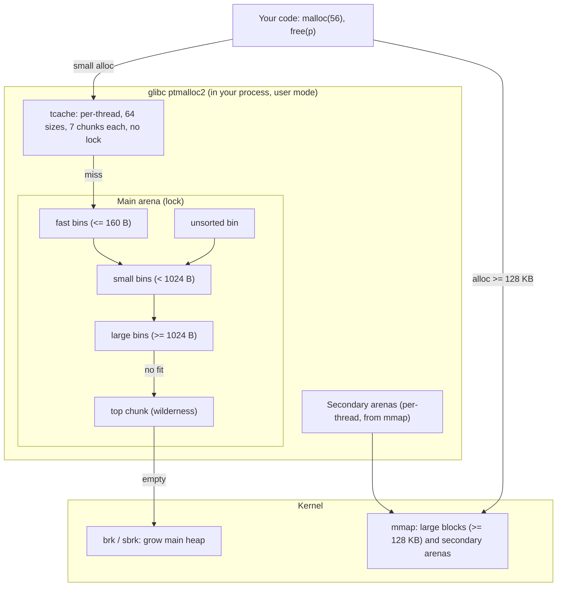

# Module 3.05: malloc internals

**Estimated hours:** 4

**What you will learn**

1. What `malloc` and `free` really do: chunks, bins, arenas, the top chunk, and why `free` almost never gives memory back to the operating system.
2. When glibc asks the kernel for memory with `brk` and when it uses `mmap`, and how to see the difference with `strace`.
3. How a heap overflow corrupts the next chunk's header, what `malloc(): corrupted top size` means, and how to read fragmentation with `malloc_stats` and `mallinfo2`.

**Prerequisites:** [Module 3.04: Virtual memory and paging](module-04-virtual-memory-and-paging.md).

---

## 1. One-line intuition

`malloc` is a shopkeeper who buys memory from the kernel in big slabs, cuts it into labelled pieces for you, keeps the returned pieces on shelves to hand out again, and hates giving the slab back to the kernel.

## 2. Real-life analogy

Think of a fabric shop.

- **The warehouse** is the kernel. It sells cloth only in huge rolls, and only through a slow loading dock (a system call).
- **The shopkeeper** is the allocator inside your process, the code behind `malloc` and `free`. In glibc on Linux this allocator is called **ptmalloc2** (a per-thread variant of Doug Lea's `dlmalloc`).
- When you ask for a small piece of cloth, the shopkeeper does not drive to the warehouse. He cuts a piece off a roll he already has on the floor. That roll is the **heap**, grown with `brk`.
- Every piece he cuts gets a **label stapled to the front**: how long it is, and whether the piece just before it is free. That label is the **chunk header**. You never see it; it sits in the few bytes just before the pointer he hands you.
- When you return a piece (`free`), he does not send it back to the warehouse. He folds it and puts it on a **shelf sorted by size** (a **bin**), ready to hand to the next customer who wants that size. This is why your program's memory use, seen from outside, stays high even after you free everything.
- For a very large order he skips the shop floor and has the warehouse deliver a dedicated roll straight to you (`mmap`). When you return that, he can actually send it back (`munmap`), because it was never mixed into the shop floor.

The whole module is this shop: the labels, the shelves, the floor, and the one case where cloth goes back to the warehouse.

## 3. Why it exists: the problem it solves

In module 3.04 you learned the kernel hands out memory in **pages** of 4096 bytes, through system calls like `mmap` and `brk`. Two problems follow.

1. **Programs want small, odd sizes.** A loan record might need 56 bytes, a string 11 bytes, a tree node 24 bytes. Asking the kernel for a whole 4096-byte page every time would waste almost all of it, and a system call costs roughly 100 to 300 ns (module 3.07) which is far too slow to do millions of times.
2. **Programs allocate and free in any order.** You need a bookkeeper that remembers which little pieces are in use, which are free, and can reuse a freed piece for the next request without going back to the kernel.

`malloc` and `free` are that bookkeeper. They sit between your program and the kernel. They buy memory in bulk (one `brk` or `mmap` covers thousands of small objects), cut it into chunks, and recycle freed chunks. Without them you would either call the kernel for every object (far too slow) or write your own allocator for every program (which is exactly what Phase 3.06 teaches you to do when the general-purpose one is not good enough).

What breaks without understanding this: you cannot explain why your server's memory stays high after a batch finishes, you cannot read a heap-corruption crash, and you cannot justify the arena allocator on your resume.

## 4. Three layers of depth

### Layer 1 (beginner): what malloc and free promise

`malloc(n)` returns a pointer to a block of **at least** `n` usable bytes, or `NULL` if it cannot. The bytes are uninitialised (garbage). `free(p)` gives a block back. The rules you must never break:

- Pass to `free` only a pointer that `malloc` (or `calloc`/`realloc`) returned, or `NULL`.
- Never `free` the same pointer twice (double free).
- Never use a block after you `free` it (use-after-free).
- Never write past the end of the block (heap overflow).

Breaking any of these is **undefined behaviour**. The program may crash now, crash later in unrelated code, or silently corrupt data. This is the single biggest source of the memory-corruption incidents in capstone C6.

`calloc(count, size)` is `malloc(count * size)` plus it zeroes the memory and checks the multiplication for overflow. `realloc(p, n)` resizes a block, possibly moving it and copying the contents.

A first experiment to run in your head: a block you get back from `malloc` is bigger than you asked for. Ask for 1 byte and glibc gives you a chunk whose usable size is 24 bytes on a 64-bit system, because chunks have a minimum size and a header. Nothing smaller is worth tracking.

### Layer 2 (working engineer): chunks, bins, arenas, brk vs mmap

**A chunk.** Every piece of heap memory, free or in use, is a **chunk**. A chunk is your usable bytes plus a small header in front. On 64-bit glibc the header is built from 8-byte fields:

- `prev_size`: the size of the chunk physically before this one, but only meaningful when that previous chunk is free. When the previous chunk is in use, your data is allowed to spill into this field, so no space is wasted.
- `size`: the size of this chunk in bytes, including the header. Because chunk sizes are always a multiple of 16, the low bits of `size` are always zero, so glibc steals those low 3 bits for **flags**:
  - bit 0, `PREV_INUSE` (`A`... actually `P`): 1 means the previous chunk is in use.
  - bit 1, `IS_MMAPPED` (`M`): 1 means this chunk came from `mmap`, not the main heap.
  - bit 2, `NON_MAIN_ARENA` (`N`): 1 means it belongs to a secondary arena (see below).

The pointer `malloc` returns points just **after** the `size` field, at the start of your usable bytes.

**Alignment and minimum size.** glibc guarantees every returned pointer is aligned to 16 bytes on 64-bit (`2 * sizeof(void*)`). The smallest chunk is 32 bytes total, giving 24 usable bytes. Request sizes are rounded up: usable size becomes `(requested + 8 header bytes, rounded up to a multiple of 16)`, with the `prev_size` reuse trick meaning a request of up to 24 bytes fits a 32-byte chunk.

**Where free chunks wait: bins.** When you `free`, the chunk is not returned to the kernel. It is put on a free list called a **bin**, chosen by size, so a later `malloc` of a similar size can reuse it instantly.

| Bin | Sizes it holds | Behaviour |
|---|---|---|
| **tcache** (per-thread cache) | small, up to 1032 bytes by default | Per-thread, needs no lock. 64 size classes, up to **7 chunks each** by default. Checked first. |
| **fast bins** | small, up to 160 bytes (64-bit) | Single-linked, chunks kept "in use" (not coalesced), very fast. |
| **small bins** | under 1024 bytes | Exact-size bins, double-linked, coalesced on free. |
| **large bins** | 1024 bytes and up | Ranges of sizes, sorted, split on allocation. |
| **unsorted bin** | any | A temporary holding list; freed chunks land here first and are sorted into small/large bins lazily on the next `malloc`. |

The **tcache** (thread-local cache, added in glibc 2.26) is why modern `malloc`/`free` of small objects is so cheap: it is a per-thread array of singly linked lists, so the common case takes no lock at all. "7 entries per size" means once a tcache size class holds 7 freed chunks, further frees of that size overflow into the fast/small bins.

**The top chunk.** The heap ends in one big free chunk called the **top chunk** (or "wilderness"). When no bin can satisfy a request, glibc carves the new chunk off the front of the top chunk. When the top chunk runs out, glibc grows the heap with `brk` (main heap) or allocates a fresh region.

**Arenas.** An **arena** is one independent heap with its own bins and its own lock. The **main arena** manages the original heap grown with `brk`. When many threads call `malloc` at once and contend on the main arena's lock, glibc creates extra **secondary arenas**, each backed by memory from `mmap`. The number is capped (by default roughly `8 * number of CPU cores`). This is the mechanism behind "per-thread arenas": threads spread across arenas so they rarely wait on each other's locks. This matters directly for your multithreaded tcpkv server and the migration engine.

**brk versus mmap.** glibc chooses where small and large allocations come from:

- **Small requests** come from the main heap, which grows and shrinks by moving the "program break" with the `brk`/`sbrk` system call. The break is the top edge of the heap.
- **Large requests**, by default **128 KB or more** (`M_MMAP_THRESHOLD`), are served by a dedicated `mmap` of their own. They are not mixed into the heap. When freed, that mapping can be returned to the kernel with `munmap`, so a large allocation's memory really does go back.
- `M_MMAP_THRESHOLD` is **dynamic**: when glibc sees a large block freed, it raises the threshold up to a cap (32 MB) so that repeated allocations of that size reuse the heap instead of paying for a fresh `mmap` each time. You can pin it with `mallopt(M_MMAP_THRESHOLD, ...)`.

### Layer 3 (internals): why free() keeps the memory, and what corruption looks like

**Why `free` rarely returns memory to the OS.** Memory from the main heap can only be returned by lowering the program break with `brk`. But the break can only move down if the **top chunk** (the very end of the heap) is free and large enough. If even one small live chunk sits at the high end of the heap, everything below it is pinned, no matter how much is free underneath. So in practice glibc keeps freed heap memory inside the process, on its bins, as a cache for future allocations.

glibc only trims the top of the heap when the free top chunk grows past `M_TRIM_THRESHOLD` (**128 KB by default**). You can force a trim with `malloc_trim(0)`, which returns free pages at the top of the heap (and unused pages inside `mmap`ed arenas) to the kernel. Even then, fragmentation can leave most freed memory stuck.

This is the key fact for your work: **the resident memory of a process (RSS) stays high after you free, because the allocator keeps the memory for reuse, not because you leaked it.** A leak is memory you can no longer reach; retained-but-reusable memory is different, and tools like `valgrind` report zero leaks while RSS is still high. The fix for a batch workload is not to `free` harder; it is to use an arena you can reset in bulk (module 3.06).

**mmapped allocations are different.** A chunk with the `IS_MMAPPED` flag is freed with `munmap`, which does return the memory to the kernel immediately. That is why a 1 MB buffer frees cleanly but a million 24-byte nodes do not.

**What a heap overflow corrupts.** Because each chunk's header sits immediately before the user data, and the **next** chunk's header sits immediately after your block, writing past the end of your block overwrites the next chunk's `size` field (and its flags). Later, when glibc tries to use that corrupted `size` to find the following chunk or to put the chunk on a bin, it reads nonsense. glibc has consistency checks; when one fails it aborts the program with a message:

- `malloc(): corrupted top size` — the top chunk's size field was overwritten, usually by an overflow of the last allocated block.
- `free(): invalid next size`, `malloc(): memory corruption`, `free(): double free detected in tcache 2` — other integrity checks firing.

These aborts are a **feature**: glibc is stopping before an attacker-controlled or garbage pointer gets used. Reading them is capstone C6 material. The abort tells you corruption happened, not where it started; the write that caused it may be far away in the code. ASan (module 8) pinpoints the write.

**Windows heap, in one paragraph.** Windows does not use glibc. The C runtime's `malloc` calls `HeapAlloc` on a default process heap managed by the OS heap manager (`ntdll` `RtlAllocateHeap`). For small blocks it uses the **Low Fragmentation Heap (LFH)**, which, like fast bins and tcache, keeps per-size free lists of fixed-size blocks to cut fragmentation and locking. Large blocks go straight to the virtual memory manager (`VirtualAlloc`), the rough equivalent of the `mmap` path. The concepts (headers, free lists by size, bulk reservation from the OS, retained-not-returned memory) carry across; the names and the exact structures differ. WinDbg's `!heap` command is the Windows equivalent of reading chunk headers.

## 5. Architecture diagram



The thick idea: your request walks tcache, then the bins, then the top chunk, and only reaches the kernel (`brk`/`mmap`) when all of those fail.

## 6. Code

This program shows four things: the chunk header hidden before your pointer, that two small `malloc`s land next to each other, that `free` does not shrink RSS, and the `brk` vs `mmap` split. It is C because this is OS-level work.

```c
/* malloc_peek.c
 * Peek at glibc chunk headers, watch brk vs mmap, and watch RSS after free.
 * Build: gcc -std=gnu17 -Wall -Wextra -Werror -g -o malloc_peek malloc_peek.c
 */
#include <stdio.h>
#include <stdlib.h>
#include <stdint.h>
#include <malloc.h>     /* malloc_stats, mallinfo2, malloc_usable_size */

/* Read the 8 bytes just before a malloc'd pointer: that is the chunk `size`
 * field, including the 3 low flag bits. The pointer points just past it. */
static void show_header(const char *label, void *p) {
    /* The size field sits one 8-byte word before the returned pointer. */
    uint64_t size_word = *((uint64_t *)p - 1);
    uint64_t flags = size_word & 0x7;      /* low 3 bits: N | M | P */
    uint64_t size  = size_word & ~(uint64_t)0x7;
    printf("%-10s ptr=%p  size_word=0x%016llx  chunk_size=%llu  flags(NMP)=%llu%llu%llu  usable=%zu\n",
           label, p,
           (unsigned long long)size_word,
           (unsigned long long)size,
           (unsigned long long)((flags >> 2) & 1),
           (unsigned long long)((flags >> 1) & 1),
           (unsigned long long)(flags & 1),
           malloc_usable_size(p));
}

int main(void) {
    printf("=== small chunks live next to each other on the heap ===\n");
    void *a = malloc(24);
    void *b = malloc(24);
    show_header("a(24)", a);
    show_header("b(24)", b);
    printf("b - a = %ld bytes (one chunk apart)\n\n", (long)((char *)b - (char *)a));

    printf("=== a big allocation is mmapped: note the M flag = 1 ===\n");
    void *big = malloc(1 * 1024 * 1024);   /* 1 MB, well over the 128 KB threshold */
    show_header("big(1MB)", big);
    printf("\n");

    printf("=== free does not necessarily return memory to the OS ===\n");
    /* Allocate a million small nodes, then free every one. */
    enum { N = 1000000 };
    void **nodes = malloc(N * sizeof(void *));
    for (int i = 0; i < N; ++i) nodes[i] = malloc(24);
    printf("after allocating %d nodes:\n", N);
    struct mallinfo2 mi1 = mallinfo2();
    printf("  in-use bytes (uordblks) = %zu\n", mi1.uordblks);
    for (int i = 0; i < N; ++i) free(nodes[i]);   /* free them all */
    free(nodes);
    free(big);
    free(a);
    free(b);
    struct mallinfo2 mi2 = mallinfo2();
    printf("after freeing everything:\n");
    printf("  in-use bytes (uordblks)      = %zu\n", mi2.uordblks);
    printf("  free fastbin bytes (fsmblks) = %zu\n", mi2.fsmblks);
    printf("  total heap from system (arena) = %zu\n\n", mi2.arena);

    printf("=== malloc_stats(): what the allocator is holding ===\n");
    malloc_stats();   /* prints a human-readable summary to stderr */
    return 0;
}
```

Compile and run:

```bash
gcc -std=gnu17 -Wall -Wextra -Werror -g -o malloc_peek malloc_peek.c
./malloc_peek
```

Expected output (addresses and exact byte counts vary by machine and glibc build; this is from one laptop running glibc 2.39). The shape, not the exact numbers, is what matters:

```text
=== small chunks live next to each other on the heap ===
a(24)      ptr=0x5audio...  size_word=0x0000000000000021  chunk_size=32  flags(NMP)=001  usable=24
b(24)      ptr=0x5...        size_word=0x0000000000000021  chunk_size=32  flags(NMP)=001  usable=24
b - a = 32 bytes (one chunk apart)

=== a big allocation is mmapped: note the M flag = 1 ===
big(1MB)   ptr=0x7...        size_word=0x0000000000101002  chunk_size=1052672  flags(NMP)=010  usable=1052656

=== free does not necessarily return memory to the OS ===
after allocating 1000000 nodes:
  in-use bytes (uordblks) = 32000000
after freeing everything:
  in-use bytes (uordblks)      = 0
  free fastbin bytes (fsmblks) = ...
  total heap from system (arena) = 32010752

=== malloc_stats(): what the allocator is holding ===
Arena 0:
system bytes     =   32010752
in use bytes     =        ...
...
```

Read the output carefully:

- `size_word = 0x21` is decimal 33. The low 3 bits are `001`: `P`=1 (previous chunk in use), `M`=0, `N`=0. Masking them off gives chunk size 32. So a 24-byte request became a 32-byte chunk: 24 usable, and the header reused. Note `b - a` is exactly 32, confirming the two chunks are adjacent.
- The 1 MB block has `M`=1 (`IS_MMAPPED`). Its chunk size is just over 1 MB, rounded up to whole pages. Its address is far from `a` and `b` because it is a separate mapping, not on the heap.
- After freeing a million nodes, `uordblks` (in-use bytes) returns to 0, but `arena` (total heap bought from the system) is still about 32 MB. **The memory is free but still owned by the process.** That is the headline fact of this module. If you watch `/proc/self/status` `VmRSS` instead, it stays high too.

### Seeing brk vs mmap with strace

```bash
strace -e trace=brk,mmap,munmap ./malloc_peek 2>&1 | grep -E "brk|mmap|munmap" | head -20
```

Expected: a series of `brk(...)` calls as the heap grows for the small allocations, and a `mmap(NULL, 1052672, PROT_READ|PROT_WRITE, ...)` for the 1 MB block, followed much later by a matching `munmap` when `big` is freed. The small nodes produce **no** per-node syscall at all; one `brk` covers thousands of them. That is the whole point of having an allocator.

## 7. Use case: core-banking loan-origination platform

The migration engine (resume claim H1, capstone C3) streams millions of Berkeley DB records into YugabyteDB. Early on it did the obvious thing: for each record, `malloc` space for the decoded fields, write the batch to the database, then `free` each field. It worked and `valgrind` reported zero leaks. Yet after processing a few million records the process's resident memory had climbed to several gigabytes and stayed there.

The cause is exactly Layer 3: freeing a million small chunks returns them to glibc's bins, not to the kernel. Because at least one live object always sat near the top of the heap during steady-state processing, glibc could never trim the break down. RSS stayed high. Under the bank's memory limits for the migration host, this risked the OOM killer stopping a multi-hour migration partway.

**The decision this drove:** replace per-record `malloc`/`free` with a per-batch **arena allocator** (module 3.06). One arena holds all the decoded fields for a batch of N records; after the batch commits to YugabyteDB, the arena is **reset** in one O(1) operation, so every object is reclaimed at once and the memory is reused for the next batch with no fragmentation and no syscalls. RSS became flat and predictable. This is the literal meaning of "arena allocator with explicit ownership contracts, restartable leak-free batches" on the resume, and the reasoning starts here, with why `free` does not give the memory back.

## 8. Lab

Work through all four parts. You have Ubuntu 24.04 in WSL2 with gcc and strace. Record results for your journal.

### Part A: read your own chunk headers (20 minutes)

1. Build and run `malloc_peek.c` from section 6.
2. Confirm the `a` and `b` chunks are 32 bytes each and adjacent (`b - a == 32`).
3. Change `malloc(24)` to `malloc(40)` for both and rerun. What chunk size do you get now? (Expected: 48; a 40-byte request plus up to 8 reusable header bytes rounds to a 48-byte chunk.)
4. Change it to `malloc(100000)` (100 KB, under the 128 KB threshold) then `malloc(200000)` (over it). Check the `M` flag in each: the 100 KB one should be on the heap (`M`=0), the 200 KB one mmapped (`M`=1).

Expected: you can predict the `M` flag from whether the size crosses 128 KB.

### Part B: brk vs mmap under strace (15 minutes)

1. Run the `strace -e trace=brk,mmap,munmap ./malloc_peek` command from section 6.
2. Count the `brk` calls versus the `mmap` calls. Confirm the 1 MB allocation is one `mmap`, and that it is `munmap`ped later.
3. Now write a tiny program that only does `void *p = malloc(10); free(p);` and strace it. You will still see `brk` and several `mmap` calls at startup. Those startup calls are the dynamic loader and glibc setting themselves up, not your `malloc`. Note this: most of a small program's syscalls happen before `main`.

Expected: large allocations map one-to-one to `mmap`; thousands of small ones share a few `brk` calls.

### Part C: the fragmentation demo (20 minutes)

Write `fragment.c`: allocate 100000 blocks of 128 bytes into an array, then `free` **every other one** (indices 1, 3, 5, ...). Print `VmRSS` before and after the frees by reading `/proc/self/status`:

```c
/* Add this helper and call it before and after the frees. */
static void print_rss(const char *when) {
    FILE *f = fopen("/proc/self/status", "r");
    char line[256];
    while (f && fgets(line, sizeof line, f))
        if (strncmp(line, "VmRSS:", 6) == 0) { printf("%s %s", when, line); break; }
    if (f) fclose(f);
}
```

1. Build with the standard command and run. Compare `VmRSS` after allocating all blocks and after freeing half.
2. Expected: RSS barely drops. The freed blocks are interleaved with live ones, so no page is fully free and nothing can be returned. This is **fragmentation**: free memory that cannot be reused for a larger request and cannot be returned to the OS.
3. Now add `malloc_trim(0);` after the frees and print RSS again. On a heap this fragmented it usually still barely moves. Write down the numbers you see.

### Part D: watch a heap overflow abort (15 minutes)

Write `overflow.c`:

```c
#include <stdlib.h>
#include <string.h>
int main(void) {
    char *p = malloc(16);
    /* Deliberately write 40 bytes into a 16-byte block: overwrites the
     * next chunk's header. This is UNDEFINED BEHAVIOUR on purpose. */
    memset(p, 'A', 40);
    char *q = malloc(16);   /* glibc now walks a corrupted heap */
    free(p);
    free(q);
    return 0;
}
```

1. Build and run. Expected: either a crash, or an abort such as `malloc(): corrupted top size` or `free(): invalid next size`, followed by `Aborted (core dumped)`. The exact message depends on what the overflow hit.
2. Rebuild with AddressSanitizer: `gcc -std=gnu17 -g -fsanitize=address -o overflow_asan overflow.c` and run. ASan reports `heap-buffer-overflow`, the exact line, and that the write was 40 bytes into a 16-byte region. This is the difference between glibc's "something is wrong somewhere" and ASan's "this line, this byte". You will rely on this in capstone C6.

### Journal

Copy [TEMPLATE.md](../journal/TEMPLATE.md) to `journal/YYYY-MM-DD-malloc-internals.md`. Record: the chunk sizes you saw for 24- and 40-byte requests; the `brk` vs `mmap` counts from Part B; the `VmRSS` before/after numbers from Part C (and after `malloc_trim`); and the exact abort message and the ASan report from Part D. In two sentences, explain to your future self why `free` did not lower RSS.

## 9. Common mistakes and misconceptions

| Mistake | Why it is wrong | Bug it causes later |
|---|---|---|
| "`free` returns the memory to the OS" | It usually returns it to glibc's bins for reuse; RSS stays high | Panic over a "memory leak" that `valgrind` says is clean |
| "High RSS means I leaked memory" | Retained-reusable memory and leaked (unreachable) memory are different things | Chasing a non-existent leak instead of using an arena |
| "`malloc(n)` gives exactly `n` bytes" | It gives a rounded-up chunk with a minimum size and alignment | Off-by-one assumptions; missing that small sizes all cost 32 bytes |
| "The header is part of my data" | The header sits before your pointer; your bytes start after `size` | Corruption when code writes at a negative offset |
| "A heap overflow crashes at the overflow" | It corrupts the next chunk's header; the crash comes later in `malloc`/`free` | Hours lost debugging the wrong function |
| "tcache/fast bins are thread-safe like a normal lock" | tcache is per-thread (no lock); arenas have locks | Misreasoning about contention in multithreaded allocation |
| "mmap and brk are interchangeable" | mmap can be returned with munmap; brk heap often cannot shrink | Expecting large-vs-small frees to behave the same |

## 10. Resume link

- **Claim H1, "arena allocator with explicit ownership contracts, restartable leak-free batches".** This module is the *why*. Say: "General-purpose `malloc`/`free` kept freed small objects in glibc's bins, so after millions of records our RSS climbed and never fell, even though `valgrind` showed no leak, because the main heap can only shrink when its top chunk is free. We switched to a per-batch arena we reset in O(1), which made memory flat." Module 3.06 is the *how*.
- **Claim B, "memory and ownership design, undefined-behaviour-aware coding".** You can now explain chunk headers, the minimum chunk size, and why a heap overflow corrupts the neighbouring chunk's `size` field, which is the root of a whole class of UB.
- **Claim F, "memory corruption investigation".** Say: "glibc's `malloc(): corrupted top size` abort is an integrity check firing; it tells me corruption happened but not where, so I reproduce under ASan to get the exact write." That is capstone C6's method in one sentence.

Likely follow-up: "After you free a large buffer, does the process give the memory back to the OS?" Answer: an `mmap`ed allocation (default 128 KB and up) is `munmap`ped and returned immediately; a small allocation goes to a bin and the heap only trims from the top past `M_TRIM_THRESHOLD`, so usually not.

## 11. Interview questions

**Q1 (easy). What does `malloc` return, and what are the rules for using the pointer?**

<details>
<summary>Model answer</summary>

`malloc(n)` returns a pointer to at least `n` bytes of uninitialised memory, suitably aligned (16-byte aligned on 64-bit glibc), or `NULL` on failure. You must check for `NULL`, must only `free` a pointer `malloc`/`calloc`/`realloc` returned (or `NULL`), must not free it twice, must not use it after freeing, and must not write past the requested size. Breaking any of these is undefined behaviour. `calloc` additionally zeroes the memory and guards the size multiplication against overflow.

</details>

**Q2 (easy). Why is calling `malloc` for one small object cheaper than you might expect, given that it ultimately comes from the kernel?**

<details>
<summary>Model answer</summary>

Because `malloc` does not call the kernel per object. glibc buys memory in bulk from the kernel with `brk` (for the main heap) or `mmap`, then cuts small chunks out of it in user space. Freed small chunks go onto per-thread (tcache) or per-arena free lists and are handed straight back out on the next request. So the common path is a few pointer operations with no system call and, for tcache, no lock. A system call (roughly 100-300 ns) happens only occasionally, when the heap must grow.

</details>

**Q3 (medium). You free millions of small objects but the process's RSS does not go down. Is this a leak? Explain.**

<details>
<summary>Model answer</summary>

Not necessarily. `free` returns chunks to glibc's bins for reuse, not to the kernel. The main heap grown by `brk` can only shrink from the top: if any live chunk sits near the top of the heap, everything below it is pinned even if it is free, so the program break cannot move down. glibc also deliberately keeps freed memory as a cache and only trims past `M_TRIM_THRESHOLD`. A true leak is memory that is no longer reachable; `valgrind` or ASan will confirm whether there is one. If `valgrind` is clean, the high RSS is retained-reusable memory plus fragmentation, and the right fix is a different allocation strategy, such as an arena you reset in bulk, or calling `malloc_trim`.

</details>

**Q4 (medium). When does glibc use `mmap` instead of the main heap, and why does that matter?**

<details>
<summary>Model answer</summary>

By default, allocations of 128 KB or more (`M_MMAP_THRESHOLD`) are served by their own `mmap`ed region rather than the main heap, and secondary arenas for multithreaded programs are also backed by `mmap`. It matters because an `mmap`ed allocation can be returned to the kernel with `munmap` when freed, so its memory really does go back, unlike small heap allocations. The threshold is dynamic: glibc raises it (up to 32 MB) when it sees large blocks freed, so repeated same-size allocations reuse memory instead of paying for a fresh `mmap` each time. You can see the split with `strace -e trace=brk,mmap`: large allocations map one-to-one to `mmap`, small ones share a few `brk` calls.

</details>

**Q5 (hard). A server aborts in production with `malloc(): corrupted top size`. Walk through what happened and how you would find the real bug.**

<details>
<summary>Model answer</summary>

glibc stores each chunk's size in a header immediately before the user data, and the next chunk's header immediately after your block. `corrupted top size` means the size field of the top chunk (the free wilderness at the end of the heap) was overwritten, almost always by a write past the end of the most recently allocated block that sat just before it. glibc caught the inconsistency during a later `malloc` or `free` when it tried to use that size, and aborted deliberately rather than follow a garbage pointer. The abort location is where corruption was *detected*, not where it was *caused*; the offending write could be anywhere earlier. To find it I would reproduce under AddressSanitizer (`-fsanitize=address`), which instruments every heap access and reports the exact line and offset of the out-of-bounds write with both the write and the allocation stacks. If it only reproduces in production, I would analyse the core dump in GDB, inspect the heap around the top chunk, and look for which object's allocation lies just below the corrupted header. The fix is almost always a bounds error: a `memcpy`/`strcpy`/loop writing one or more bytes past an allocated block.

</details>

## 12. Revision

- `malloc` buys memory in bulk from the kernel (`brk` for the small heap, `mmap` for blocks >= 128 KB) and cuts it into chunks, each with an 8-byte `size` header whose low 3 bits are the `N`/`M`/`P` flags; minimum chunk is 32 bytes, 16-byte aligned.
- `free` puts chunks on per-thread tcache (7 per size) and per-arena bins for reuse; it rarely returns heap memory to the OS because the break only lowers when the top chunk is free, so RSS stays high without being a leak.
- A heap overflow overwrites the next chunk's `size` field; glibc's integrity checks later abort with messages like `corrupted top size`, and ASan is the tool that pinpoints the actual out-of-bounds write.

---

Previous: [Module 3.04: Virtual memory and paging](module-04-virtual-memory-and-paging.md) | Next: [Module 3.06: Custom allocators: arena, pool, slab](module-06-custom-allocators-arena-pool-slab.md)
