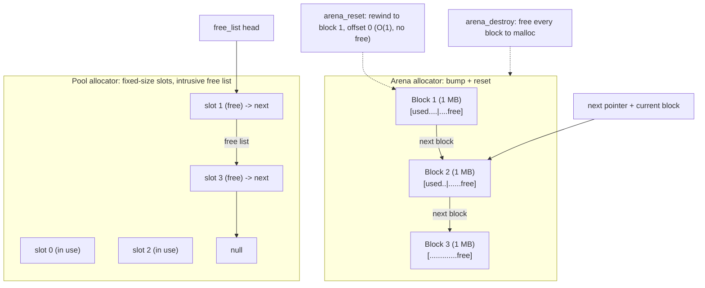

# Module 3.06: Custom allocators: arena, pool, slab

**Estimated hours:** 6

**What you will learn**

1. Three custom allocators and when each beats general-purpose `malloc`: the **arena** (bump-allocate, reset in bulk), the **pool** (fixed-size slots with a free list), and the **slab** (the kernel's object cache).
2. What an **ownership contract** is, how to write one into a header file, and why "the arena owns every object; callers borrow; never free them" makes a restarted batch leak-free by construction.
3. How to measure the speed difference against `malloc`/`free`, keep the code Valgrind-clean, and catch a use-after-reset bug with AddressSanitizer poisoning.

**Prerequisites:** [Module 3.05: malloc internals](module-05-malloc-internals.md).

---

## 1. One-line intuition

A custom allocator trades generality for speed: an arena hands out memory by bumping a pointer and throws it all away at once; a pool reuses fixed-size slots in O(1); a slab is the kernel's version of a pool for its own objects.

## 2. Real-life analogy

Back to the fabric shop from module 3.05, but now you run three specialised counters.

- **The arena counter** is a long roll of paper on a table. Each order, you tear off the next piece and slide the "torn-to-here" marker forward. You keep no record of individual pieces. When the job is done you roll the whole thing into the bin and start fresh. Tearing is instant; there is no "give one piece back" because you never track pieces. This is a **bump allocator** with **reset-in-bulk**.
- **The pool counter** sells only one product: identical 24-byte cards. You keep a stack of blank cards. Handing one out is popping the stack; taking one back is pushing it. Both are one move. Because every card is the same size, a returned card fits any future request. This is a **pool** (also called a **free-list allocator** or **fixed-size allocator**).
- **The slab counter** is the pool counter run by the warehouse (the kernel) for its own paperwork: pre-built, pre-initialised forms of one type (say, "file handle forms"), kept warm so the next one is instant. This is the **slab allocator** inside Linux.

The general-purpose `malloc` from module 3.05 is the main shop: it handles any size, in any order, which is exactly why it needs headers, bins and locks. When your workload is narrower, a specialised counter is faster and simpler.

## 3. Why it exists: the problem it solves

`malloc`/`free` are general. Generality costs you:

- **Per-object overhead.** Every chunk carries an 8-byte-plus header and is rounded up to a 32-byte minimum (module 3.05). A million 24-byte objects cost 32 MB, a third of it metadata and rounding.
- **Free-list search and locking.** `free` has to find the right bin, maybe coalesce with neighbours; `malloc` has to search bins. In multithreaded code there is locking or per-thread cache management.
- **Fragmentation and retained memory.** As you saw, freeing a million small objects does not return the memory, and interleaved frees fragment the heap.
- **No bulk reclaim.** To free a million objects you must call `free` a million times, and you must track every pointer to do so. Miss one and you leak.

Custom allocators remove the parts you do not need:

- An **arena** removes per-object free entirely. You allocate many objects, then reclaim them all in one O(1) reset. No per-object header, no free-list search, perfect for "build a batch, use it, discard it".
- A **pool** removes size handling and search. Every object is the same size, so alloc and free are each a single pointer move, O(1), with no fragmentation of that size class.
- A **slab** is the kernel's pool, with the extra trick of keeping objects **pre-constructed** so repeated allocations skip initialisation.

What breaks without them: the migration engine's RSS climbs without bound (module 3.05 section 7), the hot path of a server pays `malloc` overhead per request, and a partially failed batch leaks because you cannot easily free what you allocated. The arena you build in this module is reused **verbatim in capstone C3**.

## 4. Three layers of depth

### Layer 1 (beginner): bump allocation and fixed slots

**The arena, simplest form.** Take a big block of memory. Keep one pointer, `next`, at the start. To allocate `n` bytes, return `next` and move `next` forward by `n`. That is the entire allocation path: an add and a bounds check.

```text
block: [####........................]   next points at the first dot
alloc(4): return the dot, next += 4
block: [########....................]
```

There is no way to free one object, because you keep no per-object bookkeeping. You free **everything** by setting `next` back to the start (a **reset**). The memory block is reused; nothing goes back to the OS until you destroy the arena.

**Alignment.** CPUs want an 8-byte or 16-byte object to start at an address that is a multiple of 8 or 16 (module 3.04). A bump allocator must round `next` up to the required alignment before returning it, or you get a misaligned pointer and, on some accesses, a crash or a slowdown. The standard trick: `aligned = (next + (align - 1)) & ~(align - 1)`.

**The pool, simplest form.** You have slots of one fixed size, say 32 bytes, laid out in an array. A free slot stores, in its own bytes, the address of the next free slot: this is an **intrusive free list** (the list lives inside the free objects, costing no extra memory). `alloc` pops the head of the free list; `free` pushes the slot back on. Both are O(1). Because every slot is identical, a freed slot satisfies any future request, so there is no fragmentation within the pool.

### Layer 2 (working engineer): growth, ownership, and the batch pattern

**An arena that grows.** One fixed block is not enough for a batch of unknown size. So the arena holds a **linked list of blocks**. Each block is, say, 1 MB (or bigger if a single request exceeds the block size). When the current block cannot satisfy a request, the arena allocates a new block (one `malloc`, which under the hood is one `mmap` for a block this size, per module 3.05) and chains it on. `reset` does not free the blocks; it rewinds `next` to the start of the first block so they are all reused. `destroy` frees every block back to `malloc`.

This is the key performance property: a batch of a million small objects costs a handful of `malloc` calls for 1 MB blocks, not a million. And reset is O(number of blocks), effectively free.

**The ownership contract.** This is the idea the resume names (claim H1, "explicit ownership contracts"). An allocator does not just hand out memory; it defines **who owns the memory and for how long**. For the arena the contract is exact and must be written in the header:

> Pointers returned by `arena_alloc` are owned by the arena. The caller **borrows** them. They are valid until the next `arena_reset` or `arena_destroy` on that arena. The caller must **never** call `free` on them, must not use them after a reset, and must not hold them past the arena's lifetime.

Writing this down is not decoration. It tells every future reader the rules, it tells code review what to check, and it turns a class of bugs (double free, use-after-free, leak) into contract violations you can test for. "Explicit" means the contract is in the header comment, not in someone's memory.

**The batch-processing pattern.** This is why the contract matters for banking (section 7). Structure the work as:

```text
for each batch of N records:
    arena = arena_create()
    decode all N records into the arena   (many arena_alloc, no frees)
    write the batch to the database
    if commit succeeded:
        arena_reset(arena)   -- reclaim everything at once, reuse memory
    else:
        arena_reset(arena)   -- same: throw the whole batch away cleanly
```

Because the arena owns everything, a batch that fails halfway **cannot leak**: there are no individual pointers to lose track of, and the reset reclaims partial work exactly as cleanly as complete work. A restarted batch starts from a reset arena. This is the literal meaning of "restartable leak-free batches".

**Pool trade-offs.** A pool is ideal when you allocate and free many objects of **one type** over the program's life (connection objects, tree nodes, request structs). It is O(1) both ways, has no per-object header, and never fragments that size. Its limits: one fixed size only; and if you free an object twice, you corrupt the free list (a classic bug, demonstrated in the lab). Pools often sit on top of an arena or a slab for their backing memory.

**Slab, the one-paragraph version.** The Linux kernel allocates huge numbers of small, fixed-type objects: `task_struct` (one per thread), `inode`, `dentry`, `file`. It uses a **slab allocator** (today the default implementation is **SLUB**). A **slab** is one or more contiguous pages carved into equal slots for one object type, managed as a **cache** (`kmem_cache`). Allocation pops a slot; free pushes it; both O(1) like a pool. The slab's extra trick is the **constructor**: objects can be kept partly pre-initialised so a fresh allocation skips setup, and freed objects stay "warm" in cache. You can watch these live in `/proc/slabinfo` and with `slabtop`. You will not write a kernel slab allocator, but you should recognise it as "a pool, in the kernel, with pre-construction", and name it in an interview.

### Layer 3 (internals): what reset actually reclaims, and why it is safe or not

**What a reset does and does not do.** `arena_reset` sets each block's `used` offset back to zero and points the arena's "current block" back at the first block. It does **not** touch the bytes. The old data is still sitting there; it is simply considered free and will be overwritten by the next allocations. This is why a use-after-reset bug is so dangerous: the pointer still points at readable, writable memory that *looks* fine, right up until the next allocation overwrites it. There is no crash to tell you. This is undefined behaviour of the quiet, corrupting kind.

**Detecting use-after-reset.** Two ways:

1. **Valgrind** does not natively know about your arena, but you can teach it with client requests (`VALGRIND_MAKE_MEM_NOACCESS` on reset), so it flags any later read/write. Without that, Valgrind sees the whole block as valid and misses the bug.
2. **AddressSanitizer** gives you **manual poisoning**: `ASAN_POISON_MEMORY_REGION(ptr, size)` marks a region as off-limits, so any access ASan-instruments to it is reported as `use-after-poison`. Calling this on every block inside `arena_reset` turns a silent use-after-reset into a loud, located error at the exact offending line. The lab does exactly this.

This is the professional move: a custom allocator defeats the standard tools because they only understand `malloc`/`free`. You restore their power by annotating your allocator with poisoning or Valgrind client requests. An unannotated custom allocator is a place where memory bugs hide.

**Cache behaviour, the real reason arenas are fast.** Beyond avoiding `malloc` overhead, an arena lays objects out **contiguously in allocation order**. Walking them later touches consecutive cache lines, so the CPU's hardware prefetcher (module 3.04) keeps the pipeline fed. `malloc`ed objects are scattered across the heap and across cache lines, so walking them misses cache constantly. For a batch you build and then scan, the arena can be several times faster to *traverse*, on top of being faster to *allocate*. The exact ratio depends on your machine; you measure it in the lab rather than quoting a number.

**Thread safety.** The arena and pool shown here are **single-threaded** by design: no locks, which is part of why they are fast. The contract for multithreaded use is "one arena per thread" or "one arena per batch, used by one thread". This matches glibc's own per-thread arena idea (module 3.05) and is the right model for the migration engine, where each worker thread owns its batch and its arena. Sharing one arena across threads without a lock is a data race (Phase 4).

## 5. Architecture diagram



The arena never frees individual objects; the pool's free objects link to each other inside their own bytes.

## 6. Code

Two complete, compilable files: the arena (reused in capstone C3) and the pool. Both are single-threaded by contract.

**arena.h** — the header, with the ownership contract written at the top:

```c
/* arena.h
 * A growing bump allocator.
 *
 * OWNERSHIP CONTRACT (read this before using):
 *   - Pointers returned by arena_alloc are OWNED by the arena. The caller
 *     BORROWS them.
 *   - They are valid until the next arena_reset() or arena_destroy() on the
 *     same arena.
 *   - The caller must NEVER call free() on a pointer from arena_alloc.
 *   - The caller must NOT use any such pointer after arena_reset() or
 *     arena_destroy(): that is use-after-reset, undefined behaviour.
 *   - The arena is single-threaded: do not share one arena across threads
 *     without external synchronisation. Use one arena per thread/batch.
 */
#ifndef ARENA_H
#define ARENA_H
#include <stddef.h>

typedef struct Arena Arena;

/* Create an arena. block_size is the default block in bytes (e.g. 1<<20). */
Arena *arena_create(size_t block_size);

/* Allocate `size` bytes aligned to `align` (a power of two, e.g. 16).
 * Returns NULL only if the backing malloc fails. */
void *arena_alloc(Arena *a, size_t size, size_t align);

/* Convenience: default 16-byte alignment. */
void *arena_alloc_default(Arena *a, size_t size);

/* Reclaim every object at once in O(number of blocks). Memory is reused;
 * nothing is returned to the OS. All previously returned pointers become
 * invalid. */
void arena_reset(Arena *a);

/* Free every block back to malloc and free the arena itself. */
void arena_destroy(Arena *a);

/* Diagnostics: total bytes currently handed out, and total block capacity. */
size_t arena_used(const Arena *a);
size_t arena_capacity(const Arena *a);

#endif /* ARENA_H */
```

**arena.c** — the implementation, with optional ASan poisoning on reset:

```c
/* arena.c  -- see arena.h for the ownership contract. */
#include "arena.h"
#include <stdint.h>
#include <stdlib.h>
#include <stdint.h>
#include <assert.h>

/* If built with -fsanitize=address, poison freed regions on reset so that
 * any use-after-reset is caught. These macros compile to nothing otherwise. */
#if defined(__SANITIZE_ADDRESS__)
#  include <sanitizer/asan_interface.h>
#  define ARENA_POISON(p, n)   ASAN_POISON_MEMORY_REGION((p), (n))
#  define ARENA_UNPOISON(p, n) ASAN_UNPOISON_MEMORY_REGION((p), (n))
#else
#  define ARENA_POISON(p, n)   ((void)0)
#  define ARENA_UNPOISON(p, n) ((void)0)
#endif

typedef struct Block {
    struct Block *next;
    size_t capacity;      /* usable bytes in `data` */
    size_t used;          /* bytes handed out from this block */
    unsigned char data[]; /* flexible array: the actual storage */
} Block;

struct Arena {
    Block  *head;         /* first block */
    Block  *current;      /* block we are allocating from now */
    size_t  block_size;   /* default new-block size */
    size_t  total_capacity;
};

static Block *new_block(size_t capacity) {
    Block *b = (Block *)malloc(sizeof(Block) + capacity);
    if (!b) return NULL;
    b->next = NULL;
    b->capacity = capacity;
    b->used = 0;
    ARENA_POISON(b->data, capacity);   /* nothing handed out yet */
    return b;
}

Arena *arena_create(size_t block_size) {
    if (block_size < 64) block_size = 64;
    Arena *a = (Arena *)malloc(sizeof(Arena));
    if (!a) return NULL;
    a->head = a->current = new_block(block_size);
    if (!a->head) { free(a); return NULL; }
    a->block_size = block_size;
    a->total_capacity = block_size;
    return a;
}

static size_t align_up(size_t n, size_t align) {
    assert((align & (align - 1)) == 0 && "align must be a power of two");
    return (n + (align - 1)) & ~(align - 1);
}

void *arena_alloc(Arena *a, size_t size, size_t align) {
    size_t offset = align_up(a->current->used, align);
    if (offset + size > a->current->capacity) {
        /* Need a new block. Make it big enough for this request. */
        size_t cap = a->block_size;
        if (size > cap) cap = size;              /* oversized single object */
        Block *b = new_block(cap);
        if (!b) return NULL;
        a->current->next = b;
        a->current = b;
        a->total_capacity += cap;
        offset = 0;                               /* fresh block starts at 0 */
    }
    unsigned char *p = a->current->data + offset;
    a->current->used = offset + size;
    ARENA_UNPOISON(p, size);                      /* this region is now live */
    return p;
}

void *arena_alloc_default(Arena *a, size_t size) {
    return arena_alloc(a, size, 16);
}

void arena_reset(Arena *a) {
    for (Block *b = a->head; b; b = b->next) {
        ARENA_POISON(b->data, b->capacity);       /* catch use-after-reset */
        b->used = 0;
    }
    a->current = a->head;
}

void arena_destroy(Arena *a) {
    Block *b = a->head;
    while (b) { Block *next = b->next; free(b); b = next; }
    free(a);
}

size_t arena_used(const Arena *a) {
    size_t t = 0;
    for (const Block *b = a->head; b; b = b->next) t += b->used;
    return t;
}

size_t arena_capacity(const Arena *a) { return a->total_capacity; }
```

**pool.c** — a self-contained fixed-size pool with its own tiny test in `main`:

```c
/* pool.c
 * A fixed-size pool allocator with an intrusive free list.
 * Build: gcc -std=gnu17 -Wall -Wextra -Werror -g -o pool pool.c
 *
 * OWNERSHIP CONTRACT:
 *   - pool_alloc returns a slot of exactly `slot_size` bytes, owned by the
 *     caller until pool_free is called on it.
 *   - Pass to pool_free only a pointer pool_alloc returned, exactly once.
 *   - Single-threaded.
 */
#include <stdio.h>
#include <stdlib.h>
#include <stdint.h>
#include <string.h>

typedef struct Pool {
    unsigned char *storage;   /* backing array of slot_count * slot_size */
    void          *free_list; /* head of the intrusive free list */
    size_t         slot_size;
    size_t         slot_count;
} Pool;

static Pool *pool_create(size_t slot_size, size_t slot_count) {
    if (slot_size < sizeof(void *)) slot_size = sizeof(void *); /* must hold a pointer */
    Pool *p = (Pool *)malloc(sizeof(Pool));
    if (!p) return NULL;
    p->storage = (unsigned char *)malloc(slot_size * slot_count);
    if (!p->storage) { free(p); return NULL; }
    p->slot_size = slot_size;
    p->slot_count = slot_count;
    /* Thread every slot onto the free list: each free slot stores, in its
     * first bytes, the address of the next free slot. */
    p->free_list = NULL;
    for (size_t i = slot_count; i-- > 0; ) {
        void *slot = p->storage + i * slot_size;
        *(void **)slot = p->free_list;   /* write next-pointer into the slot */
        p->free_list = slot;
    }
    return p;
}

static void *pool_alloc(Pool *p) {
    if (!p->free_list) return NULL;      /* pool exhausted */
    void *slot = p->free_list;
    p->free_list = *(void **)slot;       /* pop: head = head->next */
    return slot;
}

static void pool_free(Pool *p, void *slot) {
    *(void **)slot = p->free_list;       /* push: slot->next = head */
    p->free_list = slot;
}

static void pool_destroy(Pool *p) { free(p->storage); free(p); }

int main(void) {
    Pool *p = pool_create(32, 4);        /* 4 slots of 32 bytes */
    void *a = pool_alloc(p);
    void *b = pool_alloc(p);
    void *c = pool_alloc(p);
    void *d = pool_alloc(p);
    void *e = pool_alloc(p);             /* 5th alloc from a 4-slot pool */
    printf("a=%p b=%p c=%p d=%p\n", a, b, c, d);
    printf("e (pool exhausted, expect nil): %p\n", e);
    pool_free(p, b);                     /* give one back */
    void *f = pool_alloc(p);             /* should reuse b's slot */
    printf("freed b, reallocated f=%p  (f == b? %s)\n", f, f == b ? "yes" : "no");
    pool_destroy(p);
    return 0;
}
```

Compile and run the pool:

```bash
gcc -std=gnu17 -Wall -Wextra -Werror -g -o pool pool.c
./pool
```

Expected output (addresses vary; `e` is nil, and `f` reuses `b`'s slot):

```text
a=0x5...000 b=0x5...020 c=0x5...040 d=0x5...060
e (pool exhausted, expect nil): (nil)
freed b, reallocated f=0x5...020  (f == b? yes)
```

Notice `b`, `c`, `d` are each 32 (0x20) bytes apart: slots are contiguous and exactly `slot_size`. After freeing `b`, the next `pool_alloc` returns `b`'s exact address: O(1) reuse with no search and no fragmentation.

## 7. Use case: core-banking loan-origination platform

This is the heart of the migration engine (resume claim H1, capstone C3). The engine reads records from a Berkeley DB environment with a B-tree cursor and writes them in batches to a YugabyteDB cluster. Each record must be **decoded** from a packed binary layout into a set of small heap objects (decoded fields, composite key parts, a staging struct) before it can be turned into SQL.

With plain `malloc`/`free` the engine suffered the two problems from module 3.05: RSS climbed and never fell, and a batch that failed partway (a network blip to the cluster) risked leaking the half-decoded records because the cleanup path had to free each object individually and one was always missed under error conditions.

**The decision this drove:** adopt the per-batch arena with the written ownership contract above.

- One `Arena` per batch of N records (N tuned so a batch is a few MB, matching the block size).
- The decoder calls `arena_alloc` for every field and key part. It **never** frees anything.
- After the batch commits to YugabyteDB, the engine calls `arena_reset`. Every object for that batch is reclaimed in one O(1) step and the same memory is reused for the next batch.
- If the batch fails, the error path is identical: `arena_reset`. There is nothing to leak because there are no individual pointers to track. The batch is simply replayed into the reset arena. This is **restartable and leak-free by construction**, not by careful manual cleanup.

The measured result on the engine was flat, predictable RSS regardless of how many millions of records had passed through, and a faster decode path because allocation was a pointer bump instead of a `malloc` call. In an interview, this is the decision to describe: "We matched the allocator to the workload. The workload was 'build a batch, flush it, discard it', so a bulk-reset arena with an explicit ownership contract removed both the fragmentation and the leak-on-partial-failure risk." The exact speed and memory numbers are the ones you record in the lab and the capstone journal, not invented figures.

## 8. Lab

You have Ubuntu 24.04 in WSL2 with gcc, valgrind and the AddressSanitizer that ships with gcc. Build the arena and pool from section 6. Record every number for your journal.

### Part A: build and test the arena (30 minutes)

Write `arena_test.c` that uses `arena.h`:

```c
#include "arena.h"
#include <stdio.h>
#include <string.h>
#include <assert.h>

int main(void) {
    Arena *a = arena_create(1 << 20);   /* 1 MB blocks */

    /* Allocate 100000 small structs across many blocks. */
    typedef struct { long id; double amount; char grade; } Rec;
    for (int i = 0; i < 100000; ++i) {
        Rec *r = (Rec *)arena_alloc_default(a, sizeof(Rec));
        assert(((uintptr_t)r % 16) == 0 && "must be 16-byte aligned");
        r->id = i; r->amount = i * 1.5; r->grade = 'A';
    }
    printf("used=%zu bytes, capacity=%zu bytes\n", arena_used(a), arena_capacity(a));

    /* Reset and reuse: used should drop to 0, capacity unchanged. */
    arena_reset(a);
    printf("after reset: used=%zu capacity=%zu\n", arena_used(a), arena_capacity(a));

    arena_destroy(a);
    printf("ok\n");
    return 0;
}
```

Build and run, then check Valgrind is clean:

```bash
gcc -std=gnu17 -Wall -Wextra -Werror -g -o arena_test arena_test.c arena.c
./arena_test
valgrind --leak-check=full --error-exitcode=1 ./arena_test
```

Expected: the program prints a non-zero `used` (about 100000 * 24 rounded for alignment, i.e. ~2.4 MB), `capacity` a few MB (several 1 MB blocks), then `used=0` after reset with `capacity` unchanged, then `ok`. Valgrind must report `All heap blocks were freed -- no leaks are possible` and exit 0. If Valgrind complains, you forgot to `arena_destroy` or over-freed.

### Part B: measure arena vs malloc/free (40 minutes)

Write `bench.c` that times one million allocations two ways. Use `clock_gettime(CLOCK_MONOTONIC, ...)`.

```c
#include "arena.h"
#include <stdio.h>
#include <stdlib.h>
#include <time.h>

static double now_ms(void) {
    struct timespec ts; clock_gettime(CLOCK_MONOTONIC, &ts);
    return ts.tv_sec * 1000.0 + ts.tv_nsec / 1e6;
}

int main(void) {
    enum { N = 1000000, SZ = 24 };

    /* malloc/free: allocate all, then free all (must track pointers). */
    void **ptrs = malloc(N * sizeof(void *));
    double t0 = now_ms();
    for (int i = 0; i < N; ++i) ptrs[i] = malloc(SZ);
    for (int i = 0; i < N; ++i) free(ptrs[i]);
    double t1 = now_ms();
    free(ptrs);

    /* arena: allocate all, then one reset. */
    Arena *a = arena_create(1 << 20);
    double t2 = now_ms();
    for (int i = 0; i < N; ++i) (void)arena_alloc_default(a, SZ);
    arena_reset(a);
    double t3 = now_ms();
    arena_destroy(a);

    printf("malloc/free %d x %d B: %.1f ms\n", N, SZ, t1 - t0);
    printf("arena       %d x %d B: %.1f ms\n", N, SZ, t3 - t2);
    return 0;
}
```

Build with optimisation (benchmarks must not be debug builds, module 0.01) and run several times:

```bash
gcc -std=gnu17 -O2 -Wall -Wextra -Werror -o bench bench.c arena.c
./bench; ./bench; ./bench
```

**Do not expect a specific number; record your own.** The expected *ordering* is that the arena is faster, often several times faster, and here is why, so you can explain it: the arena path is a pointer bump with no header, no free-list search, and one bulk reset instead of a million `free` calls, and the objects are contiguous so the allocating loop is cache-friendly. Write down your three runs and the ratio. Note that if your machine shows only a small gap, it is because glibc's tcache (module 3.05) makes same-size `malloc`/`free` quite fast too; the arena's bigger win is often on *traversal* and on *not retaining memory*, which this micro-benchmark does not measure. Add that observation to your journal.

### Part C: the deliberate bug — use-after-reset, caught by ASan (30 minutes)

Write `uaf_reset.c`:

```c
#include "arena.h"
#include <stdio.h>
#include <string.h>

int main(void) {
    Arena *a = arena_create(1 << 20);
    char *msg = (char *)arena_alloc_default(a, 32);
    strcpy(msg, "loan 1001 approved");
    printf("before reset: %s\n", msg);

    arena_reset(a);                 /* msg is now INVALID per the contract */

    /* BUG: using a pointer after reset. The memory still looks fine... */
    printf("after reset : %s\n", msg);   /* use-after-reset: UB */

    arena_destroy(a);
    return 0;
}
```

1. Build and run normally. It probably **prints the message fine both times**. That is the danger: the bug is silent because reset does not wipe the bytes.
2. Rebuild with AddressSanitizer and run:

```bash
gcc -std=gnu17 -g -fsanitize=address -Wall -Wextra -o uaf_reset uaf_reset.c arena.c
./uaf_reset
```

Expected: because `arena_reset` calls `ASAN_POISON_MEMORY_REGION` on every block, the read after reset is reported as `use-after-poison`, with the exact line of the offending `printf` and the stack of where the region was poisoned (inside `arena_reset`). This is the payoff of annotating your allocator: a bug the standard build hides becomes a precise, located error. Write the first five lines of the ASan report into your journal.

### Part D: break the pool on purpose (20 minutes)

1. In `pool.c`, after `pool_free(p, b);` add a second `pool_free(p, b);` (a double free of the same slot). Rebuild and run. The free list now has a cycle (`b -> b`), so two later `pool_alloc` calls return the **same** address. Print two allocations after the double free and confirm they are equal. This shows how a pool's intrusive free list corrupts silently on double free, unlike glibc which has a tcache double-free check.
2. Add a guard: before pushing in `pool_free`, you could scan the free list for the slot (O(n), debug-only) and `assert` it is not already there. Note in your journal why production pools often skip this check (cost) and rely on tooling instead.

### Journal

Copy [TEMPLATE.md](../journal/TEMPLATE.md) to `journal/YYYY-MM-DD-custom-allocators.md`. Record: the arena `used`/`capacity` before and after reset (Part A) and that Valgrind was clean; your three benchmark runs and the arena-vs-malloc ratio with one sentence on why (Part B); the first lines of the ASan `use-after-poison` report (Part C); and what happened on the pool double free (Part D). End with two sentences stating the arena's ownership contract in your own words, because you will say exactly this in the capstone C3 resume defence.

## 9. Common mistakes and misconceptions

| Mistake | Why it is wrong | Bug it causes later |
|---|---|---|
| Calling `free` on an arena pointer | The arena owns it; `free` expects a `malloc` chunk header that is not there | Immediate corruption / crash in `free` |
| Using a pointer after `arena_reset` | Reset rewinds the offset but does not wipe bytes; the pointer looks valid | Silent data corruption until the next alloc overwrites it |
| Forgetting alignment in a bump allocator | Returning an unaligned address | Misaligned access: slow, or a crash on stricter rules |
| Thinking the arena returns memory to the OS on reset | Reset only rewinds; memory is reused, freed to the OS only on destroy | Confusion when RSS stays flat (which is the goal) |
| Sharing one arena across threads without a lock | The arena is single-threaded by contract | Data race on the bump pointer (Phase 4) |
| Double-freeing a pool slot | Creates a cycle in the intrusive free list | Two allocations return the same slot; aliasing corruption |
| Assuming Valgrind/ASan understand your allocator | They only know `malloc`/`free` by default | Memory bugs hide inside the arena until you add poisoning |
| Making the pool slot smaller than a pointer | The free list stores a next-pointer inside each free slot | Overwriting adjacent slots; corruption |

## 10. Resume link

- **Claim H1, "arena allocator with explicit ownership contracts, restartable leak-free batches".** This module *is* that claim. The "explicit ownership contract" is the header comment in `arena.h`: arena owns, caller borrows, valid until reset/destroy, never free. "Restartable leak-free batches" is the Part A + section 7 pattern: one arena per batch, reset on both success and failure, so a replayed batch cannot leak. Say the contract out loud and describe the reset-on-failure path; that is what separates someone who used an arena from someone who *designed* one.
- **Claim B, "memory and ownership design".** Arena vs pool vs slab is the canonical answer to "have you designed a custom allocator and why?". Answer: "I match the allocator to the lifetime pattern. Build-and-discard batches want a bump arena; many same-size objects want a pool; the kernel uses slabs for its fixed object types."
- **Claim F, "memory corruption and leak investigation".** The Part C poisoning trick is the professional detail: "A custom allocator blinds Valgrind and ASan, so I annotate `arena_reset` with `ASAN_POISON_MEMORY_REGION` to catch use-after-reset at the exact line."

Likely follow-up: "How does your arena free a single object?" Correct answer: "It does not; that is the point. Individual free is not supported by contract. You reclaim everything with a reset. If a workload needs per-object free, an arena is the wrong tool and I would use a pool or plain `malloc`."

## 11. Interview questions

**Q1 (easy). What is a bump allocator and how does it allocate and free?**

<details>
<summary>Model answer</summary>

A bump (arena) allocator holds a block of memory and a `next` pointer. To allocate `n` aligned bytes it rounds `next` up to the alignment, returns that address, and advances `next` by `n`. That is the whole allocation path: an add and a bounds check, no header and no search. It does not free individual objects; instead it reclaims everything at once with a reset that rewinds `next` to the start, reusing the memory. It is ideal when many objects share one lifetime: you build them, use them, then discard them together.

</details>

**Q2 (easy). What is an intrusive free list in a pool allocator?**

<details>
<summary>Model answer</summary>

A pool allocates fixed-size slots. The free slots are linked into a singly linked list, but instead of allocating separate list nodes, each free slot stores the address of the next free slot inside its own bytes, which are unused while it is free. So the list lives "intrusively" inside the free objects and costs no extra memory. `alloc` pops the head (O(1)), `free` pushes the slot back on the head (O(1)). The only constraint is that each slot must be at least as large as a pointer.

</details>

**Q3 (medium). What is an "ownership contract" for an allocator, and why does writing it down make a batch leak-free?**

<details>
<summary>Model answer</summary>

An ownership contract states who owns the returned memory and for how long. For the arena it is: the arena owns every object; the caller borrows; pointers are valid only until the next reset or destroy; the caller must never call `free` on them and must not use them after a reset. Writing it in the header makes the rules explicit for every reader and reviewer, and it turns the batch pattern into a safe design: because the arena owns everything, you never track individual pointers, so there is nothing to leak. On both success and failure you call `arena_reset`, which reclaims complete and partial work identically. A batch that fails halfway is simply replayed into a reset arena, so it is restartable and leak-free by construction rather than by careful manual cleanup.

</details>

**Q4 (medium). Why might your custom arena hide memory bugs from Valgrind and AddressSanitizer, and what do you do about it?**

<details>
<summary>Model answer</summary>

Valgrind and ASan understand bugs in terms of `malloc`/`free`: they track which `malloc`ed regions are live. An arena does one big `malloc` and then hands out sub-regions itself, so to the tools the entire block is "valid" the whole time. A use-after-reset or an overrun into a neighbouring arena object looks like a normal access to valid memory, so the tools stay silent. The fix is to annotate the allocator: call `ASAN_POISON_MEMORY_REGION` on freed/reset regions and `ASAN_UNPOISON_MEMORY_REGION` when handing a region out, or use Valgrind client requests like `VALGRIND_MAKE_MEM_NOACCESS`. Then a use-after-reset is reported as `use-after-poison` at the exact line, restoring the tools' power over your custom allocator.

</details>

**Q5 (hard). Compare arena, pool, and slab. For a server that creates and destroys connection objects constantly, and separately decodes short-lived per-request data, which would you use where and why?**

<details>
<summary>Model answer</summary>

An arena is bump-allocate with bulk reset: best for many objects of one lifetime that you build and then discard together, with no per-object free. A pool is fixed-size slots with an O(1) intrusive free list: best for many objects of one type created and destroyed independently over a long life, with no fragmentation of that size. A slab is the kernel's pool for its own fixed object types, adding pre-construction so repeated allocations skip initialisation. For the server: connection objects are long-lived, one type, created and destroyed independently as clients come and go, so a pool fits: O(1) alloc/free, no fragmentation, and you can pre-size it to the max connection count. The per-request decode data is short-lived and discarded all at once when the request completes, so an arena per request fits: bump-allocate everything, then reset when the response is sent, which also makes a failed request leak-free. Using `malloc`/`free` for both would pay header overhead and risk fragmentation and retained memory; the specialised allocators match the lifetime patterns exactly. A slab is the kernel's internal mechanism, not something I would hand-roll in the application, but it is the right mental model and the right word to use for the connection pool.

</details>

## 12. Revision

- An **arena** bump-allocates (pointer add + bounds check, 16-byte aligned, grows by chaining 1 MB blocks) and frees everything at once with an O(1) reset; it never supports per-object free, which is the whole design.
- The **ownership contract** (arena owns, caller borrows, valid until reset/destroy, never `free`) makes the per-batch pattern restartable and leak-free: reset on both success and failure, so partial work is reclaimed identically to complete work.
- A **pool** gives O(1) alloc/free of one fixed size via an intrusive free list with no fragmentation; a **slab** is the kernel's pool with pre-constructed objects; custom allocators blind Valgrind/ASan until you poison on reset.

---

Previous: [Module 3.05: malloc internals](module-05-malloc-internals.md) | Next: [Module 3.07: System calls](module-07-system-calls.md)
