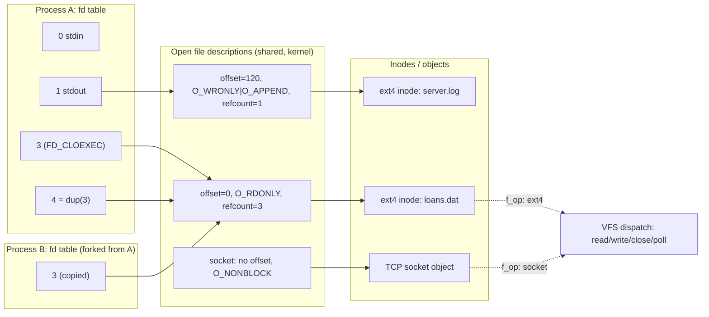

# Module 3.08: File descriptors and the VFS

**Estimated hours:** 4

**What you will learn**

1. The three-level structure behind every file descriptor: the per-process **fd table**, the shared **open file description**, and the **inode**, and why `dup` and `fork` behave the way they do.
2. The core calls (`open` with its flags, `read`/`write` and their partial results, `close`, `dup2`, `lseek`, `fstat`, `fcntl`) and the loop idiom every server needs.
3. How fd leaks happen and show up (`ulimit -n`, `EMFILE`, `/proc/<pid>/fd`, `lsof`), what `O_CLOEXEC` prevents, and why "everything is a file" is the VFS doing its job.

**Prerequisites:** [Module 3.07: System calls](module-07-system-calls.md).

---

## 1. One-line intuition

A file descriptor is a small integer that is your process's ticket to one open thing (file, pipe, socket, device); the kernel keeps the real object and you only hold the ticket.

## 2. Real-life analogy

Think of a coat check at a theatre.

- You hand over your coat and get a **numbered ticket**: 3, 4, 5. The ticket is the **file descriptor**. It is just a small number; it means nothing outside this theatre (this process).
- Behind the counter the attendant keeps a **hook** for each ticket with a card clipped to it: "coat, checked at 7:40, currently being brushed". That card is the **open file description**: it records the current position in the file and the mode (read or write) you opened it with.
- The hook points at the **coat itself**, hanging on the rail. The coat is the **inode**: the real object with its size, owner and permissions. Many tickets can point at the same coat.
- If you tear your ticket in half and give one half to a friend (`dup`), both halves name the same hook and the same card. If your friend moves the coat to the next hook, you see it moved too, because you share the card.
- If the theatre makes a complete copy of you (`fork`), the copy gets a copy of your **tickets**, pointing at the **same hooks and cards**. That is why a child process shares the parent's file position.
- Lose a ticket without handing the coat back (**an fd leak**), and that hook is occupied forever. The theatre has a fixed number of hooks (`ulimit -n`). Lose enough tickets and the attendant says "no more hooks" (`EMFILE`), and nobody can check anything in, including new customers (new connections).

## 3. Why it exists: the problem it solves

A process needs to refer to things it has opened: this file, that network connection, this pipe to a child. It cannot hold a kernel pointer, because user mode may not see kernel memory (module 3.07). So the kernel hands out small integers as handles, keeps the real objects itself, and validates every integer on every call. That gives three things:

1. **Safety.** The kernel checks that fd 7 is really yours and really open before touching anything.
2. **Uniformity.** The same `read`/`write`/`close` work on a disk file, a terminal, a pipe, a socket, a device, a timer, an event. Code that reads lines does not care which it has. This is the "everything is a file" principle and it is what lets tcpkv treat a TCP connection as "something I read lines from".
3. **Sharing with clear rules.** `fork`, `dup` and passing fds between processes all follow from the three-level structure in Layer 2.

What breaks without it: servers that run for months leak descriptors one at a time until they hit `EMFILE` and refuse new connections, child processes inherit secrets through open files, and redirection (`ls > out.txt`) would be impossible without the dup trick. All three are exactly what this module teaches you to prevent and to build.

## 4. Three layers of depth

### Layer 1 (beginner): the calls you use

Every process starts with three descriptors: 0 standard input, 1 standard output, 2 standard error. The next `open` returns the lowest free number, usually 3.

| Call | What it does |
|---|---|
| `int fd = open(path, flags, mode)` | Open or create a file; returns an fd or -1 with `errno` |
| `ssize_t n = read(fd, buf, count)` | Read up to `count` bytes; returns bytes read, 0 at end of file, -1 on error |
| `ssize_t n = write(fd, buf, count)` | Write up to `count` bytes; returns bytes written, -1 on error |
| `close(fd)` | Release the descriptor; returns 0 or -1 |
| `lseek(fd, offset, whence)` | Move the file position (`SEEK_SET`, `SEEK_CUR`, `SEEK_END`) |
| `fstat(fd, &st)` | Fill a `struct stat` with size, mode, inode number, timestamps |
| `dup(fd)` / `dup2(old, new)` | Make another fd that refers to the same open file |
| `fcntl(fd, cmd, ...)` | Read or change descriptor and file-status flags |

**`open` flags you must know.** Flags are bits combined with `|`:

- Access mode, exactly one: `O_RDONLY`, `O_WRONLY`, `O_RDWR`.
- `O_CREAT`: create if missing (then the `mode` argument, like `0644`, sets permissions).
- `O_TRUNC`: empty the file on open. `O_APPEND`: every write goes to the end.
- `O_EXCL` with `O_CREAT`: fail if the file already exists (atomic "create new").
- `O_NONBLOCK`: do not block in `read`/`write`; return `EAGAIN` instead. Essential for `epoll` servers (module 3.11).
- `O_CLOEXEC`: close this fd automatically when the process `exec`s a new program. Explained in Layer 2; use it on every fd a server opens.

The classic "write a new file" combination is `open(path, O_WRONLY | O_CREAT | O_TRUNC, 0644)`.

**Partial results.** `read` may return fewer bytes than you asked for, even when more are coming (a pipe or socket delivers what has arrived so far). `write` may write fewer bytes than you gave it (a socket buffer is nearly full). Correct code always loops until it has the full count or hits end of file or error. The loop is in section 6.

**`EINTR` on `close`.** On Linux, if `close` returns -1 with `errno == EINTR`, the descriptor **is still closed**; do not retry, because the number may already have been reused by another thread. Check the return of `close` for `EIO` (a deferred write error) and log it; that is the "explicit close error check" tcpkv's wrapper needs.

### Layer 2 (working engineer): the three-level structure and what follows from it

The kernel keeps three separate things:

1. **The fd table** (per process): an array indexed by the small integer. Slot `n` holds a pointer to an open file description plus one per-descriptor flag, `FD_CLOEXEC`.
2. **The open file description** (system-wide, shared): created by each `open`. Holds the current **file offset**, the **status flags** (`O_APPEND`, `O_NONBLOCK`, access mode), and a pointer to the inode. In the kernel this is `struct file`.
3. **The inode** (one per file on a file system): size, permissions, owner, timestamps, and where the data blocks are. In the kernel this is `struct inode`.

Everything surprising about descriptors follows from which level is shared:

| Operation | What is shared | Consequence |
|---|---|---|
| `open` the same path twice | Only the inode | Two independent offsets; writes interleave by position |
| `dup(fd)` or `dup2` | The open file description | Same offset and flags; reading through one advances the other |
| `fork` | The child's fd table is a **copy**, pointing at the **same** descriptions | Parent and child share the offset; both must `close` for the description to go away |
| `fcntl(F_SETFL, O_NONBLOCK)` | Sets a flag on the open file description | Also affects every dup and every forked copy |
| `fcntl(F_SETFD, FD_CLOEXEC)` | Sets a flag on the fd table entry only | Does not affect dups; each fd decides its own exec fate |

**Redirection is `dup2`.** When the shell runs `ls > out.txt`, it (in the child, before `exec`) opens `out.txt` and calls `dup2(file_fd, 1)`: now fd 1 refers to the file's open file description, and `ls` writes to "standard output" without knowing anything changed. You implement this in the lab.

**`O_CLOEXEC` and the fork-exec leak.** By default every fd survives `exec`. A server that opens a database connection, then `fork`s and `exec`s a helper tool, hands that helper a copy of the database socket. The helper never closes it, so the connection stays open (and if it is the listening socket, the port stays bound after the server exits, and a restart fails with `EADDRINUSE`). Worse, there is a race: between `open` and a later `fcntl(F_SETFD, FD_CLOEXEC)`, another thread may `fork`. Passing `O_CLOEXEC` to `open` (and `SOCK_CLOEXEC` to `socket`, `accept4` with `SOCK_CLOEXEC`) sets the flag atomically at creation. Rule: every fd a server creates gets `O_CLOEXEC` unless you specifically want a child to inherit it.

**Limits and leaks.** Each process may hold a bounded number of fds: `ulimit -n` shows the soft limit (commonly 1024, often raised to 65536 for servers; Ubuntu 24.04 in WSL2 typically shows 1024 soft / a much larger hard limit). When the table is full, `open`/`accept`/`socket` fail with `EMFILE` ("Too many open files"). A leak is an fd you opened and never closed. Over hours a server leaks to the limit and then refuses every new connection. To see what a process holds:

```bash
ls -l /proc/<pid>/fd        # each entry is an fd, linked to what it refers to
lsof -p <pid>               # same, with more detail
ls /proc/<pid>/fd | wc -l   # count them; watch it grow in a leaking server
```

**Pipes and sockets are fds too.** `pipe(fds)` gives two descriptors (read end, write end). `socket()` and `accept()` return descriptors. The same `read`/`write`/`close`/`dup2`/`fcntl` apply. The only difference is which kernel code sits behind the inode pointer, which is Layer 3.

### Layer 3 (internals): the VFS and what "everything is a file" really means

**The VFS.** Linux has one layer, the **Virtual File System** (VFS), that owns the fd table, `struct file` and `struct inode` and dispatches every call to the right implementation. Each kind of file has a table of function pointers (`struct file_operations`) with entries like `.read`, `.write`, `.open`, `.llseek`, `.poll`. When you call `read(fd, ...)`:

1. The syscall entry (module 3.07) lands in `ksys_read`.
2. The VFS looks up `fd` in the current process's table (`files_struct` -> `fdtable`), gets the `struct file`, and takes a reference.
3. It checks the access mode (was it opened for reading?) and that `buf` is user memory you may write to.
4. It calls `file->f_op->read` (or `read_iter`). For a file on ext4 that goes to the ext4 code, which consults the page cache (module 3.04) and the inode's block map. For a socket it goes to the networking stack and copies from the receive queue. For `/proc/<pid>/status` it goes to procfs, which **generates the text on the fly** from kernel structures; there is no disk at all.
5. It advances the file offset in `struct file` (for seekable files), releases the reference, and returns the count.

So "everything is a file" means: one table, one set of calls, and a function-pointer table per file type. The same `read` becomes "fetch a disk block", "pop bytes off a TCP queue", or "format a kernel struct as text" depending on `f_op`. This is also why fds can be waited on uniformly with `poll`/`epoll` (module 3.11): every type implements `.poll`.

**Reference counting.** A `struct file` has a count of how many fd-table slots (across all processes) point at it. `close` decrements it; only when it reaches zero does the kernel really release the file (flush, release the inode reference, free the socket). This is the mechanism behind "both parent and child must close". The inode is reference counted in turn, which is why you can `unlink` (delete) a file that is still open: the name disappears, but the data lives until the last `close`. Databases use this for temporary files that vanish automatically on crash.

**Windows handles.** Windows uses **handles** (`HANDLE`, an opaque pointer-sized value) from `CreateFile`, `CreateEvent`, `socket`, etc., stored in a per-process **handle table** managed by the Object Manager. `CloseHandle` is the universal close. There is no "lowest free number" rule and handle values are not small sequential integers, so `dup2`-style redirection uses `SetStdHandle` and `DuplicateHandle` instead. Inheritance into child processes is controlled per handle with the `bInheritHandle` flag at creation (the equivalent of *not* setting `O_CLOEXEC`). A handle leak shows in Task Manager's **Handles** column, which you looked at in module 0.02, and `!handle` in WinDbg.

| Linux | Windows | Note |
|---|---|---|
| `open` / `close` | `CreateFile` / `CloseHandle` | `CloseHandle` closes any object type |
| `read` / `write` | `ReadFile` / `WriteFile` | Also partial results possible |
| `dup2(fd, 1)` | `DuplicateHandle` + `SetStdHandle` | Redirection |
| `O_CLOEXEC` (default: inherit) | `bInheritHandle = FALSE` (default: do not inherit) | Opposite defaults |
| `ulimit -n`, `EMFILE` | Per-process handle limit (about 16 million), rarely hit | Leaks still exhaust memory |
| `ls -l /proc/<pid>/fd`, `lsof` | Process Explorer, `handle.exe` | Inspect open objects |

## 5. Architecture diagram



Left to right: fd table (per process) points to open file description (shared offset and flags) points to inode (the thing itself). `dup` and `fork` share the middle box; opening the same path twice does not.

## 6. Code

This program implements the shell's `>` redirection with `dup2`, shows the robust read/write loops, demonstrates `O_CLOEXEC`, and inspects itself through `/proc/self/fd`. It is C because this is OS-level work.

```c
/* fd_demo.c
 * dup2 redirection, full read/write loops, O_CLOEXEC, and /proc/self/fd.
 * Build: gcc -std=gnu17 -Wall -Wextra -Werror -g -o fd_demo fd_demo.c
 */
#define _GNU_SOURCE
#include <stdio.h>
#include <stdlib.h>
#include <string.h>
#include <errno.h>
#include <fcntl.h>      /* open, O_* flags, fcntl */
#include <unistd.h>     /* read, write, close, dup2, lseek, fork, execlp */
#include <sys/stat.h>   /* fstat */
#include <sys/wait.h>   /* waitpid */

/* Write ALL of buf, looping on partial writes. Returns 0 or -1. */
static int write_all(int fd, const void *buf, size_t len) {
    const char *p = buf;
    while (len > 0) {
        ssize_t n = write(fd, p, len);
        if (n < 0) {
            if (errno == EINTR) continue;   /* interrupted by a signal: retry */
            return -1;
        }
        p += n; len -= (size_t)n;           /* partial write: keep going */
    }
    return 0;
}

/* Read up to len bytes, looping until len, EOF or error. Returns bytes read. */
static ssize_t read_full(int fd, void *buf, size_t len) {
    char *p = buf; size_t got = 0;
    while (got < len) {
        ssize_t n = read(fd, p + got, len - got);
        if (n < 0) { if (errno == EINTR) continue; return -1; }
        if (n == 0) break;                  /* end of file */
        got += (size_t)n;
    }
    return (ssize_t)got;
}

/* close() with the error check tcpkv's RAII wrapper needs. */
static void close_checked(int fd, const char *what) {
    if (close(fd) < 0 && errno != EINTR)    /* on EINTR the fd is already closed */
        fprintf(stderr, "close(%s) failed: %s\n", what, strerror(errno));
}

static void list_my_fds(const char *when) {
    printf("--- open fds %s ---\n", when);
    fflush(stdout);
    char cmd[64];
    snprintf(cmd, sizeof cmd, "ls -l /proc/%d/fd", (int)getpid());
    (void)system(cmd);     /* shows each fd and what it points to */
}

int main(void) {
    list_my_fds("at start");

    /* 1. Open with O_CLOEXEC: this fd will NOT leak into exec'd children. */
    int log_fd = open("fd_demo.log", O_WRONLY | O_CREAT | O_TRUNC | O_CLOEXEC, 0644);
    if (log_fd < 0) { perror("open log"); return 1; }
    printf("log_fd = %d (lowest free number)\n", log_fd);

    /* 2. Redirection, exactly as the shell does `cmd > file`: in a child,
     *    dup2 the file onto fd 1, then exec. The child's printf goes to the file. */
    pid_t pid = fork();
    if (pid == 0) {
        int out = open("redirected.txt", O_WRONLY | O_CREAT | O_TRUNC, 0644);
        if (out < 0) { perror("open redirected"); _exit(1); }
        if (dup2(out, STDOUT_FILENO) < 0) { perror("dup2"); _exit(1); }
        close(out);                         /* fd 1 still refers to the file */
        /* log_fd (O_CLOEXEC) is closed by exec; fd 1 (no CLOEXEC) survives. */
        execlp("echo", "echo", "written by echo via dup2", (char *)NULL);
        perror("execlp"); _exit(1);
    }
    waitpid(pid, NULL, 0);

    /* 3. Read it back with the full-read loop. */
    int in = open("redirected.txt", O_RDONLY | O_CLOEXEC);
    if (in < 0) { perror("open redirected for read"); return 1; }
    char buf[128];
    ssize_t got = read_full(in, buf, sizeof buf - 1);
    buf[got > 0 ? got : 0] = '\0';
    printf("redirected.txt contains: %s", buf);

    /* 4. fstat and lseek: size and position. */
    struct stat st;
    if (fstat(in, &st) == 0)
        printf("fstat: size=%lld bytes, inode=%llu\n", (long long)st.st_size,
               (unsigned long long)st.st_ino);
    off_t pos = lseek(in, 0, SEEK_CUR);
    printf("file position after reading = %lld\n", (long long)pos);
    close_checked(in, "in");

    /* 5. dup shares the offset; a second open does not. */
    int a = open("redirected.txt", O_RDONLY | O_CLOEXEC);
    int b = dup(a);                         /* same open file description */
    int c = open("redirected.txt", O_RDONLY | O_CLOEXEC);  /* new description */
    char one[8] = {0};
    (void)read_full(a, one, 7);             /* advance a (and therefore b) by 7 */
    printf("after reading 7 via a: pos(a)=%lld pos(b)=%lld pos(c)=%lld\n",
           (long long)lseek(a, 0, SEEK_CUR), (long long)lseek(b, 0, SEEK_CUR),
           (long long)lseek(c, 0, SEEK_CUR));

    /* 6. fcntl: inspect the flags of each level. */
    int fdflags = fcntl(log_fd, F_GETFD);   /* fd-table level: FD_CLOEXEC */
    int flflags = fcntl(log_fd, F_GETFL);   /* description level: O_WRONLY etc. */
    printf("log_fd: FD_CLOEXEC=%d  access mode=%s\n",
           (fdflags & FD_CLOEXEC) ? 1 : 0,
           (flflags & O_ACCMODE) == O_WRONLY ? "O_WRONLY" : "other");

    write_all(log_fd, "done\n", 5);
    list_my_fds("before closing");
    close_checked(a, "a"); close_checked(b, "b"); close_checked(c, "c");
    close_checked(log_fd, "log");
    return 0;
}
```

Compile and run:

```bash
gcc -std=gnu17 -Wall -Wextra -Werror -g -o fd_demo fd_demo.c
./fd_demo
```

Expected output (PIDs, inode numbers and the `/dev/pts/N` terminal name vary):

```text
--- open fds at start ---
total 0
lrwx------ 1 shakir shakir 64 Oct 19 10:00 0 -> /dev/pts/1
lrwx------ 1 shakir shakir 64 Oct 19 10:00 1 -> /dev/pts/1
lrwx------ 1 shakir shakir 64 Oct 19 10:00 2 -> /dev/pts/1
log_fd = 3 (lowest free number)
redirected.txt contains: written by echo via dup2
fstat: size=25 bytes, inode=1234567
file position after reading = 25
after reading 7 via a: pos(a)=7 pos(b)=7 pos(c)=0
log_fd: FD_CLOEXEC=1  access mode=O_WRONLY
--- open fds before closing ---
total 0
lrwx------ 1 shakir shakir 64 Oct 19 10:00 0 -> /dev/pts/1
lrwx------ 1 shakir shakir 64 Oct 19 10:00 1 -> /dev/pts/1
lrwx------ 1 shakir shakir 64 Oct 19 10:00 2 -> /dev/pts/1
l-wx------ 1 shakir shakir 64 Oct 19 10:00 3 -> /home/shakir/course/fd_demo.log
lr-x------ 1 shakir shakir 64 Oct 19 10:00 4 -> /home/shakir/course/redirected.txt
lr-x------ 1 shakir shakir 64 Oct 19 10:00 5 -> /home/shakir/course/redirected.txt
lr-x------ 1 shakir shakir 64 Oct 19 10:00 6 -> /home/shakir/course/redirected.txt
```

Read it with the three-level model. The child's `echo` wrote to the file because `dup2` pointed fd 1 at the file's open file description before `exec`. `pos(a)` and `pos(b)` are both 7 because `dup` shares the description; `pos(c)` is 0 because a second `open` made a new one. The `ls -l /proc/<pid>/fd` output shows `3` opened write-only (`l-wx`) and `4`, `5`, `6` read-only (`lr-x`); note that the extra `ls` process itself may briefly appear as an fd 7 on some systems. (The `ls` run inside `system()` lists the parent's fds via `/proc/<pid>/`, which is why it works.)

## 7. Use case: core-banking loan-origination platform

The application server (resume claim H4) ran for weeks between deployments, serving several hundred branch terminals. After an upgrade it began refusing new logins after roughly a day, with the log line `accept: Too many open files`. Existing sessions kept working; only new ones failed. Memory and CPU were normal.

`ls /proc/<pid>/fd | wc -l` on the live process showed the count climbing steadily toward 1024, and `ls -l /proc/<pid>/fd` showed hundreds of entries pointing at the **same** audit-log file. The new code opened the audit log per request and closed it only on the success path; any request that failed validation returned early and leaked the descriptor. One leak per failed login, a few hundred failed logins an hour, and the table filled in about a day. The server then hit `EMFILE` in `accept`, exactly the mechanism in Layer 2.

**The decision this drove:** two rules, both now in tcpkv and capstone C2. First, **every descriptor is owned by an RAII wrapper** (the `FileDescriptor` class from module 2.03), so the close happens in the destructor on every path, including early returns and exceptions; there is no "success path only". Second, that wrapper's constructor passes `O_CLOEXEC` (and `accept4` with `SOCK_CLOEXEC` for sockets) so a forked helper never inherits the listening socket or the database connection, and its `close()` method **checks the return value** and logs `EIO`, instead of ignoring it. The incident's RCA (capstone C6 format) named the leak, the `EMFILE` symptom, the one-day time-to-failure arithmetic, and the fix; the fd count graph before and after is the evidence an interviewer wants to hear.

## 8. Lab

You have Ubuntu 24.04 in WSL2 with gcc, strace and `lsof` (install with `sudo apt-get install lsof` if missing). Record numbers for your journal.

### Part A: run the demo and read the three levels (25 minutes)

1. Build and run `fd_demo.c` from section 6. Confirm `pos(a)=pos(b)=7` and `pos(c)=0`.
2. Run `strace -e trace=openat,dup2,close,read,write,execve ./fd_demo 2>&1 | head -60`. Find the `dup2(3, 1)` (or similar) in the child and the `execve("/usr/bin/echo", ...)` right after it. Note that `openat` is what `open` becomes at the syscall level.
3. Change the log file's `O_CLOEXEC` to nothing (remove the flag) and rerun under `strace -f -e trace=write`. Nothing visible changes in output, but now `echo`'s process holds a copy of fd 3. Add `ls -l /proc/self/fd` as the exec'd command instead of `echo` (use `execlp("ls", "ls", "-l", "/proc/self/fd", NULL)`) and compare with and without `O_CLOEXEC`: the log fd appears in the child's list without the flag, and is absent with it.

Expected: you can point at the exact line in `strace` where redirection happens and show `O_CLOEXEC` removing an fd from the child.

### Part B: implement `>` as a tiny shell (30 minutes)

Write `redirect.c` that takes arguments like `./redirect out.txt ls -l` and runs the command with stdout redirected to `out.txt`, using `fork`, `open(O_WRONLY|O_CREAT|O_TRUNC, 0644)`, `dup2`, `execvp` and `waitpid`. Then:

```bash
gcc -std=gnu17 -Wall -Wextra -Werror -g -o redirect redirect.c
./redirect out.txt ls -l
cat out.txt
./redirect err.txt ls /no/such/dir
```

Expected: `out.txt` holds the `ls -l` listing. For the second command, the error message still appears on your terminal, because you only redirected fd 1, not fd 2. Extend the program with an option to redirect fd 2 as well (`dup2(fd, 2)`), the shell's `2>`.

### Part C: leak until EMFILE (20 minutes)

Write `leak.c` that opens `/dev/null` in a loop with `open(O_RDONLY)`, never closing, printing the fd number every 100 opens, until `open` returns -1. Print `errno` and `strerror(errno)`.

```bash
ulimit -n                       # note the soft limit, typically 1024
gcc -std=gnu17 -Wall -Wextra -Werror -g -o leak leak.c
./leak
```

Expected: fds climb to the limit (last successful fd is `limit - 1`, e.g. 1023), then `open` fails with `errno=24 (Too many open files)`, which is `EMFILE`. While it is running in a second terminal (add a `sleep(30)` before exit), run `ls /proc/$(pgrep leak)/fd | wc -l` and `lsof -p $(pgrep leak) | tail -5` to see the leak from outside, exactly as you would on a production server. Then run `ulimit -n 4096 && ./leak` in a fresh shell and see the limit move.

### Part D: fstat, lseek and the deleted-but-open file (15 minutes)

1. Write a small program that opens a file, `unlink`s it (deletes the name), then still writes to it and reads it back via `lseek(fd, 0, SEEK_SET)`. Check with `ls` that the name is gone while the program runs, and with `ls -l /proc/<pid>/fd` that the entry shows `(deleted)`.
2. Call `fstat` and print `st_nlink` (link count, now 0) and `st_size`.

Expected: the data is readable until `close`, after which it vanishes. This is Layer 3's reference counting made visible and is how databases make crash-safe temporary files.

### Journal

Copy [TEMPLATE.md](../journal/TEMPLATE.md) to `journal/YYYY-MM-DD-file-descriptors-vfs.md`. Record: the `pos(a)/pos(b)/pos(c)` line and your one-sentence explanation of it; the `strace` line showing `dup2`; what `ls -l /proc/<pid>/fd` showed with and without `O_CLOEXEC`; the fd limit and the `EMFILE` errno from Part C and what `lsof` showed; and the `(deleted)` entry from Part D. End with the two rules from section 7 that tcpkv's `FileDescriptor` wrapper now enforces.

## 9. Common mistakes and misconceptions

| Mistake | Why it is wrong | Bug it causes later |
|---|---|---|
| Assuming `read` returns the full count you asked for | Pipes and sockets return what has arrived; files can be short at EOF | Truncated messages; parsers that work in tests and fail under load |
| Assuming `write` writes everything | Sockets accept partial writes when buffers are nearly full | Silently dropped bytes in a server reply |
| Closing only on the success path | Early returns and exceptions skip the close | fd leak, `EMFILE` after hours or days |
| Retrying `close` on `EINTR` | On Linux the fd is already released; the number may be reused | Closing another thread's brand-new fd |
| Ignoring the return value of `close` | Deferred write errors (`EIO`) surface only there | Lost data with no log line |
| Forgetting `O_CLOEXEC` | Every fd is inherited across `exec` by default | Child holds the listening socket; port stays bound; `EADDRINUSE` on restart |
| "Two `open`s of the same file share the position" | Only `dup` and `fork` share the open file description | Interleaved or overwritten output |
| "A deleted file's data is gone" | The inode lives until the last `close` | Disk space not freed; or relying on data that is in fact still there |
| Treating sockets as different from files | Same fd table, same `read`/`write`/`close`/`poll` via the VFS | Duplicated code paths; missed reuse of `epoll` |

## 10. Resume link

- **Claim I (tcpkv), "RAII socket/fd wrappers, move-only connection handles".** Say: "Every fd lives in a move-only RAII wrapper. The constructor opens with `O_CLOEXEC` or `SOCK_CLOEXEC`, the destructor calls `close` on every exit path and checks the return value, treating `EINTR` as closed and logging `EIO`. That is what makes the server leak-free under the load generator, which I verify by watching `/proc/<pid>/fd` stay flat." The Part C numbers back this up.
- **Claim H4, "multithreaded application server".** The section 7 incident is the story: `accept: Too many open files`, `ls /proc/<pid>/fd` showing hundreds of entries for one log file, one leak per failed request, time-to-failure arithmetic, RAII fix. Tie it to claim H5 (RCA writing) as the incident you can describe end to end.
- **Claim G, "Linux ... Windows".** You can give the handle-table equivalents: `CloseHandle`, `DuplicateHandle`/`SetStdHandle`, `bInheritHandle` versus `O_CLOEXEC` with opposite defaults, and Task Manager's Handles column.

Likely follow-up: "What is the difference between `dup` and opening the file again?" Answer: `dup` shares the open file description (offset and status flags); a second `open` creates a new one with its own offset. Both point at the same inode.

## 11. Interview questions

**Q1 (easy). What is a file descriptor?**

<details>
<summary>Model answer</summary>

A small non-negative integer the kernel returns from `open`, `socket`, `pipe`, `accept` and similar calls. It indexes the process's fd table, which points at a kernel open file description (holding the current offset and status flags), which in turn points at the inode or object. The process never sees kernel memory; it only holds the integer, and the kernel validates it on every call. Descriptors 0, 1 and 2 are standard input, output and error, and new ones take the lowest free number. The same `read`, `write` and `close` work on any descriptor regardless of what it refers to.

</details>

**Q2 (easy). Why must you loop around `read` and `write`?**

<details>
<summary>Model answer</summary>

Because both may return fewer bytes than requested without error. `read` on a pipe or socket returns whatever has arrived so far, and returns 0 only at end of file; `write` to a socket may accept only part of the buffer when the kernel send buffer is nearly full. Correct code keeps calling until the full count is transferred, EOF is reached, or an error occurs, retrying on `EINTR`. Code that assumes a single call does the whole job passes tests on small inputs and fails under real load.

</details>

**Q3 (medium). Explain the difference between the fd table, the open file description and the inode, and use it to explain `dup` and `fork`.**

<details>
<summary>Model answer</summary>

The fd table is per process: an array of small integers each pointing at an open file description plus the per-fd `FD_CLOEXEC` flag. The open file description is a kernel object created by each `open`, holding the current file offset, the status flags such as `O_APPEND` and `O_NONBLOCK`, and a pointer to the inode. The inode is the file itself: size, permissions, block map. `dup` makes a second fd-table entry pointing at the same open file description, so both share the offset: reading through one advances the other. `fork` copies the entire fd table into the child, with every entry pointing at the same descriptions, so parent and child share offsets, and the description is freed only when all referring fds in all processes are closed. Opening the same path twice, by contrast, creates two independent descriptions with separate offsets pointing at the same inode.

</details>

**Q4 (medium). What is `O_CLOEXEC` and what goes wrong without it?**

<details>
<summary>Model answer</summary>

`O_CLOEXEC` sets the close-on-exec flag on a new descriptor at creation, so the fd is automatically closed when the process calls `exec`. Without it, every descriptor is inherited by any program the process execs. A server that forks and execs a helper then leaks its listening socket, database connections and log files into that helper; the helper keeps the port bound so a restart fails with `EADDRINUSE`, and it may hold open connections or secrets. Setting the flag later with `fcntl(F_SETFD, FD_CLOEXEC)` leaves a race window in multithreaded code where another thread can fork between the open and the fcntl, which is why the flag must be passed to `open`, `socket(SOCK_CLOEXEC)`, `accept4` and `pipe2` directly. The rule for servers is: every fd gets it unless a child is specifically meant to inherit.

</details>

**Q5 (hard). A long-running server starts failing new connections with "Too many open files" after about a day. Walk through how you diagnose it, what the root cause probably is, and how you fix it so it cannot recur.**

<details>
<summary>Model answer</summary>

The error is `EMFILE` from `accept` or `socket`: the per-process fd table has hit the soft limit shown by `ulimit -n`, commonly 1024. First confirm on the live process: `ls /proc/<pid>/fd | wc -l` to see the count against the limit, then `ls -l /proc/<pid>/fd` or `lsof -p <pid>` to see what the entries point at. A leak shows as hundreds of entries referring to the same file, socket state, or pipe. The time-to-failure gives the leak rate: 1024 fds in 24 hours is roughly one leak every 85 seconds, which usually matches some error path or an occasional request type. The root cause is almost always an fd closed only on the success path, so an early return, an exception, or an error branch skips the close; or a forked helper inheriting fds because `O_CLOEXEC` was not set. The fix is structural, not a patch: own every fd in an RAII wrapper whose destructor closes on every path, open with `O_CLOEXEC`/`SOCK_CLOEXEC` so children cannot inherit, check `close`'s return value for `EIO`, and add a test under a load generator that asserts the fd count stays flat. Raising `ulimit -n` only delays the failure and is not a fix. The incident write-up records the symptom, the `/proc/<pid>/fd` evidence, the leak arithmetic, the exact leaking path, and the before/after fd-count graph.

</details>

## 12. Revision

- A file descriptor is a per-process small integer indexing the fd table; each entry points to a shared open file description (offset, status flags) which points to an inode; `dup` and `fork` share the description, a second `open` does not.
- Always loop `read`/`write` for partial results, retry on `EINTR` except for `close` (already closed), check `close`'s return, and open every server fd with `O_CLOEXEC` so children cannot inherit it; `dup2` onto fd 1 is how the shell implements `>`.
- The VFS dispatches the same calls to ext4, procfs, pipes and sockets through per-type function tables ("everything is a file"); fd leaks show in `/proc/<pid>/fd` and `lsof` and end in `EMFILE` at `ulimit -n`; Windows uses handles and `CloseHandle` with opposite inheritance defaults.

---

Previous: [Module 3.07: System calls](module-07-system-calls.md) | Next: [Module 3.09: Signals](module-09-signals.md)
