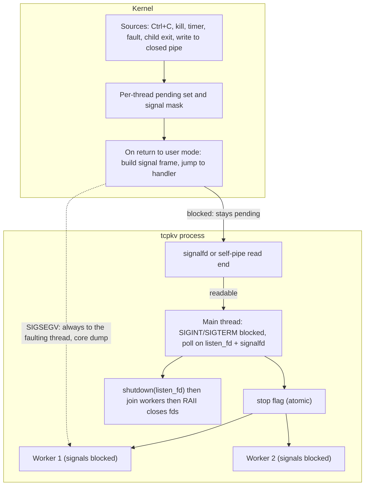

# Module 3.09: Signals

**Estimated hours:** 3

**What you will learn**

1. What a signal is (an asynchronous notification delivered by the kernel), the default action of each common signal, and how to install a handler with `sigaction`.
2. Why a handler may only call async-signal-safe functions, and the two safe patterns: set a `volatile sig_atomic_t` flag, or write a byte to a pipe (the self-pipe trick) or use `signalfd`.
3. How to design graceful shutdown for a multithreaded server: block signals in workers, handle them in one place, wake the accept loop, drain, and let destructors close every fd.

**Prerequisites:** [Module 3.08: File descriptors and the VFS](module-08-file-descriptors-and-vfs.md).

---

## 1. One-line intuition

A signal is the kernel tapping your process on the shoulder at an unpredictable moment; your program must either accept the default consequence or have a tiny, careful handler ready that does almost nothing except leave a note for the main code.

## 2. Real-life analogy

You are a bank clerk (a process) working through a queue of customers (your main loop).

- A **signal** is a note passed to you from the branch manager (the kernel) in the middle of serving someone. "Fire drill, leave now" (`SIGTERM`). "Customer pressed the alarm" (`SIGINT`, Ctrl+C). "You just tried to open a vault you have no key for" (`SIGSEGV`, a bad memory access). "The customer you were posting a letter to has walked out" (`SIGPIPE`). "Your assistant has finished" (`SIGCHLD`).
- Each note has a **default action** if you ignore it: for most, "pack up and leave" (the process ends). For `SIGSEGV`, "leave and have your desk photographed for the investigation" (a core dump).
- You may install a **handler**: instructions for what to do when a given note arrives. But here is the catch: the note can arrive **at any instruction**, including halfway through writing a ledger entry (halfway through `malloc` or `printf`). If your handler tries to write the same ledger, you corrupt it. So the only safe handler is one that **writes a tick on a sticky note** ("stop after this customer") and goes back. The main loop checks the sticky note between customers. That is the `volatile sig_atomic_t` flag.
- In a busy branch with ten clerks (threads), you do not want every clerk interrupted. You tell nine of them "ignore notes" (`pthread_sigmask` blocks the signal) and one clerk watches the inbox (a dedicated thread, or the main loop with a self-pipe or `signalfd`).
- **Graceful shutdown** is the fire-drill procedure: stop admitting new customers (close the door, i.e. wake the accept loop and stop it), let each clerk finish the customer in front of them (drain), lock every drawer (destructors close fds), and leave. Not "everyone drop everything and run", which leaves ledgers half-written.

## 3. Why it exists: the problem it solves

A process needs to be told about events it did not ask for and cannot poll for cheaply:

- The user pressed Ctrl+C. The service manager wants the server to stop. A child process exited. A timer expired.
- The CPU hit a fault in this process (bad address, division by zero, illegal instruction). The kernel must tell the process *now*, at the exact instruction, because execution cannot continue.
- A write went to a pipe or socket whose reader has gone away.

Signals are the Unix mechanism for all of these: a small integer per event, delivered **asynchronously**, meaning between any two instructions of your code, with a default action the kernel takes if you do nothing.

What breaks without understanding them: a server killed by `SIGTERM` mid-write leaves a corrupt file or a half-committed batch; a server with `SIGPIPE` unhandled dies the moment one client disconnects at the wrong instant; a handler that calls `printf` or `malloc` deadlocks or corrupts the heap once in ten thousand runs, the kind of bug that produces the production crash dumps of capstone C6; and a server with no shutdown plan cannot be upgraded without dropping requests. "Graceful shutdown on signals" is a line on your resume for tcpkv; this module is its foundation.

## 4. Three layers of depth

### Layer 1 (beginner): the common signals and their defaults

| Signal | Number | Sent when | Default action |
|---|---|---|---|
| `SIGINT` | 2 | You press Ctrl+C in the terminal | Terminate |
| `SIGTERM` | 15 | `kill <pid>`, `systemctl stop`, Docker stop; the polite "please exit" | Terminate |
| `SIGKILL` | 9 | `kill -9`; the OOM killer | Terminate, **cannot be caught, blocked or ignored** |
| `SIGSEGV` | 11 | Invalid memory access (module 0.01's fault) | Terminate + core dump |
| `SIGABRT` | 6 | `abort()`, failed `assert`, glibc heap checks (module 3.05) | Terminate + core dump |
| `SIGPIPE` | 13 | `write` to a pipe or socket with no reader | Terminate |
| `SIGCHLD` | 17 | A child process stopped or exited | Ignore |
| `SIGHUP` | 1 | Terminal hangup; by convention "reload config" for daemons | Terminate |
| `SIGALRM` | 14 | A timer set with `alarm`/`setitimer` expired | Terminate |
| `SIGUSR1`, `SIGUSR2` | 10, 12 | Never by the kernel; reserved for your own use | Terminate |

Three kinds of signals to keep apart:

1. **Asynchronous, from outside**: `SIGINT`, `SIGTERM`, `SIGHUP`, `SIGCHLD`, `SIGUSR1`. They arrive at any instruction. Your handler must be tiny and safe.
2. **Synchronous, caused by the faulting instruction**: `SIGSEGV`, `SIGBUS`, `SIGFPE`, `SIGILL`. The kernel delivers them *at* the bad instruction. The usual right answer is **not** to handle them but to let the process die with a core dump you can analyse (Layer 3). Catching `SIGSEGV` to "keep going" hides corruption.
3. **Uncatchable**: `SIGKILL` and `SIGSTOP`. No handler, no blocking. This is why a graceful shutdown must be designed around `SIGTERM`, and why Docker and systemd send `SIGTERM` first and `SIGKILL` only after a timeout.

**Installing a handler.** Always use `sigaction`, never the older `signal()`, whose behaviour differs between systems (whether the handler resets after one delivery, whether syscalls restart). With `sigaction` you set the handler function, a mask of signals to block while it runs, and flags such as `SA_RESTART` (automatically restart interrupted slow syscalls like `read`) or its absence (so `read` returns `-1`/`EINTR`, which is sometimes what you want to break out of a blocking call).

### Layer 2 (working engineer): async-signal-safety, the flag, the self-pipe, signalfd, and threads

**The rule.** A signal handler runs in the middle of whatever your program was doing. If the main code was inside `malloc` holding the heap lock and the handler calls `malloc` too, the handler waits for a lock the interrupted code can never release: deadlock. If the main code was inside `printf` updating the `stdout` buffer and the handler calls `printf`, the buffer is corrupted. So POSIX defines a list of **async-signal-safe** functions that are safe to call from a handler: `write`, `read`, `close`, `_exit`, `kill`, `sigaction`, `signal`, and a few dozen others. **Not** on the list: `printf`, `malloc`, `free`, `fprintf`, `exit` (it runs atexit handlers and flushes stdio), most of the C library, and anything that takes a lock. The list is `man 7 signal-safety`; read it in the lab.

**Pattern 1: the flag.** The handler does one thing: set a global `volatile sig_atomic_t stop = 1;`. `sig_atomic_t` is an integer type the C standard guarantees can be read and written in one uninterruptible step; `volatile` tells the compiler the value can change behind its back so it must re-read it every time. The main loop checks `if (stop) break;` between units of work. Simple, correct, and the right default for single-threaded programs. Its limit: if the main loop is blocked in `accept` or `read`, it does not see the flag until that call returns. Without `SA_RESTART`, the signal makes the call return `EINTR`, so the loop wakes up; but this is fragile with multiple threads because the signal may interrupt a different thread.

**Pattern 2: the self-pipe trick.** Create a pipe at startup. The handler does `write(pipe_wr, "x", 1)`, which is async-signal-safe. The main loop uses `poll` or `epoll` to wait on the listening socket **and** the pipe's read end. When a signal arrives, the pipe becomes readable, `poll` returns, and the main loop reads the byte and begins shutdown. Now the signal is just another readable fd, integrated into the same event loop as the sockets (module 3.11). Mark the pipe `O_NONBLOCK` so the handler never blocks if the pipe fills.

**Pattern 3: `signalfd` (Linux only).** Linux goes one step further: block the signals with `sigprocmask`/`pthread_sigmask`, then call `signalfd(-1, &mask, SFD_NONBLOCK | SFD_CLOEXEC)` to get an fd that becomes readable when one of those signals is pending. Reading it gives a `struct signalfd_siginfo`. No handler at all, no async-signal-safety worries, just another fd in `poll`/`epoll`. This is the cleanest design for a Linux server; the self-pipe trick is the portable one.

**Threads and signals.** In a multithreaded process a signal sent to the process is delivered to **one** thread that has it unblocked, chosen by the kernel. If every thread can receive it, your handler runs on an unpredictable worker. The standard design: in `main`, before creating any threads, block `SIGINT` and `SIGTERM` with `pthread_sigmask(SIG_BLOCK, ...)`. New threads inherit the mask, so workers never see them. Then either (a) the main thread uses `signalfd` on the blocked set, or (b) one dedicated thread calls `sigwait` and sets the stop state. Faulting signals like `SIGSEGV` are always delivered to the thread that faulted; you cannot route those.

**`SIGPIPE` and servers.** When a client disconnects and the server then writes to that socket, the kernel sends the server `SIGPIPE`, whose default action is to terminate the **whole server**. One rude client kills the service. Every network server therefore either ignores it process-wide, `signal(SIGPIPE, SIG_IGN)` (one of the few places plain `signal` is fine), so that `write` returns `-1`/`EPIPE` instead, or passes `MSG_NOSIGNAL` to each `send` call. tcpkv does both: `SIG_IGN` at startup as a safety net, and `MSG_NOSIGNAL` in the socket wrapper.

### Layer 3 (internals): delivery, core dumps, and the shutdown sequence

**How delivery works.** When the kernel decides a process should get a signal, it sets a bit in the target's **pending** set and marks a thread that has the signal unblocked. The handler does not run immediately in the sender's context. It runs when that thread next returns from the kernel to user mode: at the end of a syscall, at the end of an interrupt, or when the scheduler switches it back in. On that return the kernel builds a **signal frame** on the thread's user stack (saved registers, the signal mask, a return trampoline), sets the instruction pointer to your handler, and returns to user mode *inside the handler*. When the handler returns, it lands on the trampoline, which calls `rt_sigreturn`, and the kernel restores the saved registers and resumes the interrupted code exactly where it was. This is why the handler is "in the middle of anything": the interrupted instruction can be any instruction, including one inside `malloc`. You can see `rt_sigreturn` in `strace` after every handled signal, and `--- SIGINT {si_signo=SIGINT, ...} ---` marking delivery.

**Blocked versus pending.** Blocking a signal does not discard it; it stays pending until unblocked. Standard signals do not queue: if `SIGTERM` arrives three times while blocked, you get it once. That is fine for "please stop", and why shutdown logic must be idempotent.

**`SIGSEGV` and core dumps.** When the CPU faults on a bad address, the kernel delivers `SIGSEGV` to the faulting thread. With the default action, the kernel terminates the process and, if allowed, writes a **core dump**: a file containing the process's memory and register state at that instant. Two things control it:

- `ulimit -c` is the maximum core size; `ulimit -c unlimited` enables dumps in the current shell (and its children).
- `/proc/sys/kernel/core_pattern` says where the dump goes and what it is named. The default is `core` in the process's working directory (often with the PID appended if `core_uses_pid` is set). On many Ubuntu desktops it is instead a pipe to `apport`, which swallows the dump; on Ubuntu 24.04 in **WSL2**, `cat /proc/sys/kernel/core_pattern` typically shows plain `core` or `|/usr/share/apport/apport ...` depending on whether apport is installed. To get a plain file, run `echo core | sudo tee /proc/sys/kernel/core_pattern` (or `echo '/tmp/core.%e.%p' | sudo tee ...` to name by executable and PID), then `ulimit -c unlimited`, then run the crashing program. GDB opens it with `gdb ./prog core`. Capstone C6 lives in this file; this module only makes sure you can produce one.

**The graceful shutdown sequence for tcpkv.** This is the design you implement in capstone C1, in C++17 with RAII:

1. **Startup.** `signal(SIGPIPE, SIG_IGN)`. Block `SIGINT` and `SIGTERM` with `pthread_sigmask` **before** spawning the pool, so workers inherit the block. Create a `signalfd` (or self-pipe) for the blocked set.
2. **Accept loop.** The main thread `poll`s on the listening socket and the `signalfd`. New connections are pushed to the pool.
3. **Signal arrives.** `poll` returns with the `signalfd` readable. Main reads it, sets `stop = true` (a `std::atomic<bool>`), and **wakes anything blocked**: it stops calling `accept`, and it calls `shutdown(listen_fd, SHUT_RDWR)` then closes the listening socket, so any other thread blocked in `accept` returns with an error and exits its loop. (If workers block in `read` on client sockets, use a per-connection timeout or `shutdown` those sockets too.)
4. **Drain.** The pool stops taking new work, each worker finishes the request in hand, and `join` waits for all of them. In-flight replies complete; nothing is cut mid-line.
5. **Destructors.** As the pool, the connection handles and the listening socket go out of scope, their RAII destructors (module 3.08) close every fd and check the return. The process exits 0. Under the load generator, the fd count hits zero and ASan/Valgrind report no leaks, which is the "clean shutdown" evidence for the resume.

**Windows.** A console program receives Ctrl+C and close events through `SetConsoleCtrlHandler`, which runs your callback on a **new thread** (not asynchronously inside an existing one), so the async-signal-safety problem does not exist, but you still need to signal your main loop (an event object, module 4.x) and wait for drain. Services get `SERVICE_CONTROL_STOP` through the service control handler. Faults like access violations are **structured exceptions** (SEH, `__try`/`__except`), and a crashing process produces a minidump via Windows Error Reporting or `procdump`, which WinDbg opens; that is the Windows side of capstone C6. There is no `SIGPIPE`: a `send` to a closed socket just returns `SOCKET_ERROR` with `WSAECONNRESET`.

| Linux | Windows | Note |
|---|---|---|
| `SIGINT` / `SIGTERM` handler via `sigaction` | `SetConsoleCtrlHandler` callback (runs on its own thread) | Still set a flag and wake the loop |
| `kill -TERM <pid>` | `TerminateProcess` (no graceful option); service control `STOP` | Design for the service control path |
| `SIGSEGV` + core dump | Access violation structured exception + minidump | Analysed with GDB vs WinDbg |
| `SIGPIPE` on write to closed socket | None; `send` returns `WSAECONNRESET` | Still check every send result |
| `signalfd` / self-pipe | Event object + `WaitForMultipleObjects` | Same idea: shutdown as a waitable thing |

## 5. Architecture diagram



Asynchronous signals are funnelled through one readable fd into the main loop; workers never run a handler. Faults are the exception: they land on whoever faulted.

## 6. Code

This program installs a `sigaction` handler for `SIGINT` and `SIGTERM` that writes a byte to a self-pipe, runs a `poll`-based loop that treats the pipe as "shutdown requested", ignores `SIGPIPE`, and shows the flag pattern as well. It is C because this is OS-level work.

```c
/* signals_demo.c
 * sigaction + self-pipe trick + poll, and a volatile sig_atomic_t flag.
 * Build: gcc -std=gnu17 -Wall -Wextra -Werror -g -o signals_demo signals_demo.c
 * Run:   ./signals_demo      then press Ctrl+C, or `kill -TERM <pid>` from
 *        another terminal.
 */
#define _GNU_SOURCE
#include <stdio.h>
#include <stdlib.h>
#include <string.h>
#include <errno.h>
#include <signal.h>
#include <unistd.h>
#include <fcntl.h>
#include <poll.h>

static int self_pipe[2];                       /* [0] = read end, [1] = write end */
static volatile sig_atomic_t got_signal = 0;   /* the flag pattern, for comparison */

/* The handler: ONLY async-signal-safe calls. write() is on the list in
 * `man 7 signal-safety`; printf and malloc are NOT. */
static void on_signal(int signo) {
    got_signal = signo;                        /* pattern 1: set a flag */
    int saved = errno;                         /* preserve errno for the interrupted code */
    (void)write(self_pipe[1], "x", 1);         /* pattern 2: poke the pipe */
    errno = saved;
}

static int make_nonblocking_cloexec(int fd) {
    int fl = fcntl(fd, F_GETFL); if (fl < 0) return -1;
    if (fcntl(fd, F_SETFL, fl | O_NONBLOCK) < 0) return -1;
    int fd_fl = fcntl(fd, F_GETFD); if (fd_fl < 0) return -1;
    return fcntl(fd, F_SETFD, fd_fl | FD_CLOEXEC);
}

int main(void) {
    /* 1. A server never wants to die because a client hung up mid-write. */
    signal(SIGPIPE, SIG_IGN);

    /* 2. Self-pipe: non-blocking so the handler can never block. */
    if (pipe(self_pipe) < 0) { perror("pipe"); return 1; }
    make_nonblocking_cloexec(self_pipe[0]);
    make_nonblocking_cloexec(self_pipe[1]);

    /* 3. sigaction, not signal(): explicit flags, explicit mask. No SA_RESTART,
     *    so a blocking call returns EINTR when a signal lands; harmless here
     *    because we use poll and the pipe. */
    struct sigaction sa;
    memset(&sa, 0, sizeof sa);
    sa.sa_handler = on_signal;
    sigemptyset(&sa.sa_mask);                  /* block nothing extra during the handler */
    sa.sa_flags = 0;
    if (sigaction(SIGINT,  &sa, NULL) < 0) { perror("sigaction INT");  return 1; }
    if (sigaction(SIGTERM, &sa, NULL) < 0) { perror("sigaction TERM"); return 1; }

    printf("pid %d: working. Press Ctrl+C or run: kill -TERM %d\n",
           (int)getpid(), (int)getpid());

    /* 4. The event loop: wait on the self-pipe (a real server also adds the
     *    listening socket and client sockets here). */
    struct pollfd pfd = { .fd = self_pipe[0], .events = POLLIN, .revents = 0 };
    int ticks = 0;
    for (;;) {
        int r = poll(&pfd, 1, 1000);           /* 1-second timeout = one "tick" of work */
        if (r < 0) {
            if (errno == EINTR) continue;      /* signal interrupted poll: loop and re-check */
            perror("poll"); break;
        }
        if (r == 0) {                          /* timeout: do a unit of work */
            printf("tick %d (flag=%d)\n", ++ticks, (int)got_signal);
            fflush(stdout);
            continue;
        }
        if (pfd.revents & POLLIN) {            /* the pipe is readable: shutdown */
            char buf[16];
            while (read(self_pipe[0], buf, sizeof buf) > 0) { /* drain */ }
            printf("shutdown requested by signal %d: finishing current work, then exiting\n",
                   (int)got_signal);
            break;
        }
    }

    /* 5. Drain and clean up. In tcpkv: stop accept, join the pool, destructors
     *    close fds. Here: just close the pipe and exit 0. */
    close(self_pipe[0]);
    close(self_pipe[1]);
    printf("clean exit\n");
    return 0;
}
```

Compile and run, then press Ctrl+C after a few ticks:

```bash
gcc -std=gnu17 -Wall -Wextra -Werror -g -o signals_demo signals_demo.c
./signals_demo
```

Expected output (the PID varies; `^C` is the terminal echoing your Ctrl+C):

```text
pid 4821: working. Press Ctrl+C or run: kill -TERM 4821
tick 1 (flag=0)
tick 2 (flag=0)
tick 3 (flag=0)
^Cshutdown requested by signal 2: finishing current work, then exiting
clean exit
```

With `kill -TERM 4821` from a second terminal instead, the line reads `signal 15`. Notice the program did **not** die on the signal; the default action was replaced by your handler, the handler only wrote one byte, and the main loop did the real work of shutting down. Under `strace -e trace=poll,write,read,rt_sigreturn ./signals_demo` you will see `--- SIGINT {si_signo=SIGINT, ...} ---`, then the handler's `write(4, "x", 1)`, then `rt_sigreturn()`, then `poll` returning with `POLLIN`.

### The same thing with signalfd (no handler at all)

```c
/* signalfd_demo.c -- Linux only.
 * Build: gcc -std=gnu17 -Wall -Wextra -Werror -g -o signalfd_demo signalfd_demo.c
 */
#define _GNU_SOURCE
#include <stdio.h>
#include <signal.h>
#include <unistd.h>
#include <poll.h>
#include <sys/signalfd.h>

int main(void) {
    sigset_t mask;
    sigemptyset(&mask);
    sigaddset(&mask, SIGINT);
    sigaddset(&mask, SIGTERM);
    /* Block them so they are never delivered asynchronously. In a threaded
     * server do this BEFORE creating threads; they inherit the mask. */
    if (sigprocmask(SIG_BLOCK, &mask, NULL) < 0) { perror("sigprocmask"); return 1; }
    int sfd = signalfd(-1, &mask, SFD_NONBLOCK | SFD_CLOEXEC);
    if (sfd < 0) { perror("signalfd"); return 1; }

    printf("pid %d: waiting on signalfd. Ctrl+C or kill -TERM %d\n",
           (int)getpid(), (int)getpid());
    struct pollfd pfd = { .fd = sfd, .events = POLLIN, .revents = 0 };
    for (;;) {
        if (poll(&pfd, 1, -1) < 0) { perror("poll"); return 1; }
        struct signalfd_siginfo si;
        if (read(sfd, &si, sizeof si) == (ssize_t)sizeof si) {
            printf("got signal %u from pid %u: shutting down\n", si.ssi_signo, si.ssi_pid);
            break;
        }
    }
    close(sfd);
    return 0;
}
```

Expected: `got signal 2 from pid 0: shutting down` on Ctrl+C (the terminal driver sends it, so the sender PID is 0), or `got signal 15 from pid <your shell's kill pid>` with `kill -TERM`. No handler ran; the signal was consumed as data from an fd.

## 7. Use case: core-banking loan-origination platform

The application server (resume claim H4) is stopped and restarted on every deployment and every failover rehearsal (capstone C4). An early version had no signal handling at all. `systemctl stop` sent `SIGTERM`, the default action killed the process instantly, and whatever was in flight died with it: a loan-application request that had written its header row to YugabyteDB but not its line items, a half-written audit-log line, and a batch of RPC replies that clients were waiting for. Each deployment generated a handful of "stuck application" tickets and a manual data clean-up. Separately, the server had died twice in production with no obvious cause; the core dump showed a `SIGPIPE` delivered when a branch terminal disconnected while the server was writing its reply.

**The decision this drove:** a defined shutdown protocol, which is now the Layer 3 sequence in both the app server and tcpkv.

- `SIGPIPE` ignored at startup and `MSG_NOSIGNAL` on every send, so a disconnecting client produces an `EPIPE` error on that one connection instead of killing the server. The two mystery crashes stopped.
- `SIGINT`/`SIGTERM` blocked in all workers via `pthread_sigmask` before the pool is created, and consumed by the main thread through `signalfd` in the same `poll` loop as the listening socket. No handler code, no async-signal-safety risk.
- On signal: stop accepting (`shutdown` + close the listening socket), set the atomic stop flag, let each worker finish its current request and commit or roll back its transaction cleanly, join the pool, and let RAII destructors close every socket and the database connections.
- A **drain deadline** (typically 30 seconds, below systemd's `TimeoutStopSec`) after which the server exits anyway, because `SIGKILL` is coming regardless and a bounded exit is better than an unbounded one.

The measurable result: zero in-flight requests lost across deployment restarts, verified by the data-parity suite (claim H3), and the "stuck application" tickets disappeared. In an interview, this is the concrete meaning of "graceful shutdown on signals": not "I caught Ctrl+C", but "I designed where the signal is consumed, how every blocked thread is woken, how in-flight work is drained with a deadline, and how resources are released by destructors; and I ignore `SIGPIPE` because one client must never be able to kill the server."

## 8. Lab

You have Ubuntu 24.04 in WSL2 with gcc, gdb and strace. Record results for your journal.

### Part A: handlers, the safety list, and strace (25 minutes)

1. Build and run `signals_demo.c` from section 6. Let it tick three times, press Ctrl+C, and confirm the clean exit. Run it again and stop it with `kill -TERM <pid>` from a second terminal; confirm `signal 15`.
2. Run `man 7 signal-safety`. Find `write`, `_exit` and `sigaction` in the safe list. Confirm that `printf`, `malloc` and `exit` are **not** listed. Write down three safe and three unsafe functions.
3. Run `strace -e trace=poll,read,write,rt_sigreturn ./signals_demo`, press Ctrl+C, and find the sequence: `--- SIGINT ... ---`, the handler's `write(4, "x", 1)` (your fd number may differ), `rt_sigreturn()`, then `poll` returning. That is Layer 3's delivery, visible.
4. Try `kill -9 <pid>` on a running copy. Expected: it dies immediately with no "clean exit" line. `SIGKILL` cannot be caught, which is why your shutdown must be designed around `SIGTERM`.

Expected: you can name the three steps of delivery from the `strace` output and recite which functions are safe in a handler.

### Part B: the unsafe handler bug (20 minutes)

Write `unsafe_handler.c`: install a `SIGINT` handler that calls `printf("caught\n")` and `malloc(16)`, and in `main` loop forever doing `malloc`/`free` of random sizes and `printf` of a counter. Build and run, then press Ctrl+C repeatedly, quickly, many times.

Expected: usually it "works", but occasionally the program hangs (deadlocked inside `malloc`'s lock, delivered while `malloc` was already running) or prints garbled output. If you cannot provoke it in a minute, that is the point: the bug is rare, which is exactly why it reaches production. Attach `gdb -p <pid>` to a hung instance and run `bt`; you should see your handler's `malloc` sitting on top of the interrupted `malloc`. Record the backtrace. Then rewrite the handler to the flag pattern and confirm it can no longer hang.

### Part C: signalfd and blocking in a threaded program (25 minutes)

1. Build and run `signalfd_demo.c` from section 6. Confirm no handler runs and the signal is read as data.
2. Extend it: in `main`, after `sigprocmask(SIG_BLOCK, ...)` (use `pthread_sigmask` for the threaded version), create two worker threads with `pthread_create` that loop printing "worker N alive" once per second. Keep the main thread on `poll`+`signalfd`. On signal, set a global `volatile sig_atomic_t stop` (or `atomic_int`), `pthread_join` both workers after they notice the flag, and exit. Build with `-pthread`.
3. Expected: Ctrl+C never interrupts a worker (they inherited the blocked mask); main consumes the signal, workers finish their current second and exit, and the program ends with all threads joined. Confirm with `strace -f` that no `rt_sigreturn` appears in any thread: nothing ran a handler.

### Part D: SIGSEGV and a core dump (20 minutes)

1. Write `crash.c` that dereferences a null pointer. Build with `-g`.
2. Check and set up core dumps:

```bash
cat /proc/sys/kernel/core_pattern
ulimit -c unlimited
echo core | sudo tee /proc/sys/kernel/core_pattern    # plain file named core
./crash
ls -l core*
gdb -batch -ex bt ./crash core*
```

3. Expected: `Segmentation fault (core dumped)`, a `core` (or `core.<pid>`) file in the current directory, and `gdb` printing a backtrace naming `main` at the faulting line. If `core_pattern` showed an `apport` pipe and you did not change it, no file appears; that is the usual reason "core dumped" produces nothing on Ubuntu. Note which it was on your WSL2. The `core_pattern` change does not survive a WSL restart; note the command in your journal.
4. Run `./crash` under `strace -e trace=none 2>&1 | tail -2` (or just `strace ./crash 2>&1 | tail -3`) to see `--- SIGSEGV {si_signo=SIGSEGV, si_code=SEGV_MAPERR, si_addr=NULL} ---` and `+++ killed by SIGSEGV (core dumped) +++`. `si_addr=NULL` is the faulting address from module 0.01's Q5.

### Journal

Copy [TEMPLATE.md](../journal/TEMPLATE.md) to `journal/YYYY-MM-DD-signals.md`. Record: the `strace` delivery sequence from Part A; three safe and three unsafe functions; whether you provoked the Part B hang and the `gdb` backtrace if so; that Part C's workers never saw the signal and how you proved it; the `core_pattern` value you found and the `gdb bt` from Part D. End with the five-step shutdown sequence for tcpkv in your own words, because it is the design you implement in capstone C1 and the answer to "how does your server shut down gracefully?".

## 9. Common mistakes and misconceptions

| Mistake | Why it is wrong | Bug it causes later |
|---|---|---|
| Calling `printf`, `malloc` or `exit` in a handler | They take locks or touch shared state the interrupted code may be using | Rare deadlock or heap corruption; a production crash dump with the handler on top of `malloc` |
| Using `signal()` instead of `sigaction()` | Semantics vary (one-shot handlers, syscall restart) between systems | Second Ctrl+C kills the process; `read` silently restarts when you wanted `EINTR` |
| Forgetting to ignore `SIGPIPE` in a server | Default action terminates the whole process on write to a closed socket | One disconnecting client kills the service |
| Letting every thread receive `SIGTERM` | The kernel picks any unblocked thread; the handler runs on a random worker | Non-deterministic shutdown; worker interrupted mid-transaction |
| Setting the flag but never waking blocked calls | A thread stuck in `accept`/`read` never checks the flag | Server "ignores" Ctrl+C until the next connection arrives |
| Catching `SIGSEGV` to keep running | The process state is already corrupt | Silent data corruption instead of a dump you can analyse |
| Designing shutdown around `SIGKILL` | It cannot be caught, blocked or ignored | No cleanup ever runs; half-written files |
| Assuming signals queue | Standard signals are a pending bit; three `SIGTERM`s deliver once | Logic that counts signals misbehaves |
| Expecting a core file after "core dumped" without checking `core_pattern` | Ubuntu often pipes dumps to apport; `ulimit -c` may be 0 | No dump to analyse when the real incident happens |

## 10. Resume link

- **Claim I (tcpkv), "graceful shutdown on signals".** Say the sequence: "I block `SIGINT`/`SIGTERM` in `main` before creating the pool so workers inherit the mask, consume them via `signalfd` in the same `poll` loop as the listening socket, set an atomic stop flag, `shutdown` and close the listener so any blocked `accept` returns, let workers finish their current request, `join` the pool, and let RAII destructors close every fd. `SIGPIPE` is ignored and sends use `MSG_NOSIGNAL`. Under the load generator the fd count returns to zero and ASan reports no leaks." Your Part C program is the prototype.
- **Claim H4 / H5, application server and crash-dump debugging.** The section 7 story: two mystery crashes traced to `SIGPIPE` in the core dump; lost in-flight requests on deploy; the fix as a defined shutdown protocol with a drain deadline under systemd's stop timeout.
- **Claim F, "core dump analysis".** Part D is the first time you produce and open a core on purpose: `ulimit -c unlimited`, `core_pattern`, `gdb ./prog core`, `bt`. Capstone C6 builds on exactly this.
- **Claim C, "Win32 ... wait objects".** The Windows table in Layer 3: `SetConsoleCtrlHandler` runs on its own thread, so shutdown is an event object the main loop waits on; access violations are SEH exceptions and minidumps.

Likely follow-up: "Why can't your handler just call `printf` to log the signal?" Answer: `printf` is not async-signal-safe; if the signal lands while the main thread is inside `printf` or `malloc` holding a lock, the handler deadlocks or corrupts the buffer. The handler writes one byte to a pipe or sets a `sig_atomic_t` flag, and the main loop logs.

## 11. Interview questions

**Q1 (easy). What is a signal, and what happens if a process does not handle `SIGTERM`?**

<details>
<summary>Model answer</summary>

A signal is a small integer notification the kernel delivers to a process asynchronously, between any two instructions, to report an event: Ctrl+C (`SIGINT`), a polite stop request (`SIGTERM`), a memory fault (`SIGSEGV`), a child exiting (`SIGCHLD`), a write to a closed pipe (`SIGPIPE`), and so on. Each has a default action. For `SIGTERM` the default is to terminate the process immediately, with no cleanup code run: open files are closed by the kernel but buffers are not flushed, in-flight work is lost, and nothing in the program gets a chance to finish. A server that wants to drain requests must install a handler or consume the signal via `signalfd`.

</details>

**Q2 (easy). What is the difference between `SIGTERM` and `SIGKILL`?**

<details>
<summary>Model answer</summary>

Both terminate by default, but `SIGTERM` (15) can be caught, blocked or ignored, so a program can intercept it to shut down gracefully. `SIGKILL` (9) cannot be caught, blocked or ignored; the kernel ends the process without running any user code. That is why service managers and Docker send `SIGTERM` first, wait a timeout, then send `SIGKILL`. A graceful shutdown must be designed around `SIGTERM` and must complete within that timeout, because `SIGKILL` will arrive regardless.

</details>

**Q3 (medium). Why is it unsafe to call `printf` or `malloc` inside a signal handler, and what should a handler do instead?**

<details>
<summary>Model answer</summary>

A handler runs in the middle of whatever the thread was executing, which could be inside `malloc` or `printf` itself. Those functions hold locks and update shared state, such as the heap's free lists or the `stdout` buffer. If the handler calls `malloc` while the interrupted code holds the heap lock, the handler waits for a lock that can never be released: deadlock. If it calls `printf` while the buffer is half-updated, output is corrupted. POSIX lists the async-signal-safe functions, including `write`, `read`, `close`, `_exit`, `sigaction` and `kill`, in `man 7 signal-safety`; `printf`, `malloc`, `free` and `exit` are not on it. A handler should do one of two things: set a `volatile sig_atomic_t` flag that the main loop checks, or `write` one byte to a non-blocking self-pipe that the main loop polls, saving and restoring `errno`. On Linux, `signalfd` avoids handlers entirely by turning blocked signals into a readable fd.

</details>

**Q4 (medium). In a multithreaded server, which thread receives `SIGTERM`, and how do you make shutdown deterministic?**

<details>
<summary>Model answer</summary>

A process-directed signal is delivered to one thread chosen by the kernel from those that have it unblocked, so by default it could land on any worker. To make it deterministic, the main thread blocks `SIGINT` and `SIGTERM` with `pthread_sigmask(SIG_BLOCK, ...)` before creating any threads; new threads inherit the mask, so no worker can ever receive them. Then the main thread either calls `signalfd` on that set and adds the resulting fd to its `poll`/`epoll` loop, or dedicates one thread to `sigwait`. On receipt it sets an atomic stop flag, stops accepting, calls `shutdown`/`close` on the listening socket so any thread blocked in `accept` returns, lets workers finish their current request, joins the pool, and lets destructors release resources. Faulting signals such as `SIGSEGV` are the exception: they are always delivered to the thread that faulted and cannot be routed.

</details>

**Q5 (hard). Design graceful shutdown for a thread-pool TCP server, and explain how you would prove it is clean.**

<details>
<summary>Model answer</summary>

At startup: ignore `SIGPIPE` so a client disconnecting mid-reply cannot kill the process, and use `MSG_NOSIGNAL` on sends as belt and braces. Block `SIGINT` and `SIGTERM` in `main` before spawning the pool so workers inherit the mask. Create a `signalfd` for that set (or a non-blocking self-pipe plus a `sigaction` handler that only writes a byte) and open every fd with `O_CLOEXEC`. The main thread's event loop polls the listening socket and the signal fd together. On signal: read it, set a `std::atomic<bool> stop`, stop calling `accept`, `shutdown(listen_fd, SHUT_RDWR)` and close it so any thread blocked in `accept` fails out of its loop. The pool stops dequeuing new connections; each worker finishes the request in hand so no reply is cut mid-line, and connections idle in `read` are closed or time out. Main joins all workers with a drain deadline shorter than the service manager's stop timeout, because `SIGKILL` follows regardless. Finally everything goes out of scope and RAII destructors close every socket, checking `close`'s return. To prove it clean: run the concurrent load generator, send `SIGTERM` mid-load, and check that every client got either a complete reply or a clean connection close, that `ls /proc/<pid>/fd` showed every fd released before exit, that the exit code is 0, and that ASan, Valgrind and TSan report no leaks or races across the shutdown path. The same test runs in CI.

</details>

## 12. Revision

- A signal is an asynchronous kernel notification with a default action (terminate, terminate+core, ignore); `SIGKILL`/`SIGSTOP` cannot be caught, faults like `SIGSEGV` go to the faulting thread, and servers must ignore `SIGPIPE`; install handlers with `sigaction`, never `signal`.
- A handler may call only async-signal-safe functions (`man 7 signal-safety`): set a `volatile sig_atomic_t` flag or `write` to a self-pipe; or block the signals and use `signalfd` so they become a readable fd in `poll`/`epoll` with no handler at all.
- Graceful shutdown: block signals before creating threads, consume them in one place, set an atomic stop flag, wake blocked `accept` with `shutdown`/`close`, drain workers under a deadline, join, and let RAII destructors close every fd; `ulimit -c unlimited` plus `core_pattern` is how you get a core dump to analyse.

---

Previous: [Module 3.08: File descriptors and the VFS](module-08-file-descriptors-and-vfs.md) | Next: [Module 3.10: Inter-process communication](module-10-ipc.md)
