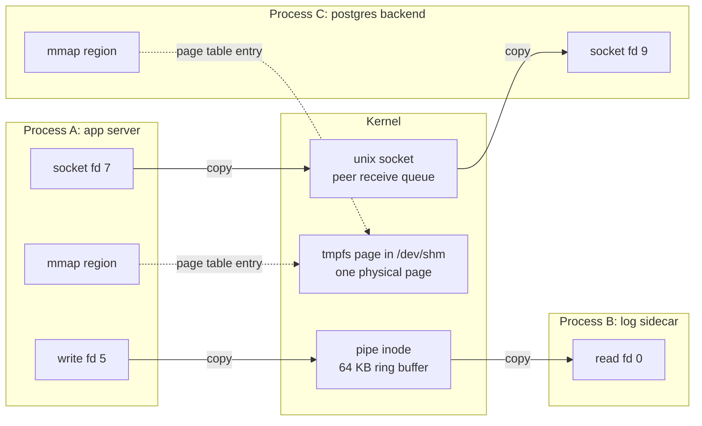

# Module 3.10: Inter-process communication

**Estimated hours:** 4

**What you will learn**

1. The five ways two processes on one machine talk to each other: pipes, FIFOs, shared memory, Unix domain sockets and message queues, and what each one costs.
2. How `pipe` plus `fork` is exactly what the shell does for `ls | grep`, including the end-of-file and `SIGPIPE` rules that every pipe bug comes from.
3. How to choose between them for a real server, and what the Windows equivalents are called.

**Prerequisites:** [Module 3.09: Signals](module-09-signals.md). You need `fork` and `wait` from 3.01, file descriptors from 3.08, and `mmap` from 3.04.

---

## 1. One-line intuition

Processes cannot see each other's memory, so the kernel offers a few kinds of letterbox, shared whiteboard and telephone line, each with a different speed and a different set of rules.

## 2. Real-life analogy

Go back to the office building from module 0.02. Each tenant company (process) has its own locked floor (address space). The building manager (kernel) offers several ways for two tenants to work together:

- **A pneumatic tube** between two floors. You push paper in one end, it comes out the other, in order. If the tube is full you wait. If nobody is at the other end any more, your paper falls on the floor and the manager slaps your wrist. That is a **pipe**. A tube with a name on the wall that any tenant can find is a **FIFO** (a named pipe).
- **A shared whiteboard** in a corridor both tenants can walk to. Either can write on it at any time, and reading is as fast as looking. But if both write at once the result is a mess, so you need a rule about who holds the marker. That is **shared memory**, and the marker rule is a **mutex** (Phase 4).
- **An internal telephone** that only works inside the building. It behaves exactly like a real phone line (a TCP socket) but never leaves the building, so it is faster and nobody outside can dial in. That is a **Unix domain socket**.
- **A pigeonhole rack in the post room** where you leave whole envelopes, each with a priority sticker. The reader takes one envelope at a time, highest priority first. That is a **message queue**.

The manager's rule for all of them: the tenants never touch each other's floors. Every byte goes through the manager, or through a whiteboard the manager put up on purpose.

## 3. Why it exists: the problem it solves

Module 3.04 taught you that each process has its own page tables, so a pointer in one process means nothing in another. That isolation is what keeps one crashing program from taking down the others. But it creates a problem: real systems are built from many processes.

- The shell runs `ps aux | grep postgres`. Two processes; the output of one is the input of the other.
- PostgreSQL is one postmaster process plus one backend process per client plus background writers, checkpointer, WAL writer. They share the buffer pool (the cache of table pages) through shared memory. Without it, every backend would have its own cache and the database would use ten times the RAM.
- `psql` on the same machine as the server does not need the network at all. It talks over a Unix domain socket.
- A log collector, a metrics agent and a crash handler often run as separate small processes next to a big server so that a bug in them cannot corrupt the server.

What breaks without IPC: either everything becomes one giant process (one bug kills all of it, one language for all of it) or processes pass data through files on disk (slow, and racy: who knows when the file is complete?). IPC is the kernel giving you fast, ordered, permission-checked channels that do not touch the disk.

## 4. Three layers of depth

### Layer 1 (beginner): the five mechanisms and when each one fits

| Mechanism | What it looks like | Direction | Who can use it | Survives process exit? |
|---|---|---|---|---|
| Anonymous pipe | Two fds from `pipe()` | One way | Parent and children (fds are inherited across `fork`) | No |
| FIFO (named pipe) | A path like `/tmp/loan.fifo` made with `mkfifo` | One way per open | Any process that can open the path | The name does; the data does not |
| Shared memory | A region mapped into both address spaces | Both, at memory speed | Any process that can open the name and has permission | The segment does until unlinked |
| Unix domain socket | A path like `/var/run/postgresql/.s.PGSQL.5432` | Both ways, like TCP | Any process that can connect to the path | The listening socket file does |
| POSIX message queue | A name like `/loan-events` | Both, in whole messages with priorities | Any process with permission | Yes until unlinked |

**Pipe.** `pipe(fds)` gives you two file descriptors: `fds[0]` is the read end, `fds[1]` is the write end. Bytes written to `fds[1]` can be read from `fds[0]`, in the same order, and nowhere else. A pipe has a buffer inside the kernel (64 KB by default on Linux). Writing to a full pipe blocks until the reader drains some. Reading an empty pipe blocks until a writer adds some.

The important rule: a pipe is a byte stream, not a list of messages. If the writer does `write` three times with 10 bytes each, the reader may get 30 bytes in one `read`, or 7 then 23. You will meet this again with TCP in module 5.02.

**How the shell does `|`.** When you type `ls | grep loan`, the shell calls `pipe()`, then `fork()` twice. In the first child it makes fd 1 (stdout) a copy of the write end with `dup2` and runs `ls`. In the second child it makes fd 0 (stdin) a copy of the read end and runs `grep`. `ls` writes to "the screen" as usual and `grep` reads from "the keyboard" as usual; neither knows the other exists. That is the whole trick. You will do it yourself in the lab.

**FIFO.** `mkfifo /tmp/loan.fifo` creates a special file. Any process that opens it for reading and any process that opens it for writing are connected by a pipe. Nothing is stored on disk; the file is only a name for the kernel's pipe. Opening a FIFO blocks until there is a process on the other side.

**Shared memory.** `shm_open("/loan-cache", O_CREAT | O_RDWR, 0600)` returns an fd for a memory object that lives in `/dev/shm`. `ftruncate` sets its size. `mmap` maps it into your address space. Any other process that does the same sees the same bytes, instantly, with no system call per access. It is the fastest IPC there is and the only one where a bug in one process can corrupt the other's data. Sharing memory means you need synchronisation, which is the subject of Phase 4; this module only shows the mapping.

**Unix domain socket.** `socket(AF_UNIX, SOCK_STREAM, 0)`, then `bind` to a path, `listen`, `accept`, exactly like a TCP server in module 5.03. The difference is the address: a file path instead of an IP and port. Packets never touch the network stack. Permissions on the socket file control who may connect. It is the default way local clients talk to PostgreSQL, Docker (`/var/run/docker.sock`), systemd and the X server.

**Message queue.** `mq_open("/loan-events", O_CREAT | O_RDWR, 0600, NULL)`, `mq_send`, `mq_receive`. Each message is delivered whole, with a priority. The kernel keeps them until read. Queues appear under `/dev/mqueue`. The typical default limits are small (10 messages of 8 KB each), which is one reason they are less common than sockets in server code.

**`socketpair`.** `socketpair(AF_UNIX, SOCK_STREAM, 0, fds)` gives two connected sockets with no name at all, like a pipe that works in both directions. It is the usual way a parent gives a child a private two-way channel.

### Layer 2 (working engineer): the rules that cause bugs

**Close the ends you do not use.** After `fork`, both processes hold both ends of the pipe. The reader sees end of file (`read` returns 0) only when every write end in every process is closed. If the child forgets to close its copy of the write end, it will wait for itself forever. This is the number one pipe bug and it looks like a hang.

**EOF and SIGPIPE.** The two failure directions are not symmetric:

| Situation | What happens |
|---|---|
| Reader reads, all writers have closed | `read` returns 0. That is end of file. Normal. |
| Writer writes, all readers have closed | The kernel sends `SIGPIPE` to the writer. The default action kills it silently. If `SIGPIPE` is ignored (module 3.09), `write` returns -1 with `errno == EPIPE`. |

This is why `yes | head -1` finishes: `head` exits, `yes` writes once more, gets `SIGPIPE`, dies. A server that writes to a pipe or socket must ignore `SIGPIPE` and check `EPIPE`, or one disconnecting client kills the whole server. tcpkv does this in its startup.

**Atomic writes.** A single `write` of at most `PIPE_BUF` bytes (4096 on Linux) to a pipe is never interleaved with another process's write. Larger writes can be split. If several producers share one pipe, keep each record under 4096 bytes or add your own framing.

**Pipe capacity.** 64 KB by default; `fcntl(fd, F_SETPIPE_SZ, bytes)` can raise it up to `/proc/sys/fs/pipe-max-size` (typically 1 MB). When the reader is slower than the writer, the writer blocks. This is **back-pressure**, and it is a feature: it stops a fast producer from using unlimited memory. It is also why a stalled log process can freeze a server (section 7).

**Shared memory needs locking and a layout.** The mapped region is just bytes. Both processes must agree on the layout (usually a `struct` with fixed-size fields, no pointers, because addresses differ between processes). Both must agree on who may write when. A `pthread_mutex_t` placed inside the region with the `PTHREAD_PROCESS_SHARED` attribute, or an atomic flag, does that job; module 4.03 shows how. Without it you get torn reads: one process sees half of an updated balance.

**Unix sockets versus TCP on localhost.**

| Property | Unix domain socket | TCP to 127.0.0.1 |
|---|---|---|
| Address | File path | IP and port |
| Access control | File permissions on the socket path | Anyone on the machine (or network, if bound to 0.0.0.0) |
| Who is on the other end | `SO_PEERCRED` gives the peer's PID, UID, GID; can pass fds with `SCM_RIGHTS` | Unknown without authentication |
| Overhead | No IP headers, no checksums, no routing, no TIME_WAIT | Full TCP stack even on loopback |
| Typical latency | Lower; a round trip is commonly a few tens of microseconds on a laptop | Higher; typically somewhat more than the Unix socket on the same machine |
| Works across machines | No | Yes |

The usual rule: same machine, use the Unix socket; different machine, you have no choice.

**PostgreSQL.** On Ubuntu, `psql` with no `-h` option connects to `/var/run/postgresql/.s.PGSQL.5432`. The `5432` is the port number used only to make the name unique. The server creates that file at startup (`unix_socket_directories` in `postgresql.conf`). `psql -h localhost` instead uses TCP, which goes through the loopback interface and through a different line in `pg_hba.conf`. You can see which one you got with `\conninfo` inside `psql`.

**Windows equivalents.**

| Linux | Windows | Notes |
|---|---|---|
| Anonymous pipe | `CreatePipe` | Also one way; used by `CreateProcess` to capture a child's output |
| FIFO | Named pipe, `CreateNamedPipe("\\\\.\\pipe\\loan")` | Two way, message mode available, works across the network with SMB |
| `shm_open` + `mmap` | `CreateFileMapping` + `MapViewOfFile` | Called a "section object" inside the kernel (module 3.13) |
| Unix domain socket | `AF_UNIX` is supported by Winsock since Windows 10 (1803) | Named pipes are still the common choice |
| Message queue | Mailslots (one way, datagram), or MSMQ | Rare in modern code |
| `socketpair` | No direct equivalent; use a named pipe pair or loopback TCP | |

### Layer 3 (internals): what the kernel does for a pipe, a shared mapping and a Unix socket

**A pipe inside the kernel.** `pipe()` creates an inode on the internal `pipefs` file system and two `struct file` objects pointing at it, one opened for reading and one for writing. The inode owns a ring of pages (16 pages of 4 KB = 64 KB) plus a head and tail index. `write` copies bytes from your buffer into the ring; `read` copies them out. There is no disk, no block layer. Both file objects go into your fd table (module 3.08) and are inherited across `fork` exactly like any other fd, which is why the child can use them. Each `read` or `write` is one system call and one memory copy, so a pipe moves data at roughly memory-copy speed minus the syscall cost per call. The reader count and writer count live on the inode; when the writer count drops to zero, a blocked reader is woken and gets 0; when the reader count drops to zero, a writer gets `SIGPIPE`.

**A shared mapping inside the kernel.** `shm_open` creates a file on `tmpfs` (mounted at `/dev/shm`); it is an ordinary file whose pages live in RAM and the page cache, never on disk unless the machine swaps. `mmap` with `MAP_SHARED` adds a virtual memory area (VMA) to your process that points at that file. When you first touch a page you take a page fault; the kernel finds (or allocates) the page in the page cache and installs it in your page table. When the other process touches the same offset, its page fault finds the same physical page and installs that same frame in its own page table. Two page tables, one physical page: that is sharing. After the first touch there is no kernel involvement at all, which is why it is fast. The copy-on-write trick from module 3.04 is the opposite case: `MAP_PRIVATE` pages get duplicated on the first write instead of being shared.

**A Unix domain socket inside the kernel.** `bind` to a path creates a socket inode in the real file system (that is why it has permissions and shows as type `s` in `ls -l`). `connect` looks the path up, finds the listening socket, and the kernel links a pair of socket buffers directly: a `write` on one end queues an `sk_buff` straight onto the peer's receive queue. There is no IP layer, no checksum, no segmentation, no retransmission timer. For `SOCK_STREAM` the data is a byte stream like TCP; for `SOCK_SEQPACKET` message boundaries are kept. The `SCM_RIGHTS` ancillary message lets you send a file descriptor: the kernel installs a copy of your `struct file` in the receiver's fd table. That is how one process can accept a connection and hand it to another, which Nginx and systemd both do.

**Message queues** are implemented by `mqueue` fs: each queue is an inode with a sorted list of message pages. `mq_send` and `mq_receive` are system calls that copy whole messages. `mq_notify` can deliver a signal or start a thread when a message arrives.

## 5. Architecture diagram



Solid arrows are memory copies that cost a system call each. Dotted arrows are page-table entries: after the first page fault, reading or writing shared memory costs nothing extra.

## 6. Code

One program that shows the two mechanisms you will use most: an anonymous pipe from parent to child, and a shared-memory segment that the child fills and the parent reads after waiting for it. Read the comments about closing ends; they are the point of the exercise.

```c
/* ipc_pipe_shm.c
 * Part 1: pipe + fork. Parent writes loan records, child reads until EOF.
 * Part 2: POSIX shared memory. Child writes a struct, parent reads it after wait().
 */
#include <errno.h>
#include <fcntl.h>
#include <stdio.h>
#include <stdlib.h>
#include <string.h>
#include <sys/mman.h>
#include <sys/wait.h>
#include <unistd.h>

#define SHM_NAME "/loan-demo-shm"

/* Layout both processes agree on. Fixed sizes, no pointers. */
struct shared_summary {
    int   loans_seen;
    long  total_balance;
    char  last_id[16];
};

static void die(const char *what) {
    perror(what);
    exit(1);
}

int main(void) {
    /* ---------- Part 1: anonymous pipe ---------- */
    int fds[2];
    if (pipe(fds) == -1) die("pipe");
    /* fds[0] = read end, fds[1] = write end. Both will be copied by fork. */

    /* ---------- Part 2 setup: shared memory, created before fork ---------- */
    int shm_fd = shm_open(SHM_NAME, O_CREAT | O_RDWR, 0600);
    if (shm_fd == -1) die("shm_open");
    if (ftruncate(shm_fd, sizeof(struct shared_summary)) == -1) die("ftruncate");
    struct shared_summary *sum = mmap(NULL, sizeof *sum, PROT_READ | PROT_WRITE,
                                      MAP_SHARED, shm_fd, 0);
    if (sum == MAP_FAILED) die("mmap");
    close(shm_fd);                 /* the mapping stays alive without the fd */
    memset(sum, 0, sizeof *sum);

    pid_t pid = fork();
    if (pid == -1) die("fork");

    if (pid == 0) {
        /* ===== child: reader ===== */
        close(fds[1]);             /* MUST close our copy of the write end,
                                      or read() never sees EOF */
        char buf[64];
        ssize_t n;
        while ((n = read(fds[0], buf, sizeof buf - 1)) > 0) {
            buf[n] = '\0';
            /* parse "id balance\n" records; a read may contain several */
            char *line = buf;
            while (line && *line) {
                char *nl = strchr(line, '\n');
                if (nl) *nl = '\0';
                char id[16]; long bal;
                if (sscanf(line, "%15s %ld", id, &bal) == 2) {
                    sum->loans_seen += 1;              /* write to shared memory */
                    sum->total_balance += bal;
                    strncpy(sum->last_id, id, sizeof sum->last_id - 1);
                    printf("child  : got %s balance %ld\n", id, bal);
                }
                line = nl ? nl + 1 : NULL;
            }
        }
        if (n == -1) die("read");
        printf("child  : read returned 0, writer closed, exiting\n");
        close(fds[0]);
        _exit(0);
    }

    /* ===== parent: writer ===== */
    close(fds[0]);                 /* parent does not read */
    const char *records[] = { "L1001 250000\n", "L1002 120000\n", "L1003 90000\n" };
    for (int i = 0; i < 3; ++i) {
        size_t len = strlen(records[i]);
        if (write(fds[1], records[i], len) != (ssize_t)len) die("write");
        printf("parent : sent %s", records[i]);
    }
    close(fds[1]);                 /* this is what makes the child see EOF */

    int status;
    if (waitpid(pid, &status, 0) == -1) die("waitpid");
    printf("parent : child exited with %d\n", WEXITSTATUS(status));

    /* Safe to read shared memory now: the child is finished, so no race. */
    printf("parent : shared summary -> loans=%d total=%ld last=%s\n",
           sum->loans_seen, sum->total_balance, sum->last_id);

    munmap(sum, sizeof *sum);
    shm_unlink(SHM_NAME);          /* remove /dev/shm/loan-demo-shm */
    return 0;
}
```

Compile and run:

```bash
gcc -std=gnu17 -Wall -Wextra -Werror -g -o ipc_pipe_shm ipc_pipe_shm.c
./ipc_pipe_shm
```

On glibc 2.34 and newer (Ubuntu 24.04 has 2.39) `shm_open` lives in the main C library. On an older system add `-lrt` at the end of the command.

Expected output (the order of parent and child lines can interleave differently; that is the scheduler):

```text
parent : sent L1001 250000
parent : sent L1002 120000
parent : sent L1003 90000
child  : got L1001 balance 250000
child  : got L1002 balance 120000
child  : got L1003 balance 90000
child  : read returned 0, writer closed, exiting
parent : child exited with 0
parent : shared summary -> loans=3 total=460000 last=L1003
```

Three things to notice. The child saw end of file only because both the parent's `close(fds[1])` and the child's own `close(fds[1])` happened. The three records may have arrived in one `read` or several; the parsing loop handles both. And the parent read the shared struct only after `waitpid`, so there was no moment when both processes touched it. Remove that guarantee and you need a lock.

## 7. Use case: core-banking loan-origination platform

The application server from claim H4 ran on the same machine as a PostgreSQL instance in the test and UAT environments, and against a remote YugabyteDB cluster in production. Two IPC decisions came out of that.

**Decision 1: local database over the Unix socket, remote over TCP, chosen by configuration.** When the database is local, the connection string omits `host` so `libpq` uses `/var/run/postgresql/.s.PGSQL.5432`. This gave three things: no network exposure (the socket file was owned by the `postgres` group and the `loanapp` user was in that group, so no other process on the box could connect), peer authentication from `pg_hba.conf` (the server trusted the kernel-supplied UID instead of a password in a config file), and lower latency on the hot path. When the database is a YugabyteDB cluster on other machines, `host` is set and the same code path uses TCP. The decision was: one code path, the address decides the transport; never hard-code `localhost` because that silently forces TCP.

**Decision 2: a log sidecar fed by a pipe, with back-pressure handled on purpose.** The server wrote its log lines to stdout. The service manager connected stdout to a small logger process that stamped, rotated and compressed files. This kept file rotation out of the server and meant a logger crash could not corrupt the server's memory. The cost appeared on one incident: the logger stalled on a full disk, the 64 KB pipe filled, and every server thread that logged blocked inside `write`. Requests timed out while the server looked healthy. The decision that followed was to make the log fd non-blocking (module 3.11), count dropped lines, and alarm on the counter. A pipe's back-pressure is a feature for batch jobs and a hazard for a request server, and you must choose which one you want.

## 8. Lab

### Part A: the pipe program and the forgotten close (30 minutes)

1. Compile and run the program from section 6. Confirm the output.
2. Comment out the child's `close(fds[1]);` line. Rebuild and run. The program hangs after the three `got` lines. Press `Ctrl+C`. Explain in one sentence why the child never saw EOF.
3. Restore that line. Now comment out the parent's `close(fds[1]);` instead. Run. It also hangs. Same reason, other side.
4. Restore it. Run with `strace -f -e trace=pipe2,read,write,close,wait4 ./ipc_pipe_shm 2>&1 | head -40`. Find the `pipe2` call, the `write` calls in the parent (PID in brackets), and the `read` that returns `0` in the child.

Expected for step 4: `pipe2([3, 4], 0) = 0`, three `write(4, "L100...", 13) = 13` lines, and in the child a final `read(3, "", 63) = 0`.

### Part B: build `|` yourself with dup2 (30 minutes)

Write `mypipe.c` that runs `ls -l | wc -l` without the shell:

```c
/* mypipe.c: run "ls -l | wc -l" the way the shell does */
#include <stdio.h>
#include <stdlib.h>
#include <sys/wait.h>
#include <unistd.h>

int main(void) {
    int fds[2];
    if (pipe(fds) == -1) { perror("pipe"); return 1; }

    pid_t left = fork();
    if (left == 0) {                       /* ls -l: stdout -> write end */
        dup2(fds[1], STDOUT_FILENO);
        close(fds[0]); close(fds[1]);
        execlp("ls", "ls", "-l", (char *)NULL);
        perror("execlp ls"); _exit(127);
    }
    pid_t right = fork();
    if (right == 0) {                      /* wc -l: stdin <- read end */
        dup2(fds[0], STDIN_FILENO);
        close(fds[0]); close(fds[1]);
        execlp("wc", "wc", "-l", (char *)NULL);
        perror("execlp wc"); _exit(127);
    }
    close(fds[0]); close(fds[1]);          /* the parent holds neither end */
    waitpid(left, NULL, 0);
    waitpid(right, NULL, 0);
    return 0;
}
```

```bash
gcc -std=gnu17 -Wall -Wextra -Werror -g -o mypipe mypipe.c
./mypipe
ls -l | wc -l
```

Expected: both commands print the same number. Then delete the parent's `close(fds[0]); close(fds[1]);` line and run again: `wc` never finishes, because the parent still holds a write end. Restore it.

### Part C: FIFO and a Unix socket from the shell (30 minutes)

1. FIFO. Open two WSL terminals.

```bash
# terminal 1
mkfifo /tmp/loan.fifo
ls -l /tmp/loan.fifo        # first character is p
cat /tmp/loan.fifo          # blocks until a writer opens it
```

```bash
# terminal 2
echo "L2001 50000" > /tmp/loan.fifo
```

Expected: terminal 1 prints the line and `cat` exits (it saw EOF when `echo` closed). Run `ls -l /tmp/loan.fifo` again: size is 0; nothing was stored. Remove it with `rm /tmp/loan.fifo`.

2. Unix socket with netcat.

```bash
# terminal 1
nc -lU /tmp/loan.sock
```

```bash
# terminal 2
ls -l /tmp/loan.sock        # first character is s
echo "hello over a unix socket" | nc -U /tmp/loan.sock
```

Expected: terminal 1 prints the line. Both sides can type; it is two way. Press `Ctrl+C` in both and `rm /tmp/loan.sock`.

3. PostgreSQL. With your PostgreSQL 16 from module 0.05 running:

```bash
sudo -u postgres psql -c '\conninfo'
sudo -u postgres psql -h localhost -c '\conninfo'
ls -l /var/run/postgresql/
```

Expected: the first prints `... via socket in "/var/run/postgresql" at port "5432"`, the second prints `... on host "localhost" (127.0.0.1) at port "5432"`, and the listing shows `.s.PGSQL.5432` with type `s`. Same server, two transports. (If PostgreSQL runs in Docker instead, the socket is inside the container; use `docker exec` to run the same commands there.)

### Part D: shared memory between two unrelated processes (30 minutes)

1. Run the section 6 program under `strace -e trace=openat,mmap,ftruncate ./ipc_pipe_shm 2>&1 | grep -i shm`. Find the `openat` of `/dev/shm/loan-demo-shm` and the `mmap(..., MAP_SHARED, ...)`.
2. Split the program into two: `shm_writer.c` that creates the segment, writes `loans_seen = 7`, and sleeps 30 seconds before unlinking; `shm_reader.c` that opens the existing name with `shm_open(SHM_NAME, O_RDWR, 0)`, maps it, and prints the struct. Run the writer in one terminal and the reader in another while the writer sleeps.
3. While the writer sleeps, run `ls -l /dev/shm/` and `cat /proc/$(pgrep shm_writer)/maps | grep shm`. You see the file and the mapping with its virtual address. Run the same `grep` for the reader. The virtual addresses are usually different; the physical page is the same.

Expected: the reader prints `loans=7`. If you start the reader after the writer has unlinked, `shm_open` fails with `No such file or directory`.

### Journal

Copy [journal/TEMPLATE.md](../journal/TEMPLATE.md) to `journal/YYYY-MM-DD-ipc.md`. Record: the one-sentence explanation of the hang from Part A, the `strace` line where `read` returned 0, the two `\conninfo` outputs from Part C, and the two virtual addresses of the shared mapping from Part D. Add one line on which IPC you would pick for the log sidecar and why.

## 9. Common mistakes and misconceptions

| Mistake | Why it is wrong | Bug it causes later |
|---|---|---|
| Forgetting to close the unused pipe end after `fork` | EOF arrives only when every write end is closed | A reader that hangs forever; looks like a deadlock |
| Treating a pipe or stream socket as messages | It is a byte stream; writes can merge or split | Parser that works in tests with small writes and breaks under load |
| Not handling `SIGPIPE` in a server | Default action kills the process | Server dies when one client disconnects mid-reply |
| Writing to shared memory from two processes without a lock | Both page tables point at the same bytes; no ordering | Torn values, corrupted counters, bugs that appear only under load |
| Storing pointers in shared memory | Each process maps the region at a different virtual address | Segfault in the second process |
| Using TCP to `localhost` for a local database by habit | Loses peer credentials, file-permission access control and some latency | Passwords in config files; slower hot path |
| Expecting a FIFO to store data | It is a name for a kernel pipe; bytes exist only while both ends are open | "Where did my messages go?" when the reader was not running |
| Forgetting `shm_unlink` | Segments persist in `/dev/shm` until unlinked or reboot | Stale data read by the next run; `/dev/shm` fills up |

## 10. Resume link

- **Claim H4, "application server ... against distributed SQL".** The transport question is a favourite: "Did the app server use a Unix socket or TCP to reach PostgreSQL?" Answer from section 7: "Local instances over the Unix socket with peer authentication, remote YugabyteDB nodes over TCP; the connection string decided, not the code." Follow-up: "What is `SO_PEERCRED`?" You can now say: the kernel tells the server the PID and UID of the connecting process, so no password is needed.
- **Claim E, "client-server architecture, POSIX sockets".** A Unix domain socket uses the same `socket`, `bind`, `listen`, `accept` calls as TCP. Saying "I understand the socket API as one interface over two transports" shows depth.
- **Claim D, "PostgreSQL ... caching".** PostgreSQL's buffer pool is shared memory across backend processes. When you reach module 6.03 you will see `shared_buffers` and know it is a `mmap` region like the one you built here.
- **Claim F, "incident triage".** The log-sidecar stall in section 7 is a true-to-life incident shape: healthy process, blocked threads, full pipe. Being able to name back-pressure as the cause, and `write` to a full pipe as where the threads sat, is exactly what RCA writing in module 8.09 needs.

## 11. Interview questions

**Q1 (easy). What is a pipe and how does the shell use it?**

<details>
<summary>Model answer</summary>

A pipe is a one-way byte channel inside the kernel with a read end and a write end, each a file descriptor, and a buffer of typically 64 KB. The shell implements `a | b` by calling `pipe`, forking twice, using `dup2` so the first child's stdout is the write end and the second child's stdin is the read end, closing the pipe fds in the parent, and `exec`ing the two programs. Neither program knows it is talking to a pipe.

</details>

**Q2 (easy). When does a reader on a pipe see end of file?**

<details>
<summary>Model answer</summary>

When the buffer is empty and every file descriptor referring to the write end, in every process, has been closed. After `fork` both parent and child hold the write end, so the reader must close its own copy or it will wait for itself. The symmetric rule is that writing when no read end exists raises `SIGPIPE`, or `EPIPE` if that signal is ignored.

</details>

**Q3 (medium). Why would you use a Unix domain socket instead of TCP to localhost for a local PostgreSQL?**

<details>
<summary>Model answer</summary>

Four reasons. Security: access is controlled by file permissions on the socket path and the server can read the client's UID with `SO_PEERCRED`, enabling peer authentication without passwords. Exposure: nothing is listening on a port. Overhead: no IP headers, checksums or TCP state machine, so lower latency per round trip. Features: file descriptors can be passed with `SCM_RIGHTS`. The cost is that it only works on one machine, so the configuration must switch to TCP for a remote cluster, which is what my app server did for YugabyteDB.

</details>

**Q4 (medium). Shared memory is the fastest IPC. Why is it not the default choice?**

<details>
<summary>Model answer</summary>

Because it only provides bytes, not rules. There is no ordering, no message boundary and no notification: the reader does not know when the writer is finished, and simultaneous writes produce torn data. You must add a synchronisation protocol, usually a process-shared mutex or atomics, plus a fixed layout with no pointers since the region maps at different addresses in each process. A bug in one process corrupts the other's view directly, breaking the isolation that processes are for. It wins where the data is large and hot, such as a database buffer pool, and loses where you want a simple, robust channel, where a pipe or socket is better.

</details>

**Q5 (hard). Your server logs to stdout, which is a pipe to a logging process. Under load, all request threads suddenly stop and CPU drops to zero, but the process is alive. What happened and how do you fix it?**

<details>
<summary>Model answer</summary>

The logger stopped draining the pipe, perhaps because its disk filled or it hung, so the 64 KB kernel buffer filled and every `write` to the log fd blocked inside the kernel. Each request thread blocks on its next log line, so the whole pool stalls while the process looks healthy. I would confirm with `cat /proc/PID/stack` or `gdb` attach showing threads in `pipe_write`, and `ls -l /proc/PID/fd/1` showing a pipe. Fixes: make the log fd non-blocking and drop or count lines when `write` returns `EAGAIN`; or move logging to a dedicated thread with a bounded in-process queue so request threads never block on I/O; or raise the pipe size with `F_SETPIPE_SZ` as a stopgap. The real lesson is that pipe back-pressure is correct for batch pipelines and dangerous in a latency-sensitive server.

</details>

## 12. Revision

- Pipes and FIFOs are one-way byte streams in a 64 KB kernel buffer; EOF arrives when every write end is closed, `SIGPIPE` when every read end is closed, so close the ends you do not use.
- Shared memory (`shm_open` + `mmap`) is one physical page in two page tables: fastest, but you supply the layout and the locking.
- Unix domain sockets are TCP without the network: same API, file permissions and peer credentials instead of ports; use them for local PostgreSQL, TCP for a remote cluster.

---

Previous: [Module 3.09: Signals](module-09-signals.md) | Next: [Module 3.11: I/O models: blocking, non-blocking, select/poll/epoll](module-11-io-models-blocking-to-epoll.md)
