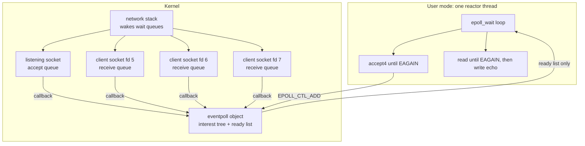

# Module 3.11: I/O models: blocking, non-blocking, select/poll/epoll

**Estimated hours:** 5

**What you will learn**

1. What a thread actually does while a blocking `read` waits (it sleeps inside the kernel), and how `O_NONBLOCK` and `EAGAIN` let one thread refuse to wait.
2. How `select`, `poll` and `epoll` let one thread watch thousands of sockets, including the level-triggered versus edge-triggered rule that causes most epoll bugs.
3. How to decide between a blocking thread pool and an epoll reactor for tcpkv and for the app server, with the numbers that drive the choice.

**Prerequisites:** [Module 3.10: Inter-process communication](module-10-ipc.md). You need file descriptors (3.08), threads and their 8 MB stacks (3.02), context-switch cost (3.03), and the socket calls you met briefly in 3.10 (`socket`, `bind`, `listen`, `accept`). Module 5.03 covers sockets fully; here you only need to copy the listener code.

---

## 1. One-line intuition

A blocking read is a thread standing in a queue doing nothing; readiness APIs like epoll let one thread ask "which of my ten thousand queues has something in it right now?" and only stand in those.

## 2. Real-life analogy

Picture a bank branch with many customer counters.

- **Blocking I/O, one thread per customer.** Every customer gets a personal clerk who sits with them for the whole visit. While the customer fills in a form (which is most of the visit), the clerk stares at the wall. Two hundred customers need two hundred clerks, two hundred chairs and two hundred salaries. Simple, and fine for a small branch.
- **Non-blocking I/O.** The clerk asks "ready?" and, if not, walks away immediately. Asking every customer every second is polling. It wastes the clerk's time when nobody is ready.
- **`select` and `poll`.** The clerk hands the receptionist a list of all customers and says "wake me when any of these raises a hand". The receptionist walks the whole list every time anyone moves. With ten customers it is fine. With ten thousand, the receptionist spends all day walking the list.
- **`epoll`.** Each customer gets a buzzer linked to a board at the receptionist's desk. When a customer presses it, their name lights up. The clerk asks "who is lit?" and gets only those names. Ten customers or ten thousand, the cost is the number of lit names, not the size of the branch.

The two flavours of the buzzer are the thing people get wrong. **Level-triggered**: the light stays on as long as the customer still has something to say. **Edge-triggered**: the light flashes once when the customer first presses, and never again until they press again. With edge-triggered you must hear the customer out completely, or you will never be told about the rest.

## 3. Why it exists: the problem it solves

A server's job is mostly waiting. A loan-origination request arrives, the server does a millisecond of work, sends a reply, and then waits seconds or minutes for that client's next request. If waiting costs a thread, a server with 10,000 connected branch terminals needs 10,000 threads, almost all asleep.

In 1999 Dan Kegel wrote a page called "The C10K problem": how can one machine serve ten thousand concurrent connections? The hardware could do it. The software could not, because every popular server used a thread or a process per connection, and the operating system's cost per thread (memory, scheduler work, `select` walking a 10,000-entry list every wakeup) grew faster than the hardware. The answers were `epoll` on Linux (2002), `kqueue` on BSD (2000) and I/O completion ports on Windows (1994), and the server designs built on them: Nginx, Node.js, Redis, HAProxy.

What breaks without readiness APIs: either you cap concurrency at a few hundred connections, or you burn memory and CPU on idle threads, or you poll in a loop and burn CPU on nothing. What breaks if you use them wrongly: a connection that silently never gets served again (the edge-triggered bug), or a thundering herd of threads woken for one event.

## 4. Three layers of depth

### Layer 1 (beginner): blocking, non-blocking, and asking "who is ready?"

**Blocking read.** `read(fd, buf, n)` on a socket with no data does not return. The thread is put to sleep by the kernel. In `ps` its state shows as `S` (interruptible sleep). It uses zero CPU. When data arrives, the network stack wakes the thread, the read copies the bytes and returns. This is the default and it is the easiest model to reason about: each thread is a straight line of code.

**Non-blocking read.** Set `O_NONBLOCK` on the fd with `fcntl(fd, F_SETFL, flags | O_NONBLOCK)`. Now `read` on an empty socket returns `-1` immediately with `errno` set to `EAGAIN` (on Linux `EWOULDBLOCK` is the same number). The thread is never put to sleep by I/O. The cost: if you call `read` in a loop, you burn 100% CPU asking a question whose answer is "no". Non-blocking is only useful together with something that tells you when to ask.

**`select`.** The oldest readiness call (1983). You fill an `fd_set` bitmap with the fds you care about and call `select(maxfd + 1, &readfds, &writefds, &exceptfds, &timeout)`. It sleeps until at least one is ready, then returns with the bitmaps modified to show which. Limits: `FD_SETSIZE` is 1024 on Linux, so fds numbered 1024 or above cannot be used at all; the bitmaps are overwritten, so you rebuild them before every call; and the kernel scans all `maxfd` entries every time.

**`poll`.** Same idea with an array of `struct pollfd { int fd; short events; short revents; }` instead of bitmaps. No 1024 limit and the array is not destroyed, but the kernel still walks the whole array on every call and copies it in and out each time. Cost is proportional to the number of fds watched, not the number ready.

**`epoll`.** Three calls:

| Call | What it does |
|---|---|
| `epoll_create1(EPOLL_CLOEXEC)` | Makes an epoll instance; returns an fd for it |
| `epoll_ctl(ep, EPOLL_CTL_ADD / MOD / DEL, fd, &event)` | Registers, changes or removes interest in one fd, once |
| `epoll_wait(ep, events, maxevents, timeout_ms)` | Sleeps until something is ready; fills `events` with only the ready ones |

The interest list lives in the kernel, so there is nothing to rebuild and nothing to copy on each wait. Cost per `epoll_wait` is proportional to the number of ready fds. This is why epoll scales and `select` does not.

**Readiness versus completion.** `select`, `poll`, `epoll` and `kqueue` tell you an fd is *ready*: a `read` would now return without blocking. You still do the `read` yourself. Windows IOCP and Linux io_uring (module 3.12) are *completion* models: you hand the kernel a buffer and say "read into this", and later you are told "done, here are 512 bytes". Readiness fits sockets well because the data is already in a kernel buffer; completion fits disk files and large transfers better. Keep the two words apart; interviewers use them.

### Layer 2 (working engineer): triggering modes, the rules, and the decision

**Level-triggered (default).** `epoll_wait` reports an fd every time it is called while the fd is still readable. If you read only half the data, the next `epoll_wait` reports it again. Forgiving. Works like `poll`.

**Edge-triggered (`EPOLLET`).** `epoll_wait` reports an fd only when its state changes from not-ready to ready, that is when new data arrives. If 10 KB arrives and you read 4 KB, you will not be told again until more data arrives. The 6 KB sits there forever if the client is waiting for your reply. The rule, which you must be able to recite: **with `EPOLLET`, use non-blocking fds and read in a loop until `read` returns `EAGAIN`.** The same applies to `accept`: keep accepting until `EAGAIN`, or connections queue unnoticed.

Why use edge-triggered at all? Fewer wakeups when you have many threads calling `epoll_wait` on one instance, and it lets you write without being told repeatedly that a socket is writable (which is almost always true and would make level-triggered `EPOLLOUT` spin).

**`EPOLLONESHOT`.** After reporting an fd once, epoll disables it until you re-arm with `EPOLL_CTL_MOD`. This is how a multi-threaded reactor stops two threads from handling the same socket at the same time: one thread gets the event, handles it, re-arms. Without it, a second `epoll_wait` call on another thread could receive the same fd while the first thread is still reading.

**`EPOLLRDHUP`.** Reports that the peer has closed its write side. Without it you learn about a closed connection only when `read` returns 0.

**Thundering herd.** If eight threads all call `epoll_wait` on the same instance and one listening socket becomes ready, level-triggered mode may wake all eight; seven find nothing. `EPOLLEXCLUSIVE` (Linux 4.5+) wakes one. Alternatively use one epoll instance per thread with `SO_REUSEPORT` listeners, which is what Nginx does.

**Writing.** A socket's send buffer can fill when the client reads slowly. A non-blocking `write` then returns a short count or `EAGAIN`. A correct reactor keeps the unsent remainder in a per-connection buffer and asks for `EPOLLOUT`; when it arrives, it writes more, and removes `EPOLLOUT` once the buffer is empty. The echo server in section 6 skips this (it only echoes small lines) and says so in a comment. Module 5.05 adds it.

**What a thread-per-connection design really costs.**

| Resource | Per thread, typical Linux defaults | 10,000 connections |
|---|---|---|
| Stack virtual reservation | 8 MB (`ulimit -s`) | 80 GB of address space; fine on 64-bit, impossible on 32-bit |
| Stack actually touched | typically 8 to 64 KB | 80 to 640 MB of real RAM |
| Kernel `task_struct` and kernel stack | about 16 KB kernel stack plus bookkeeping | a few hundred MB |
| Scheduler work | every wakeup is a context switch, roughly 1 to 5 µs | at 10 requests/s each: 100,000 switches/s, a noticeable share of one core |
| Limits | `/proc/sys/kernel/threads-max`, `ulimit -u`, `pid_max` | may need raising |

It fails first on memory (virtual on 32-bit, real on 64-bit) and then on context switches. Memory is the usual first wall.

**The decision table.** This is the one to memorise for tcpkv (claim I) and the app server (claim H4):

| Situation | Choose | Why |
|---|---|---|
| Hundreds of connections, short requests, real work per request (database calls, computation) | Blocking I/O with a fixed thread pool | Simplest code; each request is a straight line; the pool size bounds memory; the database is the bottleneck, not I/O waiting |
| Tens of thousands of mostly idle connections (chat, push notifications, long polling, proxies) | epoll reactor, one or a few threads | Idle connections cost one entry in the interest list, not a thread |
| Many connections and real CPU work per request | Reactor for I/O plus a worker thread pool for the work | Never do slow work on the epoll thread |
| Prototype, tool, test client | Blocking, one thread | Nothing else is worth the complexity |

tcpkv uses a fixed thread pool with blocking sockets: a client's request is one line, the work is a map lookup under a `shared_mutex`, and the test load is a few hundred connections. The app server uses the same pooled model because each request spends its time waiting on PostgreSQL or YugabyteDB, which the pool size throttles on purpose. Neither needs epoll. Being able to say *why* is the skill.

**Windows.** Winsock has `select` (its `fd_set` is an array of socket handles, default `FD_SETSIZE` 64 but you can define it larger) and `WSAPoll` (since Vista; it had a bug with failed connects on older versions, fixed in Windows 10). There is no epoll. The native scalable model is I/O completion ports, which is module 3.12. `WSAEventSelect` and `WSAAsyncSelect` exist for GUI programs; servers use IOCP.

### Layer 3 (internals): what the kernel does on a blocking read and inside epoll

**A blocking read on a socket.** `read` enters the kernel, finds the socket's receive queue (`sk_receive_queue`) empty, and calls into `sk_wait_data`. That function adds the current thread to the socket's wait queue (`sk_sleep`), sets the thread state to `TASK_INTERRUPTIBLE`, and calls `schedule()`. The scheduler (module 3.03) switches to another thread. Your thread is now not on any run queue; it costs nothing but its memory. When a packet for that socket arrives, the network interrupt handler and the TCP code append the data to the receive queue and call `wake_up` on the socket's wait queue, which marks your thread runnable. When the scheduler picks it, `read` resumes, copies the bytes to user space with `copy_to_user`, and returns. The `S` you see in `ps` is `TASK_INTERRUPTIBLE`; "interruptible" means a signal can also wake it, which is why `read` can return `EINTR` (module 3.09).

**`O_NONBLOCK`.** The same path, but `sk_wait_data` is never called: when the queue is empty the code returns `-EAGAIN` at once. The flag lives on the open file description (module 3.08), so it is shared by duplicated fds.

**`select` and `poll`.** The kernel loops over every fd you passed, calling each file's `poll` method (for a socket, `tcp_poll`) to check readiness and to register the calling thread on that file's wait queue. If nothing is ready it sleeps; any of those wait queues can wake it; after waking, it loops over all the fds again to see which ones are ready, and tears down all the wait-queue registrations. That is work proportional to the number of fds, twice, on every call.

**epoll.** `epoll_create1` makes an `eventpoll` object with a red-black tree (the interest list, keyed by fd) and a ready list. `epoll_ctl(ADD)` inserts into the tree and, once, registers a callback (`ep_poll_callback`) on the target file's wait queue. From then on, whenever the socket's data arrives and the network stack wakes that wait queue, the callback runs and appends the fd's entry to the ready list. `epoll_wait` just checks the ready list: if non-empty, it copies those entries to your array (calling the file's `poll` method again for each to confirm the event mask); if empty, it sleeps on the eventpoll's own wait queue. The expensive registration happens once per fd at `ADD` time, not on every wait. That is the entire reason epoll is O(ready) instead of O(watched).

Level versus edge is one line inside `epoll_wait`: in level-triggered mode, after reporting an entry it is put back on the ready list if the file still reports readiness; in edge-triggered mode it is not, so only a fresh wakeup (new data) re-adds it.

**The copy still happens.** epoll tells you the data is there. The `read` that follows still copies from the kernel socket buffer into your buffer. io_uring (module 3.12) can avoid some of that bookkeeping by letting the kernel do the read into your buffer directly and tell you when it is done.

## 5. Architecture diagram



Each socket is registered with the eventpoll object once. Data arriving on fd 6 runs one callback that appends fd 6 to the ready list; `epoll_wait` returns only fd 6, regardless of how many other sockets are idle.

## 6. Code

A complete single-threaded echo server. It uses edge-triggered epoll and non-blocking sockets, so it demonstrates the "read until `EAGAIN`" rule. Connect with several `nc` sessions at once; each line you type comes back, and the server prints connections and disconnections.

```c
/* epoll_echo.c: one thread, many clients, edge-triggered epoll.
 * Build: gcc -std=gnu17 -Wall -Wextra -Werror -g -o epoll_echo epoll_echo.c
 * Test : nc localhost 5555   (in several terminals)
 */
#define _GNU_SOURCE            /* accept4 */
#include <errno.h>
#include <fcntl.h>
#include <netinet/in.h>
#include <signal.h>
#include <stdio.h>
#include <stdlib.h>
#include <string.h>
#include <sys/epoll.h>
#include <sys/socket.h>
#include <unistd.h>

#define PORT       5555
#define MAX_EVENTS 64

static int set_nonblocking(int fd) {
    int flags = fcntl(fd, F_GETFL, 0);
    if (flags == -1) return -1;
    return fcntl(fd, F_SETFL, flags | O_NONBLOCK);
}

static int make_listener(void) {
    int fd = socket(AF_INET, SOCK_STREAM | SOCK_CLOEXEC, 0);
    if (fd == -1) { perror("socket"); exit(1); }
    int one = 1;
    setsockopt(fd, SOL_SOCKET, SO_REUSEADDR, &one, sizeof one);  /* restart quickly */

    struct sockaddr_in addr;
    memset(&addr, 0, sizeof addr);
    addr.sin_family      = AF_INET;
    addr.sin_addr.s_addr = htonl(INADDR_LOOPBACK);   /* 127.0.0.1 only */
    addr.sin_port        = htons(PORT);
    if (bind(fd, (struct sockaddr *)&addr, sizeof addr) == -1) { perror("bind"); exit(1); }
    if (listen(fd, 128) == -1) { perror("listen"); exit(1); }
    if (set_nonblocking(fd) == -1) { perror("fcntl"); exit(1); }
    return fd;
}

/* Drain one client. Returns 0 to keep the connection, -1 to close it.
 * Edge-triggered rule: keep reading until read() says EAGAIN. */
static int handle_client(int fd) {
    char buf[4096];
    for (;;) {
        ssize_t n = read(fd, buf, sizeof buf);
        if (n > 0) {
            /* Echo it back. Small lines only: a full send buffer would need
             * EPOLLOUT handling, which module 5.05 adds. */
            ssize_t off = 0;
            while (off < n) {
                ssize_t w = write(fd, buf + off, (size_t)(n - off));
                if (w == -1) {
                    if (errno == EINTR) continue;
                    if (errno == EAGAIN) break;      /* peer not reading; drop rest */
                    return -1;                       /* EPIPE, ECONNRESET, ... */
                }
                off += w;
            }
        } else if (n == 0) {
            return -1;                               /* EOF: peer closed */
        } else {
            if (errno == EAGAIN || errno == EWOULDBLOCK) return 0;   /* drained */
            if (errno == EINTR) continue;
            return -1;                               /* real error */
        }
    }
}

int main(void) {
    signal(SIGPIPE, SIG_IGN);      /* a vanished client must not kill us (3.09, 3.10) */

    int listener = make_listener();
    int ep = epoll_create1(EPOLL_CLOEXEC);
    if (ep == -1) { perror("epoll_create1"); return 1; }

    struct epoll_event ev;
    ev.events  = EPOLLIN;          /* level-triggered for the listener is fine */
    ev.data.fd = listener;
    if (epoll_ctl(ep, EPOLL_CTL_ADD, listener, &ev) == -1) { perror("epoll_ctl"); return 1; }

    printf("echo server on 127.0.0.1:%d, pid %d, one thread\n", PORT, (int)getpid());
    int clients = 0;
    struct epoll_event events[MAX_EVENTS];

    for (;;) {
        int n = epoll_wait(ep, events, MAX_EVENTS, -1);   /* sleeps here: state S */
        if (n == -1) {
            if (errno == EINTR) continue;
            perror("epoll_wait"); return 1;
        }
        for (int i = 0; i < n; ++i) {
            int fd = events[i].data.fd;

            if (fd == listener) {
                for (;;) {           /* accept until EAGAIN: there may be several */
                    int c = accept4(listener, NULL, NULL, SOCK_NONBLOCK | SOCK_CLOEXEC);
                    if (c == -1) {
                        if (errno == EAGAIN || errno == EWOULDBLOCK) break;
                        perror("accept4"); break;
                    }
                    struct epoll_event cev;
                    cev.events  = EPOLLIN | EPOLLET | EPOLLRDHUP;   /* edge-triggered */
                    cev.data.fd = c;
                    if (epoll_ctl(ep, EPOLL_CTL_ADD, c, &cev) == -1) {
                        perror("epoll_ctl add"); close(c); continue;
                    }
                    ++clients;
                    printf("fd %d connected   (%d open)\n", c, clients);
                }
                continue;
            }

            int closing = (events[i].events & (EPOLLERR | EPOLLHUP)) != 0;
            if (!closing && handle_client(fd) == -1) closing = 1;
            if (closing) {
                epoll_ctl(ep, EPOLL_CTL_DEL, fd, NULL);   /* close() would do it too */
                close(fd);
                --clients;
                printf("fd %d disconnected (%d open)\n", fd, clients);
            }
        }
    }
}
```

Compile and run in terminal 1:

```bash
gcc -std=gnu17 -Wall -Wextra -Werror -g -o epoll_echo epoll_echo.c
./epoll_echo
```

In terminals 2 and 3 (and as many more as you like):

```bash
nc localhost 5555
```

Type `loan L1001 approved` in terminal 2 and `hello from 3` in terminal 3; each line comes straight back in the terminal where you typed it. Press `Ctrl+C` in terminal 3. (If `nc localhost` cannot connect on your machine, use `nc 127.0.0.1 5555`; the server binds only to IPv4.)

Expected output in terminal 1 (fd numbers and PID vary):

```text
echo server on 127.0.0.1:5555, pid 31724, one thread
fd 5 connected   (1 open)
fd 6 connected   (2 open)
fd 6 disconnected (1 open)
```

Expected in terminal 2:

```text
loan L1001 approved
loan L1001 approved
```

The first line is what you typed; the second is the echo. One thread served both terminals, and it used no CPU while you were thinking about what to type.

## 7. Use case: core-banking loan-origination platform

The app server from claim H4 serves branch terminals: at a large bank a few hundred to a few thousand users, each sending a request every few seconds at the busiest hour. Every request calls the database once or twice. The design question was: thread pool with blocking I/O, or a reactor?

The team measured three things before deciding. Requests per second at peak (low thousands). Time per request spent waiting on the database (the large majority of each request's wall time). Memory per pooled thread with its stack and request buffers (tens of KB real, 8 MB virtual). A pool of 64 threads with blocking sockets could serve the peak with room to spare, and because every request spent its time waiting on the database, the pool size became the natural limit on concurrent database queries, which protected the cluster from overload. A reactor would have made the code harder to debug (state machines instead of straight-line functions, the exact kind of code that produces the subtle bugs in claim H5) for no measurable gain at that connection count.

**The decision:** blocking I/O with a fixed pool, pool size tuned to the database's comfortable concurrency, and connection keep-alive so idle terminals cost one socket in the kernel and nothing in the pool. The explicit trigger for revisiting it was written down: if idle connections ever needed to exceed about ten thousand (for example, if every teller's screen kept a live push connection open), move the accept-and-wait part to an epoll reactor and keep the worker pool for the database calls. That is also exactly the shape of tcpkv's design (claim I): accept loop plus fixed pool, blocking reads, because its requests are short and its connections are counted in hundreds.

## 8. Lab

### Part A: watch a thread sleep (20 minutes)

1. Start `./epoll_echo` in terminal 1. In terminal 2 run:

```bash
ps -o pid,stat,wchan:20,pcpu,comm -p $(pgrep epoll_echo)
```

Expected: `STAT` is `S` (sleeping) and `%CPU` is `0.0`. The `WCHAN` column typically shows `do_epoll_wait` or `ep_poll`; it may show `-` or `0` if your kernel restricts symbol names. Either way the thread is asleep in the kernel, not spinning.

2. In terminal 2 run `cat` with no arguments. It blocks on `read(0, ...)`. In terminal 3: `ps -o pid,stat,wchan:20,comm -C cat`. Same `S` state. Press `Ctrl+D` in terminal 2 to end `cat`.
3. Now the opposite. Write `spin_read.c`: open a socket with `O_NONBLOCK` (or just use `fcntl` on fd 0 after `nc` connects), call `read` in a tight loop ignoring `EAGAIN`, and look at `%CPU`. Expected: close to 100 on one core. Non-blocking without a readiness call is a space heater. Delete it.

### Part B: break the edge-triggered rule on purpose (30 minutes)

1. In `handle_client`, replace the `for (;;)` loop body with a single `read` and `write` (read once, echo once, return 0). Rebuild.
2. Connect with `nc localhost 5555` and paste a long line of about 6,000 characters (generate one with `python3 -c "print('x'*6000)"` and paste the output). Only the first 4,096 come back. Type another short line: now the remaining part of the long line comes back, followed by nothing for your short line. The data was there; epoll did not say so again because no new edge had occurred until your second send.
3. Change `EPOLLIN | EPOLLET | EPOLLRDHUP` to `EPOLLIN | EPOLLRDHUP` (level-triggered) and repeat. Now the rest arrives on the next `epoll_wait` without a new send. Level-triggered forgave the bug.
4. Restore the loop and `EPOLLET`.

### Part C: many idle clients, one thread (30 minutes)

1. Open 200 idle connections from one shell:

```bash
for i in $(seq 1 200); do (sleep 300 | nc localhost 5555 > /dev/null) & done
sleep 2
ps -o pid,stat,rss,nlwp,pcpu,comm -p $(pgrep epoll_echo)
ls /proc/$(pgrep epoll_echo)/fd | wc -l
```

Expected: the server shows `200 connected` lines, `NLWP` (threads) is `1`, `RSS` is a few hundred KB to a few MB, `%CPU` is `0.0`, and the fd count is about 205. Kill the clients with `pkill -f "nc localhost 5555"`; the server prints 200 disconnect lines.

2. Try 1,100 connections instead of 200. If it stops around 1,020, you hit `ulimit -n` (typically 1024 on Ubuntu). Run `ulimit -n 4096` in the server's shell and restart it. This is the `EMFILE` limit from module 0.02 appearing in real life, and the reason `select` with `FD_SETSIZE` 1024 was never going to reach C10K.

### Part D: compare with strace (20 minutes)

1. With the server running and two clients connected, run `strace -p $(pgrep epoll_echo) -e trace=epoll_wait,read,write,accept4 2>&1 | head -30` in another terminal, then type a line in one client.

Expected: one `epoll_wait(...) = 1`, one `read(5, "...", 4096) = 20`, one `write(5, ...) = 20`, one `read(5, ...) = -1 EAGAIN (Resource temporarily unavailable)`, then `epoll_wait` again. That final `EAGAIN` read is the edge-triggered rule being obeyed: one extra system call per event is the price of never missing data.

2. Count the system calls per echoed line (four). In module 3.12 you will see how io_uring can cut that.

### Journal

Copy [journal/TEMPLATE.md](../journal/TEMPLATE.md) to `journal/YYYY-MM-DD-io-models.md`. Record: the `ps` state and `WCHAN` from Part A, what happened to the 6,000-character line in Part B and why, the `RSS`, `NLWP` and fd count for 200 idle clients from Part C, the fd limit you hit, and the four system calls per echo from Part D. Finish with two sentences: which model tcpkv should use and why.

## 9. Common mistakes and misconceptions

| Mistake | Why it is wrong | Bug it causes later |
|---|---|---|
| "Blocking I/O wastes CPU" | A blocked thread is asleep in the kernel at 0% CPU; it wastes memory and scheduler time, not cycles | Rewriting a working thread pool as a reactor for no gain |
| Non-blocking read in a loop without `epoll`/`poll` | Returns `EAGAIN` millions of times a second | 100% CPU on an idle server |
| Edge-triggered without reading to `EAGAIN` | No new edge means no new event | A client that hangs forever waiting for a reply; appears only with large requests |
| Edge-triggered with a blocking fd | The last `read` in the drain loop blocks instead of returning `EAGAIN` | The whole reactor freezes on one client |
| Doing slow work (database call) on the epoll thread | Every other connection waits behind it | p99 latency spikes that scale with connection count |
| Using `select` in a server that may hold fd 1024 or higher | `FD_SET` on such an fd is undefined behaviour (buffer overflow in the bitmap) | Memory corruption that appears only after the server has been up for a while |
| Forgetting `EPOLL_CTL_DEL` is implicit on `close` only if no other fd refers to the file | A `dup`ed or forked copy keeps the registration alive | Stale events for an fd number that was reused for a new connection |
| Treating a thread-per-connection failure as a CPU problem | It fails first on memory and then on context switches | Buying faster CPUs instead of changing the model |

## 10. Resume link

- **Claim I, tcpkv "fixed thread pool".** The interviewer's question will be "why a thread pool and not epoll?" Answer with the decision table: "Requests are one line and the work is a map lookup; connections are in the hundreds; a fixed pool bounds memory and keeps each handler a straight line of code. I measured 200 idle connections on an epoll server at one thread and a few MB; for tcpkv that scale is not needed, and the pool was simpler to make sanitizer-clean." Follow-up: "When would you switch?" Say: tens of thousands of mostly idle connections, then a reactor for I/O plus the same pool for work.
- **Claim H4, "pooled request model".** Same reasoning, with the extra point from section 7: the pool size is also the database concurrency limit. Follow-up: "What does a thread do while waiting on the database?" Sleeps in `TASK_INTERRUPTIBLE` inside a socket read; costs memory, not CPU.
- **Claim E, "server architectures".** Being able to explain level versus edge triggering and the `EAGAIN` rule is the standard depth test for "knows epoll". You have run the bug yourself in Part B.
- **Claim G, "Windows (Win32)".** Say plainly: "Windows has `select` and `WSAPoll`, but the scalable model is IOCP, which is a completion model rather than a readiness model." Module 3.12 gives you the details.

## 11. Interview questions

**Q1 (easy). What happens to a thread that calls `read` on a socket with no data?**

<details>
<summary>Model answer</summary>

The kernel puts it to sleep: it is added to the socket's wait queue, its state becomes `TASK_INTERRUPTIBLE` (shown as `S` in `ps`), and the scheduler runs something else. It uses no CPU. When data arrives, the network stack wakes the wait queue, the thread becomes runnable, and `read` copies the data and returns. A signal can also wake it, in which case `read` returns `-1` with `EINTR`.

</details>

**Q2 (easy). What is the difference between `select` and `epoll`?**

<details>
<summary>Model answer</summary>

`select` takes bitmaps of fds limited to `FD_SETSIZE` (1024), destroys them on return so you rebuild each call, and the kernel scans every fd each time, so cost grows with the number watched. `epoll` keeps the interest list in the kernel, registered once with `epoll_ctl`; a callback on each fd's wait queue adds it to a ready list, and `epoll_wait` returns only ready fds, so cost grows with the number ready. `poll` removes the 1024 limit but still scans everything each call.

</details>

**Q3 (medium). Explain level-triggered versus edge-triggered epoll and the rule for using edge-triggered safely.**

<details>
<summary>Model answer</summary>

Level-triggered reports an fd on every `epoll_wait` while it remains readable, so partial reads are harmless. Edge-triggered reports only on a transition from not-ready to ready, that is when new data arrives. If you read part of the buffer and stop, you are not told again until more data arrives, which may be never if the peer is waiting for your reply. The rule: use non-blocking fds and read (or accept) in a loop until the call returns `EAGAIN`. Edge-triggered reduces redundant wakeups in multi-threaded reactors and makes `EPOLLOUT` usable, at the price of that discipline. `EPOLLONESHOT` is the related tool that stops two threads from handling one fd at the same time.

</details>

**Q4 (medium). Your server uses one thread per connection. At what point does it fail, and on what resource?**

<details>
<summary>Model answer</summary>

Memory first. Each thread reserves an 8 MB stack by default; on 64-bit the virtual reservation is cheap but the touched pages, kernel stack and `task_struct` are real, typically tens of KB per thread, so tens of thousands of threads cost gigabytes and run into `threads-max` and `ulimit -u`. Next, scheduler cost: every request is a wakeup and a context switch of a few microseconds, and with many runnable threads the CPU spends a visible share switching and polluting caches. The fix in order of effort: a fixed thread pool (bounds memory, fine for hundreds of busy connections), then an epoll reactor for the idle connections with a pool for the work.

</details>

**Q5 (hard). You are designing an RPC application server for a few thousand branch terminals that each call a database per request. Choose the I/O model and defend it against "epoll scales better".**

<details>
<summary>Model answer</summary>

I would use blocking sockets with a fixed thread pool, sized to what the database can comfortably serve concurrently, with keep-alive so idle terminals cost only a kernel socket. The reasoning: each request's wall time is dominated by the database round trip, so the server is not I/O-bound on the client side; the pool size doubles as a concurrency limiter protecting the cluster; and straight-line request handlers are far easier to debug from a crash dump than reactor state machines, which matters because production incidents are handled under an SLA. "epoll scales better" is true for connection count, but at a few thousand connections with sub-second requests, a 64-thread pool is nowhere near its memory or context-switch limits; the measured constraint is database concurrency, which epoll does nothing for. I would write down the trigger for changing the design: if idle connection count approaches ten thousand, for example for push notifications, move accept and waiting into an epoll reactor and keep the worker pool for the database calls. That is also how the C10K servers are built: a reactor plus a pool, not a reactor alone.

</details>

## 12. Revision

- A blocked thread sleeps in the kernel at 0% CPU (`S` state); `O_NONBLOCK` makes `read` return `EAGAIN` instead; `select` and `poll` scan every fd each call; epoll registers once and returns only ready fds.
- Edge-triggered epoll reports only new arrivals, so use non-blocking fds and read until `EAGAIN`; level-triggered keeps reporting while data remains; `EPOLLONESHOT` serialises multi-threaded handlers.
- Hundreds of busy connections: blocking I/O with a fixed thread pool (tcpkv, the app server). Tens of thousands of idle ones: epoll reactor plus a worker pool. Thread-per-connection fails first on memory, then on context switches. Windows has `select` and `WSAPoll`, but the real model is IOCP.

---

Previous: [Module 3.10: Inter-process communication](module-10-ipc.md) | Next: [Module 3.12: io_uring and Windows IOCP](module-12-io-uring-and-iocp.md)
