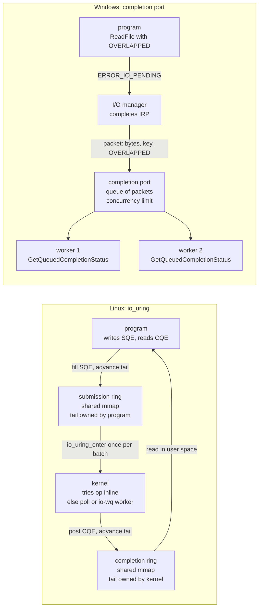

# Module 3.12: io_uring and Windows IOCP

**Estimated hours:** 3

**What you will learn**

1. What a completion model is, and how io_uring's two shared rings let a program submit many I/O requests and collect results with far fewer system calls than epoll plus `read`.
2. How Windows I/O completion ports work: overlapped I/O, a queue of finished operations, and a small pool of threads blocked on that queue.
3. Where each one wins, what each one costs, and what a scaled-up version of the app server would use on Linux and on Windows.

**Prerequisites:** [Module 3.11: I/O models: blocking, non-blocking, select/poll/epoll](module-11-io-models-blocking-to-epoll.md). You need the readiness versus completion distinction and the system-call cost from module 3.07.

---

## 1. One-line intuition

Instead of asking the kernel "is this ready?" and then doing the read yourself, you hand the kernel a stack of orders and it tells you when each one is done.

## 2. Real-life analogy

Go back to the bank branch. In module 3.11 the clerk watched a board of lights (epoll) and, when a customer's light came on, walked over and did the work.

A **completion model** changes the job. The clerk writes each task on a slip ("fetch file 1001 from the archive, put it in tray 7") and drops it into an **in-tray**. Archive staff take slips from the in-tray, do the work in the background, and drop a receipt ("file 1001 is in tray 7, 512 pages") into an **out-tray**. The clerk only ever looks at the out-tray. The clerk never walks to the archive.

- **io_uring** is this with the two trays nailed to the clerk's own desk. The clerk writes slips directly into the in-tray and reads receipts directly from the out-tray. No trip to the manager's office is needed to deliver a slip or collect a receipt; the clerk rings a bell (one system call) only to say "there are new slips", and sometimes not even that.
- **IOCP** (Windows) is this with a single out-tray shared by a small team of clerks. Every finished task lands in that tray. Clerks sit beside it; whenever a receipt appears, one clerk (and only one) picks it up and handles it.

The lights board tells you something *can* be done. The out-tray tells you something *has been* done. That is readiness versus completion.

## 3. Why it exists: the problem it solves

Three problems were left over after epoll.

**Problem 1: system calls per operation.** In module 3.11 you counted four system calls per echoed line: `epoll_wait`, `read`, `write`, and the final `read` that returned `EAGAIN`. Each costs roughly 100 to 300 ns of mode switch plus the work. Since 2018 (the Spectre and Meltdown mitigations) a system call also flushes or isolates parts of the CPU's caches and predictors, so it can cost more. A server doing a million operations a second spends a measurable share of a core just crossing the boundary.

**Problem 2: disk files.** epoll does not work on regular files: a file is always "ready", and the `read` then blocks while the disk works. Linux's older asynchronous file API (`aio_read`, `io_submit`) only worked properly with `O_DIRECT` and was awkward. Databases that wanted true asynchronous disk I/O had to use thread pools to fake it.

**Problem 3: Windows never had epoll.** It had something older and different: I/O completion ports, from 1994, built on the fact that every Windows I/O operation can be issued asynchronously ("overlapped") and told to report completion to a queue.

io_uring (Linux 5.1, 2019, by Jens Axboe) solves problems 1 and 2 with two ring buffers shared between the program and the kernel, so that submitting and completing I/O can need zero copies of the request structures and, in some modes, zero system calls. It works for files, sockets, timers, `accept`, `connect`, `fsync`, `openat` and more.

What breaks without them: servers at the very top end (a database engine's I/O layer, a CDN edge, a storage node) spend their time in the syscall boundary rather than on the work. What breaks *with* them if used carelessly: a much larger attack surface in the kernel, as you will see honestly in Layer 2.

## 4. Three layers of depth

### Layer 1 (beginner): submission ring, completion ring, port

**io_uring in three sentences.** `io_uring_setup` creates two rings in kernel memory and lets you `mmap` them so they are visible in your address space. You write a **submission queue entry (SQE)** describing one operation (opcode, fd, buffer, offset, a user tag) into the submission ring and tell the kernel with `io_uring_enter`. The kernel performs it and writes a **completion queue entry (CQE)** (your tag, a result code) into the completion ring, which you read directly.

The three system calls:

| Call | What it does |
|---|---|
| `io_uring_setup(entries, params)` | Creates the rings, returns an fd for them |
| `io_uring_enter(fd, to_submit, min_complete, flags)` | Tells the kernel new SQEs exist and/or waits for completions |
| `io_uring_register(fd, opcode, ...)` | Pre-registers buffers or files to avoid per-operation lookups |

Nobody calls these directly. **liburing** (`apt install liburing-dev`) wraps them: `io_uring_queue_init`, `io_uring_get_sqe`, `io_uring_prep_read`, `io_uring_submit`, `io_uring_wait_cqe`, `io_uring_cqe_seen`, `io_uring_queue_exit`. Section 6 uses exactly those.

**IOCP in three sentences.** On Windows you open a file or socket with `FILE_FLAG_OVERLAPPED` and attach it to a **completion port** with `CreateIoCompletionPort`. You issue `ReadFile` or `WSARecv` with an `OVERLAPPED` structure; the call returns at once with `ERROR_IO_PENDING` and the kernel does the work. When it is done the kernel queues a completion packet (bytes transferred, your key, your `OVERLAPPED` pointer) to the port, and a worker thread blocked in `GetQueuedCompletionStatus` wakes up holding it.

| Call | What it does |
|---|---|
| `CreateIoCompletionPort(INVALID_HANDLE_VALUE, NULL, 0, threads)` | Creates a port; `threads` = how many may run concurrently (0 = number of CPUs) |
| `CreateIoCompletionPort(handle, port, key, 0)` | Associates a file or socket with the port; `key` comes back with every completion for that handle |
| `ReadFile` / `WriteFile` / `WSARecv` / `WSASend` / `AcceptEx` with an `OVERLAPPED` | Starts an operation; returns `ERROR_IO_PENDING` |
| `GetQueuedCompletionStatus(port, &bytes, &key, &overlapped, timeout)` | Blocks until one completion is available, dequeues it |
| `PostQueuedCompletionStatus` | Lets your own code push a packet, for example "shut down" |

**The one-sentence comparison.** epoll says "fd 5 is readable"; io_uring and IOCP say "your read on fd 5 finished with 512 bytes in your buffer".

### Layer 2 (working engineer): what each saves, what each costs, and the honest parts

**What io_uring saves.**

| Saving | How |
|---|---|
| System calls | One `io_uring_enter` can submit dozens of operations and wait for completions in the same call. With `IORING_SETUP_SQPOLL`, a kernel thread polls the submission ring and you make no system call at all to submit. |
| Copies of request metadata | SQEs and CQEs live in shared memory; the kernel reads them in place |
| Lookups | `io_uring_register` pins buffers (`IORING_REGISTER_BUFFERS`) and files (`IORING_REGISTER_FILES`) so each operation skips the fd-table lookup and page pinning |
| Thread pools for disk I/O | File reads that would block are handed to kernel worker threads automatically; the program never blocks |
| Chaining | `IOSQE_IO_LINK` makes one SQE run after the previous one succeeds, for example `read` then `write` without returning to user space |

**What io_uring costs.**

- **Complexity.** Every operation needs a tag, a buffer that must stay alive until the CQE arrives, and a state machine to continue the work. Cancellation (`IORING_OP_ASYNC_CANCEL`) is a request like any other and may race with completion. This is the same difficulty as any completion model, but it is real.
- **Kernel version.** The feature set grew release by release: multishot accept (5.19), multishot receive (6.0), zero-copy send (6.0), ring-provided buffers, and so on. Code written for 6.x may fail with `EINVAL` on 5.15. Check `io_uring_get_probe` or feature flags at startup.
- **Security.** Be honest about this in interviews. The io_uring code is large, runs with kernel privileges and has had a run of serious bugs. In 2023 Google reported that roughly 60% of the exploits submitted to its kernel bug bounty targeted io_uring, and disabled it on ChromeOS, on Android apps, and on its production servers. Docker's default seccomp profile blocks the three io_uring system calls in recent releases. Linux 6.6 added the `kernel.io_uring_disabled` sysctl (0 = on, 1 = only for processes with `CAP_SYS_ADMIN` or in a named group, 2 = off) so distributions and administrators can turn it off; some hardened builds do. Before choosing io_uring for a product, check whether it is allowed where the product will run.
- **Measurable benefit only at the top end.** For a server doing a few thousand operations a second, the syscall cost epoll pays is noise next to the database round trip. io_uring pays off at hundreds of thousands to millions of operations per second, or when you need genuinely asynchronous disk reads.

**Who uses it.** PostgreSQL 18 (2025) added an `io_method = io_uring` option for its new asynchronous I/O layer, alongside a worker-process method. RocksDB (the engine under YugabyteDB's DocDB) can use it for multi-read. Many high-performance Rust and C++ runtimes have io_uring back ends. For sockets, the common pattern is still epoll because readiness fits sockets well and the deployment risk is lower.

**What IOCP gives you, and the pattern you must follow.**

- A **bounded worker pool**: typically as many threads as CPUs, all blocked in `GetQueuedCompletionStatus`. The port wakes threads in LIFO order, so with light load the same thread keeps running (warm caches) and the others stay asleep. The `NumberOfConcurrentThreads` argument caps how many are *running* at once: if one blocks on something else, the port releases another to keep the CPUs busy.
- Every I/O carries an `OVERLAPPED` block that must live until completion. The idiom is to embed `OVERLAPPED` as the first member of your own per-operation struct, then cast the pointer back when `GetQueuedCompletionStatus` returns it. The completion key, set once per handle, usually points at the per-connection object.
- Completions for one handle can arrive on different threads, so per-connection state needs a lock or a rule that only one operation per connection is in flight. The Win32 synchronisation objects for that are module 4.12.
- There is no readiness mode. If you want "tell me when readable", you post a zero-byte `WSARecv`, which completes when data arrives, and then issue the real read. Also note Winsock's **RIO** (registered I/O, Windows 8+) for the very highest packet rates, and **IoRing** (Windows 11 22H2+), a newer io_uring-style API that at present covers file reads and writes.

**The comparison table.**

| | epoll (Linux) | kqueue (BSD, macOS) | io_uring (Linux) | IOCP (Windows) |
|---|---|---|---|---|
| Year | 2002 | 2000 | 2019 | 1994 |
| Model | Readiness | Readiness | Completion | Completion |
| Works on regular files | No (always ready) | Partly (vnode events, not async read) | Yes | Yes (overlapped `ReadFile`) |
| Sockets, timers, signals, processes | Sockets, pipes; timers and signals via `timerfd`, `signalfd` | All of them natively | All of them, plus `openat`, `fsync`, `accept` | Sockets, files, named pipes; timers via other APIs |
| Syscalls per operation | At least two (`epoll_wait` plus the `read`) | At least two | Can be below one with batching; zero with `SQPOLL` | One to issue, shared `GetQueuedCompletionStatus` to collect |
| Who does the copy into your buffer | Your `read` | Your `read` | The kernel, into the buffer you gave in the SQE | The kernel, into the buffer in the overlapped call |
| Thread model | One or a few reactor threads plus a work pool | Same | Any; one ring per thread is common | A small pool blocked on the port |
| Buffer lifetime rule | Only during your `read` | Same | Must stay valid until the CQE | Must stay valid until the completion packet |
| Deployment risk | Very low | Very low | Check kernel version and whether it is disabled | None; it is the native model |

### Layer 3 (internals): the rings and the port

**The two rings.** `io_uring_setup` allocates, in kernel memory, an array of SQEs, an array of CQEs, and two sets of head and tail indices. `mmap` of the ring fd at fixed magic offsets (`IORING_OFF_SQ_RING`, `IORING_OFF_CQ_RING`, `IORING_OFF_SQES`) maps them into the process. Each ring is a classic single-producer, single-consumer circular buffer: for the submission ring the program is the producer and owns the tail, the kernel is the consumer and owns the head; for the completion ring the roles are reversed. Updating a tail is a store with release ordering; reading it is a load with acquire ordering (module 4.07 covers these words). Because each index is written by exactly one side, no lock is needed. That is the whole trick: the same memory is a queue in both directions with no copying and no locking.

**Submitting.** liburing's `io_uring_get_sqe` returns a pointer to the next free SQE slot. `io_uring_prep_read` fills in `opcode = IORING_OP_READ`, the fd, the buffer address, length, offset and your `user_data`. `io_uring_submit` publishes the new tail and calls `io_uring_enter` once for all pending SQEs. Inside the kernel, `io_submit_sqes` walks the new entries. For each it tries the operation immediately, non-blocking: a socket with data or a file in the page cache completes right there and the CQE is posted before `io_uring_enter` returns. If the operation would block, it is either armed with a poll-style callback (sockets: the kernel waits for readiness internally and then does the read itself) or handed to an `io-wq` kernel worker thread (regular file reads that miss the cache, `fsync`). When it finishes, the kernel writes the CQE and advances the completion tail.

**Waiting.** `io_uring_wait_cqe` first checks the completion ring in user space; if a CQE is already there, it returns without any system call. Only if the ring is empty does it call `io_uring_enter` with `IORING_ENTER_GETEVENTS` and sleep. `io_uring_cqe_seen` advances the completion head so the slot can be reused. With `SQPOLL`, a kernel thread spins on the submission ring for a while after each submission, so the program never calls `io_uring_enter` to submit at all; the price is one core kept busy.

**IOCP inside.** A completion port is a kernel object (module 3.13) wrapping a queue (`KQUEUE`) of completion packets plus a list of waiting threads. Associating a file handle with the port stores a pointer to the port in the file object. When any I/O request packet (IRP) for that file completes, the I/O manager, instead of (or as well as) signalling the file handle, allocates a completion packet containing the bytes transferred, the status, the completion key and the `OVERLAPPED` pointer, and inserts it into the port's queue. `GetQueuedCompletionStatus` is a wait on that queue. The scheduler tracks how many threads released by this port are currently running; if the count is at the concurrency limit, further packets wait even though threads are available, and if a running thread blocks on something else, the kernel notices and releases one more. That accounting is what makes IOCP a *concurrency-controlled* pool rather than just a queue, and it is why the Windows thread pool API (`CreateThreadpoolIo`) is built on top of it.

**Why they match in spirit.** Both io_uring and IOCP move the "do the read" step into the kernel and report a finished result with the user's own tag. The differences are mechanical: io_uring uses shared memory rings and batches, IOCP uses a kernel queue and a blocking dequeue call. epoll and kqueue, by contrast, leave the read to you.

## 5. Architecture diagram



On the left the program and kernel share two ring buffers; on the right the kernel owns a queue and threads block on it. Both deliver "finished" rather than "ready".

## 6. Code

A minimal liburing program that reads the first 4 KB of a file asynchronously. It submits the read, prints a line while the kernel works, then waits for the completion and prints what came back. It needs `liburing-dev`.

```bash
sudo apt install -y liburing-dev
```

```c
/* uring_read.c: read a file asynchronously with io_uring via liburing.
 * Build: gcc -std=gnu17 -Wall -Wextra -Werror -g -o uring_read uring_read.c -luring
 * Run  : ./uring_read /etc/hostname
 */
#include <fcntl.h>
#include <liburing.h>
#include <stdio.h>
#include <string.h>
#include <unistd.h>

struct request {            /* our per-operation state; its address is the tag */
    int   id;
    char  buf[4096];
};

int main(int argc, char **argv) {
    if (argc != 2) { fprintf(stderr, "usage: %s <file>\n", argv[0]); return 1; }

    int fd = open(argv[1], O_RDONLY);
    if (fd == -1) { perror("open"); return 1; }

    /* 1. Create the rings: 8 submission slots. The kernel allocates them and
     *    liburing mmaps them into this process. */
    struct io_uring ring;
    int rc = io_uring_queue_init(8, &ring, 0);
    if (rc < 0) {
        fprintf(stderr, "io_uring_queue_init: %s\n", strerror(-rc));
        return 1;   /* ENOSYS: kernel without io_uring; EPERM: disabled by policy */
    }

    /* 2. Fill one submission queue entry: "read up to 4095 bytes from fd at
     *    offset 0 into req.buf, and give me back the pointer req as the tag". */
    struct request req = { .id = 42 };
    struct io_uring_sqe *sqe = io_uring_get_sqe(&ring);
    if (sqe == NULL) { fprintf(stderr, "submission ring full\n"); return 1; }
    io_uring_prep_read(sqe, fd, req.buf, sizeof req.buf - 1, 0);
    io_uring_sqe_set_data(sqe, &req);

    /* 3. One system call submits everything queued so far. */
    rc = io_uring_submit(&ring);
    if (rc < 0) { fprintf(stderr, "io_uring_submit: %s\n", strerror(-rc)); return 1; }
    printf("submitted %d request(s); kernel is reading while we print this\n", rc);

    /* 4. Wait for a completion. If the CQE is already in the shared ring this
     *    returns without entering the kernel at all. */
    struct io_uring_cqe *cqe;
    rc = io_uring_wait_cqe(&ring, &cqe);
    if (rc < 0) { fprintf(stderr, "io_uring_wait_cqe: %s\n", strerror(-rc)); return 1; }

    struct request *done = io_uring_cqe_get_data(cqe);   /* our tag comes back */
    if (cqe->res < 0) {
        fprintf(stderr, "read failed: %s\n", strerror(-cqe->res));
    } else {
        done->buf[cqe->res] = '\0';
        printf("completion for request %d: %d bytes\n", done->id, cqe->res);
        printf("first line: %.*s\n", (int)strcspn(done->buf, "\n"), done->buf);
    }
    io_uring_cqe_seen(&ring, cqe);   /* 5. hand the CQE slot back to the kernel */

    io_uring_queue_exit(&ring);
    close(fd);
    return 0;
}
```

Compile and run:

```bash
gcc -std=gnu17 -Wall -Wextra -Werror -g -o uring_read uring_read.c -luring
./uring_read /etc/hostname
```

Expected output (your hostname differs; the byte count is its length plus the newline):

```text
submitted 1 request(s); kernel is reading while we print this
completion for request 42: 10 bytes
first line: DESKTOP-X1
```

Now watch the system calls:

```bash
strace -e trace=io_uring_setup,io_uring_enter,mmap,read ./uring_read /etc/hostname 2>&1 | grep -v "mmap(NULL, .*PROT_READ, MAP_PRIVATE"
```

Expected: one `io_uring_setup(8, ...)`, three `mmap` calls on the ring fd (the SQ ring, the CQ ring, the SQE array), one `io_uring_enter(3, 1, 0, 0, NULL, 8)` for the submit, and either no second `io_uring_enter` (the read of a cached file completed inline, so the CQE was already there) or one with `IORING_ENTER_GETEVENTS`. There is **no** `read` system call anywhere: the kernel did the read. If `io_uring_queue_init` fails with `Operation not permitted`, your environment has io_uring disabled by policy (Layer 2); the standard WSL2 kernel allows it.

## 7. Use case: core-banking loan-origination platform

The production application server from claim H4 ran as a Win32 process (module 3.13), and the course's C2 Win32 variant of its synchronisation layer uses threads, critical sections and wait objects (module 4.12) over blocking sockets with a fixed pool. For its scale, a few thousand terminals and database-bound requests, that was the right choice, as module 3.11 argued.

This module is about the question an interviewer asks next: "What would you do if it had to scale ten times?" The team had an answer written down, and it drove one decision early.

**The decision:** keep every request handler free of thread-affinity assumptions, so the server could move from "one pooled thread handles a request end to end" to "any worker thread may continue a request after a completion" without rewriting business logic. Concretely: no `thread_local` request state, no "the thread that read the request writes the reply" rule, request context in a heap object passed by pointer. The reason was IOCP. On Windows the scaled-up design would be: listening socket and every client socket associated with one completion port; `AcceptEx` and `WSARecv` issued overlapped; a worker pool of CPU-count threads in `GetQueuedCompletionStatus`; the completion key pointing at the per-connection object; database calls still performed by a separate bounded pool so the I/O workers never block. The equivalent on Linux would be an epoll reactor, or io_uring with multishot `accept` and `recv` if the kernel and the deployment policy allowed it. Because the handlers did not care which thread ran them, that migration was a change to the I/O layer only.

The same consideration applies on the storage side: YugabyteDB's DocDB is built on RocksDB, and PostgreSQL 18 offers `io_method = io_uring`. When the team tuned the cluster, the database engine's I/O method was a configuration choice they had to understand, not a mystery.

## 8. Lab

### Part A: run and trace the io_uring program (30 minutes)

1. Install `liburing-dev`, build and run the program from section 6 on `/etc/hostname` and then on a larger file such as `/usr/share/dict/words` (install `wamerican` if missing) or any text file. Confirm the byte count is 4095 for a large file: that is the buffer limit, not the file size.
2. Run the `strace` command from section 6. Count the `io_uring_enter` calls. Write down whether the completion needed a second `io_uring_enter` or was already in the ring.
3. Run `uname -r` and note your WSL2 kernel version. Run `sysctl kernel.io_uring_disabled 2>/dev/null || echo "sysctl not present (kernel older than 6.6)"`. Record the result.

Expected: a cached small file usually completes inline, so you see one `io_uring_enter`. A large file read for the first time may be handed to an `io-wq` worker and need the second call.

### Part B: batch several reads in one submit (40 minutes)

1. Copy `uring_read.c` to `uring_batch.c`. Change it to take up to 4 file names, create one `struct request` per file, prepare one SQE per file, and call `io_uring_submit` once. Then loop `io_uring_wait_cqe` four times, printing which request (by `id`) completed and in what order.
2. Run with `./uring_batch /etc/hostname /etc/os-release /etc/passwd /etc/hosts` under `strace -e trace=io_uring_enter`.

Expected: `submitted 4 request(s)` and a single `io_uring_enter(..., 4, ...)`. Four reads, one system call. Completions may arrive in any order; that is the point of tagging each one.

### Part C: IOCP on Windows (45 minutes)

Open the Developer Command Prompt and save this as `iocp_read.cpp`:

```cpp
// iocp_read.cpp: read a file with overlapped I/O and a completion port.
// Build: cl /W4 /EHsc /Zi iocp_read.cpp
// Run  : iocp_read.exe C:\Windows\win.ini
#include <windows.h>
#include <cstdio>
#include <cstring>

int main(int argc, char** argv) {
    if (argc != 2) { std::printf("usage: iocp_read <file>\n"); return 1; }

    // 1. Open with FILE_FLAG_OVERLAPPED so ReadFile may return before finishing.
    HANDLE file = CreateFileA(argv[1], GENERIC_READ, FILE_SHARE_READ, nullptr,
                              OPEN_EXISTING, FILE_FLAG_OVERLAPPED, nullptr);
    if (file == INVALID_HANDLE_VALUE) {
        std::printf("CreateFile failed, error %lu\n", GetLastError());
        return 1;
    }

    // 2. Create a port and associate the file with it. Key 7 comes back with
    //    every completion for this handle.
    HANDLE port = CreateIoCompletionPort(file, nullptr, 7, 0);
    if (port == nullptr) {
        std::printf("CreateIoCompletionPort failed, error %lu\n", GetLastError());
        return 1;
    }

    // 3. Issue the read. The OVERLAPPED block must outlive the operation.
    char buf[4096];
    OVERLAPPED ov = {};
    ov.Offset = 0;                       // file offset lives in the OVERLAPPED
    BOOL ok = ReadFile(file, buf, sizeof buf - 1, nullptr, &ov);
    if (!ok && GetLastError() != ERROR_IO_PENDING) {
        std::printf("ReadFile failed, error %lu\n", GetLastError());
        return 1;
    }
    std::printf("read issued (%s); waiting on the port\n",
                ok ? "completed synchronously" : "pending");

    // 4. Block until the completion packet arrives. In a server this loop runs
    //    in each of a few worker threads.
    DWORD bytes = 0;
    ULONG_PTR key = 0;
    LPOVERLAPPED done = nullptr;
    if (!GetQueuedCompletionStatus(port, &bytes, &key, &done, INFINITE)) {
        std::printf("I/O failed, error %lu\n", GetLastError());
        return 1;
    }
    buf[bytes] = '\0';
    std::printf("completion: key=%llu bytes=%lu overlapped=%p\n",
                static_cast<unsigned long long>(key), bytes, static_cast<void*>(done));
    std::printf("first line: %.*s\n",
                static_cast<int>(strcspn(buf, "\r\n")), buf);

    CloseHandle(port);
    CloseHandle(file);
    return 0;
}
```

```bat
cl /W4 /EHsc /Zi iocp_read.cpp
iocp_read.exe C:\Windows\win.ini
```

Expected output (the overlapped address varies; whether the read reports "completed synchronously" or "pending" depends on whether the file was already in the cache, and the completion packet is queued either way):

```text
read issued (completed synchronously); waiting on the port
completion: key=7 bytes=92 overlapped=000000A1B2C3D4E8
first line: ; for 16-bit app support
```

The `OVERLAPPED` pointer that came back is the address of `ov`. In a real server you embed `OVERLAPPED` as the first field of a per-operation struct and cast the pointer back to recover your state. Try it: wrap `ov` and `buf` in a `struct Op { OVERLAPPED ov; char buf[4096]; int id; };` and recover `id` from `done`.

### Part D: decide (15 minutes)

Write a half-page answer to: "tcpkv currently uses a fixed thread pool with blocking reads. Under what measured conditions would you move it to epoll, and under what further conditions to io_uring? What would you check about the deployment before choosing io_uring?" Use numbers from your own module 3.11 lab.

### Journal

Copy [journal/TEMPLATE.md](../journal/TEMPLATE.md) to `journal/YYYY-MM-DD-io-uring-and-iocp.md`. Record: the kernel version and `io_uring_disabled` value, the `io_uring_enter` count for one read and for the batch of four, the IOCP output including whether the read completed synchronously, and your Part D answer.

## 9. Common mistakes and misconceptions

| Mistake | Why it is wrong | Bug it causes later |
|---|---|---|
| "io_uring is just a faster epoll" | It is a different model: completion, with the kernel doing the read into your buffer | Designs that still call `read` after a completion, or reuse buffers too early |
| Freeing or reusing a buffer before its CQE or completion packet arrives | The kernel is still writing into it | Memory corruption that appears only under load; the classic completion-model bug |
| Losing the tag (`user_data`, `OVERLAPPED` pointer) | Completions can arrive in any order; the tag is the only link to your state | Replies sent to the wrong connection |
| Assuming io_uring is available | Older kernels lack features; some platforms disable it by policy | `ENOSYS`, `EINVAL` or `EPERM` only in production |
| Blocking inside an IOCP worker (database call, `Sleep`) | The port's concurrency accounting releases another thread, but the pool is small and soon all are blocked | Throughput collapse under load |
| Putting `OVERLAPPED` on the stack of a function that returns before completion | The kernel writes to a dead stack frame | Random stack corruption |
| Ignoring the security history | io_uring has been a major source of kernel exploits; disabled on several platforms | A product that cannot be deployed where the customer runs it |
| Choosing io_uring or IOCP for a database-bound server | The syscall savings are noise next to the database round trip | Complexity with no measured gain |

## 10. Resume link

- **Claim H4, "multithreaded application server ... Win32".** The follow-up "how would it scale?" is answered with section 7: a completion port with CPU-count workers, overlapped `AcceptEx` and `WSARecv`, per-connection objects as completion keys, and a separate bounded pool for database calls. Say also why the current design did not need it: database-bound requests, a few thousand terminals.
- **Claim C, "Win32 synchronisation (critical sections, wait objects)".** `GetQueuedCompletionStatus` is itself a wait object in the Windows sense, and the port's concurrency limit is a scheduler feature. Mentioning this shows you understand the platform rather than one API.
- **Claim E, "server architectures".** You can now place four APIs in one sentence: "epoll and kqueue are readiness; io_uring and IOCP are completion; the first pair leaves the copy to you, the second pair does it in the kernel and returns a tag."
- **Claim D, "PostgreSQL ... storage engines".** PostgreSQL 18's `io_method` setting and RocksDB's io_uring support are examples you can cite to show you follow where database I/O layers are going, and the honesty about kernel version and security shows judgement.

## 11. Interview questions

**Q1 (easy). What is the difference between a readiness model and a completion model?**

<details>
<summary>Model answer</summary>

A readiness model (epoll, kqueue, poll) tells you that an operation on a descriptor would now not block; you then perform the read or write yourself. A completion model (io_uring, IOCP) has you submit the operation with a buffer and a tag up front; the kernel performs it, and tells you afterwards that it finished, with the result and the tag. Completion suits disk files and large transfers because the kernel can do the work asynchronously; readiness suits sockets, where the data is already in a kernel buffer and the copy is cheap.

</details>

**Q2 (easy). What are the two rings in io_uring and who writes to each?**

<details>
<summary>Model answer</summary>

The submission ring holds submission queue entries describing operations; the program writes entries and advances its tail, the kernel consumes from the head. The completion ring holds completion queue entries with a result and the user's tag; the kernel writes and advances its tail, the program consumes from the head. Both are mapped into the process with `mmap`, so a submission or completion is a memory write, not a copy through a system call. `io_uring_enter` is used to tell the kernel about new entries and, optionally, to wait for completions.

</details>

**Q3 (medium). How does an I/O completion port control concurrency, and why does that matter?**

<details>
<summary>Model answer</summary>

When created, the port is given a maximum number of concurrently running threads, typically the CPU count. Worker threads block in `GetQueuedCompletionStatus`. When a packet arrives, the port releases one thread in LIFO order, so under light load the same warm thread keeps working. If the number of running threads released by the port is at the limit, further packets wait even though other threads are available, which keeps the CPUs from being oversubscribed. If a running thread blocks on something else, the kernel notices the running count dropped and releases another thread. This gives a self-regulating pool: enough threads to keep every core busy, not so many that they thrash. The practical rule is never to block for long inside a worker, because the pool is small.

</details>

**Q4 (medium). Why would a team choose not to use io_uring even though it is faster?**

<details>
<summary>Model answer</summary>

Three reasons. Deployment: the kernel may be too old for the features used, and io_uring may be disabled by policy, since Google turned it off on ChromeOS, Android and its servers after most kernel bug-bounty exploits targeted it, Docker's default seccomp profile blocks it, and Linux 6.6 added `kernel.io_uring_disabled` for administrators. Complexity: buffers must outlive operations, completions arrive out of order, and cancellation is asynchronous, so the code is a state machine with more ways to be wrong. Benefit: the saving is system calls per operation, which only matters at hundreds of thousands of operations per second or for true asynchronous disk I/O; a database-bound request server gains nothing measurable. I would choose it only with a measurement showing the syscall boundary is the bottleneck and a deployment check that it is permitted.

</details>

**Q5 (hard). Design the I/O layer of a Windows application server that must hold 50,000 mostly idle client connections and make a database call per request. Name the APIs, the thread counts, and the two bugs you would guard against.**

<details>
<summary>Model answer</summary>

One completion port created with concurrency equal to the CPU count, and a worker pool of about twice that many threads blocked in `GetQueuedCompletionStatus` (the extra threads cover short blocking moments). The listening socket uses `AcceptEx` with several accepts posted in advance; each accepted socket is associated with the port with its per-connection object as the completion key. Each connection keeps one `WSARecv` outstanding with a buffer inside a per-operation struct whose first member is `OVERLAPPED`. Idle connections cost only that struct and a kernel socket, so 50,000 is fine. When a request completes, the worker parses it and hands the database call to a separate bounded pool sized to the cluster's comfortable concurrency, posting the reply back with `WSASend` when it returns, so port workers never block on the database. Shutdown is a `PostQueuedCompletionStatus` with a special key. The two bugs: first, buffer lifetime, where an `OVERLAPPED` or buffer is freed before the completion arrives, which corrupts memory silently; I would make the per-operation struct reference-counted and release it only when the packet comes back. Second, concurrent completions for one connection on two workers; I would allow only one receive and one send in flight per connection and protect its state with a critical section or SRW lock. On Linux the same design would be an epoll reactor with a worker pool, or io_uring with multishot accept and receive where permitted.

</details>

## 12. Revision

- io_uring: two mmap'ed rings, SQEs in and CQEs out, one `io_uring_enter` per batch or none with `SQPOLL`; the kernel does the read into your buffer and returns your tag; works for files, sockets, timers and more; check kernel version and whether policy disables it.
- IOCP: open overlapped, associate with a port, issue `ReadFile`/`WSARecv`, block CPU-count workers in `GetQueuedCompletionStatus`; the port's concurrency limit keeps cores busy without thrashing; it is Windows' native scalable model and is completion-based like io_uring.
- epoll and kqueue are readiness, io_uring and IOCP are completion; buffers must outlive completions; a database-bound server gains nothing from either, so the app server and tcpkv keep their blocking pools and know what a scaled-up version would use.

---

Previous: [Module 3.11: I/O models: blocking, non-blocking, select/poll/epoll](module-11-io-models-blocking-to-epoll.md) | Next: [Module 3.13: Windows internals and the Win32 API](module-13-windows-internals-and-win32.md)
